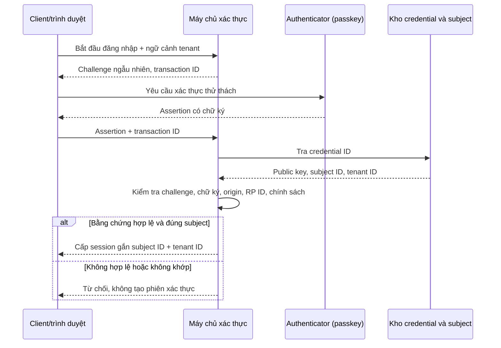

# Đảm bảo đúng chủ thể

Một hệ thống có thể kiểm tra mật khẩu đúng, nhận được mã OTP hợp lệ hoặc xác minh một chữ ký số thành công, nhưng vẫn đăng nhập **nhầm tài khoản** nếu ánh xạ bằng chứng sang danh tính bị sai. Mục tiêu cốt lõi của xác thực (authentication) là: **chỉ công nhận yêu cầu là của một chủ thể cụ thể khi có bằng chứng đủ tin cậy, đúng ngữ cảnh và còn hiệu lực để gắn yêu cầu đó với chủ thể ấy**.

Trong phạm vi nền tảng bảo mật và xác thực danh tính, “đúng chủ thể” không chỉ là bước kiểm tra credential khi đăng nhập. Tính đúng đắn phải được duy trì từ lúc người dùng khai báo danh tính, chứng minh quyền kiểm soát yếu tố xác thực, hệ thống tạo phiên/token, cho đến lúc dịch vụ phía sau sử dụng danh tính đó. Việc thêm yếu tố MFA, dùng passkey, liên kết nhà cung cấp danh tính hay khôi phục tài khoản đều phải bảo toàn cùng nguyên tắc này.

## 1. Hiểu “chủ thể” và “đúng” đến mức nào

**Chủ thể (subject/principal)** là thực thể mà hệ thống gán danh tính và quyền thực hiện hành động: người dùng, tài khoản dịch vụ, workload hoặc thiết bị. Đối với một ứng dụng phục vụ người dùng, hệ thống thường xác thực **tài khoản** và chủ thể nội bộ tương ứng. Nó không mặc nhiên chứng minh người trước màn hình chính là một cá nhân ngoài đời thực.

| Khái niệm | Vai trò | Ví dụ |
| --- | --- | --- |
| Danh tính được khai báo (claimed identity) | Chủ thể mà bên yêu cầu muốn được công nhận | “Tôi đăng nhập tài khoản của An” |
| Định danh ổn định (subject ID) | Khóa phân biệt tài khoản trong phạm vi xác định | `user_42` trong tenant `org_a` |
| Credential | Thông tin/khóa dùng làm căn cứ xác thực | Mật khẩu, khóa riêng của passkey, chứng chỉ client |
| Authenticator | Cơ chế hoặc thiết bị giúp chứng minh quyền kiểm soát credential | Trình quản lý passkey, khóa bảo mật, ứng dụng OTP |
| Verifier | Thành phần kiểm tra bằng chứng | Máy chủ xác thực hoặc dịch vụ danh tính |
| Phiên/token | Cách mang kết quả xác thực sang các yêu cầu tiếp theo | Session cookie, access token |

Một xác thực thành công cần trả lời chính xác bốn câu hỏi:

1. **Ai đang được yêu cầu công nhận?** Hệ thống xác định tài khoản nào, thuộc tổ chức/tenant nào và nhà cung cấp danh tính nào.
2. **Bằng chứng thuộc về ai?** Credential được đăng ký hoặc được liên kết hợp lệ với đúng chủ thể đó hay không.
3. **Bằng chứng có áp dụng cho lần xác thực này không?** Nó còn hạn, chưa bị dùng lại và được tạo cho đúng máy chủ, ứng dụng, ngữ cảnh đăng nhập hay không.
4. **Kết quả có được giữ nguyên không?** Phiên, token và các dịch vụ tiếp theo có đang xử lý cùng chủ thể đã được kiểm chứng hay không.

Ví dụ: hai tổ chức có tài khoản mang email `an@example.com`. Email đó là thuộc tính hiển thị hoặc liên hệ, **không đủ** để chọn một chủ thể duy nhất trên toàn hệ thống. Cặp `(tenant_id, user_id)` mới là căn cứ định danh nội bộ nếu ứng dụng thiết kế ID theo phạm vi tenant. Với đăng nhập liên kết qua OpenID Connect (OIDC), cặp `(iss, sub)` của nhà cung cấp danh tính là nền tảng để ánh xạ tới tài khoản nội bộ; không được tự động gộp hai tài khoản chỉ vì trường `email` trùng nhau.

### Phân biệt ba việc thường bị nhầm

- **Identity proofing — xác minh danh tính ngoài đời:** kiểm tra thông tin, giấy tờ hoặc quy trình để liên hệ một tài khoản với cá nhân/tổ chức thực. Mức độ xác minh phụ thuộc nghiệp vụ.
- **Authentication — xác thực:** kiểm tra yêu cầu hiện tại có bằng chứng cho thấy bên yêu cầu kiểm soát authenticator/credential gắn với một chủ thể hay không.
- **Authorization — phân quyền:** sau khi biết chủ thể là ai, xác định chủ thể đó có được xem hồ sơ, duyệt thanh toán hoặc gọi API cụ thể hay không.

Đăng nhập thành công không đồng nghĩa người dùng có mọi quyền, và sở hữu credential không nhất thiết chứng minh danh tính pháp lý. Nếu credential bị đánh cắp, thiết bị bị chiếm quyền hoặc tài khoản được chia sẻ, hệ thống có thể nhận được bằng chứng kỹ thuật hợp lệ nhưng người sử dụng thực tế không phải chủ tài khoản mong muốn. Vì vậy phải kết hợp xác thực với phòng chống chiếm đoạt credential, phát hiện bất thường và quản lý vòng đời tài khoản.

## 2. Các bất biến bảo mật cần giữ

Một thiết kế xác thực hướng tới “đúng chủ thể” nên duy trì các bất biến sau:

| Bất biến | Ý nghĩa thực tế | Hỏng thì điều gì xảy ra? |
| --- | --- | --- |
| **Ánh xạ danh tính chính xác** | Credential và kết quả từ IdP chỉ trỏ đến đúng subject trong đúng tenant | Đăng nhập nhầm tài khoản, lẫn dữ liệu giữa tổ chức |
| **Bằng chứng được xác minh** | Verifier kiểm tra mật khẩu/chữ ký/chứng chỉ/MFA theo chính sách, không tin dữ liệu do client tự khai | Kẻ tấn công tự gán `userId` hoặc giả mạo trạng thái đã MFA |
| **Tính mới và ràng buộc ngữ cảnh** | Thử thách, chữ ký, assertion hoặc token chỉ dùng đúng thời điểm, đúng đích và đúng luồng | Replay, phishing, dùng nhầm token của ứng dụng khác |
| **Liên tục từ xác thực sang phiên** | Phiên/token được cấp cho subject thực sự đã xác thực; các request sau lấy subject từ kết quả tin cậy này | Session fixation, đổi tài khoản hoặc leo quyền qua tham số người dùng |
| **Quản lý thay đổi credential an toàn** | Đăng ký MFA, liên kết IdP, đổi passkey, recovery đều bảo vệ cùng chủ thể | Kẻ tấn công chiếm tài khoản qua luồng khôi phục yếu |

Các bất biến là thuộc tính **đầu cuối**. Một bước xác minh mật khẩu đúng không thể bù cho việc server gán phiên cho tài khoản khác sau đó.

## 3. Ranh giới tin cậy trong một luồng đăng nhập

Xét ứng dụng có passkey. Trình duyệt và các tham số do client gửi là đầu vào **chưa được tin cậy**; kho đăng ký credential, bộ xác minh và kho phiên là phía máy chủ có trách nhiệm đưa ra quyết định.



Luồng này có những điểm quyết định:

1. **Bắt đầu giao dịch:** máy chủ phát sinh challenge bằng nguồn ngẫu nhiên mật mã, đặt thời hạn và giữ trạng thái giao dịch. Nếu đã chọn tài khoản trước, lưu subject được kỳ vọng trong trạng thái phía máy chủ; nếu dùng passkey có thể khám phá tài khoản, xác định subject qua credential đã đăng ký sau khi kiểm chứng.
2. **Nhận bằng chứng:** client chỉ chuyển assertion. Trường `userId`, tên hay email do client gửi không tự tạo ra quyền đăng nhập.
3. **Tra cứu ràng buộc credential:** hệ thống lấy public key và chủ thể sở hữu credential từ bản ghi được quản lý, kiểm tra tenant và trạng thái credential (đang hoạt động, đã thu hồi hay chưa).
4. **Xác minh bằng thư viện đáng tin cậy:** kiểm tra chữ ký, challenge gắn giao dịch, origin, RP ID, cờ user presence và user verification theo chính sách. Giao dịch hết hạn hoặc đã dùng phải bị từ chối.
5. **Phát hành kết quả:** chỉ sau khi toàn bộ kiểm tra đạt, máy chủ cấp một phiên mới gắn với subject/tenant đã được xác minh, lưu thời điểm và phương pháp xác thực. Các API dùng subject lấy từ phiên/token đáng tin cậy.

Với mật khẩu và OTP, bằng chứng khác nhau nhưng nguyên tắc giống nhau: phải đối chiếu credential với đúng tài khoản; bảo vệ OTP khỏi bị thử đoán, phát lại hoặc chuyển tiếp; tránh để kết quả MFA của tài khoản A được áp dụng sang phiên của tài khoản B. OTP có thể bị lừa nhập vào trang giả mạo; passkey theo WebAuthn có ràng buộc với RP/origin nên giúp chống phishing tốt hơn trong các luồng được triển khai đúng.

### Pseudocode: gắn assertion vào đúng chủ thể

Đoạn dưới chỉ mô tả thứ tự kiểm tra, **không phải mã WebAuthn hoàn chỉnh**. Triển khai thực tế cần thư viện WebAuthn được duy trì, quản lý giao dịch chống replay, giới hạn tốc độ và xử lý lỗi an toàn.

```ts
// Pseudocode ở phía server, các thao tác verify do thư viện uy tín cung cấp.
function finishPasskeyLogin(transactionId, assertion) {
  const tx = pendingLogins.consumeOnce(transactionId);
  if (!tx || tx.expiresAt <= now()) return deny();

  const credential = credentialStore.find(assertion.credentialId);
  if (!credential || credential.revoked) return deny();
  if (credential.tenantId !== tx.tenantId) return deny();
  if (tx.expectedSubjectId && credential.subjectId !== tx.expectedSubjectId) {
    return deny();
  }

  const result = trustedWebAuthnLibrary.verifyAssertion({
    assertion,
    publicKey: credential.publicKey,
    expectedChallenge: tx.challenge,
    expectedOrigin: tx.origin,
    expectedRpId: tx.rpId,
    requireUserPresence: true,
    requireUserVerification: tx.requireUserVerification,
  });
  if (!result.valid) return deny();

  const session = sessionStore.create({
    subjectId: credential.subjectId,
    tenantId: credential.tenantId,
    authenticatedAt: now(),
    method: "passkey",
  });
  return issueSecureSessionCookie(session);
}
```

**Chỗ dễ sai:** thay `credential.subjectId` bằng `request.body.userId`, tin `isAuthenticated: true` từ client, hoặc tạo phiên trước khi kiểm tra bằng chứng. Một lỗi ánh xạ nhỏ có thể phá hỏng mục tiêu dù phép kiểm tra chữ ký hoàn toàn đúng.

## 4. Giữ đúng chủ thể sau khi xác thực

Yêu cầu đăng nhập chỉ là điểm khởi đầu. Sau đó, subject phải đi qua nhiều ranh giới tin cậy.

**Phiên phía server.** Session ID cần khó đoán, cấp mới sau đăng nhập hoặc thay đổi đặc quyền, có hạn sử dụng và khả năng thu hồi. Với ứng dụng web, cookie chứa session ID nên dùng `Secure`, `HttpOnly` và chính sách `SameSite` phù hợp; các thao tác thay đổi trạng thái vẫn cần bảo vệ CSRF theo kiến trúc thực tế. Không lấy `subjectId` từ URL/query/body để thay cho subject đã gắn trong phiên. Logout, khóa tài khoản hoặc thu hồi credential cần có chính sách xử lý phiên còn hiệu lực.

**Access token.** API phải xác minh chữ ký (hoặc trạng thái token mờ), thuật toán/khóa được cho phép, `iss`, `aud`, thời hạn và những ràng buộc thích hợp. `sub` chỉ có ý nghĩa trong phạm vi issuer và loại token được chấp nhận. Không dùng ID token như access token cho API; không nhận token cấp cho dịch vụ khác. Sau khi xác minh, ánh xạ subject vào principal nội bộ rõ ràng, bao gồm tenant nếu ứng dụng đa tổ chức.

**Đăng nhập qua IdP/OIDC.** Khi ứng dụng nhận danh tính từ nhà cung cấp bên ngoài, phải xác minh kết quả của đúng phiên đăng nhập đã khởi tạo (ví dụ `state`, `nonce`, PKCE khi phù hợp với luồng), kiểm tra issuer và audience, rồi ánh xạ `(iss, sub)` tới tài khoản nội bộ. Email, tên hiển thị hoặc avatar có thể thay đổi và không phải khóa liên kết an toàn. Thao tác **liên kết thêm** một danh tính bên ngoài vào tài khoản hiện có phải yêu cầu xác thực đủ mạnh của tài khoản đích; không tự động liên kết chỉ vì email trùng.

**Dịch vụ phía sau.** Nếu API gateway truyền subject qua header nội bộ, dịch vụ nhận chỉ được tin header từ gateway đã xác thực và có bảo vệ kênh; phải chặn việc client trực tiếp tự đặt header đó. Trước khi trả tài nguyên, lớp phân quyền vẫn phải kiểm tra tài nguyên thuộc subject/tenant được yêu cầu và quyền tương ứng.

## 5. Những tình huống làm hệ thống công nhận sai chủ thể

| Tình huống | Lỗi cốt lõi | Kiểm soát nên có |
| --- | --- | --- |
| Hai tài khoản cùng email ở hai tenant | Ánh xạ subject chỉ theo email | Khóa subject theo phạm vi issuer/tenant; giữ tenant xuyên suốt phiên |
| Người dùng nhập OTP trên trang giả rồi kẻ tấn công chuyển tiếp | Bằng chứng bị phishing và dùng trong phiên của kẻ tấn công | Ưu tiên passkey/WebAuthn chống phishing, chống replay và giám sát đăng nhập rủi ro |
| Kẻ tấn công gửi lại assertion/token cũ | Thiếu challenge, thời hạn, audience hoặc chống sử dụng lại | Challenge ngẫu nhiên có hạn, giao dịch một lần; xác minh `exp`, `aud`, `iss` và các ràng buộc liên quan |
| Đăng nhập tài khoản A nhưng response tự gán `userId` của B | Tin subject do client gửi hoặc lỗi ánh xạ | Chỉ lấy subject từ credential/IdP đã được xác minh và bản ghi máy chủ |
| Attacker cố định session ID trước đăng nhập | Session fixation | Đổi session ID khi chuyển từ ẩn danh sang đã xác thực; quản lý cookie chặt chẽ |
| Khôi phục mật khẩu bằng câu hỏi bảo mật yếu | Recovery vượt qua mức bảo vệ của đăng nhập thường | Recovery nhiều bước theo mức rủi ro, kiểm tra kênh/thiết bị, cảnh báo và thu hồi phiên khi cần |
| Tài khoản dùng chung cho cả nhóm | Một credential đại diện nhiều người | Tài khoản riêng, ủy quyền có kiểm soát, nhật ký hành động theo chủ thể |

Không cơ chế nào bảo đảm tuyệt đối rằng “người thật” đang sử dụng thiết bị chính là người đứng tên tài khoản. Chẳng hạn, kẻ tấn công kiểm soát thiết bị đã mở khóa có thể thực hiện hành động bằng phiên hợp lệ. Thiết kế phải xác định **mức đảm bảo cần thiết** theo rủi ro: hành động xem thông tin công khai, xem dữ liệu riêng, thay đổi phương thức MFA hoặc chuyển tiền có thể cần các yêu cầu xác thực/step-up khác nhau.

## 6. Đăng ký, thay đổi và khôi phục credential cũng là xác thực

Nếu kẻ tấn công có thể thêm authenticator của mình vào tài khoản nạn nhân, sau đó họ sẽ vượt qua mọi kiểm tra đăng nhập bằng credential **hợp lệ theo dữ liệu hệ thống**. Do đó, “đúng chủ thể” còn phụ thuộc vào cách tạo và sửa liên kết `credential → subject`.

- Khi **đăng ký passkey/MFA mới**, xác minh phiên hiện tại và yêu cầu xác thực lại ở mức phù hợp; ràng buộc credential mới với subject lấy từ phiên, không lấy từ client.
- Khi **đổi email hoặc liên kết IdP**, xác nhận quyền kiểm soát và ý định của chủ tài khoản, phòng chiếm đoạt qua việc đổi kênh khôi phục hoặc tự động nối tài khoản trùng email.
- Khi **khôi phục tài khoản**, kiểm tra bằng chứng khôi phục độc lập với đường đăng nhập đang bị mất, giới hạn số lần thử, dùng token ngắn hạn một lần, ghi nhận và thông báo thay đổi; cân nhắc hủy phiên và credential nghi bị lộ.
- Với **tài khoản dịch vụ hoặc chứng chỉ máy**, xác thực cả danh tính workload, quyền cấp phát khóa và chu kỳ luân chuyển/thu hồi chứng chỉ; không chỉ kiểm tra rằng chứng chỉ được một CA bất kỳ ký.

Nhật ký bảo mật nên ghi *subject ID, tenant, thời điểm, phương pháp, kết quả, nguồn và sự kiện thay đổi yếu tố xác thực* ở mức dữ liệu cần thiết để phát hiện bất thường và điều tra. Không ghi mật khẩu, OTP, private key hoặc token phiên nguyên vẹn vào log.

## 7. Tự đánh giá một thiết kế xác thực

Trước khi công nhận hệ thống đã đáp ứng mục tiêu “đúng chủ thể”, hãy thử các ca sau:

| Ca kiểm tra | Kết quả mong đợi |
| --- | --- |
| Cùng email, khác tenant hoặc khác issuer | Không tự động trở thành cùng một subject |
| Credential hợp lệ của A nhưng yêu cầu tạo phiên cho B | Từ chối, không có phiên của B |
| Challenge đã sử dụng, hết hạn hoặc không thuộc giao dịch hiện tại | Từ chối assertion |
| Token ký đúng nhưng `aud` không phải API đang gọi | API từ chối token |
| Client tự thêm `X-User-ID` hoặc sửa `userId` trong body | Không đổi principal đã xác thực |
| Phiên đã xác thực yêu cầu thêm MFA của người dùng khác | Từ chối liên kết sai subject |
| Vừa khôi phục tài khoản hoặc đổi yếu tố xác thực nhạy cảm | Áp dụng kiểm soát xác thực lại, cảnh báo và chính sách thu hồi thích hợp |

### Câu hỏi tự kiểm tra

1. Vì sao “đúng mật khẩu” vẫn có thể dẫn đến “sai chủ thể”? **Gợi ý:** kiểm tra ánh xạ credential, tenant và thời điểm cấp phiên.
2. Vì sao không nên dùng email làm khóa duy nhất để liên kết đăng nhập từ hai IdP? **Gợi ý:** email có thể trùng, đổi hoặc được xác minh theo chính sách khác nhau; `(iss, sub)` mới định danh subject tại IdP.
3. Nếu API nhận được token hợp lệ về chữ ký nhưng sai `aud`, có nên chấp nhận? **Không.** Chữ ký hợp lệ không chứng minh token được cấp cho API đó.

**Điểm cần nhớ:** Chỉ gắn danh tính cho yêu cầu khi đã kiểm chứng bằng chứng xác thực với đúng credential, đúng subject và đúng ngữ cảnh; sau đó giữ nguyên ràng buộc ấy qua phiên, token, dịch vụ và các luồng thay đổi tài khoản. Đây là nền tảng để các biện pháp MFA, passkey, chống phishing, chống replay và phân quyền phát huy tác dụng.
