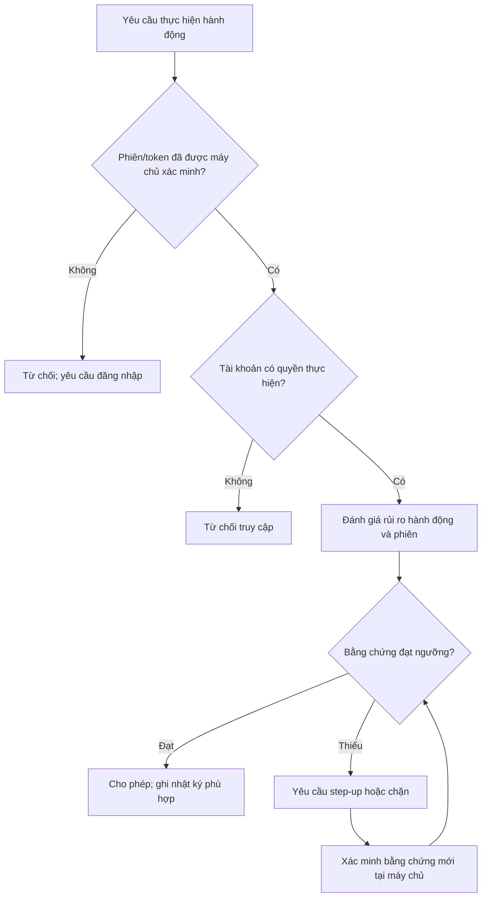

# Thiết lập mức tin cậy trong xác thực

## Mục tiêu học tập

Trong hệ thống xác thực, câu hỏi không chỉ là **“người dùng đã đăng nhập chưa?”** mà còn là **“hệ thống có đủ bằng chứng để tin rằng chủ thể đang thực hiện hành động này là người kiểm soát tài khoản hợp lệ hay không?”**. Mức tin cậy phải phù hợp với rủi ro của từng hành động và có thể thay đổi trong suốt vòng đời tài khoản.

Sau bài học, bạn có thể:

- Phân biệt mức bảo đảm danh tính, mức bảo đảm xác thực và mức bảo đảm liên kết danh tính.
- Xác định mức bảo đảm cần thiết cho các hành động dựa trên tài sản, hậu quả và mối đe dọa.
- Thiết kế quy trình thu thập, xác minh và duy trì bằng chứng xác thực từ đăng ký đến phiên làm việc.
- Giải thích khi nào phải xác thực lại, nâng mức xác thực hoặc hạn chế tài khoản sau khôi phục.
- Kiểm tra các quyết định tin cậy trước phishing, replay, đánh cắp phiên và lạm dụng đăng nhập.

Bài học thuộc chương **Mục tiêu xác thực** của mô-đun **SECURITY_AUTHENTICATION_FUNDAMENTALS**, nơi khảo sát credential, mật khẩu, MFA, passkey, chứng chỉ, token, phiên, liên kết danh tính và khôi phục tài khoản.

## 1. “Tin cậy” là tin vào điều gì?

Giả sử ứng dụng nhận được yêu cầu đổi email khôi phục từ một trình duyệt đã đăng nhập. Có ít nhất bốn câu hỏi độc lập:

1. **Danh tính/tài khoản:** Tài khoản mà phiên đang đại diện là tài khoản nào? Danh tính ngoài đời của chủ tài khoản đã được kiểm chứng đến đâu, nếu nghiệp vụ cần?
2. **Xác thực:** Bằng chứng nào chứng minh người gửi yêu cầu đang kiểm soát credential đã đăng ký? Bằng chứng đó mạnh và mới đến mức nào?
3. **Phiên/liên kết:** Bằng chứng xác thực được đưa đến ứng dụng một cách đáng tin cậy chưa? Phiên hoặc token còn hợp lệ, đúng người nhận và chưa bị thu hồi không?
4. **Ủy quyền:** Tài khoản đó có quyền đổi email trong hoàn cảnh này không?

**Xác thực tốt không đồng nghĩa với đã xác minh danh tính pháp lý, và xác thực thành công không tự cấp quyền thao tác.** Ví dụ, người dùng đăng nhập bằng passkey vẫn không được xem dữ liệu của người khác nếu không có quyền.

“Mức tin cậy” ở đây là **kết luận có phạm vi và có thời hạn, dựa trên bằng chứng mà máy chủ kiểm tra được**. Không nên biểu diễn bằng một cờ `isTrusted = true` có hiệu lực vĩnh viễn.

### Ba trục bảo đảm thường gặp

Các khái niệm trong họ tiêu chuẩn NIST SP 800-63 giúp tách các trục cần đánh giá:

| Trục | Câu hỏi chính | Ví dụ về bằng chứng |
| --- | --- | --- |
| **IAL** — Identity Assurance Level | Đã kiểm chứng danh tính người đăng ký đến đâu? | Quy trình đối chiếu thông tin hoặc giấy tờ theo yêu cầu nghiệp vụ |
| **AAL** — Authentication Assurance Level | Lần xác thực hiện tại chứng minh quyền kiểm soát authenticator mạnh đến đâu? | Mật khẩu, MFA, khóa mật mã chống phishing, đặc tính thiết bị |
| **FAL** — Federation Assurance Level | Kết quả xác thực từ nhà cung cấp danh tính đến ứng dụng có được bảo vệ và ràng buộc phù hợp không? | Assertion/token được xác minh, bảo vệ kênh và ràng buộc đúng bên nhận |

Đây là **những chiều đánh giá khác nhau**, không cộng thành một điểm tin cậy duy nhất. Một tài khoản có danh tính đã kiểm chứng kỹ vẫn có thể bị xâm nhập qua phiên đăng nhập yếu; ngược lại, tài khoản biệt danh có thể đăng nhập bằng phương thức mật mã mạnh mà không có danh tính pháp lý.

Để đọc và trao đổi yêu cầu AAL, có thể dùng mô tả khái quát sau:

| Mức AAL | Ý nghĩa khái quát | Giới hạn cần nhớ |
| --- | --- | --- |
| **AAL1** | Có bằng chứng kiểm soát ít nhất một yếu tố xác thực phù hợp | Không mặc nhiên chống phishing hoặc chiếm đoạt credential |
| **AAL2** | Xác thực đa yếu tố với cơ chế đáp ứng yêu cầu của mức này | Nhiều cách MFA, như mã OTP, vẫn có thể bị phishing thời gian thực |
| **AAL3** | Bảo đảm cao với xác thực mật mã, bảo vệ khóa bằng phần cứng và chống phishing theo yêu cầu của tiêu chuẩn | Không được tự gán AAL3 chỉ vì sản phẩm ghi “passkey” hoặc “biometric” |

Bảng chỉ dùng để hiểu khái niệm. Khi phải tuyên bố tuân thủ, cần đối chiếu **đầy đủ phiên bản tiêu chuẩn, yêu cầu triển khai, vòng đời authenticator và bằng chứng kiểm thử**. Không suy ra mức bảo đảm chính thức chỉ từ tên phương thức đăng nhập.

## 2. Chọn ngưỡng tin cậy từ rủi ro của hành động

Mức xác thực cần thiết phụ thuộc vào **việc người dùng sắp làm**, không chỉ vào loại tài khoản. Bắt đầu bằng cách lập danh mục hành động và trả lời:

- Tài sản cần bảo vệ là gì: dữ liệu cá nhân, tiền, quyền quản trị hay khóa truy cập?
- Nếu kẻ tấn công giả mạo thành công, thiệt hại và khả năng khắc phục ra sao?
- Đường tấn công thực tế là gì: credential stuffing, phishing, đánh cắp cookie, replay, SIM swap, cưỡng ép MFA?
- Bằng chứng nào đủ để giảm các rủi ro đó; trong bao lâu thì bằng chứng trở nên cũ?
- Khi không đạt ngưỡng, hệ thống yêu cầu xác thực bổ sung, giới hạn chức năng hay từ chối hoàn toàn?

Ví dụ chính sách **minh họa**, cần hiệu chỉnh theo bối cảnh và mô hình đe dọa:

| Hành động | Rủi ro điển hình | Ngưỡng tin cậy đề xuất |
| --- | --- | --- |
| Xem nội dung công khai | Thấp | Không bắt buộc đăng nhập |
| Xem hồ sơ cá nhân | Lộ dữ liệu riêng | Phiên hợp lệ, xác thực cơ bản và kiểm tra quyền |
| Xem dữ liệu nhạy cảm hoặc tải bản sao | Lộ dữ liệu quy mô lớn | Phiên hợp lệ, xác thực đủ mạnh, cân nhắc xác thực lại gần thời điểm truy cập |
| Đổi email khôi phục, thêm passkey hoặc thiết bị MFA | Kẻ tấn công có thể chiếm quyền lâu dài | Xác thực lại gần đây bằng phương thức mạnh; cảnh báo kênh cũ và áp dụng kiểm soát rủi ro |
| Chuyển tiền, xuất khóa bí mật, cấp quyền quản trị | Tổn thất lớn hoặc khó đảo ngược | Bằng chứng chống phishing, xác thực gần thời điểm thao tác; với nghiệp vụ phù hợp, xác nhận rõ nội dung giao dịch |
| Khôi phục tài khoản khi mất mọi yếu tố | Đường vòng qua bảo vệ đăng nhập | Quy trình khôi phục độc lập, kiểm chứng nhiều tín hiệu, giới hạn sau khôi phục và giám sát |

Các khoảng thời gian như “xác thực lại trong 10 phút” nếu được dùng phải là **tham số chính sách minh họa**. Chúng không phải con số mặc định áp dụng cho mọi hệ thống hay chứng nhận một AAL nào.

### Không đánh đồng tín hiệu rủi ro với yếu tố xác thực

Địa chỉ IP, vị trí gần đúng, dấu vân tay trình duyệt, thiết bị từng dùng và lịch sử hành vi **có thể hỗ trợ phát hiện bất thường**; chúng không chứng minh người dùng đang giữ bí mật hoặc khóa riêng. Địa chỉ IP quen thuộc không thay thế MFA. Thiết bị lạ không tự chứng minh gian lận.

Một quyết định vững chắc cần cả hai mặt:

- **Mức bảo đảm đã đạt:** bằng chứng xác thực được xác minh và ghi nhận ở máy chủ.
- **Rủi ro của yêu cầu hiện tại:** bất thường đăng nhập, trạng thái tài khoản, loại hành động và thiệt hại nếu sai.

Ngưỡng cho phép có thể tăng khi rủi ro cao. Nếu tín hiệu chỉ ra chiếm đoạt phiên, một bước MFA thông thường có thể chưa đủ; hệ thống có thể phải chấm dứt phiên, khóa thao tác hoặc chuyển sang xác minh thủ công.

## 3. Xây dựng chuỗi bằng chứng tin cậy

Độ tin cậy của thao tác cuối cùng phụ thuộc vào từng mắt xích, từ đăng ký credential đến lúc API kiểm tra quyền.

### 3.1. Đăng ký tài khoản và gắn authenticator

Khi tạo tài khoản, hệ thống phải xác định **đối tượng được gắn credential**: một tài khoản nội bộ, một người đã xác minh danh tính hay một danh tính từ nhà cung cấp bên ngoài. Địa chỉ email được xác nhận chỉ cho thấy khả năng truy cập hộp thư ở thời điểm đó; bản thân nó không chứng minh danh tính pháp lý.

Khi thêm mật khẩu, passkey, ứng dụng TOTP hoặc chứng chỉ:

1. Yêu cầu phiên đăng ký hoặc phiên quản lý credential đáng tin cậy; với thao tác bổ sung authenticator, nên xác thực lại theo rủi ro.
2. Tạo thử thách hoặc bí mật đăng ký trên máy chủ qua kênh được bảo vệ.
3. Xác minh đúng giao thức và ràng buộc authenticator với **tài khoản đích**, không dựa vào ID tài khoản do client tự khẳng định.
4. Ghi nhận phương thức, thời điểm, trạng thái và bằng chứng cần thiết cho các lần đánh giá sau.
5. Có cơ chế thu hồi, thay thế và cảnh báo khi authenticator thay đổi.

Mật khẩu phải được lưu bằng hàm băm dành cho mật khẩu có salt và chi phí phù hợp (chẳng hạn Argon2id theo chính sách hệ thống), không lưu dạng rõ hoặc mã hóa có thể giải mã dễ dàng. Với passkey/WebAuthn, máy chủ lưu **khóa công khai** và thông tin credential cần thiết, rồi kiểm tra chữ ký trên thử thách; không lưu khóa riêng của người dùng.

### 3.2. Xác minh trong lần đăng nhập

| Phương thức | Điều có thể chứng minh | Đường tấn công cần xét |
| --- | --- | --- |
| Mật khẩu | Người gửi biết một bí mật đã đăng ký | Tái sử dụng, rò rỉ, credential stuffing, phishing |
| OTP qua ứng dụng | Người gửi có mã từ authenticator đã đăng ký trong cửa sổ thời gian | Phishing thời gian thực, replay nếu không vô hiệu hóa mã đã dùng |
| OTP qua SMS | Khả năng nhận mã trên số điện thoại lúc đó | SIM swap, chuyển hướng tin nhắn, phishing; phụ thuộc kênh viễn thông |
| Passkey/WebAuthn | Authenticator giữ khóa riêng đã đăng ký và ký thử thách cho đúng bên yêu cầu | Cấu hình sai origin/RP ID, sai ràng buộc tài khoản; cần hiểu cơ chế user verification và khả năng đồng bộ khóa |
| Chứng chỉ khách hàng, ví dụ mTLS | Bên kết nối kiểm soát khóa riêng tương ứng chứng chỉ hợp lệ | Sai kiểm tra chuỗi chứng chỉ, ánh xạ danh tính, thời hạn hoặc thu hồi |

Điểm chung là **máy chủ tự xác minh bằng chứng**. Với giao thức challenge–response, thử thách phải mới, khó đoán, giới hạn thời gian và ràng buộc đúng phiên/ngữ cảnh; kết quả cũ không được chấp nhận lại. Với passkey, cần kiểm tra chữ ký, thử thách, origin, RP ID và cờ xác minh người dùng khi chính sách yêu cầu. Khóa riêng bảo vệ bằng phần cứng và passkey có thể đồng bộ là hai đặc tính khác nhau; không suy ra cùng mức bảo đảm chỉ từ giao diện đăng nhập.

MFA làm giảm rủi ro một yếu tố bị lộ, nhưng **không phải mọi MFA đều chống phishing**. Một trang giả mạo có thể chuyển tiếp mật khẩu cùng OTP trong thời gian thực. Cơ chế mật mã ràng buộc với đúng origin hoặc bên xác minh, chẳng hạn WebAuthn triển khai đúng, xử lý tốt hơn kiểu tấn công này.

### 3.3. Chuyển kết quả xác thực thành token hoặc phiên

Sau khi xác thực, ứng dụng thường cấp phiên hoặc nhận thông tin từ nhà cung cấp danh tính (IdP). Khi ấy, bằng chứng ban đầu cần được chuyển thành **ngữ cảnh xác thực do phía tin cậy quản lý**, ví dụ:

- Chủ thể: định danh tài khoản nội bộ; với danh tính liên kết, lưu cặp `issuer + subject` để tránh nhập nhằng.
- Phương thức và thời điểm xác thực gần nhất, trạng thái MFA hoặc xác thực chống phishing **đã thực sự hoàn tất**.
- Mức bảo đảm mà nhà cung cấp tuyên bố, **chỉ khi ứng dụng có hợp đồng và cách xác minh ý nghĩa của tuyên bố đó**.
- Phiên đang hoạt động, hạn tồn tại, trạng thái thu hồi, sự kiện thay credential hoặc khôi phục.
- Tín hiệu rủi ro hiện tại và các hạn chế đang áp dụng.

Với OIDC, những claim như `auth_time`, `amr` và `acr` có thể hữu ích; `amr` mô tả phương thức, còn `acr` biểu diễn lớp/ngữ cảnh xác thực theo quy ước giữa các bên. Không tự gán `acr = high` từ một nhãn giao diện hay suy ra độ mạnh chỉ từ một chuỗi `amr`. Phải kiểm tra token/assertion theo giao thức: chữ ký, nhà phát hành (`iss`), bên nhận (`aud`), thời hạn (`exp`), nonce/state khi áp dụng, cùng các ràng buộc liên quan.

Với session cookie, nên dùng thuộc tính `Secure`, `HttpOnly` và `SameSite` phù hợp; xoay session ID sau đăng nhập và khi nâng mức, giới hạn thời gian sống, cho phép thu hồi tại máy chủ và kiểm soát CSRF cho thao tác thay đổi trạng thái. Nếu dùng refresh token, áp dụng lưu trữ an toàn, xoay vòng và phát hiện tái sử dụng theo thiết kế. **Token hợp lệ về chữ ký chưa đủ** nếu phiên đã bị thu hồi, tài khoản bị khóa hoặc token được gửi sai tài nguyên.

### 3.4. Xác thực lại khi cần nâng mức

Giả sử người dùng đăng nhập từ sáng bằng mật khẩu và đến chiều yêu cầu đổi yếu tố khôi phục. Việc phiên còn sống **không** làm bằng chứng buổi sáng trở nên mới. Hệ thống cần yêu cầu bước nâng mức (`step-up authentication`), xác minh một authenticator phù hợp rồi ghi lại thời điểm và mức vừa đạt.

Không nâng mức chỉ vì người dùng **đã đăng ký** passkey; họ phải **dùng** phương thức đáp ứng yêu cầu trong lần xác thực có liên quan. Tương tự, một xác thực mạnh từ nhiều giờ trước không đương nhiên còn đáp ứng ngưỡng “gần đây”.

Khi step-up thành công, nên cập nhật hoặc xoay phiên, ràng buộc kết quả vào đúng phiên đang thao tác và áp dụng ngưỡng thời gian cho hành động nhạy cảm. Với giao dịch có hậu quả cao, việc xác nhận cụ thể số tiền, người nhận hoặc thay đổi quyền giúp giảm rủi ro xác nhận nhầm; chỉ xuất hiện một hộp thoại “Approve” không đủ để kết luận đã ràng buộc giao dịch.

### 3.5. Khôi phục tài khoản là điểm có thể hạ mức tin cậy

Nếu hệ thống cho phép “quên mật khẩu” qua email, đường khôi phục có thể trở thành cách vượt qua phương thức đăng nhập mạnh. Vì vậy phải xem khôi phục là một **luồng xác thực và quản lý credential có rủi ro riêng**:

- Chọn bằng chứng khôi phục theo mức thiệt hại nếu tài khoản bị chiếm; không coi quyền truy cập email là bằng chứng ngang với mọi authenticator khác.
- Thử thách/đường dẫn khôi phục phải giới hạn thời gian, sử dụng một lần và chống dò quét; phản hồi không nên tiết lộ tài khoản có tồn tại hay không.
- Giới hạn số lần thử, ghi dấu bất thường và thông báo tới các kênh liên hệ cũ khi phù hợp.
- Thu hồi phiên/token và credential đã mất an toàn; cân nhắc khoảng hạn chế trước khi cho phép đổi quyền quản trị hoặc thực hiện giao dịch giá trị cao.
- Sau khôi phục, đánh giá lại mức bảo đảm thực tế. **Không giữ nguyên nhãn “độ tin cậy cao” nếu bằng chứng từng nâng mức đã không còn.**

## 4. Mô hình hóa ranh giới tin cậy và quyết định truy cập

Một luồng điển hình:



Các ranh giới quan trọng gồm: trình duyệt ↔ ứng dụng; ứng dụng ↔ IdP; dịch vụ API ↔ hệ thống phiên/token; người dùng ↔ thiết bị/authenticator. Phía ngoài ranh giới không tự được tin cậy: header `X-User-Id`, tham số `mfa=true` hay JSON từ trình duyệt **không phải bằng chứng xác thực**.

Ví dụ, một ứng dụng Java có thể mô hình hóa **quyết định chính sách** như sau. Các trường của `AuthContext` bắt buộc đến từ thành phần máy chủ đã xác minh đăng nhập/phiên, không đọc trực tiếp từ request body.

```java
import java.time.Duration;
import java.time.Instant;

enum Action {
    VIEW_PROFILE, CHANGE_RECOVERY_EMAIL, ADD_AUTHENTICATOR
}

enum Decision {
    ALLOW, STEP_UP, DENY
}

record AuthContext(
    boolean serverValidated,
    boolean sessionActive,
    boolean mfaVerifiedThisLogin,
    boolean phishingResistantThisLogin,
    Instant strongAuthTime,
    boolean recoveryRestricted,
    boolean highRisk
) {}

class AssurancePolicy {
    static Decision decide(Action action, AuthContext ctx, Instant now) {
        if (!ctx.serverValidated() || !ctx.sessionActive()) {
            return Decision.DENY;
        }

        // Rủi ro nghiêm trọng cần xử lý ngoài luồng step-up thông thường.
        if (ctx.highRisk()) {
            return Decision.DENY;
        }

        if (action == Action.VIEW_PROFILE) {
            return Decision.ALLOW;
        }

        // Sau khôi phục, chưa mở lại những thay đổi credential nhạy cảm.
        if (ctx.recoveryRestricted()) {
            return Decision.DENY;
        }

        if (!ctx.mfaVerifiedThisLogin()
                || !ctx.phishingResistantThisLogin()
                || !recent(ctx.strongAuthTime(), now)) {
            return Decision.STEP_UP;
        }

        return Decision.ALLOW;
    }

    private static boolean recent(Instant at, Instant now) {
        return at != null
                && !at.isAfter(now)
                && Duration.between(at, now)
                           .compareTo(Duration.ofMinutes(10)) <= 0;
    }
}
```

Đây là **mẫu minh họa cho quyết định mức bảo đảm**, không phải thư viện bảo mật hoàn chỉnh. Ngưỡng 10 phút là lựa chọn của ví dụ; các hệ thống khác có thể dùng giá trị khác. Trước khi gọi `decide`, hệ thống vẫn phải xác minh token, trạng thái phiên và nguồn dữ liệu chứng thực; sau khi trả `ALLOW`, hệ thống **vẫn kiểm tra quyền sở hữu tài nguyên và quyền thao tác**. Khi trả `STEP_UP`, chỉ nâng mức sau khi máy chủ xác minh một bằng chứng mới và gắn kết quả với đúng phiên.

Đặc biệt, `mfaVerifiedThisLogin` và `phishingResistantThisLogin` là hai điều kiện riêng: dùng OTP cùng mật khẩu có thể đạt MFA nhưng chưa đáp ứng yêu cầu chống phishing; một passkey cũng phải được kiểm tra đúng cấu hình và bằng chứng user verification nếu chính sách đòi hỏi.

## 5. Các tình huống tấn công làm sai lệch mức tin cậy

| Tình huống | Kết luận sai thường gặp | Cách xử lý phù hợp |
| --- | --- | --- |
| Kẻ tấn công biết mật khẩu bị rò rỉ | “Đã đăng nhập bằng credential đúng nên đáng tin” | Chống credential stuffing, hạn chế thử, MFA và phát hiện đăng nhập bất thường |
| Nạn nhân nhập OTP vào trang giả | “Có hai yếu tố nên không thể phishing” | Ưu tiên cơ chế chống phishing cho hành động nhạy cảm |
| Request xác thực hoặc OTP bị gửi lại | “Đã từng hợp lệ nên vẫn hợp lệ” | Nonce/challenge mới, hết hạn, một lần sử dụng, ràng buộc ngữ cảnh |
| Cookie phiên bị đánh cắp | “Phiên còn sống tức người gửi là chủ tài khoản” | Cookie an toàn, phát hiện bất thường, xác thực lại, giới hạn và thu hồi phiên |
| IdP trả về tài khoản có email giống nhau | “Email trùng nghĩa là cùng danh tính” | Liên kết theo `iss` và `sub` đã xác minh; kiểm soát chặt thao tác liên kết |
| Người dùng vừa khôi phục bằng yếu tố yếu hơn | “Trước đây có MFA mạnh nên hiện tại vẫn mạnh” | Hạ bảo đảm, thu hồi phiên nguy cơ, hạn chế thao tác và yêu cầu thiết lập lại yếu tố |
| Máy khách gửi `assuranceLevel=3` | “Client đã thông báo mức cao” | Chỉ tin thông tin được verifier/IdP đáng tin cậy xác minh và ánh xạ chính sách |

Một sai lầm thiết kế là **hạ cấp im lặng**: luồng dành cho thao tác quan trọng yêu cầu passkey nhưng khi người dùng gặp lỗi lại cho phép tiếp tục bằng một mã SMS mà không đánh giá lại ngưỡng. Cơ chế dự phòng cần được thiết kế như một chính sách bảo đảm riêng, với các hạn chế tương ứng.

## 6. Kiểm chứng chính sách bằng kịch bản

Giả sử ứng dụng áp dụng quy tắc mẫu ở mục 4. Kiểm tra cả đường hợp lệ và đường từ chối:

| Kịch bản | Kết quả mong đợi | Vì sao |
| --- | --- | --- |
| Phiên đã hết hạn, yêu cầu xem hồ sơ | `DENY` | Chưa có phiên hợp lệ |
| Phiên hợp lệ, rủi ro bình thường, xem hồ sơ | `ALLOW` | Đạt ngưỡng của hành động thông thường |
| Vừa đăng nhập bằng mật khẩu, yêu cầu đổi email khôi phục | `STEP_UP` | Chưa đủ bằng chứng mạnh |
| Đã dùng mật khẩu + OTP nhưng không có bằng chứng chống phishing | `STEP_UP` | MFA không tự đáp ứng mọi ngưỡng |
| Đã dùng MFA chống phishing phù hợp trong 3 phút, phiên hợp lệ và rủi ro bình thường | `ALLOW` cho thao tác nhạy cảm trong ví dụ | Đạt cả ngưỡng sức mạnh và độ mới |
| Bằng chứng mạnh có từ hơn 10 phút trước | `STEP_UP` | Không đạt ngưỡng độ mới đã chọn |
| Tài khoản đang bị hạn chế sau khôi phục | `DENY` cho đổi email hoặc thêm authenticator | Cần hoàn tất chính sách khôi phục |
| Tín hiệu chiếm đoạt phiên nghiêm trọng | `DENY` | Step-up thông thường có thể không đủ |

Trong kiểm thử tích hợp, cần bổ sung trường hợp token sai chữ ký/`aud`/`iss`, request bị phát lại, liên kết sai tài khoản, credential bị thu hồi, đồng hồ lệch, đăng nhập song song, lỗi khi IdP không có `acr` mong đợi, và thay đổi yếu tố khôi phục trong lúc phiên cũ còn hiệu lực. Các thông tin do client tự sửa phải **không** làm thay đổi kết luận của máy chủ.

## 7. Checklist thiết kế mức tin cậy

Khi xây dựng một luồng xác thực mới, hãy tự kiểm tra:

1. **Đối tượng:** Xác thực tài khoản nào? Nghiệp vụ có cần kiểm chứng danh tính ngoài đời không?
2. **Mức yêu cầu:** Hành động có mức thiệt hại nào, cần loại bằng chứng gì và trong khoảng thời gian bao lâu?
3. **Nguồn bằng chứng:** Credential/challenge/claim được thành phần đáng tin cậy kiểm tra và ràng buộc với tài khoản, origin, phiên và bên nhận chưa?
4. **Chống tấn công:** Có kiểm soát phishing, replay, đoán mật khẩu, lạm dụng MFA và chiếm phiên tương ứng với rủi ro không?
5. **Duy trì:** Token, cookie, vòng đời phiên, thay credential và thu hồi có làm cập nhật hoặc hạ mức bảo đảm khi cần không?
6. **Nâng mức:** Khi thao tác nhạy cảm, ứng dụng có xác thực lại bằng phương thức phù hợp và dùng thời điểm thực tế của lần xác thực đó không?
7. **Khôi phục:** Có đường nào cho phép khôi phục yếu vượt qua mọi yêu cầu xác thực mạnh không?
8. **Phân quyền:** Sau xác thực, máy chủ vẫn kiểm tra quyền và đối tượng tài nguyên chứ?

### Bài tập vận dụng

Một ứng dụng cho phép người dùng đăng nhập bằng mật khẩu và TOTP; sau đó, từ phiên còn hiệu lực 24 giờ, họ có thể thêm passkey hoặc đổi số điện thoại dùng để khôi phục. Khi người dùng quên cả mật khẩu lẫn TOTP, ứng dụng gửi liên kết khôi phục qua email.

Hãy mô tả chính sách trước và sau khi sửa thiết kế: xác định các điểm kẻ tấn công có thể chiếm quyền, bằng chứng cần thiết trước khi thêm authenticator hoặc đổi kênh khôi phục, cách xử lý phiên cũ, và các hạn chế sau khôi phục. Giải thích vì sao **chỉ thêm một nút “Xác nhận”** hoặc chỉ kiểm tra “đã bật MFA” không đủ để thiết lập mức tin cậy.

**Gợi ý:** Tách mức bảo đảm đã đạt trong *lần xác thực hiện tại* khỏi việc tài khoản từng đăng ký những phương thức gì. Sau đó kiểm tra độ mới, khả năng chống phishing, tính hợp lệ của phiên, rủi ro của hành động và quyền của chủ thể.

---

**Điểm cần ghi nhớ:** Mức tin cậy là một **quyết định có điều kiện** dựa trên bằng chứng xác thực đã xác minh, cách truyền và duy trì bằng chứng, độ mới của nó và rủi ro của hành động. Thiết kế an toàn luôn có đường **nâng mức, hạ mức, thu hồi và từ chối** rõ ràng; không coi một lần đăng nhập thành công là sự tin cậy vô hạn.
