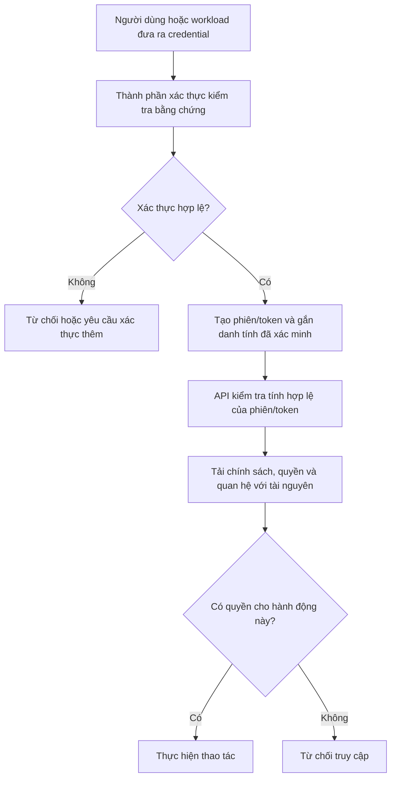

# Hỗ trợ authorization

## 1. Vì sao xác thực là nền tảng của phân quyền?

Trong mô-đun **SECURITY_AUTHENTICATION_FUNDAMENTALS**, người học tìm hiểu cách hệ thống xác minh danh tính bằng credential, mật khẩu, MFA, passkey, chứng chỉ, token và phiên; đồng thời hiểu các rủi ro phishing, replay, lạm dụng đăng nhập, liên kết danh tính và khôi phục tài khoản. Một mục tiêu quan trọng của toàn bộ cơ chế đó là **hỗ trợ authorization** (ủy quyền hoặc kiểm soát quyền truy cập): cung cấp thông tin danh tính đủ tin cậy để hệ thống quyết định ai được thực hiện hành động nào trên tài nguyên nào, trong điều kiện nào.

Hai khái niệm liên quan chặt chẽ nhưng có nhiệm vụ khác nhau:

| Câu hỏi | Authentication (xác thực) | Authorization (kiểm soát quyền) |
|---|---|---|
| Hệ thống cần xác định | Chủ thể yêu cầu là ai, đã chứng minh danh tính bằng cách nào? | Chủ thể đó có được thực hiện thao tác cụ thể trên tài nguyên cụ thể không? |
| Đầu vào tiêu biểu | Credential, kết quả MFA, phiên, token được xác minh, định danh chủ thể | Danh tính đã xác thực, vai trò, quyền, quan hệ sở hữu, chính sách, ngữ cảnh yêu cầu |
| Kết quả | Một danh tính/ngữ cảnh xác thực đã được kiểm chứng, hoặc thất bại | Cho phép hoặc từ chối một hành động |
| Ví dụ | Alice đăng nhập thành công bằng passkey | Alice được xem hóa đơn A nhưng không được xóa hóa đơn B |

**Đăng nhập thành công không đồng nghĩa có quyền truy cập mọi tài nguyên.** Ngay cả một người đã xác thực với độ tin cậy cao cũng có thể không đủ quyền xem dữ liệu thuộc khách hàng khác. Ngược lại, một chính sách phân quyền rất chặt vẫn thất bại nếu kẻ tấn công có thể giả mạo danh tính mà chính sách đang dựa vào.

Sau bài này, người học cần có khả năng:

- Phân biệt bằng chứng xác thực với quyết định phân quyền.
- Xác định các thuộc tính danh tính mà lớp phân quyền có thể tin cậy và giới hạn của chúng.
- Thiết kế luồng từ đăng nhập, kiểm tra token/phiên đến kiểm tra quyền tại API hoặc dịch vụ.
- Nhận diện rủi ro vượt quyền khi danh tính bị gắn nhầm, phiên bị chiếm đoạt, dữ liệu quyền bị lỗi thời hoặc việc kiểm tra chỉ diễn ra ở giao diện.
- Biết khi nào nên yêu cầu xác thực lại hoặc MFA bổ sung cho thao tác nhạy cảm.

## 2. Chuỗi tin cậy từ credential đến quyết định truy cập

Authorization chỉ nên dùng một **ngữ cảnh danh tính đã được hệ thống tin cậy xác lập**. Trong hệ thống có Identity Provider (IdP) hoặc dịch vụ đăng nhập riêng, luồng cơ bản là:



Cần chú ý hai ranh giới tin cậy:

1. **Từ thiết bị/ứng dụng của người gọi vào máy chủ xác thực:** tên người dùng, mật khẩu, assertion passkey, mã OTP hoặc chứng chỉ là dữ liệu cần kiểm tra; không thể chỉ tin tuyên bố của client rằng người dùng đã đăng nhập.
2. **Từ phiên/token vào dịch vụ sở hữu tài nguyên:** dịch vụ phải xác minh tính hợp lệ và nguồn phát hành, sau đó **tự áp chính sách quyền** cho thao tác đang được yêu cầu. Token hợp lệ chỉ là một phần của điều kiện cho phép.

Trong một số kiến trúc, cùng dịch vụ đảm nhiệm cả xác thực và phân quyền; trong kiến trúc khác, API Gateway xác minh token, còn dịch vụ nghiệp vụ kiểm tra quyền. Dù bố trí ra sao, mỗi điểm thực thi truy cập cần có bảo đảm đáng tin cậy về danh tính và chính sách áp dụng.

### Ngữ cảnh danh tính mà authorization thường cần

| Thuộc tính | Công dụng | Lưu ý an toàn |
|---|---|---|
| `issuer` (`iss`) và `subject` (`sub`) | Xác định chủ thể trong phạm vi nhà phát hành; dùng làm khóa tham chiếu danh tính | Kết hợp cả nguồn phát hành và chủ thể khi hệ thống tin cậy nhiều IdP; không chỉ dùng tên hiển thị/email |
| Tenant/tổ chức hiện hành | Giới hạn dữ liệu và chính sách trong đúng tổ chức | Phải xác nhận thành viên và tenant được chọn; không tin độc lập vào tham số URL hoặc header do client nhập |
| Trạng thái tài khoản | Chặn tài khoản bị vô hiệu hóa, khóa hoặc thu hồi | Trạng thái có thể đổi sau khi cấp token; quyết định nhạy cảm cần kiểm tra độ mới |
| `auth_time` hoặc thời điểm xác thực | Biết lần xác thực gần nhất để yêu cầu xác thực mới với hành động quan trọng | Không đồng nhất thời điểm phát hành token với lần chứng minh danh tính |
| `amr` / `acr` khi có hỗ trợ | Cung cấp thông tin về phương pháp hoặc mức bảo đảm xác thực | Chỉ tin claim từ bên phát hành đã được cấu hình và kiểm chứng; ý nghĩa phụ thuộc chính sách của IdP |
| ID phiên, hạn hiệu lực, trạng thái thu hồi | Duy trì hoặc kết thúc ngữ cảnh đăng nhập | Phiên còn hiệu lực không bảo đảm quyền truy cập không thay đổi |
| Vai trò, nhóm, scope, entitlement | Cung cấp tín hiệu cho chính sách quyền | Có thể lỗi thời, có phạm vi khác nhau và không thay thế kiểm tra tài nguyên cụ thể |

Định danh ổn định rất quan trọng: email có thể thay đổi, được tái sử dụng hoặc chưa xác minh; tên hiển thị dễ trùng lặp. Nếu chính sách sở hữu tài nguyên lưu `ownerSubjectId` thì tài khoản mới có cùng email không được tự động kế thừa tài nguyên của chủ thể cũ.

## 3. Mức tin cậy của xác thực ảnh hưởng đến quyết định quyền

Phân quyền có thể yêu cầu không chỉ “đã đăng nhập” mà cả **cách và thời điểm xác thực**:

- **Mật khẩu:** có thể xác định chủ thể khi được kiểm chứng đúng, nhưng dễ bị lừa nhập trên trang phishing hoặc bị lộ qua các cuộc tấn công khác. Chính sách quyền không nên tự coi phiên dựa vào mật khẩu là đủ cho mọi thao tác rủi ro cao.
- **MFA:** bổ sung bằng chứng ngoài mật khẩu. Tuy nhiên, OTP có thể bị phishing hoặc bị chuyển tiếp theo thời gian thực; mức chống phishing phụ thuộc loại yếu tố và thiết kế luồng xác thực.
- **Passkey/WebAuthn:** dựa trên mật mã khóa công khai và kiểm tra ràng buộc với nguồn gốc trang (origin/RP ID), giúp chống phishing tốt hơn mật khẩu và mã OTP truyền thống khi triển khai đúng.
- **Chứng chỉ và mTLS:** có thể chứng minh danh tính máy khách hoặc workload đang kết nối. Chứng chỉ dịch vụ hợp lệ không tự suy ra người dùng nào ở phía sau dịch vụ được quyền thao tác trên hồ sơ nào.
- **Token và phiên:** chuyển tải hoặc tham chiếu kết quả xác thực qua nhiều request. Việc chiếm đoạt token hoặc cookie phiên có thể khiến API tiếp nhận một danh tính hợp lệ về hình thức nhưng do kẻ khác sử dụng.

Ví dụ, ứng dụng kế toán có thể cho phép xem hóa đơn sau khi đăng nhập, nhưng yêu cầu xác thực mới bằng phương thức mạnh trước khi thay đổi tài khoản ngân hàng nhận tiền. Điều kiện này thường gọi là **step-up authentication**. Step-up cung cấp thêm bằng chứng cho chính sách; sau khi step-up thành công, hệ thống vẫn phải kiểm tra người đó có quyền thay đổi thông tin ngân hàng hay không.

Một chính sách có thể được diễn đạt như sau:

```text
CHO_PHEP nếu:
  danh_tính_đã_xác_thực
  VÀ tài_khoản_đang_hoạt_động
  VÀ cùng_tenant_được_phép
  VÀ có_quyền_trên_tài_nguyên
  VÀ (nếu thao_tác_nhạy_cảm: xác_thực_đủ_mạnh_và_đủ_mới)
```

Không có một quy tắc chung rằng “đã dùng MFA thì có quyền admin” hoặc “token có `amr=mfa` thì được chuyển tiền”. Đó là hai quyết định khác nhau, phải được chính sách quy định rõ.

## 4. Danh tính đã xác thực đi vào các mô hình authorization như thế nào?

Sau xác thực, hệ thống có thể áp dụng một hoặc kết hợp nhiều mô hình:

| Mô hình | Cách dùng danh tính | Ví dụ |
|---|---|---|
| RBAC — theo vai trò | Tra cứu vai trò đang hiệu lực của chủ thể | `ACCOUNTANT` được xem báo cáo kế toán |
| ABAC — theo thuộc tính | So sánh thuộc tính chủ thể, tài nguyên và bối cảnh | Nhân viên thuộc chi nhánh A chỉ được duyệt giao dịch chi nhánh A trong hạn mức |
| ReBAC — theo quan hệ | Xét quan hệ giữa chủ thể và tài nguyên | Người tạo tài liệu, người được chia sẻ hoặc thành viên dự án được đọc tài liệu |
| Chính sách dựa trên scope | Giới hạn hành động mà ứng dụng/token được phép yêu cầu | Client được cấp `invoices:read` nhưng không có `invoices:write` |

Scope là giới hạn năng lực của token/client trong một phạm vi nhất định, **không phải bằng chứng mặc định rằng người dùng có quyền trên mọi tài nguyên**. Ví dụ, token mang `invoices:read` vẫn không cho phép đọc hóa đơn thuộc tenant khác.

Hãy xét tài liệu `doc-42` thuộc tenant `north`, chủ sở hữu là Alice. Alice và Bob đều đã xác thực thành công; Bob thậm chí dùng MFA mạnh hơn. Một quy tắc “chỉ chủ sở hữu hoặc người được chia sẻ mới được đọc” vẫn cho phép Alice và từ chối Bob nếu Bob không nằm trong danh sách chia sẻ. Mức mạnh của đăng nhập không thay thế quy tắc sở hữu.

## 5. Thiết kế kiểm tra quyền tại nơi sử dụng tài nguyên

Một luồng API an toàn cần trả lời theo thứ tự:

1. **Yêu cầu này có danh tính hợp lệ không?** Kiểm tra cookie phiên hoặc token theo đúng cơ chế của hệ thống; từ chối nếu không thể xác minh.
2. **Danh tính này thuộc phạm vi nào?** Xác định `issuer`, `subject` và tenant có hiệu lực. Kiểm tra người dùng thực sự thuộc tenant nếu hệ thống đa tổ chức.
3. **Đang yêu cầu làm gì với tài nguyên nào?** Lấy đối tượng thực tế từ kho dữ liệu và xác định hành động `read`, `update`, `delete`, v.v.
4. **Chính sách hiện hành có cho phép không?** Xem vai trò, ACL/quan hệ sở hữu, trạng thái, scope và điều kiện ngữ cảnh; mặc định từ chối khi thiếu bằng chứng.
5. **Thao tác có yêu cầu bảo đảm bổ sung không?** Với hành động rủi ro cao, kiểm tra mức bảo đảm và độ mới của lần xác thực; nếu chưa đạt thì khởi động step-up theo luồng bảo vệ chống giả mạo yêu cầu.

Ví dụ Java sau minh họa **logic chính sách ở tầng nghiệp vụ**, giả định `AuthContext` được tạo từ phiên/token đã được middleware xác minh. Các kiểu `Document` và `MembershipService` là kiểu minh họa, không phải thư viện bắt buộc:

```java
import java.time.Clock;
import java.time.Duration;
import java.time.Instant;

record AuthContext(
    String issuer,
    String subjectId,
    String tenantId,
    Instant authenticatedAt,
    boolean strongAuthentication
) {}

record Document(String id, String tenantId, String ownerSubjectId) {}

enum Action { READ, DELETE }

interface MembershipService {
    boolean isActiveMember(String subjectId, String tenantId);
    boolean canReadDocument(String subjectId, String documentId);
    boolean canDeleteDocument(String subjectId, String documentId);
}

final class DocumentPolicy {
    private final MembershipService memberships;
    private final Clock clock;

    DocumentPolicy(MembershipService memberships, Clock clock) {
        this.memberships = memberships;
        this.clock = clock;
    }

    boolean allowed(AuthContext actor, Document doc, Action action) {
        if (actor == null || doc == null || action == null) return false;

        // tenantId phải đến từ ngữ cảnh đã được máy chủ kiểm chứng.
        if (!doc.tenantId().equals(actor.tenantId())) return false;
        if (!memberships.isActiveMember(actor.subjectId(), actor.tenantId())) {
            return false;
        }

        boolean isOwner = doc.ownerSubjectId().equals(actor.subjectId());
        boolean hasPermission = switch (action) {
            case READ -> isOwner
                || memberships.canReadDocument(actor.subjectId(), doc.id());
            case DELETE -> memberships.canDeleteDocument(actor.subjectId(), doc.id());
        };
        if (!hasPermission) return false;

        if (action == Action.DELETE) {
            Instant cutoff = clock.instant().minus(Duration.ofMinutes(10));
            return actor.strongAuthentication()
                && actor.authenticatedAt() != null
                && !actor.authenticatedAt().isBefore(cutoff);
        }
        return true;
    }
}
```

Ở đây:

- `subjectId` cần tương ứng với danh tính đã kiểm chứng; trong hệ thống nhiều IdP, nên chuẩn hóa khóa chủ thể cùng `issuer`, tránh trùng `sub` từ hai nhà phát hành.
- Quyền xóa lấy từ `MembershipService`/kho quyền phía máy chủ; không được lấy từ một cờ `isAdmin=true` do trình duyệt gửi lên.
- Quyền đọc kiểm tra cả tenant và quan hệ với tài liệu cụ thể, giúp ngăn lỗi **Broken Object Level Authorization (BOLA/IDOR)**.
- `strongAuthentication` là kết quả tin cậy do hệ thống xác thực xác lập theo chính sách, không phải một boolean tự khai từ request. Thời điểm xác thực được đối chiếu với đồng hồ máy chủ.
- Trong ứng dụng thực tế, điểm thực thi quyền cần gắn với thao tác đọc/ghi thực sự; phải tính đến dữ liệu cập nhật đồng thời và tránh kiểm tra một đối tượng rồi thao tác trên đối tượng khác.

Khi chưa xác thực, API thường trả `401 Unauthorized` (hoặc chuyển đến luồng đăng nhập tùy giao thức). Khi đã xác thực nhưng thiếu quyền, API thường trả `403 Forbidden`; một số hệ thống chủ động trả `404` để hạn chế lộ sự tồn tại của tài nguyên. Không ghi lộ bí mật, nội dung token hoặc thông tin nhạy cảm vào thông báo lỗi.

## 6. Token, phiên và sự khác nhau giữa xác thực với cấp quyền

### Phân biệt ID token, access token và session cookie

**OpenID Connect (OIDC)** có ID token để client xác nhận sự kiện đăng nhập và danh tính người dùng theo đúng đối tượng nhận (`aud`) của token. **OAuth 2.0** đưa ra cơ chế ủy quyền để client lấy access token truy cập tài nguyên trong phạm vi được cấp. Một API không nên lấy ID token dành cho ứng dụng giao diện làm vé truy cập API.

Khi API nhận access token, cơ chế kiểm tra phụ thuộc định dạng token và mô hình triển khai:

- Với JWT được API chấp nhận: kiểm tra chữ ký bằng khóa đáng tin cậy, thuật toán cho phép, `iss`, `aud`, hạn hiệu lực (`exp`), thời điểm hiệu lực (`nbf`) nếu có và các điều kiện liên quan.
- Với token opaque: tra cứu hoặc introspect qua thành phần được tin cậy theo hợp đồng triển khai.
- Với cookie phiên: tra cứu phiên phía máy chủ hoặc xác minh cơ chế phiên được bảo vệ; áp dụng `Secure`, `HttpOnly`, `SameSite` phù hợp, phòng chống CSRF khi dùng cookie để xác thực yêu cầu thay đổi dữ liệu.

**Token hợp lệ chưa phải là quyết định cho phép**: API vẫn phải kiểm tra scope cần thiết, tài khoản/tenant, quyền hiện hành và quan hệ với tài nguyên. Không được lấy token từ client rồi giải mã phần payload JWT mà bỏ qua kiểm tra chữ ký để quyết định danh tính.

### Quyền có thể thay đổi khi phiên còn sống

Giả sử quản trị viên gỡ vai trò duyệt thanh toán của Alice lúc 14:00, nhưng access token phát lúc 13:55 còn hiệu lực tới 14:25. Nếu API chỉ tin vai trò nhúng trong token, Alice có thể tiếp tục duyệt đến khi token hết hạn. Đây là vấn đề **độ mới của dữ liệu phân quyền**, không đơn thuần là xác thực sai.

Tùy mức độ rủi ro, hệ thống có thể dùng token sống ngắn, tra quyền cập nhật tại dịch vụ, cache quyền có TTL nhỏ, phiên bản chính sách/quyền, introspection, cơ chế thu hồi hoặc buộc tạo phiên mới. Không có một biện pháp duy nhất cho mọi hệ thống; cần đặt giới hạn thời gian chấp nhận quyền cũ theo tác động của từng thao tác.

Đăng xuất, khóa tài khoản, reset credential hoặc phát hiện phiên bị chiếm đoạt cũng cần dẫn đến hành vi vô hiệu hóa/giới hạn phiên theo chính sách. Với token tự chứa, chỉ chờ `exp` có thể không đáp ứng yêu cầu thu hồi tức thời.

## 7. Liên kết danh tính, khôi phục tài khoản và ủy quyền thay mặt

### Liên kết nhiều phương thức đăng nhập

Một người có thể dùng mật khẩu, passkey và một nhà cung cấp đăng nhập bên ngoài cho cùng tài khoản. Điều hệ thống cần bảo vệ là **liên kết chính xác các credential/identity về cùng một chủ thể nội bộ**.

Ví dụ, việc hai IdP cùng trả về email `an@example.com` không đủ để tự động kết luận đó là cùng một chủ thể. Email có thể chưa xác minh, bị đổi chủ hoặc được tái sử dụng. Quy trình liên kết nên yêu cầu bằng chứng người dùng kiểm soát tài khoản hiện hữu và credential mới, đồng thời ghi nhận việc thêm/gỡ phương thức đăng nhập.

Nếu liên kết sai, kẻ tấn công có thể trở thành “Alice” trong lớp xác thực, rồi hợp lệ vượt qua tất cả quy tắc phân quyền vốn cấp cho Alice. Đây là lý do quản trị vòng đời danh tính thuộc nền tảng của authorization.

### Khôi phục tài khoản và thay đổi yếu tố xác thực

Luồng “quên mật khẩu”, reset MFA, thay email chính hoặc khôi phục passkey cần được xem như **thao tác nhạy cảm có thể chuyển quyền kiểm soát danh tính**. Nếu luồng khôi phục yếu hơn rất nhiều so với đăng nhập thường ngày, kẻ tấn công có thể đi đường vòng để sở hữu tài khoản và kế thừa quyền truy cập.

Biện pháp cần cân nhắc gồm xác minh phù hợp rủi ro, thông báo đến các kênh hiện có, giới hạn tần suất, ghi audit, buộc xác thực lại và hủy/đánh giá lại các phiên cũ sau sự kiện nghiêm trọng.

### Ủy quyền thay mặt không phải giả danh vô điều kiện

Một dịch vụ có thể gọi dịch vụ khác **thay mặt người dùng**. Cần giữ rõ ít nhất hai thông tin: ai là ứng dụng/dịch vụ đang gọi, và người dùng nào được đại diện trong phạm vi quyền nào. Không dùng credential có đặc quyền rộng của dịch vụ để bỏ qua quyền của người dùng cuối. Với OAuth, quyền cấp cho client, scope, audience và các cơ chế trao đổi token/ủy quyền phù hợp phải được diễn giải đúng ngữ cảnh.

Tương tự, tính năng quản trị viên “xem như người dùng” cần có quyền chuyên biệt, lý do, thời hạn và audit; không nên làm biến mất danh tính quản trị viên đã khởi tạo thao tác.

## 8. Các lỗi thường gặp khi lấy authentication làm cơ sở authorization

| Lỗi | Kịch bản | Hướng xử lý |
|---|---|---|
| Chỉ kiểm tra đã đăng nhập | Alice đổi ID trên URL để xem đơn hàng của Bob | Kiểm tra quyền với từng object tại backend, bao gồm tenant và quan hệ sở hữu |
| Tin vai trò từ UI hoặc header | Client sửa `role=admin` trong request | Chỉ lấy thông tin quyền từ nguồn phía máy chủ được xác minh |
| Nhận token sai đối tượng | API chấp nhận ID token hoặc access token cấp cho API khác | Kiểm tra loại token theo hợp đồng, `aud`, `iss` và chính sách endpoint |
| Không kiểm tra chữ ký token | Kẻ tấn công sửa `sub` hoặc `scope` trong payload JWT | Kiểm tra chữ ký và các claim bắt buộc trước khi dùng |
| Quyền cũ tồn tại quá lâu | Người bị gỡ quyền vẫn dùng token chưa hết hạn | Quy định độ mới, cache và cơ chế thu hồi tương ứng mức rủi ro |
| Nhầm mức xác thực với quyền | Ai có MFA đều được xóa dữ liệu | Kiểm tra **cả quyền xóa lẫn** điều kiện xác thực mạnh/gần đây |
| Dùng email làm khóa chủ thể | Tài khoản có email trùng kế thừa dữ liệu của người trước | Dùng định danh ổn định, gắn với nguồn phát hành và quy trình liên kết an toàn |
| Không chặn replay/chiếm đoạt phiên | Kẻ tấn công sử dụng lại cookie/token bị lộ | Bảo vệ truyền tải và lưu trữ token, giảm thời hạn, phát hiện lạm dụng, dùng cơ chế ràng buộc người gửi khi phù hợp |
| Bỏ qua ngữ cảnh tenant | Thành viên tenant A truy cập tài nguyên tenant B | Xác minh thành viên, tenant và quan hệ với tài nguyên trong từng quyết định |
| Chỉ ẩn nút thao tác | UI ẩn nút “Xóa” nhưng API vẫn cho gọi trực tiếp | Kiểm tra quyền ở server ngay tại đường thực thi thao tác |

Kiểm soát đăng nhập nhằm chống credential stuffing, brute force và phishing giúp giảm cơ hội kẻ xấu lấy được ngữ cảnh xác thực. Tuy nhiên, **một phiên bị chiếm đoạt vẫn có thể đi qua lớp xác thực**; quyền tối thiểu, kiểm tra theo tài nguyên, thời hạn phiên và các tín hiệu rủi ro bổ sung giúp hạn chế thiệt hại.

## 9. Kiểm thử ranh giới xác thực–phân quyền

Khi xây dựng một endpoint như `GET /tenants/{tenantId}/documents/{documentId}`, hãy kiểm thử cả danh tính lẫn quyền:

| Trường hợp | Kết quả mong đợi |
|---|---|
| Không có phiên/token hợp lệ | Từ chối và yêu cầu xác thực |
| Đã đăng nhập, đúng tenant, là chủ tài liệu | Cho phép đọc nếu các điều kiện chính sách khác thỏa mãn |
| Đã đăng nhập, cùng tenant nhưng không sở hữu/không được chia sẻ | Từ chối |
| Đã đăng nhập, có quyền ở tenant A nhưng yêu cầu tài nguyên tenant B | Từ chối |
| Token sai `aud`, hết hạn hoặc chữ ký không hợp lệ | Từ chối trước khi dùng claim |
| Tài khoản bị khóa hoặc quyền bị gỡ trong phiên đang sống | Từ chối trong giới hạn độ trễ cập nhật quyền đã thiết kế |
| Có quyền xóa nhưng lần xác thực không đủ mạnh hoặc đã quá cũ | Yêu cầu step-up hoặc từ chối thao tác xóa |
| Vừa đổi ID tài liệu trong URL hoặc body | Không vượt được kiểm tra quyền theo tài nguyên thực tế |
| Đổi email, liên kết IdP hoặc reset yếu tố xác thực | Không tự động nhận quyền của danh tính khác; phiên được xử lý theo chính sách |

Ngoài kiểm thử chức năng, nên ghi audit với chủ thể, hành động, tài nguyên, kết quả cho phép/từ chối và mã lý do thích hợp. Nhật ký phải tránh chứa mật khẩu, assertion bí mật, OTP, access token hoặc cookie phiên. Giám sát các lần từ chối bất thường có thể giúp phát hiện dò ID tài nguyên hoặc khai thác quyền.

## 10. Bài tập tình huống

Hệ thống quản lý chi phí có ba nhân viên: An, Bình và Chi. An sở hữu đề nghị hoàn tiền `E-17`; Bình là kế toán có quyền xem mọi đề nghị của tenant `T1`; Chi là nhân viên của tenant `T2`. Cả ba đều xác thực thành công. Chi đăng nhập bằng passkey, còn An và Bình dùng mật khẩu kèm MFA.

Giả sử chính sách là: chủ sở hữu hoặc kế toán cùng tenant được xem đề nghị; chỉ kế toán được phê duyệt; phê duyệt trên 50 triệu đồng đòi hỏi MFA phù hợp và xác thực trong 10 phút gần nhất.

- An được xem `E-17` vì là chủ sở hữu nhưng không mặc nhiên có quyền phê duyệt.
- Bình được xem và có thể phê duyệt `E-17` nếu thỏa điều kiện phân quyền; với số tiền lớn, cần thêm điều kiện xác thực đủ mạnh và đủ mới.
- Chi không thể xem `E-17` vì khác tenant, dù dùng passkey có khả năng chống phishing tốt.
- Nếu Bình vừa bị thu hồi vai trò kế toán, hệ thống phải áp dụng quy tắc độ mới của quyền; việc Bình còn cookie đăng nhập không chứng minh vai trò còn hiệu lực.

Từ tình huống này, hãy tự trả lời: hệ thống sẽ lấy vai trò kế toán từ đâu, kiểm tra tenant ở lớp nào, kiểm tra thời điểm xác thực nào, và làm sao tránh dùng lại quyền cũ khi vai trò vừa thay đổi?

## 11. Ghi nhớ khi thiết kế

Một yêu cầu được phép thực hiện khi **danh tính đã được kiểm chứng đủ tin cậy** và **chính sách hiện hành cho phép chủ thể đó thực hiện hành động trên tài nguyên cụ thể**. Mức độ mạnh của xác thực có thể là điều kiện bổ sung nhưng không thể thay thế quyền.

Trong thực hành, hãy luôn xác định rõ: ai chứng minh danh tính, ai phát hành và xác minh token/phiên, ai cung cấp dữ liệu quyền, ai thực thi quyết định tại tài nguyên và bao lâu thì quyền thay đổi được phản ánh. Các ranh giới này kết nối thiết kế credential, MFA, passkey, chứng chỉ, token, phiên, liên kết danh tính và khôi phục tài khoản với mục tiêu cuối cùng: **chỉ đúng chủ thể, đúng quyền, đúng ngữ cảnh mới được phép truy cập**.
