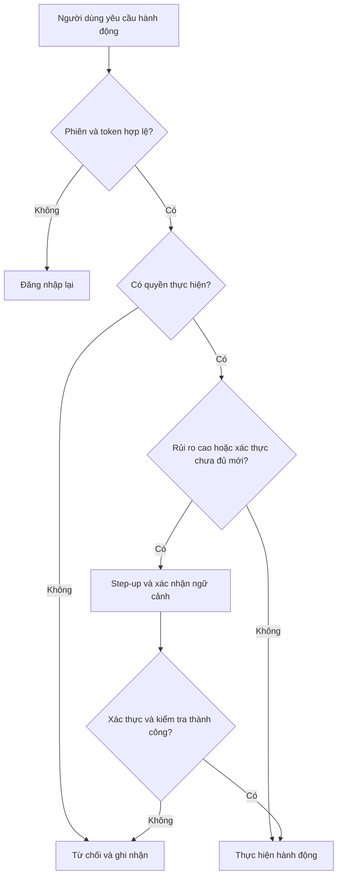

# Đáp ứng yêu cầu kinh doanh

Xác thực danh tính không chỉ trả lời câu hỏi “người đang truy cập là ai?”. Trong một sản phẩm thực tế, cơ chế xác thực còn phải giúp khách hàng hoàn thành công việc, bảo vệ tài sản của doanh nghiệp, giảm gian lận, hỗ trợ vận hành và đáp ứng các cam kết với đối tác. Một hệ thống đăng nhập rất chặt chẽ nhưng thường xuyên chặn nhầm người dùng hợp lệ có thể gây thiệt hại kinh doanh; một luồng đăng nhập tiện lợi nhưng dễ bị chiếm đoạt tài khoản cũng vậy.

Bài học thuộc chương **Mục tiêu xác thực** của học phần **SECURITY_AUTHENTICATION_FUNDAMENTALS**. Trọng tâm là chuyển nhu cầu kinh doanh thành yêu cầu xác thực có thể triển khai và kiểm chứng, trong phạm vi từ credential, mật khẩu, MFA, passkey, chứng chỉ đến token, phiên, liên kết danh tính và khôi phục tài khoản. Các quyết định cần xét đến ranh giới tin cậy và các nguy cơ như phishing, replay hay lạm dụng đăng nhập.

## 1. Kết quả học tập

Sau bài này, người học có thể:

- Phân biệt **mục tiêu kinh doanh**, **yêu cầu xác thực** và **biện pháp kỹ thuật**; không nhảy thẳng từ một mục tiêu mơ hồ sang lựa chọn công nghệ.
- Mô hình hóa các hành trình có xác thực, tài sản cần bảo vệ, nhóm người dùng và hậu quả khi định danh sai.
- Chọn mức bảo đảm xác thực tương xứng với rủi ro của từng hành động, đồng thời cân nhắc trải nghiệm, khả năng tiếp cận và chi phí hỗ trợ.
- Viết tiêu chí chấp nhận, cách đo và tình huống kiểm thử cho đăng nhập, xác thực tăng cường, phiên, liên kết danh tính và khôi phục tài khoản.

## 2. Vì sao yêu cầu kinh doanh quyết định thiết kế xác thực?

Ba câu hỏi thường xuất hiện cùng nhau nhưng giải quyết các vấn đề khác nhau:

1. **Định danh:** hệ thống đang nói đến tài khoản hoặc chủ thể nào?
2. **Xác thực:** có đủ bằng chứng rằng bên đang tương tác kiểm soát các yếu tố xác thực gắn với chủ thể đó không?
3. **Phân quyền:** chủ thể đã xác thực có được thực hiện thao tác cụ thể trên tài nguyên cụ thể không?

Ví dụ, một nhân viên đã đăng nhập thành công bằng passkey vẫn không mặc nhiên có quyền xem bảng lương. Xác thực là đầu vào cho quyết định truy cập; quyền truy cập vẫn phải được kiểm tra ở phía dịch vụ theo ngữ cảnh nghiệp vụ.

Yêu cầu kinh doanh thường hình thành từ nhiều lợi ích phải cân bằng:

| Mục tiêu kinh doanh | Câu hỏi cần chuyển thành yêu cầu xác thực | Ví dụ tiêu chí kiểm chứng |
| --- | --- | --- |
| Tăng tỷ lệ khách hàng hoàn tất mua hàng | Những bước nào cần tài khoản? Khi nào có thể giữ phiên hợp lệ thay vì đăng nhập lại? | Đo tỷ lệ hoàn thành đăng nhập và tỷ lệ bỏ giỏ hàng tại bước xác thực theo từng nhóm thiết bị. |
| Giảm thất thoát do chiếm đoạt tài khoản | Hành động nào có thể chuyển tiền, đổi thông tin nhận tiền hoặc làm lộ dữ liệu nhạy cảm? | Thao tác rủi ro cao yêu cầu bằng chứng xác thực đủ mới; kịch bản chiếm phiên không được tự ý thay đổi tài khoản nhận tiền. |
| Phục vụ khách hàng doanh nghiệp | Có cần đăng nhập liên kết với nhà cung cấp danh tính của khách hàng, quản lý vòng đời nhân sự và thu hồi truy cập không? | Tài khoản bị vô hiệu hóa theo quy trình đã thống nhất không thể tiếp tục truy cập bằng phiên hoặc token còn hiệu lực ngoài giới hạn cho phép. |
| Giảm chi phí hỗ trợ | Người dùng mất thiết bị hoặc quên mật khẩu có thể khôi phục tài khoản bằng quy trình nào? | Luồng khôi phục hoàn thành được với bằng chứng phù hợp, có chống lạm dụng và ghi nhận sự kiện nhạy cảm. |
| Duy trì độ tin cậy của dịch vụ | Điều gì xảy ra nếu nhà cung cấp danh tính, mạng di động hoặc thiết bị của người dùng gặp sự cố? | Có chính sách gián đoạn, giám sát và phương án vận hành đã kiểm thử cho từng nhóm người dùng. |

**Điểm cốt lõi:** “phải có MFA” là một phương án kiểm soát, chưa phải phát biểu đầy đủ về yêu cầu kinh doanh. Yêu cầu tốt phải nêu được **ai**, **đang làm gì**, **tài sản nào có rủi ro**, **điều kiện nào kích hoạt kiểm soát** và **kết quả nào được chấp nhận**.

## 3. Chuyển mục tiêu thành yêu cầu có thể thực thi

Một quy trình thực dụng gồm sáu bước.

### Bước 1 — Xác định hành trình và tác nhân

Liệt kê các hành trình như đăng ký, đăng nhập lần đầu, đăng nhập thường xuyên, thêm thiết bị, thay đổi email, thanh toán, quản trị, đăng nhập liên kết và lấy lại tài khoản. Cùng một sản phẩm có thể có khách hàng cá nhân, nhân viên hỗ trợ, quản trị viên doanh nghiệp, đối tác tích hợp và dịch vụ máy với máy. Không nên áp dụng một chính sách xác thực giống hệt cho tất cả.

Hãy xét cả người dùng có thiết bị đời cũ, kết nối yếu, hạn chế về khả năng tiếp cận, không dùng điện thoại thông minh hoặc thường xuyên di chuyển. Nếu phương thức dự phòng bị bỏ qua trong thiết kế ban đầu, chính quy trình hỗ trợ thủ công sau này có thể trở thành điểm yếu bảo mật.

### Bước 2 — Xác định tài sản và tác động

Phân loại tác động nếu xác thực thất bại hoặc kẻ tấn công chiếm được tài khoản:

- **Tài chính:** thanh toán sai, thay đổi tài khoản nhận tiền, hoàn tiền gian lận.
- **Dữ liệu và riêng tư:** lộ hồ sơ khách hàng, thông tin nhân sự hoặc dữ liệu đối tác.
- **Vận hành:** quản trị viên bị chiếm quyền, ngừng dịch vụ, phá hủy cấu hình.
- **Uy tín và pháp lý:** mất niềm tin, vi phạm cam kết hợp đồng hoặc nghĩa vụ áp dụng tại thị trường phục vụ.

Đánh giá cả xác suất và hậu quả, có tính đến các biện pháp kiểm soát hiện có. Mức rủi ro không chỉ phụ thuộc vào vai trò “admin” hay “user”: một người dùng thường thay đổi thông tin nhận tiền có thể tạo ra tác động lớn hơn việc một quản trị viên xem trang cấu hình công khai.

### Bước 3 — Xác định ranh giới tin cậy

Nêu rõ hệ thống nào phát hành bằng chứng, hệ thống nào xác minh và hệ thống nào quyết định cho phép hành động. Chẳng hạn:

- Thiết bị và trình duyệt có thể bị mất, nhiễm mã độc hoặc bị lừa truy cập trang giả; chỉ nhìn thấy trạng thái giao diện “đã đăng nhập” không đủ để dịch vụ tin cậy.
- Dịch vụ xác thực hoặc nhà cung cấp danh tính phát hành kết quả đăng nhập theo giao thức đã chọn; ứng dụng phải kiểm tra và ràng buộc đúng kết quả đó với phiên của mình.
- API kiểm tra token và quyền ở phía máy chủ; không tin vào định danh, vai trò hoặc trạng thái xác thực do ứng dụng khách tự gửi.
- Đổi email, liên kết tài khoản và khôi phục tài khoản là các hành động vượt ranh giới tin cậy, vì có thể thay đổi ai kiểm soát danh tính.

Trong hệ thống liên kết danh tính, ứng dụng cần kiểm tra đúng **issuer**, **audience**, chữ ký, thời hạn và các ràng buộc luồng đăng nhập liên quan; với OIDC, cần xử lý đúng `state`, `nonce` khi áp dụng và PKCE cho luồng authorization code phù hợp. Không dùng một ID token dành cho ứng dụng khác như bằng chứng truy cập API của mình.

### Bước 4 — Quy định mức xác thực theo rủi ro

Không phải mọi thao tác đều cần độ ma sát như nhau. Có thể dùng ma trận chính sách sau như điểm xuất phát, rồi điều chỉnh theo mô hình đe dọa thực tế:

| Tình huống | Định hướng xác thực | Lý do |
| --- | --- | --- |
| Xem nội dung công khai | Không buộc đăng nhập nếu nghiệp vụ không cần định danh | Giảm ma sát và tránh thu thập danh tính không cần thiết. |
| Xem dữ liệu riêng tư thông thường | Phiên đã xác thực hợp lệ, có giới hạn thời gian và ràng buộc phù hợp | Cân bằng sử dụng liên tục với nguy cơ bị đánh cắp phiên. |
| Đăng nhập từ ngữ cảnh rủi ro hoặc bổ sung thiết bị mới | Có thể yêu cầu xác minh bổ sung, thông báo và giám sát | Giảm cơ hội lợi dụng credential bị lộ; tránh phụ thuộc duy nhất vào tín hiệu rủi ro dễ giả mạo. |
| Đổi mật khẩu, yếu tố MFA, email khôi phục hoặc thông tin nhận tiền | Xác thực lại hoặc **step-up** bằng phương thức đủ mạnh và đủ gần thời điểm thao tác | Một phiên cũ hay phiên bị chiếm đoạt không nên tự thay đổi phương tiện kiểm soát tài khoản. |
| Truy cập đặc quyền và vận hành nhạy cảm | Phương thức chống phishing, phân quyền tối thiểu, nhật ký kiểm toán và khả năng thu hồi | Hậu quả khi bị chiếm quyền cao; cần bảo vệ cả người và phiên quản trị. |
| Dịch vụ máy với máy | Danh tính khối lượng công việc, chứng chỉ/khóa hoặc cơ chế phù hợp, token có phạm vi hẹp | Máy không thể dùng các luồng tương tác như người dùng; phải quản lý vòng đời bí mật và quyền. |

MFA giúp giảm rủi ro lộ mật khẩu nhưng **không phải mọi MFA chống phishing như nhau**. Mã OTP có thể bị trang giả mạo đánh cắp theo thời gian thực; SMS còn phụ thuộc vào bảo mật số điện thoại. Passkey dựa trên FIDO/WebAuthn ràng buộc xác thực với nguồn gốc dịch vụ, hỗ trợ chống phishing tốt hơn, song mức bảo đảm còn phụ thuộc cách tạo, lưu trữ, đồng bộ, xác minh người dùng và chính sách thiết bị. Chứng chỉ có thể phù hợp trong môi trường quản lý thiết bị hoặc hệ thống máy với máy, nhưng kéo theo quy trình cấp phát, xoay vòng và thu hồi.

### Bước 5 — Ghi yêu cầu dưới dạng quan sát được

Một yêu cầu có thể kiểm thử nên chứa:

> **Khi** [tác nhân] thực hiện [hành động] trên [tài sản] trong [điều kiện], **hệ thống phải** [kiểm tra/bằng chứng/xử lý]; **đạt khi** [kết quả và cách kiểm chứng].

Ví dụ: “Khi người dùng đã đăng nhập muốn đổi tài khoản nhận tiền, hệ thống phải yêu cầu xác thực đủ mới bằng phương thức đã đăng ký và xác nhận rõ thông tin sẽ thay đổi; nếu thử thách thất bại hoặc hết hạn, thông tin nhận tiền không được cập nhật.” Đây là yêu cầu nghiệp vụ có điều kiện, biện pháp, trạng thái thất bại và tiêu chí kiểm thử.

### Bước 6 — Xác định chủ sở hữu, phương án dự phòng và cách đo

Gán người chịu trách nhiệm cho chính sách rủi ro, trải nghiệm, bộ phận hỗ trợ, an ninh và vận hành. Xác định trước việc làm gì khi thiếu yếu tố xác thực, nhà cung cấp danh tính gián đoạn hoặc phát hiện sự cố. Các trường hợp ngoại lệ cần có bằng chứng, giới hạn thời gian, phê duyệt phù hợp và nhật ký; một kênh hỗ trợ có thể bỏ qua mọi kiểm tra sẽ phá vỡ chính sách chính.

## 4. Trải nghiệm đăng nhập là một phần của yêu cầu

Mục tiêu kinh doanh không chỉ được đo bằng số lần từ chối tấn công. Người dùng hợp lệ phải hoàn thành công việc trong thời gian và công sức hợp lý. Thiết kế cần xét:

- **Tỷ lệ hoàn thành:** chỉ yêu cầu định danh khi có ích; hỗ trợ trình quản lý mật khẩu, tự động điền phù hợp và passkey khi điều kiện cho phép.
- **Khả năng tiếp cận:** cung cấp hướng dẫn rõ ràng, thông báo lỗi không làm lộ tài khoản, khả năng điều hướng bằng bàn phím và lựa chọn thay thế phù hợp cho người không dùng được một yếu tố cụ thể.
- **Tính liên tục:** quản lý thời hạn phiên theo độ nhạy; chỉ yêu cầu step-up tại hành động quan trọng hoặc khi rủi ro tăng, thay vì buộc đăng nhập lại cho từng lần chuyển trang.
- **Tính minh bạch:** giải thích lý do yêu cầu xác thực lại ở mức hữu ích, cho xem và thu hồi thiết bị/phiên đã đăng nhập, thông báo thay đổi bảo mật quan trọng.
- **Khả năng khôi phục:** chuẩn bị luồng mất thiết bị, mất khóa, thay số điện thoại và quên mật khẩu; không biến khôi phục thành đường vòng dễ bị thao túng xã hội.

Một quyết định “ít bước hơn” cũng có thể làm tăng chi phí gian lận và hỗ trợ. Ngược lại, tăng thêm thử thách ở mọi nơi có thể làm sụt tỷ lệ chuyển đổi và tạo nhu cầu bypass qua nhân viên hỗ trợ. Nên đưa ra quyết định bằng dữ liệu theo nhóm người dùng và **tác động của từng hành động**, không chỉ số lần nhập mật khẩu trung bình.

## 5. Xét toàn bộ vòng đời tài khoản, token và phiên

Một yêu cầu kinh doanh thường kéo dài vượt xa màn hình đăng nhập:

| Giai đoạn | Câu hỏi nghiệp vụ | Kiểm soát xác thực cần thiết |
| --- | --- | --- |
| Đăng ký và thiết lập ban đầu | Ai được tạo tài khoản? Cần chứng minh quyền kiểm soát email, số điện thoại hay danh tính tổ chức ở mức nào? | Kiểm tra dữ liệu đầu vào, chống tự động hóa, xác minh kênh sở hữu nếu cần; không nhầm xác minh email với xác minh danh tính pháp lý. |
| Gắn và thay credential | Ai được thêm passkey, thay mật khẩu hoặc hủy phương thức cũ? | Xác thực đủ mới, thông báo thay đổi, quy trình thu hồi và chống chiếm đoạt lúc gắn yếu tố mới. |
| Đăng nhập và tạo phiên | Khi nào kết quả xác thực đủ để tạo phiên? | Chống đoán mật khẩu/credential stuffing, xử lý an toàn callback, cấp phiên mới sau đăng nhập và thiết lập chính sách hết hạn. |
| Duy trì phiên và token | Tài nguyên nào được phép truy cập, trong bao lâu? | Token có đối tượng nhận và phạm vi phù hợp, kiểm tra hạn và chữ ký; cookie phiên có `Secure`, `HttpOnly`, `SameSite` phù hợp, bảo vệ CSRF khi cần. |
| Thao tác nhạy cảm | Bằng chứng đăng nhập trước đó còn đủ mới không? | Step-up hoặc xác thực lại; kiểm tra quyền trên máy chủ và ràng buộc với hành động cần bảo vệ. |
| Liên kết danh tính/SSO | Khi nào hai tài khoản được xem là cùng chủ sở hữu? | Liên kết có chủ ý, xác thực cả hai phía hoặc bằng chứng tương đương; không tự động gộp tài khoản chỉ vì trùng địa chỉ email. |
| Khôi phục và khóa tài khoản | Làm sao trả quyền truy cập cho chủ tài khoản thật? | Bằng chứng độc lập và đủ mạnh, chống dò đoán, giới hạn và giám sát; thu hồi phiên/credential bị nghi lộ theo chính sách. |
| Nghỉ việc, chấm dứt hợp đồng, xóa tài khoản | Khi nào quyền truy cập phải dừng? | Vô hiệu hóa danh tính, thu hồi phiên/token hoặc giới hạn tồn tại của token theo cam kết; ghi nhận và kiểm chứng việc ngừng truy cập. |

Các token truy cập ngắn hạn có thể tiếp tục có hiệu lực đến khi hết hạn nếu hệ thống không có cơ chế thu hồi tức thời. Vì vậy, yêu cầu “nhân viên nghỉ việc phải mất quyền ngay” cần được chuyển thành một thiết kế khả thi, ví dụ kiểm tra trạng thái tập trung cho thao tác nhạy cảm, cơ chế thu hồi hoặc thời hạn token phù hợp. Không thể chỉ ghi “đã disable user trong giao diện quản trị” rồi coi mọi API đã an toàn.

Một luồng quyết định đơn giản cho hành động nhạy cảm:

Sơ đồ chỉ mô tả quyết định nghiệp vụ. Trong triển khai, từng bước cần được kiểm tra tại máy chủ; thao tác phải bảo vệ trước tình trạng thay đổi dữ liệu giữa lúc xác nhận và lúc thực thi, và không được lặp tác vụ tài chính chỉ vì người dùng gửi lại yêu cầu.

## 6. Gắn mục tiêu kinh doanh với mối đe dọa cụ thể

Mỗi rủi ro cần có kiểm soát tương ứng và cách đánh giá hiệu quả:

| Rủi ro | Tác động kinh doanh | Hướng kiểm soát |
| --- | --- | --- |
| Credential stuffing và thử mật khẩu hàng loạt | Tài khoản bị chiếm, tăng tải dịch vụ, tăng chi phí hỗ trợ | Giới hạn tốc độ theo tín hiệu đa chiều, phát hiện bất thường, mật khẩu an toàn, MFA hoặc passkey, tránh khóa diện rộng gây từ chối dịch vụ. |
| Phishing và trang đăng nhập giả | Mất credential/OTP, bị chiếm tài khoản hoặc phiên | Ưu tiên phương thức chống phishing, xác thực đúng nguồn gốc, giáo dục người dùng, bảo vệ luồng liên kết danh tính. |
| Replay thông điệp, mã hoặc token | Hành động hoặc truy cập được lặp lại ngoài ý muốn | Token/mã có thời hạn, nonce hoặc thử thách dùng một lần ở nơi cần thiết, kiểm tra audience và ngữ cảnh, ngăn dùng lại mã khôi phục. |
| Chiếm phiên | Truy cập kéo dài dù kẻ tấn công không có mật khẩu | Cookie an toàn, xoay định danh phiên, quản lý hết hạn và thu hồi, kiểm tra step-up cho hành động quan trọng. |
| Lạm dụng khôi phục tài khoản và hỗ trợ | Bypass MFA, thay yếu tố sở hữu tài khoản | Quy trình bằng chứng độc lập, hạn chế thử, giám sát hỗ trợ, thông báo thay đổi và thời gian chờ theo rủi ro khi phù hợp. |
| Liên kết sai danh tính | Truy cập chéo dữ liệu giữa người dùng/đơn vị | Kiểm tra định danh từ nguồn đáng tin, xác nhận liên kết và phân tách quyền theo tổ chức. |

Không biện pháp đơn lẻ nào loại bỏ mọi rủi ro. Ví dụ, giới hạn số lần đăng nhập chống brute force nhưng nếu khóa tài khoản thiếu kiểm soát, kẻ xấu có thể chủ động khóa người dùng thật. Chính sách cần cân nhắc cả thất thoát do gian lận lẫn tổn thất do từ chối nhầm.

## 7. Tình huống thực hành: Nền tảng quản lý hóa đơn B2B

Giả sử một nền tảng SaaS phục vụ các doanh nghiệp phát hành hóa đơn, duyệt thanh toán và quản lý thông tin nhận tiền. Ba nhóm tác nhân là kế toán, người phê duyệt thanh toán và quản trị viên doanh nghiệp. Khách hàng lớn muốn dùng đăng nhập một lần qua nhà cung cấp danh tính của họ; khách hàng nhỏ dùng tài khoản trực tiếp của nền tảng.

### 7.1. Từ yêu cầu đầu bài đến chính sách

**Nhu cầu 1: Kế toán đăng nhập hằng ngày dễ dàng.** Hệ thống hỗ trợ passkey và phương thức thay thế có chính sách rõ ràng; với phiên hợp lệ, người dùng có thể xem và tạo bản nháp hóa đơn mà không bị hỏi lại liên tục. Mục tiêu đo là tỷ lệ hoàn thành đăng nhập, thời gian đến tác vụ đầu tiên và số yêu cầu hỗ trợ.

**Nhu cầu 2: Việc đổi tài khoản nhận tiền cần độ tin cậy cao.** Ngoài quyền nghiệp vụ, dịch vụ yêu cầu bằng chứng xác thực đủ mới, hiển thị thông tin tài khoản mới để người dùng xác nhận và ghi sự kiện kiểm toán. Một token truy cập hợp lệ nhưng thiếu bằng chứng tăng cường không tự đủ để đổi thông tin. Nếu chính sách kinh doanh đòi hai người duyệt, đó là **kiểm soát phân quyền/quy trình phê duyệt** bổ sung, không phải MFA.

**Nhu cầu 3: Nhân viên nghỉ việc không được tiếp tục truy cập dữ liệu.** Khi khách hàng dùng SSO, cần hợp đồng kỹ thuật về đồng bộ/thu hồi danh tính, phiên và giới hạn hiệu lực token. Với tài khoản nội bộ, quản trị viên có luồng vô hiệu hóa và thu hồi phiên, kèm kiểm thử API thực tế.

**Nhu cầu 4: Người dùng làm mất thiết bị vẫn phải khôi phục được tài khoản.** Luồng khôi phục dùng bằng chứng phù hợp với rủi ro và kiểm tra độc lập với yếu tố đã mất; sau thay đổi credential nhạy cảm có thông báo và xử lý phiên cũ. Nhân viên hỗ trợ không được tùy ý xóa MFA chỉ vì người gọi biết tên, email hoặc số hóa đơn.

**Nhu cầu 5: Không trộn dữ liệu giữa hai doanh nghiệp.** Dù cùng một người có tài khoản ở nhiều tổ chức, ứng dụng phải giữ đúng ngữ cảnh tenant, xác thực danh tính liên kết có chủ ý và kiểm tra quyền trên từng tài nguyên. Trùng email giữa các nhà cung cấp danh tính không tự chứng minh hai danh tính là một.

### 7.2. Viết tiêu chí chấp nhận

Các ví dụ sau mô tả kết quả cần quan sát được; đội phát triển sẽ bổ sung ngưỡng, thời gian và phương thức cụ thể theo quyết định sản phẩm.

1. **Đăng nhập hợp lệ:** Với tài khoản đang hoạt động, khi người dùng hoàn tất đúng phương thức được hỗ trợ, ứng dụng tạo một phiên được ràng buộc với danh tính và tổ chức chính xác; lần truy cập vào dữ liệu của tổ chức khác vẫn bị kiểm tra quyền riêng.
2. **Bảo vệ hành động nhạy cảm:** Với người dùng đã đăng nhập nhưng chưa có xác thực đủ mới, khi yêu cầu đổi thông tin nhận tiền, API chưa lưu thay đổi và trả về yêu cầu step-up; chỉ lưu sau khi xác thực, xác nhận nội dung và kiểm tra quyền thành công.
3. **Từ chối replay:** Với mã thử thách hoặc mã khôi phục đã dùng, khi gửi lại mã đó, hệ thống từ chối và không tạo thêm phiên hay thay đổi credential.
4. **Thu hồi truy cập:** Với tài khoản đã bị vô hiệu hóa, các yêu cầu mới không được tạo phiên; các phiên/token đang tồn tại bị chặn hoặc hết hiệu lực trong giới hạn thời gian mà doanh nghiệp đã cam kết và đã kiểm thử.
5. **Khôi phục an toàn:** Với người dùng mất thiết bị, quy trình khôi phục cho phép người sở hữu hợp lệ lấy lại quyền truy cập bằng bằng chứng thích hợp; yêu cầu không đủ bằng chứng không được thêm credential mới dù có liên hệ qua hỗ trợ.
6. **Không liên kết nhầm:** Với hai danh tính liên kết cùng email nhưng chưa xác nhận mối liên kết, hệ thống không tự gộp tài khoản hoặc cấp quyền truy cập dữ liệu của nhau.

### 7.3. Đo xem chính sách có phục vụ kinh doanh không

Một bảng đo cần có cả chỉ số trải nghiệm lẫn chỉ số rủi ro:

| Nhóm | Chỉ số gợi ý | Lưu ý khi đo |
| --- | --- | --- |
| Trải nghiệm | Tỷ lệ đăng nhập hoàn thành; thời gian hoàn thành ở p50/p95; tỷ lệ bỏ dở step-up | Phân đoạn theo thiết bị, phương thức, nhóm khách hàng và tình trạng kết nối; tránh tính bot như người dùng thật. |
| Bảo mật | Số vụ chiếm đoạt đã xác nhận; tỷ lệ thử thách rủi ro cao bị từ chối; số lần dùng lại token/mã thất bại | Phân biệt tấn công bị chặn với người dùng hợp lệ bị từ chối; số cảnh báo tăng không tự chứng minh tình hình xấu hơn. |
| Hỗ trợ | Số ticket khôi phục trên mỗi 1.000 tài khoản hoạt động; thời gian khôi phục; số lần phải can thiệp thủ công | Theo dõi trường hợp khó và lạm dụng kênh hỗ trợ, không chỉ số ticket đóng được. |
| Vận hành | Độ sẵn sàng và độ trễ của dịch vụ xác thực; lỗi tích hợp SSO; thời gian thu hồi truy cập | Định nghĩa cách đo, khoảng thời gian và xử lý khi nhà cung cấp ngoài gặp sự cố. |
| Kinh doanh | Tỷ lệ hoàn thành hành trình chính sau đăng nhập; gian lận gây tổn thất; chi phí hỗ trợ | Phân tích cùng nhau để thấy tác dụng phụ khi tăng hoặc giảm ma sát. |

Chẳng hạn nhóm sản phẩm có thể **đề xuất** “95% người dùng hợp lệ hoàn tất đăng nhập trong 45 giây” rồi kiểm tra dữ liệu thực tế trước khi chốt mục tiêu. Đây chỉ là con số minh họa, không phải chuẩn chung cho mọi hệ thống. Tương tự, yêu cầu về độ sẵn sàng, thời gian thu hồi hoặc phương thức xác thực phải được thống nhất với chủ sở hữu nghiệp vụ, an ninh và khách hàng liên quan.

## 8. Những sai lầm thường gặp khi chuyển yêu cầu

- **“Có MFA là an toàn.”** MFA có nhiều mức chống phishing; yếu tố khôi phục, phiên và quy trình hỗ trợ có thể làm yếu toàn bộ hệ thống.
- **“Đã đăng nhập thì được phép thao tác.”** Đăng nhập không thay thế kiểm tra quyền, ngữ cảnh tenant hay xác nhận cho hành động nhạy cảm.
- **“Dùng SSO là xong trách nhiệm xác thực.”** Ứng dụng vẫn phải kiểm chứng assertion/token, bảo vệ phiên, xử lý liên kết danh tính và thu hồi.
- **“Email đã xác minh là biết chắc người đó là ai.”** Xác minh email chủ yếu chứng minh quyền kiểm soát một hộp thư tại một thời điểm, không tự xác minh danh tính pháp lý hoặc thẩm quyền doanh nghiệp.
- **“Người dùng mất yếu tố thì hỗ trợ tắt MFA.”** Nếu không có bằng chứng tương đương và kiểm soát, đó là con đường tấn công thuận lợi nhất.
- **“Tăng bảo mật bằng cách hỏi lại mật khẩu ở mọi màn hình.”** Cách này có thể gây mệt mỏi, tăng khả năng phishing và làm giảm chuyển đổi; hãy gắn kiểm tra tăng cường với rủi ro và độ mới của xác thực.
- **“Chỉ theo dõi số lượt đăng nhập thành công.”** Con số đó không cho biết có bao nhiêu người thật bị chặn nhầm, bao nhiêu phiên bị chiếm hay bao nhiêu giao dịch bị lạm dụng.

## 9. Bài tập tự kiểm tra

Một ứng dụng đặt lịch khám cho phép người dùng xem lịch hẹn, tải tài liệu cá nhân và đổi số điện thoại dùng để khôi phục tài khoản. Doanh nghiệp muốn giảm tỷ lệ bỏ dở đăng nhập nhưng không để kẻ tấn công lợi dụng một phiên bị đánh cắp để đổi phương thức khôi phục.

Hãy tự trả lời:

1. Những hành động nào có thể dùng phiên hiện tại, hành động nào cần xác thực đủ mới? Vì sao?
2. Ranh giới tin cậy nằm ở đâu khi thiết bị yêu cầu đổi số điện thoại, và máy chủ phải kiểm tra những gì?
3. Nếu người dùng mất cả thiết bị và số điện thoại, quy trình hỗ trợ cần những bảo đảm nào để vừa khôi phục được tài khoản vừa chống mạo danh?
4. Chọn ít nhất hai chỉ số trải nghiệm và hai chỉ số an ninh để kiểm tra xem chính sách mới có đạt mục tiêu kinh doanh hay không.

**Gợi ý đánh giá:** lời giải tốt phải nói rõ tác nhân, tài sản, rủi ro, phương thức xác thực, trạng thái thất bại, tiêu chí kiểm thử và ảnh hưởng đến trải nghiệm. Không có một công nghệ duy nhất phù hợp với mọi sản phẩm; chính sách đúng là chính sách phù hợp với hành động cần bảo vệ và có thể đo được hiệu quả thực tế.
