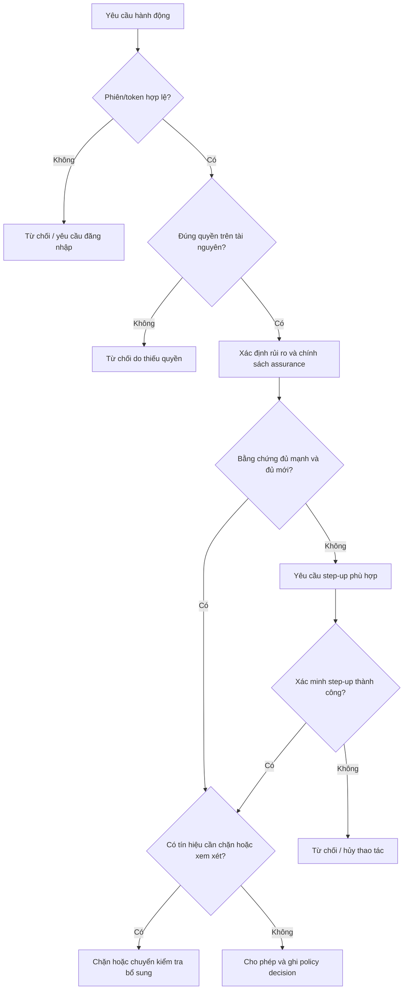

# Đo lường assurance trong xác thực

> **Chương:** Mục tiêu xác thực  
> **Phạm vi:** Security Authentication Fundamentals — đánh giá độ tin cậy của danh tính, bằng chứng xác thực và ngữ cảnh phiên, từ đó lựa chọn biện pháp bảo vệ thích hợp.

## Mục tiêu học tập

Sau bài này, bạn có thể:

1. Diễn giải **authentication assurance** (mức bảo đảm xác thực) và phân biệt với xác minh danh tính ban đầu, bảo đảm liên kết danh tính, phân quyền và đánh giá rủi ro.
2. Phân tích những yếu tố quyết định mức assurance: phương thức xác thực, ràng buộc mật mã, khả năng chống phishing/replay, vòng đời authenticator, nguồn phát hành token và độ mới của lần xác thực.
3. Sử dụng mô hình mức bảo đảm như IAL, AAL, FAL để trao đổi về yêu cầu hệ thống mà không biến chúng thành một điểm số tùy tiện.
4. Định nghĩa chỉ số, mẫu số, sự kiện cần ghi nhận và ngưỡng theo dõi nhằm đánh giá độ bao phủ, tuân thủ chính sách, chất lượng vận hành và tác động đến người dùng.
5. Thiết kế một quyết định **step-up authentication** cho thao tác nhạy cảm, đồng thời nhận diện sai lệch trong phép đo và các con đường hạ mức bảo đảm qua khôi phục tài khoản.

## 1. Assurance là gì và tại sao phải đo?

Trong bảo mật danh tính, **assurance** là mức độ tin cậy có căn cứ vào một khẳng định về danh tính hoặc một sự kiện xác thực, xét trong điều kiện, quy trình và cơ chế kiểm soát cụ thể. Khi hệ thống nhận một yêu cầu “Tôi là tài khoản A”, một lần xác thực thành công chỉ nói rằng **bằng chứng đã vượt qua bộ kiểm tra đang áp dụng**. Mức assurance cho biết **bộ kiểm tra đó mạnh đến đâu đối với các kiểu tấn công đang xét**, và bằng chứng còn phù hợp với hành động hiện tại không.

Ví dụ, hai người dùng đều được ghi `login_success`, nhưng:

- Người thứ nhất dùng mật khẩu duy nhất, được kiểm tra qua HTTPS, rồi dùng cookie phiên mới tạo.
- Người thứ hai xác thực bằng passkey gắn với đúng website, có thử thách mới do máy chủ phát và yêu cầu kiểm tra người dùng trên thiết bị.

Cả hai đều “đăng nhập thành công”; tuy nhiên khả năng kháng phishing, replay và chiếm credential **không giống nhau**. Ngược lại, nếu quy trình hỗ trợ cho phép đặt lại passkey chỉ bằng thông tin dễ đoán, assurance thực tế của toàn bộ vòng đời tài khoản có thể thấp hơn mức bảo vệ khi đăng nhập bình thường.

**Đo assurance** có ba mục đích chính:

1. **Ra quyết định:** Một bằng chứng hiện tại có đủ để thực hiện thao tác này, hay cần xác thực lại/step-up?
2. **Kiểm tra thực thi chính sách:** Tỷ lệ thao tác nhạy cảm thực sự được bảo vệ bằng đúng phương thức, đúng thời điểm và đúng ràng buộc là bao nhiêu?
3. **Cải thiện hệ thống:** Phát hiện đường vòng yếu, lỗi cấu hình, thất bại của cơ chế phòng vệ, tác động đến khả năng truy cập của người dùng và thay đổi xu hướng theo thời gian.

Assurance **không phải** xác suất tuyệt đối rằng người thao tác là người thật ngoài đời thực, cũng không phải nhãn “an toàn 100%”. Các quan sát vận hành chỉ cung cấp bằng chứng về việc hệ thống đáp ứng tiêu chí đã chọn trong phạm vi dữ liệu có thể đo.

## 2. Đo cái gì? Phân biệt các lớp bảo đảm

Một hệ thống có thể tin cậy ở lớp này nhưng yếu ở lớp khác. Không nên trộn tất cả thành một điểm “trust score” nếu chưa xác định câu hỏi cần trả lời.

| Lớp cần đánh giá | Câu hỏi | Ví dụ bằng chứng / kiểm soát | Giới hạn cần nhớ |
| --- | --- | --- | --- |
| **Identity assurance** | Bản ghi tài khoản được liên hệ với người/tổ chức khai báo đáng tin đến đâu? | Quy trình identity proofing, nguồn xác minh, tái kiểm tra | Người đã được xác minh có thể bị chiếm tài khoản về sau |
| **Authentication assurance** | Người/yêu cầu hiện tại đã chứng minh kiểm soát authenticator ở mức nào? | WebAuthn, MFA, chứng cứ kiểm tra server-side, chống replay | Đăng nhập đúng không đồng nghĩa được quyền mọi thao tác |
| **Federation assurance** | Kết quả xác thực/thuộc tính nhận từ IdP tới ứng dụng có được bảo vệ phù hợp không? | Xác thực issuer, audience, chữ ký, luồng token, ràng buộc assertion | Tin IdP không đồng nghĩa tự động tin mọi trường trong phản hồi |
| **Session assurance / freshness** | Ngữ cảnh đã xác thực còn phù hợp ở thời điểm sử dụng không? | `auth_time`, TTL, trạng thái phiên, sự kiện rủi ro, chính sách step-up | Phiên còn hạn chưa chắc đủ mới cho giao dịch lớn |
| **Authorization** | Danh tính/ngữ cảnh này có quyền thực hiện hành động cụ thể không? | Kiểm tra vai trò, quyền trên tài nguyên, chính sách nghiệp vụ | Đây là quyết định riêng, không thể thay bằng điểm assurance |

Các bộ tiêu chuẩn như **NIST SP 800-63** dùng các họ mức bảo đảm:

- **IAL (Identity Assurance Level):** mức bảo đảm về quy trình xác minh danh tính khi gắn người với tài khoản.
- **AAL (Authenticator Assurance Level):** mức bảo đảm từ phương thức và quy trình xác thực.
- **FAL (Federation Assurance Level):** mức bảo đảm cho cơ chế truyền và bảo vệ kết quả xác thực giữa các bên trong liên kết danh tính.

Thông thường các mức được đánh số theo thứ bậc (ví dụ IAL1–IAL3, AAL1–AAL3, FAL1–FAL3), nhưng **tiêu chí cụ thể tùy phiên bản và hồ sơ áp dụng của tiêu chuẩn**. Một mức không thể tự suy ra chỉ vì ứng dụng có “hai bước”, sử dụng JWT, bật TLS hay yêu cầu vân tay. Muốn tuyên bố tuân thủ một mức, phải đối chiếu **toàn bộ yêu cầu bắt buộc của mức đó**, kể cả vòng đời đăng ký, quản lý authenticator, giới hạn thời gian, bảo vệ phiên và khôi phục, theo phiên bản tiêu chuẩn đã chọn.

**Ví dụ phân biệt:** Một tài khoản được xác minh giấy tờ rất chặt khi mở (identity assurance cao) nhưng hằng ngày chỉ đăng nhập bằng mật khẩu dễ bị lừa (authentication assurance thấp). Tăng độ chặt của thủ tục mở tài khoản **không tự động** làm lần đăng nhập mạnh hơn. Tương tự, một tài khoản chỉ dùng biệt danh nhưng đăng nhập bằng passkey vẫn có thể có bằng chứng kiểm soát authenticator mạnh, dù danh tính pháp lý của người dùng chưa được xác minh.

## 3. Năm nhóm yếu tố định hình authentication assurance

### 3.1. Chất lượng và tính độc lập của bằng chứng

Phân biệt **thứ được kiểm tra** với giao diện người dùng nhìn thấy. Mật khẩu là bí mật dùng chung; TOTP bổ sung bằng chứng sở hữu một authenticator khác; passkey sử dụng khóa riêng ký thử thách, trong đó máy chủ chỉ giữ khóa công khai. Hai lần nhập mã từ cùng một nguồn chưa chắc tương đương MFA hai yếu tố độc lập.

Các câu hỏi tối thiểu:

- Credential đã được **đăng ký và liên kết** với đúng tài khoản như thế nào?
- Có đủ yếu tố xác thực theo chính sách không? Các yếu tố có độc lập thực sự không?
- Bí mật hoặc khóa riêng có thể bị sao chép, chuyển tiếp, xuất ra hoặc sử dụng ngoài ngữ cảnh dự kiến không?
- Bằng chứng có được kiểm tra bởi thành phần tin cậy, có ghi nhận phiên bản và kết quả chính sách không?

Đừng mặc định rằng “biometric login” có assurance cao: đôi khi ứng dụng chỉ dùng vân tay để mở một khóa lưu trên thiết bị; đôi khi dùng sinh trắc học để mở khóa ứng dụng cục bộ mà máy chủ không hề nhận bằng chứng mật mã mới. Hai luồng này cho kết quả đo assurance khác nhau.

### 3.2. Kháng phishing, replay và lạm dụng đăng nhập

**Phishing resistance** là khả năng bằng chứng không bị kẻ tấn công lấy hoặc dùng cho trang giả để đăng nhập vào dịch vụ thật. WebAuthn/passkey hợp lệ có ràng buộc với **RP ID/origin**, còn mật khẩu và nhiều loại OTP có thể bị chuyển tiếp bởi trang giả. Việc hệ thống “đã bật MFA” không chứng minh rằng yếu tố đó chống phishing.

**Replay resistance** nghĩa là bằng chứng bị chặn bắt ở một lần giao tiếp không thể dễ dàng sử dụng lại ở lần khác. Một challenge ngẫu nhiên, mới và chỉ dùng một lần là một cơ chế cốt lõi; ngoài ra còn cần kiểm soát thời gian, ngữ cảnh và việc chấp nhận trùng. Ví dụ: mã TOTP có hạn dùng ngắn nhưng vẫn cần giới hạn thử sai và chính sách chống dùng lại trong cửa sổ chấp nhận.

**Login abuse resistance** đề cập kiểm soát dò mật khẩu, credential stuffing, password spraying, MFA fatigue và enumeration. Đây là một phần bảo đảm **quy trình xác thực vận hành an toàn**, không thể suy ra chỉ từ việc thuật toán ký đủ mạnh.

### 3.3. Ràng buộc giao thức và điểm kiểm chứng

Assurance phụ thuộc vào việc kiểm tra đúng thông điệp, đối tác và ngữ cảnh:

- Ứng dụng web dùng **HTTPS/TLS** để bảo vệ kênh truyền và xác minh đúng điểm kết nối.
- WebAuthn kiểm tra challenge, chữ ký, RP ID, origin và các cờ/chính sách tương ứng; không tin đơn thuần vào câu trả lời “thiết bị đã xác thực”.
- Token phải được kiểm tra **chữ ký, issuer (`iss`), audience (`aud`), thời hạn (`exp`) và những điều kiện áp dụng**. JWT có chữ ký hợp lệ nhưng cấp cho API khác không được nhận vào API hiện tại.
- Với SSO/OIDC, ứng dụng phải tin đúng IdP, kiểm tra các tham số chống giả mạo luồng và diễn giải đúng bằng chứng được IdP cam kết; claim do client tự gửi không mang cùng độ tin cậy.
- Với xác thực dịch vụ, chứng chỉ/mTLS hoặc bằng chứng giữ khóa riêng cần được kiểm tra theo chuỗi tin cậy, danh tính đích, hạn dùng và quy trình quản trị khóa.

Một phương thức mạnh nhưng kiểm tra sai `aud` hoặc bỏ qua ràng buộc nguồn gốc vẫn có thể dẫn tới chấp nhận bằng chứng không đúng mục tiêu.

### 3.4. Độ mới và tính liên tục của phiên

Phải hỏi **“xác thực lần cuối lúc nào?”**, **“bằng chứng đó dành cho ngữ cảnh nào?”** và **“sự kiện nào có thể làm mất hiệu lực tin cậy?”**. Một phiên hợp lệ cho xem trang cá nhân không nhất thiết đủ để đổi số tài khoản nhận tiền.

Một số tín hiệu được dùng trong chính sách:

| Tín hiệu | Ý nghĩa | Cách dùng phù hợp |
| --- | --- | --- |
| `auth_time` đáng tin | Thời điểm xác thực người dùng thực sự, nếu được nhà phát hành/ngữ cảnh cung cấp hợp lệ | Kiểm tra thời gian tối đa từ lần xác thực cho thao tác nhạy cảm |
| `amr` trong OIDC | Mô tả các phương thức đã sử dụng, theo quy ước của IdP | Hỗ trợ đánh giá bằng chứng, **không** thay thế kiểm tra chính sách |
| `acr` trong OIDC | Tham chiếu đến lớp/ngữ cảnh xác thực do IdP công bố | Chỉ dùng khi có hợp đồng ý nghĩa/ánh xạ và IdP đáng tin |
| Hạn phiên/token | Khoảng thời gian ngữ cảnh còn có thể dùng | Đặt TTL, kiểm tra thu hồi và giới hạn lưu giữ |
| Tín hiệu rủi ro | IP bất thường, thiết bị mới, thay đổi authenticator, hành vi khác thường | Cân nhắc step-up, giới hạn chức năng hoặc điều tra bổ sung |

**Độ mới không đồng nghĩa độ mạnh**: mật khẩu vừa nhập không mặc nhiên tương đương passkey đã dùng cách đây hai phút; passkey mạnh từ tuần trước cũng không mặc nhiên đủ mới cho mọi giao dịch. Khi thiết kế, cần kiểm tra **cả mức phương thức lẫn độ mới**.

### 3.5. Đăng ký, khôi phục và thu hồi

Mức assurance không thể cao hơn một cách có ý nghĩa nếu người khác có thể thêm authenticator mới hoặc khôi phục quyền truy cập qua đường yếu. Đặc biệt cần đánh giá:

- Xác minh nào được yêu cầu khi đăng ký passkey đầu tiên, liên kết IdP mới hoặc thay số điện thoại/email khôi phục?
- Người dùng có thể bỏ qua MFA bằng mã dự phòng, hỗ trợ thủ công hoặc email đặt lại không? Khi đó yêu cầu tương ứng có chấp nhận được với mức rủi ro của tài khoản không?
- Có thông báo thay đổi, nhật ký kiểm toán, thời gian chờ hoặc xác thực tăng cường cho thay đổi nhạy cảm không?
- Sau mất thiết bị, lộ credential hay nghỉ việc, phiên/token và authenticator còn hoạt động được thu hồi ra sao?

**Đo đúng assurance** phải bao gồm cả các đường **enrollment → authentication → session → account linking/recovery → revocation**, không chỉ giao diện login thành công.

## 4. Chuyển từ yêu cầu nghiệp vụ sang tiêu chí đo được

Một mục tiêu như “đăng nhập phải rất an toàn” chưa có điều kiện kiểm thử. Hãy biến nó thành **quy tắc chấp nhận** cho một hành động cụ thể:

> Với hành động `approve_refund` có giá trị lớn, chỉ cho phép nếu tài khoản có quyền duyệt hoàn, phiên hợp lệ, lần xác thực gần đây đáp ứng chính sách chống phishing, không xuất hiện tín hiệu rủi ro vượt ngưỡng và không đi qua ngoại lệ recovery bị cấm.

Mỗi yêu cầu nên có bốn phần:

1. **Phạm vi:** nhóm người dùng, tài nguyên, luồng và mức thiệt hại dự kiến khi tài khoản bị chiếm.
2. **Điều kiện bắt buộc:** phương thức chấp nhận, ràng buộc với dịch vụ, kiểm tra phía máy chủ, độ mới, trạng thái phiên, chính sách recovery và quyền nghiệp vụ.
3. **Dữ liệu kiểm chứng:** các sự kiện/thuộc tính đáng tin giúp xác minh điều kiện có được thực thi trên từng hành động hay không.
4. **Phản ứng khi thiếu bằng chứng:** từ chối, yêu cầu step-up, chuyển luồng hỗ trợ hoặc cảnh báo, tùy chính sách; không “cho qua” mặc định khi mất dữ liệu.

Ví dụ quy tắc minh họa (ngưỡng **5 phút là giả định nghiệp vụ**, không phải con số chuẩn bắt buộc cho mọi hệ thống):

```text
function canApproveLargeRefund(request, action, now):
    principal = requireVerifiedLiveSession(request)
    if principal is absent:
        return DENY_UNAUTHENTICATED

    if not isAuthorized(principal, "approve_refund", action.refundId):
        return DENY_NOT_AUTHORIZED

    proof = loadServerVerifiedAuthenticationContext(principal.sessionId)
    if proof is absent or not proof.bindingValid:
        return REQUIRE_STEP_UP

    if not proof.phishingResistant or not proof.userVerificationSatisfied:
        return REQUIRE_STEP_UP

    if now - proof.authenticatedAt > 5 minutes:
        return REQUIRE_STEP_UP

    if recoveryRestrictionActive(principal) or riskTooHigh(request, action):
        return DENY_OR_MANUAL_REVIEW

    recordPolicyDecision(action.id, "refund-high-risk-v2", "ALLOW")
    return ALLOW
```

Đây là **mã giả diễn giải chính sách**. Thông tin như `phishingResistant` và `userVerificationSatisfied` phải được **suy ra từ bằng chứng đã xác minh phía tin cậy**, không đọc từ Boolean do ứng dụng khách tùy ý gắn vào request. Lựa chọn `REQUIRE_STEP_UP` chỉ đúng khi có luồng xác thực lại tương ứng; vòng lặp step-up liên tục cần được ngăn bằng thiết kế session/transaction rõ ràng. Nếu ứng dụng liên kết danh tính qua IdP, thông tin trong `acr`, `amr`, `auth_time` chỉ dùng sau khi xác minh token/assertion và ý nghĩa claim với IdP.

## 5. Đo assurance bằng các chỉ số thực tế

Các chỉ số nên chia thành **độ bao phủ**, **chất lượng thực thi**, **bảo vệ trước tấn công** và **khả năng sử dụng**. Mỗi chỉ số phải có cửa sổ thời gian, quần thể đo, tử số, mẫu số, cách loại trùng và ngưỡng mục tiêu do nhóm phụ trách phê duyệt.

| Chỉ số | Công thức/định nghĩa tham khảo | Điều mà nó phản ánh | Bẫy diễn giải |
| --- | --- | --- | --- |
| **Authenticator enrollment coverage** | Số tài khoản trong phạm vi có ít nhất một authenticator đáp ứng chính sách / tổng tài khoản trong phạm vi | Khả năng tiếp cận phương thức dự kiến | Đăng ký rồi không dùng không có nghĩa giao dịch được bảo vệ |
| **Phishing-resistant usage rate** | Số phiên đăng nhập đã được xác minh là dùng phương thức chống phishing / tổng phiên đăng nhập hợp lệ thuộc phạm vi | Việc sử dụng thực sự | Dễ lệch nếu đếm mọi lần refresh token là một lần đăng nhập |
| **Protected sensitive-action rate** | Số hành động nhạy cảm được **cho phép** và có đủ bằng chứng theo chính sách / tổng hành động nhạy cảm được cho phép | Mức thực thi kiểm soát trên hành động có tác động | Loại hành động bị từ chối khỏi mẫu số chỉ phù hợp khi đang đo chất lượng hành động đã cho phép; phải báo cáo tỷ lệ chặn riêng |
| **Policy violation / exception rate** | Số hành động được cho phép dù thiếu điều kiện bắt buộc / tổng hành động được cho phép trong phạm vi | Đường bỏ qua hoặc cấu hình sai | Nếu không ghi event ngoại lệ, chỉ số sẽ thấp giả tạo |
| **Step-up completion rate** | Số thử thách step-up kết thúc thành công / số thử thách step-up khởi tạo | Khả năng hoàn tất bước xác thực tăng cường | Phải tách người dùng hợp lệ khỏi tự động hóa ác ý khi có dữ liệu tin cậy |
| **Recovery path usage** | Số lần khôi phục thành công theo từng phương thức / số yêu cầu recovery hợp lệ theo định nghĩa | Phụ thuộc vào kênh dự phòng | Không nên suy rằng ít recovery là tốt: người dùng có thể bị khóa vĩnh viễn |
| **Confirmed account takeover rate** | Số tài khoản xác nhận bị chiếm / số tài khoản hoạt động, thường chuẩn hóa theo 10.000 tài khoản và kỳ đo | Thiệt hại được phát hiện/xác minh | Bị ảnh hưởng bởi độ trễ và năng lực điều tra; không đại diện đầy đủ tất cả vụ tấn công |
| **Authentication friction** | Thời gian hoàn tất, số lần thử lại, tỷ lệ bỏ dở theo nhóm người dùng/phương thức | Chi phí trải nghiệm của chính sách | Giảm ma sát bằng cách bỏ bảo vệ có thể khiến chỉ số đẹp lên nhưng rủi ro tăng |

### Công thức phải khớp với câu hỏi

Giả sử trong 7 ngày có **10.000 yêu cầu duyệt hoàn tiền giá trị lớn** và hệ thống ghi nhận:

- **9.200** yêu cầu được cho phép sau khi kiểm tra được bằng chứng chống phishing đáp ứng điều kiện *freshness*.
- **300** yêu cầu được cho phép qua nhánh ngoại lệ yếu hơn mà chính sách mục tiêu muốn loại bỏ.
- **500** yêu cầu bị từ chối hoặc chặn vì không đáp ứng chính sách.

Khi đó:

| Câu hỏi | Phép tính | Kết quả |
| --- | --- | --- |
| Bao nhiêu yêu cầu thực sự đi qua kiểm tra mạnh thành công? | `9.200 / 10.000` | **92,0%** tổng yêu cầu |
| Trong các hành động **được cho phép**, bao nhiêu đáp ứng chính sách mục tiêu? | `9.200 / (9.200 + 300)` | **≈ 96,84%** |
| Trong các hành động **được cho phép**, bao nhiêu đi qua ngoại lệ không đạt mục tiêu? | `300 / 9.500` | **≈ 3,16%** |
| Tỷ lệ yêu cầu bị chặn là bao nhiêu? | `500 / 10.000` | **5,0%** |

Đây là **dữ liệu giả định**. Chỉ số 96,84% có vẻ cao nhưng vẫn tương ứng **300 hành động nhạy cảm đã được cho phép qua đường yếu** trong kỳ đo. Đó là một phát hiện cần phân tích. Ngược lại, không thể coi tất cả 500 yêu cầu bị chặn là tấn công: có thể có người dùng hợp lệ thiếu thiết bị hoặc bị lỗi hệ thống. Phải điều tra lý do trước khi kết luận bảo vệ tăng hoặc giảm.

### Đừng biến assurance thành phép cộng điểm tùy ý

Một bảng tính kiểu “HTTPS +10, mật khẩu +20, MFA +20, token +10 = 60/100 điểm an toàn” rất dễ đánh lừa. TLS, credential, kiểm tra nonce, quyền và recovery là những **điều kiện khác loại**. Một số là bắt buộc: thiếu kiểm tra chữ ký token hoặc xác minh challenge không được bù bằng nhiều cờ cấu hình khác.

Hãy ưu tiên **hồ sơ có cấu trúc**:

```yaml
assurance_evidence:
  verified_authenticator: webauthn_passkey
  phishing_resistance: verified
  replay_protection: verified_challenge
  user_verification: verified
  authenticated_at: trusted_server_timestamp
  session: valid_and_not_revoked
  federation_context: not_applicable
  recovery_restriction: none_active
policy_decision:
  policy_id: approve-refund-high-risk-v2
  required_evidence_present: true
  decision: allow
```

Đây là **ví dụ biểu diễn kết quả kiểm tra nội bộ**, không phải cấu trúc chuẩn của WebAuthn hay tuyên bố đạt mức AAL cụ thể. Nhiều trường hợp nên mô hình hóa bằng trạng thái `verified`, `missing`, `failed`, `unknown`, vì **không quan sát được** khác với **đã xác minh là không có**.

## 6. Thu thập bằng chứng: ghi sự kiện đúng chỗ

Một dashboard tốt không thể sửa dữ liệu đầu vào thiếu tin cậy. Quyết định assurance nên dựa trên **sự kiện phát ra từ verifier, IdP đáng tin hoặc máy chủ thực thi chính sách**.

### Thiết kế event tối thiểu

| Trường | Mục đích | Lưu ý bảo mật |
| --- | --- | --- |
| `event_id`, `occurred_at`, `flow_id` | Chống đếm trùng, nối các bước của một luồng | Dùng ID ngẫu nhiên hoặc định danh có kiểm soát |
| `subject_ref` | Thống kê theo tài khoản/nhóm mà không cần lộ định danh người dùng | Ưu tiên bút danh hoặc mã nội bộ phân quyền truy cập |
| `event_type` | `auth_started`, `auth_verified`, `step_up_required`, `policy_decided`, `recovery_completed`... | Định nghĩa nhất quán giữa các hệ thống |
| `auth_method`, `verifier_result` | Phương thức thực tế và kết quả kiểm tra | Suy ra phía máy chủ, không tin nhãn từ client |
| `phishing_resistant`, `user_verified`, `auth_time` | Đánh giá độ mạnh và độ mới | Ghi kết quả đã xác minh, có thể có trạng thái `unknown` |
| `policy_id`, `action_type`, `risk_tier`, `decision`, `reason_code` | Truy nguyên vì sao một thao tác được cho phép, chặn hoặc step-up | Gắn phiên bản chính sách để so sánh qua các lần thay đổi |
| `recovery_path`, `factor_changed`, `session_revoked` | Đánh giá đường yếu và hậu quả sau recovery | Chỉ lưu loại sự kiện, không ghi mã khôi phục |

**Tuyệt đối không ghi** mật khẩu, OTP, khóa riêng, raw access/refresh token, session cookie, reset link, toàn bộ dữ liệu sinh trắc hoặc thông tin nhận dạng không cần thiết vào log. Hạn chế truy cập event, đặt thời hạn lưu giữ hợp lý và giảm chi tiết định danh trên dashboard. Tín hiệu IP/thiết bị có thể hữu ích để phát hiện lạm dụng nhưng phải xử lý theo chính sách dữ liệu phù hợp.

Một chuỗi sự kiện ví dụ:

```text
10:01:00 auth_started       flow=F12 method=passkey
10:01:02 auth_verified      flow=F12 phishing_resistant=true
10:04:10 action_requested   action=A91 type=approve_refund tier=high
10:04:10 policy_decided     action=A91 policy=refund-v2 decision=allow
10:06:20 action_requested   action=A92 type=approve_refund tier=high
10:06:20 step_up_required   action=A92 reason=auth_too_old
10:06:40 auth_verified      flow=F13 method=passkey
10:06:41 policy_decided     action=A92 policy=refund-v2 decision=allow
```

Thời gian ở đây nhằm minh họa cách theo dõi, không phải khuyến nghị TTL chung. Để phép đo đúng, mỗi **hành động nghiệp vụ** phải có ID riêng và kết quả cuối cùng. Đếm hai event `auth_verified` thành hai “giao dịch an toàn” là sai: xác thực và hành động có quan hệ nhiều-nhiều.

### Truy vấn kiểm tra chính sách (SQL minh họa)

Giả sử bảng sự kiện đã được tổng hợp thành một bản ghi **cuối cùng cho mỗi hành động** trên máy chủ:

```sql
SELECT
    COUNT(*) FILTER (WHERE decision = 'allow') AS allowed_actions,
    COUNT(*) FILTER (
        WHERE decision = 'allow' AND required_evidence_present = TRUE
    ) AS compliant_allowed_actions,
    COUNT(*) FILTER (
        WHERE decision = 'allow' AND required_evidence_present IS NOT TRUE
    ) AS noncompliant_allowed_actions
FROM final_action_decisions
WHERE action_type = 'approve_refund'
  AND risk_tier = 'high'
  AND decided_at >= :window_start
  AND decided_at < :window_end
  AND policy_id = 'refund-v2';
```

Ví dụ sử dụng cú pháp `FILTER` của một số hệ quản trị SQL; hệ khác có thể dùng `SUM(CASE WHEN ...)`. Trước khi truy vấn, phải bảo đảm bảng có **một kết quả cuối cùng trên mỗi `action_id`**, không nhân bản khi join log. `NULL` được tính như thiếu bằng chứng trong phép đếm không tuân thủ, tránh mất dữ liệu làm tỷ lệ đẹp hơn. Cần thêm chỉ số riêng cho `deny`, `step_up_pending`, lỗi hệ thống và sự kiện không xác định.

## 7. Đối chiếu bằng chứng với rủi ro: step-up có điều kiện

Không nhất thiết áp một cơ chế mạnh nhất cho mọi màn hình. Một chính sách hợp lý xét **mức hậu quả của thao tác**, assurance hiện tại và tín hiệu rủi ro, rồi chọn bằng chứng bổ sung phù hợp.



| Tình huống | Assurance cần cân nhắc | Cách đánh giá việc thực thi |
| --- | --- | --- |
| Đọc bài viết công khai | Thường không cần tài khoản | Không biến login thành yêu cầu không cần thiết |
| Xem thông tin hồ sơ cá nhân | Phiên xác thực hợp lệ và quyền truy cập đúng đối tượng | Tỷ lệ API kiểm tra session và quyền; lỗi truy cập chéo tài khoản |
| Thay authenticator hoặc gắn IdP mới | Xác thực lại đủ mạnh, kiểm soát khôi phục và thông báo | Tỷ lệ thay đổi có proof hợp lệ; số ngoại lệ hỗ trợ |
| Duyệt hoàn tiền lớn | Phương thức chống phishing, bằng chứng đủ mới, kiểm tra quyền và rủi ro giao dịch | Protected sensitive-action rate và policy violation rate |
| Dịch vụ backend gọi API nhạy cảm | Danh tính máy/dịch vụ được xác minh bằng chứng giữ khóa và token giới hạn phạm vi | Tỷ lệ request kiểm tra certificate/token/audience/scope; thất bại trust chain |

**Lưu ý:** Một giao dịch bị đánh dấu rủi ro cao không nhất thiết chỉ cần “thêm OTP”. Nếu nghi ngờ kẻ tấn công đang điều khiển phiên hoặc đang có AiTM, loại step-up cũng phải chống được kiểu tấn công đó. Có thể cần chặn và xác minh theo đường khác thay vì tiếp tục trong phiên đã nghi bị chiếm.

## 8. Cách kiểm chứng assurance ngoài dashboard

Số liệu chỉ phản ánh những gì được ghi nhận. Muốn đánh giá có đáng tin không, cần bổ sung các kiểm tra định kỳ:

1. **Kiểm thử đối kháng theo đe dọa:** Phishing, chuyển tiếp OTP, replay challenge, dùng lại token hết hạn/sai audience, credential stuffing, MFA fatigue, chiếm phiên và bỏ qua recovery. Kiểm thử trong môi trường được phép và dùng dữ liệu thử nghiệm.
2. **Kiểm tra đường thực thi thực tế:** Các API nhạy cảm có cùng kiểm tra chính sách hay tồn tại endpoint bỏ qua middleware? Có nhánh fallback hoặc hỗ trợ thủ công được cấp quyền quá rộng không?
3. **Đánh giá quản trị khóa và credential:** Cách phát hành, lưu, xoay/thu hồi khóa ký, chứng chỉ, passkey, refresh token và secret phục vụ xác thực dịch vụ.
4. **Đối soát sự kiện:** So log verifier với log kết quả nghiệp vụ, tìm hành động thành công mà không có bằng chứng xác thực tương ứng; điều tra `unknown` và khoảng trống telemetry.
5. **Đánh giá hậu quả và trải nghiệm:** Số vụ chiếm tài khoản đã xác nhận, tổn thất và thời gian xử lý; tỷ lệ khóa nhầm, abandon, khôi phục thất bại và hỗ trợ người dùng theo từng nhóm.

Một số khái niệm có thể dễ bị dùng sai:

- **False acceptance**: hệ thống chấp nhận một chủ thể/bằng chứng không hợp lệ. **False rejection**: hệ thống từ chối người dùng hoặc bằng chứng hợp lệ. Muốn đo trực tiếp cần có nhãn *ground truth* đáng tin hoặc bộ thử nghiệm kiểm soát. Tỷ lệ đăng nhập thất bại thông thường **không đồng nghĩa** false rejection vì chứa cả bot và thử sai thực sự.
- **FAR/FRR** trong hệ thống sinh trắc học mô tả hiệu năng so khớp dưới điều kiện đo cụ thể; chúng không thay cho đánh giá toàn bộ luồng WebAuthn, đăng nhập, phiên và recovery.
- **Không quan sát thấy chiếm tài khoản** không chứng minh hệ thống không có vụ chiếm tài khoản; độ phủ logging, cách người dùng báo cáo và độ trễ phát hiện đều ảnh hưởng kết quả.
- **Chặn nhiều yêu cầu** không mặc định chứng minh hệ thống mạnh hơn: có thể do lưu lượng tấn công tăng hoặc chính sách đang làm sai người dùng hợp lệ.

Khi so sánh A/B hoặc trước/sau triển khai, phải cố định định nghĩa sự kiện, phân đoạn theo phương thức/thiết bị/rủi ro, xét thay đổi lưu lượng tấn công và chính sách, đồng thời theo dõi cả an toàn lẫn khả năng sử dụng. Các KPI tổng hợp rất dễ che giấu một nhánh nhỏ nhưng nghiêm trọng, ví dụ chỉ 0,1% giao dịch dùng recovery yếu nhưng lại chứa phần lớn thiệt hại.

## 9. Bài tập tình huống: công ty triển khai SSO và passkey

Một công ty có ba loại người truy cập cổng quản trị: nhân viên, quản lý hoàn tiền và dịch vụ đồng bộ tự động. Công ty vừa triển khai passkey cho nhân viên; vẫn giữ đăng nhập bằng mật khẩu + SMS OTP làm dự phòng. Cổng quản trị sử dụng OIDC để nhận danh tính từ IdP và access token để gọi các API nội bộ.

Nhóm sản phẩm báo cáo: “95% nhân viên đã đăng ký passkey; assurance đã đạt 95%”. Hãy đánh giá phát biểu này.

**Phân tích:**

1. **95% là enrollment coverage**, không cho biết bao nhiêu lượt đăng nhập hoặc hành động nhạy cảm **thực sự dùng passkey**. Có thể người dùng đã đăng ký nhưng vẫn ưu tiên mật khẩu + SMS OTP.
2. Việc IdP sử dụng passkey không cho phép client tùy ý gắn nhãn “AAL cao”. Ứng dụng cần biết **bằng chứng và cam kết nào** nhận được từ IdP, xác minh token/assertion đúng quy trình, và đối chiếu chính sách thích hợp.
3. Access token hợp lệ chứng minh quyền mang theo token trong phạm vi được cấp, **không tự nó chứng minh** người dùng vừa xác thực bằng passkey; cần ngữ cảnh xác thực đáng tin và độ mới phù hợp.
4. Luồng dự phòng bằng SMS OTP và đường gọi hỗ trợ để thay thiết bị có thể làm giảm assurance cho các hành động nhạy cảm, đặc biệt nếu kẻ tấn công có thể chiếm số điện thoại hoặc thuyết phục nhân viên hỗ trợ.
5. Dịch vụ đồng bộ tự động là chủ thể máy: cần đo việc dùng token/chứng chỉ/khóa dịch vụ đúng audience, scope, TTL, phân quyền và thu hồi; không áp cùng chỉ số passkey người dùng.

Một bộ câu hỏi tốt để nhóm triển khai trả lời:

| Câu hỏi kiểm chứng | Dữ liệu cần có |
| --- | --- |
| Bao nhiêu phiên thực sự xác thực bằng passkey trong 30 ngày? | Event xác minh authenticator theo luồng, loại trùng refresh token |
| Bao nhiêu lần duyệt hoàn tiền được phép với proof chống phishing đủ mới? | Kết quả policy theo `action_id`, phương thức và `auth_time` đáng tin |
| Có bao nhiêu trường hợp fallback đi qua đường yếu? | Reason code cho exception/recovery, đối soát event cuối cùng |
| Bao nhiêu người dùng hợp lệ không thể hoàn tất step-up? | Kết quả thử thách, thời gian, abandon, dữ liệu hỗ trợ sau xác minh |
| Token của dịch vụ có bị nhận nhầm ở API khác không? | Kiểm thử sai `aud`, policy scope và sự kiện từ chối phía verifier/API |

**Đề xuất mục tiêu kỹ thuật minh họa:** Với thao tác hoàn tiền giá trị lớn, đặt mục tiêu **100% hành động được cho phép có bản ghi đủ bằng chứng chống phishing và còn mới**, mọi trường hợp thiếu bằng chứng đều phải step-up hoặc từ chối. Đây là một **mục tiêu thiết kế**, không phải khẳng định rằng một dashboard đạt 100% có nghĩa hệ thống hoàn toàn không thể bị tấn công. Kèm theo đó, theo dõi tỷ lệ hoàn tất thành công của người dùng hợp lệ và mức độ ảnh hưởng của luồng recovery để bảo đảm chính sách có thể vận hành.

## 10. Checklist thiết kế phép đo assurance

Trước khi đưa một chỉ số lên dashboard hoặc dùng để cho phép giao dịch, hãy kiểm tra:

- **Định nghĩa:** Chỉ số đo identity, authentication, federation, session hay authorization? Đơn vị là người dùng, phiên, lần thử hay hành động?
- **Mô hình đe dọa:** Muốn chống phishing, replay, stuffing, chiếm token, bypass qua recovery hay nhầm IdP? Bằng chứng có ngăn đúng mối đe dọa không?
- **Chính sách:** Mức bắt buộc cho từng hành động và cơ chế xác thực lại là gì? Có ràng buộc độ mới, quyền và tình trạng phiên không?
- **Nguồn tin:** Event đến từ verifier/IdP/backend đáng tin hay từ trình duyệt? Có kiểm tra chữ ký, issuer, audience, challenge và thuộc tính bắt buộc không?
- **Tử số/mẫu số:** Có tính các nhánh ngoại lệ, lỗi/unknown, yêu cầu bị chặn và trường hợp nhiều lần thử theo quy tắc nhất quán không?
- **Vòng đời:** Luồng tạo tài khoản, liên kết danh tính, thêm authenticator, khôi phục, đổi quyền và thu hồi có được kiểm tra không?
- **Vận hành:** Có theo dõi cả bypass lẫn false rejection, người dùng bỏ dở, accessibility, sự cố và khả năng điều tra không?
- **Bảo mật dữ liệu đo:** Có tránh ghi secret, token thô, mã khôi phục và dữ liệu nhạy cảm ngoài nhu cầu không?
- **Kiểm chứng:** Có kiểm thử đối kháng, đối soát log hành động và rà soát thay đổi chính sách/tiêu chuẩn định kỳ không?

### Câu hỏi tự kiểm tra

1. Vì sao tỷ lệ tài khoản đã đăng ký MFA không đủ để suy ra tỷ lệ giao dịch nhạy cảm được bảo vệ đúng yêu cầu?
2. IAL, AAL và FAL trả lời những câu hỏi khác nhau như thế nào? Cho một ví dụ có IAL mạnh nhưng AuthN hằng ngày yếu.
3. Một người vừa xác thực bằng mật khẩu, người khác dùng passkey từ 30 phút trước. Khi nào có thể kết luận bằng chứng nào đủ cho giao dịch?
4. Vì sao `auth_time` và `amr` được client gửi trực tiếp không thể dùng làm chứng cứ assurance, dù định dạng trông hợp lệ?
5. Trong một kỳ có 100 hành động được cho phép, 97 hành động có bằng chứng đầy đủ và 3 hành động qua ngoại lệ. Tỷ lệ tuân thủ là bao nhiêu, và cần điều tra gì trước khi tuyên bố hệ thống an toàn?
6. Nếu không thể ghi nhận kết quả recovery hoặc các lời gọi API không đi qua policy engine, dashboard assurance sẽ có sai lệch gì?

## Kết luận

**Assurance cần được mô tả bằng bằng chứng đã kiểm chứng, chính sách theo rủi ro và các chỉ số có mẫu số rõ ràng.** Một lần đăng nhập thành công, hai yếu tố xác thực, token đã ký hay tỷ lệ đăng ký passkey đều chỉ là **một phần bức tranh**. Để đo mức bảo đảm có ích cho quyết định, hệ thống phải xem xét phương thức xác thực, khả năng chống phishing/replay, độ mới của phiên, kiểm tra trust boundary, liên kết danh tính, thu hồi và các đường khôi phục; đồng thời đối soát điều đó với **những hành động thực sự được phép thực hiện**. Dữ liệu đo chỉ đáng tin khi có nguồn phát hành đúng, chính sách rõ, ghi nhận ngoại lệ đầy đủ và được xác minh bằng kiểm thử độc lập.
