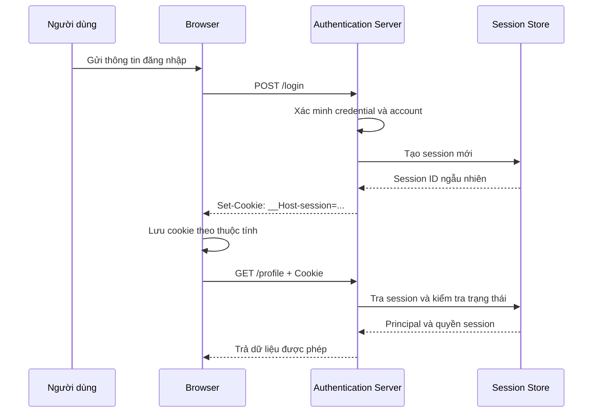
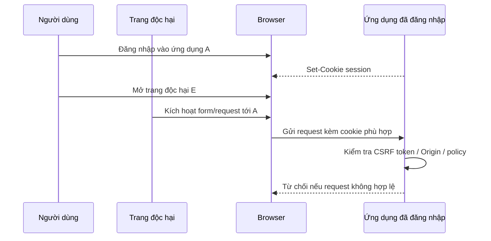
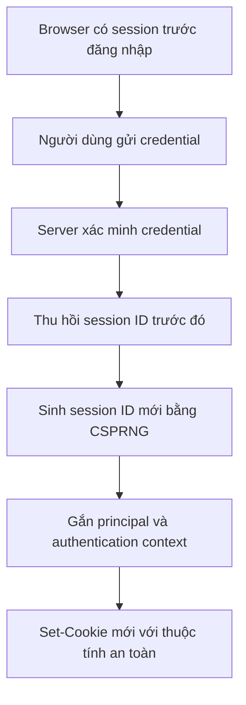

# Authentication cookie

**Authentication cookie** là cookie do ứng dụng hoặc hệ thống xác thực thiết lập để trình duyệt gửi kèm các request, qua đó duy trì trạng thái đăng nhập hoặc tham chiếu tới phiên đã được xác thực. Cookie thường chứa một session identifier ngẫu nhiên; server dùng identifier đó để tìm session record và xác định principal tương ứng. Vì trình duyệt tự động gửi cookie theo các quy tắc domain, path, secure context và SameSite, cookie tạo ra trải nghiệm đăng nhập liên tục nhưng cũng mở ra rủi ro CSRF, session fixation, đánh cắp phiên và cấu hình phạm vi quá rộng.

Bài học thuộc chương **Cookie và browser** trong module **SECURITY_AUTHENTICATION_FUNDAMENTALS**. Người học cần hiểu browser lưu và gửi cookie thế nào, phân biệt cookie với session, chọn thuộc tính `Secure`, `HttpOnly`, `SameSite`, `Domain`, `Path`, `Expires` và `Max-Age`, bảo vệ cookie trước XSS/CSRF, quản lý vòng đời session và mô hình hóa ranh giới tin cậy giữa browser, ứng dụng, reverse proxy và hệ thống xác thực.

Điểm cốt lõi: **cookie là cơ chế lưu và chuyển dữ liệu giữa browser với server; cookie tự nó không chứng minh người dùng là ai**. Bằng chứng đăng nhập được kiểm tra trước đó, server tạo session và gắn cookie với session đó. Mọi request dùng cookie vẫn cần được kiểm tra trạng thái session, quyền và ngữ cảnh nghiệp vụ.

## 1. Cookie hoạt động như thế nào?

HTTP về cơ bản là giao thức request/response. Nếu không có cơ chế duy trì trạng thái, mỗi request độc lập và server không tự biết hai request đến từ cùng một phiên đăng nhập. Cookie cung cấp cách browser lưu một cặp tên/giá trị do server gửi và tự đính kèm vào những request phù hợp.

Luồng cơ bản:

1. Người dùng đăng nhập bằng mật khẩu, passkey, MFA hoặc một cơ chế được chấp nhận.
2. Server xác minh chứng cứ, kiểm tra account và tạo session.
3. Server gửi response có header `Set-Cookie` chứa session cookie và các thuộc tính bảo vệ.
4. Browser lưu cookie theo chính sách của nó.
5. Với request tiếp theo phù hợp phạm vi cookie, browser tự gửi header `Cookie`.
6. Server đọc session identifier, tra session record, kiểm tra trạng thái và tạo principal cho request.



Cookie không thay thế bước xác thực. Nó là **vật mang session credential** trong các request sau đăng nhập.

### 1.1. Ví dụ response thiết lập cookie

```http
HTTP/1.1 200 OK
Set-Cookie: __Host-session=RANDOM_OPAQUE_VALUE; Path=/; Secure; HttpOnly; SameSite=Lax
Cache-Control: no-store
Content-Type: application/json

{"authenticated":true}
```

`RANDOM_OPAQUE_VALUE` là placeholder minh họa, không phải giá trị session thật. Một session cookie có thể không khai báo `Expires` hoặc `Max-Age`, khiến browser xem nó là cookie phiên theo hành vi lưu trữ. Tuy vậy, **session trên server vẫn cần expiry riêng**; việc browser đóng hoặc xóa cookie không tự bảo đảm server đã thu hồi session.

### 1.2. Browser gửi cookie ra sao?

Browser tự quyết định cookie nào phù hợp với URL, scheme, path, SameSite context và các thuộc tính khác. Request thường chứa:

```http
GET /profile HTTP/1.1
Host: app.example.org
Cookie: __Host-session=RANDOM_OPAQUE_VALUE
```

Client JavaScript không cần tự thêm header `Cookie`; browser quản lý header này và JavaScript thông thường không được phép thiết lập trực tiếp. Với `fetch`, thuộc tính `credentials` điều khiển việc gửi credential theo chính sách browser; mặc định là `same-origin`. Đối với request cross-origin có cookie, client cần cấu hình phù hợp và server phải cho phép credential với origin cụ thể theo CORS.

## 2. Cookie khác session như thế nào?

Cookie và session thường được dùng cùng nhau nhưng là hai thành phần khác nhau:

| Thành phần | Nơi lưu / quản lý | Vai trò |
| --- | --- | --- |
| **Authentication cookie** | Browser lưu và gửi theo phạm vi cookie. | Mang session ID hoặc credential liên quan. |
| **Session record** | Server-side store, database, cache hoặc session service. | Lưu trạng thái đăng nhập, principal, thời hạn, thông tin xác thực và metadata cần thiết. |
| **Principal** | Được server dựng cho request sau khi kiểm tra session. | Đại diện danh tính bảo mật và ngữ cảnh quyền. |
| **Authorization policy** | Server/service quản lý. | Quyết định principal được làm gì trên resource. |

Ví dụ, cookie chứa chuỗi ngẫu nhiên `sid=...`; server lưu record tương ứng:

```json
{
  "session_id_hash": "stored-verifier-or-keyed-hash",
  "user_identity_id": "usr-57",
  "account_id": "acct-91",
  "tenant_id": "org-7",
  "created_at": "2026-11-22T05:00:00Z",
  "last_seen_at": "2026-11-22T05:10:00Z",
  "absolute_expires_at": "2026-11-22T13:00:00Z",
  "status": "active",
  "authentication_context": {
    "method": ["passkey"],
    "user_verified": true
  }
}
```

Đây là ví dụ khái niệm. Server không cần lưu mọi claim trong session; chỉ lưu dữ liệu cần để xác định trạng thái và áp dụng policy. Không lưu password, OTP seed, private key hay token nhạy cảm không cần thiết trong session record.

### 2.1. Opaque session ID thường có lợi thế gì?

Với server-side session, browser chỉ giữ một identifier ngẫu nhiên khó đoán. Khi session bị thu hồi, server đánh dấu record inactive; cookie cũ không còn giá trị. Server cũng có thể cập nhật role, tenant hoặc trạng thái account mà không cần chờ một JWT tự chứa hết hạn, miễn là request tra session state theo chính sách.

Identifier cần được tạo bằng CSPRNG với entropy đủ cao, không mang user ID, email, thời gian hoặc thông tin có thể đoán. Có thể lưu hash/HMAC của session ID phía server để giảm tác động nếu kho session bị đọc; cách lưu phải bảo đảm khả năng tra cứu và rotation.

### 2.2. Cookie chứa JWT có khác không?

Một số ứng dụng đặt JWT hoặc token đã ký trong cookie. Khi đó server có thể xác minh chữ ký và claims thay vì tra một session record truyền thống. Tuy nhiên:

- Cookie vẫn được browser tự động gửi, nên **rủi ro CSRF vẫn tồn tại**.
- `HttpOnly` giúp JavaScript không đọc cookie nhưng XSS vẫn có thể gửi request từ trang bị xâm nhập.
- JWT tự chứa khó thu hồi tức thời nếu resource server chỉ kiểm chữ ký và thời hạn.
- Nếu cookie chứa token, phải giới hạn audience, scope, expiry và cách refresh; không coi chữ ký hợp lệ là đủ authorization.
- Token trong cookie không được dùng lẫn mục đích giữa ID token và access token.

Chọn server-side session hoặc token-based session theo nhu cầu kiến trúc. Không nhét toàn bộ hồ sơ, quyền nhạy cảm hay dữ liệu cá nhân vào cookie chỉ vì cookie được ký.

## 3. Các thuộc tính bảo mật của authentication cookie

Các thuộc tính cookie quyết định browser lưu, gửi và cho phép script truy cập cookie như thế nào. Ví dụ:

```http
Set-Cookie: __Host-session=RANDOM_VALUE; Path=/; Secure; HttpOnly; SameSite=Lax; Max-Age=1800
```

Đây là cấu hình minh họa. Thời hạn thực tế cần khớp với session policy của server.

### 3.1. Secure

`Secure` yêu cầu browser chỉ gửi cookie qua secure channel, thông thường là HTTPS. Cookie xác thực cần bật thuộc tính này để tránh gửi session ID qua kết nối HTTP không mã hóa.

- Triển khai HTTPS xuyên suốt, bao gồm kết nối từ reverse proxy tới backend theo yêu cầu bảo mật.
- Không tắt xác minh TLS hoặc cho phép downgrade chỉ để hỗ trợ môi trường production cấu hình sai.
- Cấu hình HSTS phù hợp để giảm khả năng browser truy cập site bằng HTTP.
- Kiểm tra proxy có truyền đúng scheme và không khiến ứng dụng phát hành cookie thiếu `Secure`.

### 3.2. HttpOnly

`HttpOnly` ngăn JavaScript thông thường đọc cookie qua API như `document.cookie`. Điều này làm giảm nguy cơ XSS đánh cắp trực tiếp session ID.

Nhưng HttpOnly **không ngăn XSS thực hiện hành động thay mặt người dùng**. Script độc hại chạy trong origin hợp lệ vẫn có thể gọi API; browser tự đính kèm cookie. Vì vậy vẫn cần output encoding, sanitization, CSP phù hợp, kiểm soát dependency và bảo vệ CSRF.

Không đánh dấu cookie cần JavaScript đọc là authentication cookie nếu không có lý do kiến trúc rõ. Access token/session secret trong localStorage không tự an toàn hơn cookie HttpOnly.

### 3.3. SameSite

`SameSite` kiểm soát trong những ngữ cảnh site khác nhau browser có gửi cookie hay không. Đây là lớp giảm CSRF, nhưng cần hiểu đúng khái niệm **site** và **origin**:

- **Same-origin** xét scheme, host và port.
- **Same-site** xét site theo quy tắc browser (hiện đại thường là schemeful site và miền đăng ký được); hai subdomain có thể same-site nhưng khác origin.

Các giá trị chính:

| Giá trị | Hành vi khái quát | Khi cân nhắc |
| --- | --- | --- |
| `Strict` | Không gửi cookie trong các ngữ cảnh cross-site. | Ứng dụng có thể chấp nhận người dùng phải điều hướng lại hoặc đăng nhập trong một số luồng từ site khác. |
| `Lax` | Cho phép cookie trong một số điều hướng top-level an toàn theo quy tắc browser; hạn chế nhiều request cross-site khác. | Thường là điểm khởi đầu phù hợp cho session web thông thường. |
| `None` | Cho phép gửi cookie trong ngữ cảnh cross-site nếu browser cho phép; cần `Secure`. | Một số kiến trúc SSO/iframe hoặc tích hợp cross-site có thể cần, nhưng phải có CSRF defense bổ sung. |

Không dựa vào mặc định của browser. Hãy đặt rõ `SameSite` theo luồng sản phẩm và kiểm thử trên browser được hỗ trợ. Chính sách third-party cookie có thể khác nhau giữa browser và thay đổi theo thời gian; `SameSite=None` không đảm bảo cookie bên thứ ba luôn được lưu/gửi.

### 3.4. Domain

Nếu bỏ thuộc tính `Domain`, cookie là **host-only cookie** và chỉ gửi tới host đã thiết lập nó. Nếu đặt `Domain=example.org`, cookie có thể được gửi tới domain đó và các subdomain phù hợp.

Với authentication cookie, ưu tiên host-only để giảm phạm vi. Cookie có Domain rộng như `.example.org` có thể được gửi tới nhiều subdomain, bao gồm subdomain cũ, subdomain do đội khác quản lý hoặc một host dễ bị takeover.

Không thể dùng Domain để đặt cookie cho public suffix không được phép. Cần xem xét toàn bộ subdomain và ranh giới tin cậy trước khi chia sẻ session giữa nhiều ứng dụng.

### 3.5. Path

`Path` giới hạn những đường dẫn request mà browser gửi cookie tới, ví dụ `Path=/app`. Path hữu ích để giảm gửi cookie không cần thiết nhưng **không phải ranh giới bảo mật đáng tin cậy giữa các ứng dụng cùng host**. Một ứng dụng khác trên cùng host có thể tạo request tới path phù hợp và có những khả năng tác động tùy môi trường.

Đối với cookie xác thực cấp host, `Path=/` thường cần cho toàn ứng dụng. Kết hợp với prefix `__Host-` yêu cầu Path là `/` và không có Domain.

### 3.6. Expires và Max-Age

- `Expires` chỉ định thời điểm cookie hết hạn theo ngày/giờ HTTP.
- `Max-Age` chỉ định tuổi thọ cookie tính bằng giây; khi cả hai xuất hiện, browser thường ưu tiên `Max-Age` theo chuẩn cookie hiện hành.
- Không có cả hai thuộc tính thường tạo session cookie, nhưng hành vi khôi phục session của browser có thể khác nhau.

Cookie expiry là phía browser; server-side session expiry là phía server. Nếu cookie còn tồn tại nhưng session record đã hết hạn, server phải từ chối. Nếu server thu hồi session, cookie cũ phải trở nên vô dụng dù browser vẫn còn lưu nó.

### 3.7. Prefix __Host- và __Secure-

Một số browser hỗ trợ cookie name prefix để áp đặt điều kiện thiết lập:

- `__Secure-`: cookie phải được thiết lập trong secure context với thuộc tính `Secure`.
- `__Host-`: yêu cầu secure context, thuộc tính `Secure`, `Path=/` và không có `Domain`, giúp cookie gắn với host cụ thể.

Ví dụ:

```http
Set-Cookie: __Host-session=RANDOM_VALUE; Path=/; Secure; HttpOnly; SameSite=Lax
```

Prefix là lớp bảo vệ bổ sung, không thay thế việc xác minh session, CSRF defense hoặc quản lý subdomain. Kiểm thử trên browser mục tiêu và không giả định mọi client cũ đều áp dụng prefix giống nhau.

## 4. Cookie scope và ranh giới tin cậy của browser

Cookie được browser áp dụng theo host/domain, path, scheme, expiry và SameSite context. Những quy tắc này tạo ra ranh giới gửi credential, nhưng **không đồng nghĩa với quyền truy cập trong ứng dụng**.

### 4.1. Host-only cookie thường an toàn hơn

Giả sử ứng dụng chính ở `app.example.org`, còn blog cũ ở `legacy.example.org`. Nếu session cookie có `Domain=example.org`, browser có thể gửi nó tới cả hai host phù hợp. Nếu blog có lỗ hổng hoặc bị takeover, phạm vi lộ/ảnh hưởng có thể tăng.

Một cookie host-only cho `app.example.org` hạn chế gửi tới `legacy.example.org`. Nếu nhiều ứng dụng cần đăng nhập chung, nên dùng SSO/IdP và luồng chuyển tiếp token/session được thiết kế, thay vì chia sẻ một cookie domain rộng tùy tiện.

### 4.2. Same-site không phải same-origin

`https://app.example.org` và `https://admin.example.org` có thể là same-site nhưng khác origin. Một trang ở subdomain khác có thể tạo request tới app; SameSite=Lax/Strict không phải hàng rào chống mọi request từ subdomain cùng site. Cần kiểm tra Origin/CSRF token và authorization phù hợp.

Cũng cần nhớ `http://example.org` và `https://example.org` có thể được xem khác nhau trong schemeful SameSite context. Không tự giả định các host cùng registrable domain luôn có cùng hành vi cookie.

### 4.3. Third-party cookie và partitioning

Cookie được sử dụng trong ngữ cảnh nhúng cross-site, iframe hoặc tracker có thể chịu chính sách third-party cookie và partitioning của browser. Một số browser chặn, giới hạn hoặc phân vùng cookie bên thứ ba; hỗ trợ có thể thay đổi.

Nếu sản phẩm dựa vào cookie cross-site cho SSO hoặc embedded app:

- Kiểm thử browser/platform được hỗ trợ.
- Ưu tiên redirect/top-level navigation hoặc chuẩn federation phù hợp nếu có thể.
- Không phụ thuộc vào third-party cookie như cơ chế duy nhất duy trì phiên.
- Đánh giá `SameSite=None; Secure`, partitioned cookies và tác động tới trải nghiệm.
- Giữ kiểm soát CSRF và xác minh state/nonce cho luồng liên kết.

## 5. Authentication cookie và CSRF

**Cross-Site Request Forgery (CSRF)** xảy ra khi browser của người dùng gửi request có credential tự động đính kèm tới một site mà người dùng đã đăng nhập, trong khi request bị kích hoạt từ một trang khác. Vì cookie được browser tự động gửi, attacker có thể khiến người dùng thực hiện hành động mà họ không chủ ý.

Ví dụ, người dùng đã đăng nhập `bank.example.org`. Attacker tạo trang có form gửi POST tới endpoint chuyển tiền. Nếu browser gửi session cookie và server không kiểm tra CSRF, request có thể được xử lý như hành động hợp lệ của người dùng.



### 5.1. Synchronizer token pattern

Với server-side session, server có thể tạo CSRF token gắn với session, đưa token vào form hoặc response an toàn để frontend gửi lại trong header/body. Server so sánh token với session khi nhận request thay đổi trạng thái.

Ví dụ:

```html
<form method="post" action="/profile/email">
  <input type="hidden" name="csrf_token" value="SERVER_GENERATED_TOKEN">
  <input type="email" name="email">
  <button type="submit">Cập nhật</button>
</form>
```

Token cần khó đoán, gắn với session và không bị lộ qua URL/log. Với SPA, có thể cung cấp token qua response được bảo vệ rồi gửi trong custom header; server phải xác minh nguồn request và token. Không dùng một token cố định cho mọi người dùng.

### 5.2. Double-submit cookie pattern

Một biến thể đặt CSRF token trong cookie và yêu cầu client gửi lại cùng giá trị trong header hoặc body. Server kiểm tra hai giá trị khớp và có thể dùng signed token hoặc ràng buộc session để chống attacker tự đặt cookie.

Double-submit đơn giản nhưng cần cẩn thận với cookie injection từ subdomain, Domain scope và cookie tossing. Nếu attacker có thể đặt cookie cùng tên từ subdomain, so sánh hai giá trị đơn thuần có thể không đủ. Một signed, session-bound double-submit pattern hoặc synchronizer token có thể phù hợp hơn.

### 5.3. Kiểm tra Origin và Referer

Server có thể kiểm tra `Origin` hoặc `Referer` trên request thay đổi trạng thái để xác nhận request bắt nguồn từ origin được phép. Cần xử lý trường hợp header vắng mặt theo policy và không cho client tự gửi giá trị tùy ý qua một proxy không đáng tin.

Origin check là lớp phòng vệ bổ sung; kết hợp CSRF token và SameSite phù hợp. Không dùng CORS như biện pháp CSRF duy nhất: CORS chủ yếu kiểm soát việc JavaScript đọc response cross-origin, không ngăn mọi form hoặc request được browser gửi.

### 5.4. SameSite không thay thế CSRF token trong mọi trường hợp

SameSite=Lax/Strict giúp giảm cookie trong nhiều cross-site request, nhưng có những giới hạn:

- Subdomain cùng site có thể tạo request same-site nhưng khác origin.
- Luồng đăng nhập/SSO có thể cần điều hướng cross-site.
- Browser và chính sách cookie có thể khác nhau.
- Một số thao tác hoặc endpoint không tuân thủ ngữ nghĩa HTTP an toàn có thể bị kích hoạt ngoài dự kiến.

Dùng `SameSite` như defense-in-depth; vẫn bảo vệ các thao tác thay đổi trạng thái bằng CSRF token, Origin check và authorization.

## 6. Authentication cookie và XSS

**Cross-Site Scripting (XSS)** cho phép mã độc chạy trong origin của ứng dụng. Nếu cookie không có HttpOnly, script có thể đọc cookie qua API JavaScript và gửi session ID ra ngoài. HttpOnly làm giảm nguy cơ đánh cắp trực tiếp này.

Nhưng khi XSS chạy trong origin hợp lệ, browser vẫn tự gửi cookie cho request mà script tạo. Attacker có thể đọc dữ liệu mà trang được phép đọc, thay đổi hồ sơ, thêm phương thức khôi phục hoặc thực hiện giao dịch tùy quyền của phiên.

Biện pháp cần kết hợp:

- Bật `HttpOnly` cho session cookie.
- Escape/sanitize dữ liệu không tin cậy theo ngữ cảnh HTML, attribute, URL và JavaScript.
- Dùng CSP với nonce/hash và hạn chế script nguồn không tin cậy khi phù hợp.
- Kiểm soát dependency, template, upload và DOM APIs.
- Bảo vệ thao tác nhạy cảm bằng re-authentication/step-up và xác nhận giao dịch.
- Hạn chế quyền session, thời hạn và khả năng truy cập của từng principal.
- Không đưa token, secret hoặc session ID vào DOM, URL, localStorage hoặc log.

HttpOnly là một thuộc tính quan trọng nhưng không phải giải pháp XSS toàn diện.

## 7. Session fixation và rotation

**Session fixation** xảy ra khi attacker khiến nạn nhân sử dụng một session identifier mà attacker đã biết hoặc kiểm soát trước khi nạn nhân đăng nhập. Nếu server giữ nguyên identifier sau authentication, attacker có thể dùng cùng ID để tiếp quản session đã được xác thực.

Biện pháp chính:

1. Tạo session ID mới sau khi đăng nhập thành công.
2. Rotation session ID khi thay đổi mức đặc quyền, xác thực lại hoặc hoàn tất recovery theo policy.
3. Hủy session cũ hoặc đánh dấu không còn hợp lệ.
4. Không nhận session ID do client tự chọn làm định danh phiên hợp lệ.
5. Cookie dùng cho session phải có entropy cao và không chứa dữ liệu có thể đoán.
6. Kiểm tra session state server-side trước khi tạo principal.

Ví dụ luồng:



Không chỉ thay giá trị cookie ở browser. Server phải vô hiệu hóa session cũ, nếu không identifier cũ vẫn có thể hoạt động.

## 8. Quản lý vòng đời authentication session

Cookie expiry và session expiry phải được thiết kế cùng nhau. Một session policy thường có:

- **Idle timeout:** hết hạn sau thời gian không có hoạt động được tính là activity.
- **Absolute lifetime:** giới hạn tổng thời gian kể từ khi tạo session.
- **Re-authentication/step-up:** yêu cầu xác thực lại trước hành động nhạy cảm hoặc sau một khoảng thời gian.
- **Revocation:** vô hiệu hóa session khi logout, mất thiết bị, nghi ngờ compromise, account bị đình chỉ hoặc quyền thay đổi.
- **Rotation:** thay session identifier khi đăng nhập, nâng quyền hoặc một sự kiện bảo mật quan trọng.

### 8.1. Server-side session expiry

Server nên kiểm tra thời hạn độc lập với cookie. Ví dụ pseudocode:

```text
authenticateRequest(request):
    sessionId = readCookie(request, "__Host-session")
    require sessionId exists

    session = lookupSession(hashOrVerify(sessionId))
    require session exists
    require session.status == "active"
    require now < session.absoluteExpiresAt
    require now - session.lastSeenAt < idleTimeout

    account = loadAccount(session.accountId)
    require account.status == "active"

    updateLastSeenAccordingToPolicy(session)
    return principalFor(session, account)
```

Không cập nhật `lastSeenAt` cho mọi request một cách không giới hạn nếu điều đó tạo sliding session vô hạn. Cần phân biệt hoạt động thực sự của người dùng, heartbeat nền và request tự động.

### 8.2. Logout và xóa cookie

Logout nên thu hồi session phía server trước hoặc đồng thời với việc yêu cầu browser xóa cookie. Response có thể gửi cookie cùng tên và cùng phạm vi với giá trị rỗng, thời hạn đã qua hoặc `Max-Age=0`:

```http
Set-Cookie: __Host-session=; Path=/; Secure; HttpOnly; SameSite=Lax; Max-Age=0
```

Phạm vi cookie khi xóa phải khớp với cookie đã thiết lập; nếu cookie cũ dùng Domain/Path khác, cần xử lý đúng biến thể đó. Xóa cookie ở browser mà không thu hồi session server-side có thể để session ID bị sao chép tiếp tục hoạt động.

### 8.3. Đăng xuất một thiết bị và tất cả thiết bị

Ứng dụng có thể quản lý nhiều session cho cùng account. Người dùng nên có khả năng xem và thu hồi session theo thiết bị/phiên nếu sản phẩm hỗ trợ. “Đăng xuất thiết bị này” thu hồi session hiện tại; “đăng xuất tất cả” cần thu hồi toàn bộ session hoặc tăng session version theo thiết kế. Refresh token, access token và session ở các ứng dụng SSO có thể cần xử lý riêng.

## 9. Cookie trong fetch, CORS và SSO

### 9.1. fetch credentials

Với JavaScript:

```javascript
// Same-origin: browser mặc định gửi credential theo chính sách same-origin.
fetch("/api/profile");

// Cross-origin: nếu kiến trúc cần cookie, phải yêu cầu credentials rõ ràng.
fetch("https://api.example.org/profile", {
  credentials: "include"
});
```

Đối với request cross-origin có credentials, server cần trả CORS response cho origin cụ thể, bật `Access-Control-Allow-Credentials: true` và xử lý preflight/headers phù hợp. Không thể kết hợp credentials với `Access-Control-Allow-Origin: *` theo chuẩn CORS. CORS không thay thế CSRF token vì browser vẫn có thể gửi một số loại request cross-site dù script không đọc được response.

### 9.2. SSO và cookie của IdP

Trong SSO, IdP có thể dùng cookie riêng để duy trì phiên đăng nhập tại domain của IdP. Ứng dụng relying party có cookie/session riêng sau khi hoàn tất federation. Hai session này không phải một cookie dùng chung.

Luồng redirect-based OIDC/SAML thường có state, nonce và các cơ chế chống giả mạo/replay. Cookie của ứng dụng RP phải được thiết lập sau khi xác minh response federation và ràng buộc với đúng giao dịch đăng nhập. Nếu browser chặn third-party cookie, kiến trúc dựa vào iframe silent authentication có thể gặp vấn đề; cần thiết kế fallback và kiểm thử browser.

Không đặt cookie Domain rộng chỉ để chia sẻ session giữa các ứng dụng con nếu có thể dùng federation hoặc cơ chế SSO có ranh giới tin cậy rõ hơn.

## 10. Các lỗi cấu hình thường gặp

| Sai lầm | Rủi ro | Cách xử lý |
| --- | --- | --- |
| Không bật `Secure` | Cookie có thể bị gửi qua kết nối không mã hóa trong điều kiện phù hợp. | Bắt buộc HTTPS và Secure cho authentication cookie. |
| Không bật `HttpOnly` | XSS có thể đọc trực tiếp session cookie. | Bật HttpOnly; đồng thời sửa XSS vì script vẫn có thể hành động. |
| Không đặt `SameSite` rõ ràng | Hành vi phụ thuộc mặc định browser và có thể không như mong đợi. | Chọn Strict/Lax/None theo luồng, kiểm thử thực tế. |
| Dùng `SameSite=None` nhưng thiếu Secure | Browser hiện đại thường từ chối cookie theo yêu cầu chuẩn. | Kết hợp None; Secure và CSRF defense. |
| Đặt `Domain=example.org` cho mọi app | Cookie lan tới nhiều subdomain, tăng bề mặt tấn công. | Ưu tiên host-only; chỉ mở rộng khi có lý do và kiểm soát subdomain. |
| Coi Path là ranh giới bảo mật | Ứng dụng khác cùng host có thể không bị cô lập như kỳ vọng. | Không dựa vào Path để phân tách quyền; dùng host/origin và authorization. |
| Dùng session ID cố định trước và sau login | Session fixation. | Rotate ID sau authentication và thay đổi privilege. |
| Chỉ xóa cookie khi logout | Session server vẫn có thể hoạt động nếu ID bị sao chép. | Thu hồi session server-side và xóa cookie đúng phạm vi. |
| Chỉ dựa vào SameSite để chống CSRF | Same-site cross-origin hoặc luồng đặc biệt có thể vẫn có rủi ro. | CSRF token, Origin/Referer check và SameSite kết hợp. |
| Nghĩ HttpOnly chặn XSS hoàn toàn | Script độc hại vẫn có thể gọi API bằng cookie tự động gửi. | Phòng XSS, CSP, step-up và giới hạn quyền. |
| Lưu access/refresh token tùy tiện trong cookie | Tăng rủi ro CSRF và lộ token qua sai cấu hình. | Thiết kế BFF/session hoặc cookie token với CSRF và lifecycle rõ ràng. |
| Không kiểm tra session state server-side | Cookie cũ có thể tiếp tục được chấp nhận sau khi account bị khóa. | Kiểm tra expiry, revocation, account và tenant. |

## 11. Tình huống thực hành: cookie domain rộng và subdomain bị takeover

**Bối cảnh:** Nền tảng đào tạo dùng `Domain=example.org` cho cookie `session`. Ứng dụng chính ở `learn.example.org`; một subdomain cũ `promo.example.org` không còn được quản lý chặt. Một attacker chiếm được subdomain cũ và có thể phục vụ nội dung độc hại.

**Phân tích:**

1. Cookie Domain rộng khiến browser gửi authentication cookie tới các subdomain phù hợp.
2. Subdomain bị takeover nằm trong phạm vi tin cậy rộng hơn dự kiến.
3. Nếu cookie thiếu HttpOnly, script có thể đọc cookie; nếu có HttpOnly, script vẫn có thể tạo request tới ứng dụng trong một số ngữ cảnh và khai thác các điểm yếu CSRF/session.
4. Cùng site không đồng nghĩa cùng origin hoặc cùng mức tin cậy.
5. Một cookie chia sẻ giữa nhiều subdomain làm tăng tác động của lỗ hổng ở ứng dụng ít tin cậy.

**Thiết kế lại:**

- Dùng host-only cookie cho `learn.example.org`, ưu tiên prefix `__Host-` với Secure, HttpOnly, Path=/ và không Domain.
- Dùng SSO/federation nếu các ứng dụng thực sự cần đăng nhập chung; không chia sẻ session cookie toàn domain.
- Kiểm kê và bảo vệ subdomain, loại bỏ DNS record không còn dùng, giám sát takeover.
- Thêm CSRF token/Origin validation cho thao tác thay đổi trạng thái.
- Rotate session sau đăng nhập, thu hồi session cũ và đặt idle/absolute expiry.
- Nếu cookie domain cũ từng được dùng, triển khai migration và xóa cookie theo đúng Domain/Path cũ.

## 12. Checklist triển khai authentication cookie

- [ ] Cookie chỉ mang opaque session ID hoặc credential đã được thiết kế có chủ đích; không chứa password, OTP seed hay private key.
- [ ] Bật `Secure` và `HttpOnly` cho authentication cookie.
- [ ] Đặt `SameSite` rõ ràng theo luồng và kiểm thử browser mục tiêu.
- [ ] Ưu tiên host-only cookie; cân nhắc `__Host-` với `Path=/` và không có Domain.
- [ ] Không xem `Path` là ranh giới authorization hoặc isolation.
- [ ] Dùng session ID ngẫu nhiên có entropy cao, rotate sau login và nâng quyền.
- [ ] Server kiểm tra session state, idle timeout, absolute lifetime, account status và tenant.
- [ ] Logout thu hồi session server-side và xóa cookie đúng phạm vi.
- [ ] Bảo vệ request thay đổi trạng thái bằng CSRF token và Origin/Referer policy; SameSite là defense-in-depth.
- [ ] Phòng XSS bằng output encoding, sanitization, CSP và kiểm soát dependency; hiểu HttpOnly không chặn hành động của script.
- [ ] Kiểm tra Domain/subdomain, proxy, TLS termination, CORS và fetch credentials.
- [ ] Không phụ thuộc third-party cookie cho luồng quan trọng nếu browser có thể chặn.
- [ ] Không ghi session ID, cookie header hoặc token vào log/tracing.
- [ ] Kiểm thử session fixation, CSRF, XSS impact, cookie tossing, expiry, logout và revoke trên nhiều thiết bị.

## 13. Câu hỏi tự kiểm tra

**1. Authentication cookie có tự xác thực người dùng không?**  
Không. Nó mang session identifier hoặc credential được server kiểm tra. Danh tính và trạng thái được xác định qua session/account mapping phía server.

**2. `HttpOnly` có ngăn mọi tác động của XSS không?**  
Không. Nó ngăn JavaScript thông thường đọc cookie, nhưng script chạy trong origin vẫn có thể gửi request và browser tự đính kèm cookie.

**3. Vì sao cookie xác thực nên có `Secure`?**  
Để browser chỉ gửi cookie qua secure channel, thông thường là HTTPS, giảm nguy cơ lộ session qua kết nối không mã hóa.

**4. SameSite và Same-origin khác nhau như thế nào?**  
Same-origin xét scheme, host và port; SameSite xét ngữ cảnh site theo quy tắc browser. Hai subdomain có thể same-site nhưng khác origin.

**5. Cookie hết hạn có đảm bảo session server đã bị xóa không?**  
Không. Cookie expiry là phía browser; server phải quản lý session expiry/revocation độc lập.

**6. Tại sao phải rotate session ID sau đăng nhập?**  
Để ngăn session identifier trước xác thực bị attacker biết hoặc kiểm soát tiếp tục dùng sau khi quyền đã được nâng lên.

**7. SameSite=Lax có loại bỏ hoàn toàn CSRF không?**  
Không. Có các ngữ cảnh same-site cross-origin và luồng browser đặc biệt. Nên kết hợp CSRF token, Origin check và authorization.

**8. Có thể chia sẻ cookie Domain rộng giữa tất cả subdomain để làm SSO không?**  
Không nên mặc định. Điều đó mở rộng bề mặt tin cậy; SSO/federation với cookie riêng cho từng ứng dụng thường có ranh giới rõ hơn.

**9. Logout chỉ xóa cookie ở browser có đủ không?**  
Không. Server cần thu hồi session để cookie/session ID bị sao chép cũng không còn được chấp nhận.

**10. Cookie chứa JWT có loại bỏ rủi ro CSRF không?**  
Không. Nếu browser tự động gửi cookie, request vẫn có thể bị CSRF. JWT cần kiểm tra đúng issuer/audience/expiry và có chiến lược thu hồi; cookie vẫn cần thuộc tính và CSRF defense phù hợp.

**Ghi nhớ:** Authentication cookie giúp browser duy trì phiên, nhưng cũng khiến credential được gửi tự động theo quy tắc browser. Hãy giới hạn phạm vi cookie, bật Secure/HttpOnly/SameSite phù hợp, dùng session ID khó đoán và rotation, kiểm tra trạng thái session phía server, bảo vệ CSRF/XSS và thu hồi session đúng cách khi logout hoặc có sự cố.
