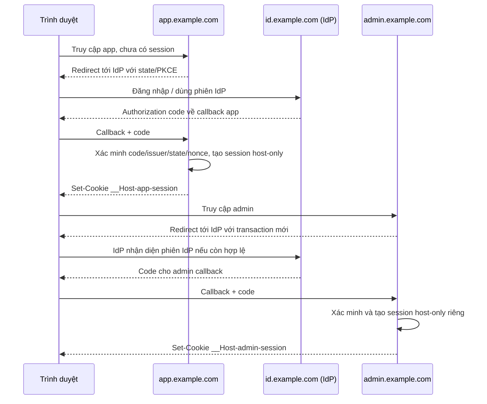

# Cookie scope — Phạm vi áp dụng của cookie

Cookie là một cơ chế để trình duyệt lưu dữ liệu nhỏ và tự động gửi lại trong các request phù hợp. Với ứng dụng đăng nhập, cookie thường mang session ID hoặc một giá trị liên quan tới phiên. Nhưng **cookie được gửi tới host nào, đường dẫn nào, trong ngữ cảnh site nào và qua loại kết nối nào** phụ thuộc vào các thuộc tính scope và chính sách của trình duyệt.

Ví dụ, công ty có `app.example.com`, `admin.example.com` và `static.example.com`. Nếu ứng dụng đặt cookie với `Domain=example.com`, trình duyệt có thể gửi cookie tới các subdomain phù hợp. Khi một subdomain ít được bảo vệ bị chiếm quyền, cookie dùng chung có thể bị lạm dụng hoặc bị ghi đè trong một số tình huống. Nếu cookie chỉ cần dùng cho `app.example.com`, đặt cookie host-only thường thu hẹp bề mặt tấn công.

Trong module `SECURITY_AUTHENTICATION_FUNDAMENTALS`, cookie scope là nền tảng để bảo vệ session và luồng xác thực trên trình duyệt. Người học cần phân biệt host-only với Domain cookie, hiểu Path matching, Secure, HttpOnly, SameSite và cookie partitioning; biết rằng scope của cookie không phải là phân quyền ứng dụng; và thiết kế cookie phiên sao cho giảm rủi ro session theft, cookie tossing, CSRF và rò rỉ giữa các subdomain.

## 1. Cookie scope quyết định điều gì?

Cookie không được trình duyệt gửi cho mọi request. Trình duyệt chọn cookie dựa trên host/domain, path, secure transport, thời hạn, SameSite context, partition key và các chính sách lưu trữ khác. Khi phù hợp, trình duyệt đưa các cặp `name=value` vào header `Cookie`.

Các thuộc tính scope quan trọng:

| Thuộc tính | Vai trò | Ví dụ |
| --- | --- | --- |
| **Domain** | Mở rộng cookie từ host hiện tại tới domain và các subdomain phù hợp | `Domain=example.com` |
| **Host-only** | Chỉ gửi cookie tới đúng host đã đặt cookie; được tạo khi bỏ thuộc tính `Domain` | Cookie đặt từ `app.example.com` không được gửi tới `admin.example.com` |
| **Path** | Giới hạn các URL path mà trình duyệt gửi cookie tới | `Path=/account` |
| **Secure** | Chỉ gửi cookie qua secure transport theo quy tắc trình duyệt | `Secure` |
| **HttpOnly** | Không cho JavaScript truy cập cookie qua `document.cookie` | `HttpOnly` |
| **SameSite** | Điều khiển việc gửi cookie trong request same-site/cross-site | `SameSite=Lax` |
| **Partitioned** | Lưu cookie trong vùng phân vùng theo top-level site trong các trình duyệt hỗ trợ | `Partitioned` |
| **Max-Age / Expires** | Xác định thời gian lưu cookie ở trình duyệt | `Max-Age=1800` |

Một cookie thường được nhận diện bằng tên, domain/host scope và path; với cookie partitioned còn có ngữ cảnh phân vùng. Hai cookie cùng tên nhưng khác Path hoặc Domain có thể cùng tồn tại. Vì vậy, server không nên giả định một cookie name chỉ xuất hiện một lần trong request.

### Cookie không phải là quyền truy cập

Cookie scope chỉ điều khiển **trình duyệt có gửi cookie trong request nào**. Nó không quyết định người dùng được xem dữ liệu gì. Server vẫn phải:

- xác minh session ID hoặc token;
- kiểm tra trạng thái phiên, tài khoản và thời hạn;
- dựng principal từ dữ liệu phía server đáng tin;
- phân quyền theo subject, tenant, resource và action;
- bảo vệ request thay đổi trạng thái khỏi CSRF.

Một cookie được gửi tới `/admin` không có nghĩa chủ phiên là quản trị viên. Ngược lại, cookie không được gửi tới một path không có nghĩa server đã bảo vệ endpoint đó khỏi request bằng credential khác.

## 2. Domain cookie và host-only cookie

### 2.1. Bỏ Domain để tạo host-only cookie

Khi server gửi `Set-Cookie` mà **không có thuộc tính `Domain`**, trình duyệt tạo host-only cookie cho host đã trả response. Ví dụ response từ `https://app.example.com`:

```http
Set-Cookie: __Host-app-session=opaque-value; Path=/; Secure; HttpOnly; SameSite=Lax
```

Cookie này chỉ được gửi tới `app.example.com` theo các điều kiện còn lại. Nó không được gửi tới `admin.example.com` hoặc `static.example.com` chỉ vì các host đó cùng nằm dưới `example.com`.

Đây thường là lựa chọn phù hợp cho session cookie của một ứng dụng. Nếu ứng dụng không có yêu cầu chia sẻ cookie giữa các subdomain, không đặt `Domain`.

### 2.2. Đặt Domain để chia sẻ giữa subdomain

Ví dụ:

```http
Set-Cookie: shared-session=value; Domain=example.com; Path=/; Secure; HttpOnly; SameSite=Lax
```

Cookie Domain này có thể được gửi tới `example.com` và các subdomain phù hợp như `app.example.com`, `admin.example.com` hoặc `static.example.com`, nếu các điều kiện cookie khác cũng thỏa mãn.

Quy tắc cần nhớ:

- Server chỉ có thể đặt Domain là host hiện tại hoặc một domain cha hợp lệ theo quy tắc domain-match; không thể đặt cookie cho domain không liên quan.
- Trình duyệt từ chối một số Domain không hợp lệ, chẳng hạn public suffix như `com` hoặc `co.uk`; danh sách public suffix được trình duyệt sử dụng để ngăn cookie mở rộng quá rộng.
- Dấu chấm đứng đầu trong `Domain=.example.com` không tạo thêm ý nghĩa đặc biệt trong các trình duyệt hiện đại; hãy dùng `Domain=example.com` nếu thực sự cần Domain cookie.
- Cookie có `Domain=example.com` không bị giới hạn ở một port. Cookie không có thuộc tính Port; các ứng dụng ở những port khác nhau trên cùng host có thể cùng nhận cookie nếu path/secure và các điều kiện khác phù hợp.
- Domain cookie không tự chia sẻ cookie sang một domain đăng ký khác, ví dụ `example.net`.

### 2.3. Rủi ro khi chia sẻ cookie giữa subdomain

Giả sử `app.example.com` dùng `Domain=example.com` cho session. Một subdomain cũ `legacy.example.com` có ứng dụng yếu hoặc bị chiếm quyền. Kẻ tấn công kiểm soát subdomain có thể cố đặt cookie cùng tên với Domain cha, hoặc lợi dụng cách server xử lý nhiều cookie cùng tên. Đây là nhóm rủi ro thường gọi là **cookie tossing** hoặc cookie shadowing.

Các biện pháp giảm thiểu:

1. Ưu tiên host-only cookie cho session và credential nhạy cảm.
2. Dùng tên cookie riêng, không tái sử dụng một tên chung giữa nhiều ứng dụng có mức tin cậy khác nhau.
3. Với session cookie, cân nhắc prefix `__Host-` để trình duyệt áp dụng ràng buộc host-only mạnh hơn.
4. Không dựa vào thứ tự cookie cùng tên trong header `Cookie`; parser server/framework phải xử lý duplicate name một cách rõ ràng và an toàn.
5. Tách biệt ứng dụng legacy, subdomain do bên thứ ba quản lý và các ứng dụng có mức bảo vệ khác nhau.

## 3. Cookie Path và quy tắc path-match

`Path` giới hạn các request path mà trình duyệt gửi cookie tới. Ví dụ:

```http
Set-Cookie: account-ui=abc; Path=/account; Secure; HttpOnly; SameSite=Lax
```

Cookie này có thể được gửi tới `/account`, `/account/profile` và `/account/settings`. Nó không được gửi tới `/accounts` chỉ vì chuỗi đó bắt đầu bằng `/account`; quy tắc path-match xét ranh giới path, không đơn giản là prefix tùy ý.

### Quy tắc khái quát

Cookie Path khớp request path khi một trong các điều kiện sau đúng:

- Hai path giống hệt nhau.
- Cookie Path là tiền tố của request path và cookie Path kết thúc bằng `/`.
- Cookie Path là tiền tố của request path và ký tự ngay sau tiền tố trong request path là `/`.

Ví dụ minh họa:

| Cookie Path | Request path | Path-match? |
| --- | --- | --- |
| `/` | `/account` | Có |
| `/account` | `/account` | Có |
| `/account` | `/account/profile` | Có |
| `/account/` | `/account/profile` | Có |
| `/account` | `/accounts` | Không |
| `/admin` | `/admin/users/42` | Có |
| `/admin` | `/administrator` | Không |

Nếu không chỉ định `Path`, trình duyệt tạo default-path dựa trên URL path của response theo quy tắc cookie. Không nên dựa vào default-path cho session cookie quan trọng; hãy đặt `Path` tường minh.

### Path không phải ranh giới bảo mật

Không dùng `Path=/admin` với kỳ vọng ngăn script ở `/` hoặc ứng dụng khác cùng origin truy cập session. Path cookie chủ yếu điều khiển việc trình duyệt đính kèm cookie vào request. Nó không tạo sandbox bảo mật giữa các ứng dụng cùng origin; script cùng origin có thể tương tác với các URL khác, và các vấn đề XSS hoặc request forgery vẫn cần được xử lý riêng.

Đối với session cookie chính, `Path=/` thường là lựa chọn đơn giản và dễ vận hành. Nếu cần tách các ứng dụng có mức tin cậy khác nhau, dùng host/subdomain hoặc origin riêng và cookie host-only; đừng dựa vào Path để cô lập ứng dụng.

## 4. Secure: chỉ gửi qua kênh bảo mật

Thuộc tính `Secure` yêu cầu trình duyệt chỉ gửi cookie qua secure transport, thường là HTTPS. Ví dụ:

```http
Set-Cookie: __Host-session=opaque-value; Path=/; Secure; HttpOnly; SameSite=Lax
```

Với cookie phiên đăng nhập, `Secure` nên được bật trong production. Nếu cookie nhạy cảm được gửi qua HTTP, người ở giữa mạng có thể đánh cắp hoặc sửa session ID. `Secure` giảm khả năng cookie bị gửi qua HTTP, nhưng không thay thế TLS đúng cấu hình và xác minh chứng chỉ.

Lưu ý:

- Dùng HTTPS cho toàn bộ ứng dụng, không chỉ trang login; bảo vệ mọi endpoint nhận cookie.
- Bật HSTS phù hợp để trình duyệt ưu tiên HTTPS và giảm downgrade.
- Kiểm tra proxy/load balancer kết thúc TLS; backend phải nhận thông tin scheme từ proxy đáng tin, không từ header do client tự khai.
- Không để redirect hoặc endpoint phụ gửi credential/session qua HTTP.
- `Secure` không ngăn XSS đọc dữ liệu khác hoặc thực hiện request same-origin; cần các lớp bảo vệ ứng dụng.

## 5. HttpOnly: giới hạn truy cập từ JavaScript

`HttpOnly` ngăn JavaScript thông thường đọc cookie qua `document.cookie`. Đây là lớp giảm thiểu rủi ro khi có XSS, vì script độc hại không thể đơn giản đọc và gửi session cookie ra ngoài bằng API này.

Ví dụ:

```http
Set-Cookie: __Host-session=opaque-value; Path=/; Secure; HttpOnly; SameSite=Lax
```

Nhưng `HttpOnly` **không loại bỏ XSS**:

- Script độc hại vẫn có thể gửi request same-origin; trình duyệt tự đính kèm cookie phù hợp.
- Script có thể đọc hoặc thay đổi nội dung trang, thực hiện thao tác dưới quyền người dùng và lấy dữ liệu API được hiển thị.
- Nếu session token được lưu thêm trong `localStorage` hoặc biến JavaScript, HttpOnly cookie không bảo vệ bản sao đó.
- HttpOnly không phải biện pháp chống CSRF; cookie vẫn được trình duyệt tự động gửi theo scope và SameSite policy.

Đối với session cookie, thường nên đặt `HttpOnly`. Nếu ứng dụng cần JavaScript đọc một cookie không nhạy cảm (ví dụ một số thiết kế CSRF token), tách riêng cookie đó và không đặt session ID vào nơi JavaScript đọc được.

## 6. SameSite: cookie trong ngữ cảnh same-site và cross-site

`SameSite` kiểm soát việc trình duyệt có gửi cookie trong một số request cross-site hay không. Thuộc tính này có ích trong phòng chống **Cross-Site Request Forgery (CSRF)**, vì nhiều CSRF dựa trên việc trình duyệt tự đính kèm cookie của một site khi người dùng truy cập site khác.

Ba giá trị thường dùng:

| Giá trị | Hành vi khái quát | Trường hợp cân nhắc |
| --- | --- | --- |
| `Strict` | Hạn chế cookie trong các request bắt nguồn từ site khác; thường chỉ gửi trong ngữ cảnh same-site | Ứng dụng có thể chấp nhận trải nghiệm khi người dùng đi từ liên kết bên ngoài rồi chưa có cookie trong request đầu |
| `Lax` | Cho phép cookie trong same-site và một số top-level cross-site navigation an toàn, thường là phương thức an toàn như GET | Lựa chọn cân bằng phổ biến cho session web |
| `None` | Cho phép cookie trong ngữ cảnh cross-site theo các điều kiện khác | Một số luồng nhúng/SSO cần cookie cross-site; phải đi kèm `Secure` và CSRF defense mạnh |

Nếu không chỉ định SameSite, trình duyệt hiện đại thường áp dụng hành vi mặc định tương tự Lax, nhưng chi tiết có thể khác theo trình duyệt/chính sách. Với cookie nhạy cảm, **hãy đặt rõ `SameSite`** thay vì phụ thuộc mặc định.

### 6.1. Site khác origin

Khái niệm **site** không giống **origin**:

- Origin gồm scheme, host và port. Ví dụ `https://app.example.com:443` và `https://admin.example.com` là khác origin.
- Schemeful site dựa trên scheme và registrable domain (eTLD+1) theo Public Suffix List; port không tạo site mới.
- `https://app.example.com` và `https://admin.example.com` thường là same-site nhưng khác origin.
- `https://app.example.com` và `http://app.example.com` là khác schemeful site.
- `https://example.com` và `https://attacker.example.net` là cross-site.

Điều này quan trọng: SameSite không phải cơ chế cô lập các subdomain. Nếu một subdomain cùng site bị chiếm quyền, request từ subdomain đó có thể vẫn được xem là same-site đối với cookie của domain chính. Cần host-only cookie, kiểm tra `Origin`, CSRF token và bảo vệ từng ứng dụng.

### 6.2. SameSite và CSRF

Ví dụ ứng dụng ngân hàng dùng cookie session. Attacker dụ nạn nhân mở một trang bên ngoài có form gửi `POST` tới ngân hàng. Nếu trình duyệt đính kèm cookie và server không kiểm tra CSRF, request có thể được thực hiện bằng phiên nạn nhân.

`SameSite=Lax` hoặc `Strict` làm giảm một số kiểu CSRF, nhưng không nên xem là lớp duy nhất. Các biện pháp phù hợp gồm:

- CSRF token gắn với session và được kiểm tra ở request thay đổi trạng thái.
- Kiểm tra `Origin` (và `Referer` theo policy dự phòng) đối với endpoint nhạy cảm.
- Không dùng GET để thực hiện thao tác thay đổi trạng thái.
- Không chấp nhận content type hoặc request shape bất thường cho endpoint nhạy cảm.
- Dùng `SameSite` phù hợp với luồng điều hướng/SSO; kiểm thử hành vi trên trình duyệt mục tiêu.

### 6.3. SameSite=None

Khi cần cookie trong ngữ cảnh cross-site, phải đặt rõ:

```http
Set-Cookie: sso-context=value; Path=/; Secure; HttpOnly; SameSite=None
```

Các trình duyệt yêu cầu `Secure` khi dùng `SameSite=None`. Tuy nhiên, `SameSite=None` không bảo đảm cookie bên thứ ba luôn được lưu hoặc gửi; chính sách chặn third-party cookies, tracking protection, partitioning và cài đặt người dùng có thể ảnh hưởng. Luồng SSO/embedded app cần có thiết kế dự phòng và kiểm thử thực tế, không giả định mọi browser đều hành xử giống nhau.

## 7. Partitioned cookie và CHIPS

Cookie `Partitioned` (liên quan tới CHIPS — Cookies Having Independent Partitioned State) cho phép cookie bên thứ ba được lưu trong phân vùng gắn với top-level site. Cùng một embedded service có thể có trạng thái cookie riêng khi được nhúng dưới các site cấp cao khác nhau, giảm khả năng dùng một cookie theo dõi người dùng xuyên site.

Ví dụ:

```http
Set-Cookie: __Host-widget-session=value; Path=/; Secure; HttpOnly; SameSite=None; Partitioned
```

Khi được trình duyệt hỗ trợ, cookie partitioned được lưu trong partition key gắn với top-level site. Nó không phải cách để chia sẻ một session chung xuyên mọi website; đó chính là mục đích của partitioning.

Điểm cần nhớ:

- Hỗ trợ và chi tiết hành vi phụ thuộc trình duyệt; phải kiểm thử trên các browser mục tiêu.
- `Partitioned` thường được dùng với `Secure`; khi cần cross-site, cấu hình `SameSite=None` phù hợp.
- Cookie partitioned không thay thế xác thực, authorization hoặc CSRF protection.
- Đừng dùng partitioned cookie cho luồng cần cùng một phiên đăng nhập toàn cục nếu mô hình partition làm phiên bị tách theo top-level site.
- Cần hiểu tương tác với Domain/host-only và cookie prefixes; host-only với `__Host-` thường giúp scope rõ hơn.

## 8. Cookie prefixes: `__Host-` và `__Secure-`

Một số trình duyệt hỗ trợ cookie name prefixes để buộc thuộc tính bảo vệ nhất định. Prefix không thay thế việc kiểm tra header, nhưng có thể giúp trình duyệt từ chối cấu hình yếu.

| Prefix | Yêu cầu chính | Ý nghĩa |
| --- | --- | --- |
| `__Secure-` | Cookie phải được đặt từ secure origin và có `Secure` | Ngăn cookie mang prefix này được tạo theo cấu hình không Secure |
| `__Host-` | Secure origin, có `Secure`, `Path=/`, không có `Domain` | Buộc cookie host-only, path gốc và Secure |

Ví dụ session cookie:

```http
Set-Cookie: __Host-session=opaque-random-id; Path=/; Secure; HttpOnly; SameSite=Lax
```

Vì `__Host-` không cho phép `Domain`, subdomain khác không thể đặt một cookie `__Host-session` có Domain cha để cố ghi đè cookie host-only cùng prefix theo quy tắc prefix. Prefix giúp bảo vệ cấu hình, nhưng server vẫn phải xử lý duplicate cookie an toàn và xác minh session.

### Khi nào dùng prefix?

- Dùng `__Host-` cho session cookie host-only nếu ứng dụng có thể đáp ứng các điều kiện prefix.
- Dùng `__Secure-` khi cần cookie Secure nhưng mô hình thực sự cần Domain hoặc Path khác; vẫn cân nhắc thu hẹp scope.
- Kiểm tra hỗ trợ browser mục tiêu; không dựa vào prefix như cơ chế authorization.
- Không đặt `Domain` hoặc `Path` khác `/` cho cookie `__Host-`; trình duyệt sẽ từ chối cookie theo quy tắc prefix.

## 9. Cookie scope, CORS và CSRF là ba khái niệm khác nhau

Ba cơ chế thường bị nhầm:

| Cơ chế | Câu hỏi nó trả lời | Nó không làm gì? |
| --- | --- | --- |
| **Cookie scope** | Trình duyệt có gửi cookie trong request này không? | Không quyết định JavaScript origin nào được đọc response; không phân quyền user |
| **CORS** | JavaScript từ origin nào được phép đọc response cross-origin theo chính sách server? | Không phải cơ chế xác thực; không phải biện pháp đầy đủ để ngăn request CSRF |
| **CSRF protection** | Request dùng cookie tự động gửi có thực sự được người dùng/ứng dụng hợp lệ khởi tạo không? | Không thay thế authentication hoặc authorization |

Ví dụ, một trang ở `https://evil.example.net` có thể gửi form tới `https://app.example.com`. Cookie có được đính kèm hay không phụ thuộc cookie scope, SameSite và browser policy. CORS chủ yếu quyết định JavaScript có đọc được response hay không; nó không tự ngăn mọi request cross-site được gửi đi. Vì thế endpoint thay đổi trạng thái cần CSRF defense riêng.

Nếu dùng `fetch` với cookie cross-origin, client thường cần `credentials: "include"`; server phải trả `Access-Control-Allow-Credentials: true` và `Access-Control-Allow-Origin` cụ thể, không dùng wildcard `*` trong trường hợp credentials. Nhưng cấu hình CORS đúng vẫn không thay thế CSRF token và kiểm tra nguồn request.

## 10. Ví dụ thiết kế cookie cho các tình huống

### 10.1. Session cookie cho ứng dụng web cùng host

```http
Set-Cookie: __Host-session=<opaque-id>; Path=/; Secure; HttpOnly; SameSite=Lax
```

Đặc điểm:

- Không có `Domain`: host-only.
- `Path=/`: dùng trong toàn bộ ứng dụng cùng host.
- `Secure`: chỉ gửi qua HTTPS.
- `HttpOnly`: JavaScript không đọc session ID.
- `SameSite=Lax`: giảm một số request cross-site mang cookie.
- Không có `Max-Age`/`Expires`: cookie session theo vòng đời trình duyệt, nhưng session phía server vẫn phải có idle/absolute timeout.

Cookie session không có thời hạn lưu persistent ở trình duyệt không đồng nghĩa session server vô hạn hoặc tự động bị thu hồi khi người dùng đóng browser. Hành vi session restore của trình duyệt cũng có thể khôi phục session cookie; server vẫn cần TTL.

### 10.2. Cookie dùng cho cross-site embedded flow

```http
Set-Cookie: __Host-embed-context=<opaque-value>; Path=/; Secure; HttpOnly; SameSite=None; Partitioned
```

Chỉ dùng nếu ứng dụng thực sự cần cookie cross-site và có hỗ trợ partitioning phù hợp. Kiểm tra tác động của third-party cookie blocking và có thiết kế fallback. Không dùng cookie này thay cho session chính nếu ứng dụng cần cùng một phiên giữa nhiều top-level site.

### 10.3. Cookie preference không nhạy cảm

```http
Set-Cookie: ui-language=vi; Path=/; Max-Age=31536000; Secure; SameSite=Lax
```

Cookie này chỉ lưu lựa chọn giao diện, không mang session hoặc quyền. Có thể không cần `HttpOnly` nếu JavaScript phải đọc để đổi ngôn ngữ, nhưng phải tránh đưa dữ liệu nhạy cảm vào đó. Nếu preference có thể được client sửa, server không được dùng nó làm căn cứ phân quyền.

## 11. Xóa cookie, thay đổi scope và cookie trùng tên

### 11.1. Xóa cookie đúng scope

Để xóa cookie, server thường gửi lại cookie cùng tên và cùng scope phù hợp với `Path`/`Domain`, đặt thời hạn đã qua hoặc `Max-Age=0`:

```http
Set-Cookie: __Host-session=; Path=/; Max-Age=0; Secure; HttpOnly; SameSite=Lax
```

Nếu trước đó cookie được tạo dưới một Domain hoặc Path khác, cần xử lý đúng biến thể scope đó. Gửi cookie hết hạn với sai Path/Domain có thể không xóa cookie cũ; nhiều cookie cùng tên có thể tiếp tục tồn tại.

Xóa cookie ở browser chỉ xóa bản sao phía client. Đối với session, server phải thu hồi session record hoặc token family. Nếu chỉ xóa cookie mà session ID bị sao chép trước đó vẫn active, attacker vẫn có thể sử dụng ID đó.

### 11.2. Nhiều cookie cùng tên

Browser có thể gửi nhiều cặp cookie cùng tên nếu chúng khác Path hoặc Domain. Header request có thể trông như:

```http
Cookie: session=path-value; session=domain-value
```

Không nên dựa vào thứ tự để quyết định session hợp lệ. Các framework/parser có thể chọn giá trị đầu, cuối hoặc cung cấp nhiều giá trị; proxy và backend có thể xử lý khác nhau. Điều này có thể tạo cookie shadowing hoặc bypass nếu hai lớp chọn khác cookie.

Giảm thiểu:

- Dùng tên riêng và prefix `__Host-` cho session cookie.
- Không tạo nhiều session cookie cùng tên ở nhiều Path/Domain.
- Khi nhận duplicate session cookie, từ chối request hoặc xử lý theo quy tắc server rõ ràng; tránh chọn giá trị dựa trên thứ tự không được đảm bảo.
- Khi đổi scope, chủ động xóa các biến thể cookie cũ.
- Kiểm thử header `Cookie` qua toàn bộ proxy, framework và application server.

## 12. Quy trình thiết kế cookie scope cho hệ thống nhiều subdomain

Giả sử tổ chức có:

- `app.example.com`: ứng dụng người dùng.
- `admin.example.com`: trang quản trị.
- `legacy.example.com`: ứng dụng cũ ít được cập nhật.
- `static.example.com`: phân phối tài nguyên tĩnh.

Không nên mặc định đặt `Domain=example.com` cho mọi cookie. Hãy lập bảng dữ liệu và nhu cầu:

| Ứng dụng | Cookie cần | Scope gợi ý | Lý do |
| --- | --- | --- | --- |
| `app.example.com` | Session người dùng | Host-only, `__Host-`, `Path=/` | Chỉ app nhận session của app |
| `admin.example.com` | Session quản trị | Host-only, tên riêng, `__Host-` | Không chia sẻ session giữa app và admin |
| `legacy.example.com` | Session legacy | Host-only, tên riêng, scope tối thiểu | Giảm khả năng cookie legacy can thiệp app khác |
| `static.example.com` | Thường không cần session | Không đặt cookie xác thực | Tài nguyên tĩnh không nên nhận credential không cần thiết |

Nếu SSO cần dùng chung danh tính, không nhất thiết chia sẻ một cookie Domain cha. Có thể dùng redirect tới IdP tập trung, OIDC authorization code flow, state/nonce/PKCE và mỗi RP tạo session host-only riêng. Cách này tách phiên theo ứng dụng và giúp thu hồi/ủy quyền rõ hơn.

### Mô hình SSO với cookie host-only



Sơ đồ minh họa mỗi ứng dụng có session riêng và IdP giữ phiên của chính nó. Cần triển khai OIDC đúng chuẩn, bảo vệ redirect URI, state, nonce, PKCE, issuer và logout; không truyền session cookie của app này sang app khác.

## 13. Những sai lầm thường gặp

| Sai lầm | Rủi ro | Cách xử lý |
| --- | --- | --- |
| Đặt `Domain=example.com` cho mọi session cookie | Mở rộng credential tới các subdomain không cần thiết | Host-only cookie và tên riêng cho từng app |
| Nghĩ `Path=/admin` cô lập ứng dụng admin | Path không phải ranh giới bảo mật giữa ứng dụng cùng origin | Tách host/origin và authorization đúng |
| Không đặt `Secure` | Cookie có thể bị gửi qua HTTP | HTTPS toàn site, `Secure`, HSTS phù hợp |
| Không đặt `HttpOnly` cho session ID | XSS có thể đọc cookie qua JavaScript | Dùng `HttpOnly`; vẫn phải phòng XSS |
| Dùng `SameSite=None` mà không có CSRF defense | Cookie có thể được gửi cross-site | `Secure`, CSRF token, Origin checks và policy cụ thể |
| Nghĩ SameSite bảo vệ khỏi mọi subdomain | Subdomain cùng site có thể vẫn là same-site | Host-only, kiểm tra origin và bảo vệ subdomain |
| Dùng cookie làm authorization | Client có thể sửa preference/role cookie | Principal và quyền phải được xác minh phía server |
| Dựa vào cookie order khi có duplicate name | Proxy/backend có thể chọn giá trị khác nhau | Prefix `__Host-`, tên riêng, reject duplicate |
| Xóa cookie sai Path/Domain | Cookie cũ vẫn tồn tại | Xóa theo đúng scope và thu hồi server-side |
| Cho rằng HttpOnly ngăn XSS hoàn toàn | XSS vẫn gửi request và thao tác trong session | CSP, output encoding, sanitization và defense-in-depth |
| Cho rằng CORS ngăn CSRF | Request cross-site vẫn có thể được gửi | CSRF token, Origin validation, SameSite và method semantics |
| Cho rằng cookie không có Port scope nghĩa là tách port an toàn | Ứng dụng khác port trên cùng host có thể nhận cookie | Không dựa vào port để cô lập; dùng host riêng nếu cần |

## 14. Kiểm thử cookie scope

| Kịch bản | Kết quả mong đợi |
| --- | --- |
| Host-only cookie đặt từ `app.example.com` | Không gửi tới `admin.example.com` |
| Cookie `Domain=example.com` | Có thể gửi tới subdomain phù hợp theo domain/path/secure rules |
| Cookie Domain là public suffix không hợp lệ | Browser từ chối |
| Cookie `Path=/account` và request `/accounts` | Không match theo path boundary |
| Cookie `Path=/account` và request `/account/profile` | Match |
| Cookie `Secure` qua HTTP | Không được gửi theo quy tắc Secure cookie |
| Cookie `HttpOnly` đọc bằng `document.cookie` | Không xuất hiện trong kết quả JavaScript |
| Cookie `SameSite=Strict` từ cross-site navigation | Không gửi trong ngữ cảnh bị Strict hạn chế |
| Cookie `SameSite=Lax` trong top-level safe navigation | Được gửi theo quy tắc Lax của browser |
| Cookie `SameSite=None` thiếu `Secure` | Browser hiện đại thường từ chối; test policy cụ thể |
| Cookie `__Host-` có `Domain` hoặc Path khác `/` | Browser từ chối theo prefix rules |
| Cookie cùng tên ở Domain/Path khác nhau | Server không dựa vào thứ tự; duplicate được xử lý an toàn |
| Subdomain bị chiếm cố đặt cookie Domain cha | Session host-only `__Host-` không bị ghi đè theo cơ chế Domain cookie thông thường |
| Cookie `Partitioned` trong hai top-level site | Trạng thái được phân vùng riêng trong browser hỗ trợ |
| Logout chỉ xóa cookie nhưng server session còn active | Test phát hiện session ID cũ vẫn dùng được; cần revoke server-side |
| CORS cho phép origin lạ đọc response có credentials | Cấu hình bị từ chối hoặc yêu cầu origin allowlist chính xác |
| Request cross-site POST dùng cookie | CSRF defense chặn thao tác trái phép |

### Tình huống thực hành

Một ứng dụng có `portal.example.com` và `admin.example.com`. Cả hai đặt `Set-Cookie: session=...; Domain=example.com; Path=/; SameSite=None` nhưng không có `Secure` hoặc `HttpOnly`. Một subdomain thử nghiệm cũ bị chiếm quyền. Backend chọn cookie `session` đầu tiên trong header nếu có nhiều cookie trùng tên. Người dùng báo có request quản trị bất thường.

**Yêu cầu:** xác định các lỗi scope và thiết kế lại cookie.

**Hướng giải:**

1. Domain cookie chia sẻ session tới subdomain; subdomain bị chiếm có thể tạo cookie cùng tên và gây cookie tossing/shadowing.
2. Thiếu `Secure` khiến cookie không có ràng buộc HTTPS; thiếu `HttpOnly` khiến JavaScript có thể đọc session cookie.
3. `SameSite=None` mở rộng ngữ cảnh gửi cookie cross-site; không có `Secure` cũng không phù hợp với yêu cầu browser hiện đại. Cần đánh giá lại xem cross-site có thật sự cần không.
4. Parser chọn cookie đầu tiên là không an toàn vì thứ tự duplicate cookie không nên được dùng làm căn cứ chọn phiên.
5. Đổi sang tên riêng theo ứng dụng, ví dụ `__Host-portal-session` và `__Host-admin-session`; bỏ `Domain`, đặt `Path=/; Secure; HttpOnly; SameSite=Lax` nếu luồng không cần cross-site.
6. Nếu SSO cần thiết, dùng IdP và OIDC để mỗi ứng dụng tạo session host-only riêng; không chia sẻ cookie Domain cha.
7. Thu hồi session/token có dấu hiệu bị lộ, kiểm tra audit và request quản trị, cập nhật subdomain bị chiếm và kiểm thử cookie duplicate/CSRF.

## 15. Câu hỏi tự kiểm tra

1. **Host-only cookie khác Domain cookie thế nào?** Host-only được tạo khi bỏ `Domain` và chỉ gửi tới host đã đặt cookie; Domain cookie có thể được gửi tới domain và subdomain phù hợp.
2. **Cookie Path có thể dùng để cô lập hai ứng dụng cùng origin không?** Không. Path điều khiển việc gửi cookie nhưng không phải ranh giới bảo mật; dùng host/origin riêng và authorization.
3. **Vì sao session cookie thường nên dùng `__Host-`?** Prefix buộc Secure, Path `/` và không có Domain, giúp host-only scope và giảm một số kiểu cookie tossing từ subdomain.
4. **HttpOnly có ngăn CSRF không?** Không. Cookie vẫn được browser tự động gửi; cần SameSite và CSRF defenses phù hợp.
5. **SameSite khác CORS thế nào?** SameSite điều khiển việc gửi cookie trong ngữ cảnh site; CORS điều khiển quyền JavaScript đọc response cross-origin theo chính sách server.
6. **Hai subdomain cùng `example.com` có luôn cross-site không?** Thường là same-site nếu cùng scheme và cùng registrable domain, nhưng vẫn khác origin.
7. **Xóa cookie ở browser có thu hồi session không?** Không. Server phải vô hiệu session/token; cookie cũ hoặc bản sao đã bị đánh cắp có thể vẫn được dùng nếu server chưa thu hồi.

**Ghi nhớ:** Cookie scope là tập hợp quy tắc của trình duyệt về **host/domain, path, secure transport, same-site context, partition và thời hạn**. Với session nhạy cảm, ưu tiên cookie host-only `__Host-` có `Secure`, `HttpOnly`, `Path=/` và `SameSite` được chọn rõ ràng; phân quyền, chống CSRF và thu hồi phiên vẫn phải được thực hiện ở server. Đừng dùng Domain hoặc Path rộng hơn nhu cầu, và đừng xem cookie scope là ranh giới authorization.
