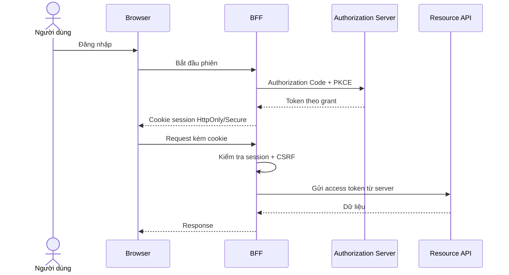

# Browser storage — Lựa chọn và bảo vệ nơi lưu dữ liệu trong trình duyệt

Một ứng dụng web cần giữ trạng thái đăng nhập khi người dùng chuyển trang, tải dữ liệu để dùng lại và lưu tùy chọn giao diện. Trình duyệt cung cấp nhiều cơ chế lưu trữ: cookie, Web Storage, IndexedDB, Cache Storage và bộ nhớ JavaScript. Chúng có cách gửi dữ liệu, phạm vi truy cập và vòng đời khác nhau. Chọn sai nơi lưu có thể làm lộ token qua XSS, tạo lỗ hổng CSRF hoặc khiến dữ liệu nhạy cảm tồn tại lâu hơn dự kiến.

Bài học thuộc chương **Cookie và browser** của học phần **SECURITY_AUTHENTICATION_FUNDAMENTALS**. Nội dung liên hệ browser storage với credential, mật khẩu, MFA, passkey, token, phiên, liên kết danh tính và khôi phục tài khoản. Trọng tâm là hiểu ranh giới origin/site, lựa chọn nơi lưu phù hợp, bảo vệ dữ liệu xác thực và thiết kế vòng đời lưu trữ an toàn.

## 1. Kết quả học tập

Sau bài này, người học có thể:

- Phân biệt cookie, localStorage, sessionStorage, IndexedDB, Cache Storage và bộ nhớ trong JavaScript.
- Giải thích khác biệt giữa origin, site, domain, path và cách chúng ảnh hưởng đến việc truy cập dữ liệu.
- Đánh giá nơi lưu phù hợp cho session identifier, access token, refresh token, dữ liệu cá nhân và cache không nhạy cảm.
- Thiết kế cookie với `Secure`, `HttpOnly`, `SameSite`, `Domain`, `Path`, thời hạn và prefix phù hợp.
- Phân tích tác động của XSS, CSRF, malware, extension, browser profile dùng chung và third-party context.
- Xây dựng logout/clear-site-data và xử lý dữ liệu tồn tại sau khi tài khoản bị thu hồi.
- Viết tiêu chí kiểm thử để chứng minh dữ liệu nhạy cảm không bị lưu, gửi hoặc giữ lại ngoài chính sách.

## 2. Browser storage là gì?

**Browser storage** là tập hợp các cơ chế mà ứng dụng web có thể dùng để giữ dữ liệu ở phía trình duyệt. Không phải cơ chế nào cũng là “kho bí mật”; nhiều loại được thiết kế cho dữ liệu ứng dụng và có thể đọc được bởi JavaScript chạy cùng origin.

| Cơ chế | Vòng đời/phạm vi | JavaScript cùng origin đọc được? | Tự động gửi theo HTTP request? |
| --- | --- | --- | --- |
| Cookie | Theo domain/path, thời hạn và chính sách cookie | Có, trừ cookie `HttpOnly` | Có, nếu domain/path/SameSite/secure phù hợp |
| localStorage | Lưu lâu dài theo origin, đến khi bị xóa | Có | Không |
| sessionStorage | Theo origin và browsing context/tab; thường mất khi tab đóng | Có | Không |
| IndexedDB | Cơ sở dữ liệu bất đồng bộ theo origin, lưu bền hơn | Có | Không |
| Cache Storage | Cache request/response, thường do Service Worker quản lý | Có, theo quyền origin/service worker | Không tự gửi như cookie; có thể được Service Worker dùng để phản hồi request |
| JavaScript memory | Trong vòng đời page/worker/context | Có trong context tương ứng | Không tự gửi; ứng dụng có thể gắn vào request |

Các đặc tính cụ thể có thể chịu ảnh hưởng bởi chế độ riêng tư, quota, chính sách trình duyệt, partitioning và việc người dùng xóa dữ liệu. Không nên xem dữ liệu trong browser là nơi lưu trữ bền vững duy nhất cho trạng thái quan trọng hoặc là nơi an toàn trước mã độc cùng quyền người dùng.

## 3. Origin, site và phạm vi truy cập

### 3.1. Origin

Origin được xác định bởi bộ ba **scheme, host và port**. Ví dụ:

- `https://app.example.test` và `http://app.example.test` khác origin.
- `https://app.example.test` và `https://api.example.test` khác origin.
- `https://app.example.test:443` và `https://app.example.test:8443` khác origin.

Web Storage và IndexedDB được phân vùng theo origin. Một script ở `app.example.test` không thể trực tiếp đọc localStorage của `api.example.test` theo same-origin policy.

### 3.2. Site và cookie

Khái niệm site trong SameSite cookie policy thường dựa trên schemeful site và registrable domain (eTLD+1), không giống origin. Hai subdomain có thể khác origin nhưng được xem là same-site trong một số ngữ cảnh. Do đó, same-site không có nghĩa là cùng một ứng dụng hoặc cùng mức tin cậy.

Cookie có các thuộc tính Domain/Path quyết định request nào có thể mang cookie. Cookie không bị ràng buộc bởi port giống origin của Web Storage. Một cookie có Domain rộng như `.example.test` có thể được gửi tới nhiều subdomain; nếu một subdomain bị kiểm soát, phạm vi ảnh hưởng có thể lớn hơn dự kiến.

### 3.3. Ranh giới không đồng nghĩa với tin cậy

Same-origin policy giúp ngăn script từ origin khác đọc dữ liệu trực tiếp, nhưng XSS chạy ngay trên origin hợp lệ vẫn có thể đọc localStorage/IndexedDB và thực hiện request bằng quyền của người dùng. Cookie HttpOnly ngăn script đọc giá trị cookie, nhưng XSS vẫn có thể gọi API mà browser tự gắn cookie. Vì vậy, không có một thuộc tính storage đơn lẻ nào thay thế việc ngăn XSS và kiểm soát quyền phía server.

## 4. Cookie: cơ chế lưu và gửi tự động

Cookie là cặp tên/giá trị cùng các thuộc tính do server hoặc script tạo. Browser có thể tự động gửi cookie phù hợp trong header `Cookie` khi request khớp điều kiện domain, path, secure và SameSite.

Ví dụ response:

```http
Set-Cookie: __Host-session=opaque-random-id; Path=/; Secure; HttpOnly; SameSite=Lax
```

Ví dụ request tiếp theo:

```http
GET /account HTTP/1.1
Host: app.example.test
Cookie: __Host-session=opaque-random-id
```

Giá trị minh họa không phải session ID hoạt động. Với session cookie, nên dùng một định danh ngẫu nhiên không mang dữ liệu cá nhân; server tra cứu trạng thái phiên. Tránh nhúng role, email, token dài hạn hoặc dữ liệu nhạy cảm vào cookie chỉ vì cookie được ký.

### 4.1. Các thuộc tính quan trọng

| Thuộc tính | Ý nghĩa | Khuyến nghị cho cookie phiên |
| --- | --- | --- |
| `Secure` | Chỉ gửi cookie qua kênh HTTPS an toàn | Bật trong production |
| `HttpOnly` | Không cho JavaScript đọc cookie qua `document.cookie` | Bật cho session identifier |
| `SameSite` | Kiểm soát gửi cookie trong một số ngữ cảnh cross-site | Chọn Strict/Lax/None theo luồng và threat model |
| `Path` | Giới hạn đường dẫn request được gửi cookie | Thường dùng `/` cho session toàn ứng dụng |
| `Domain` | Mở rộng phạm vi cookie tới domain/subdomain phù hợp | Bỏ qua thuộc tính này nếu không cần chia sẻ subdomain |
| `Expires` / `Max-Age` | Thời hạn cookie phía browser | Đồng bộ với chính sách phiên; server vẫn phải kiểm tra hết hạn/revoke |

**Lưu ý:** `HttpOnly` không ngăn XSS thực hiện hành động bằng phiên hiện tại. Nó chủ yếu ngăn script đọc trực tiếp giá trị cookie. `Secure` không bảo vệ cookie nếu thiết bị hoặc server bị chiếm. `SameSite` giúp giảm một số dạng CSRF nhưng không thay thế mọi biện pháp CSRF.

### 4.2. SameSite

- **Strict:** cookie chỉ được gửi trong ngữ cảnh same-site; bảo vệ mạnh hơn trước nhiều điều hướng cross-site nhưng có thể làm gián đoạn một số luồng đăng nhập/điều hướng từ ngoài.
- **Lax:** thường cho phép cookie trong một số điều hướng top-level an toàn như GET; phù hợp nhiều phiên web, nhưng không phải lá chắn đầy đủ.
- **None:** cho phép cookie trong ngữ cảnh cross-site; yêu cầu `Secure` trong trình duyệt hiện đại. Chỉ dùng khi kiến trúc thực sự cần, ví dụ một số luồng nhúng/federation, và cần CSRF protection phù hợp.

SameSite được đánh giá theo site chứ không chỉ origin. Một subdomain bị xâm nhập có thể vẫn là same-site với ứng dụng chính. Cần xét thêm CSRF token, kiểm tra Origin/Referer và quyền của subdomain.

### 4.3. Cookie prefix

Các prefix giúp browser áp dụng điều kiện chặt hơn khi chấp nhận cookie:

- `__Secure-`: cookie phải được đặt từ secure context và có thuộc tính Secure.
- `__Host-`: cookie phải có Secure, Path=/ và không được có Domain; điều này giới hạn cookie vào host cụ thể.

Ví dụ:

```http
Set-Cookie: __Host-session=opaque-id; Path=/; Secure; HttpOnly; SameSite=Lax
```

Prefix không thay thế kiểm tra server-side. Cần kiểm tra hỗ trợ của trình duyệt mục tiêu và cấu hình cookie đúng; tên cookie không tự làm giá trị trở nên bí mật.

### 4.4. Session cookie và persistent cookie

Session cookie thường không có Expires/Max-Age rõ ràng và có thể bị xóa khi browsing session kết thúc; persistent cookie có thời hạn lưu ở browser. Tuy nhiên, “session cookie” không đồng nghĩa phiên server không hết hạn, và hành vi khôi phục tab/browser có thể khác theo trình duyệt. Server phải áp dụng idle timeout, absolute timeout và revoke độc lập với vòng đời cookie.

## 5. localStorage và sessionStorage

Web Storage cung cấp API đồng bộ, đơn giản cho JavaScript:

```js
localStorage.setItem("theme", "dark");
const theme = localStorage.getItem("theme");

sessionStorage.setItem("wizard-step", "2");
const step = sessionStorage.getItem("wizard-step");
```

### 5.1. localStorage

- Dữ liệu tồn tại qua lần reload và thường qua lần đóng/mở browser cho tới khi bị xóa.
- Phạm vi theo origin; các tab cùng origin chia sẻ cùng localStorage.
- JavaScript cùng origin đọc/ghi được.
- Không tự động gửi trong HTTP request.

Phù hợp cho tùy chọn giao diện, trạng thái không nhạy cảm và dữ liệu có thể tái tạo. Không nên lưu access token/refresh token dài hạn hoặc bí mật xác thực trong localStorage nếu có lựa chọn kiến trúc an toàn hơn.

### 5.2. sessionStorage

- Phạm vi theo origin và browsing context/tab; các tab thường có vùng sessionStorage riêng.
- Dữ liệu thường bị xóa khi tab/browsing context kết thúc.
- JavaScript cùng origin đọc/ghi được.
- Không tự động gửi trong request.

sessionStorage giảm thời gian tồn tại so với localStorage trong nhiều tình huống, nhưng vẫn chịu rủi ro XSS. Một script độc hại chạy trong tab có thể đọc token hoặc dữ liệu nhạy cảm đã lưu ở đó.

### 5.3. Vì sao không lưu token trong Web Storage?

Nếu có XSS, attacker có thể chạy JavaScript cùng origin và đọc localStorage/sessionStorage. Token bearer bị lấy có thể được dùng từ thiết bị khác cho tới khi hết hạn/thu hồi. CSP, Trusted Types và output encoding giúp giảm XSS, nhưng không biến Web Storage thành kho bí mật.

Nếu ứng dụng cần giữ token trong browser, hãy cân nhắc:

- Dùng backend-for-frontend (BFF): server giữ OAuth token; browser chỉ giữ cookie phiên bảo vệ.
- Nếu không thể dùng BFF, giữ access token ngắn hạn trong memory khi phù hợp và thiết kế refresh/re-auth an toàn.
- Không lưu refresh token dài hạn trong localStorage.
- Hạn chế dependency/script bên thứ ba, bảo vệ CSP và kiểm soát supply chain.
- Có cơ chế logout/revoke và xử lý token lộ.

## 6. IndexedDB, Cache Storage và Service Worker

### 6.1. IndexedDB

IndexedDB là cơ sở dữ liệu bất đồng bộ trong browser, phù hợp lưu dữ liệu cấu trúc, dữ liệu offline hoặc lượng dữ liệu lớn hơn Web Storage. Nó có thể lưu object/blob và hỗ trợ transaction.

IndexedDB vẫn thuộc phạm vi origin và có thể được JavaScript cùng origin truy cập. Nếu XSS xảy ra, attacker có thể đọc hoặc sửa dữ liệu mà ứng dụng lưu ở đó. Không lưu private key, refresh token hoặc bí mật dài hạn chỉ vì IndexedDB là database.

### 6.2. Cache Storage

Cache Storage lưu các cặp Request/Response thường được dùng với Service Worker để hỗ trợ offline/performance. Nếu cache response chứa dữ liệu riêng tư hoặc token, dữ liệu có thể tồn tại sau khi người dùng logout hoặc đổi tài khoản.

- Chỉ cache dữ liệu công khai hoặc dữ liệu riêng tư có chính sách rõ.
- Tránh cache response chứa credential, reset link, dữ liệu tài chính hoặc hồ sơ nhạy cảm nếu không cần.
- Dùng Cache-Control phù hợp và kiểm soát Service Worker cache riêng.
- Khi logout/đổi tài khoản, xóa cache có phạm vi người dùng nếu ứng dụng đã lưu dữ liệu cá nhân.
- Không xem `Clear-Site-Data` là cách duy nhất; cần xử lý cache do ứng dụng tự quản lý.

### 6.3. Service Worker

Service Worker có thể intercept network request, cache response và hoạt động ngoài vòng đời page. Nếu script Service Worker bị thay thế hoặc có lỗ hổng, nó có thể đọc/điều chỉnh request/response trong phạm vi origin được kiểm soát.

Quản lý Service Worker cần:

- Phục vụ script qua HTTPS và kiểm soát cập nhật.
- Giữ scope nhỏ, không cho script không tin cậy điều khiển vùng ứng dụng nhạy cảm.
- Không cache token hoặc response nhạy cảm một cách mặc định.
- Xem xét việc cập nhật/thu hồi Service Worker khi có sự cố.
- Kiểm thử hành vi offline, logout, đổi tài khoản và xóa dữ liệu.

## 7. Nên lưu gì ở đâu?

Không có một lựa chọn storage tốt nhất cho mọi loại dữ liệu. Hãy chọn theo độ nhạy cảm, thời gian tồn tại, cách gửi dữ liệu và rủi ro XSS/CSRF.

| Dữ liệu | Vị trí thường phù hợp | Lưu ý |
| --- | --- | --- |
| Session ID web | Cookie Secure + HttpOnly + SameSite, server-side session store | Dùng giá trị ngẫu nhiên; server quản lý expiry/revocation |
| Access token OAuth | BFF/server-side nếu có thể; memory ngắn hạn trong một số SPA | Không log, không URL, scope/audience/TTL tối thiểu |
| Refresh token | Backend hoặc secure storage phù hợp với client | Bảo vệ nghiêm ngặt, rotation/reuse detection/revoke |
| Tùy chọn giao diện | localStorage hoặc cookie không nhạy cảm | Không chứa secret hoặc dữ liệu cá nhân không cần thiết |
| Trạng thái wizard tạm thời | sessionStorage hoặc memory | Có thể mất khi tab đóng; không dùng làm bằng chứng quyền |
| Dữ liệu offline | IndexedDB/Cache Storage theo chính sách | Cân nhắc dữ liệu còn tồn tại sau logout và trên thiết bị dùng chung |
| Public static assets | Cache Storage/browser cache | Có thể cache nếu versioning và integrity phù hợp |
| Private key/passkey | Authenticator/OS keystore/secure hardware theo nền tảng | Không xuất khóa vào Web Storage |
| Password | Không lưu phía browser sau khi gửi | Dùng password manager; server lưu password hash chuyên dụng |
| Reset token | Luồng ngắn hạn, không lưu lâu trong storage | Tránh log/history/referrer; dùng một lần và hết hạn |

### Quy tắc quyết định nhanh

1. Nếu dữ liệu là bí mật xác thực dài hạn, đừng mặc định browser JavaScript storage là nơi phù hợp.
2. Nếu dữ liệu cần browser tự gửi kèm request, cookie có thể phù hợp nhưng phải giải quyết CSRF.
3. Nếu dữ liệu không cần tự động gửi, Web Storage/IndexedDB tránh một số rủi ro CSRF nhưng vẫn có rủi ro XSS.
4. Nếu dữ liệu nhạy cảm cần tồn tại lâu, cân nhắc giữ ở server và chỉ lưu một session handle bảo vệ ở browser.
5. Nếu ứng dụng hỗ trợ offline, hãy xác định rõ dữ liệu nào được cache, ai có thể đọc trên thiết bị và cách xóa khi logout.

## 8. XSS và CSRF tác động tới storage thế nào?

### 8.1. XSS

Cross-site scripting xảy ra khi nội dung không tin cậy được đưa vào trang mà không xử lý an toàn, khiến script độc hại chạy trong origin của ứng dụng.

Hậu quả theo loại storage:

- localStorage/sessionStorage: script có thể đọc token và dữ liệu.
- IndexedDB: script có thể truy vấn hoặc sửa dữ liệu trong phạm vi origin.
- Cookie HttpOnly: script không đọc trực tiếp cookie, nhưng có thể gửi request cùng cookie qua browser và đọc response nếu không có biện pháp khác.
- Cache/Service Worker: script có thể tương tác với dữ liệu/cache trong phạm vi quyền của origin.

Phòng ngừa XSS:

- Output encoding theo ngữ cảnh và dùng API DOM an toàn.
- Tránh `innerHTML` với dữ liệu không tin cậy; dùng `textContent` khi phù hợp.
- CSP chặt, hạn chế inline/eval và script bên thứ ba.
- Trusted Types khi hệ sinh thái hỗ trợ.
- Kiểm soát dependency, review template và kiểm thử XSS.
- Giảm giá trị token có thể lấy: BFF, token ngắn hạn, sender constraint và revoke.

### 8.2. CSRF

Cross-site request forgery lợi dụng việc browser tự động gửi cookie tới một site khi request đáp ứng điều kiện. Kẻ tấn công có thể dụ người dùng đang đăng nhập gửi request thay đổi trạng thái.

Biện pháp:

- Cookie SameSite phù hợp.
- CSRF token cho request thay đổi trạng thái.
- Kiểm tra Origin/Referer theo chính sách.
- Không dùng GET để thay đổi dữ liệu.
- Yêu cầu xác thực lại/step-up cho thao tác nhạy cảm.

Web Storage không tự gửi theo request nên giảm một dạng CSRF dựa trên cookie tự động, nhưng token trong Web Storage có thể bị XSS đánh cắp. **Không thể kết luận localStorage an toàn hơn cookie trong mọi trường hợp**; hai cơ chế chuyển rủi ro theo cách khác nhau.

## 9. Cookie và token trong kiến trúc BFF

Một mô hình web thường dùng là browser giao tiếp với backend-for-frontend (BFF) qua cookie phiên, còn BFF giữ OAuth access/refresh token phía server:



Ưu điểm: JavaScript trong browser không cần đọc OAuth token. Tuy nhiên, BFF vẫn có thể bị XSS điều khiển thông qua request của browser; cookie vẫn tự động gửi nên cần CSRF protection. BFF cần bảo vệ token store, session store, TLS và authorization. BFF không phải lá chắn tuyệt đối, mà là cách giảm exposure của token dài hạn ở client.

## 10. Logout và xóa browser storage

Logout cần xử lý cả phía client và server:

1. Gửi request logout được xác thực và chống CSRF.
2. Server thu hồi session, refresh token hoặc token liên quan theo chính sách.
3. Server gửi Set-Cookie xóa cookie đúng Domain/Path.
4. Client xóa dữ liệu ứng dụng ở localStorage/sessionStorage nếu đã lưu.
5. Xóa dữ liệu riêng tư khỏi IndexedDB và Cache Storage theo user/session scope.
6. Hủy state trong memory, đóng channel/worker liên quan nếu cần và điều hướng về trạng thái đăng xuất.
7. Nếu dùng SSO, thực hiện luồng logout IdP/RP theo phạm vi người dùng chọn.

Xóa storage ở browser không thu hồi token đã sao chép sang nơi khác. Ngược lại, revoke server-side nhưng để dữ liệu cá nhân trong IndexedDB/cache trên thiết bị dùng chung vẫn có thể làm lộ thông tin cho người dùng tiếp theo.

### Clear-Site-Data

Header `Clear-Site-Data` có thể yêu cầu browser xóa nhóm dữ liệu theo origin, ví dụ cache/cookies/storage tùy directive và hỗ trợ trình duyệt. Đây là công cụ bổ sung, không thay thế server-side revoke. Nó có thể xóa cả dữ liệu ứng dụng không liên quan hoặc không xóa dữ liệu do cơ chế riêng của ứng dụng quản lý; cần kiểm thử kỹ trước khi dùng rộng rãi.

Ví dụ minh họa:

```http
Clear-Site-Data: "cache", "cookies", "storage"
```

Chỉ dùng khi thực sự muốn xóa dữ liệu tương ứng của origin và đã đánh giá tác động. Cần xem xét subdomain, cookie domain, Service Worker và trải nghiệm người dùng.

## 11. Mối đe dọa và kiểm soát

| Mối đe dọa | Storage/ranh giới liên quan | Kiểm soát |
| --- | --- | --- |
| XSS đọc token | localStorage, sessionStorage, IndexedDB | Output encoding, CSP, Trusted Types, giảm token exposure, BFF |
| XSS dùng cookie HttpOnly | Cookie tự động gửi theo request | CSRF protection, CSP/XSS defense, step-up, authorization server-side |
| CSRF | Cookie tự động gửi cross-site | SameSite, CSRF token, Origin/Referer validation, POST cho state change |
| Cookie tossing/fixation | Domain/path và session ID | __Host- prefix, host-only cookie, rotate session ID, kiểm tra cookie trùng |
| Subdomain takeover | Cookie Domain rộng, same-site context | Không chia sẻ Domain nếu không cần, quản lý DNS/subdomain, phân tách trust |
| Token leakage qua URL/log | Query string, referrer, proxy log | Authorization header, redact log, Referrer-Policy, no-store |
| Browser profile dùng chung | Persistent storage, cache, cookie | Logout đầy đủ, xóa dữ liệu riêng tư, thời hạn ngắn, hướng dẫn thiết bị dùng chung |
| Service Worker compromise | Cache/request interception | Kiểm soát script, scope nhỏ, cập nhật an toàn, xóa cache khi cần |
| Third-party script compromise | Script chạy trong origin ứng dụng | Giảm script bên thứ ba, CSP/SRI, dependency review |
| Stale data after logout | IndexedDB, Cache Storage, localStorage | Xóa theo user scope, server revoke, kiểm thử đổi tài khoản |
| Browser extension độc hại | DOM, storage, request và clipboard | Giảm secret phía client, quản lý thiết bị, cảnh báo và endpoint protection |

## 12. Tình huống thực tế: ứng dụng hồ sơ cá nhân

Một ứng dụng cho phép người dùng xem hồ sơ và tải tài liệu. Nhóm phát triển ban đầu lưu access token trong localStorage, dùng cookie analytics và cache mọi response GET để tăng tốc.

### Vấn đề

- Một XSS ở trang nhận xét có thể đọc access token và gửi ra ngoài.
- Cache Storage giữ response hồ sơ sau khi người dùng logout.
- Một cookie session đặt Domain rộng khiến subdomain marketing có thể ảnh hưởng phạm vi cookie.
- Logout chỉ xóa localStorage nhưng refresh token vẫn còn ở backend.
- Browser tự gửi cookie trong một số request cross-site; endpoint cập nhật email không có CSRF protection.

### Thiết kế cải thiện

1. Chuyển access/refresh token sang BFF nếu phù hợp; browser chỉ giữ session cookie host-only, Secure, HttpOnly và SameSite phù hợp.
2. Bảo vệ mọi request thay đổi trạng thái bằng CSRF token/Origin validation.
3. Chỉ cache tài nguyên công khai; response hồ sơ riêng tư dùng policy không cache hoặc cache riêng có kiểm soát.
4. Khi logout, server revoke session/refresh token; client xóa storage/cache theo user scope.
5. Thu hẹp cookie Domain hoặc dùng __Host- cookie để tránh chia sẻ subdomain không cần thiết.
6. Khắc phục XSS bằng output encoding, CSP, kiểm soát dependency và kiểm thử.

## 13. Checklist thiết kế browser storage

Trước khi đưa một dữ liệu vào browser storage, hãy trả lời:

- Dữ liệu có phải credential, token, private key, reset link hoặc thông tin nhạy cảm không?
- Script cùng origin có cần đọc dữ liệu đó không?
- Browser có cần tự gửi dữ liệu theo request không?
- Dữ liệu tồn tại bao lâu và ai có thể dùng lại trên thiết bị?
- Nếu XSS xảy ra, attacker lấy được gì? Nếu CSRF xảy ra, attacker có thể làm gì?
- Dữ liệu có bị lưu trong backup, cache, history, crash report hoặc extension không?
- Logout, đổi tài khoản, reset mật khẩu và thu hồi phiên xóa/thu hồi dữ liệu ra sao?
- Các subdomain có cùng mức tin cậy không? Cookie Domain có thể thu hẹp không?
- Ứng dụng có hỗ trợ browser privacy mode, partitioned storage và chính sách third-party cookie không?

## 14. Tiêu chí chấp nhận và kiểm thử

| Tình huống | Kết quả mong đợi |
| --- | --- |
| Cookie phiên được tạo | Có Secure, HttpOnly, SameSite phù hợp; host-only hoặc __Host- khi có thể |
| JavaScript thử đọc cookie phiên | Không đọc được giá trị HttpOnly |
| Request HTTP không an toàn | Cookie Secure không được gửi |
| Request cross-site thay đổi trạng thái | Bị chặn bởi SameSite/CSRF/Origin policy phù hợp |
| Script XSS chạy trong origin | Không thể đọc OAuth token dài hạn vì token không lưu trong Web Storage theo thiết kế |
| localStorage/sessionStorage chứa tùy chọn giao diện | Không chứa password, refresh token hoặc secret |
| Logout trên thiết bị dùng chung | Server revoke phiên; browser xóa cookie và dữ liệu riêng tư đã lưu |
| Người dùng A logout rồi người dùng B đăng nhập | B không nhìn thấy dữ liệu cache/IndexedDB của A |
| Cache response hồ sơ cá nhân | Không được phục vụ cho người dùng khác sau logout/đổi tài khoản |
| Host-only cookie và subdomain | Subdomain không thể đặt/ghi đè cookie __Host- của host chính theo quy tắc browser |
| Token xuất hiện trong URL hoặc log | Bị loại bỏ/redact; không lan qua referrer/analytics |
| Service Worker cập nhật | Chỉ script được kiểm soát được kích hoạt; cache nhạy cảm được xử lý theo chính sách |
| Clear-Site-Data được bật | Chỉ xóa dữ liệu đã chọn theo phạm vi dự kiến, không thay thế revoke server-side |
| Refresh token bị revoke | Không thể xin access token mới dù browser storage đã bị xóa hay chưa |

### Chỉ số vận hành

Theo dõi số lỗi CSRF/XSS đã xác nhận, số token phát hiện trong log/URL, tỷ lệ cookie không có thuộc tính bảo mật, số response nhạy cảm bị cache ngoài ý muốn, lỗi logout/clear storage và thời gian thu hồi phiên. Không ghi giá trị cookie/token hoặc dữ liệu cá nhân thô để tạo chỉ số.

## 15. Bài tập tự kiểm tra

Một cổng dịch vụ công có web app và BFF. Ứng dụng lưu tùy chọn ngôn ngữ, access token, dữ liệu biểu mẫu chưa gửi và bản sao một số tài liệu để hỗ trợ offline. Người dùng có thể đăng nhập từ máy tính công cộng.

Hãy:

1. Chọn nơi lưu cho từng loại dữ liệu: cookie phiên, access token, tùy chọn ngôn ngữ, biểu mẫu nháp và tài liệu offline.
2. Giải thích vì sao cookie HttpOnly vẫn cần CSRF protection và vì sao localStorage không phù hợp làm kho bí mật token.
3. Thiết kế cookie phiên với các thuộc tính phù hợp và giải thích lựa chọn SameSite.
4. Mô tả logout trên máy tính công cộng: server revoke, xóa cookie, xóa IndexedDB/Cache Storage và xử lý SSO.
5. Nêu các rủi ro khi subdomain marketing và ứng dụng chính chia sẻ cookie Domain.
6. Viết ít nhất năm test case để chứng minh dữ liệu của người dùng trước không xuất hiện khi người dùng sau đăng nhập trên cùng browser profile.

**Gợi ý đánh giá:** câu trả lời tốt phải phân biệt rủi ro XSS và CSRF, hiểu rằng cookie tự gửi còn Web Storage do JavaScript đọc, đồng thời mô tả vòng đời dữ liệu sau logout và cách thu hồi ở server. Không có storage nào tự động an toàn chỉ vì tên gọi hoặc API của nó.

---

**Ghi nhớ:** chọn browser storage theo **mức nhạy cảm, cách dữ liệu được truy cập/gửi, vòng đời và mô hình đe dọa**. Cookie phiên cần thuộc tính bảo mật và CSRF protection; Web Storage/IndexedDB dễ bị script cùng origin đọc; Cache/Service Worker có thể giữ dữ liệu sau logout. Hãy giảm bí mật ở client, bảo vệ origin, thu hồi phía server và xóa dữ liệu riêng tư theo đúng vòng đời tài khoản.
