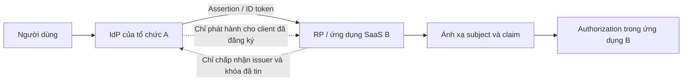
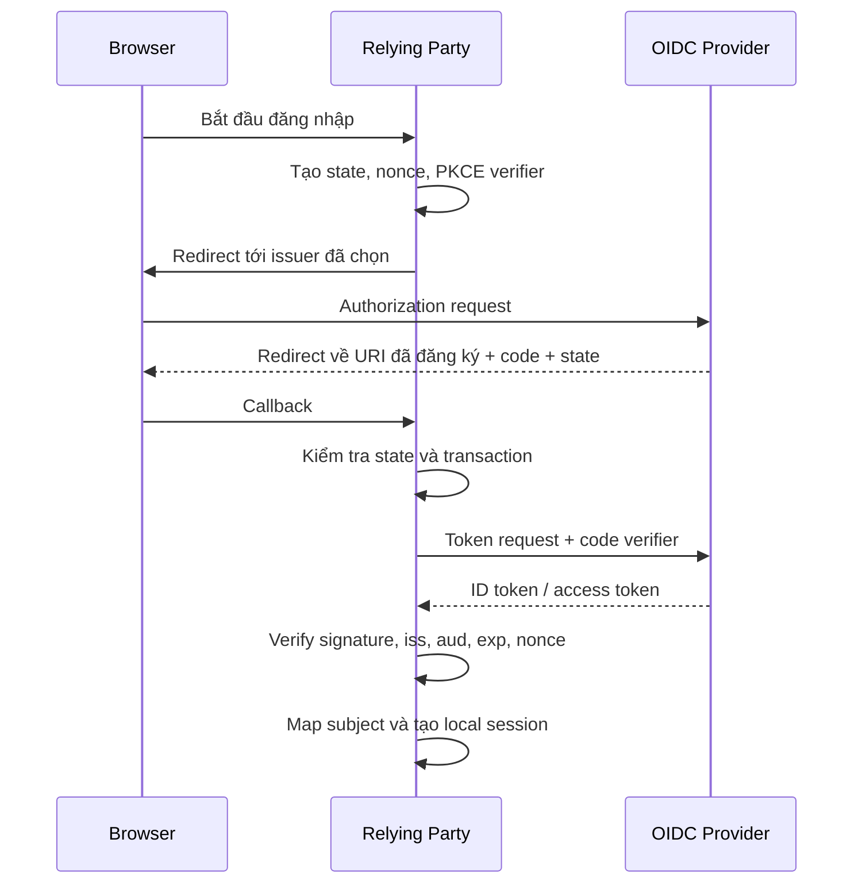

# Trust relationship — Quan hệ tin cậy trong liên kết danh tính

## 1. Trust relationship là gì?

Trong **identity federation** (liên kết danh tính), **trust relationship** là tập hợp thỏa thuận, cấu hình kỹ thuật và chính sách vận hành cho phép hai miền bảo mật trao đổi, xác minh và sử dụng thông tin danh tính. Một bên thường xác thực người dùng và phát hành thông điệp khẳng định danh tính; bên còn lại kiểm tra thông điệp đó rồi quyết định có chấp nhận người dùng vào ứng dụng của mình hay không.

Ví dụ: nhân viên Công ty A dùng tài khoản doanh nghiệp để đăng nhập ứng dụng SaaS của Nhà cung cấp B. IdP của A xác thực nhân viên bằng passkey/MFA và phát hành assertion hoặc token. Ứng dụng của B (Relying Party - RP, hoặc Service Provider - SP trong SAML) xác minh nguồn phát hành, chữ ký, audience, thời hạn và các điều kiện đã thỏa thuận. Sau đó B ánh xạ danh tính sang tài khoản nội bộ và áp dụng authorization của ứng dụng.

**Trust relationship không đơn giản là hai hệ thống biết URL của nhau.** Hai bên phải thống nhất ai là issuer, ai là recipient, khóa nào được tin, giao thức và endpoint nào được dùng, danh tính/claim nào có ý nghĩa, mức xác thực nào được chấp nhận, cũng như cách xử lý thay đổi khóa, thu hồi và sự cố.

Trong mô-đun **SECURITY_AUTHENTICATION_FUNDAMENTALS**, trust relationship kết nối credential, mật khẩu, MFA, passkey, chứng chỉ, token, session, account linking và recovery. Nó tạo ranh giới tin cậy giữa các tổ chức và dịch vụ; một cấu hình sai ở ranh giới này có thể khiến kết quả xác thực mạnh tại IdP bị chấp nhận sai ở RP.

### Mục tiêu học tập

Sau bài này, người học có thể:

- Giải thích vai trò của IdP, RP, SP, issuer, subject và audience.
- Phân biệt trust relationship với đăng nhập, SSO, OAuth authorization và authorization nghiệp vụ.
- Mô tả cách hai bên thiết lập trust qua metadata, khóa ký, endpoint và chính sách.
- Xác minh SAML assertion hoặc OIDC token theo đúng giao thức.
- Thiết kế claim mapping và liên kết tài khoản mà không dựa duy nhất vào email.
- Quản lý vòng đời trust: đăng ký, thay khóa, thay endpoint, thu hồi và offboarding.
- Nhận diện issuer/audience confusion, replay, mix-up, metadata poisoning và lạm dụng claim.

## 2. Các bên tham gia và điều họ tin nhau

Một quan hệ federation thường có các vai trò:

| Vai trò | Trách nhiệm | Điều cần bảo vệ |
|---|---|---|
| Identity Provider (IdP) | Xác thực người dùng và phát hành assertion/token | Credential, MFA, signing key, phiên IdP, quy trình khôi phục |
| Relying Party (RP) | Ứng dụng nhận kết quả xác thực và dựa vào đó đăng nhập người dùng | Issuer allowlist, client registration, redirect URI, token validation, account mapping |
| Service Provider (SP) | Thuật ngữ thường dùng trong SAML cho ứng dụng tiêu thụ assertion | Entity ID, ACS endpoint, certificate/key, audience và replay protection |
| User / Subject | Người dùng được xác thực hoặc chủ thể được đại diện | Quyền kiểm soát tài khoản, thiết bị và thông tin cá nhân |
| Federation operator / trust framework | Quản lý quy tắc chung, metadata hoặc trust anchor giữa nhiều tổ chức | Quy trình thành viên, cấp phát, audit, thay đổi và xử lý sự cố |

Trong OIDC, ứng dụng thường là OpenID Provider (OP) ở phía phát hành và Relying Party ở phía tiêu thụ. Trong SAML, thuật ngữ phổ biến là Identity Provider (IdP) và Service Provider (SP).

### Trust thường có tính định hướng

RP tin một IdP cụ thể phát hành assertion cho RP đó. Điều này không có nghĩa IdP tự động tin mọi RP, hoặc mọi ứng dụng khác cũng phải tin cùng issuer. Phía IdP cũng phải đăng ký và kiểm soát client/SP: client ID hoặc entity ID, redirect URI/ACS URL, signing/encryption key khi dùng, loại flow và các quyền được phép.



Đây là quan hệ hai phía có điều kiện: RP chấp nhận thông điệp từ issuer đã cấu hình; IdP chỉ phát hành cho client đã được đăng ký. Không nên diễn giải thành một niềm tin chung không giới hạn.

## 3. Trust relationship bao gồm những gì?

Một trust relationship cần được định nghĩa bằng cả thông tin kỹ thuật và chính sách:

| Thành phần | Câu hỏi cần trả lời |
|---|---|
| Trust domain | Tổ chức, tenant, môi trường hoặc namespace nào tham gia? |
| Issuer / entity ID | Bên phát hành có định danh chính xác nào? |
| RP / client identity | Ứng dụng tiêu thụ được nhận diện bằng client ID hoặc entity ID nào? |
| Protocol | SAML 2.0, OpenID Connect hay giao thức khác? |
| Endpoints | Authorization, token, JWKS, metadata, ACS, logout endpoint nào được phép? |
| Signing keys | Khóa nào xác minh chữ ký; lấy từ nguồn nào; xoay và thu hồi ra sao? |
| Encryption keys | Có mã hóa assertion/token hay không; khóa nhận được quản lý thế nào? |
| Subject identifier | Người dùng được nhận diện bằng iss + sub, NameID hay identifier khác? |
| Claims / attributes | Claim nào được phát hành, kiểu dữ liệu và ý nghĩa ra sao? |
| Authentication policy | MFA, phishing resistance, độ mới và assurance nào được yêu cầu? |
| Authorization mapping | Claim nào có thể ảnh hưởng role/group; quyền nào do RP tự quản lý? |
| Lifecycle | Onboarding, thay đổi, key rotation, revoke, offboarding và incident response |

Trust không nên chỉ được ghi trong tài liệu kỹ thuật. Cần có owner ở mỗi bên, môi trường kiểm thử, người phê duyệt thay đổi và quy trình liên lạc khi một endpoint hoặc khóa bị xâm phạm.

### Một trust contract mẫu

Một hợp đồng trust có thể nêu:

- IdP issuer chính xác là `https://id.example.org/tenant-a`.
- RP client ID là `hr-portal-prod`.
- Chỉ chấp nhận Authorization Code Flow với PKCE.
- ID token phải có issuer đúng, audience chứa client ID, chữ ký hợp lệ bằng khóa được công bố qua JWKS tin cậy và thời hạn hợp lệ.
- Claim `sub` là định danh chủ thể ổn định trong phạm vi issuer; email chỉ dùng làm thuộc tính liên hệ.
- Nếu thao tác yêu cầu MFA chống phishing, RP chỉ chấp nhận kết quả xác thực có `acr`/`amr` theo mapping được IdP và RP thống nhất.
- Claim nhóm chỉ được ánh xạ vào tập role được allowlist; không chấp nhận role tùy ý do người dùng cung cấp.
- Hai bên có quy trình thông báo thay khóa, thay endpoint và thu hồi trust khi chấm dứt hợp tác.

Các giá trị trên chỉ là ví dụ minh họa, không phải cấu hình chuẩn cho mọi tổ chức.

## 4. Thiết lập trust trước khi cho phép đăng nhập

### 4.1. Xác minh danh tính đối tác

Trước khi cấu hình federation, hai bên cần xác minh tổ chức và người có thẩm quyền yêu cầu tích hợp. Không lấy một URL gửi qua email hoặc một file metadata không rõ nguồn làm bằng chứng duy nhất.

Với private federation, có thể cần hợp đồng, ticket thay đổi, kiểm tra domain sở hữu, phê duyệt từ security/identity owner và xác minh fingerprint của signing certificate qua kênh độc lập. Với public OIDC provider, RP phải cấu hình issuer mong đợi một cách rõ ràng và tải discovery metadata từ đúng issuer qua HTTPS.

### 4.2. Đăng ký RP/client tại IdP

IdP cần biết ứng dụng nào được phép sử dụng dịch vụ:

- OIDC: client ID, redirect URI chính xác, loại client, grant/response type, PKCE và các tùy chọn cần thiết.
- SAML: SP entity ID, Assertion Consumer Service (ACS) URL, binding, signing/encryption certificate và yêu cầu NameID/attribute.
- Định nghĩa logout endpoint và cách liên kết sự kiện logout nếu hỗ trợ.
- Chỉ cấp scope/claim và quyền cần thiết.

Redirect URI và ACS URL phải được kiểm soát chính xác. Wildcard rộng hoặc cho phép URL do người dùng tự chọn có thể tạo đường chuyển token/assertion tới domain của attacker.

### 4.3. Cấu hình trust tại RP

RP phải biết issuer/entity ID nào được chấp nhận, khóa nào xác minh chữ ký, endpoint nào thuộc issuer và các policy áp dụng. Nếu một RP phục vụ nhiều tenant/IdP, cấu hình trust phải được phân tách theo tenant; không chọn issuer chỉ dựa trên một tham số không được kiểm chứng từ request.

### 4.4. Kiểm thử trước khi bật production

Kiểm tra cả luồng thành công và thất bại:

- Token/assertion đúng issuer, chữ ký, audience và thời hạn.
- Sai issuer, sai audience, chữ ký sai hoặc khóa không được tin.
- Assertion/token bị phát lại.
- Redirect/ACS sai hoặc response không khớp request ban đầu.
- Người dùng bị khóa, nghỉ việc hoặc mất quyền tại IdP.
- Claim thiếu, sai kiểu hoặc có giá trị ngoài allowlist.
- Thay khóa, endpoint không khả dụng và logout.

Không bật production chỉ vì một lần đăng nhập thành công. Cần xác minh các điều kiện từ chối cũng hoạt động.

## 5. Metadata, signing key và trust store

### 5.1. Metadata là gì?

Metadata mô tả thông tin cần thiết để hai bên cấu hình giao tiếp federation. SAML metadata có thể chứa entity ID, SSO/Logout endpoint, binding và chứng chỉ ký/mã hóa. OIDC Discovery metadata mô tả issuer, authorization endpoint, token endpoint, JWKS URI và khả năng giao thức của OpenID Provider.

Metadata giúp tự động hóa cấu hình, nhưng **metadata không tự tạo ra trust**. RP cần xác minh metadata đến từ issuer/đối tác đã được chấp thuận, kiểm tra issuer chính xác và bảo vệ quá trình cập nhật.

### 5.2. OIDC Discovery và JWKS

Trong OIDC, RP thường lấy discovery document từ URL được cấu hình dựa trên issuer. Document công bố các endpoint và `jwks_uri`. JWKS chứa public key mà RP có thể sử dụng để xác minh chữ ký token.

Các nguyên tắc:

- Không để request login tự do quyết định issuer hoặc URL discovery mà RP sẽ tin; điều này có thể tạo SSRF hoặc issuer injection.
- Xác minh trường `issuer` trong metadata khớp chính xác issuer đã cấu hình.
- Chỉ tải JWKS từ `jwks_uri` thuộc issuer tin cậy và qua kết nối được xác minh TLS.
- Dùng `kid` để chọn khóa phù hợp trong tập khóa đã lấy, nhưng không coi `kid` là bằng chứng tin cậy.
- Khi gặp `kid` chưa biết, có thể refresh JWKS có giới hạn/rate limit; không tải URL tùy ý từ token.
- Không chấp nhận mọi thuật toán hoặc key type; áp dụng allowlist theo chính sách.

OIDC Discovery metadata thông thường được lấy qua HTTPS từ issuer đã cấu hình; không mặc định mọi discovery document đều có chữ ký metadata độc lập. Một số federation framework có cơ chế metadata signing hoặc trust chain riêng, cần tuân thủ đúng quy định của framework đó.

### 5.3. SAML metadata và signing certificate

SAML metadata có thể được phân phối qua URL HTTPS, file trao đổi có xác minh hoặc metadata aggregator của federation. Nếu metadata được ký, RP phải xác minh chữ ký bằng trust anchor được thiết lập trước. Không thể giải quyết bootstrap trust bằng cách tin một khóa chỉ vì chính metadata chứa khóa đó.

Certificate dùng để xác minh chữ ký assertion thường chứa public key. Private key ký phải được IdP giữ bí mật và bảo vệ; certificate/public key cần được cập nhật theo quy trình có kiểm soát.

### 5.4. Key rotation

Khi IdP thay signing key:

1. Thông báo lịch thay đổi và fingerprint/metadata theo kênh đã thống nhất.
2. Công bố khóa mới trước khi dùng nếu giao thức/hạ tầng hỗ trợ giai đoạn overlap.
3. RP cập nhật JWKS hoặc SAML metadata từ nguồn tin cậy.
4. Trong khoảng chuyển tiếp, RP chỉ chấp nhận tập khóa cũ/mới đã được phê duyệt.
5. Sau khi chuyển xong, gỡ khóa cũ theo lịch; nếu khóa cũ bị lộ, xử lý khẩn cấp và thu hồi ngay theo incident plan.

Không pin một certificate sắp hết hạn vô thời hạn. Cũng không tự động tin mọi certificate mới xuất hiện trong metadata nếu nguồn metadata hoặc thay đổi chưa được xác minh.

## 6. Xác minh trust trong OpenID Connect

OIDC bổ sung lớp xác thực danh tính trên OAuth 2.0. Trong Authorization Code Flow, RP chuyển người dùng tới OP/IdP, nhận authorization code tại redirect URI đã đăng ký, rồi đổi code lấy token ở token endpoint.

### 6.1. Những giá trị cần kiểm tra trong ID token

Một RP cần kiểm tra ít nhất các điều kiện phù hợp với OIDC và profile triển khai:

- Chữ ký hợp lệ bằng khóa của issuer đã tin; thuật toán nằm trong allowlist.
- `iss` khớp chính xác issuer đã cấu hình.
- `aud` chứa client ID của RP; kiểm tra `azp` khi áp dụng theo quy tắc OIDC.
- `exp` chưa hết hạn; kiểm tra `iat`, `nbf` nếu có và clock skew theo policy.
- `nonce` khớp giá trị RP đã tạo và gắn với authentication request nếu đã gửi.
- `state` được kiểm tra ở callback để chống CSRF và liên kết response với browser session.
- Authorization code được đổi đúng client/redirect URI; dùng PKCE với verifier tương ứng.
- Nếu yêu cầu xác thực mới hoặc mức assurance cụ thể, kiểm tra `auth_time`, `acr`, `amr` theo mapping đã thống nhất.

Không được coi payload JWT đã decode là dữ liệu đáng tin trước khi xác minh chữ ký và claim. ID token dành cho client RP; API/resource server phải xác minh access token được cấp cho chính API đó, không nhận ID token thay access token.

### 6.2. State, nonce và PKCE có vai trò khác nhau

| Cơ chế | Mục đích chính |
|---|---|
| `state` | Liên kết callback với yêu cầu đăng nhập và phiên browser, giảm CSRF/login CSRF |
| `nonce` | Liên kết ID token với authentication request, giảm token substitution/replay trong OIDC |
| PKCE | Ràng buộc authorization code với client instance đã tạo code verifier, giảm code interception |
| `iss` và `aud` | Xác định ai phát hành token và token dành cho ai |

Không cơ chế nào thay thế hoàn toàn cơ chế còn lại. Client cần tạo, lưu và kiểm tra các giá trị ngẫu nhiên đúng cách, gắn chúng với đúng browser session và chỉ tiêu thụ một lần.

### 6.3. Issuer và mix-up

Trong ứng dụng hỗ trợ nhiều IdP, kẻ tấn công có thể cố làm RP nhầm lẫn response đến từ issuer nào hoặc gửi authorization response của một IdP vào luồng được khởi tạo cho IdP khác. RP cần gắn issuer với transaction, dùng issuer identification/response validation theo profile áp dụng, kiểm tra `iss` trong ID token và không chọn issuer chỉ từ tham số callback không đáng tin.



## 7. Xác minh trust trong SAML 2.0

Trong SAML Web Browser SSO, IdP phát hành SAML Response chứa Assertion cho SP. Assertion có thể mang subject, điều kiện, authentication statement và attributes. SP phải xác minh chữ ký và mọi ràng buộc liên quan trước khi tạo local session.

Các kiểm tra thường cần có:

- Issuer của Response/Assertion đúng IdP đã cấu hình.
- Chữ ký được xác minh bằng signing key tin cậy từ metadata đã xác minh.
- Chỉ chấp nhận thuật toán chữ ký và digest được cho phép.
- `AudienceRestriction` bao gồm SP entity ID mong đợi.
- `Destination` và `Recipient` khớp endpoint/ACS mong đợi theo profile.
- `InResponseTo` khớp AuthnRequest đang chờ trong SP-initiated flow.
- `NotBefore` và `NotOnOrAfter` còn hiệu lực, áp dụng clock skew giới hạn.
- `SubjectConfirmationData` có recipient, thời hạn và request correlation phù hợp.
- Assertion ID/Response ID được lưu vào replay cache trong khoảng hiệu lực để ngăn dùng lại.
- Không chấp nhận assertion không ký hoặc chỉ ký một phần nếu policy yêu cầu ký assertion/response cụ thể.

### XML Signature Wrapping

XML Signature Wrapping (XSW) là nhóm tấn công khai thác cách ứng dụng phân tích XML và xác định node nào đã được ký. Một ứng dụng có thể xác minh chữ ký trên một node nhưng sau đó đọc một Assertion khác không được ký hoặc không nằm trong node đã xác minh.

Để giảm rủi ro:

- Dùng thư viện SAML/XML security được duy trì, theo khuyến nghị của framework.
- Xác minh chữ ký trên đúng Assertion/Response mà logic ứng dụng sẽ sử dụng.
- Không tự viết XML signature validation hoặc XPath tùy tiện.
- Bảo vệ parser khỏi XXE và cấu hình XML nguy hiểm.
- Từ chối cấu trúc bất thường, duplicate ID hoặc nhiều assertion không được hỗ trợ.
- Ràng buộc audience, recipient, destination, request ID và replay cache.

Không được chỉ kiểm tra “có chữ ký hợp lệ ở đâu đó trong XML” rồi tin toàn bộ nội dung.

## 8. Subject identity và claim mapping

Sau khi xác minh token/assertion, RP cần ánh xạ subject bên ngoài thành tài khoản nội bộ. Đây là một bước quan trọng của trust relationship: xác thực đúng issuer vẫn có thể đăng nhập nhầm tài khoản nếu mapping sai.

### Dùng định danh ổn định

Trong OIDC, cặp `iss` + `sub` là định danh chủ thể trong phạm vi issuer. Cùng một `sub` ở hai issuer khác nhau không nhất thiết là cùng một người. Trong SAML, SP có thể dựa trên NameID với format và phạm vi đã thỏa thuận hoặc một identifier bền vững được quản lý.

Không nên dùng email làm khóa định danh duy nhất vì:

- Email có thể đổi.
- Email có thể được tái cấp cho người khác.
- Hai IdP có thể phát hành cùng một email.
- Claim email có thể chưa được xác minh hoặc mức bảo đảm xác minh khác nhau.
- Quyền kiểm soát email không nhất thiết đồng nghĩa quyền kiểm soát tài khoản nội bộ cũ.

### Claim mapping phải có allowlist

Ví dụ IdP phát hành:

| Claim | Giá trị ví dụ | Cách RP nên sử dụng |
|---|---|---|
| `iss` | `https://id.example.org` | Kiểm tra đúng issuer đã tin |
| `sub` | `00u8x...` | Định danh subject trong issuer đó |
| `email` | `mai@example.org` | Thuộc tính liên hệ; không mặc định làm account key |
| `email_verified` | `true` | Chỉ có ý nghĩa theo chính sách và mức tin cậy của IdP |
| `groups` | `["hr-readers"]` | Ánh xạ qua danh sách group/role được allowlist |
| `acr` / `amr` | Giá trị theo profile IdP | Dùng nếu có mapping rõ cho assurance/phương thức |
| `auth_time` | Timestamp | Kiểm tra độ mới khi thao tác yêu cầu |

RP nên:

- Chỉ nhận claim được xác định trong hợp đồng.
- Kiểm tra kiểu dữ liệu, độ dài và số lượng giá trị.
- Không cho claim tùy ý ghi đè role nội bộ.
- Giới hạn group-to-role mapping và xem xét tenant boundary.
- Không tự nâng quyền từ claim không có nguồn hoặc không được ký.
- Có quy trình xử lý khi claim thiếu, đổi tên hoặc IdP thay semantics.

### Account linking

Nếu người dùng đã có local account và muốn liên kết IdP, RP cần yêu cầu người dùng xác thực tài khoản hiện tại và tài khoản IdP trong một luồng liên kết rõ ràng. Không tự động gộp chỉ vì hai bên trả cùng email. Ghi lại issuer, subject, thời điểm, actor thực hiện và cho phép unlink theo policy; với tài khoản nhạy cảm, yêu cầu step-up.

## 9. Authentication, provisioning và authorization là ba việc khác nhau

Federation có thể giúp xác thực người dùng, nhưng không tự giải quyết toàn bộ vòng đời tài khoản hoặc quyền trong ứng dụng.

| Hoạt động | Câu hỏi | Cơ chế thường gặp |
|---|---|---|
| Authentication | Người dùng là subject nào và đã chứng minh danh tính ra sao? | SAML, OIDC, passkey tại IdP |
| Provisioning | Tài khoản/nhóm/thuộc tính nào cần được tạo, cập nhật hoặc vô hiệu hóa? | SCIM, HR feed, lifecycle workflow |
| Authorization | Subject được làm gì trên tài nguyên nào? | RBAC, ABAC, policy engine, ACL |

### Just-in-time provisioning

RP có thể tạo tài khoản local khi người dùng đăng nhập federation lần đầu. JIT provisioning cần kiểm tra issuer/subject, tenant, thuộc tính bắt buộc và policy cấp quyền mặc định. Không nên cấp role quản trị chỉ vì người dùng có claim group tùy ý.

### SCIM và offboarding

SCIM có thể đồng bộ user/group và trạng thái vòng đời giữa IdP và ứng dụng. SCIM không phải giao thức đăng nhập; một user được provision không có nghĩa người đó vừa xác thực. Ngược lại, federation login thành công không bảo đảm tài khoản local còn được phép nếu provisioning đã vô hiệu hóa người dùng.

Khi nhân viên nghỉ việc hoặc đối tác chấm dứt hợp đồng, cần thu hồi quyền tại IdP, đồng bộ trạng thái sang RP, vô hiệu hóa session/token và xử lý tài khoản/claim còn lưu. Không dựa riêng vào việc người dùng không thể đăng nhập IdP trong tương lai để thu hồi các phiên local đang hoạt động.

## 10. Trust relationship và mức assurance

RP thường dựa vào IdP để xác thực người dùng, nhưng phải biết IdP đã xác thực bằng phương thức nào và mức assurance nào được đảm bảo. Các claim như `acr`, `amr`, `auth_time` trong OIDC hoặc Authentication Context trong SAML có thể mang thông tin này tùy profile và triển khai.

Điều cần thỏa thuận:

- Phương thức nào được IdP coi là MFA?
- Có yêu cầu phishing resistance không?
- User verification bằng passkey có được yêu cầu không?
- Thời điểm xác thực tối đa được phép là bao lâu?
- Có yêu cầu thiết bị được quản lý hoặc certificate không?
- Claim nào biểu diễn mức assurance và ai chịu trách nhiệm về mapping?

Không được tự suy luận `acr=high` hoặc `amr=["mfa"]` tương đương một chuẩn AAL cụ thể nếu chưa có mapping được hai bên xác nhận. Claim chỉ đáng tin sau khi token/assertion đã được xác minh và issuer được tin cho mục đích đó.

### Step-up qua IdP

Khi người dùng đã có local session nhưng muốn làm thao tác nhạy cảm, RP có thể yêu cầu IdP thực hiện xác thực mới hoặc mức assurance cao hơn nếu giao thức và IdP hỗ trợ. RP phải kiểm tra kết quả mới, thời điểm, request correlation và claim theo chính sách; không chỉ tin rằng người dùng đã quay lại từ IdP.

Local authorization vẫn được thực hiện sau step-up. Xác thực mạnh không tự cấp quyền thay đổi dữ liệu hoặc truy cập tenant khác.

## 11. Các kiểu tấn công vào trust relationship

| Tấn công/lỗi | Cách xảy ra | Kiểm soát |
|---|---|---|
| Issuer confusion | RP chấp nhận token từ issuer không được phép | Issuer allowlist, so khớp chính xác `iss`, tách cấu hình tenant |
| Audience confusion | Token dành cho client/API khác bị chấp nhận | Kiểm tra `aud`, `azp` hoặc AudienceRestriction |
| Token/assertion replay | Assertion hợp lệ bị phát lại | Nonce, request correlation, exp/conditions, replay cache, one-time code |
| Login CSRF / account mix-up | Callback bị gắn với browser session hoặc transaction khác | `state`, nonce, PKCE, issuer binding, session correlation |
| Redirect URI abuse | Code/token bị chuyển tới URI attacker kiểm soát | Redirect URI chính xác, không wildcard rộng |
| SAML XML Signature Wrapping | App dùng Assertion khác với node được xác minh chữ ký | Thư viện chuẩn, kiểm tra đúng node, parser an toàn |
| Metadata poisoning | Attacker thay issuer endpoint hoặc signing key trong metadata | Nguồn metadata tin cậy, chữ ký/kênh xác minh, phê duyệt thay đổi |
| Signing key compromise | Kẻ tấn công ký token/assertion giả | Bảo vệ key, rotation, revoke, incident response |
| Account linking by email | Hai account bị gộp chỉ vì email trùng | Link bằng chứng minh quyền kiểm soát cả hai account và stable subject |
| Claim/role injection | Claim ngoài allowlist được ánh xạ thành quyền cao | Schema validation, allowlist mapping, authorization phía RP |
| Confused deputy | RP dùng token hoặc quyền của một bên cho tài nguyên/đối tượng khác | Audience/scope, subject binding, tenant checks, authorization |
| Stale session after offboarding | User bị khóa ở IdP nhưng local session/token vẫn hoạt động | SCIM/lifecycle, back-channel revoke, session TTL và trạng thái local |

### Confused deputy trong federation

Một ứng dụng có thể nhận token hợp lệ từ IdP nhưng sử dụng token đó cho API hoặc tenant khác mà không kiểm tra audience/scope. Khi đó ứng dụng trở thành “deputy” dùng quyền của mình sai mục đích. Chỉ chữ ký hợp lệ không đủ; token phải được phát hành cho đúng recipient và được dùng trong đúng ngữ cảnh.

## 12. Logout và thu hồi trust

Logout trong federation có nhiều lớp:

- Logout local tại RP: hủy session của ứng dụng.
- Logout tại IdP: hủy phiên đăng nhập trung tâm.
- Federated logout: IdP và RP phối hợp thông báo kết thúc phiên qua cơ chế được giao thức hỗ trợ.
- Token revocation: thu hồi refresh token/access token theo khả năng của hệ thống.

Không giả định logout ở một nơi sẽ lập tức hủy mọi session/token ở tất cả ứng dụng. Cần hiểu khả năng Front-Channel/Back-Channel Logout của OIDC hoặc SAML Single Logout, cấu hình session association và xử lý khi endpoint logout không khả dụng.

### Thu hồi trust relationship

Khi một đối tác chấm dứt hoặc bị xâm phạm:

1. Vô hiệu hóa client registration/IdP trust theo quy trình.
2. Ngừng chấp nhận issuer/entity ID hoặc khóa bị xâm phạm.
3. Thu hồi/đánh dấu compromised token, session và account mapping liên quan.
4. Thu hồi quyền và credential nội bộ được cấp dựa trên federation.
5. Xử lý user/group đã provision và các tài khoản local liên kết.
6. Lưu audit, bảo toàn bằng chứng và thông báo các owner liên quan.
7. Chỉ mở lại trust sau khi xác minh nguyên nhân, khóa và endpoint mới.

Nếu signing key bị lộ, chỉ xóa cache JWKS hoặc chờ token hết hạn có thể không đủ. Cần xác định phạm vi token/assertion đã phát hành và áp dụng biện pháp khẩn cấp phù hợp.

## 13. Ví dụ Java mô hình hóa trust policy

Đoạn Java sau minh họa cách RP kiểm tra issuer, audience và thời hạn sau khi một thư viện OIDC đã xác minh chữ ký token. Đây là **mô hình policy**, không thay thế thư viện OIDC/JWT:

```java
import java.time.Instant;
import java.util.Set;

record VerifiedIdentityToken(
    String issuer,
    Set<String> audiences,
    String subject,
    Instant expiresAt,
    Instant issuedAt
) {}

record FederationTrust(
    String expectedIssuer,
    String relyingPartyClientId,
    Set<String> allowedSubjects
) {}

final class FederationTrustPolicy {

    boolean accepts(VerifiedIdentityToken token,
                    FederationTrust trust,
                    Instant now) {
        if (token == null || trust == null || now == null
                || trust.expectedIssuer() == null
                || trust.relyingPartyClientId() == null
                || trust.allowedSubjects() == null) return false;
        if (token.issuer() == null
                || !token.issuer().equals(trust.expectedIssuer())) {
            return false;
        }
        if (token.audiences() == null
                || !token.audiences().contains(trust.relyingPartyClientId())) {
            return false;
        }
        if (token.subject() == null || token.subject().isBlank()) {
            return false;
        }
        if (token.expiresAt() == null || !now.isBefore(token.expiresAt())) {
            return false;
        }
        if (token.issuedAt() == null || token.issuedAt().isAfter(now)) {
            return false;
        }
        return trust.allowedSubjects().isEmpty()
                || trust.allowedSubjects().contains(token.subject());
    }
}
```

Giới hạn của ví dụ:

- `VerifiedIdentityToken` phải được tạo từ kết quả của thư viện đã kiểm tra chữ ký, thuật toán, `kid`, `iss`, `aud`, `exp`, `nonce` và các claim OIDC bắt buộc; không được khởi tạo trực tiếp từ payload chưa xác minh.
- Kiểm tra `azp`, `auth_time`, `acr`, `amr`, `nbf`, clock skew và request correlation khi profile/policy yêu cầu.
- Trong OIDC, `sub` có thể khác nhau giữa các client nếu dùng pairwise subject; không coi danh sách subject là cơ chế duy nhất để ánh xạ người dùng.
- Cần kiểm tra trạng thái tài khoản và tenant ở RP sau federation.
- Authorization trên tài nguyên thực hiện riêng; token hợp lệ không tự cấp quyền nghiệp vụ.

## 14. Quy trình vận hành trust relationship

Một quy trình vòng đời có thể gồm:

1. **Request:** tổ chức/đội ứng dụng yêu cầu liên kết, nêu mục đích, dữ liệu, nhóm người dùng và owner.
2. **Verify partner:** xác minh tổ chức, domain, người có thẩm quyền và trust framework áp dụng.
3. **Design:** chọn SAML/OIDC, xác định issuer/entity ID, client/SP, endpoints, keys, claims, assurance và logout.
4. **Register:** tạo client/SP registration ở IdP và trust configuration ở RP; hạn chế redirect/ACS và scope.
5. **Validate:** kiểm thử signature, issuer, audience, state/nonce, replay, claim mapping, account linking và error handling.
6. **Approve:** owner bảo mật/danh tính phê duyệt trước production.
7. **Operate:** giám sát login, key use, metadata changes, claim changes, provisioning và lỗi bất thường.
8. **Rotate:** cập nhật key/metadata/endpoints theo quy trình có overlap và xác minh.
9. **Revoke/offboard:** dừng trust, hủy phiên/token, thu hồi quyền và xử lý account lifecycle.
10. **Review:** định kỳ xác nhận owner, mục đích, scope, claim và user population còn phù hợp.

### Các tín hiệu cần giám sát

- Issuer, audience, client ID hoặc ACS/redirect URI thay đổi.
- JWKS có key mới hoặc `kid` không nhận diện được bất thường.
- Lượng đăng nhập thất bại, assertion replay hoặc signature failure tăng.
- Claim group/role thay đổi đột ngột hoặc có giá trị ngoài allowlist.
- User bị offboard vẫn tạo session mới hoặc token còn được sử dụng.
- Metadata endpoint trả về host/redirect bất thường.
- Một subject đăng nhập vào tenant không thuộc mapping.

Log cần có correlation ID, issuer, client ID, subject nội bộ đã ánh xạ, kết quả validation và lý do từ chối ở mức cần thiết. Không ghi toàn bộ token, assertion, authorization code, private key hoặc session cookie.

## 15. Tình huống thực tế

### Tình huống A — Tin issuer sai

Một RP hỗ trợ hai IdP. Callback handler chọn issuer từ query parameter do browser gửi rồi xác minh token bằng JWKS URL tương ứng. Attacker thay query parameter để RP dùng issuer ngoài danh sách đã phê duyệt.

**Bài học:** issuer phải được gắn với cấu hình trust và transaction server-side; không để request tự chọn nguồn khóa được tin.

### Tình huống B — Token hợp lệ nhưng sai audience

Một access token được phát hành cho `inventory-api` có chữ ký hợp lệ. `payroll-api` chỉ kiểm tra chữ ký và thời hạn nên chấp nhận token.

**Bài học:** API phải kiểm tra audience và scope của chính nó. Chữ ký hợp lệ chỉ chứng minh token do issuer phát hành, không chứng minh token dành cho API hiện tại.

### Tình huống C — Gộp tài khoản theo email

Nhân viên đã có tài khoản local với email công ty. Một IdP bên ngoài trả về cùng email nhưng subject khác. RP tự động gộp hai account và cấp quyền cũ cho danh tính mới.

**Bài học:** account linking phải chứng minh quyền kiểm soát cả hai tài khoản và dùng stable subject trong phạm vi issuer.

### Tình huống D — IdP bị offboard nhưng phiên local còn hoạt động

Một đối tác ngừng hợp tác. RP ngừng cho login mới từ IdP nhưng quên revoke các session local và token refresh đã cấp.

**Bài học:** offboarding trust phải bao gồm session, token, account mapping, provisioning và quyền đã cấp trước đó.

## 16. Checklist thiết kế trust relationship

- [ ] Có owner và mục đích rõ cho mỗi quan hệ federation.
- [ ] Xác minh đối tác và issuer qua kênh tin cậy trước khi cấu hình.
- [ ] Đăng ký RP/client và IdP/SP chính xác; redirect URI/ACS được allowlist.
- [ ] Trust store/JWKS/metadata chỉ lấy từ nguồn đã cấu hình và xác minh.
- [ ] Có quy trình key rotation, overlap, revoke và xử lý key compromise.
- [ ] Xác minh chữ ký, issuer, audience, thời hạn và request correlation.
- [ ] OIDC có state, nonce, PKCE và kiểm tra claim theo flow.
- [ ] SAML kiểm tra signature đúng assertion, audience, recipient, destination, InResponseTo và replay.
- [ ] Không dùng ID token thay access token cho API.
- [ ] Subject mapping dùng issuer + subject hoặc identifier bền vững; không gộp chỉ theo email.
- [ ] Claim mapping có schema, allowlist và giới hạn tenant/role.
- [ ] Phân biệt authentication, provisioning và authorization.
- [ ] Claim assurance có mapping được hai bên thống nhất.
- [ ] Logout, token revoke, offboarding và session cleanup được kiểm thử.
- [ ] Có audit, giám sát metadata/key/claim và incident response.

## 17. Tổng kết

Trust relationship là nền tảng để các tổ chức và ứng dụng chấp nhận kết quả xác thực do một miền danh tính khác phát hành. Quan hệ này phải xác định rõ **ai phát hành, ai tiêu thụ, khóa nào được tin, token/assertion dành cho ai, subject được ánh xạ thế nào và chính sách nào được áp dụng**.

SAML và OIDC cung cấp giao thức trao đổi thông tin, nhưng không tự quyết định mọi chính sách tin cậy. RP phải xác minh chữ ký, issuer, audience, thời hạn, replay và claim; sau đó ánh xạ danh tính và kiểm tra authorization riêng. Trust relationship còn cần được quản lý xuyên suốt từ đăng ký, vận hành, key rotation đến offboarding. Khi các ranh giới này được thiết kế rõ ràng, federation giúp dùng chung danh tính giữa các hệ thống mà vẫn kiểm soát được nguồn tin cậy và quyền truy cập.
