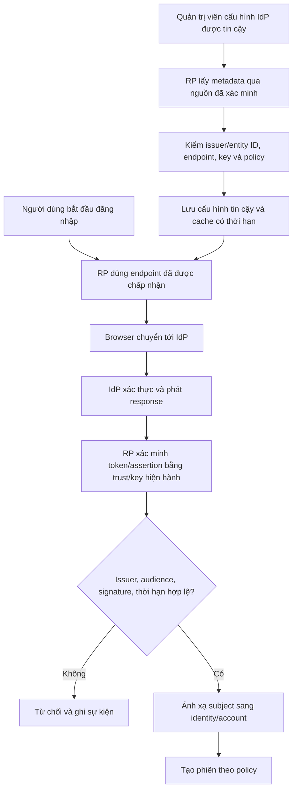

# Federation metadata

**Federation metadata** là tập thông tin cấu hình được các bên trong một quan hệ liên kết danh tính sử dụng để biết cách giao tiếp và xác minh lẫn nhau. Metadata có thể mô tả issuer hoặc entity ID, endpoint, giao thức và binding được hỗ trợ, loại response, thuật toán ký, khóa công khai, chứng chỉ, thời hạn và chính sách liên quan. Trong OpenID Connect (OIDC), metadata thường được công bố qua discovery document và JWKS; trong SAML, metadata được biểu diễn bằng XML entity descriptor.

Bài học thuộc chương **Federation** của module **SECURITY_AUTHENTICATION_FUNDAMENTALS**. Khi một ứng dụng tin cậy Identity Provider (IdP) để đăng nhập, metadata giúp ứng dụng biết nơi chuyển hướng người dùng, nơi nhận token hoặc assertion và khóa nào dùng để kiểm tra chữ ký. Người học cần biết phân biệt metadata với token/assertion, thiết lập nguồn tin cậy, kiểm tra endpoint và key, quản lý cache/rotation, phát hiện metadata bị thay đổi và thiết kế vòng đời federation an toàn.

Điểm cốt lõi: **metadata là dữ liệu cấu hình có ảnh hưởng trực tiếp tới ranh giới tin cậy**. Nếu ứng dụng lấy metadata từ nguồn giả, chấp nhận issuer không mong muốn hoặc dùng nhầm khóa, kẻ tấn công có thể khiến hệ thống xác minh token/assertion sai hoặc gửi thông tin nhạy cảm tới endpoint của họ. Không được tin metadata chỉ vì nó có định dạng JSON/XML hợp lệ.

## 1. Metadata làm gì trong federation?

Giả sử nền tảng học tập cho phép nhân viên đăng nhập bằng IdP của công ty. Ứng dụng (relying party, RP hoặc OIDC client) cần biết:

- IdP có issuer/entity ID nào?
- Endpoint nào dùng để bắt đầu đăng nhập, đổi authorization code hoặc lấy thông tin người dùng?
- Khóa công khai nào được dùng để xác minh chữ ký token/assertion?
- IdP hỗ trợ response type, signing algorithm và protocol binding nào?
- Metadata có phiên bản hoặc thời hạn cập nhật ra sao?
- Tổ chức nào chịu trách nhiệm phát hành và thay đổi cấu hình?

Metadata trả lời những câu hỏi cấu hình này. Nó giúp các bên thiết lập giao thức mà không phải hardcode mọi endpoint và khóa trong ứng dụng.

### 1.1. Metadata khác token và assertion

| Thành phần | Vai trò | Ví dụ |
| --- | --- | --- |
| **Federation metadata** | Mô tả cấu hình và năng lực của bên tham gia federation. | OIDC discovery document, JWKS, SAML metadata XML. |
| **ID token** | Mang kết quả xác thực và claims dành cho OIDC client. | JWT có `iss`, `sub`, `aud`, `exp`. |
| **Access token** | Cấp quyền truy cập resource/API theo audience và scope. | Token dành cho `learning-api`. |
| **SAML assertion** | Mang subject, authentication statement và attributes trong một giao dịch SAML. | Assertion XML được ký theo profile. |
| **Protocol message** | Request/response thực tế trong một lần đăng nhập. | OIDC authorization response hoặc SAML Response. |

Metadata thường tồn tại lâu hơn một giao dịch đăng nhập, nhưng có thể thay đổi khi endpoint, khóa, chứng chỉ hoặc chính sách thay đổi. Token/assertion là dữ liệu giao dịch; chúng phải được xác minh theo metadata và trust configuration phù hợp.

### 1.2. Hai hướng metadata chính

- **OIDC/OAuth metadata:** JSON document mô tả issuer, endpoint và các tính năng được hỗ trợ; JWKS cung cấp tập public key để xác minh chữ ký.
- **SAML metadata:** XML mô tả entity, vai trò IdP/SP, endpoint, binding, khóa ký/mã hóa và thông tin tổ chức.

Hai hệ sinh thái có mục tiêu tương tự nhưng cấu trúc và quy tắc tin cậy khác nhau. Không thể lấy trường trong OIDC discovery rồi coi đó là tương đương trực tiếp với một XML element SAML.

## 2. Metadata nằm ở đâu trong luồng đăng nhập?



Một quy trình an toàn có hai thời điểm cần phân biệt:

1. **Thiết lập/cập nhật trust:** ứng dụng nhận metadata, kiểm tra nguồn và chấp nhận cấu hình.
2. **Xác minh giao dịch:** ứng dụng dùng cấu hình đã được tin cậy để xác minh response thực tế.

Không nên tải metadata tùy ý từ URL do request đăng nhập cung cấp rồi dùng ngay để xác minh response của chính request đó. Điều đó cho phép attacker tự chọn issuer và khóa mà RP sẽ tin.

## 3. OIDC Discovery metadata

OpenID Connect Discovery cho phép một OpenID Provider (OP) công bố cấu hình dưới dạng JSON. Một discovery document phổ biến có endpoint `/.well-known/openid-configuration` gắn với issuer theo quy tắc discovery của OIDC.

Ví dụ rút gọn:

```json
{
  "issuer": "https://id.example.org",
  "authorization_endpoint": "https://id.example.org/oauth2/authorize",
  "token_endpoint": "https://id.example.org/oauth2/token",
  "userinfo_endpoint": "https://id.example.org/oauth2/userinfo",
  "jwks_uri": "https://id.example.org/oauth2/keys",
  "response_types_supported": ["code"],
  "subject_types_supported": ["public", "pairwise"],
  "id_token_signing_alg_values_supported": ["RS256"],
  "scopes_supported": ["openid", "profile", "email"],
  "token_endpoint_auth_methods_supported": ["private_key_jwt", "client_secret_basic"],
  "code_challenge_methods_supported": ["S256"]
}
```

Đây là ví dụ minh họa; giá trị và endpoint thực tế do OP công bố. Ứng dụng cần hiểu trường nào bắt buộc theo specification và profile đang dùng, trường nào tùy chọn, và tính năng nào phải được allowlist theo chính sách.

### 3.1. Các trường quan trọng

| Trường | Ý nghĩa | Kiểm soát cần có |
| --- | --- | --- |
| `issuer` | Định danh chính xác của OpenID Provider. | So sánh chính xác với issuer đã cấu hình và claim `iss` trong ID token. |
| `authorization_endpoint` | Endpoint bắt đầu authorization request. | Chỉ chấp nhận HTTPS và endpoint thuộc OP đã tin cậy. |
| `token_endpoint` | Endpoint đổi code hoặc thực hiện token request. | Gửi client authentication phù hợp; bảo vệ code và secret. |
| `jwks_uri` | Endpoint cung cấp public keys. | Lấy từ metadata đã tin cậy; xác minh TLS và kiểm tra key set. |
| `userinfo_endpoint` | Endpoint cung cấp claims về user theo access token. | Gọi bằng access token phù hợp; kiểm tra response và subject. |
| `response_types_supported` | Các response type OP hỗ trợ. | Chọn flow phù hợp; ưu tiên Authorization Code Flow với PKCE cho ứng dụng hiện đại. |
| `subject_types_supported` | Cách OP tạo subject identifier, ví dụ public hoặc pairwise. | Không giả định `sub` luôn giống nhau giữa các client. |
| `id_token_signing_alg_values_supported` | Thuật toán ký ID token được OP công bố hỗ trợ. | Chọn allowlist thuật toán an toàn; không chấp nhận thuật toán chỉ vì metadata liệt kê. |
| `token_endpoint_auth_methods_supported` | Phương thức client authentication ở token endpoint. | Chọn phương thức phù hợp với loại client và quản lý khóa/secret. |
| `code_challenge_methods_supported` | Phương thức PKCE được hỗ trợ. | Ưu tiên `S256`; không hạ xuống phương thức yếu chỉ để tương thích. |

Discovery document là mô tả năng lực, không phải lời mời chấp nhận mọi tính năng. RP có thể chỉ cho phép một tập flow, thuật toán và endpoint đã được đánh giá.

### 3.2. Issuer phải khớp chính xác

Issuer là định danh của OP. Trong OIDC, claim `iss` của ID token phải khớp với issuer mà client đã cấu hình và tin cậy. Không nên tự động bỏ dấu slash cuối, đổi chữ hoa/thường, thay hostname hoặc chuẩn hóa URL theo cách làm hai issuer khác nhau trở thành một.

Ví dụ, các chuỗi sau không mặc nhiên là cùng issuer:

```text
https://id.example.org
https://id.example.org/
https://login.example.org
https://id.example.org/tenant-a
```

Ứng dụng phải dùng quy tắc chính xác theo OIDC và cấu hình OP. Không dùng email domain hoặc tên hiển thị làm thay thế issuer.

### 3.3. Discovery URL và issuer có đường dẫn

Một issuer có thể chứa path, ví dụ `https://id.example.org/tenant-a`. Cách xây discovery URL có quy tắc theo OIDC Discovery; không tự nối chuỗi `/.well-known/openid-configuration` theo trực giác nếu thư viện/protocol profile yêu cầu cách xử lý cụ thể.

Hãy dùng thư viện OIDC đã được kiểm thử để tạo discovery URL, xác minh issuer trong document và xử lý path đúng specification. Tránh redirect hoặc URL rewriting làm metadata trả về một issuer khác với issuer yêu cầu.

## 4. JWKS: metadata về khóa công khai

**JSON Web Key Set (JWKS)** là JSON object chứa một tập JWK public keys. OIDC discovery thường công bố `jwks_uri`; client dùng endpoint này để lấy khóa xác minh chữ ký ID token. JWKS không phải kho private key và không nên chứa khóa bí mật dùng để ký.

Ví dụ JWKS rút gọn:

```json
{
  "keys": [
    {
      "kty": "RSA",
      "use": "sig",
      "kid": "signing-2026-11",
      "alg": "RS256",
      "n": "base64url-modulus",
      "e": "AQAB"
    }
  ]
}
```

Giá trị `n`, `e` và `kid` ở đây chỉ là placeholder. JWK thực tế có cấu trúc theo loại khóa; không dùng ví dụ này làm khóa sản xuất.

### 4.1. Các trường JWK thường gặp

- `kty`: loại khóa, ví dụ RSA hoặc EC.
- `kid`: key ID giúp chọn khóa tương ứng với header JWT.
- `use`: mục đích sử dụng, ví dụ `sig` cho ký/xác minh.
- `alg`: thuật toán liên quan nếu được công bố.
- `n`, `e`: tham số public key RSA.
- `crv`, `x`, `y`: tham số public key EC.

RP cần kiểm tra khóa có loại và kích thước phù hợp, mục đích sử dụng đúng, thuật toán nằm trong allowlist và key thuộc JWKS của issuer đã được tin cậy. Không lấy `jku` hoặc `x5u` do token tự khai làm nguồn khóa mới nếu không có chính sách tin cậy rõ ràng.

### 4.2. Chọn khóa bằng kid

JWT header có thể chứa `kid` để chỉ khóa ký. RP tìm khóa tương ứng trong JWKS đã lấy từ issuer tin cậy. Nếu không tìm thấy `kid`, client có thể refresh JWKS một lần theo cơ chế có giới hạn để xử lý rotation, nhưng không nên tải liên tục theo từng token lạ.

Các kiểm soát quan trọng:

- Chỉ dùng JWKS URI lấy từ metadata của issuer đã cấu hình.
- Giới hạn kích thước response, thời gian tải và số lần refresh.
- Không chọn khóa chỉ dựa trên `kid`; kiểm `kty`, `use`, `alg` và tham số.
- Không cho token tự chọn thuật toán không được cấu hình.
- Xử lý `kid` trùng hoặc JWKS chứa khóa mơ hồ theo hướng từ chối/điều tra, không chọn tùy tiện.
- Cache JWKS hợp lý và hỗ trợ rotation có overlap.

## 5. SAML metadata

Trong SAML 2.0, metadata thường là XML mô tả một **entity** và các vai trò SAML mà entity thực hiện. Một tổ chức có thể công bố metadata cho Identity Provider (IdP), Service Provider (SP) hoặc nhiều role.

Một tài liệu có thể chứa:

- `EntityDescriptor`: định danh entity qua `entityID`.
- `IDPSSODescriptor`: thông tin vai trò IdP, endpoint đăng nhập và khóa.
- `SPSSODescriptor`: thông tin vai trò SP, endpoint nhận assertion và yêu cầu.
- `SingleSignOnService`, `SingleLogoutService`: endpoint và binding.
- `KeyDescriptor`: chứng chỉ/khóa dùng cho signing hoặc encryption.
- `NameIDFormat`: loại NameID hỗ trợ.
- `AssertionConsumerService`: endpoint SP nhận SAML response.
- `validUntil`, `cacheDuration`: thời hạn và gợi ý cache.
- `Organization`, `ContactPerson`: thông tin tổ chức/liên hệ.

Ví dụ XML rút gọn:

```xml
<EntityDescriptor
    entityID="https://id.example.org/saml"
    xmlns="urn:oasis:names:tc:SAML:2.0:metadata">
  <IDPSSODescriptor
      protocolSupportEnumeration="urn:oasis:names:tc:SAML:2.0:protocol">
    <KeyDescriptor use="signing">
      <KeyInfo xmlns="http://www.w3.org/2000/09/xmldsig#">
        <X509Data>
          <X509Certificate>BASE64_CERTIFICATE_PLACEHOLDER</X509Certificate>
        </X509Data>
      </KeyInfo>
    </KeyDescriptor>
    <SingleSignOnService
        Binding="urn:oasis:names:tc:SAML:2.0:bindings:HTTP-Redirect"
        Location="https://id.example.org/saml/sso"/>
  </IDPSSODescriptor>
</EntityDescriptor>
```

Ví dụ này chỉ thể hiện hình dạng khái niệm; metadata triển khai thực tế cần namespace, endpoint, role, key và thuộc tính theo schema/profile SAML phù hợp.

### 5.1. entityID và endpoint

`entityID` là định danh entity trong SAML. Nó không nhất thiết phải là URL có thể mở bằng browser, dù thường được biểu diễn dưới dạng URI. SP phải biết entityID nào được tin và xác minh response/assertion có issuer tương ứng.

Endpoint như `SingleSignOnService` và `AssertionConsumerService` phải được kiểm tra theo metadata đã chấp nhận. Binding xác định cách SAML message được truyền, ví dụ HTTP-Redirect hoặc HTTP-POST. Không nhận endpoint từ response chưa xác minh để quyết định nơi gửi dữ liệu nhạy cảm.

### 5.2. KeyDescriptor và chứng chỉ

`KeyDescriptor use="signing"` mô tả khóa/chứng chỉ được dùng để xác minh chữ ký của entity hoặc vai trò tương ứng theo profile. `use="encryption"` có thể mô tả khóa dùng mã hóa dữ liệu gửi tới bên nhận. Nếu thuộc tính `use` vắng mặt, cách diễn giải phụ thuộc quy tắc metadata SAML và ứng dụng; không tự gán một ý nghĩa không được profile hỗ trợ.

Chứng chỉ trong SAML metadata thường là phương tiện phân phối public key. Việc nó nằm trong metadata không tự động tạo trust: SP phải xác minh metadata đến từ nguồn đã được thiết lập, ví dụ kênh quản trị an toàn, chữ ký metadata đã xác minh hoặc trust framework đã thống nhất.

### 5.3. XML metadata phải được parse an toàn

Metadata XML là dữ liệu bên ngoài. Parser cần được cấu hình an toàn:

- Tắt external entity resolution (XXE) và DTD không cần thiết.
- Giới hạn kích thước, độ sâu và thời gian parse.
- Kiểm tra schema/profile nếu triển khai yêu cầu.
- Xử lý XML signature theo thư viện đã được kiểm thử; chống signature wrapping.
- Xác minh chữ ký trên đúng node/element được sử dụng, không chỉ kiểm tra một chữ ký ở đâu đó trong document.
- Không dùng dữ liệu từ metadata chưa được xác minh để thay đổi trust hoặc endpoint production.

SAML response/assertion cũng cần kiểm tra chữ ký, issuer, audience, recipient, destination, thời hạn, InResponseTo và replay theo profile. Metadata hợp lệ không thay thế xác minh từng assertion.

## 6. Thiết lập trust: metadata đến từ đâu?

Metadata có thể được lấy theo nhiều cách:

1. **Cấu hình thủ công qua kênh quản trị:** quản trị viên nhập issuer, metadata URL, chứng chỉ hoặc khóa đã xác minh qua quy trình nội bộ.
2. **Discovery từ issuer đã được tin cậy:** tổ chức đã có issuer đáng tin, sau đó tải metadata qua HTTPS và kiểm tra issuer/endpoint.
3. **Metadata được ký:** bên phát hành ký metadata; bên nhận xác minh chữ ký bằng trust anchor đã phân phối trước.
4. **Trust framework/federation operator:** một tổ chức điều phối công bố metadata hoặc trust bundle cho các thành viên theo chính sách chung.

HTTPS bảo vệ đường truyền tới host được kết nối, nhưng **không tự trả lời liệu host đó có phải IdP mà tổ chức muốn tin hay không**. Trust bootstrap phải dựa trên cấu hình hoặc quan hệ tin cậy đã xác minh, không chỉ dựa vào URL do người dùng tự nhập.

### 6.1. Không tin metadata URL do client kiểm soát

Nếu ứng dụng cho người dùng gửi `metadata_url` trong request rồi server tải URL đó, có thể phát sinh SSRF. Attacker có thể yêu cầu server truy cập địa chỉ nội bộ, metadata giả hoặc endpoint kiểm soát bởi họ.

Biện pháp:

- Chỉ admin hoặc quy trình onboarding có thẩm quyền được thêm IdP.
- Validate scheme/host và áp dụng allowlist theo chính sách; ưu tiên URL được lưu trong cấu hình tenant.
- Chặn địa chỉ loopback, link-local, private/internal và các dạng redirect tới vùng mạng không được phép.
- Giới hạn redirect, DNS resolution, kích thước response và timeout.
- Không tải metadata trong request path đăng nhập nếu có thể xử lý qua job quản trị tách biệt.
- Ghi audit ai thêm hoặc thay metadata URL và ai phê duyệt.

Không có một allowlist IP đơn giản nào thay thế được kiểm soát DNS rebinding và redirect; dùng cơ chế outbound fetch an toàn của nền tảng.

### 6.2. Xác minh issuer và tenant

Một hệ thống đa tenant có thể dùng nhiều IdP. Cần ràng buộc:

- Tenant nào đã phê duyệt issuer/entityID nào.
- User identity được ánh xạ từ `(issuer, subject)` hoặc SAML NameID/attribute theo quy tắc nào.
- Endpoint/keys nào thuộc metadata của đúng issuer đó.
- Audience/client ID/ACS URL nào dành cho ứng dụng hiện tại.
- Claims nào được tin để cấp membership hoặc role.

Không cho một tenant tự khai issuer khác rồi dùng token của issuer đó để truy cập tenant hiện hữu. Metadata phải gắn với cấu hình trust và tenant được phê duyệt.

## 7. Metadata và key rotation

Khóa ký có thể thay đổi vì rotation định kỳ, thay đổi thuật toán, nghi ngờ compromise hoặc thay nhà cung cấp. Metadata là một trong những kênh phân phối public key mới.

### 7.1. Rotation bình thường

Một kế hoạch rotation thường có các bước:

1. IdP tạo key pair mới và công bố public key mới trong JWKS hoặc SAML metadata.
2. Trong thời gian overlap, metadata có thể chứa cả khóa cũ và mới.
3. IdP bắt đầu ký bằng khóa mới sau khi RP có cơ hội tải và chấp nhận key set mới.
4. RP xác minh token/assertion bằng khóa tương ứng với `kid` hoặc certificate đã được metadata chấp nhận.
5. Sau khi không còn token/assertion hợp lệ cần khóa cũ, IdP gỡ public key cũ theo lịch.
6. RP cập nhật cache và ngừng tin khóa cũ theo policy.

Thời gian overlap phải tính đến cache TTL, độ trễ phân phối, thời hạn token/assertion và thời gian triển khai giữa các region. Không xóa khóa cũ quá sớm nếu còn response hợp lệ đã ký bằng khóa đó; cũng không giữ khóa cũ vô thời hạn.

### 7.2. Rotation khẩn cấp khi nghi lộ private key

Nếu private signing key bị compromise, lịch rotation bình thường có thể không đủ. Cần:

- Dừng hoặc giới hạn việc phát hành bằng khóa bị lộ.
- Phát hành key mới và cập nhật metadata qua trust channel đã xác minh.
- Xác định thời gian và phạm vi token/assertion ký bằng khóa cũ.
- Thu hồi session/token hoặc yêu cầu re-authentication khi mức rủi ro đòi hỏi.
- Cập nhật JWKS cache/metadata cache; có thể cần loại bỏ key cũ sớm.
- Thông báo các RP/tenant liên quan theo quy trình incident response.
- Kiểm tra liệu attacker có thể sửa metadata URL, DNS, CA hoặc trust anchor hay không.

**Xóa key khỏi JWKS không bảo đảm mọi RP lập tức ngừng tin key đó** nếu họ cache lâu hoặc có bản sao cấu hình riêng. Kế hoạch sự cố cần biết cache và cơ chế trust của từng RP.

## 8. Cache, refresh và metadata freshness

Metadata không nên được tải lại ở mỗi request đăng nhập. Hệ thống thường cache discovery document, JWKS hoặc SAML metadata để giảm độ trễ và tăng khả năng phục vụ. Tuy nhiên cache quá lâu có thể giữ endpoint hoặc khóa cũ; cache quá ngắn làm tăng tải và tạo điểm phụ thuộc bên ngoài.

### 8.1. Cache policy

- Tôn trọng HTTP caching headers và metadata-specific `cacheDuration`/`validUntil` theo protocol, nhưng áp dụng giới hạn nội bộ.
- Lưu thời điểm lấy, nguồn, version/hash, issuer/entityID và kết quả xác minh.
- Dùng background refresh để tránh mọi request đăng nhập đồng loạt tải metadata.
- Khi fetch thất bại, có thể dùng bản cache đã xác minh trong thời gian grace có giới hạn theo risk policy; không chấp nhận metadata mới chưa xác minh chỉ để tăng availability.
- Cảnh báo khi metadata hết hạn, issuer thay đổi, key set rỗng hoặc endpoint bất ngờ thay đổi.
- Chống cache poisoning bằng cách ràng buộc cache key với issuer/tenant và nguồn fetch đã xác minh.

### 8.2. Unknown kid

Khi JWT có `kid` không xuất hiện trong JWKS cache, có thể issuer vừa rotation. Resource server nên refresh JWKS từ URI đã tin cậy theo cơ chế throttled, rồi thử lại một lần. Nếu vẫn không tìm thấy khóa phù hợp, từ chối token.

Không tải URL khóa từ JWT header và không cho attacker tạo hàng nghìn `kid` khác nhau để ép server fetch JWKS liên tục. Cache kết quả âm trong thời gian ngắn và giới hạn refresh đồng thời để chống DoS.

### 8.3. Metadata stale và outage

Nếu IdP tạm thời không truy cập được:

- Dùng metadata/JWKS cache đã xác minh trong giới hạn policy.
- Không tự chuyển sang issuer khác hoặc bỏ kiểm tra chữ ký.
- Không chấp nhận token hết hạn chỉ vì discovery endpoint đang lỗi.
- Phân biệt outage của metadata endpoint với việc khóa/issuer bị nghi compromise.
- Có runbook cập nhật metadata thủ công qua kênh khẩn cấp đã xác minh.

Availability không được đánh đổi bằng cách chấp nhận nguồn tin cậy không rõ ràng.

## 9. Những trường metadata có ảnh hưởng đến bảo mật

Metadata không chỉ cung cấp địa chỉ. Một thay đổi nhỏ có thể thay đổi luồng xác thực hoặc nơi ứng dụng gửi thông tin nhạy cảm.

| Thành phần | Rủi ro khi bị thay đổi | Kiểm soát |
| --- | --- | --- |
| `issuer` / `entityID` | RP tin nhầm một IdP hoặc ánh xạ subject sai. | Exact match với trust config; phê duyệt issuer change. |
| Authorization/token endpoint | Authorization code hoặc client credential bị gửi tới host giả. | HTTPS, host allowlist, redirect policy, endpoint review. |
| `jwks_uri` / signing key | RP xác minh bằng khóa do attacker kiểm soát hoặc bỏ lỡ rotation. | Lấy từ metadata tin cậy, xác minh TLS/signature, key policy. |
| Redirect URI / ACS endpoint | Response được gửi tới endpoint không mong muốn. | Client registration/metadata pinning và exact endpoint validation. |
| Signing algorithm | Hạ cấp sang thuật toán không được phép. | Algorithm allowlist độc lập; không chấp nhận mọi giá trị được công bố. |
| NameID/subject/claim mapping | Identity bị gắn nhầm người hoặc cấp role sai. | Mapping rõ, tenant binding, không tự merge theo email. |
| Logout endpoint | Logout message bị gửi sai nơi hoặc không được xác minh. | Kiểm issuer, binding, signature và request correlation theo protocol. |
| Validity/cache fields | RP dùng metadata cũ hoặc ngừng tin metadata quá sớm. | Giới hạn cache và monitor freshness. |

### 9.1. Endpoint metadata và SSRF

Endpoint trong metadata có thể được server gọi trực tiếp, ví dụ token endpoint, JWKS URI, UserInfo hoặc metadata refresh. Nếu attacker điều khiển metadata, server có thể bị hướng tới host nội bộ hoặc dịch vụ ngoài dự kiến.

Áp dụng outbound request policy: HTTPS, giới hạn redirect, DNS/IP validation, timeout, response size, egress filtering và log nguồn. Không cho metadata endpoint thay đổi tự do chỉ dựa vào một response chưa xác minh.

### 9.2. Metadata thay đổi cần review

Một số thay đổi có thể hợp lệ, như thêm key mới. Những thay đổi khác cần phê duyệt cao hơn:

- Issuer/entityID thay đổi.
- Hostname endpoint thay đổi.
- JWKS URI chuyển sang domain khác.
- Signing algorithm thay đổi hoặc có thuật toán mới.
- SAML ACS/SSO/SLO endpoint hoặc binding thay đổi.
- Subject/attribute mapping hoặc assurance policy thay đổi.
- Trust anchor/certificate thay đổi ngoài kế hoạch.

Có thể so sánh hash hoặc diff metadata giữa các lần fetch và gửi cảnh báo. Diff không tự xác định thay đổi là độc hại, nhưng giúp người vận hành nhìn thấy thay đổi có ảnh hưởng trust.

## 10. Vận hành OIDC discovery và SAML metadata an toàn

### 10.1. OIDC discovery

Một luồng vận hành tham khảo:

```text
registerTrustedIssuer(tenant, configuredIssuer):
    require administratorHasAuthority(tenant)
    require configuredIssuer is approved by organization policy

    document = fetchDiscoveryDocumentSafely(configuredIssuer)
    require document.issuer exactly matches configuredIssuer
    require all required endpoints use approved HTTPS origins
    require document signing algorithms intersect local allowlist
    require document supports an approved flow

    jwks = fetchJwksSafely(document.jwks_uri)
    validateJwksStructureAndKeyPolicy(jwks)

    storeVersionedTrustConfiguration(tenant, configuredIssuer, document, jwks)
    auditMetadataEnrollment(tenant, configuredIssuer)
```

Đây là pseudocode khái niệm. Việc thiết lập trust ban đầu vẫn cần xác minh issuer qua kênh có thẩm quyền. HTTPS fetch chỉ bảo vệ kết nối tới host được chọn; nó không thay thế bước phê duyệt IdP.

### 10.2. SAML metadata

Một quy trình SAML có thể:

1. Nhận XML metadata từ URL/kênh quản trị đã phê duyệt.
2. Parse an toàn, giới hạn tài nguyên và kiểm schema/profile cần thiết.
3. Xác minh metadata signature nếu trust model yêu cầu; trust key dùng xác minh phải được phân phối độc lập.
4. Kiểm `entityID`, role descriptor, endpoint, binding, certificate và validity.
5. So sánh thay đổi với bản đã chấp nhận; phê duyệt thay đổi nhạy cảm.
6. Lưu bản đã xác minh và version/hash, cache tới hạn phù hợp.
7. Dùng cấu hình này để xác minh từng SAML response/assertion; không bỏ qua validation giao dịch.

### 10.3. Không nhầm metadata signing với assertion signing

- **Metadata signing** xác nhận nguồn và tính toàn vẹn của tài liệu metadata theo trust anchor đã biết.
- **Assertion/response signing** xác nhận nội dung của thông điệp SAML trong một giao dịch.
- **TLS** bảo vệ kết nối truyền tải tới endpoint.

Ba cơ chế này giải quyết các lớp khác nhau. Metadata được ký không có nghĩa mọi assertion sau đó tự động hợp lệ; assertion vẫn cần kiểm chữ ký, issuer, audience, recipient, destination, thời hạn và correlation.

## 11. Threat model cho federation metadata

| Mối đe dọa | Cách xảy ra | Tác động | Kiểm soát |
| --- | --- | --- | --- |
| **Metadata spoofing** | Attacker cung cấp discovery document/XML giả. | RP tin issuer, endpoint hoặc key giả. | Trust bootstrap, admin approval, metadata signature hoặc kênh phân phối đã xác minh. |
| **JWKS key substitution** | JWKS URI bị thay hoặc token trỏ tới key URL không tin cậy. | Token giả được xác minh bằng khóa attacker. | Chỉ dùng JWKS URI từ metadata tin cậy; bỏ qua key URL tự khai không được phép. |
| **SSRF qua metadata URL** | User nhập URL trỏ tới địa chỉ nội bộ hoặc endpoint nhạy cảm. | Server truy cập mạng nội bộ thay attacker. | Admin-only onboarding, URL validation, egress filtering, redirect/DNS controls. |
| **Issuer mix-up** | Client không ràng buộc response với issuer đã chọn. | Response từ IdP khác bị chấp nhận. | Exact issuer validation, state/nonce, issuer binding và client configuration riêng. |
| **Key rotation race** | IdP đổi key nhưng RP cache chưa cập nhật hoặc xóa key cũ sớm. | Login hợp lệ bị lỗi hoặc token sai được chấp nhận. | Overlap, refresh throttling, cache policy và runbook rotation. |
| **Metadata cache poisoning** | Cache dùng key không ràng buộc tenant/issuer hoặc nhận response từ nguồn sai. | Một tenant dùng nhầm trust config của tenant khác. | Cache key theo issuer+tenant, provenance và integrity. |
| **SAML XML signature wrapping / XXE** | Parser xử lý XML không an toàn hoặc xác minh sai node. | Assertion giả được dùng hoặc đọc file/network ngoài ý muốn. | XML parser hardened, signature verification đúng node, schema/profile và thư viện chuẩn. |
| **Algorithm downgrade** | Metadata/response quảng bá thuật toán yếu hoặc RP tự chấp nhận. | Giảm độ mạnh xác minh chữ ký. | Local algorithm allowlist, policy review và loại bỏ thuật toán yếu. |
| **Stale metadata** | RP dùng key/endpoint cũ quá lâu. | Không nhận rotation hoặc tiếp tục tin cấu hình đã thay đổi. | Freshness monitoring, cache giới hạn, version/diff và incident update. |
| **Tenant trust confusion** | Issuer/subject của tenant này được dùng trong tenant khác. | Identity mapping sai hoặc truy cập chéo tổ chức. | Trust binding theo tenant, issuer và subject; authorization riêng. |

## 12. Tình huống thực hành: JWKS URI bị thay đổi

**Bối cảnh:** Nền tảng học tập tin IdP `https://id.example.org`. Discovery document ban đầu có `jwks_uri=https://id.example.org/keys`. Sau một thay đổi cấu hình không được phê duyệt, metadata trỏ tới `https://keys.attacker.example/jwks`. Attacker phát hành JWT với `iss` trông giống IdP và ký bằng private key của họ. RP tự động tải JWKS mới và dùng public key đó để xác minh.

**Phân tích:**

1. Chữ ký JWT có thể hợp lệ về mặt toán học, nhưng public key đến từ nguồn không còn được tổ chức tin cậy.
2. RP đã biến metadata thành trust anchor động mà không có kiểm soát thay đổi.
3. Nếu chỉ kiểm `kid`, `alg` hoặc `exp` mà không kiểm issuer và nguồn JWKS, token giả có thể được chấp nhận.
4. Nếu metadata URL/issuer được cấu hình theo tenant, việc cache sai có thể ảnh hưởng cả tổ chức khác.

**Cách thiết kế lại:**

- Ràng buộc discovery document với issuer đã được quản trị viên phê duyệt; xác minh `issuer` chính xác.
- Chỉ chấp nhận JWKS URI nằm trong origin/host policy được duyệt hoặc theo trust policy đã định.
- Phát hiện và review thay đổi JWKS URI; phân biệt key rollover bình thường với đổi nguồn khóa.
- Cache metadata/JWKS theo tenant và issuer; ghi provenance, version/hash và thời điểm lấy.
- Xác minh JWT theo issuer, audience, signature, algorithm, thời hạn và các claim bắt buộc.
- Khi có dấu hiệu compromise, thu hồi trust configuration/key, đánh giá token đã cấp và yêu cầu re-authentication khi cần.

**Câu hỏi mở:** Nếu IdP chỉ thêm một key mới vào JWKS nhưng giữ nguyên issuer và URI, có cần chặn không? Không nhất thiết. Đây có thể là rotation hợp lệ; cần kiểm tra key policy, overlap, nguồn metadata và quy trình thông báo. Một thay đổi URI hoặc issuer thường có tác động trust lớn hơn việc thêm một key trong cùng JWKS đã được tin cậy.

## 13. Checklist quản lý federation metadata

- [ ] Có nguồn trust bootstrap rõ ràng cho từng issuer/entityID và tenant.
- [ ] Phân biệt metadata, token, assertion và protocol message.
- [ ] OIDC discovery document phải có issuer khớp chính xác với cấu hình đã tin cậy.
- [ ] Chỉ sử dụng authorization/token/UserInfo/JWKS endpoints từ metadata đã xác minh.
- [ ] Không lấy JWKS từ URL tùy ý trong JWT header hoặc request client.
- [ ] Kiểm tra thuật toán, loại khóa, key use, key ID và cấu hình allowlist độc lập.
- [ ] SAML XML được parse an toàn; tắt XXE/DTD không cần thiết và chống signature wrapping.
- [ ] Xác minh metadata signature bằng trust anchor phân phối độc lập nếu trust model yêu cầu.
- [ ] Kiểm tra entityID, role descriptor, endpoint, binding, certificate và validity.
- [ ] Cache metadata/JWKS theo issuer+tenant; có freshness, refresh, throttling và outage policy.
- [ ] Có quy trình key rotation overlap và xử lý khẩn cấp khi private key bị lộ.
- [ ] Theo dõi diff/hash và yêu cầu phê duyệt với issuer, endpoint, JWKS URI, algorithm hoặc mapping thay đổi.
- [ ] Bảo vệ metadata fetch khỏi SSRF, DNS rebinding, redirect và response quá lớn.
- [ ] Không để metadata của tenant này tự động trở thành trust của tenant khác.
- [ ] Vẫn xác minh đầy đủ từng ID token/SAML assertion: signature, issuer, audience, thời hạn, nonce/state/correlation và replay.
- [ ] Ghi audit thay đổi metadata nhưng không ghi client secret, private key hoặc token.

## 14. Câu hỏi tự kiểm tra

**1. Federation metadata có phải là token đăng nhập không?**  
Không. Metadata mô tả cấu hình, endpoint, khóa và năng lực của bên tham gia; token/assertion là thông điệp giao dịch mang kết quả xác thực hoặc quyền.

**2. OIDC discovery document thường cung cấp thông tin gì?**  
Issuer, authorization/token/UserInfo endpoints, JWKS URI, response types, subject types, signing algorithms và các phương thức hỗ trợ khác.

**3. JWKS có chứa private key để RP xác minh token không?**  
Không. JWKS công bố các JWK; RP dùng public key phù hợp để xác minh chữ ký. Private signing key phải được IdP bảo vệ.

**4. Nếu JWT có `kid` không có trong JWKS cache thì nên làm gì?**  
Có thể refresh JWKS một lần từ URI đã tin cậy theo cơ chế giới hạn để xử lý rotation; nếu vẫn không có key phù hợp thì từ chối token. Không tải key URL do token tự khai.

**5. HTTPS có đủ để tin một metadata URL bất kỳ không?**  
Không. HTTPS bảo vệ kết nối tới host, nhưng tổ chức vẫn phải xác minh host/issuer có đúng IdP mà họ muốn tin hay không.

**6. SAML metadata signing khác assertion signing như thế nào?**  
Metadata signing bảo vệ tài liệu cấu hình; assertion signing bảo vệ nội dung xác thực của giao dịch cụ thể. Assertion vẫn phải được kiểm tra độc lập.

**7. Vì sao không cho người dùng cuối tự nhập metadata URL?**  
Server có thể bị lợi dụng để fetch địa chỉ nội bộ (SSRF) hoặc thiết lập trust với IdP giả. Việc onboarding IdP cần thẩm quyền, kiểm tra nguồn và audit.

**8. Khi IdP rotation signing key, cần giữ key cũ bao lâu?**  
Theo kế hoạch overlap tính đến cache TTL, thời hạn token/assertion và độ trễ các RP. Nếu key cũ bị compromise, xử lý khẩn cấp có thể cần loại bỏ sớm và đánh giá lại token đã phát hành.

**9. Metadata hợp lệ có làm SAML assertion tự động hợp lệ không?**  
Không. RP vẫn phải kiểm chữ ký, issuer, audience, recipient, destination, thời hạn, InResponseTo và chống replay theo profile.

**10. Vì sao metadata cache phải gắn với tenant và issuer?**  
Để tránh một tenant vô tình dùng endpoint hoặc public key của tenant khác, gây nhầm lẫn trust và ánh xạ danh tính sai.

**Ghi nhớ:** Federation metadata là cấu hình có quyền định hình ai được tin, endpoint nào được gọi và khóa nào được dùng để xác minh. Hãy thiết lập trust từ nguồn đã xác minh, kiểm issuer/endpoint/key, bảo vệ metadata fetch và XML parsing, quản lý cache/rotation có kiểm soát, rồi vẫn xác minh từng token hoặc assertion theo đúng giao thức trước khi tạo principal và session.
