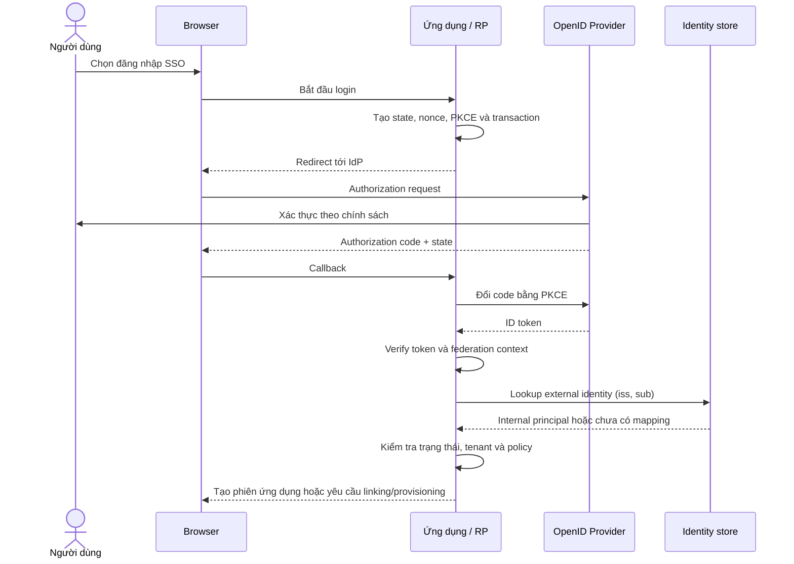

# Subject mapping — Ánh xạ chủ thể liên kết thành tài khoản nội bộ

Một nhân viên đăng nhập vào ứng dụng SaaS bằng SSO của công ty. Nhà cung cấp danh tính (Identity Provider, IdP) trả về một định danh chủ thể; ứng dụng cần biết lần đăng nhập này tương ứng với tài khoản nội bộ nào, thuộc tenant nào và được cấp quyền gì. Nếu ánh xạ sai, nhân viên có thể vào nhầm tài khoản, nhìn thấy dữ liệu của tổ chức khác hoặc nhận quyền quản trị không phù hợp. Nếu dùng email làm khóa định danh, việc đổi địa chỉ hoặc cấp lại hộp thư có thể dẫn tới chiếm đoạt tài khoản.

**Subject mapping** là quá trình chuyển một danh tính đã được xác minh từ hệ thống liên kết (federation) thành một principal/tài khoản nội bộ ổn định. Đây là cầu nối giữa kết quả xác thực bên ngoài và mô hình người dùng, tenant, vai trò, dữ liệu của ứng dụng.

Bài học thuộc chương **Federation** của học phần **SECURITY_AUTHENTICATION_FUNDAMENTALS**. Nội dung kết nối subject mapping với credential, mật khẩu, MFA, passkey, chứng chỉ, token, phiên, liên kết danh tính và khôi phục tài khoản. Người học sẽ biết mô hình hóa ranh giới tin cậy, xác minh claim, phòng chống giả mạo/replay và thiết kế ánh xạ danh tính an toàn.

## 1. Kết quả học tập

Sau bài này, người học có thể:

- Phân biệt external subject, internal user ID, tenant membership, account linking và provisioning.
- Giải thích vì sao OIDC thường dùng cặp `iss + sub` làm khóa danh tính bên ngoài và vì sao email không phải khóa ổn định.
- Nhận biết public subject, pairwise subject và các dạng NameID trong SAML.
- Thiết kế bảng ánh xạ với khóa duy nhất, lịch sử, trạng thái và ràng buộc tenant.
- Xác minh token/assertion trước khi ánh xạ; không lấy claim chưa được kiểm chứng làm định danh hoặc quyền.
- Xử lý xung đột, đổi email, đổi tên, chuyển tenant, deprovisioning và tái cấp subject.
- Tách subject mapping khỏi liên kết tài khoản, cấp quyền và đồng bộ hồ sơ.
- Viết tiêu chí kiểm thử cho collision, account takeover, issuer mix-up, tenant isolation và thay đổi vòng đời danh tính.

## 2. Các định danh trong hệ thống liên kết

Một hệ thống liên kết thường có ít nhất ba lớp định danh:

1. **External subject:** định danh chủ thể do IdP phát hành trong phạm vi issuer/protocol.
2. **Internal principal:** định danh ổn định do ứng dụng tự quản lý, ví dụ `user_id`.
3. **Membership/authorization context:** mối quan hệ giữa principal với tenant, tổ chức, vai trò và tài nguyên.

Ví dụ:

```text
OIDC identity
    issuer  = https://id.example-corp.test/
    subject = 00u8x9...
            │ subject mapping
            ▼
Internal principal
    user_id = usr_7f31...
            │ membership mapping
            ├── tenant_id = tenant_acme, role = employee
            └── tenant_id = tenant_research, role = viewer
```

External subject không nên được dùng trực tiếp làm khóa chính cho toàn bộ dữ liệu nghiệp vụ. Ứng dụng cần một ID nội bộ ổn định để liên kết đơn hàng, hồ sơ, audit log và các credential nội bộ. Khi người dùng đổi IdP hoặc có thêm phương thức đăng nhập, ứng dụng có thể cập nhật bảng liên kết mà không phải đổi mọi khóa dữ liệu.

### 2.1. Subject không phải username

Username, email, tên hiển thị và số điện thoại thường được dùng để tìm kiếm hoặc giao tiếp với người dùng. Chúng có thể thay đổi, được cấp lại, trùng lặp hoặc có phạm vi duy nhất khác nhau. Subject là định danh giao thức được IdP phát hành theo quy tắc cụ thể; ứng dụng cần lưu cùng issuer và phạm vi tin cậy của nó.

### 2.2. Phân biệt identity với attributes và permissions

| Thành phần | Ví dụ | Cách sử dụng |
| --- | --- | --- |
| Subject identifier | OIDC `iss + sub`; SAML persistent NameID trong phạm vi đã thỏa thuận | Tìm bản ghi danh tính bên ngoài đã được xác minh |
| Profile attributes | `email`, `name`, `locale`, `phone_number` | Hiển thị/cập nhật hồ sơ theo chính sách |
| Organization attributes | `groups`, `department`, `employee_number` | Dữ liệu đầu vào cho chính sách thành viên/quyền nếu đã xác minh và được cho phép |
| Internal principal ID | `user_id` do ứng dụng tạo | Khóa ổn định cho dữ liệu và audit nội bộ |
| Authorization | Vai trò, scope, quyền trên tài nguyên | Quyết định riêng tại server; không suy ra chỉ từ việc subject đã được ánh xạ |

Một danh tính hợp lệ không tự động có quyền truy cập mọi tài nguyên. Subject mapping trả lời **“đây là principal nội bộ nào?”**; authorization trả lời **“principal này được phép làm gì?”**.

## 3. OIDC subject: issuer và sub

Trong OpenID Connect (OIDC), ID token chứa claim:

- `iss` — issuer, định danh nhà phát hành.
- `sub` — subject, định danh người dùng trong phạm vi issuer.

Cặp **`(iss, sub)`** là khóa nhận diện chủ thể tiêu chuẩn cho relying party sau khi ID token đã được xác minh. `sub` phải ổn định, duy nhất trong phạm vi issuer theo cam kết của OIDC và không được tái gán cho người khác. Ứng dụng phải so khớp issuer đúng với cấu hình tin cậy; không bỏ qua `iss` rồi chỉ tìm theo `sub`.

Ví dụ ID token payload minh họa:

```json
{
  "iss": "https://login.example.test/",
  "sub": "248289761001",
  "aud": "saas-web-client",
  "exp": 1900003600,
  "iat": 1900000000,
  "nonce": "n-0S6_WzA2Mj"
}
```

Đây chỉ là payload ví dụ, không phải token có thể sử dụng. Chỉ dùng claim sau khi xác minh chữ ký, issuer, audience, thời hạn, nonce và các điều kiện OIDC liên quan. Một JSON decode thành công không phải xác minh danh tính.

### 3.1. Public subject

Với public subject, IdP phát cùng một `sub` cho một người dùng ở các client trong phạm vi áp dụng. Điều này thuận tiện cho việc nhận diện cùng chủ thể giữa các ứng dụng, nhưng có thể làm tăng khả năng tương quan hoạt động giữa dịch vụ.

### 3.2. Pairwise subject

Với pairwise subject, IdP tạo subject khác nhau cho cùng người dùng ở các client/sector khác nhau nhằm hạn chế việc các relying party liên kết hoạt động của người dùng với nhau. Cùng một người có thể có:

```text
issuer + sub_for_app_A  -> cùng người dùng
issuer + sub_for_app_B  -> cùng người dùng
```

Nhưng ứng dụng A không thể tự suy ra rằng hai giá trị subject thuộc cùng người chỉ bằng cách so sánh chuỗi. Việc liên kết cần một cơ chế được IdP hỗ trợ và sự cho phép/bằng chứng phù hợp, hoặc quy trình account linking mà người dùng chứng minh quyền kiểm soát hai phía.

### 3.3. Sector identifier và client registration

Pairwise subject có thể được tạo theo sector identifier được định nghĩa trong cấu hình OIDC. Việc thay đổi client ID, redirect URI, sector hoặc cấu hình IdP có thể làm subject thay đổi tùy cách nhà cung cấp triển khai. Khi chuyển ứng dụng/đăng ký client, phải kiểm tra tác động tới subject mapping và có kế hoạch migration được xác minh. Không tự ghép subject mới với tài khoản cũ chỉ dựa vào email giống nhau.

### 3.4. Khi nào cần thêm provider connection ID?

Nếu cùng một issuer được cấu hình trong nhiều kết nối tin cậy khác nhau, chẳng hạn hai enterprise connection có chính sách tenant, client registration hoặc phạm vi quản trị độc lập, mô hình dữ liệu có thể cần thêm `federation_connection_id` để xác định đúng trust context. Trường này là ranh giới cấu hình do ứng dụng quản lý; nó không thay thế `iss + sub` và không được dùng để hợp thức hóa một issuer/token chưa xác minh.

## 4. Subject trong SAML

Trong SAML 2.0, danh tính chủ thể thường được biểu diễn qua `NameID` trong Subject của assertion. NameID có thể mang Format và NameQualifier/SPNameQualifier tùy profile và thỏa thuận giữa IdP với Service Provider (SP).

Một số dạng thường gặp:

| NameID format | Ý nghĩa điển hình | Lưu ý khi mapping |
| --- | --- | --- |
| `persistent` | Định danh ổn định, riêng theo quan hệ IdP–SP | Có thể dùng làm external subject nếu profile/thỏa thuận đảm bảo tính ổn định và không tái gán |
| `transient` | Định danh tạm thời cho một phiên/luồng | Không dùng làm ID tài khoản lâu dài |
| `emailAddress` | NameID mang dạng địa chỉ email | Email có thể đổi/cấp lại; không mặc định là khóa bền vững |
| `unspecified` | Nhà phát hành không nêu format cụ thể | Phải dựa vào hợp đồng tích hợp và tài liệu IdP để xác định semantics |

Khi ánh xạ SAML, không chỉ lấy chuỗi NameID. Cần xác minh assertion:

- Chữ ký theo profile: assertion hoặc response được ký ở vị trí mà SP yêu cầu.
- Issuer đúng IdP đã cấu hình.
- Audience restriction dành cho SP.
- Recipient, Destination và ACS endpoint phù hợp.
- `InResponseTo` khớp AuthnRequest đang chờ trong SP-initiated flow.
- Conditions, NotBefore, NotOnOrAfter và clock skew.
- SubjectConfirmationData và phương thức xác nhận theo profile.
- Assertion ID chưa được xử lý trước đó để chống replay.

NameID chỉ có ý nghĩa trong ngữ cảnh issuer và thỏa thuận federation. Nếu IdP thay NameID format hoặc thay giá trị, cần migration có kiểm soát, không tự suy ra cùng một người từ email.

## 5. Quy trình subject mapping an toàn

Một luồng OIDC điển hình:



### Các bước bắt buộc

1. **Chọn đúng trust configuration:** xác định IdP/connection, issuer, client ID, tenant context và redirect URI từ cấu hình máy chủ.
2. **Khởi tạo giao dịch:** tạo state ngẫu nhiên, nonce và PKCE verifier theo flow; lưu transaction có TTL, intent và browser/session binding phù hợp.
3. **Xác minh kết quả:** kiểm tra code exchange, chữ ký ID token, `iss`, `aud`, `azp` khi áp dụng, `exp`, `iat`, `nonce` và các claim liên quan.
4. **Lấy external key:** sử dụng issuer/subject từ token đã xác minh; không lấy subject/email từ query string hoặc form.
5. **Tra mapping:** tìm external identity theo khóa và trust context chính xác.
6. **Kiểm tra trạng thái:** principal còn active? mapping có revoked/blocked? tenant membership còn hiệu lực? có yêu cầu xác thực mới hoặc step-up không?
7. **Xử lý chưa có mapping:** theo chính sách JIT provisioning, onboarding hoặc account linking; không tự gắn với tài khoản có email trùng.
8. **Tạo phiên:** chỉ sau khi danh tính và chính sách cho phép; xoay session ID, đặt mức bảo đảm/độ mới đúng theo kết quả.

Nếu dùng SAML, thay bước OIDC token bằng việc xác minh assertion/response đầy đủ trước khi lấy NameID và attributes. Không dùng một assertion chưa xác minh để tạo tài khoản hoặc cập nhật mapping.

## 6. Thiết kế bảng ánh xạ

Một mô hình tối thiểu có thể tách internal user, external identity và tenant membership:

```sql
CREATE TABLE users (
    id              UUID PRIMARY KEY,
    status          VARCHAR(20) NOT NULL,
    created_at      TIMESTAMP NOT NULL
);

CREATE TABLE external_identities (
    id                    UUID PRIMARY KEY,
    user_id               UUID NOT NULL REFERENCES users(id),
    issuer                VARCHAR(1024) NOT NULL,
    subject               VARCHAR(1024) NOT NULL,
    federation_connection_id UUID,
    status                VARCHAR(20) NOT NULL,
    first_linked_at       TIMESTAMP NOT NULL,
    last_seen_at          TIMESTAMP,
    revoked_at            TIMESTAMP
);

CREATE UNIQUE INDEX uq_external_identity
ON external_identities(issuer, subject);

CREATE TABLE tenant_memberships (
    tenant_id       UUID NOT NULL,
    user_id         UUID NOT NULL REFERENCES users(id),
    status          VARCHAR(20) NOT NULL,
    role_source     VARCHAR(30) NOT NULL,
    PRIMARY KEY (tenant_id, user_id)
);
```

Đây là ví dụ cấu trúc; nếu một issuer có các namespace/connection độc lập, unique key cần phản ánh trust boundary đã được thiết kế, chẳng hạn thêm connection ID khi semantics của tích hợp yêu cầu. Không thêm tenant vào unique key một cách tùy tiện: điều đó có thể cho phép cùng một external subject được gắn với nhiều principal khác nhau mà không có chính sách linking rõ ràng.

### Nguyên tắc dữ liệu

- `users.id` do ứng dụng tạo và không đổi khi người dùng thay email hoặc IdP.
- External identity giữ nguyên giá trị issuer/subject đã xác minh; không normalize subject bằng cách trim, lowercase hoặc biến đổi tùy tiện.
- Issuer được so sánh theo metadata/cấu hình tin cậy và quy tắc giao thức; không tự thay slash, scheme hoặc host để “khớp gần đúng”.
- Unique constraint ở database ngăn hai tiến trình đồng thời tạo cùng mapping.
- Trạng thái mapping cần hỗ trợ active, revoked/blocked và audit lịch sử.
- Không xóa dấu vết mapping ngay khi unlink/deprovision nếu cần ngăn tái liên kết trái phép hoặc phục vụ điều tra.
- Giữ dữ liệu profile/attributes tách khỏi khóa danh tính để có thể cập nhật mà không thay mapping.

## 7. Vì sao không mapping theo email?

Email là thuộc tính hồ sơ và có thể là kênh liên lạc, nhưng không phải định danh federation bền vững. Email có thể:

- Thay đổi khi người dùng đổi tên hoặc chuyển công ty.
- Bị thu hồi rồi cấp lại cho người khác.
- Dùng alias hoặc nhiều địa chỉ cho cùng một hộp thư.
- Bị IdP cung cấp chưa xác minh hoặc với semantics khác nhau.
- Trùng giữa hai tenant/nhà cung cấp.
- Không được gửi trong token/assertion hoặc có thể bị ẩn vì privacy policy.

Ngay cả claim OIDC `email_verified: true` cũng chỉ nói IdP xác nhận địa chỉ email theo chính sách của họ. Nó không tự chứng minh email đó là khóa định danh ổn định trong ứng dụng, cũng không chứng minh người đang đăng nhập có quyền nhận một tài khoản nội bộ đã tồn tại.

**Ví dụ chiếm tài khoản:** nhân viên Alice rời công ty, hộp thư `alice@company.test` được cấp lại cho Bob. Nếu ứng dụng tự tìm user theo email và gắn phiên SSO của Bob vào tài khoản Alice, Bob có thể nhận dữ liệu hoặc quyền cũ. Subject mapping theo issuer/subject đã xác minh, cùng quy trình quản lý nhân sự/deprovisioning, giúp tránh kiểu gắn nhầm này.

Email có thể được dùng để gợi ý cho người dùng rằng một tài khoản có thể đã tồn tại, nhưng liên kết phải yêu cầu chứng minh quyền kiểm soát tài khoản hiện tại và danh tính ngoài theo một luồng được bảo vệ.

## 8. Subject mapping, account linking và provisioning

Ba hoạt động thường đi cùng nhau nhưng cần tách rõ:

| Hoạt động | Câu hỏi được giải quyết | Ví dụ |
| --- | --- | --- |
| **Subject mapping** | External subject đã xác minh tương ứng với principal nội bộ nào? | `(iss, sub) → user_id` |
| **Account linking** | Người dùng có chủ đích liên kết một danh tính/credential khác vào tài khoản hiện có không? | Đang đăng nhập bằng mật khẩu, thêm SSO của công ty |
| **Provisioning** | Tài khoản và membership được tạo/cập nhật/vô hiệu hóa theo nguồn quản trị nào? | SCIM tạo user, cập nhật department và disable khi nghỉ việc |

### 8.1. Just-in-time provisioning

JIT provisioning tạo principal hoặc membership lần đầu người dùng đăng nhập SSO thành công. Trước khi tạo, cần xác minh issuer/subject, connection, tenant, điều kiện domain/organization, trạng thái nhân sự và các policy. Không tự tạo tài khoản từ mọi assertion hợp lệ nếu ứng dụng chỉ cho phép người thuộc tổ chức đã được phê duyệt.

### 8.2. SCIM provisioning

SCIM thường dùng `id` do Service Provider cấp và `externalId` do client/IdP quản lý trong phạm vi tích hợp. `externalId` có thể hữu ích để đồng bộ đối tượng, nhưng không mặc định là OIDC subject hoặc khóa toàn cục. Cần ghi rõ namespace, nguồn sở hữu và cách xử lý khi externalId thay đổi/trùng.

Provisioning có thể cập nhật trạng thái user/group/role, trong khi subject mapping dùng để xác định danh tính đăng nhập. Không để một lần đăng nhập tự động khôi phục tài khoản đã bị SCIM disable nếu nguồn quản trị vẫn đánh dấu người dùng không còn hoạt động.

### 8.3. Mapping claim sang quyền

Claim `groups`, `roles` hoặc `department` chỉ được dùng để tính quyền nếu:

- Claim đến từ issuer/connection được tin cậy và token/assertion đã xác minh.
- Có allowlist claim và mapping rule được quản trị; không lấy role tùy ý từ dữ liệu người dùng.
- Mapping có phạm vi tenant rõ ràng và không cấp quyền vượt quá quyền IdP được phép quản lý.
- Thay đổi nhóm/quyền có thời gian hiệu lực, audit và cơ chế thu hồi.
- API vẫn kiểm tra quyền tại server cho từng tài nguyên.

Không ánh xạ chuỗi `admin` trong một claim không rõ nguồn gốc thành quyền quản trị toàn hệ thống.

## 9. Xử lý collision, migration và thay đổi danh tính

| Tình huống | Xử lý an toàn | Tránh làm |
| --- | --- | --- |
| External subject đã map tới user A, người dùng hiện đăng nhập user B | Chặn linking; đưa vào quy trình giải quyết xung đột có xác minh | Chuyển mapping tự động |
| Email thay đổi, subject không đổi | Cập nhật profile theo policy; giữ mapping | Tạo user mới vì email khác |
| Subject thay đổi do IdP đổi client/sector | Migration được IdP xác nhận hoặc account linking có xác thực hai phía | Tự ghép theo email/tên |
| Hai IdP cùng trả email giống nhau | Giữ hai external identity riêng cho tới khi có bằng chứng linking | Coi email giống nhau là cùng người |
| User bị deprovision ở IdP | Disable membership/session theo policy; giữ audit và mapping tombstone | Xóa mapping rồi cho người khác chiếm lại |
| User được tái tuyển dụng hoặc subject được cấp lại | Dùng quy trình reactivation có kiểm chứng và chính sách chống tái gán | Tự khôi phục quyền cũ chỉ vì subject/email trùng |
| Hai request JIT tạo mapping cùng lúc | Unique constraint và transaction; một kết quả nhất quán | Chỉ kiểm tra tồn tại ở tầng ứng dụng |
| Tenant thay IdP hoặc connection | Chuyển đổi có kế hoạch, đối chiếu mapping và quyền | Thay issuer/connection trong dữ liệu mà không audit |

### 9.1. Collision

Collision xảy ra khi một external key đã gắn với principal khác hoặc dữ liệu từ hai nguồn xung đột. Hệ thống phải fail closed: không cấp phiên cho principal mới, không chuyển mapping và không gộp dữ liệu. Có thể trả thông báo chung cho người dùng, tạo sự kiện bảo mật và yêu cầu bộ phận hỗ trợ xác minh theo quy trình.

### 9.2. Migration

Khi chuyển IdP hoặc thay OIDC client registration, hãy lập kế hoạch:

1. Xác định subject cũ và subject mới từ nguồn IdP đáng tin.
2. Xác minh người dùng/tổ chức có quyền thực hiện chuyển đổi.
3. Kiểm tra mapping hiện tại, xung đột và tenant membership.
4. Tạo liên kết mới có audit, giữ lại lịch sử cần thiết.
5. Thử nghiệm trên nhóm pilot; theo dõi đăng nhập và quyền sau migration.
6. Thu hồi đường đăng nhập cũ khi chuyển đổi hoàn tất và chính sách cho phép.

Không dùng email làm phép nối duy nhất cho migration hàng loạt nếu không có bằng chứng bổ sung và quy trình xử lý ngoại lệ.

## 10. Deprovisioning và vòng đời mapping

Khi nhân viên nghỉ việc, nguồn quản trị (IdP/HR/SCIM) có thể disable user hoặc xóa membership. Ứng dụng cần phân biệt:

- **Disable external identity:** không chấp nhận đăng nhập mới từ external subject đó.
- **Disable internal principal:** khóa tài khoản nội bộ theo quyết định quản trị.
- **Remove tenant membership:** thu hồi quyền trong một tổ chức nhưng có thể vẫn cho phép user truy cập tenant khác.
- **Revoke sessions/tokens:** ngăn tiếp tục dùng phiên và token đã cấp.
- **Unlink identity:** xóa quan hệ đăng nhập theo yêu cầu được xác minh; không đồng nghĩa xóa user hay dữ liệu nghiệp vụ.

Deprovisioning phải có hiệu lực nhất quán trên các API và phiên hiện tại theo SLA. Một mapping còn tồn tại trong database không có nghĩa nó vẫn active; trạng thái và nguồn quản lý phải được kiểm tra.

Nên giữ tombstone/audit cho external subject đã bị vô hiệu hóa để ngăn việc một subject bị tái gán hoặc một request cũ vô tình tạo lại tài khoản. Thời gian lưu phải phù hợp chính sách dữ liệu và nghĩa vụ riêng tư.

## 11. Bảo mật claim và dữ liệu từ IdP

Sau khi xác minh token/assertion, vẫn cần xử lý claim cẩn trọng:

- Không tin claim ngoài schema/hợp đồng được định nghĩa.
- Kiểm tra kiểu dữ liệu, độ dài và encoding; không đưa claim thẳng vào HTML hoặc câu truy vấn.
- Không coi email, display name hoặc group name là duy nhất nếu IdP không cam kết.
- Không tự động cấp role đặc quyền từ claim do nhiều IdP khác nhau quản lý.
- Xử lý claim thiếu/không nhất quán theo fail-closed cho quyết định nhạy cảm.
- Không log toàn bộ assertion/ID token hoặc thông tin cá nhân nếu không cần.
- Lưu nguồn và thời điểm cập nhật attribute nếu cần audit, nhưng tránh lưu dư thừa.

Với OIDC, xác minh ít nhất chữ ký, issuer, audience, thời hạn và nonce theo flow; kiểm tra `azp`, `auth_time`, `acr` khi có ý nghĩa. Với SAML, xác minh chữ ký, issuer, audience, recipient, destination, thời hạn, InResponseTo và chống replay assertion. Không thực hiện subject mapping trước khi kết quả xác thực được kiểm tra đầy đủ.

## 12. Pseudocode: resolve subject mapping

Ví dụ minh họa OIDC backend. Các hàm là trách nhiệm logic, không phải API của một thư viện cụ thể:

```ts
async function resolveFederatedLogin(idToken, transaction) {
  const claims = await oidcVerifier.verifyIdToken(idToken, {
    trustedIssuer: transaction.expectedIssuer,
    expectedAudience: transaction.clientId,
    expectedNonce: transaction.nonce
  });
  if (!claims) return rejectAuthentication();

  const externalKey = {
    issuer: claims.iss,
    subject: claims.sub
  };

  const mapping = await identityStore.findActiveMapping(externalKey);
  if (mapping) {
    const user = await userStore.findById(mapping.userId);
    if (!user?.active || !await membershipPolicy.allows(user, transaction)) {
      return rejectAuthentication();
    }
    return establishSession(user.id, claims);
  }

  if (await identityStore.hasBlockedOrTombstonedMapping(externalKey)) {
    return rejectAuthentication();
  }

  return handleUnmappedIdentity({
    externalKey,
    verifiedClaims: claims,
    tenantContext: transaction.tenantContext
  });
}
```

Phần `handleUnmappedIdentity` phải tuân theo policy JIT provisioning/onboarding/linking. Nó không được tìm user bằng email rồi tự gắn subject. Khi insert mapping, dùng transaction và unique constraint để xử lý hai request đồng thời; nếu collision, không cấp phiên theo mapping vừa thất bại.

### Ví dụ xử lý identity chưa được ánh xạ

```text
IF issuer/subject đã có active mapping:
    kiểm tra principal và membership -> tạo phiên
ELSE IF mapping bị blocked/tombstoned:
    từ chối và chuyển quy trình hỗ trợ
ELSE IF tenant cho phép JIT provisioning:
    xác minh tổ chức/claim allowlist -> tạo principal + mapping + membership
ELSE IF user đang đăng nhập tài khoản nội bộ và chủ động link:
    xác thực lại tài khoản đích + xác minh external identity -> tạo mapping
ELSE:
    yêu cầu onboarding/admin approval hoặc từ chối
```

## 13. Tình huống thực tế: SaaS nhiều tenant dùng SSO

Một SaaS quản lý dự án phục vụ hai công ty: Acme và Northwind. Cả hai dùng SSO. Một nhân viên có thể được mời vào nhiều tenant với vai trò khác nhau.

### Mô hình phù hợp

- Mỗi IdP/connection được cấu hình với issuer, client ID, tenant, chính sách và claim mapping riêng.
- Ứng dụng xác minh ID token của đúng connection đã khởi tạo.
- Cặp issuer/subject đã xác minh ánh xạ tới một internal principal ổn định.
- Membership của principal trong Acme và Northwind được lưu riêng; role được xác định theo tenant và policy.
- Khi người dùng đăng nhập từ Acme, ứng dụng chọn tenant context đã được xác minh; không lấy tenant ID tùy ý từ query string.

### Lỗi nguy hiểm

1. Hai IdP cùng trả `alex@example.test`; ứng dụng ghép theo email và trộn tài khoản.
2. Token của Acme được gửi tới callback/connection Northwind; ứng dụng chỉ kiểm tra chữ ký mà bỏ qua issuer/audience.
3. Claim `groups=["admins"]` từ IdP của Acme được dùng làm quyền admin toàn hệ thống.
4. Nhân viên bị disable trong Acme nhưng local session và refresh token vẫn hoạt động vô thời hạn.
5. Subject mới sau migration bị ghép với user cũ chỉ vì display name/email giống nhau.

### Cách xử lý

Xác minh trust context, mapping theo external subject, tenant membership độc lập, role allowlist theo connection, session/token revocation và quy trình migration có bằng chứng. Một người có thể là employee ở tenant này và guest ở tenant khác; quyền không được tự động lan giữa các tenant.

## 14. Tiêu chí chấp nhận và kiểm thử

| Tình huống | Kết quả mong đợi |
| --- | --- |
| OIDC ID token hợp lệ, đúng issuer/audience/nonce, subject đã map | Đăng nhập vào đúng internal principal |
| Token có chữ ký hợp lệ nhưng issuer khác connection | Từ chối |
| Token đúng issuer nhưng sai audience hoặc nonce | Từ chối |
| Cùng `sub` nhưng issuer khác | Không coi là cùng external identity |
| Email giống nhau nhưng subject khác | Không tự động liên kết hoặc gộp tài khoản |
| Email thay đổi, issuer/subject không đổi | Mapping giữ nguyên; profile cập nhật theo policy |
| Pairwise subject khác giữa hai client | Không tự suy ra cùng người; cần linking/migration có xác minh |
| SAML transient NameID | Không dùng làm khóa tài khoản lâu dài |
| SAML assertion sai audience, recipient, InResponseTo hoặc đã replay | Từ chối, không tạo mapping |
| Hai request đồng thời tạo cùng mapping | Unique constraint đảm bảo chỉ có một mapping nhất quán |
| External identity đã gắn với user A nhưng người dùng đang đăng nhập user B | Chặn link và xử lý collision |
| Mapping bị tombstone/blocked | Không tự tạo lại hoặc cấp phiên |
| User bị deprovision trong tenant A | Thu hồi membership/phiên theo policy; tenant B được đánh giá riêng |
| Claim groups có giá trị ngoài allowlist | Không cấp role từ claim đó |
| Tenant context do client sửa | Server dùng context đã xác minh; không truy cập tenant khác |
| IdP migration tạo subject mới | Chỉ chuyển mapping sau quy trình xác minh và audit |

### Chỉ số vận hành

Theo dõi số mapping mới, collision, linking thủ công, JIT provisioning thất bại, subject thay đổi sau migration, deprovisioning latency, phiên còn hiệu lực sau disable và tỷ lệ đăng nhập sai tenant. Không ghi toàn bộ token/assertion hoặc thông tin cá nhân không cần thiết trong log.

## 15. Bài tập tự kiểm tra

Một nền tảng SaaS nhận đăng nhập từ hai IdP doanh nghiệp. IdP A phát `sub=abc123` và email `sam@company.test`; IdP B cũng phát `sub=abc123` nhưng email `sam@partner.test`. Người dùng đã có tài khoản nội bộ tạo bằng mật khẩu và muốn thêm cả hai SSO. Sau đó công ty thay đổi OIDC client registration khiến pairwise subject của IdP A thay đổi.

Hãy:

1. Xác định external identity key cho từng IdP và giải thích vì sao không dùng `sub` đơn lẻ.
2. Thiết kế quy trình liên kết hai IdP vào một internal principal mà không dựa vào email trùng.
3. Mô tả cách xử lý pairwise subject thay đổi sau migration.
4. Phân biệt subject mapping với tenant membership và role mapping.
5. Nêu cách deprovision user tại IdP A nhưng vẫn giữ quyền hợp lệ ở IdP B nếu chính sách cho phép.
6. Viết test case cho issuer mix-up, collision, replay và JIT provisioning race condition.

**Gợi ý đánh giá:** câu trả lời tốt phải nêu rõ issuer/subject, trust connection, internal user ID, tenant membership và nguồn của claim. Phải giải thích được vì sao mapping sai có thể gây account takeover hoặc cross-tenant data exposure và cách fail closed khi có xung đột.

---

**Ghi nhớ:** subject mapping biến danh tính liên kết đã được xác minh thành principal nội bộ. Với OIDC, dùng **issuer + subject** trong đúng trust context; với SAML, hiểu format và phạm vi của NameID. Giữ internal user ID ổn định, tách profile/tenant membership/authorization, không tự ghép theo email, và quản lý collision, migration cùng deprovisioning bằng quy trình có audit.
