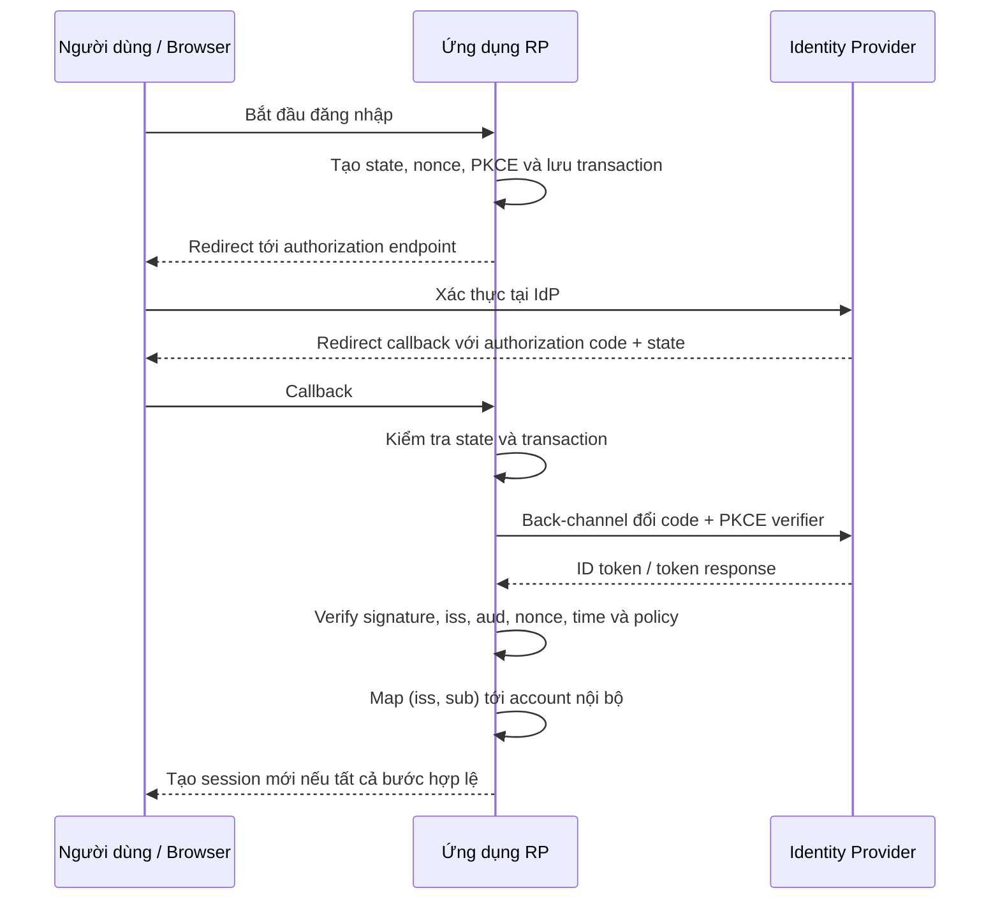

# Federation failure — Phân tích và xử lý lỗi liên kết danh tính

Đăng nhập liên kết (identity federation) cho phép một ứng dụng tin cậy kết quả xác thực do một nhà cung cấp danh tính (Identity Provider — IdP) phát hành. Ứng dụng (Relying Party — RP hoặc Service Provider — SP) không trực tiếp kiểm tra mật khẩu của người dùng tại IdP; nó kiểm tra thông điệp, token hoặc assertion được gửi qua một giao thức như OpenID Connect (OIDC) hay SAML.

Khi federation gặp lỗi, người dùng có thể không đăng nhập được, bị chuyển về trang login liên tục, vào nhầm tài khoản, hoặc nghiêm trọng hơn là được cấp phiên dựa trên một assertion không đáng tin. Ví dụ, IdP vừa xoay khóa ký nhưng RP chưa cập nhật JWKS; OIDC callback nhận ID token có `aud` không phải client ID của ứng dụng; hoặc SAML assertion có `InResponseTo` không khớp request đăng nhập. Những lỗi này có thể trông giống nhau ở giao diện, nhưng nguyên nhân và mức độ an toàn khác nhau.

Trong module `SECURITY_AUTHENTICATION_FUNDAMENTALS`, bài này giúp người học phân tích federation failure qua ranh giới tin cậy, cấu hình giao thức, kiểm tra chữ ký và claim, thời gian, replay, ánh xạ danh tính, provisioning và tính sẵn sàng của IdP. Mục tiêu là xác định **bước nào thất bại, dữ liệu nào còn đáng tin, quyền nào cần bị chặn và cách phục hồi mà không hạ thấp điều kiện xác thực**.

## 1. Federation failure gồm những loại nào?

Không phải mọi lỗi federation đều là lỗi xác thực. Một luồng có thể thất bại vì mạng, cấu hình, mật mã, chính sách danh tính hoặc provisioning. Cần phân loại trước khi xử lý.

| Nhóm lỗi | Biểu hiện | Ví dụ | Ý nghĩa bảo mật |
| --- | --- | --- | --- |
| **Availability / transport** | Không truy cập được IdP hoặc endpoint | DNS lỗi, timeout, TLS handshake thất bại | Không có bằng chứng mới; không được tự coi người dùng đã xác thực |
| **Trust/configuration** | RP không tin issuer hoặc metadata | `issuer` sai, entity ID không khớp, redirect URI lệch | Có thể là cấu hình sai hoặc endpoint giả mạo; cần từ chối |
| **Cryptographic validation** | Chữ ký hoặc certificate không hợp lệ | JWT ký bằng key không tin cậy, SAML signature sai | Thông điệp không được chứng minh là do issuer tin cậy phát hành |
| **Protocol binding** | Response không thuộc giao dịch đang chờ | `state`, `nonce`, `InResponseTo` sai | Có nguy cơ login CSRF, replay hoặc response injection |
| **Claims / conditions** | Token/assertion không dành cho RP hoặc đã hết hạn | `aud` sai, `NotOnOrAfter` qua hạn | Không được cấp phiên từ thông điệp đó |
| **Identity mapping** | Xác thực thành công nhưng không tìm thấy hoặc ánh xạ sai account | Dùng email làm khóa, trùng email giữa hai issuer | Có nguy cơ account takeover hoặc truy cập nhầm dữ liệu |
| **Provisioning / lifecycle** | Người dùng đã bị disable ở nguồn nhưng vẫn có account/quyền tại RP | SCIM deprovision trễ, JIT tạo lại account | Danh tính hoặc quyền cũ có thể tiếp tục tồn tại |
| **Key / metadata lifecycle** | RP và IdP không đồng bộ khóa hoặc metadata | JWKS cache cũ, SAML signing certificate rollover | Lỗi hàng loạt hoặc nguy cơ tin khóa sai |
| **Policy / assurance** | Phương thức hoặc mức xác thực không đáp ứng yêu cầu | `acr` không đạt, xác thực quá cũ | Không đủ điều kiện cho thao tác nhạy cảm |

Phân biệt hai kết quả: **federation authentication failed** nghĩa là RP không có bằng chứng hợp lệ để xác thực chủ thể; **authentication succeeded but authorization/provisioning failed** nghĩa là danh tính đã được xác minh nhưng ứng dụng không thể hoặc không được phép tạo quyền sử dụng. Không nên gộp cả hai thành “sai mật khẩu” hoặc tự động tạo account mới để né lỗi.

## 2. Luồng tin cậy và điểm có thể thất bại

Một luồng OIDC Authorization Code khái quát:



Các điểm tin cậy cần được cấu hình rõ:

- **Issuer/IdP:** định danh ổn định của bên phát hành; RP phải biết trước issuer được phép.
- **Discovery/metadata:** mô tả endpoint, JWKS hoặc certificate và capability của IdP; nguồn lấy metadata phải được xác thực.
- **Client/RP registration:** client ID, redirect URI, entity ID, ACS URL và phương thức client authentication.
- **Protocol transaction:** `state`, `nonce`, PKCE verifier hoặc SAML request ID phải gắn với request login do RP tạo.
- **Signed response:** chữ ký phải được kiểm tra bằng khóa của issuer đúng, trên đúng đối tượng được ký.
- **Claims/conditions:** subject, audience, recipient, destination, thời gian và mức xác thực phải đáp ứng policy.
- **Identity mapping:** định danh từ issuer được ánh xạ tới account nội bộ theo quy tắc rõ ràng.
- **Session/authorization:** chỉ tạo phiên sau khi xác thực và mapping thành công; quyền được kiểm tra riêng.

Nếu một bước thất bại, RP cần dừng tại ranh giới đó. Không nên “thử tiếp” bằng cách bỏ qua signature, `aud`, `state` hoặc kiểm tra issuer để làm cho đăng nhập chạy được.

## 3. OIDC failure: kiểm tra theo từng lớp

### 3.1. Discovery và issuer mismatch

OIDC Discovery cung cấp metadata như `issuer`, `authorization_endpoint`, `token_endpoint`, `jwks_uri` và các capability. RP cần cấu hình issuer dự kiến và xác minh metadata lấy được thực sự thuộc issuer đó.

Các lỗi thường gặp:

- Issuer trong metadata khác issuer đã cấu hình, kể cả khác dấu `/` cuối URL.
- Ứng dụng dùng URL discovery từ input do người dùng hoặc tenant tự khai mà không có allowlist/trust onboarding.
- `jwks_uri` hoặc token endpoint được thay đổi qua redirect không mong đợi.
- Môi trường staging dùng issuer/client ID của production hoặc ngược lại.
- Multi-tenant RP không ràng buộc transaction với issuer đã chọn, dẫn đến mix-up giữa các IdP.

**Cách xử lý:** so sánh issuer chính xác theo OIDC, dùng issuer allowlist và metadata từ nguồn tin cậy; tách cấu hình theo môi trường/tenant; không lấy `iss` từ ID token làm căn cứ tự động tải một JWKS bất kỳ rồi tin token đó. Nếu dùng nhiều issuer, transaction login phải ghi rõ issuer dự kiến và chỉ chấp nhận response từ issuer đó.

### 3.2. Authorization code, redirect URI và PKCE

Authorization code là mã ngắn hạn dùng một lần để đổi token. Các lỗi hay gặp:

| Lỗi | Nguyên nhân có thể | Kiểm tra |
| --- | --- | --- |
| `invalid_grant` | Code hết hạn, đã dùng, redirect URI không khớp hoặc PKCE verifier sai | Transaction ID, thời điểm callback, redirect URI đã đăng ký, verifier tương ứng |
| `invalid_client` | Client authentication sai hoặc client ID/secret không đúng môi trường | Client registration, secret/certificate version và token endpoint auth method |
| `redirect_uri_mismatch` | URI callback khác URI đăng ký, scheme/host/path/port lệch | URI chính xác theo cấu hình IdP, proxy và app |
| PKCE verification failed | RP mất verifier, dùng transaction khác hoặc encoding sai | Ràng buộc verifier với state/session transaction, method `S256` |
| Callback state missing/invalid | Session cookie không được gửi, state hết hạn hoặc callback bị giả | Cookie scope/SameSite, transaction store, state một lần |

Không nới redirect URI thành wildcard hoặc redirect mở để chữa lỗi mismatch. Redirect URI cần khớp chính xác với client registration. Nếu RP dùng reverse proxy, xác định external scheme/host/path từ cấu hình proxy đáng tin cậy, không dựa vào `Host` hoặc `X-Forwarded-*` do client tự gửi.

PKCE bảo vệ authorization code khỏi bị sử dụng bởi bên không có verifier. Với public client, dùng Authorization Code Flow + PKCE theo profile hiện hành. `state` vẫn cần để ràng buộc callback với transaction và chống CSRF/login injection; PKCE không thay thế mọi kiểm tra state/issuer.

### 3.3. ID token signature và JWKS rotation

RP phải xác minh chữ ký ID token bằng khóa được tin cậy của issuer. Các lỗi thường gặp:

- `kid` trong JWT không tồn tại trong JWKS cache.
- IdP vừa thêm khóa mới nhưng RP chưa refresh JWKS.
- RP vẫn cache khóa cũ sau khi issuer đã ngừng sử dụng hoặc thu hồi nó.
- Thuật toán token không nằm trong allowlist hoặc RP chấp nhận thuật toán theo header do token tự chọn.
- JWKS được tải qua endpoint không đúng issuer hoặc không xác minh TLS.
- JWT có cấu trúc hợp lệ nhưng chữ ký sai, key type không khớp hoặc key bị dùng sai mục đích.

**Cách xử lý key rollover:** dùng JWKS endpoint gắn với issuer đã cấu hình; hỗ trợ refresh có giới hạn khi gặp `kid` chưa biết; cache có TTL và cơ chế cập nhật; chỉ chấp nhận thuật toán đã định trước; kiểm tra chữ ký trước khi tin bất kỳ claim nào. Không tải JWKS từ URL trong header `jku` hoặc `x5u` do token không tin cậy cung cấp trừ khi giao thức/profile và policy cho phép rất rõ. Không bỏ qua signature verification khi JWKS endpoint tạm thời lỗi.

Nếu JWKS endpoint không khả dụng, có thể tiếp tục xác minh bằng khóa đã cache **chỉ khi khóa đó vẫn nằm trong trust policy và token đáp ứng mọi điều kiện khác**. Không dùng khóa chưa biết hoặc tự động chấp nhận token không chữ ký để duy trì availability.

### 3.4. Kiểm tra claim bắt buộc

Một ID token có chữ ký hợp lệ vẫn có thể không dành cho RP hiện tại.

| Claim/điều kiện | Kiểm tra | Lỗi nếu bỏ qua |
| --- | --- | --- |
| `iss` | Khớp chính xác issuer dự kiến | Token từ IdP khác bị chấp nhận |
| `aud` | Chứa client ID của RP; kiểm tra quy tắc audience theo OIDC | Token cấp cho ứng dụng khác bị dùng lại |
| `azp` | Kiểm tra authorized party khi có nhiều audience theo quy tắc OIDC | Nhầm client được ủy quyền |
| `exp` | Chưa hết hạn | Token cũ được chấp nhận |
| `iat` | Thời điểm phát hành hợp lý theo policy | Token phát hành quá xa hoặc bất thường |
| `nbf` | Đã tới thời điểm được phép dùng nếu claim xuất hiện | Token được dùng trước thời điểm hiệu lực |
| `nonce` | Khớp nonce của transaction đăng nhập, khi RP đã gửi nonce | ID token bị replay hoặc gắn với login request khác |
| `sub` | Có mặt, ổn định trong issuer và được dùng đúng phạm vi | Ánh xạ nhầm danh tính |
| `auth_time` | Kiểm tra khi yêu cầu xác thực mới/`max_age` | Chấp nhận phiên IdP quá cũ cho thao tác nhạy cảm |
| `acr` / `amr` | Đánh giá theo assurance policy nếu yêu cầu | Chấp nhận phương thức yếu hơn chính sách |

Không phải mọi claim đều bắt buộc trong mọi profile; verifier cần tuân theo OIDC Core và các profile mà hệ thống triển khai. Không tự thêm hoặc bỏ điều kiện theo cảm tính. Clock skew chỉ nên là biên nhỏ, được cấu hình và giám sát; không tăng cửa sổ thời gian lớn để che lỗi đồng hồ.

### 3.5. Nonce, state và response replay

`state` và `nonce` có vai trò khác nhau. `state` ràng buộc callback với giao dịch do RP khởi tạo; `nonce` gắn ID token với authentication request. Cả hai cần giá trị khó đoán, thời hạn ngắn và quản lý phía server. Transaction phải được tiêu thụ một lần.

Nếu callback bị gửi lại, state/transaction đã tiêu thụ phải bị từ chối. Không tái sử dụng transaction sau lỗi token exchange; người dùng cần bắt đầu flow mới. Nếu client retry do timeout, xử lý code đã tiêu thụ theo giao thức và tạo transaction mới thay vì hạ kiểm tra replay.

## 4. SAML failure: response, assertion và trust

SAML 2.0 thường dùng XML message được ký, có thể có assertion encryption và các binding như HTTP-Redirect hoặc HTTP-POST. RP/SP cần kiểm tra signature, issuer, audience, recipient, destination, request correlation và conditions.

### 4.1. Các trường cần kiểm tra

| Thành phần | Ý nghĩa | Lỗi phổ biến |
| --- | --- | --- |
| `Issuer` | Entity ID của IdP phát hành response/assertion | Nhận assertion từ IdP khác |
| `Destination` | Endpoint nhận response | Response gửi tới ACS khác hoặc endpoint không được cấu hình |
| `Recipient` | Đích nhận subject confirmation | Không khớp ACS URL của SP |
| `Audience` | RP/SP được phép nhận assertion | Assertion của SP khác bị chấp nhận |
| `InResponseTo` | Request ID mà response trả lời | Response không thuộc login request đang chờ |
| `NotBefore` | Thời điểm assertion bắt đầu có hiệu lực | Đồng hồ lệch hoặc token chưa có hiệu lực |
| `NotOnOrAfter` | Thời điểm assertion hết hiệu lực (exclusive) | Assertion cũ bị chấp nhận hoặc cửa sổ quá rộng |
| `ID` | Định danh message/assertion | Không lưu replay cache hoặc ID bị dùng lại |
| `NameID` | Định danh subject theo format/qualifier | Dùng email mutable hoặc sai phạm vi issuer |
| Signature reference | Đối tượng XML được chữ ký bảo vệ | Signature wrapping hoặc kiểm tra sai node đã ký |

### 4.2. Signature validation và XML Signature Wrapping

SAML dùng XML Signature; việc xác minh phức tạp hơn so sánh một chuỗi chữ ký. RP phải dùng thư viện SAML được duy trì, kiểm tra signature trên đúng Response hoặc Assertion theo profile, xác minh certificate/key của đúng IdP và bảo đảm node được ứng dụng sử dụng chính là node đã được ký.

Các lỗi nguy hiểm:

- Chỉ kiểm tra có phần tử `Signature` mà không xác minh chữ ký.
- Xác minh một Assertion nhưng sau đó đọc subject từ Assertion khác chưa được ký.
- Parser cho phép cấu trúc XML mơ hồ, duplicate ID hoặc external entity.
- Chấp nhận thuật toán chữ ký yếu hoặc certificate do response tự gửi mà không đối chiếu metadata/trust.
- Không kiểm tra audience, recipient, destination và conditions sau khi signature hợp lệ.

**XML Signature Wrapping (XSW)** lợi dụng khác biệt giữa node được xác minh và node mà ứng dụng dùng. Hãy dùng thư viện SAML có kiểm tra signature reference và cấu trúc chuẩn; tắt DTD/external entities, hạn chế XML entity expansion, reject duplicate IDs và chỉ sử dụng object mà thư viện xác minh đã trả về. Không tự parse XML bằng XPath tùy tiện rồi lấy `NameID` từ node đầu tiên.

### 4.3. Request correlation và unsolicited response

Trong SP-initiated SSO, SP tạo AuthnRequest với ID và lưu transaction. Response cần có `InResponseTo` khớp request ID chưa được tiêu thụ. Điều này giúp ngăn response được phát lại hoặc gắn vào phiên đăng nhập khác.

IdP-initiated SSO có thể không có request ID tương ứng. Nếu hỗ trợ, cần policy riêng, kiểm tra chặt issuer, audience, recipient, destination, time conditions, replay ID và CSRF/login injection. Không bật unsolicited response chỉ để né lỗi `InResponseTo` ở một luồng vốn được thiết kế SP-initiated.

### 4.4. SAML metadata và certificate rollover

Metadata mô tả entity ID, SSO/SLO endpoint, binding và signing/encryption certificates. Khi IdP thay signing certificate, SP cần cập nhật metadata hoặc trust registry trước thời điểm chuyển đổi theo kế hoạch. Các lỗi thường gặp:

- SP chỉ lưu certificate cũ, không chấp nhận certificate mới đã công bố.
- SP tin mọi certificate được nhúng trong response thay vì trust metadata đã xác minh.
- Metadata hết hạn hoặc không được refresh; endpoint thay đổi nhưng SP vẫn gọi endpoint cũ.
- Đồng bộ metadata không nhất quán giữa các replica.

Xác minh nguồn metadata và chữ ký metadata theo trust policy khi có; dùng kênh quản lý tin cậy để phân phối trust anchor. Có thể hỗ trợ overlap certificate cũ/mới trong thời gian rollover có kế hoạch, nhưng phải giới hạn thời gian và gỡ certificate cũ sau cutover. Nếu private key IdP bị compromise, không giữ certificate cũ chỉ để tránh gián đoạn.

## 5. Clock skew và thời hạn assertion/token

OIDC và SAML đều dựa vào thời gian. Đồng hồ lệch có thể gây lỗi đăng nhập hàng loạt hoặc tạo cửa sổ chấp nhận thông điệp quá rộng.

Các dấu hiệu:

- Token/assertion bị từ chối vì `exp`, `nbf`, `NotBefore` hoặc `NotOnOrAfter`.
- Chỉ một nhóm node lỗi trong khi node khác đăng nhập được.
- Lỗi xuất hiện sau khi VM/container khởi động lại hoặc mất NTP.
- Log của IdP và RP cho thời gian phát hành/nhận chênh lệch lớn.

Khắc phục:

1. Đồng bộ thời gian host/container bằng NTP hoặc dịch vụ thời gian được quản lý.
2. Log thời gian UTC ở cả issuer và RP, ghi rõ clock source/offset nếu có.
3. Dùng clock skew nhỏ theo profile và risk policy; không nới rộng nhiều phút/giờ để che vấn đề.
4. Kiểm tra token/assertion đã hết hạn thực sự hay do node sai giờ.
5. Không bỏ qua `exp`, `nbf`, `NotBefore` hoặc `NotOnOrAfter` để làm luồng đăng nhập thành công.

## 6. Identity mapping: xác thực đúng nhưng đăng nhập nhầm account

Một lỗi federation nghiêm trọng xảy ra khi IdP xác thực người dùng đúng, nhưng RP liên kết assertion với account nội bộ sai. Đây là lỗi **identity mapping**, không phải lỗi chữ ký.

### OIDC: dùng `(iss, sub)`

Định danh OIDC ổn định trong phạm vi issuer là cặp `(iss, sub)`. `sub` có thể pairwise và khác nhau giữa các client; cùng một email ở hai issuer không có nghĩa là cùng một người. Không dùng email làm khóa liên kết duy nhất.

Ví dụ:

| Issuer | Subject | Email | Cách hiểu |
| --- | --- | --- | --- |
| `https://id.company-a.example` | `00u123` | `mai@example.com` | Chủ thể của IdP A |
| `https://id.partner.example` | `u-778` | `mai@example.com` | Chủ thể khác ở IdP B cho dù email giống |

Nếu RP dùng email để tự động hợp nhất hai bản ghi, một thay đổi email hoặc tài khoản trùng có thể dẫn tới account takeover. Hãy lưu issuer và subject đã xác minh, cùng mapping nội bộ ổn định.

### SAML: entity ID và NameID

SAML subject thường được biểu diễn bằng `NameID` với Format, NameQualifier và SPNameQualifier tùy profile. Cần chọn định danh bền vững theo hợp đồng federation. Email-address NameID có thể thay đổi; không nên mặc định email là immutable ID. Mapping nên bao gồm IdP entity ID và giá trị subject trong phạm vi đã định nghĩa.

### Account linking phải có ý định rõ ràng

Nếu người dùng muốn liên kết một IdP mới với account hiện có:

1. Xác thực account hiện tại bằng phương thức đã tin cậy.
2. Bắt đầu transaction linking mới, gắn với subject và session hiện tại.
3. Xác minh callback từ issuer được yêu cầu, đúng `state`/`nonce` hoặc SAML correlation.
4. Kiểm tra subject `(iss, sub)` hoặc SAML identifier chưa được liên kết với account khác.
5. Ghi audit, thông báo và cho phép gỡ liên kết theo policy.

Không tự liên kết chỉ vì email trùng, kể cả khi claim `email_verified=true`, trừ khi có một policy được đánh giá kỹ và có bằng chứng bổ sung đủ mạnh. Việc email được xác minh tại một IdP không chứng minh email đó là khóa bất biến hoặc người dùng sở hữu account nội bộ cùng địa chỉ.

## 7. Provisioning và deprovisioning không phải authentication

Federation authentication xác minh người dùng tại thời điểm đăng nhập. **Provisioning** tạo/cập nhật account và nhóm/quyền tại RP; **deprovisioning** vô hiệu hoặc xóa quyền khi người dùng rời tổ chức. SCIM thường được dùng để đồng bộ lifecycle, nhưng một sự kiện SCIM không thay thế việc xác minh token đăng nhập.

Các lỗi phổ biến:

- Người dùng bị disable tại IdP nhưng RP vẫn giữ account active do deprovision event bị trễ.
- JIT provisioning tự tạo account chỉ dựa trên claim chưa được kiểm tra đầy đủ.
- Group/role claim cũ vẫn được cache trong session sau khi quyền tại IdP thay đổi.
- Mapping group không rõ namespace dẫn đến người dùng được cấp role admin ngoài ý muốn.
- Account đã xóa được tạo lại tự động bằng email cũ mà không qua quy trình phê duyệt.

Kiểm soát:

- Chỉ provisioning từ issuer/tenant đã được tin cậy và sau khi xác minh thông điệp.
- Map group/role theo allowlist và namespace rõ ràng; không ánh xạ mọi group claim thành role nội bộ.
- Có quy trình deprovisioning đáng tin cậy, retry, audit và giám sát event trễ.
- Kiểm tra account state tại thời điểm tạo session và trước thao tác nhạy cảm.
- Xác định cách thu hồi session/token khi account bị disable; deprovisioning không tự làm JWT đã phát hành hết hiệu lực nếu API không kiểm tra state.

## 8. Assurance, MFA và step-up qua federation

RP có thể yêu cầu IdP thực hiện xác thực mới hoặc mức assurance nhất định. Trong OIDC, `max_age`, `auth_time`, `acr` và `amr` có thể tham gia policy. Trong SAML, AuthnContext có thể mô tả context xác thực. RP cần hiểu ý nghĩa theo profile và hợp đồng với IdP.

Những lỗi cần tránh:

- Chỉ thấy ID token hợp lệ là cho rằng người dùng vừa nhập MFA.
- Tin `amr` hoặc `acr` mà không có mapping policy rõ với IdP.
- Không kiểm tra `auth_time` khi yêu cầu reauthentication gần đây.
- Yêu cầu step-up nhưng IdP không hỗ trợ mức context đó, rồi RP âm thầm hạ yêu cầu.
- Dùng claim assurance từ issuer khác mà không kiểm tra issuer và profile.

Nếu thao tác cần assurance cao, RP phải yêu cầu điều kiện phù hợp và từ chối nếu IdP không thể đáp ứng. Có thể cung cấp luồng xác thực nội bộ khác, nhưng không được giả vờ rằng federation yếu hơn đã đáp ứng yêu cầu mạnh.

## 9. Availability failure: IdP không khả dụng thì làm gì?

IdP timeout hoặc outage là lỗi availability, không phải lý do để bỏ kiểm tra xác thực. Chính sách nên phân biệt:

| Tình huống | Hành vi an toàn thường dùng |
| --- | --- |
| Người dùng chưa có session, IdP không truy cập được | Không tạo phiên mới; hiển thị lỗi có thể thử lại |
| Người dùng có session RP còn hiệu lực | Có thể tiếp tục session theo idle/absolute timeout và policy hiện tại |
| JWKS endpoint tạm lỗi nhưng cache có key tin cậy | Có thể xác minh token bằng key đã cache còn trong trust policy và token còn hạn |
| `kid` chưa biết, JWKS endpoint không truy cập được | Từ chối token đó; không dùng khóa không xác minh |
| Introspection endpoint lỗi | Fail-closed cho thao tác nhạy cảm; policy degraded mode phải được định nghĩa trước |
| SCIM/deprovisioning event trễ | Theo dõi queue và xử lý; giới hạn quyền/session theo chính sách, không giả định user vẫn hợp lệ vô hạn |
| Logout endpoint của IdP lỗi | Kết thúc local RP session và ghi nhận global logout chưa hoàn tất nếu protocol yêu cầu phối hợp |

Không nên lưu password người dùng để đăng nhập thay IdP khi IdP outage. Nếu có local break-glass account cho quản trị khẩn cấp, nó phải là một cơ chế riêng: ít tài khoản, credential riêng, bảo vệ mạnh, giám sát và audit, không tự động biến thành fallback cho mọi người dùng federation.

### Fail-open và fail-closed

- **Fail-closed:** từ chối khi không xác minh được issuer, signature, audience, replay hoặc trạng thái cần thiết. Đây là lựa chọn phù hợp với quyết định xác thực nhạy cảm.
- **Degraded operation có kiểm soát:** cho phép session RP đã được xác minh trước đó tiếp tục tới hạn policy, nhưng không tạo session mới nếu IdP không xác minh được.
- **Fail-open tùy tiện:** chấp nhận response không ký, token hết hạn hoặc claim không kiểm tra để duy trì availability. Đây là lỗi thiết kế nguy hiểm.

## 10. Thông báo lỗi và logging an toàn

Người dùng không cần thấy chi tiết nội bộ như `kid`, certificate fingerprint, token claim hoặc cấu hình tenant. Nhưng đội vận hành cần log đủ để xác định điểm thất bại.

### Thông báo cho người dùng

Thông báo nên rõ và không tiết lộ dữ liệu nhạy cảm:

- “Không thể hoàn tất đăng nhập qua nhà cung cấp danh tính. Vui lòng thử lại hoặc liên hệ bộ phận hỗ trợ.”
- “Tài khoản đã được xác thực nhưng chưa được cấp quyền sử dụng ứng dụng. Vui lòng liên hệ quản trị viên tổ chức.”
- “Phiên đăng nhập đã hết hạn. Hãy bắt đầu lại quy trình đăng nhập.”

Không hiển thị raw SAML response, JWT, exception stack, issuer secret, client secret hoặc nội dung claim đầy đủ trong browser.

### Trường log nên có

| Trường | Mục đích |
| --- | --- |
| `correlation_id` / `transaction_id` | Nối các bước redirect, callback, token exchange và verifier |
| `protocol` / `issuer_id` | Biết OIDC hay SAML và IdP cấu hình nào đang dùng |
| `client_id` / `entity_id` | Xác định RP/SP registration |
| `stage` | `callback`, `code_exchange`, `signature`, `claims`, `mapping`, `provisioning`... |
| `failure_code` | Mã lỗi nội bộ đã chuẩn hóa |
| `kid` hoặc certificate fingerprint | Hỗ trợ điều tra key rollover; không ghi private key |
| `clock_offset` / timestamp | Phân tích lỗi thời gian |
| `region` / `node` | Phát hiện cấu hình lệch giữa replica |
| `decision` | `REJECTED`, `RETRYABLE`, `MAPPED`, `SESSION_CREATED` |

Không log authorization code, access/refresh token, ID token nguyên vẹn, session cookie, client secret, private key hoặc raw assertion chứa PII. Nếu cần dấu vết, ghi identifier đã che/hash theo policy và giới hạn quyền truy cập log.

## 11. Quy trình troubleshooting theo thứ tự

Khi người dùng báo “SSO không đăng nhập được”, tránh thay đổi nhiều cấu hình cùng lúc. Dùng `correlation_id` để lần theo một giao dịch.

1. **Xác định phạm vi:** một user, một tenant, một RP, một IdP, một region hay tất cả? Lỗi bắt đầu từ lúc nào và có thay đổi metadata/key/deployment gần đó không?
2. **Kiểm tra transaction:** callback có đúng state/request ID, chưa hết hạn và chưa được dùng không? Có dấu hiệu browser cookie không được gửi vì SameSite/host scope không?
3. **Kiểm tra transport:** DNS, TLS, hostname, proxy, redirect URI và endpoint IdP có truy cập được không?
4. **Kiểm tra trust metadata:** issuer/entity ID, client ID, ACS/redirect URI, JWKS/certificate và metadata version có khớp cấu hình không?
5. **Kiểm tra chữ ký:** đúng issuer key, `kid`, algorithm, signature reference và certificate validity không? Nếu lỗi sau key rollover, xác minh JWKS/metadata refresh.
6. **Kiểm tra claim/conditions:** audience, recipient, destination, nonce, InResponseTo, expiry và assurance có đạt không?
7. **Kiểm tra mapping:** subject đã được liên kết chưa? Có dùng email làm khóa không? Account có active và đúng tenant không?
8. **Kiểm tra provisioning/authorization:** group mapping, SCIM state, role và policy có cho phép không?
9. **Kiểm tra phân tán:** các node có cùng config, trust bundle, clock và cache version không?
10. **Xác minh sau sửa:** chạy một transaction mới, kiểm tra session được tạo đúng subject, token/session cũ không được hồi sinh và audit không có dữ liệu bí mật.

### Bảng triệu chứng → nguyên nhân có thể

| Triệu chứng | Nguyên nhân thường gặp | Kiểm tra đầu tiên |
| --- | --- | --- |
| Redirect login lặp vô hạn | Cookie callback không được gửi, state không lưu/không khớp, session store lỗi | Cookie host/SameSite/Secure, transaction store và callback URL |
| OIDC `invalid_grant` | Code đã dùng/hết hạn, PKCE hoặc redirect URI sai | Code exchange correlation, verifier và exact redirect URI |
| OIDC unknown `kid` | JWKS rollover/cache stale hoặc issuer sai | Issuer đã cấu hình, JWKS refresh, key set và cache TTL |
| OIDC invalid audience | Client ID hoặc token được cấp cho RP khác | `aud`, `azp`, client registration/environment |
| OIDC nonce mismatch | Callback/ID token thuộc transaction khác hoặc nonce bị mất | Transaction store, nonce binding và parallel tabs |
| SAML `InResponseTo` mismatch | Response không thuộc AuthnRequest đang chờ, request ID mất hoặc unsolicited response | SP-initiated transaction store, request ID và IdP mode |
| SAML signature invalid | Cert cũ/mới, sai trust metadata, XML signature handling | Metadata version, signing cert, signature reference |
| SAML audience/recipient mismatch | IdP và SP cấu hình khác entity ID/ACS | SP entity ID, ACS URL và metadata |
| Token/assertion not yet valid/expired | Clock skew hoặc transaction quá cũ | NTP/clock offset và claim timestamps |
| Xác thực thành công nhưng account không tồn tại | JIT/provisioning hoặc identity mapping chưa thiết lập | `(iss, sub)`/NameID mapping và provisioning status |
| Người dùng vào nhầm account | Mapping theo email hoặc issuer bị trộn | Stable subject mapping, issuer binding và account linking audit |
| User bị disable vẫn đăng nhập | Deprovision trễ hoặc RP không kiểm tra account state | SCIM events, local account status, active sessions/tokens |
| Chỉ một node lỗi | Config/clock/JWKS cache/trust store lệch | So sánh node, region, config version và cache |

## 12. Pseudocode Java: xác minh OIDC trước khi tạo session

Đoạn dưới minh họa trách nhiệm và thứ tự kiểm tra; không thay thế thư viện OIDC/JWT đã được duy trì.

```java
LoginResult completeFederatedLogin(Callback callback) {
    // Transaction được tạo khi RP bắt đầu login, lưu server-side và dùng một lần.
    LoginTransaction tx = transactions.consumeOnce(callback.state());
    if (tx == null || tx.isExpired(clock.instant())) return DENY;

    // Issuer phải là issuer đã chọn khi bắt đầu transaction.
    TrustedProvider provider = providerRegistry.find(tx.expectedIssuer());
    if (provider == null) return DENY;

    // Đổi code qua TLS đã xác minh; dùng exact redirect URI và PKCE verifier.
    TokenResponse tokens = oidcClient.exchangeCode(
        provider,
        callback.code(),
        tx.exactRedirectUri(),
        tx.pkceVerifier()
    );

    VerifiedIdToken idToken = oidcVerifier.verify(
        tokens.idToken(),
        provider.trustedJwks(),
        tx.expectedIssuer(),
        tx.clientId(),
        tx.nonce(),
        tx.allowedAlgorithms(),
        tx.clockSkewPolicy()
    );
    if (idToken == null) return DENY;

    // Identity key trong issuer scope; không tự map chỉ bằng email.
    FederatedSubject key = new FederatedSubject(
        idToken.issuer(), idToken.subject()
    );
    Account account = identityMap.findAccount(key, tx.tenantId());
    if (account == null || !account.isActive()) return DENY;

    if (!assurancePolicy.accepts(idToken.authContext(), tx.requiredAssurance())) {
        return STEP_UP_REQUIRED;
    }

    // Tạo session mới sau khi signature, claims, mapping và policy đều đạt.
    return sessions.createNew(account.id(), account.tenantId(), idToken.authContext());
}
```

Khi triển khai:

- `consumeOnce` cần xử lý transaction đồng thời và state replay.
- OIDC verifier phải xác minh chữ ký, `iss`, `aud`, `azp` khi áp dụng, `exp`, `iat`, `nbf`, `nonce` và thuật toán theo profile.
- Provider metadata/JWKS chỉ lấy từ issuer đã được onboard; xử lý `kid` rotation có giới hạn và không hạ kiểm tra chữ ký.
- `FederatedSubject` phải lưu issuer + subject theo quy tắc mapping; email chỉ là thuộc tính hồ sơ.
- Không log token response hoặc authorization code.
- Authorization sau login vẫn phải kiểm tra role, tenant, resource và action.

## 13. Ma trận kiểm thử federation failure

| Kịch bản | Kết quả mong đợi |
| --- | --- |
| OIDC issuer khác issuer trong transaction | Từ chối, không tạo session |
| ID token signature sai hoặc `kid` không có trong trusted JWKS | Từ chối; refresh JWKS có giới hạn nếu phù hợp |
| JWKS endpoint timeout nhưng có key tin cậy trong cache | Chỉ tiếp tục nếu key cache còn hợp lệ theo policy và token qua mọi kiểm tra |
| OIDC `aud`/`azp` không đúng client | Từ chối |
| OIDC nonce hoặc state bị thiếu/sai/đã dùng | Từ chối replay hoặc transaction không hợp lệ |
| Authorization code đã được dùng hoặc PKCE verifier sai | Token exchange thất bại; không tạo phiên |
| Redirect URI không khớp registration | Từ chối; không dùng wildcard để chữa |
| SAML signature không hợp lệ | Từ chối |
| SAML signature hợp lệ nhưng audience/recipient/destination sai | Từ chối |
| SAML `InResponseTo` không khớp request đang chờ | Từ chối SP-initiated response |
| SAML assertion ID đã được dùng | Từ chối replay |
| XML có duplicate ID hoặc cấu trúc signature wrapping bất thường | Parser/verifier từ chối |
| Assertion/token nằm ngoài time window | Từ chối; kiểm tra clock trước khi thay policy |
| OIDC/SAML subject có email trùng account khác | Không tự liên kết; yêu cầu quy trình linking rõ |
| Account bị disable nhưng IdP vẫn xác thực thành công | RP từ chối tạo session hoặc giới hạn theo policy |
| SCIM deprovision event bị trễ | Cảnh báo/điều phối; không bỏ qua account state cho thao tác nhạy cảm |
| IdP outage, người dùng chưa có RP session | Không tạo phiên mới từ dữ liệu không xác minh |
| IdP outage, RP session hiện tại còn hợp lệ | Tiếp tục trong idle/absolute timeout theo policy |
| Một node có JWKS/metadata/clock khác node khác | Phát hiện drift; không nới kiểm tra để che lỗi |
| Token raw xuất hiện trong log | Redaction test phát hiện và chặn ghi credential |

### Tình huống thực hành

Một ứng dụng đa tenant hỗ trợ hai IdP OIDC. Sau đợt xoay khóa ở IdP B, một số node báo `unknown kid`; đội vận hành tạm bỏ qua kiểm tra chữ ký để người dùng tiếp tục đăng nhập. Một người dùng khác có email giống người dùng ở IdP A và được ứng dụng tự động liên kết vào cùng account nội bộ. Sau đó người dùng bị disable ở IdP B nhưng vẫn truy cập được bằng session RP cũ.

**Yêu cầu:** xác định các lỗi và đề xuất cách khắc phục theo mức độ ưu tiên.

**Hướng giải:**

1. Khôi phục bắt buộc xác minh chữ ký; không chấp nhận token có `kid` chưa được xác minh. Kiểm tra issuer B, JWKS endpoint, key rollover và cache drift giữa các node.
2. Refresh JWKS từ endpoint gắn với issuer B đã được onboard, với retry/rate limit; chỉ chấp nhận key mới sau khi xác minh nguồn và thuật toán.
3. Ràng buộc mỗi transaction với issuer đã chọn; kiểm tra `iss`, `aud`, `azp`, `nonce`, state, thời hạn và PKCE.
4. Gỡ auto-link theo email; dùng `(iss, sub)` làm federated identity key và thực hiện account linking có xác thực lại, ý định rõ và audit.
5. Xử lý deprovisioning: cập nhật account state, thu hồi session/refresh token theo policy và kiểm tra access token/session ở resource server.
6. Đo độ trễ từ sự kiện disable/revoke đến khi mọi node từ chối; xử lý cache/session stale và kiểm thử logout.
7. Thông báo các tài khoản bị ảnh hưởng, điều tra truy cập trong khoảng thời gian bỏ signature verification và xử lý như một sự cố bảo mật.

## 14. Câu hỏi tự kiểm tra

1. **Federation failure có luôn là lỗi mật khẩu không?** Không. Có thể là lỗi transport, issuer, chữ ký, claim, transaction, identity mapping, provisioning hoặc authorization.
2. **Vì sao không được bỏ qua chữ ký khi JWKS endpoint lỗi?** Vì không còn bằng chứng tin cậy về issuer; cần dùng key cache đã tin cậy nếu policy cho phép hoặc từ chối, không chấp nhận token chưa xác minh.
3. **`state`, PKCE và `nonce` có thay thế nhau không?** Không. Chúng ràng buộc các phần khác nhau của authorization transaction và ID token.
4. **OIDC nên dùng thuộc tính nào để định danh federated subject?** Cặp `(iss, sub)` trong phạm vi issuer; email không phải khóa định danh bền vững.
5. **SAML cần kiểm tra gì ngoài signature?** Issuer, audience, recipient, destination, `InResponseTo`, thời hạn, replay ID và đúng node XML được ký.
6. **Nếu IdP xác thực thành công nhưng account RP đã disable thì sao?** RP không được tạo session hoặc cấp quyền trái policy; authentication và local account lifecycle là hai quyết định riêng.
7. **IdP outage có cho phép tiếp tục session RP đang tồn tại không?** Có thể, nếu session RP còn hợp lệ theo idle/absolute timeout và policy; không được tạo session mới bằng cách bỏ xác minh federation.

**Ghi nhớ:** Xử lý federation failure phải xác định rõ **transport, trust, protocol transaction, chữ ký, claim, identity mapping, provisioning và authorization** đang hỏng ở đâu. Giữ nguyên các kiểm tra cốt lõi của issuer, audience, signature, replay và thời hạn; khắc phục metadata/key/clock/cache theo nguồn tin cậy; dùng `(iss, sub)` hoặc định danh SAML ổn định để map account; và chỉ tạo session sau khi mọi điều kiện xác thực cùng policy đạt. Availability không phải lý do để tin một assertion chưa được xác minh.
