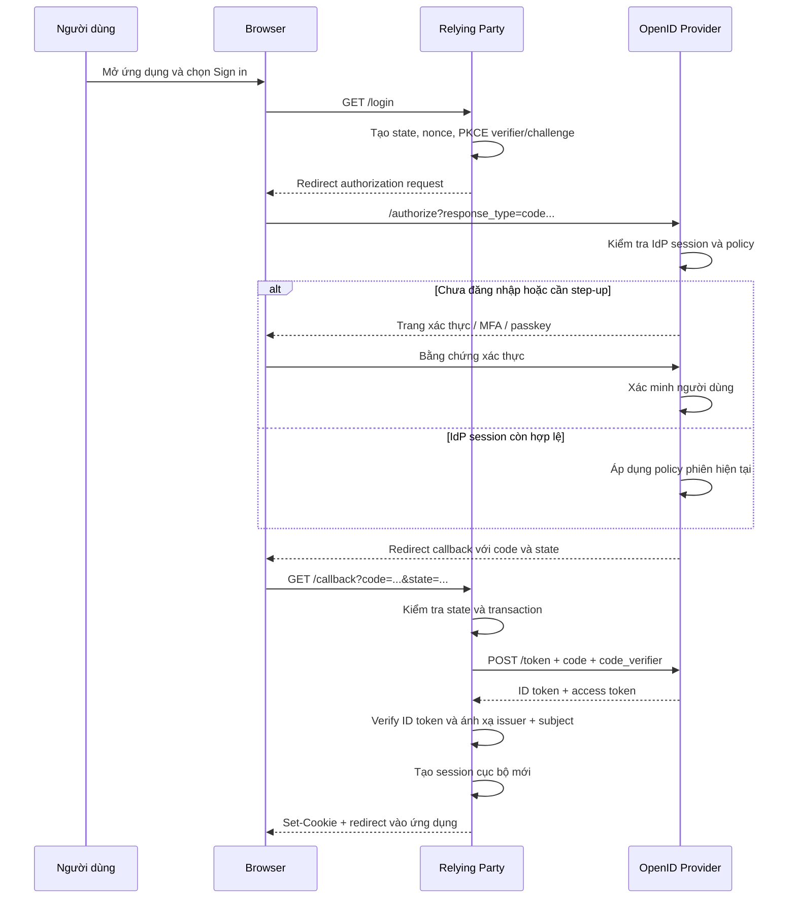
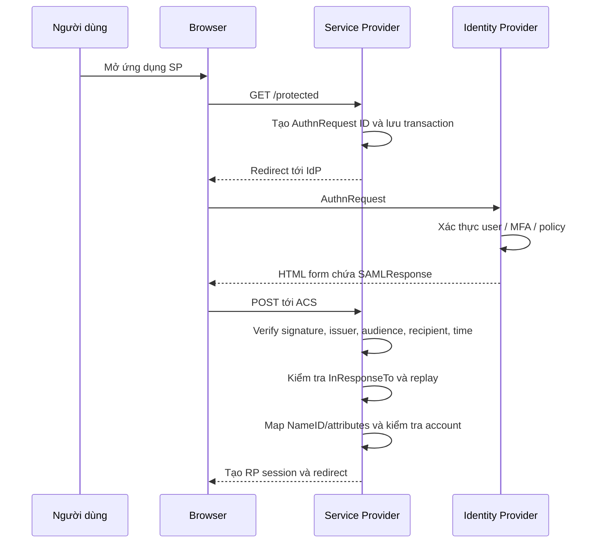

# SSO flow — Luồng đăng nhập một lần

## Mục tiêu học tập

Trong một tổ chức, người dùng có thể cần truy cập email, quản lý nhân sự, kho mã nguồn và hệ thống tài chính. Nếu mỗi ứng dụng tự giữ mật khẩu và tự xác minh danh tính, người dùng phải quản lý nhiều credential; tổ chức cũng khó áp dụng MFA, thu hồi quyền và theo dõi đăng nhập thống nhất.

**Single Sign-On (SSO)** cho phép người dùng xác thực tại một nhà cung cấp danh tính (Identity Provider — IdP), sau đó truy cập nhiều ứng dụng (Relying Party — RP hoặc Service Provider — SP) theo các quan hệ tin cậy đã cấu hình. Ứng dụng nhận kết quả xác thực có thể kiểm chứng từ IdP và tạo phiên cục bộ cho người dùng.

SSO là một mô hình trải nghiệm và kiến trúc, không phải một giao thức duy nhất. OpenID Connect (OIDC) thường dùng OAuth 2.0 Authorization Code Flow; hệ thống doanh nghiệp lâu năm có thể dùng SAML 2.0. Mỗi giao thức có thông điệp, chữ ký và quy tắc kiểm tra riêng.

Bài học thuộc chương **SSO** của mô-đun **SECURITY_AUTHENTICATION_FUNDAMENTALS**. Mô-đun tìm hiểu credential, mật khẩu, MFA, passkey, chứng chỉ, token, phiên, liên kết danh tính và khôi phục tài khoản. SSO kết nối các thành phần đó qua ranh giới giữa ứng dụng và nhà cung cấp danh tính.

Sau bài học, bạn có thể:

- Phân biệt IdP, RP/SP, browser, authorization server, resource server và session.
- Mô tả SSO end-to-end và giải thích vì sao ứng dụng không cần nhận mật khẩu của người dùng.
- Thiết kế OIDC Authorization Code Flow với PKCE, state, nonce và redirect URI chính xác.
- Xác minh ID token, access token và UserInfo theo đúng mục đích, issuer, audience, chữ ký và thời hạn.
- Mô tả SAML SP-initiated flow và các kiểm tra chữ ký, audience, recipient, InResponseTo, thời gian và replay.
- Phân biệt phiên đăng nhập tại IdP với phiên ứng dụng tại từng RP.
- Thiết kế account linking, logout, session renewal và xử lý lỗi ở các ranh giới tin cậy.
- Kiểm thử login CSRF, authorization response giả, token substitution, replay, issuer mix-up và account linking sai.

## 1. SSO là gì?

**Single Sign-On** cho phép một lần xác thực tại IdP được dùng làm cơ sở đăng nhập vào nhiều ứng dụng trong phạm vi trust relationship đã thiết lập. Người dùng có thể mở ứng dụng A, được chuyển tới IdP để xác thực, rồi mở ứng dụng B mà không cần nhập lại mật khẩu nếu phiên SSO tại IdP vẫn hợp lệ và policy cho phép.

Các vai trò chính:

| Thành phần | Vai trò |
| --- | --- |
| **Người dùng / User Agent** | Người thực hiện đăng nhập; trình duyệt thường điều hướng giữa RP và IdP |
| **Identity Provider (IdP)** | Xác minh người dùng bằng mật khẩu, MFA, passkey hoặc phương thức khác; phát hành kết quả xác thực |
| **Relying Party (RP)** | Ứng dụng dựa vào kết quả xác thực của IdP để tạo phiên cục bộ |
| **Service Provider (SP)** | Thuật ngữ thường dùng trong SAML cho ứng dụng tiêu thụ assertion |
| **Authorization Server** | Trong OAuth 2.0/OIDC, phát hành authorization code và token |
| **Resource Server** | API nhận access token và kiểm tra quyền truy cập |
| **Browser session tại IdP** | Duy trì trạng thái đăng nhập chung tại IdP |
| **Application session tại RP** | Duy trì phiên riêng của người dùng trong từng ứng dụng |

Một IdP có thể đóng nhiều vai trò, ví dụ vừa là OpenID Provider, vừa là OAuth Authorization Server. Một RP có thể đồng thời là web application và backend API, nhưng phải phân biệt client role với resource-server role.

### SSO không có nghĩa là một session cookie dùng chung

Cookie của IdP thường thuộc domain IdP; cookie của ứng dụng thuộc domain ứng dụng. Browser gửi từng cookie theo phạm vi domain và thuộc tính cookie. Ứng dụng không đọc cookie của IdP. Khi RP cần đăng nhập, browser điều hướng tới IdP; IdP dựa vào session của chính nó để quyết định có cần xác thực lại hay không, rồi trả kết quả cho RP qua giao thức đã cấu hình.

Vì vậy, có thể tồn tại đồng thời:

- Một phiên SSO tại IdP.
- Một phiên cục bộ tại ứng dụng A.
- Một phiên cục bộ tại ứng dụng B.
- Các access token/refresh token riêng cho những client hoặc API khác nhau.

Thu hồi phiên tại một RP không nhất thiết tự động logout ở IdP hoặc mọi RP khác. Logout liên ứng dụng cần giao thức và cơ chế phối hợp riêng.

### SSO khác với credential sharing

SSO không yêu cầu ứng dụng A gửi mật khẩu người dùng sang ứng dụng B. Người dùng xác thực với IdP; RP nhận assertion/token được phát hành cho chính RP theo cấu hình tin cậy. Việc chia sẻ mật khẩu giữa nhiều ứng dụng hoặc lưu cùng một mật khẩu ở nhiều nơi không phải SSO an toàn.

## 2. Hai mô hình giao thức phổ biến

| Tiêu chí | OpenID Connect (OIDC) | SAML 2.0 |
| --- | --- | --- |
| Kiểu dữ liệu chính | ID token JWT, access token; UserInfo tùy chọn | XML SAML assertion/response |
| Cơ chế phổ biến | Authorization Code Flow + PKCE | SP-initiated Web SSO |
| Định danh người dùng | Issuer + subject (iss, sub) | Issuer + NameID hoặc attribute theo hợp đồng |
| Chữ ký | Chữ ký JWT theo JWS và khóa của issuer | XML Signature trên assertion/response theo profile |
| Trao đổi qua browser | Authorization redirect, callback chứa code | Redirect AuthnRequest, POST SAMLResponse |
| API authorization | Access token theo audience/scope | Thường cần cơ chế riêng nếu gọi API |
| Trường hợp thường gặp | Ứng dụng web/mobile/API hiện đại | Enterprise federation và ứng dụng tích hợp SAML |

OIDC được xây dựng trên OAuth 2.0 và bổ sung lớp xác thực người dùng. OAuth 2.0 tự nó là framework ủy quyền; một access token không mặc nhiên là bằng chứng đăng nhập người dùng. Khi cần SSO đăng nhập, dùng OIDC hoặc một giao thức xác thực phù hợp.

Không nên chọn giao thức chỉ theo tên thương mại “SSO”. Cần xác định hệ thống hỗ trợ OIDC hay SAML, loại client, yêu cầu MFA, logout, provisioning, account linking và cách quản lý khóa.

## 3. OIDC Authorization Code Flow với PKCE

Đối với ứng dụng web, mobile và public client, luồng Authorization Code với PKCE là mô hình thường được khuyến nghị. PKCE ràng buộc authorization code với client đã khởi tạo yêu cầu, giúp giảm nguy cơ code interception. Dùng PKCE cả với confidential client là một lớp bảo vệ bổ sung hữu ích.

### Các bước của luồng

1. Người dùng mở ứng dụng RP và chọn đăng nhập.
2. RP tạo state ngẫu nhiên; tạo nonce cho OIDC; tạo code_verifier và code_challenge cho PKCE.
3. RP lưu các giá trị tạm cùng browser session hoặc transaction ID an toàn.
4. RP chuyển browser tới authorization endpoint của IdP với response_type=code, client_id, redirect_uri, scope=openid, state, nonce, code_challenge và code_challenge_method=S256.
5. IdP xác minh browser session. Nếu chưa đăng nhập hoặc policy yêu cầu, IdP yêu cầu mật khẩu, MFA, passkey hoặc phương thức khác.
6. IdP có thể hiển thị consent nếu ứng dụng xin quyền cần consent.
7. IdP redirect browser về redirect URI đã đăng ký, kèm authorization code và state.
8. RP so khớp state với transaction đang chờ, kiểm tra callback đúng redirect URI và chưa xử lý trước đó.
9. Backend RP gửi authorization code tới token endpoint qua kênh back-channel, kèm client authentication nếu là confidential client và code_verifier.
10. IdP xác minh code, client, redirect URI, PKCE và các điều kiện khác; trả ID token, access token và có thể refresh token.
11. RP xác minh ID token: chữ ký, issuer, audience, thời hạn, nonce và các claim theo hợp đồng.
12. Nếu cần thuộc tính bổ sung, RP gọi UserInfo bằng access token; sub trả về phải khớp sub trong ID token.
13. RP ánh xạ cặp issuer + subject sang tài khoản nội bộ, kiểm tra trạng thái tài khoản và policy.
14. RP tạo session cục bộ mới, xoay session ID và trả cookie an toàn cho browser.

### Sơ đồ OIDC end-to-end



Browser nhìn thấy authorization code trong callback, nhưng không nên nhận client secret hoặc refresh token của confidential client. Việc đổi code lấy token thường thực hiện từ backend RP tới token endpoint. Với public client, PKCE bảo vệ code; token được trả theo mô hình client phù hợp và phải được lưu theo hướng dẫn nền tảng.

### Ví dụ authorization request

```http
GET /authorize?
  response_type=code&
  client_id=portal-web&
  redirect_uri=https%3A%2F%2Fportal.example.test%2Foidc%2Fcallback&
  scope=openid%20profile%20email&
  state=RANDOM_STATE&
  nonce=RANDOM_NONCE&
  code_challenge=BASE64URL_SHA256_VERIFIER&
  code_challenge_method=S256
Host: id.example.test
```

Các giá trị trong ví dụ chỉ minh họa. State, nonce và code_verifier phải được tạo bằng CSPRNG; không dùng chuỗi cố định hoặc timestamp. Code_challenge được tính từ verifier theo PKCE S256. Không ghi code, token hoặc verifier vào log.

## 4. Vai trò của state, nonce, PKCE và redirect URI

Bốn cơ chế này bảo vệ các phần khác nhau của flow; không cơ chế nào thay thế hoàn toàn cơ chế còn lại.

| Thành phần | Ràng buộc | Lỗi nếu thiếu hoặc kiểm tra sai |
| --- | --- | --- |
| **state** | Authorization response với browser transaction đã khởi tạo | Login CSRF, ghép callback vào phiên khác, unsolicited response |
| **nonce** | ID token với authentication request OIDC ban đầu | Chấp nhận ID token không thuộc request hiện tại hoặc replay trong ngữ cảnh sai |
| **PKCE** | Authorization code với client giữ code_verifier | Code interception hoặc code bị đổi bởi bên không giữ verifier |
| **redirect_uri** | Authorization request/code với callback đã đăng ký | Code/token bị gửi tới endpoint ngoài dự kiến, open redirect hoặc code leakage |

### State

- Tạo giá trị ngẫu nhiên khó đoán cho mỗi lần bắt đầu login.
- Gắn state với browser session hoặc transaction record phía server.
- So sánh state callback với giá trị đang chờ; không chỉ kiểm tra tham số có tồn tại.
- Tiêu thụ state một lần và hết hạn nhanh.
- Không dùng state như nơi chứa URL redirect tùy ý hoặc dữ liệu nhạy cảm chưa được bảo vệ.

### Nonce

- Tạo nonce mới cho authentication request OIDC.
- Lưu nonce trong transaction đang chờ.
- Kiểm tra nonce trong ID token trả về nếu request đã gửi nonce.
- Không tái sử dụng nonce giữa các lần đăng nhập.
- Không nhầm nonce với state: state bảo vệ liên kết request/response ở browser flow; nonce ràng buộc ID token với authentication request.

### PKCE

- Sinh code_verifier ngẫu nhiên với entropy phù hợp chuẩn.
- Tính code_challenge bằng SHA-256 và Base64URL không padding khi dùng S256.
- Giữ verifier ở client/transaction khởi tạo; không gửi verifier trong authorization redirect.
- Chỉ gửi verifier ở token request khi đổi code.
- Từ chối flow nếu verifier không khớp hoặc code đã dùng/hết hạn.

### Redirect URI

- Đăng ký callback URI chính xác cho từng client.
- So khớp theo quy tắc của authorization server; không dùng wildcard rộng.
- Không tạo callback từ Host, Forwarded hoặc query do client tự kiểm soát.
- Không cho callback redirect tiếp sang URL ngoài allowlist.
- Không để authorization code xuất hiện trong analytics, referrer, error report hoặc log.
- Với nhiều môi trường, tách client registration và redirect URI dev/staging/production.

## 5. Xác minh ID token và UserInfo

ID token là assertion về kết quả xác thực người dùng dành cho OIDC client. RP không được tin token chỉ vì decode được JWT hoặc vì token đến từ callback browser.

### Các kiểm tra ID token

1. **Chữ ký:** xác minh JWS bằng khóa công khai tin cậy lấy từ issuer metadata/JWKS đã cấu hình; chỉ chấp nhận thuật toán theo policy.
2. **Issuer (iss):** khớp chính xác issuer đã cấu hình cho client/flow.
3. **Audience (aud):** chứa client ID của RP; xử lý azp khi cần theo OIDC.
4. **Thời hạn (exp):** chưa hết hạn; kiểm tra iat và các giới hạn thời gian theo policy.
5. **Nonce:** khớp nonce của authentication request nếu đã gửi.
6. **Subject (sub):** định danh ổn định trong phạm vi issuer; dùng cùng iss để nhận diện.
7. **Authentication context:** kiểm tra auth_time, acr, amr nếu ứng dụng có yêu cầu cụ thể.
8. **Hash claim:** xác minh c_hash hoặc at_hash khi được yêu cầu bởi response type/profile tương ứng.
9. **Key rotation:** xử lý kid mới bằng JWKS refresh an toàn; không tải khóa từ URL tùy ý do token chỉ định.

Không phải mọi ID token đều có cùng tập claim. RP phải áp dụng profile OIDC và yêu cầu đã gửi, không tự suy diễn rằng thiếu một claim tùy chọn có nghĩa là MFA đã thất bại hoặc thành công.

### ID token khác access token

- **ID token:** cho RP biết người dùng đã được IdP xác thực theo ngữ cảnh nào.
- **Access token:** cấp quyền truy cập resource server theo audience/scope và hợp đồng của issuer.
- **Refresh token:** cho phép client xin token mới từ authorization server, chịu ràng buộc client và lifecycle.
- **UserInfo:** endpoint trả thuộc tính người dùng khi được gọi bằng access token phù hợp; không thay thế bước xác minh ID token.

Không gửi ID token tới API như access token. Resource server phải kiểm tra access token dành cho chính API đó, bao gồm issuer, audience, expiry, scope và trạng thái thu hồi theo profile.

### UserInfo và subject consistency

Nếu RP gọi UserInfo, giá trị sub trong response phải khớp sub của ID token. Nếu không khớp, RP phải từ chối response và xử lý theo policy; không ghép thuộc tính của một subject khác vào phiên đã xác thực.

Email, tên hiển thị và ảnh đại diện là thuộc tính hồ sơ. Email có thể thay đổi, có thể không duy nhất giữa issuer và không nên được dùng làm khóa liên kết tài khoản duy nhất.

## 6. IdP session và RP session

SSO thường có ít nhất hai tầng session:

### IdP session

IdP tạo session sau khi xác minh người dùng. Session này có thể dùng chung cho nhiều RP trong phạm vi policy. IdP quản lý idle timeout, absolute lifetime, MFA freshness, thiết bị và rủi ro. Khi RP chuyển browser tới IdP, IdP có thể dựa trên session này để hoàn tất login mà không hỏi lại credential.

### RP session

Sau khi xác minh response của IdP, mỗi RP tạo session cục bộ riêng. RP quản lý cookie, idle/absolute expiry, authorization, logout cục bộ và quyền truy cập tài nguyên của ứng dụng.

Hai session có thể lệch trạng thái:

- Người dùng logout ở RP A nhưng IdP session vẫn còn; mở RP B có thể được đăng nhập lại mà không nhập mật khẩu.
- Người dùng logout ở IdP nhưng RP A vẫn giữ cookie cục bộ cho đến khi hết hạn hoặc nhận thông báo logout.
- Admin thu hồi session tại IdP nhưng RP chưa nhận back-channel logout hoặc chưa kiểm tra token/session version.
- RP A đình chỉ tài khoản nội bộ, nhưng RP B có policy khác; mỗi RP cần kiểm tra trạng thái và quyền riêng.

### SSO không bỏ qua policy của từng ứng dụng

Một ứng dụng có thể yêu cầu prompt=login, max_age, acr_values hoặc một assurance cụ thể để yêu cầu xác thực mới/step-up theo OIDC. IdP cần hỗ trợ và thực thi các yêu cầu này theo policy; RP phải kiểm tra kết quả trả về thay vì giả định yêu cầu đã được đáp ứng.

Ví dụ: IdP session còn hoạt động nhưng RP quản trị yêu cầu xác thực chống phishing trong 5 phút gần nhất. RP yêu cầu mức acr phù hợp hoặc xác thực mới; nếu ID token không chứng minh được assurance cần thiết, RP không cấp quyền quản trị.

## 7. SAML 2.0 SP-initiated SSO flow

SAML thường dùng XML message để trao đổi authentication request và assertion giữa Service Provider (SP) với Identity Provider (IdP). Trong luồng SP-initiated, người dùng bắt đầu tại ứng dụng; SP tạo AuthnRequest và chuyển browser tới IdP.

### Các bước cơ bản

1. Người dùng truy cập SP và chọn đăng nhập.
2. SP tạo AuthnRequest với ID duy nhất, issuer/SP entity ID, ACS URL và các thuộc tính theo cấu hình.
3. SP lưu request ID cùng browser transaction/session và thời hạn.
4. SP chuyển browser tới IdP qua HTTP Redirect hoặc binding được cấu hình.
5. IdP xác minh người dùng và áp dụng MFA/policy.
6. IdP tạo SAML Response chứa assertion, issuer, subject/NameID, audience, recipient, thời gian và authentication statement.
7. IdP gửi response tới Assertion Consumer Service (ACS) của SP, thường qua HTTP POST binding.
8. SP xác minh chữ ký theo metadata/keys tin cậy, issuer, destination, recipient, audience, thời gian, InResponseTo và trạng thái replay.
9. SP ánh xạ NameID/attributes sang principal nội bộ, kiểm tra account status và policy.
10. SP tạo session cục bộ mới và chuyển người dùng vào ứng dụng.

### Sơ đồ SAML SP-initiated



### Những kiểm tra SAML quan trọng

- **Chữ ký:** xác minh đúng phần tử được ký bằng khóa IdP trong metadata đã tin cậy; bảo đảm assertion mà ứng dụng tiêu thụ chính là assertion đã được xác minh.
- **Issuer:** đúng IdP đã cấu hình cho SP.
- **AudienceRestriction:** chứa entity ID của SP.
- **Destination:** đúng ACS endpoint được cấu hình.
- **Recipient:** đúng endpoint nhận assertion subject confirmation.
- **InResponseTo:** khớp AuthnRequest ID đang chờ trong SP-initiated flow.
- **Conditions:** NotBefore và NotOnOrAfter còn hiệu lực, clock skew giới hạn.
- **SubjectConfirmation:** method và recipient/time phù hợp profile.
- **Replay:** Response ID và Assertion ID chưa từng được chấp nhận.
- **NameID/attributes:** ánh xạ theo hợp đồng và nguồn phát hành; không dùng thuộc tính tùy ý để cấp quyền.

SAML XML Signature Wrapping là nhóm lỗi nghiêm trọng: ứng dụng có thể xác minh một XML element nhưng sau đó đọc một assertion khác do attacker chèn. Dùng thư viện SAML đã được kiểm chứng, cấu hình schema/profile an toàn, và bảo đảm chính assertion được ứng dụng tiêu thụ là assertion đã được xác minh chữ ký.

### SP-initiated và IdP-initiated

Trong IdP-initiated flow, người dùng mở dashboard IdP và chọn ứng dụng; IdP gửi SAML Response tới SP mà không có AuthnRequest đang chờ do SP tạo. Luồng này có thể tiện cho portal doanh nghiệp nhưng thiếu một số correlation tự nhiên của SP-initiated.

Nếu buộc hỗ trợ IdP-initiated:

- Chỉ chấp nhận issuer và audience đã cấu hình.
- Kiểm tra signature, conditions, recipient và replay đầy đủ.
- Có biện pháp chống login CSRF và account confusion.
- Chỉ chấp nhận response unsolicited trong trường hợp IdP-initiated đã được cấu hình rõ cho đúng IdP/client; từ chối issuer hoặc tenant ngoài trust relationship.
- Đánh giá kỹ việc liên kết response với browser/session đang mở.
- Ưu tiên SP-initiated cho flow cần correlation chặt.

Không được bỏ xác minh chỉ vì response được gửi từ IdP đã tin cậy.

## 8. Account linking và ánh xạ danh tính

SSO thường liên kết danh tính bên ngoài với tài khoản nội bộ. Đây là bước có rủi ro cao vì sai mapping có thể cho người dùng đăng nhập vào tài khoản của người khác.

### Khóa định danh

Với OIDC, dùng cặp (iss, sub) làm khóa định danh federation. sub có ý nghĩa trong phạm vi issuer; cùng một chuỗi sub ở hai issuer khác nhau là hai principal khác nhau.

Với SAML, dùng issuer cùng NameID/persistent identifier hoặc định danh ổn định theo hợp đồng giữa SP và IdP. Không mặc định mọi NameID đều persistent hoặc globally unique; cần xem format và policy.

Không tự động liên kết chỉ dựa trên email:

- Email có thể đổi hoặc được tái sử dụng.
- Hai IdP có thể trả cùng email cho hai người khác nhau.
- Claim email_verified chỉ có ý nghĩa theo issuer và quy trình xác minh của họ.
- Email domain giống nhau không chứng minh người dùng thuộc cùng tenant hoặc tổ chức.
- Một tài khoản nội bộ cũ có thể đang thuộc người khác dù email hiển thị trùng.

### Quy trình account linking an toàn

1. Xác thực người dùng với tài khoản nội bộ hiện tại.
2. Yêu cầu xác thực với IdP mới trong flow riêng có state/nonce/PKCE hoặc correlation phù hợp.
3. Xác minh issuer, subject và claims theo hợp đồng.
4. Yêu cầu xác nhận rõ ràng về việc liên kết hai danh tính.
5. Kiểm tra chính sách tenant, tổ chức, domain và account status.
6. Ghi mapping bằng khóa ổn định (issuer, subject) hoặc định danh SAML tương ứng.
7. Ghi audit event và thông báo qua kênh đã xác minh.
8. Khi unlink, yêu cầu bằng chứng phù hợp và bảo đảm tài khoản còn phương thức đăng nhập/khôi phục hợp lệ.

Nếu người dùng muốn đăng nhập bằng một IdP khác, không tự gộp tài khoản chỉ vì email giống. Nếu cần chuyển tài khoản giữa IdP, dùng quy trình migration/claim có kiểm soát và audit.

## 9. Logout trong môi trường SSO

Logout là một phần khó của SSO vì IdP và mỗi RP có session riêng. Có thể phân biệt:

- **Local logout:** kết thúc session tại một RP.
- **IdP logout:** kết thúc session SSO tại IdP.
- **Front-channel logout:** browser điều hướng hoặc tải logout request tới các RP.
- **Back-channel logout:** IdP gửi thông báo trực tiếp từ server tới RP.
- **SAML Single Logout (SLO):** cơ chế logout liên kết theo SAML profile.

### OIDC logout

RP có thể xóa session cục bộ rồi redirect browser tới end-session endpoint của OP/IdP, kèm id_token_hint, post_logout_redirect_uri đã đăng ký và state nếu profile hỗ trợ. IdP có thể kết thúc session SSO và redirect về RP. Để logout các RP khác, cần cơ chế front-channel/back-channel logout và cấu hình tương ứng.

Back-channel logout thường giúp IdP thông báo trực tiếp cho RP, nhưng RP vẫn cần xác minh logout token theo profile, issuer, audience, thời gian, sid hoặc sub và chống replay. Logout token không phải một URL callback tin cậy chỉ vì được gọi từ mạng nội bộ.

### SAML Single Logout

SAML SLO cho phép trao đổi LogoutRequest/LogoutResponse giữa IdP và SP theo profile/binding. Cần xác minh chữ ký, issuer, destination, session index và correlation. Không phải mọi IdP/SP đều hỗ trợ SLO giống nhau; logout một ứng dụng có thể không kết thúc được tất cả phiên ở các hệ thống tích hợp.

### Những giới hạn cần hiểu

- Xóa cookie RP không tự xóa IdP session.
- Kết thúc IdP session không tự xóa mọi RP session nếu không có thông báo/kiểm tra.
- Access token đã cấp có thể còn hiệu lực đến khi hết hạn nếu resource server không kiểm tra thu hồi.
- Back-channel logout có thể thất bại hoặc bị trễ; cần timeout, retry và policy session.
- Logout không thay thế account suspension hoặc revoke credential khi có sự cố bảo mật.

## 10. Java/Spring Security: cấu hình OIDC login

Ví dụ dưới đây minh họa Spring Security OAuth2 Client cấu hình OIDC login. Tên property và API có thể thay đổi theo phiên bản Spring Boot/Spring Security; cần đối chiếu phiên bản thực tế của dự án trước khi triển khai.

```yaml
spring:
  security:
    oauth2:
      client:
        registration:
          company:
            provider: company-idp
            client-id: portal-web
            client-secret: SECRET_FROM_SECRET_MANAGER
            authorization-grant-type: authorization_code
            redirect-uri: "{baseUrl}/login/oauth2/code/{registrationId}"
            scope:
              - openid
              - profile
              - email
        provider:
          company-idp:
            issuer-uri: https://id.example.test
```

Trong production, client secret phải được lấy từ secret manager hoặc cấu hình bảo mật của môi trường, không commit vào repository. Public client không có client secret; cần PKCE và cách lưu token phù hợp loại client. Với confidential web client, backend giữ secret và thực hiện code exchange.

### Ví dụ Java: yêu cầu authorization trước khi tạo phiên

```java
import org.springframework.context.annotation.Bean;
import org.springframework.context.annotation.Configuration;
import org.springframework.security.config.annotation.web.builders.HttpSecurity;
import org.springframework.security.web.SecurityFilterChain;

@Configuration
class SecurityConfiguration {

    @Bean
    SecurityFilterChain securityFilterChain(HttpSecurity http)
            throws Exception {

        http
            .authorizeHttpRequests(auth -> auth
                .requestMatchers("/", "/assets/**", "/error").permitAll()
                .anyRequest().authenticated()
            )
            .oauth2Login(login -> login
                .defaultSuccessUrl("/home", true)
            )
            .logout(logout -> logout
                .logoutSuccessUrl("/")
            );

        return http.build();
    }
}
```

Cấu hình này dựa vào OAuth2 Login support của Spring Security để xử lý redirect, callback, code exchange và token validation theo cấu hình client/provider. Đây là ví dụ khởi đầu, không tự triển khai account linking, authorization theo tenant, step-up, back-channel logout hoặc policy thu hồi phiên liên ứng dụng.

Ứng dụng production cần bổ sung:

- Session fixation protection và session ID rotation sau login.
- Cookie Secure, HttpOnly, SameSite và CSRF policy phù hợp.
- Ánh xạ (iss, sub) sang tài khoản nội bộ, kiểm tra account status.
- Authorization theo role/scope/resource; không cấp quyền chỉ từ email hoặc tên hiển thị.
- Quản lý logout và token storage theo loại client.
- Kiểm tra assurance (acr, amr, auth_time) cho thao tác nhạy cảm.
- Audit login success/failure, issuer, client và correlation ID; không log code/token/secret.

## 11. Lỗi SSO thường gặp và cách phòng tránh

| Lỗi | Hậu quả | Cách phòng tránh |
| --- | --- | --- |
| Không kiểm tra state | Login CSRF hoặc ghép callback sai phiên | State ngẫu nhiên, ràng buộc browser transaction, dùng một lần |
| Không kiểm tra nonce | ID token không thuộc authentication request | Nonce mới mỗi flow và so khớp chính xác |
| Không dùng PKCE | Authorization code bị chặn có thể bị đổi lấy token | Authorization Code + PKCE S256 |
| Redirect URI wildcard rộng | Code/token bị chuyển tới endpoint attacker | URI đăng ký chính xác, allowlist và không open redirect |
| Chấp nhận ID token ở API | Nhầm xác thực với quyền truy cập resource | API chỉ chấp nhận access token đúng audience/scope |
| Không kiểm tra issuer | Chấp nhận token từ IdP/tenant khác | Issuer allowlist và discovery metadata được cấu hình |
| Không kiểm tra audience/azp | Token dành cho client khác được chấp nhận | Kiểm tra audience và authorized party theo OIDC |
| Decode JWT nhưng không verify chữ ký | Attacker tự tạo claim sub, role | Dùng thư viện chuẩn, xác minh signature và claims |
| Tự liên kết bằng email | Gộp nhầm hai tài khoản | Dùng (iss, sub) hoặc định danh SAML ổn định; quy trình xác nhận |
| Tin UserInfo không đối chiếu sub | Gắn thuộc tính của subject khác | So khớp UserInfo sub với ID token sub |
| Không kiểm tra replay code/assertion | Response cũ có thể được dùng lại | One-time code, response/assertion ID registry, expiry |
| SAML signature wrapping | Ứng dụng dùng assertion khác với assertion đã ký | Thư viện SAML an toàn, xác minh đúng signed element |
| Chấp nhận unsolicited SAML response tùy tiện | Login CSRF/account confusion | Ưu tiên SP-initiated; kiểm tra issuer/audience/replay và correlation |
| Chỉ logout local | IdP hoặc RP khác vẫn giữ phiên | Thiết kế front/back-channel logout hoặc SLO |
| Tin mọi claim role từ IdP | Người dùng nhận quyền quá rộng | Claim mapping allowlist, issuer-specific policy và authorization |
| Không xử lý account suspension | SSO tiếp tục tạo session cho tài khoản bị khóa | Kiểm tra trạng thái tài khoản trước khi cấp phiên |
| Không xoay session ID sau login | Session fixation | Framework protection và session rotation |
| Discovery/JWKS lấy từ URL không tin | SSRF hoặc tin nhầm khóa | Issuer allowlist, metadata/JWKS theo cấu hình tin cậy |
| Không quản lý key rotation | Token hợp lệ bị từ chối hoặc khóa cũ bị tin quá lâu | JWKS refresh, overlap có giới hạn, quy trình rollover |

## 12. Bảng kiểm thử SSO flow

| Trường hợp | Thao tác/dữ liệu | Kết quả mong đợi |
| --- | --- | --- |
| OIDC login hợp lệ | Code, state, nonce, PKCE và ID token đúng | RP tạo session mới |
| State sai | Callback dùng state khác transaction | Từ chối callback |
| State đã dùng | Gửi lại callback cùng state | Từ chối replay |
| Nonce sai | ID token có nonce khác | Từ chối xác thực |
| PKCE verifier sai | Đổi code với verifier không khớp | Token endpoint từ chối |
| Code hết hạn/đã dùng | Gửi code cũ hoặc code đã redeem | Từ chối |
| Redirect URI sai | Code được yêu cầu với callback khác | Token endpoint/RP từ chối |
| Issuer sai | Token do issuer khác ký | Từ chối |
| Audience sai | ID token không dành cho client RP | Từ chối |
| azp sai khi áp dụng | Authorized party không đúng client | Từ chối |
| Chữ ký JWT sai | Sửa payload nhưng giữ chữ ký | Từ chối |
| JWKS key rotation | Token dùng kid mới từ issuer tin cậy | Refresh JWKS an toàn và xác minh thành công |
| UserInfo subject mismatch | UserInfo sub khác ID token sub | Từ chối response |
| Account linking theo email | Email giống nhưng issuer/subject khác | Không tự động gộp tài khoản |
| Account bị đình chỉ | IdP login thành công nhưng account nội bộ SUSPENDED | Không tạo phiên nghiệp vụ |
| SAML issuer sai | Assertion từ IdP ngoài allowlist | Từ chối |
| SAML audience sai | Audience không chứa SP entity ID | Từ chối |
| SAML recipient/destination sai | Response gửi tới ACS khác | Từ chối |
| SAML InResponseTo sai | Không khớp AuthnRequest đang chờ | Từ chối SP-initiated response |
| SAML assertion replay | Assertion ID đã được chấp nhận | Từ chối |
| SAML signature wrapping | Chữ ký không bao phủ assertion được ứng dụng đọc | Từ chối |
| RP local logout | Xóa phiên tại một RP | RP đó không còn chấp nhận cookie cũ |
| Back-channel logout | Logout token hợp lệ cho sid/sub hiện tại | RP thu hồi session tương ứng |
| Logout token sai issuer/audience | Token logout không đúng OP/client | Từ chối |
| Session fixation | Session ID trước login được tái sử dụng | ID được xoay; ID cũ mất hiệu lực |
| Token trước MFA | IdP chưa hoàn tất MFA nhưng RP nhận response | RP không cấp phiên đủ assurance |

Nên có integration test với nhiều IdP, nhiều browser tab, callback song song, cookie SameSite, clock skew, JWKS outage/rotation, IdP session hết hạn, account suspension, logout thất bại và retry. Dùng issuer/client test riêng; không đưa token hoặc secret production vào fixture.

## 13. Checklist triển khai SSO

Trước khi kết nối một RP với IdP, hãy trả lời:

1. **Vai trò:** IdP, RP/SP, browser, authorization server và resource server là những thành phần nào?
2. **Giao thức:** OIDC hay SAML? Flow nào được hỗ trợ và có yêu cầu đặc thù về client?
3. **Client registration:** Client ID, secret, redirect URI, ACS URL, entity ID và logout URL được quản lý ra sao?
4. **Correlation:** State, nonce, PKCE hoặc InResponseTo được tạo, lưu, kiểm tra và tiêu thụ một lần thế nào?
5. **Validation:** Issuer, audience, signature, expiry, recipient, destination, subject và replay được kiểm tra ở đâu?
6. **Keys:** Metadata/JWKS/Signing certificate được lấy từ nguồn nào? Có rotation và trust overlap có giới hạn không?
7. **Identity mapping:** Dùng (iss, sub) hoặc issuer + persistent NameID; tránh liên kết chỉ theo email.
8. **Account state:** Kiểm tra trạng thái tài khoản nội bộ, tenant membership và quyền trước khi tạo session.
9. **Assurance:** RP yêu cầu MFA/step-up thế nào? Có kiểm tra acr, amr, auth_time hoặc AuthnContext không?
10. **Session:** RP tạo cookie/session riêng, xoay ID và quản lý idle/absolute lifetime ra sao?
11. **Logout:** Local logout, IdP logout, front-channel/back-channel hoặc SAML SLO có hỗ trợ? Giới hạn đồng bộ là gì?
12. **Operations:** Có audit, alert, xử lý JWKS/IdP outage, clock skew, retry và incident response không?

## 14. Bài tập vận dụng

Một doanh nghiệp dùng một IdP cho ba ứng dụng: HR, finance và source-control. HR và finance dùng OIDC; source-control dùng SAML. Một người dùng đăng nhập vào HR rồi mở finance mà không nhập lại mật khẩu. Finance yêu cầu MFA chống phishing cho thao tác xem bảng lương. Source-control hỗ trợ IdP-initiated SAML. Nhóm tích hợp dự định liên kết tài khoản bằng email và chỉ xóa cookie cục bộ khi người dùng bấm Logout.

**Yêu cầu:**

1. Vẽ các trust boundary và session: IdP session, HR RP session, finance RP session và source-control SP session.
2. Mô tả OIDC Authorization Code + PKCE từ lúc HR/finance redirect tới IdP đến khi tạo local session.
3. Thiết kế yêu cầu step-up tại finance và xác định claim/evidence nào phải được kiểm tra để chứng minh assurance chống phishing còn đủ mới.
4. Thiết kế SAML SP-initiated flow cho source-control; nêu rủi ro và biện pháp bổ sung nếu vẫn hỗ trợ IdP-initiated.
5. Thay account linking theo email bằng mapping ổn định; mô tả quy trình khi một email xuất hiện ở hai IdP.
6. Đề xuất logout cục bộ, IdP logout và back-channel/SLO; chỉ ra giới hạn nếu một RP không nhận được thông báo.
7. Viết test cho state/nonce/PKCE sai, issuer/audience sai, assertion replay, signature wrapping, account suspension và logout không đồng bộ.

**Gợi ý tự đánh giá:** IdP xác thực người dùng; RP xác minh kết quả rồi tạo session riêng; browser chỉ chuyển thông điệp theo binding; mỗi token/assertion phải đúng issuer, người nhận, thời hạn và mục đích; account linking cần định danh ổn định; logout cần phối hợp vì mỗi bên giữ session riêng.

---

**Điểm cần nhớ:** SSO flow an toàn là một chuỗi kiểm tra liên kết giữa browser, IdP và RP. Với OIDC, state, nonce, PKCE, redirect URI và kiểm tra token bảo vệ các phần khác nhau của Authorization Code Flow. Với SAML, chữ ký, issuer, audience, recipient, InResponseTo, conditions và replay phải được xác minh đúng assertion. Sau khi nhận kết quả, RP vẫn phải ánh xạ danh tính, kiểm tra account status và authorization, rồi tạo session cục bộ riêng. SSO giúp người dùng xác thực một lần trong phạm vi tin cậy đã cấu hình; nó không làm biến mất ranh giới bảo mật giữa các ứng dụng.
