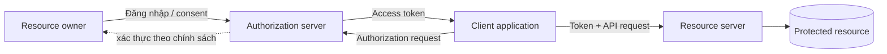
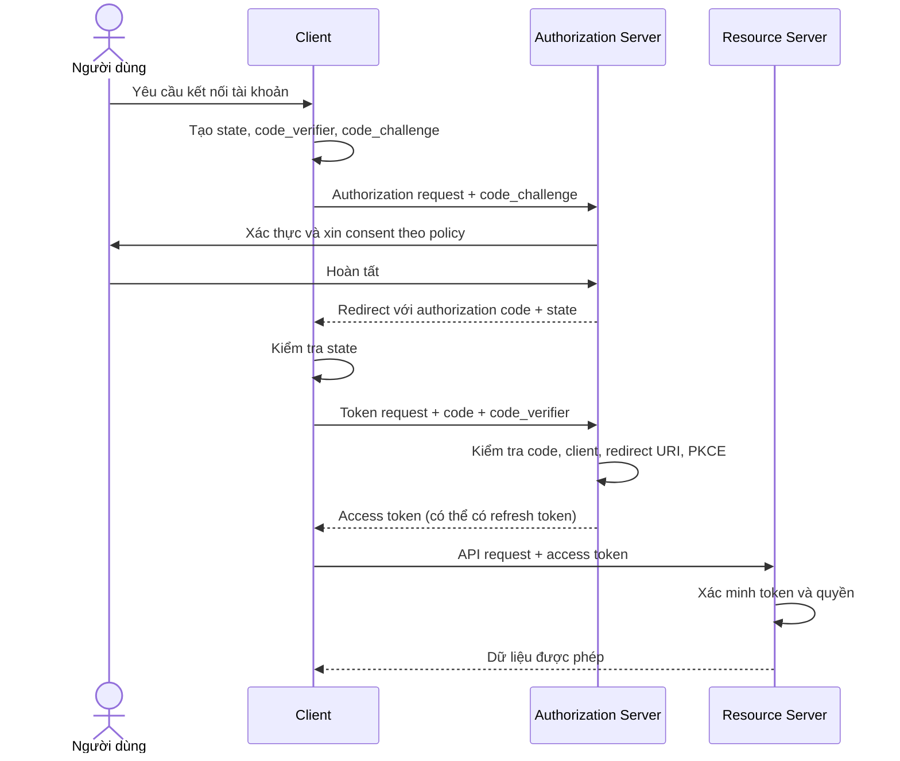
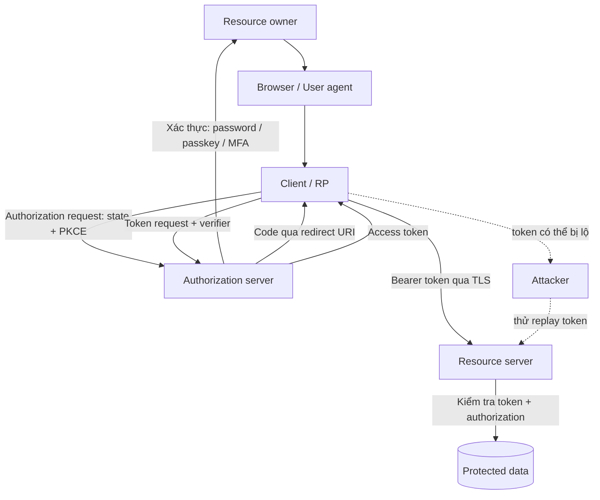

# OAuth là gì — Khung ủy quyền cho ứng dụng và API

Một người dùng muốn cho ứng dụng lịch làm việc đọc lịch của họ từ một dịch vụ khác. Ứng dụng cần được cấp quyền trong phạm vi giới hạn, nhưng không nên yêu cầu người dùng đưa mật khẩu của dịch vụ lịch cho ứng dụng. **OAuth 2.0 giải quyết bài toán ủy quyền được ủy quyền (delegated authorization):** một authorization server cấp token cho client để client truy cập resource server theo quyền, phạm vi và thời hạn đã được chấp thuận.

OAuth thường xuất hiện trong đăng nhập bằng tài khoản bên thứ ba, kết nối ứng dụng với API, tích hợp doanh nghiệp và giao tiếp giữa các dịch vụ. Tuy nhiên, cần phân biệt rõ: **OAuth 2.0 là framework ủy quyền, không phải giao thức xác thực danh tính người dùng hoàn chỉnh.** Khi ứng dụng cần nhận kết quả đăng nhập chuẩn hóa, OpenID Connect (OIDC) bổ sung lớp xác thực dựa trên OAuth 2.0.

Bài học thuộc chương **OAuth** của học phần **SECURITY_AUTHENTICATION_FUNDAMENTALS**. Nội dung liên hệ OAuth với credential, mật khẩu, MFA, passkey, chứng chỉ, token, phiên, liên kết danh tính và khôi phục tài khoản. Người học sẽ mô hình hóa ranh giới tin cậy, chọn đúng flow, bảo vệ token và phòng chống phishing, replay, giả mạo callback cùng lạm dụng quyền.

## 1. Kết quả học tập

Sau bài này, người học có thể:

- Giải thích OAuth 2.0 giải quyết vấn đề gì và phân biệt ủy quyền với xác thực.
- Nhận diện bốn vai trò: resource owner, client, authorization server và resource server.
- Phân biệt public client với confidential client, authorization grant với access token.
- Mô tả Authorization Code Flow + PKCE và chọn flow phù hợp cho web, SPA, mobile, thiết bị hạn chế đầu vào và workload.
- Giải thích access token, refresh token, scope, audience, consent và thời hạn.
- Phân biệt OAuth với OpenID Connect; hiểu vai trò của ID token, `state`, `nonce` và issuer.
- Nhận diện các flow cũ hoặc không phù hợp, như Implicit Grant và Resource Owner Password Credentials Grant.
- Thiết kế kiểm soát redirect URI, PKCE, client authentication, token storage, refresh rotation, revocation và API authorization.
- Viết tiêu chí kiểm thử cho code interception, CSRF, token substitution, replay, scope escalation và cross-tenant access.

## 2. OAuth 2.0 giải quyết vấn đề gì?

Trước OAuth, một cách tích hợp thường gặp là yêu cầu người dùng cung cấp username/password của dịch vụ nguồn cho ứng dụng bên thứ ba. Cách này tạo ra nhiều rủi ro:

- Ứng dụng bên thứ ba có thể nhìn thấy mật khẩu và sử dụng nó ngoài mục đích ban đầu.
- Người dùng phải chia sẻ credential gốc, khó giới hạn quyền theo ứng dụng.
- Khi muốn ngừng cấp quyền cho một ứng dụng, người dùng có thể phải đổi mật khẩu và ảnh hưởng các thiết bị/dịch vụ khác.
- Dịch vụ nguồn khó biết ứng dụng đang truy cập dữ liệu nào và trong phạm vi nào.

OAuth thay thế mô hình chia sẻ mật khẩu bằng một quy trình cấp quyền:

1. Client yêu cầu quyền truy cập cụ thể.
2. Authorization server xác thực resource owner theo chính sách của nó và xin consent khi cần.
3. Authorization server cấp authorization code hoặc token theo grant được phép.
4. Client dùng access token để gọi resource server.
5. Resource server kiểm tra token và quyền trước khi trả dữ liệu.

Người dùng có thể cấp quyền đọc lịch mà không trao mật khẩu; sau đó có thể thu hồi grant của ứng dụng mà không nhất thiết phải đổi mật khẩu.

### OAuth là framework, không phải một màn hình đăng nhập

OAuth không quy định một giao diện đăng nhập cụ thể, cũng không yêu cầu mọi hệ thống phải có consent screen. Nó định nghĩa vai trò, grant, token và cách client được cấp quyền. Authorization server có thể xác thực người dùng bằng mật khẩu, passkey, MFA, chứng chỉ hoặc một cơ chế khác; những phương thức xác thực đó nằm trong chính sách của hệ thống xác thực.

Một ứng dụng hiển thị nút “Đăng nhập bằng X” thường cần **OpenID Connect**, vì ứng dụng muốn biết người dùng đã đăng nhập là ai. Nếu ứng dụng chỉ cần quyền truy cập API thay mặt người dùng, OAuth có thể là lớp phù hợp; nhưng cần có hợp đồng riêng để biết danh tính nếu nghiệp vụ yêu cầu.

## 3. Bốn vai trò trong OAuth

| Vai trò | Ý nghĩa | Ví dụ |
| --- | --- | --- |
| **Resource owner** | Chủ thể có quyền cấp quyền truy cập tài nguyên; thường là người dùng | Người sở hữu lịch làm việc |
| **Client** | Ứng dụng yêu cầu quyền truy cập thay mặt resource owner hoặc theo danh tính client | Ứng dụng lịch trên điện thoại |
| **Authorization server (AS)** | Xác thực/ủy quyền theo chính sách và phát hành token | Dịch vụ identity/authorization |
| **Resource server (RS)** | Lưu tài nguyên được bảo vệ và kiểm tra access token | Calendar API |

Một client có thể là ứng dụng web, SPA, mobile app, desktop app hoặc workload. Một hệ thống có thể gộp AS và RS về mặt triển khai, nhưng vai trò giao thức vẫn khác nhau: AS quyết định cấp token; RS quyết định có chấp nhận token và cho phép hành động cụ thể không.

### Ví dụ quan hệ



Client không nhận mật khẩu gốc của resource owner trong Authorization Code Flow. Client nhận code rồi đổi code lấy token; token có quyền và thời hạn được AS quy định.

## 4. Public client và confidential client

Khả năng giữ bí mật của client ảnh hưởng tới cách xác thực client:

- **Confidential client:** có môi trường server-side có thể bảo vệ credential của client, ví dụ backend web hoặc service. Nó có thể xác thực tại token endpoint bằng phương thức được AS hỗ trợ.
- **Public client:** không thể giữ bí mật lâu dài, ví dụ SPA chạy trong browser, ứng dụng mobile hoặc desktop được phân phối cho người dùng. Bất kỳ secret nhúng trong mã nguồn/gói cài đặt đều có thể bị trích xuất.

| Loại client | Ví dụ | Nguyên tắc |
| --- | --- | --- |
| Server-side web app | Backend/BFF của website | Giữ client credential ở server; dùng Authorization Code + PKCE; bảo vệ session/token store |
| SPA | JavaScript chạy trong browser | Xem là public client; không nhúng client secret; dùng Authorization Code + PKCE |
| Mobile/desktop | Ứng dụng cài trên thiết bị | Xem là public client; dùng PKCE và redirect URI phù hợp nền tảng |
| Service/workload | Backend gọi API thay mặt chính workload | Có thể là confidential client; dùng client authentication mạnh hoặc workload identity |

Một `client_id` không phải bí mật. Client secret trong SPA hoặc mobile package không biến public client thành confidential client. PKCE cũng không phải client secret; nó ràng buộc authorization code với lần khởi tạo cụ thể.

## 5. Authorization Code Flow + PKCE

Đối với ứng dụng tương tác người dùng, **Authorization Code Flow + PKCE** là mô hình phổ biến và được khuyến nghị cho cả public client lẫn confidential client. Luồng này tách việc điều hướng người dùng tới AS khỏi việc đổi authorization code lấy token.



### 5.1. Tạo PKCE verifier và challenge

Client tạo một `code_verifier` ngẫu nhiên, đủ entropy và chỉ giữ cho giao dịch đang diễn ra. Client tính `code_challenge` bằng cách áp dụng SHA-256 rồi Base64url encode theo phương thức `S256`.

```text
code_verifier  = random high-entropy string
code_challenge = BASE64URL-ENCODE(SHA256(code_verifier))
code_challenge_method = S256
```

Client gửi challenge trong authorization request, rồi gửi verifier khi đổi code ở token endpoint. AS chỉ phát token nếu verifier khớp challenge đã lưu cho authorization code đó. Kẻ tấn công chặn được authorization code nhưng không có verifier sẽ không thể đổi code thành token.

Không dùng `plain` khi có thể dùng `S256`; không dùng verifier cố định, đoán được hoặc chia sẻ giữa nhiều giao dịch. Mỗi authorization request cần một verifier mới.

### 5.2. Authorization request minh họa

```http
GET /authorize?response_type=code
    &client_id=calendar-client
    &redirect_uri=https%3A%2F%2Fapp.example.test%2Foauth%2Fcallback
    &scope=calendar.read%20profile
    &state=<random-state>
    &code_challenge=<base64url-sha256-challenge>
    &code_challenge_method=S256 HTTP/1.1
Host: identity.example.test
```

Đây là ví dụ đã rút gọn; trong request thật, query string được mã hóa đúng cách và nằm trên một dòng. `redirect_uri` phải được đăng ký và so khớp theo chính sách AS. Không lấy redirect URL tùy ý từ tham số người dùng.

### 5.3. Token request minh họa

```http
POST /token HTTP/1.1
Host: identity.example.test
Content-Type: application/x-www-form-urlencoded

grant_type=authorization_code&
code=<authorization-code>&
redirect_uri=https%3A%2F%2Fapp.example.test%2Foauth%2Fcallback&
client_id=calendar-client&
code_verifier=<original-code-verifier>
```

Confidential client còn phải xác thực client theo phương thức đã đăng ký, ví dụ client secret được bảo vệ ở server hoặc private-key client authentication. Public client không có client secret đáng tin cậy; PKCE là lớp ràng buộc code cần thiết.

### 5.4. Vai trò của state

`state` là giá trị ngẫu nhiên do client tạo và giữ trong giao dịch; client so khớp state nhận ở callback với giao dịch đang chờ. Điều này giúp chống CSRF/login CSRF và ghép nhầm callback vào phiên khác. State cần:

- Đủ ngẫu nhiên, không đoán được.
- Gắn với đúng browser/session và giao dịch khởi tạo.
- Có TTL và chỉ được sử dụng một lần.
- Không chứa dữ liệu nhạy cảm hoặc URL tùy ý chưa được kiểm tra.

PKCE và state giải quyết các ràng buộc liên quan nhưng không nên bỏ qua một trong hai chỉ vì đã triển khai cái còn lại; dùng theo best practice của giao thức và thư viện.

## 6. Các grant/flow thường gặp

OAuth 2.0 có nhiều grant phục vụ các loại client và tình huống khác nhau. Chọn grant dựa trên việc ai đang yêu cầu quyền, có người dùng tương tác hay không và client có thể bảo vệ credential thế nào.

| Grant/flow | Tình huống | Ghi chú an ninh |
| --- | --- | --- |
| **Authorization Code + PKCE** | Ứng dụng web, SPA, mobile, desktop cần quyền thay mặt người dùng | Lựa chọn phổ biến; bảo vệ redirect, state, PKCE và token |
| **Client Credentials** | Workload/client truy cập API bằng quyền của chính client | Không đại diện người dùng; bảo vệ client authentication và scope |
| **Device Authorization Grant** | Thiết bị có bàn phím/màn hình hạn chế như TV hoặc thiết bị IoT | Người dùng xác thực trên thiết bị thứ hai; chống phishing và user-code abuse |
| **Refresh Token** | Client xin access token mới sau khi access token hết hạn | Đây là cơ chế cấp lại token, không phải grant đăng nhập người dùng mới |
| **Token Exchange** | Một dịch vụ đổi token sang token phù hợp audience/actor khác theo policy | Cần kiểm soát delegation, actor, audience và chain of trust |
| **Implicit Grant** | Flow lịch sử trả access token qua front-channel | Không nên dùng cho ứng dụng mới; Authorization Code + PKCE an toàn hơn |
| **Resource Owner Password Credentials** | Client nhận trực tiếp username/password người dùng | Không nên dùng; không phù hợp với MFA/passkey/federation và mở rộng phạm vi lộ mật khẩu |

### 6.1. Client Credentials Grant

Dùng cho giao tiếp máy với máy khi client truy cập tài nguyên bằng danh tính và quyền của chính nó:

```http
POST /token HTTP/1.1
Host: identity.example.test
Content-Type: application/x-www-form-urlencoded
Authorization: <client-authentication-method>

grant_type=client_credentials&scope=inventory.read
```

AS xác thực client và cấp access token theo quyền được cấu hình. Không có resource owner tương tác trong luồng này. Token đại diện client/workload; API không nên giả định có người dùng cuối. Nếu request cần vừa có client identity vừa có user context, phải dùng mô hình delegation phù hợp thay vì nhét một `user_id` tùy ý vào body.

### 6.2. Device Authorization Grant

Thiết bị hạn chế đầu vào có thể yêu cầu device code và user code. Người dùng mở một URL xác minh trên thiết bị khác, nhập user code, đăng nhập và chấp thuận quyền. Thiết bị gốc polling token endpoint theo khoảng thời gian và giới hạn do AS quy định.

Các kiểm soát quan trọng:

- User code đủ khó đoán và có thời hạn ngắn.
- Giới hạn tốc độ thử user code và thông báo rõ ứng dụng/thiết bị yêu cầu quyền.
- Thiết bị chỉ polling theo interval; xử lý `slow_down`, hết hạn và từ chối đúng giao thức.
- Người dùng kiểm tra đúng tên client/phạm vi trước khi chấp thuận.
- Không cho phép kẻ tấn công dùng social engineering để dụ người dùng nhập code vào một phiên thiết bị khác.

### 6.3. Implicit Grant và Password Grant

Implicit Grant từng được dùng cho browser app nhưng trả access token trực tiếp qua front-channel, làm tăng nguy cơ lộ token qua browser history, redirect và các thành phần client. Với ứng dụng mới, dùng Authorization Code + PKCE.

Resource Owner Password Credentials Grant yêu cầu client thu thập mật khẩu của người dùng. Nó làm suy yếu ranh giới giữa client và authorization server, khó hỗ trợ MFA/passkey/federation và tăng nguy cơ credential bị lộ. Không thiết kế hệ thống mới dựa trên grant này.

## 7. Access token, refresh token, scope và audience

### 7.1. Access token

Access token là credential được client trình cho resource server để truy cập tài nguyên. Token có thể là:

- **Opaque:** chuỗi không tự mô tả claim; resource server tra cứu hoặc introspect với AS.
- **JWT:** token có cấu trúc claim và chữ ký/MAC; resource server có thể xác minh cục bộ nếu profile cho phép.

OAuth không bắt buộc mọi access token phải là JWT. Client nên coi access token là chuỗi opaque: không tự phân tích claim để quyết định quyền hoặc hiển thị thông tin, trừ khi giao thức/profile quy định rõ.

### 7.2. Refresh token

Refresh token được gửi tới authorization server để xin access token mới. Nó thường sống lâu hơn access token và có giá trị cao vì có thể duy trì quyền truy cập:

- Không gửi refresh token tới resource API.
- Lưu ở backend hoặc secure storage phù hợp.
- Bảo vệ khỏi log, URL, browser storage và backup không an toàn.
- Dùng refresh token rotation và phát hiện reuse khi AS hỗ trợ.
- Thu hồi token/family khi logout, reset credential, phát hiện rủi ro hoặc người dùng thu hồi grant.

Refresh token không phải “phiên đăng nhập vô hạn”. AS cần giới hạn thời gian, client, scope và trạng thái grant.

### 7.3. Scope

Scope biểu diễn quyền mà client yêu cầu hoặc được cấp, ví dụ:

```text
calendar.read
calendar.write
profile
files.read
```

Client chỉ nên yêu cầu scope cần thiết. AS có thể cấp ít hơn yêu cầu ban đầu; client phải xử lý trường hợp scope không được cấp. Resource server kiểm tra scope theo endpoint và vẫn cần kiểm tra quyền theo từng tài nguyên/tenant.

### 7.4. Audience

Audience xác định token dành cho resource server nào. Một token cấp cho `calendar-api` không nên được chấp nhận tại `payments-api` chỉ vì cùng issuer ký. Audience hẹp giúp giảm token substitution và confused deputy.

OAuth 2.0 core không quy định một cấu trúc claim JWT duy nhất cho mọi access token. Cách biểu diễn audience, scope, subject và token type phụ thuộc token profile/AS; RS phải theo đúng hợp đồng đã cấu hình.

### 7.5. Ví dụ JWT access token

```json
{
  "iss": "https://identity.example.test/",
  "sub": "user-248",
  "aud": "calendar-api",
  "exp": 1900003600,
  "iat": 1900000000,
  "scope": "calendar.read",
  "jti": "at-4f7c"
}
```

Đây là payload minh họa, không phải token dùng được. Không tin claim chỉ vì decode được JSON. Resource server phải xác minh chữ ký/issuer/audience/thời hạn/profile và trạng thái cần thiết; sau đó kiểm tra quyền trên lịch cụ thể.

## 8. OAuth không đồng nghĩa với OpenID Connect

OAuth trả lời câu hỏi: **client được phép truy cập tài nguyên nào?** OIDC bổ sung một lớp xác thực để client biết người dùng đã xác thực là ai và nhận các claim danh tính theo một giao thức chuẩn.

| Thành phần | OAuth 2.0 | OpenID Connect |
| --- | --- | --- |
| Mục tiêu | Ủy quyền truy cập tài nguyên | Xác thực người dùng dựa trên OAuth 2.0 |
| Access token | Dùng gọi resource server | Có thể được cấp cùng OIDC; vẫn dùng cho API theo audience |
| ID token | Không phải khái niệm lõi của OAuth | JWT mang kết quả xác thực cho OIDC client |
| Scope `openid` | Không phải scope OAuth core đặc biệt | Bật yêu cầu OIDC |
| Nonce | Không phải tham số OAuth core | Ràng buộc ID token với authentication request |
| UserInfo endpoint | Không được OAuth core định nghĩa | Cung cấp claims người dùng theo access token |

### 8.1. Không dùng ID token thay access token

ID token được phát hành cho OIDC client để chứng minh kết quả xác thực. Access token được phát hành cho resource server để truy cập API. Một API không được chấp nhận ID token chỉ vì nó có chữ ký hợp lệ và chứa `sub`.

### 8.2. Vai trò của nonce

`nonce` là giá trị do client tạo trong OIDC authentication request và được trả trong ID token. Client kiểm tra nonce để ràng buộc ID token với giao dịch đã khởi tạo, giúp chống replay/token injection. Nonce không thay thế state; mỗi giá trị cần được tạo ngẫu nhiên, gắn đúng transaction và kiểm tra một lần.

### 8.3. Khi nào dùng OAuth và khi nào dùng OIDC?

- Ứng dụng tích hợp cần đọc lịch của người dùng: OAuth delegated authorization.
- Ứng dụng cần “Đăng nhập bằng tài khoản công ty” và nhận danh tính chuẩn: OIDC.
- Backend service gọi API bằng quyền workload: Client Credentials hoặc workload identity phù hợp.
- Ứng dụng vừa cần đăng nhập vừa cần gọi API: OIDC để xác thực, access token có audience/scope phù hợp để gọi resource server.

## 9. Consent, scope và quản trị grant

Consent là quyết định cho phép client truy cập dữ liệu/quyền theo chính sách. Có hệ thống yêu cầu người dùng consent mỗi lần hoặc lần đầu; hệ thống doanh nghiệp có thể cấp quyền trước qua administrator consent hoặc policy. Dù cách nào, ứng dụng cần minh bạch:

- Client nào đang yêu cầu quyền.
- Dữ liệu hoặc hành động nào sẽ được truy cập.
- Quyền có thời hạn hay cần refresh token.
- Cách người dùng/quản trị viên xem và thu hồi grant.

Không mô tả scope mơ hồ như “full access” nếu thực tế quyền bao gồm đọc, sửa, xóa hoặc chia sẻ dữ liệu. Scope nên có ngữ nghĩa rõ và đủ hẹp.

### Quyền đã cấp và quyền hiện tại

Token có thể phản ánh quyền tại thời điểm phát hành. Nếu user bị gỡ khỏi nhóm hoặc tenant, API cần cơ chế phản ánh thay đổi đó theo yêu cầu thu hồi. Không giả định access token cũ tự cập nhật khi group membership thay đổi.

## 10. Bảo mật redirect, callback và authorization code

Authorization endpoint và callback là ranh giới nhạy cảm. Những kiểm soát cơ bản:

- Đăng ký redirect URI chính xác và so khớp theo yêu cầu AS; không wildcard domain/path tùy tiện.
- Không tạo open redirect từ tham số callback hoặc `returnTo` do người dùng kiểm soát.
- Dùng HTTPS cho redirect URI production; loopback redirect cho native app chỉ theo quy tắc phù hợp.
- Dùng state ngẫu nhiên, có TTL, ràng buộc session và tiêu thụ một lần.
- Dùng PKCE `S256` để ràng buộc authorization code với client instance đã khởi tạo.
- Authorization code ngắn hạn, dùng một lần, gắn với client và redirect URI.
- Xác minh issuer/AS đã chọn để ngăn authorization server mix-up khi hỗ trợ nhiều IdP.
- Không ghi code, verifier, token hoặc secret vào log.
- Xử lý callback lỗi, người dùng từ chối và nhiều tab đồng thời mà không nới lỏng xác minh.

### Vì sao redirect URI cần khớp chặt?

Nếu AS cho phép client đăng ký một redirect URI quá rộng hoặc wildcard, attacker có thể làm authorization code được gửi tới domain/path do họ kiểm soát. PKCE giảm nguy cơ kẻ chặn code đổi code thành token, nhưng redirect URI validation vẫn là lớp kiểm soát quan trọng và không nên bị bỏ qua.

## 11. Bảo vệ token và client

### 11.1. Bảo vệ token ở client

- Backend web/BFF nên giữ access/refresh token phía server; browser giữ cookie phiên bảo vệ.
- SPA là public client; không nhúng client secret. Nếu giữ token trong browser, cần threat model XSS, TTL ngắn, hạn chế persistence và cơ chế revoke.
- Mobile/desktop dùng Authorization Code + PKCE, redirect URI đúng nền tảng và secure storage cho token dài hạn nếu cần.
- Workload dùng secret manager/KMS hoặc credential ngắn hạn; tách secret theo môi trường và quyền.

Không lưu access/refresh token trong URL, log, analytics hoặc crash report. `HttpOnly` cookie giúp JavaScript không đọc cookie trực tiếp nhưng cookie tự động gửi nên vẫn cần CSRF protection.

### 11.2. Bảo vệ token endpoint và client authentication

Confidential client phải xác thực theo phương thức đã đăng ký; không tự gửi client secret qua frontend. Ưu tiên cơ chế phù hợp với năng lực triển khai, ví dụ private-key JWT hoặc mTLS cho môi trường yêu cầu cao, khi AS hỗ trợ. Secret tĩnh phải được quản lý, xoay vòng và thu hồi.

Public client không thể xác thực bằng secret nhúng sẵn. PKCE bảo vệ authorization code; nó không biến public client thành confidential client và không tự bảo vệ access token sau khi được cấp.

### 11.3. Access token TTL và refresh rotation

Access token cần TTL phù hợp với rủi ro và chi phí refresh. Refresh token rotation có thể cấp token mới mỗi lần refresh và vô hiệu hóa token cũ. Nếu token cũ bị dùng lại, AS có thể nhận diện dấu hiệu compromise và thu hồi cả token family/grant theo policy.

Thiết kế cần xử lý request refresh đồng thời để tránh chặn nhầm client hợp lệ, nhưng không mở cửa sổ replay quá rộng. Logout phải thu hồi refresh token; access token đã phát hành có thể còn hiệu lực đến `exp` nếu RS không kiểm tra trạng thái.

## 12. Các mối đe dọa OAuth và biện pháp kiểm soát

| Mối đe dọa | Cách phát sinh | Kiểm soát |
| --- | --- | --- |
| Authorization code interception | Code bị lộ qua redirect, app link hoặc proxy | PKCE S256, redirect URI chính xác, code ngắn hạn/dùng một lần |
| Login CSRF / state injection | Callback không gắn với browser transaction ban đầu | State ngẫu nhiên, ràng buộc phiên, TTL và one-time use |
| Open redirect | Return URL hoặc redirect URI cho phép domain ngoài | Allowlist/registration chặt, chỉ return path nội bộ đã chuẩn hóa |
| Authorization server mix-up | Client nhiều AS chấp nhận phản hồi từ issuer khác | Gắn AS/issuer vào transaction; xác minh issuer theo profile |
| Token leakage | Token lộ qua URL, storage, log, XSS hoặc malware | TLS, BFF, secure storage, redact log, TTL và revoke |
| Token substitution | Dùng ID token hoặc access token của API khác | Kiểm tra token type/profile, audience, issuer và scope |
| Replay | Code, refresh token hoặc bearer token bị dùng lại | One-time code, PKCE, refresh rotation, sender constraint, replay detection |
| Scope escalation | Client yêu cầu hoặc API hiểu scope quá rộng | Scope allowlist, consent rõ, authorization server-side |
| Confused deputy | API dùng quyền của mình cho tài nguyên tùy ý client yêu cầu | Audience hẹp, principal mapping và kiểm tra quyền đối tượng/tenant |
| Refresh token theft | Token dài hạn bị lấy ở browser/storage/device | Secure storage, rotation, reuse detection và revoke family |
| Consent phishing | Người dùng bị dụ cấp quyền rộng cho app giả | Hiển thị client/permission rõ, app governance, admin consent policy |
| Public client secret extraction | Secret nhúng trong SPA/mobile package | Xem client là public; không dùng secret nhúng, dùng PKCE |
| Weak device flow | User code bị dò hoặc người dùng bị dụ nhập code | Rate limit, code TTL, xác nhận client/scope, polling interval |

OAuth không tự giải quyết XSS, CSRF, lỗi phân quyền, malware hay chiếm phiên. Các lớp bảo vệ của ứng dụng, trình duyệt, thiết bị và API vẫn cần được thiết kế riêng.

## 13. Mô hình hóa ranh giới tin cậy



Khi lập threat model, đánh dấu:

1. **Client boundary:** nơi code chạy, secret có thể bị trích xuất hay không, token được lưu ở đâu.
2. **Browser/device boundary:** redirect, deep link, cookie, extension, XSS và malware.
3. **Authorization server boundary:** nơi xác thực credential, consent, cấp code/token, refresh và revoke.
4. **Callback boundary:** redirect URI, state, PKCE, nonce (với OIDC), issuer và code.
5. **Resource server boundary:** token validation, audience, scope, tenant và object-level authorization.
6. **Federation boundary:** IdP/issuer nào được tin, subject mapping nào được phép và cách deprovisioning.

Mỗi ranh giới cần có chủ thể chịu trách nhiệm, dữ liệu đi qua, kiểm soát xác minh và hành vi khi lỗi. Không để client tự khai báo `user_id`, `role`, `tenant_id` hoặc “đã MFA” rồi server tin trực tiếp.

## 14. Pseudocode: Authorization Code + PKCE ở backend

Ví dụ sau mô tả một backend/BFF. Hàm là khái niệm; triển khai thật nên dùng thư viện OAuth/OIDC đã được duy trì và cấu hình theo provider.

```ts
async function startOAuth(req) {
  const provider = trustedProviderFor(req.tenant);
  const transaction = {
    state: secureRandomValue(),
    codeVerifier: securePkceVerifier(),
    nonce: secureRandomValue(), // khi dùng OIDC
    providerId: provider.id,
    expectedIssuer: provider.issuer,
    redirectUri: provider.registeredRedirectUri,
    returnPath: validateLocalPath(req.query.returnTo) ?? "/"
  };

  await pendingOAuthStore.saveBoundToBrowser(
    req.session.binding,
    transaction,
    shortTTL()
  );

  return redirect(provider.authorizationEndpoint, {
    response_type: "code",
    client_id: provider.clientId,
    redirect_uri: transaction.redirectUri,
    scope: "openid profile calendar.read",
    state: transaction.state,
    nonce: transaction.nonce,
    code_challenge: pkceS256(transaction.codeVerifier),
    code_challenge_method: "S256"
  });
}

async function completeOAuth(req) {
  const tx = await pendingOAuthStore.consumeOnce(req.query.state);
  if (!tx || !matchesBrowserBinding(req, tx)) return rejectCallback();

  const provider = trustedProviderById(tx.providerId);
  if (provider.issuer !== tx.expectedIssuer) return rejectCallback();

  const tokens = await oauthClient.exchangeCode({
    provider,
    code: req.query.code,
    redirectUri: tx.redirectUri,
    codeVerifier: tx.codeVerifier
  });

  // Với OIDC: verify ID token theo issuer, audience, signature,
  // expiry và nonce trước khi dùng claims danh tính.
  const identity = provider.oidc
    ? await verifyOidcIdentity(tokens.idToken, tx)
    : null;

  const accessGrant = await validateExpectedGrant(tokens, provider);
  await establishApplicationSession(identity, accessGrant);
  return redirect(tx.returnPath);
}
```

Ví dụ rút gọn không thể hiện mọi chi tiết: xử lý lỗi callback, client authentication, token validation, nhiều tab, refresh rotation, logout, consent và mapping principal. Với OAuth thuần không dùng OIDC, không được giả định có ID token hoặc danh tính người dùng; client cần hợp đồng riêng nếu nghiệp vụ cần user identity.

## 15. Tình huống thực tế: ứng dụng quản lý lịch

Một ứng dụng lịch muốn đọc lịch của người dùng từ dịch vụ lịch bên ngoài. Ứng dụng không cần mật khẩu của dịch vụ đó, chỉ cần quyền đọc lịch.

### Thiết kế

1. Client đăng ký tại AS với redirect URI cố định và scope `calendar.read`.
2. Khi người dùng chọn kết nối, client tạo state và PKCE verifier/challenge.
3. AS xác thực người dùng bằng phương thức do nhà cung cấp hỗ trợ (có thể là passkey hoặc MFA), rồi hiển thị quyền cần cấp.
4. AS redirect authorization code về URI đã đăng ký cùng state.
5. Client kiểm tra state, đổi code kèm verifier và xác thực client nếu là confidential client.
6. Client lưu access/refresh token ở nơi phù hợp với kiến trúc.
7. Client gọi Calendar API bằng access token; API kiểm tra issuer, audience, expiry, scope và quyền truy cập lịch.
8. Người dùng có thể thu hồi grant; AS vô hiệu hóa refresh token và RS ngừng chấp nhận access token theo cơ chế revoke/TTL.

### Các lỗi cần tránh

- Ứng dụng hỏi và lưu mật khẩu dịch vụ lịch.
- Redirect URI wildcard làm code bị gửi tới domain giả.
- Client bỏ qua state hoặc PKCE.
- Client dùng ID token để gọi Calendar API.
- Token được lưu trong URL hoặc log.
- Scope `calendar.write` được yêu cầu dù chỉ cần đọc.
- API tin scope mà không kiểm tra lịch thuộc người dùng/tenant nào.
- Logout chỉ xóa token trong browser nhưng refresh token vẫn còn hiệu lực.

## 16. Tiêu chí chấp nhận và kiểm thử

| Tình huống | Kết quả mong đợi |
| --- | --- |
| Authorization Code Flow hợp lệ với PKCE S256 | Code đổi được token đúng client/redirect |
| Code bị chặn nhưng thiếu verifier | Token endpoint từ chối |
| State thiếu, sai, hết hạn hoặc đã dùng | Client từ chối callback, không tạo phiên |
| Redirect URI không khớp đăng ký | AS từ chối authorization/token request theo policy |
| Callback tới domain ngoài allowlist | Không redirect; không làm lộ code/token |
| Token có issuer không được tin cậy | RS/client từ chối theo vai trò tương ứng |
| Access token có audience của API khác | Resource server từ chối |
| ID token gửi tới API | API từ chối vì sai loại token |
| Scope không được cấp | Client xử lý đúng; API không thực thi quyền chưa cấp |
| Refresh token đã rotate/revoke được dùng lại | AS từ chối và xử lý reuse theo policy |
| Public client chứa client secret trong bundle | Kiểm thử thất bại; secret phải bị loại bỏ/rotate |
| Client Credentials token được dùng như danh tính người dùng | API không suy diễn user identity; áp dụng policy workload |
| Device code bị dò hoặc polling quá nhanh | Rate limit/interval/expiry được thực thi |
| User thu hồi consent/grant | Refresh bị từ chối; access token bị chặn theo SLA |
| Người dùng bị disable tại IdP | Local session/token được thu hồi theo chính sách và thời gian cam kết |
| API nhận token hợp lệ nhưng tài nguyên thuộc tenant khác | API từ chối theo object/tenant authorization |

### Chỉ số vận hành

Theo dõi tỷ lệ authorization thành công/thất bại, callback lỗi theo nguyên nhân, code exchange lỗi PKCE, token refresh/reuse, grant bị thu hồi, scope được cấp so với scope yêu cầu, số redirect bị từ chối và thời gian từ deprovisioning tới khi API chặn truy cập. Không ghi authorization code, verifier, client secret hoặc token thô.

## 17. Bài tập tự kiểm tra

Một công ty xây dựng ứng dụng quản lý công việc. Ứng dụng có SPA cho nhân viên, backend gọi API nội bộ và một job đồng bộ chạy định kỳ. Người dùng cần đăng nhập bằng SSO; SPA cần đọc danh sách công việc; job đồng bộ cần quyền đọc dữ liệu của workspace được phân công.

Hãy:

1. Chọn vai trò OAuth cho từng thành phần và xác định client nào là public/confidential.
2. Thiết kế flow cho SPA và job đồng bộ; giải thích vì sao không dùng password grant.
3. Liệt kê tham số cần có trong Authorization Code + PKCE và cách kiểm tra callback.
4. Chọn audience/scope cho API và mô tả kiểm tra quyền theo workspace.
5. Nêu cách lưu access/refresh token, logout và thu hồi khi nhân viên nghỉ việc.
6. Phân biệt thông tin cần từ OIDC ID token với access token dùng gọi API.
7. Viết test case cho code interception, state mismatch, redirect abuse, token substitution và scope escalation.

**Gợi ý đánh giá:** câu trả lời tốt phải phân biệt xác thực với ủy quyền, chọn flow theo loại client, mô tả state/PKCE/redirect URI, tách ID token và access token, và kiểm tra authorization tại resource server. Không coi OAuth token là bằng chứng mặc định cho mọi danh tính hoặc quyền.

---

**Ghi nhớ:** OAuth 2.0 là framework **ủy quyền**: client nhận token có phạm vi để truy cập resource server theo quyền đã cấp. Authorization Code + PKCE là flow quan trọng cho ứng dụng tương tác; Client Credentials dành cho workload; token phải được bảo vệ và xác minh đúng issuer, audience, scope cùng trạng thái. Khi cần xác thực danh tính người dùng theo chuẩn, dùng **OpenID Connect** và kiểm tra ID token đúng vai trò. An toàn phụ thuộc vào redirect URI, state, PKCE, quản lý token, thu hồi và authorization ở API.
