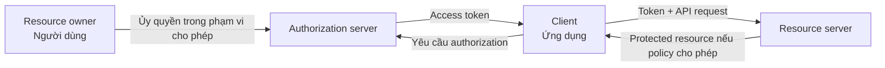
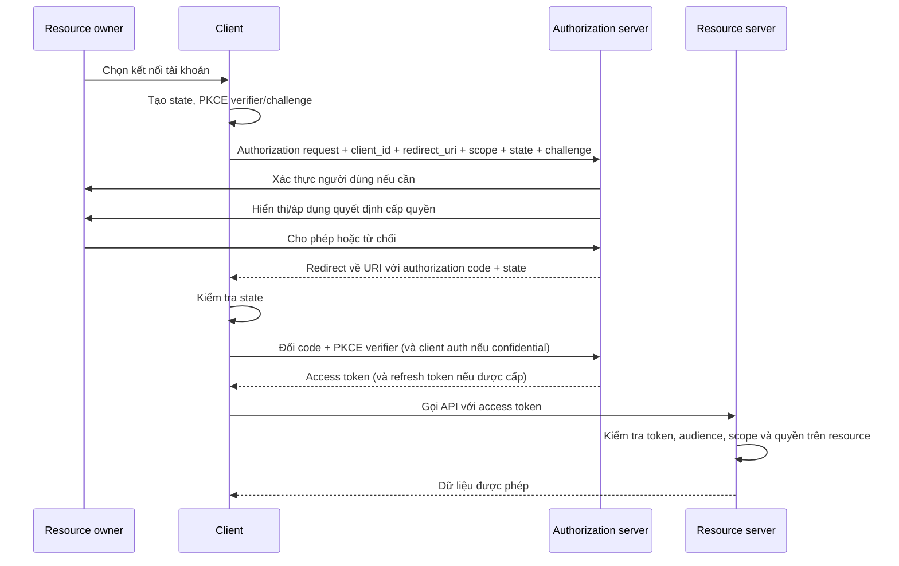

# Resource owner

Trong OAuth 2.0, **resource owner** là thực thể có khả năng cấp quyền truy cập vào một protected resource. Trong ứng dụng hướng người dùng, resource owner thường là **người dùng cuối** có dữ liệu hoặc tài nguyên được bảo vệ. Người dùng có thể cho phép một ứng dụng (client) truy cập một phạm vi dữ liệu nhất định mà không cần chia sẻ mật khẩu của mình với ứng dụng đó.

Resource owner là một vai trò trong mô hình ủy quyền OAuth. Nó không đồng nghĩa tuyệt đối với username, email, account record, người sở hữu hợp pháp tài sản hoặc subject trong mọi loại token. Authorization server có trách nhiệm xác thực chủ thể khi cần, thu thập hoặc áp dụng quyết định cấp quyền, rồi phát hành token theo chính sách. Client nhận token để gọi resource server; resource server kiểm tra token và quyết định có cho phép truy cập tài nguyên hay không.

Bài học thuộc chương **OAuth** của module **SECURITY_AUTHENTICATION_FUNDAMENTALS**. Người học cần phân biệt resource owner với client, authorization server và resource server; hiểu cách người dùng ủy quyền có giới hạn; phân biệt delegated access với app-only access; đồng thời bảo vệ luồng đăng nhập, consent, account mapping, token và quyền trên từng tài nguyên trước phishing, replay, confused deputy và lạm dụng quyền.

## 1. Resource owner là ai?

OAuth 2.0 định nghĩa resource owner là một thực thể có khả năng cấp quyền truy cập vào protected resource. Trong nhiều ứng dụng web/mobile, thực thể đó là người dùng đã đăng nhập và có quyền quyết định ứng dụng bên thứ ba được truy cập dữ liệu nào.

Ví dụ: một người dùng có tài khoản trên nền tảng học tập muốn kết nối ứng dụng lịch cá nhân. Ứng dụng lịch cần đọc lịch học để tạo sự kiện. Người dùng là resource owner đối với lịch học của mình; ứng dụng lịch là client; nền tảng học tập là authorization server và resource server (có thể là hai thành phần triển khai riêng). Người dùng cấp quyền đọc lịch học mà không cung cấp mật khẩu nền tảng cho ứng dụng lịch.

### 1.1. Vai trò trong OAuth

| Vai trò | Trách nhiệm | Ví dụ trong nền tảng học tập |
| --- | --- | --- |
| **Resource owner** | Có khả năng cấp quyền truy cập protected resource. | Học viên quyết định cho ứng dụng lịch đọc lịch học của mình. |
| **Client** | Ứng dụng yêu cầu quyền truy cập resource thay mặt resource owner hoặc theo quyền riêng của client. | Ứng dụng lịch bên ngoài. |
| **Authorization server (AS)** | Xác thực resource owner khi cần, nhận quyết định ủy quyền và phát hành token. | Dịch vụ OAuth của nền tảng học tập. |
| **Resource server (RS)** | Lưu/đưa ra protected resource và kiểm tra access token trước khi phục vụ request. | API lịch học. |

Các vai trò logic này có thể cùng nằm trong một sản phẩm hoặc được triển khai trên nhiều dịch vụ. Điều quan trọng là ranh giới trách nhiệm vẫn rõ: client không tự xác nhận quyền của resource owner; resource server không tin lời khai tùy ý từ client.

### 1.2. Resource owner không nhất thiết là một người

Trong ứng dụng phổ biến, resource owner thường là con người. Nhưng định nghĩa OAuth dùng khái niệm thực thể. Một tổ chức hoặc hệ thống quản lý tài nguyên có thể có quy trình ủy quyền riêng, trong đó người quản trị hoặc policy của tổ chức cấp quyền cho client.

Cần xác định rõ ai có thẩm quyền cấp quyền trong miền nghiệp vụ:

- Người dùng cá nhân có thể cấp quyền đọc dữ liệu riêng của họ.
- Quản trị viên tenant có thể phê duyệt integration truy cập dữ liệu tổ chức.
- Một quy trình tự động có thể được cấp quyền theo policy mà không có consent tương tác ở mỗi lần.
- Một workload có thể truy cập tài nguyên bằng quyền ứng dụng (app-only), không đại diện cho người dùng cuối.

Không nên suy ra “người đăng nhập” luôn có quyền cấp mọi loại quyền. Người đó chỉ có thể ủy quyền trong phạm vi quyền họ thực sự sở hữu hoặc được giao.

## 2. Resource owner trong mô hình OAuth

Luồng OAuth điển hình có bốn vai trò:



Resource owner không nhất thiết gửi mật khẩu trực tiếp cho client. Trong Authorization Code Flow, người dùng được chuyển tới authorization server để đăng nhập và phê duyệt quyền. Client chỉ nhận authorization code qua redirect URI, sau đó đổi code lấy token theo cơ chế bảo vệ phù hợp.

### 2.1. Phân biệt xác thực và ủy quyền

- **Authentication (xác thực):** xác định người đang đăng nhập có kiểm soát authenticator hợp lệ hay không. Authorization server hoặc một hệ thống danh tính có thể thực hiện bước này.
- **Authorization (ủy quyền):** quyết định client được phép làm gì trên tài nguyên nào, trong phạm vi và thời hạn nào.
- **Consent (đồng ý):** một cách thu thập quyết định của resource owner; không phải mọi luồng OAuth đều cần một màn hình consent tương tác.
- **Access token:** chứng cứ được phát hành để client trình bày với resource server; token không phải bản thân consent UI.

OAuth 2.0 là framework ủy quyền. Nếu ứng dụng cần xác thực người dùng và nhận claims danh tính chuẩn hóa, thường dùng **OpenID Connect (OIDC)** xây trên OAuth 2.0. Không dùng access token như thể nó luôn là bằng chứng đăng nhập người dùng.

## 3. Resource owner và client: quyền được ủy quyền

Khi resource owner cấp quyền, họ cho phép client thực hiện một số hành động trong phạm vi cụ thể. Họ không trao mật khẩu hoặc quyền kiểm soát toàn bộ account cho client.

Ví dụ:

| Yêu cầu của client | Quyết định resource owner có thể cấp |
| --- | --- |
| Đọc lịch học | Cho phép đọc lịch, không cho sửa hồ sơ. |
| Xem tiến độ khóa học | Cho phép đọc tiến độ, không cho xóa khóa học. |
| Đồng bộ chứng chỉ | Có thể cho đọc chứng chỉ; quyền phát hành/thu hồi cần policy riêng. |
| Quản lý thành viên tenant | Thường cần quyền quản trị tổ chức và phê duyệt bổ sung, không suy ra từ consent cá nhân. |

Một authorization grant nên có giới hạn:

- **Scope/action:** client được thực hiện nhóm hành động nào.
- **Resource/audience:** token dành cho API hoặc resource nào.
- **Subject/resource owner:** quyền được cấp liên quan tới ai hoặc tổ chức nào.
- **Tenant/project:** phạm vi dữ liệu mà client được truy cập.
- **Thời hạn và trạng thái:** quyền có hiệu lực tới khi nào, có bị thu hồi không.
- **Client identity:** ứng dụng nào nhận quyền; không chia sẻ grant tùy tiện cho client khác.

Scope là một cách biểu diễn phạm vi quyền, nhưng resource server vẫn phải kiểm tra quyền trên từng object và điều kiện nghiệp vụ.

## 4. Authorization Code Flow: resource owner cấp quyền

Đây là luồng phổ biến cho ứng dụng web và mobile hiện đại. Client chuyển người dùng tới authorization server; sau khi người dùng xác thực và quyết định cấp quyền, authorization server trả authorization code về redirect URI đã đăng ký. Client đổi code lấy access token.



### 4.1. Resource owner xác thực tại authorization server

Người dùng nhập mật khẩu, sử dụng passkey hoặc MFA tại authorization server (hoặc IdP được nó tin cậy). Client không nên nhận mật khẩu người dùng. Cách này giảm nguy cơ client giả mạo trang đăng nhập để thu credential và cho phép authorization server áp dụng chính sách MFA, risk assessment, account recovery và session management tập trung.

Một phiên đăng nhập còn hoạt động tại authorization server có thể khiến người dùng không phải nhập lại mật khẩu mỗi lần cấp quyền. Tuy nhiên, AS vẫn cần xác định đúng transaction, client, scope và chính sách consent; session SSO không có nghĩa mọi client đều được quyền tự động.

### 4.2. State và PKCE bảo vệ giao dịch

- **state:** client tạo giá trị khó đoán và gắn với giao dịch đang chờ; khi nhận redirect, client kiểm tra giá trị khớp để chống CSRF/login mix-up theo thiết kế flow.
- **PKCE:** client tạo `code_verifier`, gửi `code_challenge` trong authorization request; khi đổi code, client trình `code_verifier`. Authorization server kiểm tra quan hệ giữa hai giá trị.
- **redirect_uri:** phải khớp URI đã đăng ký theo quy tắc của authorization server; tránh wildcard hoặc open redirect không được kiểm soát.
- **nonce:** trong OIDC, nonce ràng buộc ID token với yêu cầu xác thực tương ứng; không nhầm vai trò nonce với state hoặc PKCE.

Public client (ví dụ native app hoặc SPA) không thể giữ client secret một cách đáng tin như backend. PKCE là biện pháp thiết yếu cho Authorization Code Flow với public client và cũng được khuyến nghị rộng rãi cho confidential client.

## 5. Consent: người dùng thực sự cấp quyền gì?

Consent screen cần giúp resource owner hiểu ứng dụng nào đang yêu cầu quyền và quyền đó cho phép làm gì. Một màn hình chỉ ghi “Cho phép ứng dụng tiếp tục” mà không mô tả phạm vi có thể khiến người dùng cấp quyền quá rộng.

Một consent tốt nên cho biết:

- Tên và danh tính client đã được đăng ký/xác minh theo chính sách.
- Nhà phát triển hoặc tổ chức chịu trách nhiệm, khi thông tin này có sẵn và đáng tin.
- Resource hoặc dữ liệu mà client muốn truy cập.
- Hành động cụ thể: đọc, tạo, cập nhật, xóa, quản lý hay chia sẻ.
- Quyền nào là tùy chọn, quyền nào bắt buộc để tính năng hoạt động.
- Thời hạn, khả năng truy cập nền/offline nếu refresh token được cấp.
- Cách xem lại và thu hồi grant sau này.

### 5.1. Consent không phải lúc nào cũng là một nút bấm

OAuth authorization có thể dựa trên consent của người dùng, quan hệ đã thiết lập, policy của tổ chức hoặc quyền được quản trị viên cấp trước. Ví dụ, ứng dụng nội bộ do tổ chức quản lý có thể được admin consent để truy cập dữ liệu nhân viên theo chính sách. Trong trường hợp đó, resource owner theo nghĩa nghiệp vụ có thể là tổ chức hoặc một chủ thể có thẩm quyền cấp quyền thay mặt tổ chức.

Không được hiển thị consent giả để hợp thức hóa một quyền mà người bấm không có thẩm quyền cấp. Hệ thống cần lưu ai đã cấp quyền, theo cơ sở nào, cho client nào và phạm vi nào.

### 5.2. Từ chối consent

Nếu resource owner từ chối, authorization server không cấp grant tương ứng. Client phải xử lý kết quả từ chối mà không lặp lại yêu cầu gây áp lực, không giả vờ rằng đã được cấp quyền và không cố gọi resource server bằng token cũ ngoài phạm vi.

Nếu client cần scope mới ở lần sau, phải yêu cầu bổ sung rõ ràng theo chính sách. Không tự nâng scope đang tồn tại mà không có authorization phù hợp.

## 6. Resource owner và các OAuth grant

Các grant khác nhau thể hiện ai cấp quyền và client đang hoạt động nhân danh ai.

| Grant/flow | Resource owner tham gia ra sao? | Mục đích |
| --- | --- | --- |
| **Authorization Code** | Người dùng được chuyển tới AS, xác thực và cấp quyền theo policy. | Delegated access cho web/mobile/public client. |
| **Client Credentials** | Không có resource owner là người dùng cuối trong grant; client hoạt động bằng quyền ứng dụng của chính nó. | Machine-to-machine/app-only access. |
| **Device Authorization Grant** | Người dùng hoàn tất xác thực/ủy quyền trên một thiết bị có browser khác; client trên thiết bị đầu vào chờ kết quả. | Thiết bị hạn chế input như TV, CLI hoặc thiết bị không tiện mở browser. |
| **Refresh Token** | Không phải grant tương tác mới của resource owner; client dùng refresh token đã được cấp để xin access token mới. | Duy trì delegated authorization theo giới hạn và policy. |
| **Resource Owner Password Credentials (ROPC)** | Client trực tiếp nhận username/password của resource owner. | Flow cũ; không nên sử dụng trong thiết kế mới và bị khuyến cáo mạnh không dùng trong thực hành hiện đại. |

### 6.1. Client Credentials không đại diện cho resource owner

Với Client Credentials Grant, client được xác thực bằng credential của chính nó và nhận access token cho quyền ứng dụng. Không có người dùng cuối tham gia cấp quyền trong mỗi giao dịch.

Ví dụ: tác vụ đồng bộ danh mục khóa học chạy theo lịch gọi API để đọc dữ liệu dùng chung. Token có thể đại diện cho `course-sync-service`, không phải một học viên cụ thể.

Resource server phải phân biệt token app-only với delegated token. Không gán một user principal giả cho token client credentials chỉ vì API cần một trường `user_id`.

### 6.2. Device Authorization Grant

Trong device flow, thiết bị hiển thị user code và verification URI. Resource owner mở browser trên thiết bị khác, xác thực tại AS và xác nhận yêu cầu. Thiết bị ban đầu định kỳ kiểm tra token endpoint để biết việc ủy quyền đã hoàn tất chưa.

Rủi ro đáng chú ý là **device code phishing**: attacker có thể dụ người dùng nhập code của phiên do attacker khởi tạo. Giao diện AS cần hiển thị client và mục đích yêu cầu; người dùng phải kiểm tra thiết bị/ứng dụng đang được liên kết trước khi chấp nhận. Client cần giới hạn thời gian, xử lý trạng thái pending/denied/expired và không spam polling.

### 6.3. ROPC và việc chia sẻ mật khẩu

ROPC khiến client thu mật khẩu resource owner rồi đổi trực tiếp lấy token. Cách này phá vỡ ranh giới giữa client và authorization server, khó hỗ trợ MFA, passkey, federation, passwordless và các chính sách xác thực tương tác. Không dùng ROPC trong thiết kế mới; chuyển sang Authorization Code Flow với PKCE hoặc flow phù hợp khác.

## 7. Delegated access và app-only access

Phân biệt hai kiểu token là điều quan trọng để resource server không nhầm quyền của ứng dụng với quyền của người dùng.

| Thuộc tính | Delegated access | App-only access |
| --- | --- | --- |
| Chủ thể sử dụng | Client hành động trong phạm vi quyền được ủy quyền bởi user/authority. | Client/workload hoạt động bằng quyền ứng dụng. |
| Resource owner | Có user hoặc authority cấp quyền theo policy. | Không nhất thiết có user cuối trong grant. |
| Token có thể thể hiện | User subject và client/actor, scope delegated. | Client/application identity và application permissions. |
| Kiểm tra phía API | Quyền của client, user, tenant, resource và ngữ cảnh. | Quyền của workload, tenant/resource và policy ứng dụng. |
| Ví dụ | Ứng dụng lịch đọc lịch của học viên An. | Job nền đồng bộ danh mục khóa học toàn tenant theo phê duyệt admin. |

Không suy luận token thuộc delegated hay app-only chỉ từ việc nó là JWT. Phải theo hợp đồng token của issuer, claims/introspection và cấu hình resource server. Trong một số profile, claim như `sub`, `client_id`, `azp`, `scope`, `roles` hoặc các claim khác có ý nghĩa riêng; không có một cách diễn giải chung cho mọi nhà cung cấp.

## 8. Resource owner, subject và account mapping

Một resource owner ngoài đời có thể có nhiều account, nhiều tenant hoặc nhiều danh tính liên kết. Ngược lại, một account có thể đại diện cho một tổ chức hoặc workload. Do đó, server không nên ánh xạ quyền chỉ bằng email hoặc tên hiển thị.

Khi nhận kết quả federation/OIDC, mapping thường dựa vào định danh issuer và subject theo chính sách, ví dụ cặp `(iss, sub)`. Khi nhận token OAuth, resource server cần hiểu subject/actor theo profile token của issuer. Không tự giả định `sub` luôn là resource owner hoặc luôn là user cuối.

### 8.1. Resource owner có quyền trên tài nguyên nào?

Ví dụ An là học viên trong tenant `org-7`. An có thể cấp quyền cho ứng dụng lịch đọc lịch học của An. An không tự động có quyền cấp cho ứng dụng lịch đọc lịch của mọi học viên trong `org-7`, cũng không có quyền quản trị tenant chỉ vì An đăng nhập thành công.

Authorization server cần xác minh quyền cấp grant theo resource/tenant. Resource server tiếp tục kiểm tra object-level authorization để ngăn client đổi `user_id` trong request và đọc dữ liệu người khác.

### 8.2. Email không phải khóa liên kết bền vững

Email có thể đổi, tái cấp hoặc bị chiếm. Nếu client hoặc RP tự động hợp nhất account chỉ vì email từ hai IdP trùng nhau, attacker có thể chiếm dữ liệu của account cũ. Liên kết identity cần chứng minh quyền kiểm soát account đích, kiểm tra issuer/subject và áp dụng chính sách account linking riêng.

## 9. Bảo vệ resource owner trong quá trình ủy quyền

Resource owner là người đưa ra quyết định cấp quyền, nhưng giao diện và luồng kỹ thuật có thể bị khai thác để đánh lừa họ.

### 9.1. Consent phishing

Attacker có thể tạo một ứng dụng với tên gần giống dịch vụ thật và yêu cầu scope rộng. Người dùng nhìn thấy màn hình quen thuộc rồi đồng ý mà không hiểu ứng dụng sẽ truy cập dữ liệu gì.

Biện pháp:

- Hiển thị tên client, publisher và redirect domain rõ ràng.
- Mô tả scope bằng ngôn ngữ hành động, không chỉ hiển thị chuỗi kỹ thuật.
- Cảnh báo quyền nhạy cảm, quyền offline hoặc quyền quản trị tenant.
- Hạn chế client dynamic registration và yêu cầu review với quyền có tác động lớn.
- Cho người dùng xem các grant đã cấp và thu hồi từng grant.
- Theo dõi consent bất thường, ứng dụng mới yêu cầu nhiều quyền hoặc số lượng người cấp tăng đột biến.

### 9.2. CSRF và login/consent mix-up

Client cần ràng buộc authorization response với giao dịch đã bắt đầu. Nếu không kiểm tra `state`, attacker có thể tìm cách gắn response của một phiên vào browser/account khác hoặc gây nhầm lẫn luồng đăng nhập.

OIDC còn dùng `nonce` để ràng buộc ID token với authentication request. PKCE bảo vệ authorization code khỏi bị một client khác đổi trái phép. Các biện pháp này bổ sung nhau, không thay thế lẫn nhau.

### 9.3. Redirect URI và open redirect

Authorization server chỉ nên chuyển response tới redirect URI đã đăng ký và khớp theo quy tắc chặt chẽ. Wildcard, URL do client gửi tự do hoặc open redirect trong domain hợp lệ có thể làm authorization code/token bị chuyển tới attacker.

Không dùng redirect URI để mang access token trong URL. Authorization Code Flow trả code qua redirect; client đổi code qua token endpoint và phải xác minh state/PKCE.

### 9.4. Scope quá rộng và consent fatigue

Nếu client luôn yêu cầu tất cả quyền ngay lần đầu, người dùng có thể bấm đồng ý theo thói quen. Chỉ yêu cầu quyền cần cho tính năng đang sử dụng; quyền nhạy cảm nên được tách, giải thích và xin đúng thời điểm. Không lặp lại prompt vô ích hoặc gây áp lực khi người dùng từ chối.

## 10. Resource owner và vòng đời grant

Một quyết định cấp quyền có vòng đời, không phải sự kiện chỉ xảy ra một lần.

- **Grant creation:** lưu client, resource owner/subject, tenant, scope, resource và thời điểm cấp.
- **Token issuance:** phát access token theo grant và policy; refresh token chỉ cấp khi cần và được bảo vệ.
- **Use:** resource server kiểm tra token, scope, audience và quyền trên object.
- **Scope change:** client xin quyền bổ sung theo cơ chế phù hợp; không tự mở rộng grant.
- **Revocation:** resource owner hoặc admin có thẩm quyền thu hồi grant; authorization server xử lý refresh token và trạng thái theo policy.
- **Account lifecycle:** khi account bị đình chỉ, nghỉ việc hoặc mất quyền trong tenant, các grant liên quan phải được đánh giá lại.

Thu hồi grant không nhất thiết làm mọi access token tự chứa mất hiệu lực tức thì. Nếu resource server chỉ xác minh chữ ký và expiry, token cũ có thể còn được chấp nhận đến hết hạn. Với quyền nhạy cảm, cần introspection, denylist, token version, session check hoặc access token lifetime ngắn phù hợp.

### 10.1. Bảng grant minh họa

Một record quyền được ủy quyền có thể lưu các trường khái niệm:

```json
{
  "grant_id": "grant-82a",
  "client_id": "calendar-integration",
  "resource_owner_id": "usr-57",
  "tenant_id": "org-7",
  "resource": "learning-calendar-api",
  "scopes": ["calendar.read"],
  "created_at": "2026-11-22T05:00:00Z",
  "status": "active"
}
```

Đây là ví dụ mô hình dữ liệu, không phải cấu trúc chuẩn OAuth. Không đưa toàn bộ grant record hoặc dữ liệu cá nhân vào access token nếu không cần. Grant cần liên kết với định danh nội bộ ổn định và có thể thu hồi.

## 11. Threat model cho resource owner authorization

| Mối đe dọa | Cách xảy ra | Tác động | Kiểm soát |
| --- | --- | --- | --- |
| **Consent phishing** | Ứng dụng giả mạo yêu cầu quyền rộng. | Người dùng cấp dữ liệu cho client độc hại. | Client identity rõ, mô tả scope, review app, grant management. |
| **Authorization response CSRF** | Response bị gắn vào browser/session không khởi tạo giao dịch. | Login/consent nhầm account hoặc nhầm client. | State, PKCE, nonce theo flow và transaction binding. |
| **Open redirect** | Authorization code bị chuyển tới URL attacker kiểm soát. | Lộ code và có thể đổi token nếu thiếu PKCE/client binding. | Exact redirect URI, loại bỏ open redirect, PKCE. |
| **Scope escalation** | Client xin hoặc được cấp quyền rộng hơn nhu cầu. | Truy cập dữ liệu/hành động vượt mục đích. | Least privilege, consent rõ, admin policy và resource server enforcement. |
| **Account linking takeover** | Gộp account theo email hoặc thuộc tính không bền vững. | Gán grant và dữ liệu cho sai người. | Mapping issuer/subject, chứng minh account control, quy trình link riêng. |
| **Confused deputy** | Client/service có quyền rộng bị lợi dụng để truy cập tài nguyên của người khác. | Vượt quyền qua service trung gian. | Ràng buộc subject, actor, tenant, resource và object-level authorization. |
| **Device code phishing** | Người dùng nhập code do attacker khởi tạo mà không kiểm tra client. | Cấp token cho thiết bị của attacker. | Hiển thị client/mục đích, user awareness, code expiry, rate limit. |
| **Token replay/theft** | Access/refresh token bị lấy và dùng lại. | Truy cập tài nguyên trái phép. | TLS, token protection, audience/scope, sender-constraining khi phù hợp, rotation/revocation. |
| **Admin consent abuse** | Admin cấp quyền tenant-wide cho client không đáng tin. | Ảnh hưởng nhiều account và dữ liệu tổ chức. | Approval, app verification, least privilege, audit và review. |
| **Stale grant** | Grant còn tồn tại sau khi người dùng nghỉ việc hoặc đổi tenant. | Client tiếp tục truy cập dữ liệu không còn được phép. | Lifecycle event, revoke, account/tenant policy check và review. |

## 12. Tình huống thực hành: ứng dụng lịch xin quyền đọc quá rộng

**Bối cảnh:** Học viên An muốn kết nối một ứng dụng lịch. Ứng dụng yêu cầu `calendar.read`, `profile.read`, `courses.read` và `certificates.issue`. Giao diện consent chỉ ghi “Ứng dụng muốn truy cập tài khoản của bạn”. An bấm đồng ý.

**Phân tích:**

1. An là resource owner trong phạm vi dữ liệu cá nhân mà An có quyền cấp.
2. Client đang xin quyền phát hành chứng chỉ, một hành động không cần thiết để đồng bộ lịch.
3. Consent không giải thích hành động và tài nguyên cụ thể, khiến An khó đánh giá.
4. Nếu API chỉ kiểm tra token hợp lệ mà không kiểm tra scope/object, client có thể thực hiện quyền vượt nhu cầu.
5. Nếu An là thành viên tenant, consent cá nhân không tự cấp quyền đọc dữ liệu của các học viên khác.

**Thiết kế lại:**

- Client chỉ xin `calendar.read` cho tính năng đồng bộ lịch.
- Consent mô tả rõ dữ liệu lịch sẽ được đọc, client nào nhận quyền và quyền có thể thu hồi ở đâu.
- Authorization server lưu grant gắn với client, subject và tenant đúng.
- Access token có audience phù hợp với calendar API và scope tối thiểu.
- Resource server kiểm tra subject, tenant, resource ownership và trạng thái grant theo policy.
- Khi An ngắt kết nối, authorization server thu hồi grant/refresh token; resource server có cơ chế giới hạn thời gian token cũ còn được chấp nhận.

**Câu hỏi mở:** Nếu tổ chức muốn ứng dụng lịch đồng bộ lịch của toàn bộ nhân viên, consent của An có đủ không? Không. Đây là quyền cấp ở phạm vi tổ chức/tenant và cần admin consent hoặc cơ chế phê duyệt theo policy; An chỉ có thể cấp quyền trong phạm vi mà An được phép đại diện.

## 13. Checklist thiết kế resource owner flow

- [ ] Xác định resource owner là ai trong từng miền dữ liệu và ai có thẩm quyền cấp quyền.
- [ ] Phân biệt resource owner, client, authorization server và resource server.
- [ ] Tách authentication khỏi authorization; dùng OIDC khi cần kết quả xác thực danh tính.
- [ ] Dùng Authorization Code Flow với PKCE cho ứng dụng người dùng phù hợp; tránh ROPC.
- [ ] Ràng buộc giao dịch bằng state, PKCE và nonce theo đúng giao thức.
- [ ] Đăng ký redirect URI chính xác; loại bỏ open redirect.
- [ ] Hiển thị client identity, resource, action và scope dễ hiểu trên consent.
- [ ] Chỉ yêu cầu quyền tối thiểu; tách quyền nhạy cảm và admin consent.
- [ ] Phân biệt delegated access với client credentials/app-only token.
- [ ] Mapping subject/issuer/account ổn định; không tự link chỉ bằng email.
- [ ] Resource server kiểm tra issuer, audience, scope, tenant, object và điều kiện nghiệp vụ.
- [ ] Có giao diện/quy trình xem và thu hồi grant; xử lý token/refresh/session theo policy.
- [ ] Xử lý account disable, tenant membership change và user lifecycle.
- [ ] Audit việc cấp, đổi, dùng và thu hồi grant; không log access/refresh token.
- [ ] Kiểm thử consent phishing, response CSRF, device code phishing, cross-tenant access và token replay.

## 14. Câu hỏi tự kiểm tra

**1. Resource owner trong OAuth là ai?**  
Là thực thể có khả năng cấp quyền truy cập protected resource; trong ứng dụng hướng người dùng, thường là người dùng cuối có quyền với dữ liệu đó.

**2. Resource owner có gửi mật khẩu cho client không?**  
Không nên. Trong Authorization Code Flow, người dùng xác thực tại authorization server; client nhận authorization code và đổi token theo giao thức.

**3. Resource owner có giống subject trong mọi access token không?**  
Không. Ý nghĩa subject phụ thuộc grant và profile token. Client Credentials có thể đại diện cho client/workload chứ không phải người dùng cuối.

**4. Consent và authentication khác nhau như thế nào?**  
Authentication xác minh chủ thể; consent là một cách ghi nhận quyết định cấp quyền. Người dùng đã đăng nhập không có nghĩa họ đã đồng ý mọi scope.

**5. Client Credentials Grant có resource owner là người dùng cuối không?**  
Không nhất thiết. Client hoạt động bằng quyền ứng dụng của chính nó; resource server cần nhận diện app-only principal.

**6. Vì sao không nên dùng email để tự động hợp nhất account?**  
Email có thể đổi hoặc tái cấp và không phải định danh federation ổn định. Cần mapping theo issuer/subject và quy trình chứng minh quyền kiểm soát account đích.

**7. Nếu resource owner thu hồi grant, mọi access token có mất hiệu lực ngay không?**  
Không nhất thiết. Tùy resource server có introspection, denylist, version/session check hay chỉ xác minh JWT đến expiry.

**8. Consent của một học viên có cấp quyền đọc dữ liệu toàn tenant không?**  
Không. Người dùng chỉ cấp quyền trong phạm vi họ có thẩm quyền. Quyền tổ chức cần admin consent hoặc policy có thẩm quyền.

**9. Vì sao scope không thay thế object-level authorization?**  
Scope chỉ giới hạn nhóm hành động; API còn phải xác minh resource cụ thể thuộc subject/tenant và caller được phép truy cập.

**10. Resource owner có thể thu hồi quyền bằng cách nào?**  
Qua cơ chế quản lý grant do authorization server hoặc tổ chức cung cấp; hệ thống cần xử lý refresh token, session và thời gian token hiện tại còn được chấp nhận.

**Ghi nhớ:** Resource owner là chủ thể có thẩm quyền cấp quyền truy cập protected resource. OAuth cho phép client nhận quyền có giới hạn mà không cần lấy mật khẩu người dùng; nhưng authorization server phải ràng buộc đúng client, subject, scope và giao dịch, còn resource server phải kiểm tra token, tenant, object và policy. Bảo vệ quyết định của resource owner đòi hỏi consent minh bạch, luồng chống CSRF/phishing, account mapping đúng và khả năng thu hồi quyền trong suốt vòng đời.
