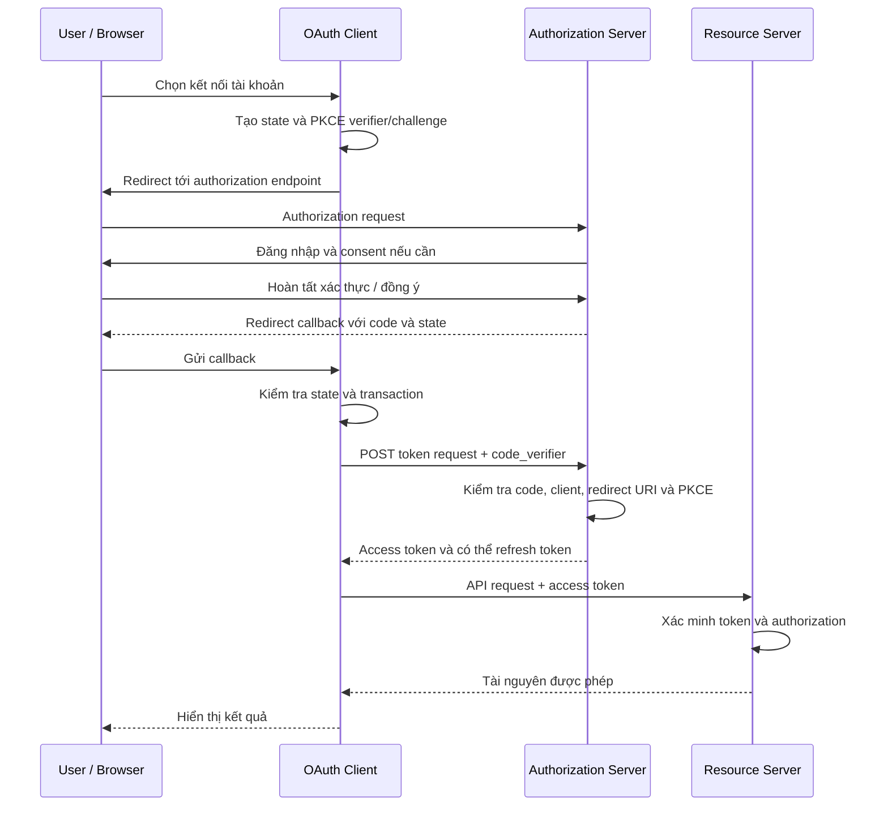

# Authorization code — Luồng cấp quyền bằng mã ủy quyền

## 1. Authorization Code là gì?

**Authorization Code Grant** (luồng cấp quyền bằng mã ủy quyền) là một luồng OAuth 2.0 trong đó ứng dụng chuyển người dùng tới Authorization Server để họ đăng nhập và cấp quyền truy cập, nhận một **authorization code** qua redirect, rồi đổi code lấy token tại token endpoint. Code chỉ là mã dùng một lần, có thời hạn ngắn; nó không phải access token và không được dùng trực tiếp để gọi API.

Ví dụ: người dùng muốn ứng dụng quản lý ảnh của bên thứ ba đọc album từ dịch vụ lưu trữ. Ứng dụng chuyển browser tới Authorization Server của dịch vụ lưu trữ. Người dùng đăng nhập và đồng ý cấp quyền đọc album. Authorization Server chuyển browser về callback đã đăng ký kèm authorization code. Backend của ứng dụng gửi code tới token endpoint, xác thực client theo loại ứng dụng và nhận access token. Ứng dụng dùng access token để gọi API album trong phạm vi được cấp.

Trong mô-đun **SECURITY_AUTHENTICATION_FUNDAMENTALS**, Authorization Code nối kết quả xác thực ở IdP với token, session, federation và authorization. OAuth ủy quyền quyền truy cập tài nguyên; bản thân OAuth không định nghĩa giao thức đăng nhập người dùng. Khi cần thông tin xác thực danh tính, hệ thống thường dùng OpenID Connect (OIDC) xây trên OAuth 2.0.

### Mục tiêu học tập

Sau bài này, người học có thể:

- Giải thích vai trò của authorization code và các thành phần OAuth.
- Mô tả đầy đủ luồng Authorization Code từ authorization request tới token exchange.
- Phân biệt public client và confidential client.
- Giải thích PKCE, state, redirect URI và cách chúng giảm các kiểu tấn công khác nhau.
- Kiểm tra access token theo audience, scope, issuer và thời hạn ở resource server.
- Phân biệt OAuth authorization với OIDC authentication.
- Nhận diện code interception, injection, replay, redirect abuse, mix-up và rò rỉ token.
- Thiết kế luồng cho web app, SPA và native app với vòng đời token phù hợp.

## 2. Các vai trò trong Authorization Code Flow

| Thành phần | Vai trò |
|---|---|
| Resource Owner | Chủ thể có quyền cấp quyền truy cập tài nguyên; thường là người dùng |
| Client | Ứng dụng muốn truy cập tài nguyên thay mặt resource owner |
| Authorization Server (AS) | Xác thực người dùng, thu thập consent/chính sách và phát hành authorization code/token |
| Resource Server (RS) | API bảo vệ tài nguyên và kiểm tra access token |
| User Agent | Browser hoặc trình duyệt hệ thống chuyển hướng giữa client và AS |
| Redirect URI / callback | Endpoint đã đăng ký để AS trả kết quả authorization về client |
| Token Endpoint | Endpoint client dùng đổi authorization code lấy token |

Ví dụ: một ứng dụng lịch muốn đọc lịch của người dùng. Người dùng là Resource Owner, ứng dụng lịch là Client, nhà cung cấp lịch vận hành Authorization Server và Resource Server, browser là User Agent. Địa chỉ callback như `https://calendar-app.example/callback` phải được đăng ký; token endpoint là nơi client đổi code lấy token.

Client không cần biết mật khẩu của người dùng tại dịch vụ lịch. Người dùng đăng nhập trực tiếp tại Authorization Server; client chỉ nhận kết quả ủy quyền theo giao thức.

## 3. Luồng Authorization Code tổng quát



Luồng có hai kênh chính:

1. **Front channel:** browser được redirect tới Authorization Server rồi quay lại callback. Authorization code xuất hiện trong response của browser.
2. **Back channel:** client gọi token endpoint trực tiếp qua TLS để đổi code lấy token. Access token không cần đi qua URL của browser trong luồng web server thông thường.

Tách code khỏi access token giúp giảm việc phát tán token qua browser history, URL, referrer và log của các thành phần trung gian. Tuy nhiên, code vẫn là credential nhạy cảm; phải bảo vệ callback và đổi code đúng cách.

## 4. Các bước chi tiết

### Bước 1 — Đăng ký client

Trước khi dùng OAuth, client được đăng ký với Authorization Server. Cấu hình thường gồm:

- `client_id` do Authorization Server cấp.
- Loại client: public hay confidential.
- Redirect URI chính xác được phép.
- Grant type và response type được phép.
- Cách xác thực client tại token endpoint nếu là confidential client.
- Scope và resource/audience được phép yêu cầu.
- Chính sách refresh token, consent, logout và các ràng buộc bổ sung.

Client ID là định danh công khai, không phải bí mật. Client secret là credential của confidential client và phải được bảo vệ như bí mật.

### Bước 2 — Tạo authorization request

Khi người dùng chọn “Kết nối tài khoản”, client tạo transaction đăng nhập và chuyển browser tới authorization endpoint. Request Authorization Code thường có các tham số:

| Tham số | Mục đích |
|---|---|
| `response_type=code` | Yêu cầu authorization code |
| `client_id` | Xác định client đã đăng ký |
| `redirect_uri` | Địa chỉ callback đã đăng ký |
| `scope` | Quyền truy cập được yêu cầu |
| `state` | Liên kết callback với transaction/browser session và chống CSRF |
| `code_challenge` | Giá trị PKCE được tạo từ code verifier |
| `code_challenge_method=S256` | Chỉ rõ dùng SHA-256 cho PKCE |
| `resource` (nếu hỗ trợ) | Chỉ định resource/audience mà token được yêu cầu dành cho |

`state` phải khó đoán, gắn với browser session hoặc transaction đang chờ và được kiểm tra ở callback. Không dùng một giá trị cố định cho mọi lần đăng nhập.

### Bước 3 — Người dùng xác thực và cấp quyền

Authorization Server xác định người dùng bằng cơ chế của mình: mật khẩu, MFA, passkey, chứng chỉ, federation hoặc session hiện có. OAuth không quy định phải dùng yếu tố nào.

Sau khi xác thực, Authorization Server áp dụng consent và policy:

- Client nào đang yêu cầu quyền?
- Scope nào được yêu cầu?
- Người dùng có quyền cấp những scope đó không?
- Có cần step-up/MFA hoặc xác thực lại không?
- Có policy theo tenant, thiết bị, risk hoặc resource không?

Người dùng có thể chấp thuận một phần hoặc từ chối. Client phải xử lý cả kết quả thành công lẫn lỗi/denial.

### Bước 4 — Authorization Server trả code

Nếu yêu cầu được chấp thuận, Authorization Server chuyển browser về redirect URI đã đăng ký, thường với `code` và `state`.

Authorization code phải:

- Được sinh ngẫu nhiên, không chứa thông tin cá nhân hoặc token có thể suy ra.
- Có thời hạn ngắn.
- Chỉ dùng một lần.
- Gắn với client đã yêu cầu.
- Gắn với redirect URI tương ứng theo giao thức.
- Gắn với PKCE challenge nếu request đã dùng PKCE.

Code là dữ liệu nhạy cảm. Không ghi code vào application log, analytics, crash report hoặc gửi qua kênh không được bảo vệ.

### Bước 5 — Client kiểm tra callback

Khi callback đến, client cần:

1. Tìm transaction đăng nhập tương ứng với browser session.
2. So sánh `state` trả về với giá trị đã lưu; từ chối nếu thiếu hoặc không khớp.
3. Kiểm tra lỗi OAuth như `access_denied` sau khi đã xác minh transaction.
4. Xác minh response đến từ Authorization Server dự kiến; với nhiều issuer cần chống mix-up.
5. Kiểm tra transaction chưa hết hạn/chưa được dùng và redirect/callback đúng luồng.
6. Chỉ sau đó mới dùng code để gọi token endpoint.

Không nhận `state` do client gửi rồi so sánh với chính giá trị đó; expected state phải đến từ transaction đã lưu trước khi redirect.

### Bước 6 — Đổi code lấy token

Client gửi HTTP POST qua TLS tới token endpoint. Request thường có:

- `grant_type=authorization_code`
- `code`
- `redirect_uri` giống URI đã dùng ở authorization request
- `client_id` khi profile yêu cầu
- `code_verifier` nếu đã dùng PKCE
- Client authentication nếu là confidential client, theo phương thức đã đăng ký

Authorization Server kiểm tra code còn hạn/chưa dùng, client phù hợp, redirect URI phù hợp, PKCE verifier đúng và client authentication hợp lệ nếu cần. Khi thành công, AS trả access token và có thể trả refresh token.

### Bước 7 — Gọi Resource Server

Client gửi access token tới API qua header `Authorization: Bearer ...` nếu token type là Bearer. Resource Server phải kiểm tra token theo loại token và chính sách của mình, gồm issuer, audience/resource, thời hạn, scope/permission và trạng thái thu hồi khi cần.

Không chỉ kiểm tra token “có tồn tại” hoặc decode JWT rồi tin payload. Token hợp lệ nhưng sai audience hoặc scope không được chấp nhận cho API hiện tại.

## 5. PKCE — bảo vệ authorization code

**Proof Key for Code Exchange (PKCE)** bổ sung một bí mật tạm thời cho từng authorization transaction, giúp ngăn attacker đổi một authorization code bị chặn lấy token nếu họ không có code verifier.

PKCE đặc biệt quan trọng với public client như SPA và native app, vì các ứng dụng này không thể giữ client secret lâu dài một cách đáng tin. Hiện nay nên dùng PKCE với Authorization Code cho cả public và confidential client.

### Cách tạo PKCE

1. Client sinh `code_verifier` ngẫu nhiên, độ dài 43–128 ký tự theo tập ký tự được chuẩn cho phép.
2. Tạo `code_challenge = BASE64URL(SHA256(ASCII(code_verifier)))`, bỏ padding `=`.
3. Gửi `code_challenge` và `code_challenge_method=S256` ở authorization request.
4. Khi đổi code, gửi `code_verifier` tại token endpoint.
5. Authorization Server tính lại challenge và so sánh với challenge đã gắn với code.

```text
code_verifier  = random high-entropy string
code_challenge = BASE64URL-ENCODE(SHA256(code_verifier))

Authorization request:
  code_challenge=<code_challenge>
  code_challenge_method=S256

Token request:
  code_verifier=<original code_verifier>
```

Không dùng `plain` nếu có thể dùng `S256`. Không tự đặt verifier dựa trên username, timestamp, session ID hoặc chuỗi cố định.

### PKCE ngăn điều gì?

Giả sử attacker lấy được authorization code từ callback URL, browser history, log hoặc ứng dụng native bị cấu hình sai. Attacker vẫn không thể đổi code nếu không có verifier đã được client giữ trong transaction ban đầu. PKCE ràng buộc code với client instance đã tạo request.

PKCE không thay thế:

- `state` để chống CSRF và liên kết callback với browser transaction.
- Client authentication cho confidential client.
- Kiểm tra issuer, redirect URI, audience hoặc scope.
- Bảo vệ endpoint callback và chống XSS/malware trên chính client.

Nếu attacker chiếm được cả code lẫn verifier hoặc kiểm soát browser/session của client, PKCE không còn đủ để bảo vệ.

## 6. State, nonce và issuer binding

Các giá trị này có mục tiêu khác nhau và không nên dùng thay thế lẫn nhau.

| Cơ chế | Dùng ở đâu | Bảo vệ chính |
|---|---|---|
| `state` | OAuth authorization request và callback | Liên kết response với transaction/browser session, giảm CSRF và login CSRF |
| PKCE | Authorization request và token exchange | Chứng minh client giữ verifier tương ứng với challenge, giảm code interception |
| `nonce` | OpenID Connect authentication request và ID token | Liên kết ID token với request, giảm token substitution/replay |
| `iss` response parameter hoặc issuer-specific callback | Federation/multi-issuer flow khi hỗ trợ | Giúp xác định authorization response đến từ issuer nào, giảm mix-up |

Trong OAuth thuần, `nonce` không phải tham số bắt buộc chung của Authorization Code Flow; nó thuộc OIDC khi được dùng theo profile. Nếu ứng dụng dùng OIDC, phải tạo và kiểm tra nonce theo giao thức.

### Vì sao cần issuer binding?

Một client hỗ trợ nhiều Authorization Server có thể bị lừa gửi authorization response từ issuer A vào transaction của issuer B. Nếu client gửi code tới token endpoint sai hoặc xác minh token bằng khóa sai, có thể xảy ra OAuth mix-up.

Biện pháp:

- Gắn issuer đã chọn vào transaction server-side trước redirect.
- Kiểm tra issuer trong authorization response theo cơ chế được hỗ trợ (ví dụ `iss` response parameter theo RFC 9207) hoặc dùng redirect URI riêng cho từng issuer.
- Chỉ đổi code tại token endpoint của issuer gắn với transaction đó.
- Không lấy issuer/JWKS/token endpoint từ query parameter không đáng tin.

## 7. Public client và confidential client

| Đặc điểm | Confidential client | Public client |
|---|---|---|
| Có thể bảo vệ credential lâu dài? | Có, nếu môi trường server được quản lý đúng | Không thể bảo đảm giữ bí mật client secret |
| Ví dụ | Web app có backend, service chạy server-side | SPA chạy trong browser, mobile/desktop app |
| Client authentication | Thường xác thực ở token endpoint bằng phương thức đã đăng ký | Không dựa vào client secret tĩnh |
| PKCE | Nên dùng | Phải dùng trong triển khai hiện đại |
| Nơi lưu token | Backend/secure server-side storage khi phù hợp | Bộ nhớ/secure storage theo nền tảng và threat model |

### Web application có backend

Đây thường là mô hình phù hợp cho ứng dụng web nhạy cảm:

- Browser chỉ nhận cookie session của ứng dụng.
- Backend giữ client secret và PKCE verifier.
- Backend thực hiện code exchange và quản lý token.
- Access/refresh token không cần được đưa vào JavaScript của browser.
- Backend kiểm tra session và authorization trên mỗi request.

### SPA

SPA là public client: mọi secret nhúng trong JavaScript có thể bị người dùng hoặc attacker đọc. SPA dùng Authorization Code + PKCE, redirect URI chính xác và kiểm soát lưu token. Ưu tiên giữ access token trong memory khi khả thi; tránh localStorage cho token dài hạn vì XSS có thể đọc dữ liệu. Nếu dùng backend-for-frontend (BFF), browser có thể chỉ giữ cookie session còn token nằm ở backend.

### Native app

Native app nên mở browser hệ thống hoặc user-agent ngoài ứng dụng để người dùng xác thực với IdP. Dùng Authorization Code + PKCE. Không nhúng client secret vào binary và không dùng embedded webview làm nơi đăng nhập IdP vì ứng dụng có thể quan sát credential/session của người dùng.

Redirect về app có thể dùng claimed HTTPS link/universal link hoặc loopback redirect theo hướng dẫn nền tảng. Custom URI scheme có thể bị ứng dụng khác đăng ký trùng; PKCE giúp giảm nguy cơ code interception nhưng vẫn cần chọn redirect mechanism an toàn.

## 8. Redirect URI và callback an toàn

Redirect URI xác định nơi Authorization Server gửi authorization response. Đây là một ranh giới bảo mật quan trọng vì code được chuyển qua browser.

Nguyên tắc:

- Đăng ký redirect URI chính xác và so khớp theo quy tắc của Authorization Server.
- Tránh wildcard rộng, domain do người dùng điều khiển hoặc open redirect.
- Không chuyển tiếp code tới URL lấy từ query parameter.
- Dùng HTTPS cho callback web production.
- Không dùng URI fragment để nhận authorization code.
- Giữ transaction/state và issuer binding khi xử lý callback.
- Với native app, dùng redirect pattern được nền tảng và OAuth best practice hỗ trợ.

### Open redirect

Nếu callback hợp lệ của client có chức năng redirect tiếp tới URL tùy ý, attacker có thể lợi dụng để chuyển browser tới domain của họ kèm code hoặc dữ liệu callback. Callback nên kết thúc luồng, xóa code khỏi URL sau khi xử lý và chỉ redirect tới đường dẫn nội bộ đã allowlist.

### Rò rỉ code qua URL

Authorization code thường xuất hiện trong query string của callback. Vì URL có thể được ghi vào access log, browser history, monitoring và `Referer`, callback nên:

- Không tải third-party script/image/analytics trước khi xử lý code.
- Dùng `Referrer-Policy: no-referrer` hoặc policy chặt phù hợp.
- Redact query parameter nhạy cảm ở reverse proxy, APM và log.
- Xử lý code ngay rồi chuyển sang URL sạch bằng redirect nội bộ.
- Không đưa code vào thông báo lỗi hoặc telemetry.

## 9. Authorization code phải được bảo vệ thế nào?

Authorization code là credential tạm thời nhưng vẫn có thể bị đánh cắp và sử dụng nếu các ràng buộc không đủ mạnh.

| Thuộc tính | Yêu cầu |
|---|---|
| Ngẫu nhiên | Không thể đoán hoặc suy ra từ dữ liệu người dùng |
| Thời hạn | Ngắn; chỉ đủ cho browser quay về và client đổi code |
| Sử dụng | Một lần; đổi thành công phải tiêu thụ code nguyên tử |
| Client binding | Chỉ client đã yêu cầu mới được đổi code |
| Redirect binding | Token request phải khớp redirect URI theo quy tắc giao thức |
| PKCE binding | Verifier phải khớp challenge đã lưu với authorization request |
| Bảo vệ truyền tải | Token endpoint qua TLS; code không xuất hiện ở log công khai |
| Replay protection | Từ chối code đã dùng, hết hạn hoặc không thuộc transaction |

Nếu hai request đồng thời đổi cùng một code, chỉ một request được thành công. Authorization Server cần bảo đảm việc đánh dấu code đã sử dụng là nguyên tử để tránh race condition.

## 10. Token response và sử dụng access token

Một token response có thể có dạng khái niệm:

```json
{
  "access_token": "opaque-or-signed-token",
  "token_type": "Bearer",
  "expires_in": 900,
  "refresh_token": "optional-refresh-token",
  "scope": "calendar.read"
}
```

Các trường phụ thuộc Authorization Server và grant/policy; không phải response nào cũng có refresh token. Token endpoint nên trả header `Cache-Control: no-store` và `Pragma: no-cache` theo yêu cầu bảo vệ token response.

### Access token

Access token đại diện quyền truy cập được cấp cho client. Nó có thể là opaque token hoặc token tự chứa như JWT. Resource Server phải biết cách xác minh loại token đang nhận:

- Với JWT: kiểm tra chữ ký bằng khóa tin cậy, thuật toán allowlist, issuer, audience, thời hạn, scope/claim và các policy khác.
- Với opaque token: có thể dùng introspection hoặc cơ chế tra cứu trạng thái được Authorization Server hỗ trợ.
- Kiểm tra token có dành cho đúng API/resource không.
- Kiểm tra quyền trên hành động/tài nguyên cụ thể; scope không thay thế authorization chi tiết.

Không đặt access token trong query string. Gửi qua TLS trong header Authorization theo token type được định nghĩa.

### Refresh token

Refresh token là credential có giá trị cao vì có thể xin access token mới. Nếu được phát hành:

- Lưu ở nơi bảo vệ phù hợp với loại client.
- Với public client, dùng refresh token rotation hoặc sender-constrained refresh token theo chính sách.
- Phát hiện refresh token cũ bị sử dụng lại và xử lý token family.
- Giới hạn thời hạn, scope, client và khả năng thu hồi.
- Thu hồi khi logout, user offboard hoặc phát hiện compromise theo policy.

### Token audience và resource

Một access token dành cho `calendar-api` không mặc nhiên được `payroll-api` chấp nhận. Resource Server phải kiểm tra audience/resource. Không dùng một access token quyền rộng cho mọi dịch vụ nếu có thể cấp token theo từng resource và scope tối thiểu.

## 11. OAuth không đồng nghĩa với đăng nhập: vai trò của OIDC

OAuth 2.0 là framework **ủy quyền**. Authorization Code Flow cho phép client nhận access token để gọi resource server. Nó không định nghĩa một chuẩn chung để client biết người dùng là ai.

OpenID Connect bổ sung lớp authentication trên OAuth:

- Client yêu cầu scope `openid`.
- Authorization Server/OP phát hành ID token.
- RP xác minh chữ ký, `iss`, `aud`, `exp`, `nonce` và các điều kiện OIDC.
- Claim `sub` định danh người dùng trong phạm vi issuer.
- RP có thể tạo local session sau khi xác minh ID token.

Phân biệt:

| Thành phần | Dùng cho |
|---|---|
| Authorization code | Đổi lấy token; không phải bằng chứng danh tính dùng trực tiếp |
| Access token | Gọi Resource Server trong scope/audience được cấp |
| ID token | Thông tin xác thực người dùng dành cho OIDC client |
| Refresh token | Xin access token mới theo policy |

Không gửi ID token cho API như access token. Không lấy tên/email từ access token một cách tùy tiện để coi đó là danh tính đã xác minh; chỉ sử dụng claim theo giao thức và token profile tương ứng.

## 12. Các kiểu tấn công và biện pháp phòng chống

| Tấn công/lỗi | Cách xảy ra | Biện pháp |
|---|---|---|
| Authorization code interception | Attacker lấy code từ callback, log, browser history hoặc custom URI scheme | PKCE S256, redirect an toàn, redaction và xử lý callback sạch |
| Code injection | Code của attacker được chèn vào transaction của nạn nhân | PKCE, state, request correlation, issuer binding |
| CSRF / login CSRF | Attacker khiến browser gửi callback không gắn với login transaction của nạn nhân | State ngẫu nhiên, gắn browser session và kiểm tra một lần |
| OAuth mix-up | Response từ issuer khác bị xử lý theo transaction/token endpoint sai | Issuer binding, iss response parameter hoặc redirect URI riêng |
| Redirect URI manipulation | Code bị chuyển tới endpoint attacker kiểm soát | Exact redirect URI, không wildcard rộng, không open redirect |
| Authorization code replay | Code đã đổi bị dùng lại | Code one-time, TTL ngắn, consume nguyên tử |
| PKCE downgrade | Client chấp nhận thiếu PKCE hoặc phương thức yếu | Bắt buộc PKCE S256 theo policy, từ chối request thiếu challenge |
| Client secret exposure | Secret nhúng trong SPA/mobile binary hoặc log | Không dùng secret cho public client; secret chỉ ở backend/secret manager |
| Token leakage | Token bị ghi log, lưu localStorage, URL hoặc crash report | Redaction, storage phù hợp, TTL, rotation và least privilege |
| Audience confusion | API nhận token phát hành cho resource khác | Kiểm tra audience/resource và scope |
| Open redirect | Callback redirect tiếp tới domain không tin cậy | Allowlist destination nội bộ, không redirect tùy ý |
| Refresh token replay | Refresh token bị đánh cắp và dùng lại | Rotation, reuse detection, revoke token family/sender constraint |

### OAuth phishing và consent abuse

Attacker có thể dựng ứng dụng giả để người dùng cấp quyền cho scope quá rộng, hoặc dụ người dùng đăng nhập trên trang giả. Cần hiển thị tên ứng dụng/nhà phát triển và quyền được yêu cầu rõ ràng, giảm scope, hạn chế client registration, theo dõi consent bất thường và cung cấp cách thu hồi quyền đã cấp.

PKCE bảo vệ authorization code trong luồng đổi token; nó không chứng minh ứng dụng xin scope có mục đích tốt. Người dùng và tổ chức vẫn cần kiểm soát consent và danh tính client.

## 13. Ví dụ Java tạo state và PKCE S256

Ví dụ sau dùng `SecureRandom` để tạo giá trị ngẫu nhiên và `MessageDigest` để tạo PKCE challenge. Trong web app có backend, lưu `state` và `codeVerifier` trong transaction phía server, gắn với browser session và issuer/client/redirect URI:

```java
import java.nio.charset.StandardCharsets;
import java.security.MessageDigest;
import java.security.SecureRandom;
import java.util.Base64;

final class OAuthPkce {
    private static final SecureRandom RANDOM = new SecureRandom();

    static String randomUrlSafeValue(int bytes) {
        byte[] value = new byte[bytes];
        RANDOM.nextBytes(value);
        return Base64.getUrlEncoder()
                .withoutPadding()
                .encodeToString(value);
    }

    static String newState() {
        return randomUrlSafeValue(32);
    }

    static String newCodeVerifier() {
        // 32 bytes tạo chuỗi Base64URL không padding dài 43 ký tự.
        return randomUrlSafeValue(32);
    }

    static String s256Challenge(String verifier)
            throws java.security.NoSuchAlgorithmException {
        byte[] digest = MessageDigest.getInstance("SHA-256")
                .digest(verifier.getBytes(StandardCharsets.US_ASCII));
        return Base64.getUrlEncoder()
                .withoutPadding()
                .encodeToString(digest);
    }
}
```

Sử dụng:

```java
String state = OAuthPkce.newState();
String verifier = OAuthPkce.newCodeVerifier();
String challenge = OAuthPkce.s256Challenge(verifier);

// Lưu state, verifier, issuer, clientId, redirectUri và thời hạn
// trong server-side login transaction gắn với browser session.
// Authorization request gửi challenge và code_challenge_method=S256.
// Callback phải kiểm tra state trước khi đổi code.
// Token request gửi verifier tương ứng với transaction đó.
```

Đây là phần tạo giá trị, chưa phải OAuth client hoàn chỉnh. Khi triển khai:

- Tạo transaction có TTL và trạng thái one-time; xóa/tiêu thụ sau callback hợp lệ.
- Dùng URL builder để encode tham số, không nối chuỗi query tùy tiện.
- Giữ `code_verifier` bí mật; không gửi nó qua browser redirect hoặc log.
- Lưu issuer/token endpoint lấy từ cấu hình tin cậy, không lấy từ callback.
- Dùng thư viện OAuth/OIDC được duy trì để thực hiện token exchange và validation.
- Với confidential client, thực hiện client authentication tại token endpoint; PKCE không thay thế việc đó.

## 14. Ví dụ request/response ở mức giao thức

Authorization request minh họa:

```http
GET /authorize?
  response_type=code&
  client_id=photo-app&
  redirect_uri=https%3A%2F%2Fapp.example%2Foauth%2Fcallback&
  scope=photos.read&
  state=RANDOM_STATE&
  code_challenge=BASE64URL_SHA256_CHALLENGE&
  code_challenge_method=S256
Host: id.example
```

Callback minh họa:

```http
GET /oauth/callback?code=ONE_TIME_CODE&state=RANDOM_STATE
Host: app.example
```

Token request minh họa:

```http
POST /token HTTP/1.1
Host: id.example
Content-Type: application/x-www-form-urlencoded
Authorization: Basic <client-authentication-if-required>

grant_type=authorization_code&
code=ONE_TIME_CODE&
redirect_uri=https%3A%2F%2Fapp.example%2Foauth%2Fcallback&
code_verifier=ORIGINAL_CODE_VERIFIER
```

Các request trên là ví dụ rút gọn; trong thực tế cần URL encoding đúng, TLS, client authentication phù hợp, state/transaction validation và header bảo vệ. Không đưa dấu ngoặc hoặc placeholder vào request production.

## 15. Kiểm thử Authorization Code Flow

| Ca kiểm thử | Kết quả mong đợi |
|---|---|
| Code hợp lệ, state đúng, PKCE verifier đúng | Token exchange thành công |
| State thiếu hoặc sai | Callback bị từ chối; không đổi code |
| Code đã dùng | Token endpoint từ chối |
| Code hết hạn | Token endpoint từ chối |
| Code thuộc client khác | Token endpoint từ chối |
| Redirect URI khác URI đã dùng | Token endpoint từ chối theo binding |
| PKCE verifier sai | Token endpoint từ chối |
| Authorization request thiếu PKCE khi policy bắt buộc | Authorization Server từ chối |
| Sai issuer/mix-up | Client từ chối callback trước khi đổi code |
| Callback có error và state hợp lệ | Xử lý lỗi đúng transaction, không tạo session đăng nhập |
| Redirect URI mở redirect tới domain ngoài | Kiểm thử phải thất bại |
| Code xuất hiện trong log/analytics | Không được ghi; phải redact |
| Access token sai audience | Resource Server từ chối |
| Scope không đủ | Resource Server từ chối hành động |
| Refresh token cũ bị replay sau rotation | Phát hiện reuse và xử lý token family theo policy |
| Client secret đặt trong SPA/mobile binary | Kiểm thử kiến trúc không đạt |

### Quan sát và audit

Có thể ghi correlation ID, client ID, issuer, redirect URI đã chuẩn hóa, scope được cấp, kết quả validation và lý do từ chối. Không ghi authorization code, code verifier, client secret, access token, refresh token, cookie hoặc toàn bộ callback URL chứa code.

Theo dõi tỷ lệ state mismatch, PKCE failure, code replay, redirect mismatch, token exchange error, issuer/key rotation và refresh token reuse. Dữ liệu log cần đủ để điều tra nhưng không trở thành nơi tập trung credential.

## 16. Checklist triển khai

- [ ] Dùng Authorization Code Flow; không dùng implicit flow cho ứng dụng mới.
- [ ] Dùng PKCE với S256 cho cả public và confidential client.
- [ ] state ngẫu nhiên, gắn transaction/browser session và kiểm tra một lần.
- [ ] Với OIDC, tạo và kiểm tra nonce theo đúng flow.
- [ ] Client có loại public/confidential được khai báo chính xác.
- [ ] Không nhúng client secret vào SPA, mobile hoặc desktop binary.
- [ ] Redirect URI được đăng ký chính xác; không wildcard rộng/open redirect.
- [ ] Gắn issuer và token endpoint vào transaction tin cậy; chống mix-up.
- [ ] Authorization code ngắn hạn, dùng một lần, ràng buộc client/redirect/PKCE.
- [ ] Token exchange qua HTTPS POST; client authentication đúng loại.
- [ ] Access token có audience/resource và scope tối thiểu.
- [ ] Resource Server xác minh token theo đúng loại và kiểm tra authorization riêng.
- [ ] Refresh token được bảo vệ, rotation/reuse detection và revoke phù hợp.
- [ ] Callback không tải third-party resource trước khi xử lý code; URL/log được làm sạch.
- [ ] Không log code, verifier, secret, token hoặc cookie.
- [ ] Có kiểm thử state, PKCE, replay, issuer, audience, redirect và logout.

## 17. Tổng kết

Authorization Code Flow cho phép client nhận một authorization code qua browser redirect rồi đổi code lấy token qua back channel. Code có thời hạn ngắn, dùng một lần và được ràng buộc với client, redirect URI và PKCE. **PKCE S256, state, redirect URI chính xác và issuer binding** bảo vệ các phần khác nhau của luồng; không cơ chế đơn lẻ nào thay thế toàn bộ các kiểm tra còn lại.

OAuth 2.0 tập trung vào ủy quyền truy cập tài nguyên. Nếu ứng dụng cần xác thực danh tính người dùng, hãy dùng OIDC và xác minh ID token theo giao thức; API vẫn phải nhận access token đúng audience/scope. Một triển khai an toàn còn cần quản lý session, token, refresh, consent, logout, thu hồi và vòng đời client xuyên suốt.
