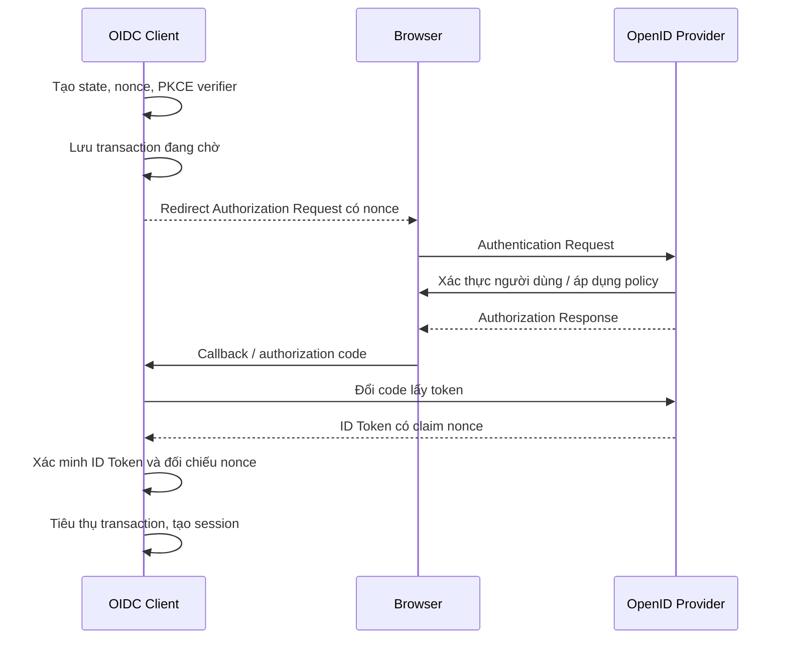

# Nonce trong OIDC

Trong OpenID Connect (OIDC), **nonce** là một giá trị do client tạo trong Authentication Request để liên kết ID Token nhận được với đúng giao dịch đăng nhập đã bắt đầu. OpenID Provider (OP) đưa nguyên giá trị nonce vào claim `nonce` của ID Token nếu tham số này được gửi trong request. Client kiểm tra claim đó có khớp với nonce đang chờ hay không trước khi chấp nhận kết quả xác thực.

Nonce giúp giảm nguy cơ **replay ID Token** và nhầm lẫn giữa các giao dịch đăng nhập. Nó đặc biệt quan trọng khi có nhiều tab, nhiều phiên đăng nhập đồng thời, redirect qua browser hoặc các luồng OIDC trả ID Token qua front channel. Nonce không thay thế chữ ký, issuer, audience, state, PKCE, kiểm tra session hay authorization.

Bài học thuộc chương **OpenID Connect** của module **SECURITY_AUTHENTICATION_FUNDAMENTALS**. Người học cần hiểu vai trò nonce trong việc ràng buộc authentication transaction, cách tạo giá trị khó đoán, lưu và tiêu thụ một lần, xác minh claim trong ID Token, phân biệt nonce với state/PKCE và xử lý replay, login CSRF, mix-up cùng các tình huống đồng thời.

## 1. Nonce là gì?

Nonce là viết tắt thường dùng của *number used once*. Trong OIDC, nó là một chuỗi do client tạo cho một yêu cầu xác thực cụ thể. Client gửi nonce tới OpenID Provider trong Authentication Request; nếu request có nonce, OP đưa giá trị đó vào ID Token phát hành cho giao dịch.

Ví dụ, ứng dụng bắt đầu đăng nhập cho browser session hiện tại:

```text
nonce = "J4v6...random-value..."
```

Client gửi giá trị này trong request tới authorization endpoint:

```http
GET /authorize?
  response_type=code&
  client_id=learning-web&
  redirect_uri=https%3A%2F%2Fapp.example.org%2Foidc%2Fcallback&
  scope=openid%20profile&
  state=st_opaque_value&
  nonce=n_opaque_value&
  code_challenge=challenge_value&
  code_challenge_method=S256
Host: id.example.org
```

Sau khi xác thực người dùng và hoàn tất flow, OP phát hành ID Token có claim:

```json
{
  "iss": "https://id.example.org",
  "sub": "user-57",
  "aud": "learning-web",
  "iat": 1795320000,
  "exp": 1795320600,
  "nonce": "n_opaque_value"
}
```

Các giá trị chỉ minh họa. Client phải xác minh chữ ký và các claim OIDC khác trước khi tin payload; sau đó so sánh chính xác claim `nonce` với giá trị đã lưu cho đúng giao dịch.

### 1.1. Nonce liên kết hai đầu của một giao dịch



Client đã tạo nonce trước khi chuyển browser tới OP. Khi nhận ID Token, client chỉ chấp nhận nếu token chứng minh được nó thuộc về giao dịch đang chờ. Một ID Token có chữ ký hợp lệ nhưng chứa nonce khác vẫn phải bị từ chối.

### 1.2. Nonce nằm ở đâu?

Nonce có hai vị trí với hai vai trò:

- **Authentication Request parameter `nonce`:** client gửi tới OP; giá trị được ràng buộc với yêu cầu xác thực.
- **ID Token claim `nonce`:** OP trả lại trong ID Token; client dùng để kiểm tra token thuộc giao dịch nào.

Nonce không phải access token, session cookie, password, signing key hoặc claim cấp quyền. Nó không nên được dùng làm định danh user hay lưu như một bí mật lâu dài.

## 2. Vì sao cần nonce?

Một ID Token là bằng chứng xác thực được OP phát hành. Nếu client chỉ kiểm tra chữ ký và thời hạn mà không liên kết token với giao dịch hiện tại, một token cũ vẫn có thể được đưa lại trong ngữ cảnh không phù hợp nếu các điều kiện khác cho phép.

Nonce giúp client phát hiện một số tình huống:

- ID Token được lấy từ một giao dịch đăng nhập khác.
- ID Token cũ bị phát lại vào callback hoặc transaction mới.
- Response bị gắn nhầm giữa các tab hoặc các lần đăng nhập đồng thời.
- Một luồng đăng nhập bị trộn với một giao dịch khác (*login/response mix-up*).
- Client nhận ID Token không phản ánh Authentication Request mà nó đang xử lý.

Nonce có ích vì client không chỉ hỏi “token có được issuer ký không?” mà còn hỏi “token này có được phát hành cho đúng yêu cầu mà client vừa khởi tạo không?”.

### 2.1. Ví dụ replay

Giả sử người dùng đã đăng nhập thành công lúc 09:00. Client tạo nonce `N1`; OP trả ID Token có claim `nonce=N1`. Sau đó attacker lấy được ID Token và thử gửi lại trong một giao dịch đăng nhập mới có nonce `N2`.

Nếu client kiểm tra nonce, token cũ có `N1` không khớp với transaction đang chờ `N2`, nên bị từ chối. Nếu client bỏ qua nonce, token có thể vượt qua một phần kiểm tra nếu chữ ký, issuer, audience và expiry vẫn còn hợp lệ, tùy cách flow và session được xử lý.

Nonce không tự chặn việc đánh cắp cookie/session sau đăng nhập, cũng không làm access token mất hiệu lực. Nó bảo vệ **liên kết giữa authentication request và ID Token**.

## 3. Tạo nonce an toàn

Client phải tạo nonce bằng **cryptographically secure random number generator (CSPRNG)**. Không dùng giá trị tuần tự, timestamp, email, user ID, số phiên hoặc hash của dữ liệu có thể đoán.

Khuyến nghị thực hành:

- Có ít nhất 128 bit entropy ngẫu nhiên; 256 bit là lựa chọn thuận tiện nếu không có giới hạn giao thức.
- Mã hóa bằng Base64URL hoặc định dạng chuỗi an toàn theo giao thức.
- Tạo nonce mới cho từng authentication transaction.
- Không tái sử dụng nonce giữa các tab, user, client hoặc lần đăng nhập.
- Không dùng nonce làm khóa bí mật hoặc làm seed cho HMAC.
- Tránh đưa nonce vào application log, analytics hoặc telemetry nếu không cần.

Ví dụ pseudocode:

```text
createLoginTransaction(browserContext):
    nonceBytes = secureRandomBytes(32)       # 256 bit
    stateBytes = secureRandomBytes(32)
    verifierBytes = secureRandomBytes(32)

    nonce = base64urlNoPadding(nonceBytes)
    state = base64urlNoPadding(stateBytes)
    codeVerifier = base64urlNoPadding(verifierBytes)
    codeChallenge = BASE64URL(SHA256(ASCII(codeVerifier)))

    transaction = {
        nonce: nonce,
        stateHash: SHA256(UTF8(state)),
        codeVerifier: codeVerifier,
        createdAt: nowUtc(),
        expiresAt: nowUtc() + shortTransactionLifetime,
        status: "pending",
        browserBinding: browserContext.id
    }

    storeTransaction(transaction)
    return authorizationRequest(state, nonce, codeChallenge)
```

Đây là pseudocode khái niệm. Cần dùng API CSPRNG của nền tảng và thư viện OIDC/PKCE đã được kiểm thử. `state`, `nonce` và `codeVerifier` phải là các giá trị độc lập, không lấy một giá trị rồi dùng lại cho cả ba mục đích.

### 3.1. Nonce có cần bí mật không?

Nonce cần khó đoán và gắn với giao dịch, nhưng không phải shared secret để xác minh chữ ký. Nó xuất hiện trong Authentication Request gửi tới OP và sau đó trong ID Token. Vì vậy không thể dựa vào việc giữ nonce bí mật khỏi OP.

Điều quan trọng là attacker không thể tự dự đoán hoặc tự tạo một giá trị hợp lệ cho transaction đang chờ, và client không chấp nhận token có nonce của giao dịch khác. Bảo vệ dữ liệu transaction khỏi log và rò rỉ vẫn là thực hành tốt, nhưng nonce không thay thế khóa mật mã hay PKCE verifier.

### 3.2. Độ dài và encoding

Chọn một encoding thống nhất, ví dụ Base64URL không padding. So sánh giá trị theo đúng chuỗi/byte được tạo; không lowercase, trim, Unicode-normalize hoặc URL-decode tùy tiện khi so sánh claim. Nonce là giá trị opaque, nên client không được diễn giải nội dung của nó.

## 4. Lưu nonce và gắn với browser transaction

Sau khi tạo nonce, client cần lưu nó ở nơi có thể truy xuất khi callback hoàn tất. Quan trọng hơn, phải lưu **nonce cùng transaction** và browser/session context đã khởi tạo yêu cầu.

Một bản ghi transaction minh họa:

```json
{
  "transaction_id": "tx-8d3a",
  "client_id": "learning-web",
  "nonce": "n_opaque_value",
  "state_hash": "hash-of-state",
  "pkce_verifier_ref": "protected-temporary-value",
  "expected_issuer": "https://id.example.org",
  "redirect_uri": "https://app.example.org/oidc/callback",
  "created_at": "2026-11-22T05:00:00Z",
  "expires_at": "2026-11-22T05:05:00Z",
  "status": "pending"
}
```

Đây là mô hình minh họa; không nhất thiết phải lưu mọi trường trong cùng một record. PKCE verifier cần được bảo vệ như một secret giao dịch; nonce/state cần được gắn với context và thời hạn. Với confidential web client, transaction thường được lưu server-side và liên kết với browser bằng cookie tạm thời an toàn hoặc session context. Với native app, lưu transaction trong bộ nhớ/secure context phù hợp và dùng redirect URI/app link đã được bảo vệ.

### 4.1. Mỗi tab cần transaction riêng

Một lỗi phổ biến là lưu duy nhất một nonce trong session hoặc biến toàn cục. Người dùng mở hai tab:

- Tab A tạo transaction A với nonce `NA`.
- Tab B tạo transaction B với nonce `NB`.
- Nếu B ghi đè nonce của A, callback của A sẽ bị so với `NB` và thất bại.
- Nếu client không kiểm tra transaction, response của tab này có thể bị gắn vào tab kia.

Lưu transaction theo state hoặc transaction ID độc lập; không giữ một trường `currentNonce` dùng chung cho tất cả tab. Mỗi callback phải tìm đúng record đang chờ và tiêu thụ record đó một lần.

### 4.2. Thời hạn transaction

Nonce chỉ cần tồn tại đủ lâu để hoàn tất authentication flow. Đặt thời hạn ngắn theo timeout và UX của ứng dụng. Khi transaction hết hạn:

- Từ chối callback cũ.
- Xóa hoặc đánh dấu transaction expired.
- Không chấp nhận lại nonce đó cho lần đăng nhập khác.
- Bắt đầu transaction mới với nonce mới nếu người dùng thử lại.

Không giữ nonce vô thời hạn trong profile người dùng hoặc database như một thuộc tính lâu dài.

## 5. Xác minh nonce trong ID Token

Client chỉ kiểm tra nonce sau khi đã nhận ID Token và xác minh token theo OIDC. Không đọc payload JWT rồi so nonce trước khi xác minh chữ ký và issuer.

Một thứ tự kiểm tra điển hình:

1. Lấy đúng transaction đang chờ bằng callback state/context.
2. Kiểm tra transaction tồn tại, chưa hết hạn, đúng client/redirect và chưa được tiêu thụ.
3. Xác minh chữ ký ID Token bằng khóa của issuer đã tin cậy.
4. Kiểm tra `iss` khớp chính xác issuer đã chọn.
5. Kiểm tra `aud` chứa client ID; xử lý `azp` theo yêu cầu khi có nhiều audience.
6. Kiểm tra `exp`, `iat`, `nbf` nếu có và policy về thời gian.
7. Kiểm tra các claim OIDC bắt buộc theo flow, ví dụ `sub`, `auth_time` khi dùng `max_age`.
8. Nếu request đã gửi nonce, yêu cầu ID Token có claim nonce và so sánh chính xác với nonce của transaction.
9. Kiểm tra transaction còn pending và tiêu thụ atomically.
10. Chỉ sau đó mới ánh xạ subject, kiểm tra account/tenant và tạo session.

Nếu client policy yêu cầu nonce nhưng claim bị thiếu, sai hoặc không thể liên kết với transaction, từ chối đăng nhập. Không bỏ qua kiểm tra để “tương thích” với một OP cấu hình sai.

### 5.1. So sánh chính xác

Nonce là chuỗi opaque, vì vậy:

- So sánh chính xác giá trị được gửi và giá trị nhận.
- Phân biệt chữ hoa/chữ thường.
- Không trim khoảng trắng hoặc thay đổi encoding để cố làm hai giá trị khớp.
- Không so sánh một phần, prefix hoặc hash không cùng quy ước.
- Không chấp nhận nonce từ một transaction khác, dù ID Token được ký bởi issuer hợp lệ.

Pseudocode:

```text
validateOidcCallback(callback):
    transaction = loadPendingTransactionByState(callback.state)
    require transaction exists
    require transaction.status == "pending"
    require nowUtc() < transaction.expiresAt
    require transaction.clientId == configuredClientId

    tokens = exchangeAuthorizationCode(
        callback.code,
        transaction.pkceVerifier
    )

    idToken = verifyIdTokenCryptographically(
        tokens.idToken,
        trustedIssuer = transaction.expectedIssuer,
        expectedAudience = configuredClientId
    )

    require idToken.iss == transaction.expectedIssuer
    require configuredClientId in idToken.aud
    require idToken.exp is valid
    require idToken.sub exists

    require idToken.nonce exists
    require constantTimeEqual(
        UTF8(idToken.nonce),
        UTF8(transaction.nonce)
    )

    consumeTransactionAtomically(transaction.id)
    user = resolveIdentity(transaction.expectedIssuer, idToken.sub)
    require accountPolicyAllowsLogin(user)

    return createApplicationSession(user)
```

Đây là pseudocode để minh họa logic, không phải implementation thay thế thư viện OIDC. Một số ứng dụng có thể không yêu cầu nonce trong một flow cụ thể theo specification/profile; nếu client đã gửi nonce hoặc policy yêu cầu nonce, phải kiểm tra claim tương ứng. Hãy tuân theo yêu cầu của flow và profile đang triển khai.

### 5.2. Kiểm tra chữ ký trước khi tin claim nonce

Claim `nonce` nằm trong ID Token đã ký. Nếu client chỉ decode JWT rồi so sánh nonce mà không xác minh chữ ký, attacker có thể tự tạo payload với nonce đúng và các claim giả. Vì vậy nonce không phải cơ chế xác thực độc lập; nó chỉ có ý nghĩa sau khi token được xác minh bằng khóa tin cậy và đúng issuer/audience.

## 6. Phân biệt nonce, state và PKCE

Ba giá trị thường xuất hiện cùng nhau trong OIDC Authorization Code Flow, nhưng giải quyết những vấn đề khác nhau.

| Cơ chế | Được tạo bởi | Gửi ở đâu? | Kiểm tra ở đâu? | Mục tiêu chính |
| --- | --- | --- | --- | --- |
| **state** | OAuth/OIDC client | Authorization Request; quay lại trong Authorization Response. | Client đối chiếu callback với transaction đã khởi tạo. | Tương quan giao dịch và giảm CSRF/response injection. |
| **nonce** | OIDC client | Authentication Request; quay lại trong claim ID Token. | Client xác minh ID Token và so claim với transaction. | Liên kết ID Token với authentication request, giảm replay. |
| **PKCE code_verifier** | OAuth client | Giữ tại client; chỉ gửi khi đổi authorization code. | Authorization Server kiểm challenge đã nhận trước đó. | Ngăn bên chặn authorization code đổi code nếu không có verifier. |

### 6.1. state không thay thế nonce

State thường gắn response redirect với request của client. Nó có thể được kiểm tra trước khi đổi code. Nonce nằm trong ID Token và giúp client xác nhận token thuộc đúng authentication request.

Một hệ thống dùng state nhưng bỏ nonce vẫn thiếu lớp ràng buộc ID Token với giao dịch nếu policy cần nonce. Ngược lại, dùng nonce mà bỏ state không tự giải quyết toàn bộ nguy cơ CSRF hoặc response injection ở callback.

### 6.2. PKCE không thay thế nonce

PKCE bảo vệ authorization code: code chỉ được đổi khi client có code verifier tương ứng với challenge. Nó không kiểm tra ID Token có được phát hành cho transaction hiện tại hay không.

Trong Authorization Code Flow, nên kết hợp state, PKCE và nonce theo profile/policy. Mỗi giá trị được tạo độc lập và kiểm tra tại đúng điểm.

### 6.3. Nonce không phải JWT jti

`jti` là định danh của một JWT và có thể được dùng trong một hệ thống replay detection nếu có cơ chế lưu/kiểm tra trạng thái. OIDC nonce là giá trị do client tạo để liên kết ID Token với Authentication Request. Hai trường có thể cùng tồn tại nhưng không có cùng ngữ nghĩa và không thay thế nhau.

## 7. Nonce theo các OIDC flow

Cách sử dụng nonce cần tuân theo flow và profile. OIDC Core quy định nonce là tham số Authentication Request có thể tùy chọn trong mô hình chung; một số flow hoặc profile yêu cầu nonce, đặc biệt các flow trả ID Token qua front channel. Trong Authorization Code Flow, client thường nên gửi nonce để tăng khả năng ràng buộc ID Token với request.

| Flow | Vai trò của nonce | Điểm cần chú ý |
| --- | --- | --- |
| **Authorization Code Flow** | Liên kết ID Token nhận từ token endpoint với Authentication Request. | Nên dùng nonce; kiểm tra claim nếu đã gửi hoặc profile yêu cầu. |
| **Implicit Flow** | Bảo vệ ID Token được trả qua front channel. | Flow này có yêu cầu nonce theo OIDC Core; không thiết kế luồng mới dựa trên implicit nếu có lựa chọn hiện đại hơn. |
| **Hybrid Flow** | Liên kết ID Token trả từ authorization endpoint và/hoặc token endpoint với request. | Tuân thủ yêu cầu nonce của response type/profile và kiểm tra ID Token ở từng vị trí. |
| **OIDC profile chuyên biệt** | Có thể bổ sung điều kiện bắt buộc hoặc cách ràng buộc riêng. | Đọc profile và policy; không suy từ flow cơ bản rằng nonce luôn optional. |

Với các hệ thống mới, Authorization Code Flow với PKCE thường là lựa chọn phù hợp cho web/mobile/public clients. Dù dùng flow nào, không được chấp nhận ID Token chỉ vì có claim nonce đúng; toàn bộ token validation vẫn bắt buộc.

## 8. Những lỗi triển khai thường gặp

| Lỗi | Hậu quả | Cách xử lý |
| --- | --- | --- |
| Không gửi nonce khi policy yêu cầu | ID Token không được liên kết rõ với transaction. | Tạo nonce mới cho mỗi request và gửi đúng tham số. |
| Gửi nonce nhưng không kiểm claim trả về | Không phát hiện ID Token replay hoặc response bị gắn nhầm. | Bắt buộc so sánh claim khi request đã có nonce. |
| Chấp nhận ID Token thiếu nonce dù client đã gửi | OP response không đáp ứng ràng buộc của request. | Từ chối token theo policy/spec. |
| Dùng một nonce toàn cục cho mọi lần đăng nhập | Các transaction không độc lập; replay/cross-tab confusion dễ xảy ra. | Tạo nonce riêng cho từng transaction. |
| Dùng timestamp hoặc user ID làm nonce | Attacker có thể dự đoán hoặc tạo giá trị trùng. | Dùng CSPRNG với entropy đủ cao. |
| Ghi nonce hoặc ID Token vào log | Tăng khả năng lộ dữ liệu giao dịch và token. | Redact log; ghi transaction ID và kết quả thay cho giá trị nhạy cảm. |
| So sánh nonce sau khi trim/lowercase | Có thể chấp nhận giá trị khác với giá trị OP phải trả nguyên vẹn. | So sánh exact, case-sensitive. |
| Không ràng buộc nonce với browser transaction | Callback của browser/tab khác có thể bị chấp nhận sai ngữ cảnh. | Lưu nonce cùng state, client, issuer và browser/session binding. |
| Không tiêu thụ nonce/transaction một lần | Response cũ có thể được xử lý lặp trong thời hạn. | Atomic consume và trạng thái transaction. |
| Chỉ kiểm nonce mà bỏ chữ ký/issuer/audience | Token giả có thể tự khai nonce đúng. | Xác minh ID Token đầy đủ trước khi tin claim. |
| Dùng nonce thay state hoặc PKCE | Bỏ sót các lớp chống CSRF hoặc code interception. | Dùng từng cơ chế cho đúng mục tiêu. |
| Lưu một biến nonce duy nhất cho nhiều tab | Giao dịch ghi đè nhau hoặc response bị gắn nhầm. | Lưu nhiều transaction độc lập theo state/ID. |

## 9. Replay, login CSRF và response mix-up

Nonce giảm một số nguy cơ replay nhưng cần phối hợp với state, PKCE, issuer binding và session policy.

### 9.1. ID Token replay

Attacker có thể cố dùng lại ID Token đã nhận trước đó. Nếu token cũ có nonce không khớp transaction hiện tại, client từ chối. Client cũng nên đảm bảo transaction chỉ được hoàn tất một lần, hết hạn và không thể được khởi tạo lại bằng callback cũ.

### 9.2. Login CSRF / account swapping

Một kịch bản login CSRF có thể khiến browser nạn nhân bị đăng nhập vào account do attacker kiểm soát. Attacker có thể tạo authorization response cho account của họ rồi tìm cách đưa response đó vào browser của nạn nhân. Nếu client không ràng buộc callback với transaction/browser context, nạn nhân có thể vô tình sử dụng sai account.

State và transaction binding giúp chống response injection; nonce giúp ID Token khớp đúng authentication request; PKCE ràng buộc code với client đã khởi tạo. Cần kết hợp chúng, không dựa vào một giá trị duy nhất.

### 9.3. Issuer mix-up

Trong hệ thống hỗ trợ nhiều IdP, client phải biết transaction được bắt đầu với issuer nào. Không chọn issuer chỉ từ callback hoặc token chưa xác minh. Lưu expected issuer cùng transaction; xác minh `iss` trong ID Token chính xác và kiểm tra token endpoint/JWKS theo issuer đã được tin cậy.

Nonce không tự chứng minh issuer. Một token từ issuer khác có thể chứa nonce đúng nếu client không kiểm issuer và chữ ký.

### 9.4. Nonce bị tái sử dụng trong cùng client

Nếu client tái sử dụng một nonce cho nhiều request, ID Token từ giao dịch trước có thể khớp với giao dịch sau. Tạo nonce riêng, thời hạn ngắn và tiêu thụ transaction một lần. Nếu transaction thất bại hoặc người dùng hủy, đánh dấu expired/aborted; không đưa nonce cũ vào lần retry.

## 10. Vận hành trong hệ thống phân tán và nhiều tab

Trong ứng dụng có nhiều instance, callback có thể đến node khác với node tạo transaction. Nếu nonce chỉ lưu trong memory của một process, node nhận callback có thể không tìm thấy hoặc vô tình không kiểm tra.

Giải pháp kiến trúc:

- Lưu transaction trong shared store hoặc cookie/session được bảo vệ theo thiết kế.
- Dùng khóa transaction duy nhất, TTL ngắn và trạng thái pending/consumed.
- Cập nhật trạng thái consumed bằng transaction/compare-and-set để chỉ một callback thành công.
- Không lưu một nonce duy nhất theo user nếu user có nhiều login flow đồng thời.
- Đồng bộ clock hoặc dùng TTL do store quản lý để hạn chế sai lệch thời gian.
- Ghi log transaction ID, issuer, client và kết quả validation; không ghi raw ID Token hoặc nonce.

### 10.1. Atomic consume

Hai callback giống nhau có thể tới hai node gần như đồng thời. Cả hai không được cùng thấy transaction pending rồi cùng tạo session. Một thao tác nguyên tử nên chuyển trạng thái:

```text
pending -> consumed
```

Chỉ một worker được phép thực hiện chuyển đổi thành công. Request còn lại phải bị từ chối như callback đã xử lý hoặc transaction không còn hợp lệ.

### 10.2. Nhiều client hoặc nhiều tenant

Nonce cần được ràng buộc với đúng client và transaction. Nếu một ứng dụng hỗ trợ nhiều tenant/issuer, record cần chứa expected issuer, client ID, redirect URI và tenant context đã được chọn từ cấu hình tin cậy. Không để nonce của tenant A hợp thức hóa ID Token của tenant B.

## 11. Quyền riêng tư và logging

Nonce không phải thông tin cá nhân, nhưng nó là metadata của giao dịch xác thực và có thể giúp tương quan các sự kiện. ID Token chứa subject và claims danh tính, nên cần bảo vệ chặt hơn.

Thực hành tốt:

- Không ghi toàn bộ Authorization Request URL có nonce/state vào log truy cập nếu không cần.
- Không ghi ID Token, authorization code, access token, refresh token hoặc PKCE verifier vào log.
- Khi cần điều tra, dùng transaction ID nội bộ, key ID, issuer, thời điểm và kết quả validation.
- Xóa nonce khi transaction hoàn tất, hết hạn hoặc bị hủy.
- Hạn chế quyền truy cập transaction store và đặt TTL.
- Không tái sử dụng nonce như cookie theo dõi người dùng hoặc định danh liên dịch vụ.

## 12. Tình huống thực hành: hai tab đăng nhập đồng thời

**Bối cảnh:** Học viên mở hai tab của `app.example.org`. Tab A bắt đầu đăng nhập bằng IdP công ty; tab B bắt đầu đăng nhập bằng IdP đối tác. Ứng dụng dùng một biến server-side `pendingNonce` cho toàn browser session.

**Diễn biến:**

1. Tab A tạo nonce `NA` và lưu vào `pendingNonce`.
2. Tab B tạo nonce `NB` và ghi đè `pendingNonce`.
3. Callback của tab A quay về với ID Token có `nonce=NA`.
4. Server đọc `pendingNonce=NB`; nếu kiểm tra đúng, callback A bị từ chối.
5. Nếu ứng dụng bỏ kiểm tra nonce để tránh lỗi, response có thể bị gắn nhầm transaction hoặc issuer.

**Thiết kế đúng:**

- Mỗi request tạo transaction ID, state, nonce và PKCE verifier riêng.
- Lưu transaction theo state hoặc ID nội bộ, gắn browser/session, issuer, client và redirect URI.
- Callback A chỉ tra transaction A; callback B chỉ tra transaction B.
- Xác minh ID Token theo issuer/audience/signature của transaction tương ứng.
- So nonce chính xác và tiêu thụ transaction atomically.
- Khi transaction hết hạn hoặc đã dùng, từ chối callback cũ và yêu cầu bắt đầu flow mới.

**Bài tập:** Nếu hai callback của cùng một transaction đến gần như đồng thời, hệ thống có thể tạo hai session không? Không, nếu transaction được consume nguyên tử và chỉ một callback được quyền hoàn tất. Nếu cả hai callback đều thành công, cần xem lại transaction store, trạng thái pending/consumed và cơ chế idempotency.

## 13. Checklist triển khai nonce trong OIDC

- [ ] Hiểu nonce là Authentication Request parameter và ID Token claim có cùng giá trị.
- [ ] Tạo nonce mới bằng CSPRNG cho mỗi authentication transaction, tối thiểu 128 bit entropy.
- [ ] Dùng encoding opaque ổn định; không tạo từ timestamp, email hoặc user ID.
- [ ] Gửi nonce theo đúng OIDC flow/profile; bật policy bắt buộc khi cần.
- [ ] Lưu nonce cùng state, PKCE verifier, expected issuer, client, redirect URI và browser/session transaction.
- [ ] Hỗ trợ nhiều tab và nhiều transaction đồng thời bằng record riêng.
- [ ] Xác minh chữ ký, issuer, audience, expiry và claim OIDC trước khi tin nonce trong ID Token.
- [ ] Nếu request đã gửi nonce hoặc profile yêu cầu, bắt buộc ID Token có claim và so sánh exact/case-sensitive.
- [ ] Không dùng nonce thay cho state, PKCE, issuer validation hoặc session controls.
- [ ] Tiêu thụ transaction/nonce một lần bằng cập nhật nguyên tử; từ chối expired, reused hoặc mismatched transaction.
- [ ] Xử lý retry, cancel, callback duplicate và multi-node/shared store.
- [ ] Không ghi raw nonce, ID Token, authorization code, access/refresh token hoặc PKCE verifier vào log.
- [ ] Xóa transaction data khi hoàn tất hoặc hết TTL; giới hạn quyền truy cập store.
- [ ] Kiểm thử replay, login CSRF, issuer mix-up, callback cross-tab, nonce missing/mismatch và race condition.

## 14. Câu hỏi tự kiểm tra

**1. Nonce trong OIDC được gửi ở đâu và trả về ở đâu?**  
Client gửi nonce trong Authentication Request; OP đưa lại giá trị đó trong claim `nonce` của ID Token khi request có nonce.

**2. Vì sao client cần kiểm tra claim nonce?**  
Để liên kết ID Token với đúng authentication transaction đã khởi tạo và giảm nguy cơ token cũ hoặc response từ giao dịch khác bị chấp nhận.

**3. Nonce có thay thế state không?**  
Không. State tương quan Authorization Response với request và giúp chống CSRF/response injection; nonce ràng buộc ID Token với Authentication Request.

**4. Nonce có thay thế PKCE không?**  
Không. PKCE bảo vệ authorization code khỏi bị bên khác đổi; nonce xác nhận ID Token thuộc đúng authentication transaction.

**5. Nếu client đã gửi nonce nhưng ID Token không có claim nonce thì sao?**  
Từ chối token theo OIDC và policy của client; không bỏ qua vì chữ ký token hợp lệ.

**6. Có thể dùng timestamp làm nonce không?**  
Không nên. Timestamp có thể đoán và trùng; nonce cần được tạo bằng CSPRNG với entropy cao.

**7. Hai tab đăng nhập đồng thời nên dùng chung nonce không?**  
Không. Mỗi tab/giao dịch cần nonce và transaction record riêng để tránh ghi đè hoặc gắn nhầm response.

**8. Nonce có tự ngăn access token bị đánh cắp không?**  
Không. Nonce liên kết ID Token với request; bảo vệ access token, refresh token, cookie và session cần các biện pháp riêng.

**9. Có thể tin claim nonce trước khi xác minh chữ ký ID Token không?**  
Không. Attacker có thể tự tạo payload với nonce mong muốn; phải xác minh chữ ký, issuer, audience và thời hạn trước.

**10. Vì sao phải consume transaction atomically?**  
Để callback bị phát lại hoặc gửi đồng thời không thể hoàn tất cùng một giao dịch nhiều lần và tạo nhiều session ngoài ý muốn.

**Ghi nhớ:** Nonce là sợi dây liên kết giữa Authentication Request và ID Token. Hãy tạo nonce khó đoán, riêng cho từng transaction, lưu đúng browser/issuer/client context, xác minh claim sau khi kiểm tra chữ ký và các claim OIDC, rồi consume một lần. Kết hợp nonce với state, PKCE và session policy để chống replay và nhầm lẫn giao dịch trong toàn bộ luồng đăng nhập.
