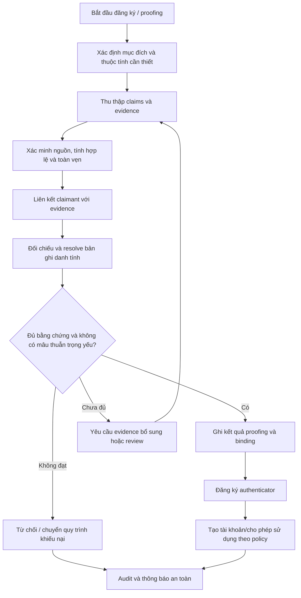

# Identity proofing là gì?

## Mục tiêu học tập

Một người tạo tài khoản trực tuyến có thể khai tên, ngày sinh và địa chỉ của mình. Nhưng việc người đó nhập một bộ thông tin hợp lý không chứng minh rằng danh tính ngoài đời thực tương ứng tồn tại, thuộc về họ hoặc được mô tả chính xác. Hệ thống cần một quy trình đánh giá bằng chứng trước khi gắn danh tính vào hồ sơ số.

**Identity proofing (xác minh danh tính ban đầu)** là quy trình thu thập và đánh giá bằng chứng để xác định một người đang yêu cầu đăng ký có thể được liên kết với một danh tính trong thế giới thực hoặc một danh tính được tổ chức công nhận theo chính sách. Quy trình thường gồm thu thập thuộc tính, xác thực bằng chứng, kiểm tra tính nhất quán, đối chiếu với nguồn tin cậy, giải quyết bản ghi danh tính và ràng buộc kết quả với tài khoản.

Identity proofing thường diễn ra khi mở tài khoản, cấp credential có mức bảo đảm cao, đăng ký dịch vụ chịu quy định hoặc khôi phục một danh tính đã mất quyền kiểm soát. Nó không phải là một lần đăng nhập. Sau khi proofing, người dùng vẫn cần authenticator để chứng minh quyền kiểm soát tài khoản ở các lần truy cập tiếp theo.

Bài học thuộc chương **Identity proofing** của mô-đun **SECURITY_AUTHENTICATION_FUNDAMENTALS**. Mô-đun tìm hiểu nguyên lý xác thực danh tính từ credential, mật khẩu, MFA, passkey và chứng chỉ đến token, phiên, liên kết danh tính và khôi phục tài khoản. Identity proofing tạo cơ sở để hệ thống biết hồ sơ tài khoản ban đầu đại diện cho ai; authentication kiểm tra người đang truy cập có kiểm soát credential đã gắn với hồ sơ đó hay không.

Sau bài học, bạn có thể:

- Phân biệt identity proofing, identity verification, identity resolution, authentication và authorization.
- Xác định các thuộc tính danh tính cần thu thập và chọn bằng chứng phù hợp mục đích.
- Đánh giá tính hợp lệ, xác thực, toàn vẹn, nguồn phát hành và mức tin cậy của evidence.
- Kết hợp kiểm tra tài liệu, đối chiếu nguồn dữ liệu, xác minh quyền sở hữu và kiểm tra hiện diện theo rủi ro.
- Mô hình hóa quy trình proofing trực tiếp và từ xa, gồm xử lý trường hợp không khớp hoặc không đủ bằng chứng.
- Phân biệt mức bảo đảm proofing (IAL) với mức bảo đảm authentication (AAL) và federation (FAL).
- Bảo vệ dữ liệu cá nhân, sinh trắc học và hồ sơ bằng chứng trong toàn bộ vòng đời.
- Thiết kế enrollment, binding, audit và kiểm thử chống giả mạo, deepfake, synthetic identity và account takeover.

## 1. Identity proofing giải quyết vấn đề gì?

Một hệ thống tài khoản cần biết hồ sơ nào đại diện cho một người, tổ chức hoặc thực thể cụ thể. Nếu chỉ dựa trên dữ liệu do người đăng ký tự khai, attacker có thể tạo tài khoản bằng thông tin bịa đặt, dùng dữ liệu của người khác hoặc tạo một danh tính tổng hợp từ nhiều thuộc tính có thật nhưng không cùng thuộc về một người.

Identity proofing tạo một quy trình có kiểm soát để đánh giá những khẳng định đó. Ví dụ, một dịch vụ tài chính có thể cần xác minh tên pháp lý, ngày sinh và địa chỉ theo quy định. Một cổng học tập nội bộ có thể chỉ cần xác minh người đăng ký thuộc danh sách nhân sự hoặc sinh viên đã được tổ chức quản lý. Một dịch vụ công có thể cần mức bảo đảm cao hơn trước khi cấp quyền truy cập hồ sơ nhạy cảm.

Mức proofing phải tương xứng với:

- Hậu quả nếu tài khoản được cấp cho sai người.
- Độ nhạy của dữ liệu và giao dịch mà tài khoản có thể truy cập.
- Nghĩa vụ pháp lý, quy định ngành và chính sách tổ chức.
- Khả năng gian lận và mô hình đe dọa của kênh đăng ký.
- Chi phí, khả năng tiếp cận và tác động tới người dùng hợp lệ.

Không phải dịch vụ nào cũng cần ảnh giấy tờ tùy thân hoặc sinh trắc học. Thu thập dữ liệu quá mức làm tăng rủi ro riêng tư, lưu trữ và rò rỉ. Chọn mức proofing tối thiểu nhưng đủ để đáp ứng mục đích và rủi ro.

### Ví dụ thực tế

Một trường đại học mở cổng cho sinh viên truy cập bảng điểm. Trường có danh sách sinh viên chính thức và mã số sinh viên. Người dùng nhập mã số, tên và ngày sinh. Nếu hệ thống chỉ kiểm tra các trường có định dạng đúng, attacker biết thông tin của người khác có thể tạo tài khoản thay họ.

Một quy trình proofing phù hợp có thể:

1. Kiểm tra mã số và thuộc tính có khớp bản ghi sinh viên đang hoạt động trong hệ thống nguồn chính thức.
2. Gửi thử thách tới kênh liên hệ đã được trường xác minh trước đó, hoặc yêu cầu phương thức xác minh bổ sung phù hợp.
3. Đối chiếu người yêu cầu với quy trình enrollment và xử lý trường hợp dữ liệu mâu thuẫn.
4. Sau khi đạt yêu cầu, tạo liên kết giữa bản ghi sinh viên và tài khoản số.
5. Yêu cầu người dùng đăng ký authenticator và hoàn tất đăng nhập.

Trong ví dụ này, email trường có thể giúp chứng minh quyền truy cập hộp thư của tổ chức, nhưng tự nó không nhất thiết chứng minh toàn bộ danh tính pháp lý. Bằng chứng phải được hiểu theo điều nó thực sự chứng minh.

## 2. Phân biệt proofing, verification, resolution, authentication và authorization

Các thuật ngữ này thường bị dùng lẫn, nhưng chúng trả lời những câu hỏi khác nhau.

| Khái niệm | Câu hỏi cần trả lời | Ví dụ |
| --- | --- | --- |
| **Identity proofing** | Có đủ cơ sở để tạo hoặc xác nhận hồ sơ danh tính này không? | Đánh giá giấy tờ, nguồn dữ liệu và người yêu cầu |
| **Evidence validation** | Bằng chứng có thật, hợp lệ, còn giá trị và không bị sửa đổi không? | Kiểm tra giấy tờ, chữ ký số, issuer và thời hạn |
| **Identity verification** | Người đang tham gia quy trình có phải người được bằng chứng đại diện không? | So khớp người với ảnh hoặc xác minh quyền kiểm soát kênh |
| **Identity resolution** | Bằng chứng và thuộc tính này tương ứng với bản ghi nào trong hệ thống? | Đối chiếu với một hồ sơ nhân sự duy nhất |
| **Identity binding** | Kết quả proofing được liên kết với tài khoản hoặc credential nào? | Gắn subject ID đã xác minh với tài khoản mới |
| **Authentication** | Người đang truy cập có kiểm soát authenticator đã đăng ký không? | Dùng passkey hoặc MFA để đăng nhập |
| **Authorization** | Principal đã xác thực được phép làm gì trên tài nguyên nào? | Cho phép nhân viên xem hồ sơ thuộc bộ phận của họ |

### Proofing không phải authentication

Proofing thường là bước thiết lập danh tính ban đầu hoặc đánh giá lại danh tính khi có thay đổi quan trọng. Authentication diễn ra nhiều lần sau đó để kiểm tra quyền kiểm soát credential.

Ví dụ: người dùng đã proofing bằng giấy tờ và cuộc đối chiếu trực tiếp. Sau đó họ đăng nhập bằng passkey. Passkey chứng minh quyền kiểm soát credential đã đăng ký theo giao thức; nó không tự lặp lại việc xác minh giấy tờ hoặc chứng minh rằng mọi thuộc tính hồ sơ vẫn còn đúng.

Ngược lại, một người có thể đăng nhập thành công bằng mật khẩu của một tài khoản bị tạo giả. Authentication thành công chỉ cho biết credential khớp với tài khoản đó; nó không chứng minh tài khoản ban đầu đã được proofing đúng.

### Verification không đồng nghĩa với matching

Một hệ thống có thể so sánh khuôn mặt trong ảnh selfie với ảnh trên giấy tờ và trả về điểm tương đồng. Điểm số đó là một tín hiệu matching. Nó không tự chứng minh giấy tờ là thật, nguồn ảnh đáng tin, người đang hiện diện không bị giả lập, hay bản ghi danh tính thuộc đúng người.

Quy trình proofing phải đánh giá nhiều loại bằng chứng và ngữ cảnh; không đưa một điểm matching đơn lẻ thành kết luận tuyệt đối.

## 3. Mô hình thuộc tính và bằng chứng danh tính

Proofing bắt đầu từ việc xác định **khẳng định danh tính (identity claims)** cần kiểm tra. Không nên thu thập mọi thuộc tính có thể có rồi mới tìm mục đích sử dụng.

### Thuộc tính danh tính

Tùy trường hợp, thuộc tính có thể gồm:

- Tên pháp lý hoặc tên được tổ chức công nhận.
- Ngày sinh hoặc nhóm tuổi cần thiết.
- Địa chỉ cư trú hoặc địa chỉ liên hệ.
- Mã số nhân viên, sinh viên, khách hàng hoặc mã định danh do tổ chức cấp.
- Quốc gia/vùng phát hành giấy tờ.
- Quan hệ với tổ chức, đơn vị hoặc tài khoản doanh nghiệp.
- Thuộc tính đủ điều kiện sử dụng dịch vụ, nếu chính sách yêu cầu.

Một thuộc tính có thể thay đổi theo thời gian. Tên, địa chỉ và tình trạng nhân sự có thể được cập nhật; hệ thống cần lưu nguồn, thời điểm xác minh và lịch sử thay đổi thay vì coi dữ liệu proofing là đúng vĩnh viễn.

### Các loại evidence

| Loại evidence | Điều có thể hỗ trợ xác minh | Giới hạn cần xem xét |
| --- | --- | --- |
| Giấy tờ do cơ quan có thẩm quyền phát hành | Thuộc tính trên giấy tờ và liên kết với người được cấp | Có thể hết hạn, giả mạo, bị đánh cắp hoặc không phù hợp mục đích |
| Nguồn dữ liệu chính thức | Đối chiếu thuộc tính với bản ghi có thẩm quyền | Dữ liệu có thể cũ, sai hoặc không bao phủ mọi nhóm người |
| Hồ sơ tổ chức | Quan hệ nhân viên/sinh viên/thành viên với tổ chức | Chỉ chứng minh trong phạm vi hệ thống nguồn quản lý |
| Xác minh trực tiếp | Quan sát người và bằng chứng trong một quy trình có kiểm soát | Phụ thuộc đào tạo, quy trình và khả năng phát hiện giả mạo |
| Video/ảnh từ xa | Hỗ trợ kiểm tra sự hiện diện và đối chiếu hình ảnh | Có nguy cơ replay, deepfake, camera injection và sai lệch thuật toán |
| Sinh trắc học | So khớp đặc điểm của người đang tham gia với mẫu tham chiếu | Không phải bằng chứng độc lập về danh tính pháp lý; có rủi ro riêng tư và sai số |
| Kênh liên hệ đã xác minh | Chứng minh quyền truy cập hộp thư/số điện thoại | Không tự chứng minh danh tính ngoài đời hoặc quyền sở hữu pháp lý |
| Chứng thư/chữ ký số | Liên kết khóa công khai với chứng thư và bằng chứng kiểm soát khóa riêng | Phụ thuộc CA, mục đích chứng thư, vòng đời khóa và quy trình cấp phát |

Một evidence có thể đáng tin cho một thuộc tính nhưng không đủ cho thuộc tính khác. Ví dụ, xác minh hộp thư có thể chứng minh người dùng kiểm soát email đó tại thời điểm hiện tại; nó không tự chứng minh ngày sinh hoặc quốc tịch.

### Evidence có nguồn và thời điểm

Mỗi evidence nên có metadata tối thiểu:

- Loại và nguồn phát hành.
- Thuộc tính mà evidence được dùng để xác minh.
- Thời điểm thu thập và thời điểm kiểm tra.
- Phương pháp kiểm tra và phiên bản quy trình.
- Kết quả, lý do từ chối hoặc mức tin cậy được phép lưu.
- Người hoặc dịch vụ thực hiện quyết định.
- Thời hạn sử dụng và điều kiện cần xác minh lại.

Không lưu nhiều bản sao ảnh giấy tờ hoặc dữ liệu sinh trắc học chỉ vì có thể. Nếu chỉ cần lưu kết quả proofing và dấu vết kiểm toán, hãy cân nhắc loại bỏ bản gốc sau thời hạn cần thiết theo chính sách và pháp luật.

## 4. Đánh giá chất lượng evidence

Evidence phải được đánh giá trên nhiều chiều. Một tài liệu nhìn rõ không có nghĩa tài liệu đó thật; một nguồn dữ liệu đáng tin không có nghĩa bản ghi đã được cập nhật gần đây.

### Các chiều đánh giá

1. **Authenticity — tính xác thực:** evidence có được phát hành bởi nguồn được công nhận không? Có dấu hiệu giả, sửa hoặc tạo lại không?
2. **Validity — tính hợp lệ:** tài liệu/chứng thư còn hiệu lực và đúng mục đích sử dụng không?
3. **Integrity — tính toàn vẹn:** nội dung có bị thay đổi trong quá trình thu thập/truyền tải không?
4. **Accuracy — độ chính xác:** thuộc tính có khớp với nguồn hoặc người được đại diện không?
5. **Source authority — thẩm quyền nguồn:** tổ chức phát hành có quyền xác nhận thuộc tính đó không?
6. **Freshness — tính cập nhật:** dữ liệu có đủ mới so với quyết định cần đưa ra không?
7. **Binding — liên kết với claimant:** người đang tham gia có được gắn đúng với evidence không?
8. **Purpose fit — phù hợp mục đích:** evidence có thực sự chứng minh điều mà quy trình yêu cầu không?

### Kiểm tra giấy tờ

Một quy trình kiểm tra tài liệu có thể xem xét:

- Loại giấy tờ có được chấp nhận cho use case không.
- Tên cơ quan phát hành, quốc gia/vùng phát hành và định dạng.
- Thời hạn, ngày cấp và các trường bắt buộc.
- Dấu hiệu sửa ảnh, ghép nội dung, font bất thường hoặc dữ liệu không nhất quán.
- Mã kiểm tra, vùng đọc máy (MRZ), barcode hoặc cơ chế xác minh điện tử nếu tài liệu hỗ trợ.
- Tính nhất quán giữa các thuộc tính và nguồn độc lập.
- Bằng chứng có thuộc về người đang tham gia quy trình không.

Không dựa vào một tín hiệu hình ảnh đơn lẻ để kết luận. Kiểm tra tài liệu cần kết hợp profile của loại giấy tờ, nguồn phát hành và quy trình xử lý ngoại lệ.

### Đối chiếu nguồn dữ liệu

Nguồn dữ liệu dùng để đối chiếu cần có chủ sở hữu, phạm vi thẩm quyền, tần suất cập nhật và quy trình sửa sai. Ví dụ:

- Hệ thống nhân sự có thể xác nhận mã nhân viên và tình trạng làm việc.
- Hệ thống trường học có thể xác nhận mã sinh viên và chương trình đang theo học.
- Cơ sở dữ liệu cơ quan có thẩm quyền có thể xác nhận một số thuộc tính dân sự theo pháp luật.
- Một nhà cung cấp dịch vụ có thể xác nhận khách hàng đã được proofing theo một profile cụ thể, nhưng bên nhận cần biết profile, thời điểm và nguồn tin cậy.

Không coi việc một thuộc tính xuất hiện trong nhiều cơ sở dữ liệu là bằng chứng độc lập nếu các cơ sở dữ liệu đều sao chép từ cùng một nguồn gốc sai.

## 5. Quy trình identity proofing end-to-end

Một quy trình tổng quát có thể chia thành các giai đoạn sau:

1. **Define purpose:** xác định dịch vụ, thuộc tính và mức bảo đảm cần thiết.
2. **Collect claims:** thu thập thuộc tính tối thiểu và thông báo mục đích xử lý.
3. **Collect evidence:** nhận tài liệu, nguồn dữ liệu hoặc bằng chứng trực tiếp phù hợp.
4. **Validate evidence:** kiểm tra nguồn phát hành, tính hợp lệ, toàn vẹn và dấu hiệu giả mạo.
5. **Verify claimant:** kiểm tra người tham gia có liên hệ với bằng chứng theo phương pháp phù hợp.
6. **Resolve identity:** đối chiếu và xác định bản ghi danh tính đúng, tránh trùng hoặc ghép nhầm.
7. **Evaluate risk:** đánh giá tín hiệu gian lận, mâu thuẫn và mức assurance đạt được.
8. **Make decision:** chấp nhận, yêu cầu bằng chứng bổ sung, chuyển review hoặc từ chối.
9. **Bind identity:** tạo liên kết giữa hồ sơ đã proofing với account/subject nội bộ.
10. **Enroll authenticators:** đăng ký passkey, khóa bảo mật, MFA hoặc credential theo policy.
11. **Notify and audit:** thông báo kết quả qua kênh phù hợp và ghi audit event.
12. **Maintain lifecycle:** xử lý thay đổi thuộc tính, hết hạn evidence, nghi ngờ gian lận và yêu cầu cập nhật.

### Sơ đồ quy trình



Các trạng thái có thể được lưu riêng như **INITIATED**, **EVIDENCE_PENDING**, **VALIDATING**, **REVIEW_REQUIRED**, **PROOFED**, **REJECTED**, **EXPIRED** và **REVOKED**. Chỉ trạng thái PROOFED theo policy mới được phép đi tiếp tới binding hoặc enrollment. Một tài khoản đã tồn tại không nên tự động chuyển sang trạng thái proofed chỉ vì người dùng hoàn tất bước đăng nhập.

## 6. Identity resolution: tránh tạo trùng và ghép nhầm người

**Identity resolution** xác định một tập thuộc tính/evidence tương ứng với bản ghi danh tính nào. Đây là bài toán khó khi dữ liệu có thể không đồng nhất:

- Một người có thể đổi tên hoặc địa chỉ.
- Nhiều người có cùng họ tên và ngày sinh.
- Dữ liệu nguồn có lỗi chính tả hoặc khác quy tắc phiên âm.
- Một người có nhiều mã định danh theo từng tổ chức.
- Một hồ sơ cũ có thể đã bị đóng, hợp nhất hoặc tái sử dụng mã.
- Danh tính tổng hợp có thể kết hợp thuộc tính thật của nhiều người.

### Không dùng một thuộc tính yếu làm khóa duy nhất

Tên, email, số điện thoại hoặc địa chỉ thường không đủ để xác định duy nhất một người. Mã định danh cũng chỉ duy nhất trong phạm vi issuer hoặc tổ chức cụ thể; cần lưu namespace/source.

Một mô hình nội bộ có thể dùng:

- **subjectId:** định danh nội bộ ngẫu nhiên, ổn định.
- **sourceSystem:** hệ thống phát hành bản ghi.
- **sourceIdentifier:** mã trong phạm vi hệ thống nguồn.
- **verifiedAttributes:** thuộc tính đã xác minh và nguồn/thời điểm.
- **proofingRecordId:** hồ sơ quyết định proofing.
- **status:** trạng thái danh tính và tài khoản.
- **createdAt, updatedAt, lastReviewedAt:** mốc vòng đời.

Không dùng số giấy tờ hoặc email làm primary key xuyên hệ thống. Nếu một nguồn cấp lại hoặc tái sử dụng mã, cần có quy tắc xác định bản ghi cũ và mới.

### Xử lý dữ liệu mâu thuẫn

Nếu tên trên giấy tờ khác tên trong hồ sơ tổ chức, không tự động chọn một bên rồi ghi đè. Hãy phân loại:

- Khác biệt định dạng hoặc phiên âm có thể chuẩn hóa.
- Tên đã thay đổi hợp pháp.
- Nguồn dữ liệu chưa cập nhật.
- Bằng chứng không nhất quán hoặc có dấu hiệu giả mạo.
- Có thể đang nhầm hai người.

Tùy mức độ, yêu cầu evidence bổ sung, dùng nguồn có thẩm quyền cao hơn hoặc chuyển review thủ công. Quyết định cần có lý do và đường khiếu nại cho người dùng hợp lệ.

## 7. Identity verification: liên kết người đang tham gia với evidence

Verification kiểm tra người đang tham gia quy trình có phải người mà evidence đại diện hay không. Phương pháp phụ thuộc loại evidence và mức assurance.

### Trực tiếp (in-person)

Nhân viên được đào tạo có thể kiểm tra tài liệu gốc, quan sát người đăng ký và áp dụng quy trình đối chiếu. Cần:

- Hướng dẫn kiểm tra tài liệu theo từng loại.
- Đào tạo nhận diện giả mạo và xử lý ngoại lệ.
- Kiểm soát truy cập khu vực và thiết bị proofing.
- Audit quyết định và người thực hiện.
- Có quy trình hỗ trợ người khuyết tật hoặc người không thể dùng giấy tờ theo cách thông thường.

Sự hiện diện trực tiếp không tự đảm bảo mọi thông tin là đúng; nhân viên vẫn phải kiểm tra evidence và nguồn phát hành.

### Từ xa (remote proofing)

Remote proofing có thể dùng camera, ứng dụng di động, quét giấy tờ, video trực tiếp hoặc nguồn dữ liệu điện tử. Các rủi ro gồm:

- Ảnh/video replay từ phiên trước.
- Deepfake hoặc face swap.
- Camera injection, virtual camera hoặc thiết bị bị kiểm soát.
- Tài liệu giả được tạo bằng công cụ chỉnh sửa.
- Tấn công vào API OCR, vendor hoặc kênh truyền evidence.
- Người hỗ trợ từ xa điều khiển phiên thay claimant.
- Dữ liệu sinh trắc học bị lộ hoặc dùng sai mục đích.

Kiểm soát có thể bao gồm:

- Challenge ngẫu nhiên theo phiên, không chấp nhận video tải lên không có kiểm tra nguồn gốc khi policy yêu cầu live capture.
- Liveness/presentation-attack detection theo chuẩn và kiểm định phù hợp.
- Kiểm tra tính toàn vẹn của capture path và phát hiện thiết bị/camera injection.
- Xác minh tài liệu và đối chiếu với nguồn có thẩm quyền.
- Mã hóa khi truyền/lưu, giới hạn quyền truy cập và thời hạn lưu.
- Human review cho kết quả không chắc chắn, bất thường hoặc ảnh hưởng lớn.
- Kiểm tra vendor, luồng dữ liệu, nơi xử lý và cách xóa dữ liệu.

Liveness detection không phải bằng chứng độc lập rằng người đó có danh tính được khai báo. Nó chỉ hỗ trợ đánh giá có người hiện diện và giảm một số kiểu presentation attack. Deepfake, replay và camera injection cần được xem xét trong mô hình đe dọa.

### Sinh trắc học và giới hạn

So khớp khuôn mặt hoặc dấu vân tay có thể hỗ trợ liên kết claimant với mẫu tham chiếu. Nhưng sinh trắc học:

- Không phải bí mật có thể thay đổi dễ dàng như mật khẩu.
- Có sai số false accept và false reject.
- Có thể bị ảnh hưởng bởi ánh sáng, camera, tuổi tác, khuyết tật hoặc đặc điểm cá nhân.
- Có thể tạo tác động khác nhau giữa các nhóm người.
- Cần cơ chế consent, bảo vệ, giới hạn mục đích và xóa dữ liệu theo luật.
- Không tự chứng minh nguồn phát hành của giấy tờ hoặc quyền sở hữu danh tính pháp lý.

Cần có phương thức thay thế phù hợp cho người không thể hoặc không muốn dùng sinh trắc học, trong giới hạn assurance của dịch vụ.

## 8. Đánh giá rủi ro và xử lý trường hợp ngoại lệ

Một quyết định proofing không nên chỉ có hai trạng thái “match” và “no match”. Có thể cần phân biệt:

- Bằng chứng đủ và nhất quán.
- Bằng chứng thiếu nhưng có thể bổ sung.
- Không thể xác minh do dịch vụ nguồn tạm thời lỗi.
- Dữ liệu mâu thuẫn cần review.
- Có tín hiệu gian lận mạnh.
- Evidence hết hạn hoặc không phù hợp use case.
- Người dùng cần một phương thức thay thế vì khả năng tiếp cận.

### Tín hiệu rủi ro

Tín hiệu có thể gồm:

- Nhiều lần gửi cùng một giấy tờ cho các danh tính khác nhau.
- Một thiết bị hoặc nguồn mạng tạo số lượng proofing bất thường.
- Thông tin tài liệu không khớp nguồn phát hành.
- Dấu hiệu chỉnh sửa hoặc camera injection.
- Một số thuộc tính trùng với hồ sơ bị gian lận đã xác nhận.
- Yêu cầu thay đổi danh tính ngay sau proofing.
- Nhiều lần thất bại ở cùng một bước hoặc hành vi tự động hóa.

IP, thiết bị, vị trí hoặc điểm rủi ro không tự chứng minh danh tính. Chúng là tín hiệu hỗ trợ quyết định; tránh từ chối người dùng chỉ vì một IP dùng chung, thiết bị cũ hoặc vị trí khác thường mà không có đánh giá phù hợp.

### Quyết định theo policy

Một hệ thống có thể áp dụng:

- **Accept:** bằng chứng đáp ứng policy, không có mâu thuẫn trọng yếu.
- **Step-up / additional evidence:** cần thêm một nguồn hoặc phương thức xác minh.
- **Manual review:** kết quả tự động không đủ chắc chắn hoặc cần người có thẩm quyền đánh giá.
- **Defer:** nguồn xác minh tạm thời không khả dụng; giữ trạng thái chờ, không cấp quyền vượt mức.
- **Reject:** evidence không hợp lệ hoặc không đạt yêu cầu.
- **Appeal / remediation:** cho phép người dùng sửa dữ liệu, cung cấp bằng chứng thay thế hoặc khiếu nại.

Không dùng lỗi kỹ thuật của nhà cung cấp dữ liệu như kết luận gian lận. Khi nguồn không sẵn sàng, giữ trạng thái chưa xác minh và cho phép thử lại an toàn.

## 9. Mức bảo đảm: IAL, AAL và FAL

Trong một số khung quản lý danh tính số, ba chiều bảo đảm được phân biệt:

- **Identity Assurance Level (IAL):** mức tin cậy rằng danh tính ngoài đời hoặc danh tính được khai báo đã được proofing đúng.
- **Authentication Assurance Level (AAL):** mức tin cậy của quá trình xác thực người dùng khi truy cập, dựa trên authenticator và giao thức.
- **Federation Assurance Level (FAL):** mức bảo đảm của việc truyền kết quả xác thực/thuộc tính giữa IdP và relying party.

Ba chiều này liên quan nhưng không thay thế nhau.

| Tình huống | IAL | AAL | FAL |
| --- | --- | --- | --- |
| Người được proofing mạnh nhưng đăng nhập bằng mật khẩu yếu | Có thể cao | Có thể thấp | Không nhất thiết liên quan |
| Người dùng có passkey chống phishing nhưng tài khoản tạo bằng thông tin tự khai | Có thể thấp | Có thể cao | Tùy federation |
| IdP proofing và authentication mạnh nhưng RP nhận assertion không được bảo vệ đúng | Có thể cao | Có thể cao | Thấp hoặc không đạt |
| Workload có chứng chỉ mTLS hợp lệ | Không tự xác định IAL người dùng | Không phải AAL người dùng cuối | Không tự xác định FAL |

Không suy ra AAL cao từ IAL cao. Việc một người đã được proofing kỹ không làm mật khẩu của họ trở thành authenticator mạnh. Tương tự, passkey mạnh không tự chứng minh danh tính ban đầu của người đăng ký là đúng.

Mức IAL cụ thể phụ thuộc tiêu chuẩn, phiên bản, loại evidence, phương pháp xác minh và quy trình vận hành. Không gán nhãn IAL chỉ dựa trên việc có chụp giấy tờ hoặc dùng nhận diện khuôn mặt; phải đối chiếu profile và yêu cầu của khung chuẩn đang áp dụng.

## 10. Binding kết quả proofing với tài khoản và authenticator

Sau khi đạt quyết định, hệ thống cần liên kết kết quả proofing với một subject/account cụ thể. Binding sai có thể làm toàn bộ bước proofing trở nên vô nghĩa.

### Quy trình binding

1. Tạo proofingRecordId duy nhất cho giao dịch proofing.
2. Lưu subject ID nội bộ hoặc tạo subject mới sau khi identity resolution hoàn tất.
3. Ghi evidence reference, nguồn, thời điểm, phương pháp và kết quả cần thiết.
4. Ràng buộc subject với account theo quy tắc chống duplicate và account linking.
5. Yêu cầu claimant hoàn tất enrollment authenticator trong flow có thời hạn.
6. Xác minh enrollment và liên kết credential với đúng subject/account.
7. Thông báo việc tạo tài khoản hoặc thêm credential qua kênh liên hệ phù hợp.
8. Lưu audit event có actor, thời điểm, policy version và correlation ID.

### Proofing và authenticator enrollment là hai bước riêng

Một người có thể proofing thành công nhưng chưa đăng ký passkey. Một người cũng có thể đăng ký authenticator nhưng chưa hoàn tất proofing. Không nên coi hai trạng thái đó là tương đương.

Ví dụ, nếu nhân viên hỗ trợ tạo tài khoản trước khi proofing hoàn tất, hệ thống phải giữ account ở trạng thái hạn chế. Không cấp quyền truy cập dữ liệu nhạy cảm chỉ vì đã có mật khẩu hoặc passkey.

### Thay đổi thuộc tính sau proofing

Khi người dùng đổi tên, địa chỉ hoặc thông tin tổ chức:

- Xác định thuộc tính nào cần evidence mới.
- Ghi nguồn và thời điểm cập nhật.
- Giữ lịch sử thay đổi cần thiết cho audit.
- Không tự thay subject ID chỉ vì tên hoặc email thay đổi.
- Nếu thay đổi có ảnh hưởng đến eligibility hoặc quyền, đánh giá lại authorization.
- Nếu có dấu hiệu takeover, yêu cầu reauthentication/step-up trước khi cập nhật.

## 11. Vòng đời danh tính và re-proofing

Proofing không phải một sự kiện làm mọi thuộc tính đúng vĩnh viễn. Một số thuộc tính cần kiểm tra lại khi có thay đổi hoặc sau một khoảng thời gian theo policy.

Các tình huống có thể cần re-proofing:

- Giấy tờ hoặc evidence hết hạn theo yêu cầu dịch vụ.
- Người dùng yêu cầu đổi thuộc tính pháp lý quan trọng.
- Có mâu thuẫn giữa hồ sơ nội bộ và nguồn có thẩm quyền.
- Tổ chức thay đổi nguồn dữ liệu hoặc mức assurance cần thiết.
- Phát hiện bằng chứng ban đầu bị giả mạo hoặc quy trình proofing có lỗi.
- Tài khoản có tín hiệu chiếm đoạt và cần xác minh lại quyền sở hữu danh tính.
- Quy định hoặc hợp đồng yêu cầu cập nhật proofing định kỳ.

Re-proofing phải có mục đích rõ và giới hạn dữ liệu. Không yêu cầu người dùng gửi lại toàn bộ giấy tờ mỗi lần đăng nhập hoặc mỗi lần đổi mật khẩu.

### Thu hồi kết quả proofing

Nếu phát hiện quyết định ban đầu dựa trên evidence giả hoặc sai mapping, hệ thống cần:

- Đánh dấu proofing record bị thu hồi hoặc cần điều tra.
- Đánh giá các tài khoản, credential và phiên được tạo từ kết quả đó.
- Tạm hạn chế quyền phù hợp rủi ro; không xóa audit trail.
- Thông báo cho bộ phận chịu trách nhiệm và người dùng theo quy trình.
- Thu hồi session/token/credential nếu cần.
- Sửa liên kết subject/account và xử lý các tài nguyên đã truy cập.
- Lưu lại lý do, bằng chứng và người phê duyệt quyết định.

Thu hồi proofing là quyết định về độ tin cậy của hồ sơ danh tính. Nó có thể kéo theo đình chỉ tài khoản, nhưng phải thực hiện theo policy, pháp luật và quy trình khiếu nại.

## 12. Quyền riêng tư, bảo vệ dữ liệu và công bằng

Identity proofing có thể xử lý dữ liệu rất nhạy cảm: ảnh giấy tờ, số định danh, địa chỉ, video, mẫu sinh trắc học và dữ liệu từ nguồn chính thức. Thiết kế bảo mật cần bao gồm quyền riêng tư ngay từ đầu.

### Nguyên tắc tối thiểu hóa dữ liệu

- Chỉ thu thập thuộc tính cần cho mục đích proofing.
- Thông báo rõ dữ liệu nào được thu thập, vì sao, ai xử lý và thời hạn lưu.
- Tách dữ liệu evidence khỏi hồ sơ ứng dụng khi có thể.
- Mã hóa khi truyền và lưu; quản lý khóa độc lập với dữ liệu.
- Phân quyền theo vai trò và ghi audit khi truy cập evidence.
- Che bớt số định danh/thuộc tính không cần thiết trong giao diện và log.
- Đặt thời hạn lưu và cơ chế xóa/ẩn danh phù hợp pháp luật.
- Kiểm soát nhà cung cấp xử lý thay, nơi lưu trữ và việc chuyển dữ liệu xuyên biên giới.
- Không dùng lại dữ liệu proofing cho quảng cáo, phân tích hoặc huấn luyện mô hình nếu chưa có cơ sở pháp lý và thông báo phù hợp.

### Công bằng và khả năng tiếp cận

Tài liệu có thể khác nhau theo quốc gia, tuổi, tình trạng cư trú và hoàn cảnh cá nhân. Một số người không có giấy tờ tiêu chuẩn, không có smartphone, camera chất lượng thấp hoặc không thể sử dụng sinh trắc học.

Quy trình nên:

- Cung cấp phương thức thay thế tương đương về assurance khi có thể.
- Hỗ trợ người khuyết tật và người cần trợ giúp.
- Có con đường review thủ công với tiêu chí rõ.
- Đo false reject/false accept theo nhóm phù hợp pháp luật và quyền riêng tư.
- Không biến sai số thuật toán thành kết luận gian lận.
- Cho phép sửa dữ liệu nguồn hoặc khiếu nại khi kết quả không chính xác.
- Giải thích lý do ở mức đủ hữu ích nhưng không tiết lộ chi tiết có thể giúp attacker né kiểm soát.

## 13. Ví dụ Java: mô hình hóa quyết định proofing

Ví dụ dưới đây mô hình hóa quyết định từ các kết quả evidence đã được bộ xác minh chuyên biệt đánh giá. Nó không tự đọc giấy tờ, nhận diện khuôn mặt, truy vấn cơ sở dữ liệu chính thức hoặc tính điểm gian lận.

```java
import java.time.Instant;
import java.util.List;
import java.util.Set;
import java.util.UUID;

enum ProofingStatus {
    INITIATED,
    EVIDENCE_PENDING,
    REVIEW_REQUIRED,
    PROOFED,
    REJECTED,
    EXPIRED,
    REVOKED
}

enum EvidenceType {
    GOVERNMENT_DOCUMENT,
    AUTHORITATIVE_RECORD,
    ORGANIZATION_RECORD,
    IN_PERSON_CHECK,
    REMOTE_VIDEO,
    BIOMETRIC_MATCH,
    DIGITAL_CERTIFICATE
}

enum EvidenceResult {
    VALID,
    INVALID,
    INCONCLUSIVE,
    UNAVAILABLE
}

record EvidenceAssessment(
        EvidenceType type,
        EvidenceResult result,
        Set<String> verifiedAttributes,
        String sourceId,
        Instant checkedAt
) {}

record ProofingPolicy(
        Set<EvidenceType> acceptedTypes,
        Set<String> requiredAttributes,
        int minimumIndependentSources
) {}

record ProofingDecision(
        ProofingStatus status,
        String reasonCode,
        List<EvidenceAssessment> assessments,
        Instant decidedAt
) {}

class IdentityProofingService {

    ProofingDecision decide(
            ProofingPolicy policy,
            List<EvidenceAssessment> assessments,
            Instant now) {

        if (policy == null || assessments == null || now == null) {
            return new ProofingDecision(
                    ProofingStatus.REVIEW_REQUIRED,
                    "MISSING_DECISION_CONTEXT",
                    assessments == null ? List.of() : assessments,
                    now
            );
        }

        boolean invalidEvidence = assessments.stream()
                .anyMatch(a -> a.result() == EvidenceResult.INVALID);

        if (invalidEvidence) {
            return new ProofingDecision(
                    ProofingStatus.REJECTED,
                    "INVALID_EVIDENCE",
                    assessments,
                    now
            );
        }

        boolean unresolved = assessments.stream()
                .anyMatch(a -> a.result() == EvidenceResult.UNAVAILABLE
                        || a.result() == EvidenceResult.INCONCLUSIVE);

        if (unresolved) {
            return new ProofingDecision(
                    ProofingStatus.REVIEW_REQUIRED,
                    "EVIDENCE_NOT_CONCLUSIVE",
                    assessments,
                    now
            );
        }

        Set<EvidenceType> validTypes = assessments.stream()
                .filter(a -> a.result() == EvidenceResult.VALID)
                .map(EvidenceAssessment::type)
                .filter(policy.acceptedTypes()::contains)
                .collect(java.util.stream.Collectors.toSet());

        Set<String> attributes = assessments.stream()
                .filter(a -> a.result() == EvidenceResult.VALID)
                .flatMap(a -> a.verifiedAttributes().stream())
                .collect(java.util.stream.Collectors.toSet());

        long independentSources = assessments.stream()
                .filter(a -> a.result() == EvidenceResult.VALID)
                .map(EvidenceAssessment::sourceId)
                .filter(id -> id != null && !id.isBlank())
                .distinct()
                .count();

        boolean enoughEvidence =
                !validTypes.isEmpty()
                && attributes.containsAll(policy.requiredAttributes())
                && independentSources >= policy.minimumIndependentSources();

        if (!enoughEvidence) {
            return new ProofingDecision(
                    ProofingStatus.EVIDENCE_PENDING,
                    "REQUIRED_EVIDENCE_MISSING",
                    assessments,
                    now
            );
        }

        return new ProofingDecision(
                ProofingStatus.PROOFED,
                "POLICY_SATISFIED",
                assessments,
                now
        );
    }
}
```

Đây là ví dụ giảng dạy về cấu trúc quyết định, không phải policy proofing hoàn chỉnh hoặc code production. Source ID phải đại diện nguồn thực sự độc lập; hai API cùng sao chép một database không phải hai nguồn độc lập. Trong thực tế, cần kiểm tra freshness, authenticity, binding với claimant, mâu thuẫn thuộc tính, risk signals, policy version, trạng thái account và quyền của reviewer. Không được coi danh sách evidence hợp lệ là đủ nếu các evidence không chứng minh đúng thuộc tính hoặc không liên kết với người đang tham gia.

### Mô hình dữ liệu proofing record

Một hồ sơ có thể lưu các trường khái niệm:

```json
{
  "proofingRecordId": "opaque-random-id",
  "subjectId": "internal-subject-id",
  "status": "PROOFED",
  "policyVersion": "identity-proofing-v1",
  "assurance": {
    "ial": "policy-defined-level",
    "decidedAt": "2026-11-22T00:00:00Z"
  },
  "evidenceReferences": [
    {
      "type": "ORGANIZATION_RECORD",
      "source": "authoritative-system",
      "verifiedAttributes": ["employeeId", "employmentStatus"],
      "checkedAt": "2026-11-22T00:00:00Z"
    }
  ],
  "decision": {
    "reasonCode": "POLICY_SATISFIED",
    "reviewer": "service-or-authorized-reviewer"
  }
}
```

Đây là schema minh họa, không phải định dạng chuẩn. Không đưa ảnh giấy tờ, số định danh đầy đủ, video hoặc dữ liệu sinh trắc học thô vào audit record chỉ để thuận tiện. Tham chiếu evidence nên trỏ tới kho được bảo vệ với access control và retention policy riêng.

## 14. Lỗi triển khai thường gặp

| Lỗi | Hậu quả | Cách phòng tránh |
| --- | --- | --- |
| Chỉ tin dữ liệu người dùng tự khai | Attacker tạo danh tính giả hoặc dùng thông tin người khác | Đánh giá evidence phù hợp mục đích và rủi ro |
| Coi email/SMS OTP là proofing đầy đủ | Chỉ chứng minh quyền truy cập kênh, không chứng minh danh tính pháp lý | Giới hạn ý nghĩa của bằng chứng và kết hợp nguồn phù hợp |
| Chụp giấy tờ là đủ | Ảnh có thể bị chỉnh sửa, giả hoặc lấy từ người khác | Xác minh issuer, validity, integrity và claimant binding |
| Chỉ dựa vào face match | Điểm tương đồng bị hiểu sai thành kết luận danh tính | Kết hợp kiểm tra evidence, liveness và nguồn có thẩm quyền |
| Không phân biệt proofing với authentication | Đăng nhập thành công bị coi là danh tính đã proofing | Lưu trạng thái proofing riêng với trạng thái session |
| Dùng email/tên làm khóa subject | Trùng, đổi hoặc tái sử dụng làm gộp nhầm người | Dùng subject ID ổn định và source namespace |
| Gộp dữ liệu từ nhiều nguồn phụ thuộc | Tưởng có nhiều bằng chứng độc lập trong khi cùng nguồn gốc | Phân tích lineage và independence của nguồn |
| Không có trạng thái review | Kết quả mơ hồ bị tự động accept hoặc reject | Có pending/review/defer và đường xử lý ngoại lệ |
| Bỏ qua dữ liệu mâu thuẫn | Binding sai danh tính | Phân loại discrepancy, bổ sung evidence hoặc review |
| Tin điểm rủi ro là danh tính | IP/device signal gây false positive hoặc false negative | Dùng risk signal hỗ trợ, không thay evidence |
| Không ràng buộc proofing với account | Evidence của người A được gắn vào tài khoản B | Dùng transaction ID, subject ID và binding nguyên tử |
| Proofing thành công tự cấp quyền rộng | Sai danh tính có thể truy cập tài nguyên vượt mục đích | Authorization riêng theo role/resource/tenant |
| Không quản lý vòng đời evidence | Thuộc tính cũ được coi là luôn đúng | Lưu source/time/freshness và re-proofing khi cần |
| Lưu ảnh/video vô thời hạn | Rò rỉ dữ liệu nhạy cảm gây hậu quả lớn | Data minimization, encryption, retention/deletion |
| Không có phương thức thay thế | Người hợp lệ bị loại do thiết bị, giấy tờ hoặc khuyết tật | Kênh thay thế và manual review có kiểm soát |
| Tin nhà cung cấp mà không đánh giá | Không biết nguồn, sai số và dữ liệu được xử lý thế nào | Due diligence, hợp đồng, audit và kiểm thử vendor |
| Không thu hồi proofing sai | Tài khoản được tạo từ evidence giả tiếp tục hoạt động | Revoke proofing record, đánh giá session/credential/quyền |

## 15. Bảng kiểm thử identity proofing

| Trường hợp | Đầu vào/thao tác | Kết quả mong đợi |
| --- | --- | --- |
| Evidence hợp lệ | Nguồn được tin, thuộc tính đủ, claimant binding đạt | Proofing đạt theo policy |
| Tài liệu hết hạn | Evidence quá thời hạn được chấp nhận | Từ chối hoặc yêu cầu evidence mới |
| Issuer không được tin | Tài liệu từ nguồn ngoài allowlist | Từ chối evidence |
| Tài liệu bị sửa | Kiểm tra integrity phát hiện chỉnh sửa | Từ chối hoặc chuyển review |
| Thuộc tính không khớp | Tên/ngày sinh không khớp nguồn có thẩm quyền | Review hoặc yêu cầu bổ sung |
| Nhiều bản ghi cùng khớp | Resolution trả nhiều subject có thể là cùng người | Không tự chọn; chuyển review |
| Email đã được xác minh nhưng không có evidence khác | Claimant kiểm soát hộp thư | Chỉ ghi nhận channel control; không tự kết luận proofing đạt |
| Replay video | Dùng lại video/ảnh từ flow trước | Phát hiện hoặc từ chối theo policy |
| Camera injection | Feed giả được đưa vào capture path | Kiểm soát phát hiện hoặc chuyển review |
| Deepfake/liveness bất thường | Kết quả PAD không chắc chắn | Không tự accept; xử lý theo risk policy |
| Nguồn chính thức tạm thời unavailable | Không thể truy vấn do outage | Defer/pending, không kết luận gian lận |
| Evidence không độc lập | Hai nguồn sao chép cùng bản ghi gốc | Không tính là hai nguồn độc lập |
| Subject binding sai | Proofing record của A gắn với account B | Transaction từ chối; không cấp quyền |
| Proofing chưa hoàn tất | Account mới chỉ có trạng thái pending | Không cấp quyền cần proofing |
| Account bị đình chỉ | Proofing trước đó đạt nhưng account đang suspended | Không mở quyền truy cập |
| Re-proofing thay đổi tên | Có evidence mới hợp lệ | Cập nhật thuộc tính có audit, giữ subject identity |
| Proofing record bị thu hồi | Evidence giả được phát hiện sau enrollment | Đánh giá và thu hồi session/credential/quyền theo policy |
| Sinh trắc học false reject | Người hợp lệ không match do điều kiện capture | Có phương thức thay thế hoặc manual review |
| Truy cập evidence trái quyền | Nhân viên không có vai trò mở ảnh/video | Từ chối và ghi audit |
| Yêu cầu xóa dữ liệu | Hết mục đích lưu theo retention policy | Xóa/ẩn danh evidence theo nghĩa vụ pháp lý và giữ audit tối thiểu cần thiết |

Ngoài unit test, cần kiểm thử tích hợp với nguồn dữ liệu thật trong môi trường test, độ trễ/outage, retry, nhiều request đồng thời, duplicate submission, vendor callback giả, key rotation, phân quyền kho evidence và xóa dữ liệu theo retention. Không dùng giấy tờ, số định danh hoặc dữ liệu sinh trắc học thật trong fixture nếu không có cơ sở và biện pháp bảo vệ phù hợp.

## 16. Checklist thiết kế identity proofing

Trước khi phát hành quy trình proofing, hãy trả lời:

1. **Purpose:** Vì sao cần proofing và tài nguyên/hành động nào phụ thuộc kết quả?
2. **Claims:** Thuộc tính nào thực sự cần? Thuộc tính nào có thể bỏ?
3. **Evidence:** Nguồn nào có thẩm quyền cho từng thuộc tính? Có độc lập và đủ mới không?
4. **Validation:** Có kiểm tra authenticity, validity, integrity, issuer, expiry và mục đích không?
5. **Claimant binding:** Làm sao xác định người đang tham gia có liên hệ với evidence?
6. **Resolution:** Làm sao tránh trùng, nhầm subject, account linking sai hoặc synthetic identity?
7. **Remote channel:** Có chống replay, deepfake, camera injection và giả mạo thiết bị không?
8. **Assurance:** Mức IAL yêu cầu là gì? Có tách rõ AAL và FAL không?
9. **Decision:** Có accept, pending, review, defer, reject và appeal với lý do rõ ràng không?
10. **Binding/enrollment:** Kết quả proofing được liên kết nguyên tử với subject/account và authenticator ra sao?
11. **Privacy:** Evidence nào được lưu, ai truy cập, retention và deletion thế nào?
12. **Fairness:** Có phương thức thay thế, hỗ trợ tiếp cận và đo sai số phù hợp không?
13. **Lifecycle:** Khi thuộc tính đổi, evidence hết hạn hoặc proofing bị thu hồi thì session/credential/quyền được xử lý thế nào?
14. **Operations:** Có audit, vendor oversight, incident response và kiểm thử định kỳ không?

## 17. Bài tập vận dụng

Một nền tảng dịch vụ tài chính cho phép mở tài khoản trực tuyến. Quy trình hiện tại chỉ yêu cầu người dùng nhập tên, ngày sinh, email và số điện thoại. Hệ thống gửi OTP tới email, sau đó coi tài khoản đã được proofing. Ứng dụng có tính năng xem thông tin tài khoản và chuyển tiền. Khi người dùng quên mật khẩu, họ chỉ cần nhận OTP qua cùng email để reset.

**Yêu cầu:**

1. Phân biệt những gì email OTP chứng minh được và những gì quy trình hiện tại chưa chứng minh.
2. Xác định thuộc tính danh tính cần thiết cho dịch vụ và chọn evidence theo rủi ro/quy định.
3. Thiết kế quy trình thu thập, validation, claimant verification, identity resolution và binding.
4. Đề xuất kiểm soát remote proofing chống tài liệu giả, replay, deepfake và camera injection.
5. Phân biệt IAL của proofing với AAL của đăng nhập và assurance cần cho giao dịch.
6. Thiết kế trạng thái pending/review/reject/appeal, retention và phương thức thay thế cho người dùng không thể dùng sinh trắc học.
7. Sửa recovery để OTP email không trở thành đường vòng duy nhất vượt qua proofing/MFA.
8. Viết test cho tài liệu giả, dữ liệu trùng, source outage, subject binding sai, account suspension và false reject.

**Gợi ý tự đánh giá:** Không có một bằng chứng đơn lẻ phù hợp mọi mục đích. Email OTP chứng minh quyền truy cập email tại thời điểm kiểm tra. Identity proofing cần đánh giá thuộc tính, nguồn, tính xác thực, claimant binding và resolution. Authentication kiểm tra quyền kiểm soát authenticator về sau; authorization quyết định người đã xác thực được làm gì. Recovery phải duy trì mức bảo đảm tương xứng, không tạo đường vòng yếu hơn.

---

**Điểm cần nhớ:** Identity proofing là quy trình thiết lập cơ sở tin cậy cho hồ sơ danh tính bằng cách **xác định claims, đánh giá evidence, xác minh claimant, resolve đúng bản ghi và bind kết quả với subject/account**. Nó khác authentication và authorization. Một quy trình tốt chọn bằng chứng theo rủi ro, có xử lý ngoại lệ và khiếu nại, bảo vệ dữ liệu nhạy cảm, hỗ trợ người dùng đa dạng và quản lý kết quả trong toàn bộ vòng đời.
