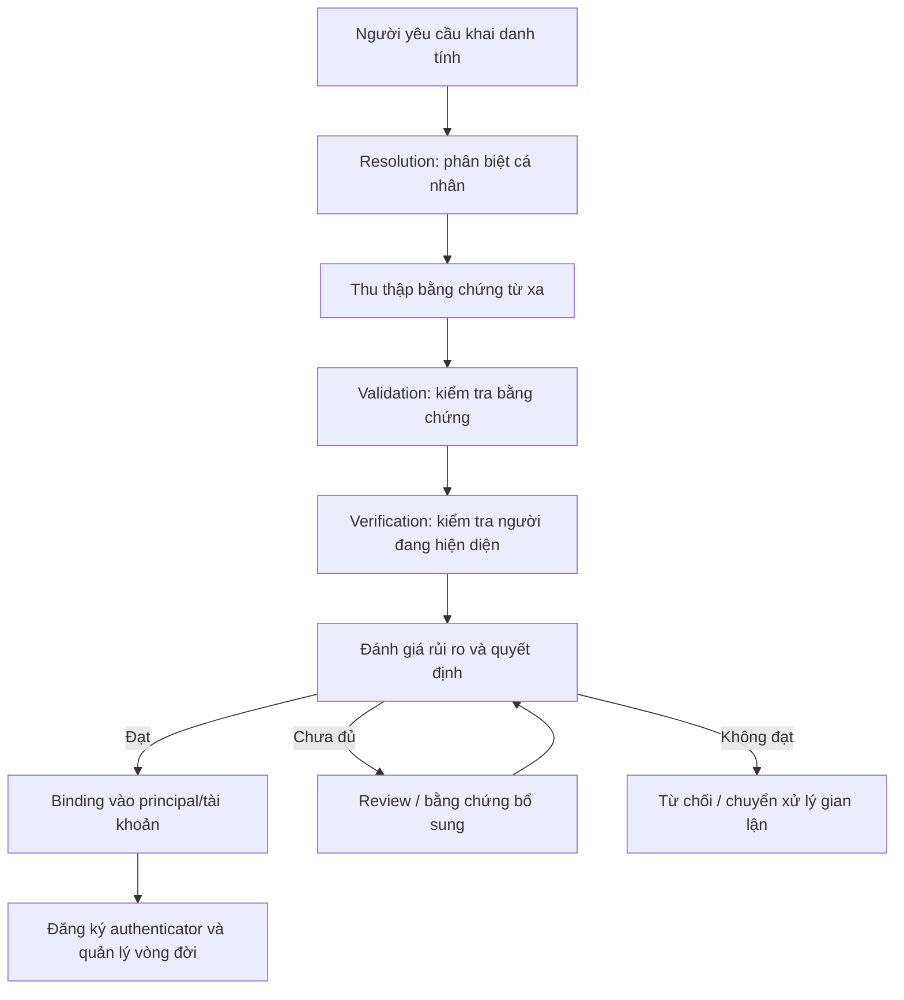
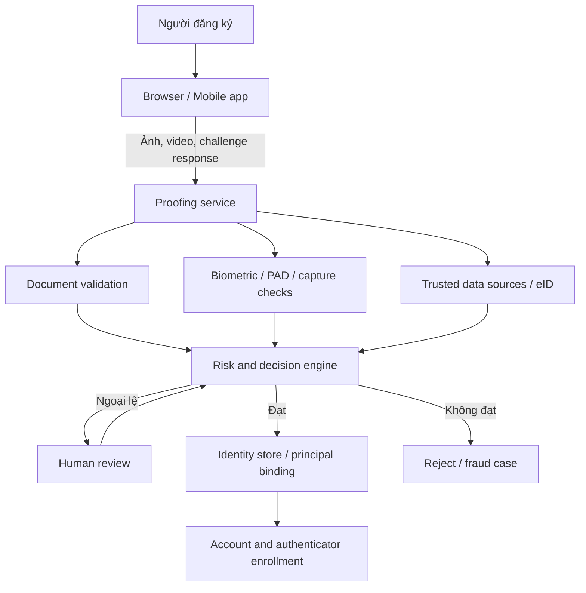

# Remote proofing — Xác minh danh tính từ xa an toàn

Một người đăng ký tài khoản tài chính trực tuyến và khai rằng họ là một cá nhân cụ thể. Dịch vụ không thể gặp trực tiếp người đó, nên cần đánh giá giấy tờ, nguồn dữ liệu, hình ảnh khuôn mặt hoặc một phương thức định danh điện tử để xác định người đang đăng ký có phù hợp với danh tính được khai báo hay không. Nếu quy trình bị đánh lừa bằng giấy tờ giả, ảnh/video phát lại, deepfake hoặc dữ liệu bị chiếm, kẻ tấn công có thể tạo tài khoản dưới danh tính người khác và vượt qua các bước xác thực về sau.

**Remote identity proofing (xác minh danh tính từ xa)** là quá trình thu thập và đánh giá bằng chứng qua kênh điện tử để xác định một cá nhân có phải là người mà họ tuyên bố hay không. Đây là bước thiết lập niềm tin về danh tính trong quá trình đăng ký, mở tài khoản hoặc khôi phục có rủi ro cao. Nó khác với đăng nhập: xác thực (authentication) kiểm tra người dùng có đang kiểm soát credential đã đăng ký hay không; identity proofing đánh giá danh tính được khai báo có được chứng minh đủ tin cậy hay không.

Bài học thuộc chương **Identity proofing** của học phần **SECURITY_AUTHENTICATION_FUNDAMENTALS**. Nội dung liên hệ proofing với credential, mật khẩu, MFA, passkey, chứng chỉ, token, phiên, liên kết danh tính và khôi phục tài khoản. Người học sẽ mô hình hóa ranh giới tin cậy, phòng chống giả mạo giấy tờ, deepfake, replay và lạm dụng quy trình đăng ký từ xa.

## 1. Kết quả học tập

Sau bài này, người học có thể:

- Phân biệt identity proofing, identity verification, authentication, authorization và account recovery.
- Mô tả các bước phân giải danh tính, xác thực bằng chứng và xác minh người đang hiện diện.
- Đánh giá giấy tờ định danh, nguồn dữ liệu đáng tin cậy, eID, NFC/chip và bằng chứng sinh trắc.
- Giải thích selfie matching, liveness detection và Presentation Attack Detection (PAD), cũng như giới hạn của từng kỹ thuật.
- Mô hình hóa luồng proofing từ xa có challenge, capture, validation, review, decision và binding vào tài khoản.
- Nhận diện giả mạo giấy tờ, replay ảnh/video, deepfake, camera injection, synthetic identity, coercion và gian lận qua bên trung gian.
- Thiết kế quy trình dựa trên rủi ro, mức bảo đảm, quyền riêng tư, khả năng tiếp cận và cơ chế xem xét thủ công.
- Tách mức bảo đảm proofing khỏi mức bảo đảm authenticator/MFA được đăng ký sau đó.
- Viết tiêu chí chấp nhận và kiểm thử cho chống replay, chống giả mạo, xử lý ngoại lệ, audit và thu hồi kết quả proofing.

## 2. Identity proofing khác authentication như thế nào?

Hai hoạt động này trả lời hai câu hỏi khác nhau:

- **Identity proofing:** Người đang đăng ký có đủ bằng chứng để khẳng định họ là cá nhân được khai báo không?
- **Authentication:** Người đang truy cập có kiểm soát credential đã đăng ký cho tài khoản đó không?

Ví dụ, một ngân hàng có thể xác minh danh tính khách hàng khi mở tài khoản từ xa bằng giấy tờ và quy trình kiểm tra người thật. Sau đó khách hàng đăng ký passkey. Những lần đăng nhập tiếp theo dùng passkey để xác thực quyền kiểm soát tài khoản. Passkey mạnh không tự chứng minh rằng danh tính ban đầu đã được proofing đúng; ngược lại, proofing tốt cũng không đảm bảo phiên đăng nhập về sau an toàn nếu credential bị đánh cắp.

| Hoạt động | Câu hỏi | Bằng chứng/kiểm soát điển hình |
| --- | --- | --- |
| Identity resolution | Có phân biệt được đúng cá nhân trong tập dữ liệu/danh tính cần kiểm tra không? | Tên, ngày sinh, địa chỉ, mã định danh và dữ liệu đối chiếu theo chính sách |
| Evidence validation | Bằng chứng có thật, hợp lệ và được phát hành bởi nguồn được chấp nhận không? | Kiểm tra giấy tờ, chữ ký số, chip, nguồn dữ liệu có thẩm quyền |
| Identity verification | Người đang tham gia quy trình có phải người gắn với bằng chứng đó không? | So sánh khuôn mặt, kiểm tra hiện diện, xác minh qua eID hoặc phương thức khác |
| Authentication | Người truy cập có kiểm soát authenticator đã đăng ký không? | Mật khẩu, passkey, OTP, chứng chỉ, security key |
| Authorization | Chủ thể đã xác thực được phép làm gì? | Role, scope, policy, quyền trên tenant/tài nguyên |
| Account recovery | Người yêu cầu khôi phục có đủ bằng chứng để lấy lại quyền kiểm soát không? | Phương thức recovery độc lập, proofing lại theo rủi ro, hỗ trợ có kiểm soát |

Một luồng có thể thực hiện nhiều hoạt động liên tiếp, nhưng không nên gộp kết quả thành một cờ chung như `verified=true`. Hệ thống cần biết chính xác điều gì đã được xác minh, bằng nguồn nào, vào thời điểm nào và theo mức bảo đảm nào.

## 3. Các bước của remote identity proofing

Một quy trình đầy đủ thường có các giai đoạn:

1. **Resolution — phân giải danh tính:** thu thập thông tin cần thiết để phân biệt cá nhân với người khác và xác định hồ sơ/đối tượng cần chứng minh.
2. **Evidence collection — thu thập bằng chứng:** nhận giấy tờ, dữ liệu từ nguồn đáng tin cậy, credential định danh điện tử hoặc bằng chứng phù hợp.
3. **Evidence validation — xác thực bằng chứng:** kiểm tra nguồn phát hành, tính hợp lệ, tính toàn vẹn, thời hạn và dấu hiệu giả mạo.
4. **Identity verification — xác minh người:** xác định người đang tham gia có khớp với cá nhân trên bằng chứng hay không.
5. **Decision — quyết định:** đánh giá kết quả, mức rủi ro, ngoại lệ, độ tin cậy và yêu cầu nghiệp vụ.
6. **Binding/enrollment — liên kết và đăng ký:** gắn kết quả proofing với internal principal, tài khoản, tenant và authenticator được đăng ký.
7. **Lifecycle — quản lý vòng đời:** lưu bằng chứng tối thiểu, audit, cập nhật, hết hạn, xử lý tranh chấp và thu hồi khi phát hiện gian lận.

Không phải mọi dịch vụ đều cần thu thập tất cả loại bằng chứng. Mức proofing phải tương xứng với tác động nếu danh tính bị mạo danh. Dịch vụ ít rủi ro có thể dùng xác minh tối giản; tài khoản có quyền tài chính, dữ liệu nhạy cảm hoặc quyền quản trị cần bằng chứng và kiểm soát mạnh hơn.

## 4. Bằng chứng danh tính và nguồn dữ liệu

### 4.1. Các loại bằng chứng

| Loại bằng chứng | Ví dụ | Câu hỏi cần đánh giá |
| --- | --- | --- |
| Giấy tờ do cơ quan có thẩm quyền phát hành | Căn cước, hộ chiếu, giấy phép lái xe | Giấy tờ có thật, còn hiệu lực, đúng người và được chấp nhận trong phạm vi dịch vụ không? |
| eID/credential điện tử | Danh tính số do nhà nước hoặc tổ chức đáng tin cấp | Issuer có được tin cậy không? Chữ ký, trạng thái và audience có hợp lệ không? |
| Dữ liệu từ nguồn có thẩm quyền | Cơ sở dữ liệu dân cư, hồ sơ tổ chức, registry theo pháp luật | Nguồn có quyền xác nhận dữ liệu nào, dữ liệu mới đến đâu và được truy cập theo căn cứ nào? |
| Bằng chứng sở hữu kênh | Email, số điện thoại, tài khoản định danh đã đăng ký | Chứng minh kiểm soát kênh tại thời điểm kiểm tra, không tự chứng minh danh tính pháp lý |
| Bằng chứng sinh trắc | Ảnh/video khuôn mặt, mẫu sinh trắc được thiết bị xác minh | Có khớp với bằng chứng tham chiếu và có chống presentation/injection attack không? |
| Bằng chứng tổ chức | Thư mời, xác nhận của quản trị viên, dữ liệu nhân sự | Người xác nhận có thẩm quyền và phạm vi xác nhận là gì? |

Không có một loại bằng chứng duy nhất phù hợp cho mọi quốc gia, nhóm người dùng và mục đích. Cần xác định loại giấy tờ được chấp nhận, cơ sở pháp lý, nguồn xác minh và trường hợp ngoại lệ trước khi xây dựng luồng.

### 4.2. Validation và verification là hai bước khác nhau

- **Validation** hỏi bằng chứng có đáng tin và hợp lệ không. Ví dụ: giấy tờ có dấu hiệu bị chỉnh sửa? Chữ ký số của chip có hợp lệ? Tài liệu còn thời hạn? Issuer có được chấp nhận?
- **Verification** hỏi người đang tham gia có phải người gắn với bằng chứng không. Ví dụ: khuôn mặt trực tiếp có khớp ảnh tham chiếu? Người dùng có kiểm soát eID hoặc kênh định danh đã đăng ký?

OCR chỉ trích xuất ký tự từ ảnh giấy tờ. OCR đọc được tên và số định danh không chứng minh giấy tờ là thật. Tương tự, một ảnh selfie có khuôn mặt giống ảnh giấy tờ không tự chứng minh ảnh giấy tờ không bị giả mạo hoặc người đang hiện diện không phải ảnh/video phát lại.

### 4.3. Nguồn dữ liệu đáng tin cậy

Khi dùng dữ liệu từ bên thứ ba hoặc registry, hãy xác định:

- Nguồn được ai vận hành và có thẩm quyền xác nhận loại thuộc tính nào.
- Kết nối được xác thực ra sao, dữ liệu có chữ ký hoặc cơ chế bảo vệ toàn vẹn không.
- Thời điểm cập nhật, độ trễ, độ chính xác và khả năng sửa sai.
- Có kiểm tra trực tiếp theo giao dịch hay chỉ dùng dữ liệu đã cache.
- Phạm vi sử dụng, sự đồng ý/căn cứ pháp lý và yêu cầu lưu giữ.
- Quy trình khi nguồn lỗi, không có kết quả hoặc trả dữ liệu mâu thuẫn.

Một dịch vụ tra cứu thương mại không tự động trở thành nguồn có thẩm quyền. Tín hiệu IP, thiết bị, địa chỉ hoặc lịch sử giao dịch có thể hỗ trợ đánh giá rủi ro nhưng không thay thế bằng chứng danh tính.

## 5. Kiểm tra giấy tờ định danh từ xa

Quy trình document verification thường nhận ảnh mặt trước/mặt sau, ảnh chụp hoặc dữ liệu đọc từ chip điện tử. Có thể gồm các bước:

1. Kiểm tra loại giấy tờ, quốc gia/issuer, thời hạn và phạm vi chấp nhận.
2. Kiểm tra chất lượng ảnh: độ nét, ánh sáng, phản chiếu, cắt xén và vùng bị che.
3. Trích xuất dữ liệu bằng OCR và kiểm tra cấu trúc/trường dữ liệu.
4. Kiểm tra tính nhất quán giữa các trường, mặt trước/mặt sau và dữ liệu máy đọc được (MRZ/barcode) nếu áp dụng.
5. Kiểm tra dấu hiệu bảo an, bố cục, font, ảnh chân dung, lớp phủ, chỉnh sửa hoặc mẫu giả.
6. Nếu có chip/eID, đọc dữ liệu theo giao thức, xác minh chữ ký/chứng thư và trạng thái theo profile.
7. Đối chiếu dữ liệu với nguồn được chấp nhận và kết quả xác minh người.
8. Đánh giá rủi ro và chuyển review khi bằng chứng không đủ rõ.

### 5.1. Ảnh giấy tờ không tương đương bản gốc

Ảnh có thể bị chỉnh sửa, ghép khuôn mặt, thay trường dữ liệu hoặc tạo bằng công cụ tổng hợp. Kiểm tra hình ảnh cần đánh giá dấu hiệu giả mạo nhưng có giới hạn; một ảnh độ phân giải cao không đồng nghĩa tài liệu thật. Với trường hợp rủi ro cao, có thể yêu cầu đọc chip/NFC, eID có chữ ký, xác minh nguồn trực tiếp hoặc một phương thức proofing thay thế.

### 5.2. NFC/chip và chữ ký điện tử

Một số giấy tờ điện tử lưu dữ liệu và chữ ký số trong chip. Đọc chip có thể giúp kiểm tra dữ liệu do issuer ký và phát hiện thay đổi trái phép. Hệ thống vẫn phải:

- Xác minh chain/chứng thư theo trust anchor được chấp nhận.
- Kiểm tra chữ ký và dữ liệu bảo vệ theo profile của giấy tờ.
- Đánh giá thời hạn, trạng thái chứng thư và chính sách issuer.
- So sánh ảnh chân dung trong chip với người đang proofing nếu quy trình yêu cầu.
- Bảo vệ kênh NFC và xử lý lỗi đọc/retry; không coi đọc được chip là đủ nếu chưa xác minh chữ ký.

Chip hợp lệ chứng minh dữ liệu được phát hành/được bảo vệ theo cơ chế của issuer; bước xác minh người vẫn cần xác định ai đang sử dụng giấy tờ đó.

### 5.3. Dữ liệu máy đọc được

MRZ hoặc barcode giúp trích xuất dữ liệu có cấu trúc và phát hiện một số sai lệch. Tuy nhiên, dữ liệu OCR/MRZ có thể được sao chép từ giấy tờ thật vào giấy tờ giả. Kiểm tra checksum hoặc định dạng chỉ là một phần của validation, không phải bằng chứng đầy đủ về tính xác thực.

## 6. Selfie, face match và liveness/PAD

Một số quy trình từ xa yêu cầu người dùng chụp ảnh selfie hoặc video ngắn để so sánh với ảnh trên giấy tờ. Các kỹ thuật thường gặp:

- **Face detection:** phát hiện có khuôn mặt trong khung hình.
- **Face comparison/matching:** tính mức độ tương đồng giữa hai ảnh/mẫu sinh trắc.
- **Liveness detection:** đánh giá dấu hiệu người thật đang hiện diện theo cách hệ thống yêu cầu.
- **Presentation Attack Detection (PAD):** phát hiện các dạng tấn công trình diễn trước cảm biến, ví dụ ảnh in, màn hình phát video hoặc mặt nạ.
- **Injection attack detection:** phát hiện dữ liệu hình ảnh/video được đưa thẳng vào pipeline thay vì được thu trực tiếp từ cảm biến tin cậy.

Các khái niệm này không đồng nghĩa. Face match cao không chứng minh người đó đang sống; liveness không nhất thiết phát hiện mọi cách inject video; PAD cần được đánh giá theo loại sensor, môi trường và tấn công mục tiêu.

### 6.1. Challenge-response

Một quy trình có thể yêu cầu người dùng thực hiện hành động ngẫu nhiên hoặc theo hướng dẫn, chẳng hạn quay đầu, nhìn theo hướng hoặc đọc một chuỗi. Challenge cần:

- Được sinh mới cho mỗi proofing transaction.
- Có thời hạn và gắn với transaction/account đang chờ.
- Được kiểm tra đúng thứ tự và kết quả; không chấp nhận video cũ.
- Không tạo hành động khó tiếp cận hoặc gây nguy hiểm cho người dùng.
- Có biện pháp bảo vệ trước việc attacker nhận challenge rồi relay cho nạn nhân thực hiện.

Challenge động làm khó việc phát lại một video đã ghi sẵn, nhưng không phải giải pháp đầy đủ trước deepfake thời gian thực, camera injection, điều khiển thiết bị hoặc coercion.

### 6.2. Presentation attack và injection attack

**Presentation attack** đưa một vật thể/hiển thị giả trước camera: ảnh in, ảnh trên màn hình, mặt nạ hoặc video phát lại. **Injection attack** bỏ qua đường camera thông thường và đưa dữ liệu giả trực tiếp vào phần mềm xử lý, ví dụ virtual camera, hook API hoặc thay luồng video trong thiết bị.

Nếu chỉ đánh giá PAD ở tầng hình ảnh mà không bảo vệ capture pipeline, attacker có thể qua mặt bằng cách inject dữ liệu đã được chuẩn bị. Với proofing rủi ro cao, cần xem xét:

- Camera capture path và integrity của ứng dụng/thiết bị.
- Phát hiện virtual camera, emulator, tampering hoặc môi trường bất thường theo policy.
- Challenge ngẫu nhiên, timestamp và ràng buộc phiên.
- PAD được kiểm thử độc lập theo các nhóm presentation attack phù hợp.
- Kiểm tra thủ công hoặc phương thức thay thế khi có dấu hiệu injection.

Tín hiệu thiết bị không nên là lý do duy nhất để từ chối một người dùng hợp lệ; cần xử lý false positive và khả năng tiếp cận.

### 6.3. Hạn chế sinh trắc

Sinh trắc là dữ liệu nhạy cảm và có đặc điểm khó thay đổi nếu bị lộ. Không lưu ảnh/video thô hoặc template lâu hơn mức cần thiết; nếu phải xử lý, mã hóa, giới hạn truy cập, tách khóa, audit và có lịch xóa. Không dùng kết quả face match như một bí mật có thể reset giống mật khẩu. Sinh trắc trong remote proofing cũng không tự động là authenticator sinh trắc dùng cho đăng nhập về sau.

## 7. Mức bảo đảm và quyết định dựa trên rủi ro

Proofing cần mức bảo đảm tương xứng với hậu quả của việc mạo danh. Các khung như NIST Digital Identity Guidelines phân loại mức bảo đảm proofing (IAL) và tách biệt với mức bảo đảm xác thực (AAL). Cần tham chiếu phiên bản tiêu chuẩn và yêu cầu pháp lý áp dụng cho tổ chức; không nên tự gán nhãn IAL/AAL chỉ dựa trên việc đã chụp giấy tờ và selfie.

### Các yếu tố quyết định mức proofing

- Giá trị tài khoản và dữ liệu có thể truy cập.
- Khả năng gây thiệt hại tài chính, pháp lý, an toàn hoặc quyền riêng tư.
- Khả năng mở tài khoản/nhận quyền bằng danh tính giả.
- Loại bằng chứng và độ tin cậy của issuer.
- Mức độ kiểm tra trực tiếp, tự động hay có người giám sát.
- Rủi ro deepfake, synthetic identity, document fraud và coercion.
- Độ chính xác, false acceptance/false rejection và độ bao phủ nhóm người dùng.
- Yêu cầu pháp lý, địa lý, accessibility và khả năng cung cấp phương thức thay thế.

### Ví dụ phân tầng

| Mức rủi ro nghiệp vụ | Ví dụ | Cách tiếp cận proofing |
| --- | --- | --- |
| Thấp | Tạo tài khoản đọc nội dung công khai, ít dữ liệu cá nhân | Thu thập tối thiểu; xác minh thuộc tính cần thiết nếu có |
| Trung bình | Tài khoản lưu hồ sơ cá nhân hoặc đặt dịch vụ | Kết hợp nguồn dữ liệu đáng tin và kiểm tra bằng chứng phù hợp |
| Cao | Mở tài khoản tài chính, thay đổi thông tin thanh toán, truy cập hồ sơ nhạy cảm | Bằng chứng mạnh, kiểm tra tính xác thực và người hiện diện; review khi tín hiệu xung đột |
| Rất cao/đặc quyền | Cấp tài khoản quản trị hoặc quyền đại diện pháp lý | Quy trình được giám sát, nguồn có thẩm quyền, kiểm soát độc lập và phê duyệt phù hợp |

Đây là ví dụ định hướng, không phải bảng ánh xạ IAL chính thức. Tổ chức cần xác định yêu cầu cụ thể dựa trên tiêu chuẩn, pháp luật và threat model.

### IAL và AAL không thay thế nhau

- IAL mô tả mức độ tin cậy của quy trình xác minh danh tính.
- AAL mô tả mức độ tin cậy của quá trình xác thực bằng authenticator.

Một tài khoản được proofing ở mức cao nhưng chỉ đăng nhập bằng mật khẩu yếu vẫn có nguy cơ bị chiếm. Một passkey mạnh gắn vào tài khoản tạo từ quy trình proofing yếu không tự nâng độ tin cậy của danh tính ban đầu. Cần thiết kế cả hai lớp theo rủi ro.

## 8. Rủi ro gian lận trong remote proofing

| Mối đe dọa | Cách thực hiện | Biện pháp giảm thiểu |
| --- | --- | --- |
| Document forgery | Chỉnh sửa ảnh giấy tờ, tạo mẫu giả hoặc thay ảnh chân dung | Kiểm tra bảo an, chip/nguồn issuer, consistency checks và review |
| Replay | Dùng lại ảnh/video hoặc proofing session cũ | Challenge mới, nonce, timestamp, transaction binding và replay detection |
| Deepfake | Tạo video/khuôn mặt tổng hợp giống người thật | PAD, challenge-response, trusted capture, nguồn dữ liệu độc lập và review |
| Camera injection | Đưa video giả trực tiếp vào pipeline capture | Bảo vệ app/device integrity, kiểm tra capture path và phát hiện môi trường giả lập |
| Synthetic identity | Kết hợp dữ liệu thật/giả để tạo danh tính không thuộc một cá nhân có thật | Đối chiếu nhiều nguồn phù hợp, kiểm tra tính nhất quán và phát hiện bất thường |
| Stolen identity | Dùng giấy tờ thật bị đánh cắp cùng ảnh giả | Face verification/PAD, kiểm tra nguồn, thông báo và xử lý khiếu nại |
| Coercion | Ép người thật thực hiện proofing thay cho attacker | Phát hiện tín hiệu bất thường, kênh hỗ trợ riêng và phương thức xác minh thay thế |
| Mule/recruitment | Thuê người thật hoàn tất proofing rồi bàn giao tài khoản | Phân tích hành vi sau proofing, binding credential và kiểm soát giao dịch |
| Insider abuse | Nhân viên sửa kết quả, bỏ qua kiểm tra hoặc truy cập ảnh | Separation of duties, audit, dual control và review mẫu |
| Vendor compromise | Nhà cung cấp SDK/proofing bị xâm nhập hoặc xử lý sai dữ liệu | Due diligence, hợp đồng, kiểm thử độc lập, quyền audit và kế hoạch thay thế |
| Data-source compromise | Nguồn đối chiếu bị giả mạo hoặc trả dữ liệu sai | Xác thực kết nối, integrity, kiểm tra nguồn độc lập và giám sát |
| Account binding attack | Kết quả proofing hợp lệ bị gắn vào tài khoản/tenant sai | Transaction binding, xác minh chủ tài khoản, unique constraints và audit |

Không có một điểm kiểm tra duy nhất loại bỏ mọi rủi ro. Các tín hiệu cần được kết hợp, có trọng số và được đánh giá theo tác động; không dùng điểm rủi ro mù quáng để từ chối người dùng mà không có phương án review/appeal.

## 9. Kiến trúc và ranh giới tin cậy

Một hệ thống remote proofing có thể gồm browser/mobile app, capture SDK, proofing service, vendor, nguồn dữ liệu, reviewer, identity store và account service.

### Ranh giới cần mô hình hóa

- **Thiết bị người dùng:** camera, microphone, OS, browser, extension, virtual camera và malware.
- **Kênh truyền tải:** TLS, upload, presigned URL, proxy và API gateway.
- **Proofing vendor/SDK:** code capture, thuật toán OCR/face/PAD, telemetry, xử lý dữ liệu và quyền truy cập.
- **Nguồn dữ liệu:** issuer, eID, registry hoặc dịch vụ xác minh; cần xác thực và kiểm tra integrity.
- **Reviewer:** quyền xem dữ liệu, thay đổi kết quả, ghi chú và phê duyệt ngoại lệ.
- **Identity/account store:** nơi liên kết kết quả proofing với internal principal, tenant và credential.
- **Audit/analytics:** có thể chứa dữ liệu sinh trắc, giấy tờ hoặc định danh; cần kiểm soát riêng.

Không tin một client-side flag như `livenessPassed=true` hoặc `documentValid=true`. Quyết định phải được xác minh phía server từ kết quả được ký/xác thực của thành phần tin cậy, có transaction ID, thời gian, issuer/vendor và policy version rõ ràng. Nếu vendor trả kết quả qua webhook, cần xác minh chữ ký, chống replay và ràng buộc callback với proofing transaction đã khởi tạo.

## 10. Binding kết quả proofing vào tài khoản

Proofing chỉ có ý nghĩa nếu kết quả được gắn vào đúng principal và đúng giao dịch đăng ký. Một luồng sai có thể xác minh đúng người nhưng lại tạo tài khoản cho attacker hoặc gắn bằng chứng của người A vào tài khoản B.

### Các nguyên tắc

- Tạo transaction ID ngẫu nhiên và ràng buộc với registration/session, tenant, mục đích và thời hạn.
- Không nhận user ID/tenant ID từ client để quyết định principal đích mà không kiểm tra phía server.
- Kết quả proofing phải có trạng thái, policy version, nguồn, thời gian và reference tới bằng chứng cần lưu.
- Chỉ một transaction hoàn tất được binding; callback lặp hoặc kết quả cũ phải bị từ chối.
- Kiểm tra trùng lặp danh tính theo dữ liệu được phép và policy; không tự gộp chỉ vì tên/email giống nhau.
- Ghi audit ai/điều gì tạo tài khoản, ai review và lý do quyết định.
- Đăng ký authenticator sau khi binding thành công, theo luồng bảo vệ credential riêng.

### Proofing không tự cấp quyền

Kết quả proofing có thể cho phép tạo một principal hoặc tiếp tục onboarding. Quyền trong ứng dụng vẫn phải đến từ provisioning, membership, policy và authorization. Một người đã xác minh danh tính không tự động là nhân viên, quản trị viên hoặc đại diện pháp lý của mọi tổ chức.

## 11. Quyền riêng tư, bảo vệ dữ liệu và khả năng tiếp cận

Remote proofing có thể xử lý giấy tờ, ảnh mặt, video, dữ liệu sinh trắc và thông tin định danh. Đây là dữ liệu có mức nhạy cảm cao; cần đưa privacy vào thiết kế từ đầu.

### 11.1. Data minimization

- Chỉ thu thập trường dữ liệu cần cho mục đích proofing.
- Không yêu cầu cả hai mặt giấy tờ nếu loại giấy tờ/mục đích không cần.
- Không giữ video thô hoặc ảnh giấy tờ vô thời hạn chỉ vì có thể hữu ích về sau.
- Tách dữ liệu proofing khỏi dữ liệu analytics và hồ sơ sản phẩm.
- Dùng reference/token nội bộ thay vì truyền ảnh giấy tờ qua nhiều dịch vụ.

### 11.2. Bảo vệ và lưu giữ

- Mã hóa khi truyền và khi lưu; quản lý khóa tách biệt với dữ liệu.
- Giới hạn reviewer và service account theo nguyên tắc least privilege.
- Audit việc xem, tải, sửa, xuất và xóa bằng chứng.
- Quy định retention, legal hold, xóa bản sao, backup và dữ liệu ở vendor.
- Không ghi ảnh, video, số định danh hoặc biometric template vào log/trace.
- Có quy trình xử lý yêu cầu truy cập, sửa sai, xóa và khiếu nại theo pháp luật áp dụng.

### 11.3. Consent và căn cứ xử lý

Giải thích rõ mục đích thu thập, loại dữ liệu, bên xử lý, thời gian lưu, chuyển giao và phương thức thay thế. Consent không phải lúc nào cũng là căn cứ pháp lý duy nhất hoặc phù hợp; tổ chức cần xác định căn cứ xử lý theo pháp luật tại nơi cung cấp dịch vụ và không ép người dùng đồng ý một cách không minh bạch.

### 11.4. Accessibility và phương thức thay thế

Không phải ai cũng có smartphone hỗ trợ NFC, camera tốt, giấy tờ mới, khả năng thực hiện challenge bằng chuyển động hoặc điều kiện ánh sáng phù hợp. Quy trình cần:

- Hỗ trợ công nghệ trợ năng và thiết bị phổ biến.
- Cho phép thử lại với hướng dẫn rõ ràng, không tiết lộ chi tiết giúp gian lận.
- Có kênh proofing thay thế có mức bảo đảm tương đương hoặc được đánh giá theo rủi ro.
- Có review bởi con người cho trường hợp hợp lệ nhưng thuật toán không kết luận được.
- Theo dõi false rejection theo nhóm thiết bị/điều kiện và nhóm người dùng; đánh giá sai lệch.

Không được mặc định người dùng không vượt qua face match là gian lận. Tín hiệu có thể đến từ ánh sáng, tuổi tác, khuyết tật, chất lượng camera hoặc khác biệt thuật toán.

## 12. Human review và quản lý ngoại lệ

Tự động hóa giúp mở rộng quy mô nhưng không nên biến mọi trường hợp mơ hồ thành từ chối vĩnh viễn. Human review có thể xem xét:

- Ảnh giấy tờ bị lóa, cắt hoặc chất lượng thấp.
- Dữ liệu nguồn không nhất quán nhưng có giải thích hợp lệ.
- Face match gần ngưỡng hoặc PAD đưa ra tín hiệu không chắc chắn.
- Người dùng không có thiết bị tương thích hoặc cần hỗ trợ tiếp cận.
- Tên có dấu, transliteration, đổi tên hợp pháp hoặc giấy tờ theo định dạng khác.

### Kiểm soát reviewer

- Phân quyền theo vai trò và loại case.
- Không để một reviewer tự tạo, sửa bằng chứng và phê duyệt ngoại lệ nhạy cảm mà không có kiểm soát.
- Ghi lý do, bằng chứng được xem, policy version và người quyết định.
- Dùng dual control cho tài khoản/hoạt động có tác động rất cao.
- Đào tạo về document fraud, social engineering, deepfake và privacy.
- Theo dõi tỷ lệ override, tỷ lệ phát hiện gian lận sau phê duyệt và sai lệch giữa reviewer.

Review thủ công không tự động đáng tin hơn mô hình máy. Con người cũng có thể bị lừa, thiên kiến hoặc chịu áp lực; quy trình cần tiêu chí nhất quán và audit.

## 13. Vòng đời proofing và liên kết với credential

Proofing là một sự kiện trong vòng đời danh tính, không phải trạng thái vĩnh viễn:

1. **Enrollment:** hoàn tất proofing, tạo principal hoặc xác nhận hồ sơ hiện có.
2. **Authenticator binding:** đăng ký passkey, security key, chứng chỉ hoặc phương thức MFA; xác minh người dùng đang gắn credential vào đúng tài khoản.
3. **Ongoing monitoring:** phát hiện thay đổi danh tính, dấu hiệu gian lận hoặc hành vi bất thường theo policy.
4. **Re-proofing:** yêu cầu proofing lại khi thay đổi thông tin quan trọng, khôi phục rủi ro cao hoặc thời hạn/chính sách yêu cầu.
5. **Recovery:** khi mất authenticator, dùng quy trình khôi phục phù hợp; không tự động hạ cấp về email/SMS yếu.
6. **Revocation/deprovisioning:** vô hiệu hóa tài khoản/credential và phiên khi danh tính không còn hợp lệ hoặc phát hiện gian lận.

### Khi nào cần proofing lại?

- Thay đổi tên pháp lý hoặc dữ liệu định danh cốt lõi theo yêu cầu nghiệp vụ.
- Phát hiện giấy tờ hoặc danh tính được dùng trong gian lận.
- Khôi phục tài khoản có giá trị cao khi các credential/kênh cũ đã bị chiếm.
- Chuyển quyền đại diện, quyền quản trị hoặc thay đổi quan hệ tổ chức quan trọng.
- Có yêu cầu pháp lý/chu kỳ xác minh cụ thể.

Không yêu cầu proofing lại chỉ vì người dùng đổi thiết bị hoặc đăng nhập từ IP mới nếu không có căn cứ rủi ro; điều đó có thể gây ma sát và tạo cơ hội cho social engineering.

### Tách kết quả proofing khỏi authenticator

Một principal có thể có nhiều authenticator. Khi một passkey bị thu hồi, điều đó không nhất thiết làm mất hiệu lực bằng chứng proofing gốc. Ngược lại, nếu phát hiện danh tính gốc bị mạo danh hoặc proofing bị gian lận, có thể cần vô hiệu hóa principal và mọi credential/phiên gắn với nó. Mô hình dữ liệu phải liên kết được proofing event, principal, authenticator và session để xử lý đúng phạm vi.

## 14. Tình huống thực tế: mở tài khoản dịch vụ tài chính từ xa

Một khách hàng đăng ký dịch vụ tài chính trên điện thoại. Họ cần mở tài khoản có thể lưu tiền và thực hiện giao dịch. Dịch vụ chọn quy trình proofing mạnh hơn đăng ký tài khoản đọc nội dung thông thường.

### Luồng đề xuất

1. Khách hàng xem thông báo mục đích, dữ liệu được thu thập và phương thức thay thế.
2. Ứng dụng tạo proofing transaction có ID ngẫu nhiên, tenant, purpose, TTL và challenge riêng.
3. Khách hàng chụp giấy tờ thuộc danh sách được chấp nhận.
4. Hệ thống kiểm tra chất lượng, OCR, cấu trúc, tính nhất quán và dấu hiệu giả mạo.
5. Nếu có chip/eID, đọc dữ liệu và xác minh chữ ký/issuer theo trust policy.
6. Khách hàng thực hiện selfie/video challenge; hệ thống đánh giá face match, PAD và capture integrity.
7. Các trường cần thiết được đối chiếu với nguồn có thẩm quyền theo căn cứ được phép.
8. Decision engine đánh giá tín hiệu; trường hợp không rõ được chuyển reviewer, không tự động coi là gian lận.
9. Khi đạt, backend binding kết quả vào principal mới hoặc hồ sơ đã được xác minh; kiểm tra trùng lặp/collision.
10. Khách hàng đăng ký passkey/MFA trong transaction riêng; server xác minh việc binding credential và tạo phiên ban đầu theo policy.
11. Hệ thống lưu audit metadata tối thiểu, áp dụng retention cho ảnh/video và gửi thông báo đăng ký.

### Các tình huống cần xử lý

- **Ảnh giấy tờ rõ nhưng selfie không khớp:** không tạo tài khoản; yêu cầu review hoặc phương thức thay thế.
- **OCR đọc được nhưng kiểm tra authenticity thất bại:** không coi OCR là proof; từ chối hoặc yêu cầu bằng chứng khác.
- **Video bị replay:** challenge/transaction binding và PAD phải phát hiện; không cấp principal.
- **Nguồn dữ liệu bị gián đoạn:** không giả định đạt; chuyển pending/retry/review theo policy.
- **Người dùng có giấy tờ hợp lệ nhưng camera không tương thích:** cung cấp kênh thay thế có kiểm soát.
- **Kết quả proofing được gửi lại:** transaction one-time và idempotency ngăn tạo principal/credential trùng.

## 15. Tiêu chí chấp nhận và kiểm thử

| Tình huống | Kết quả mong đợi |
| --- | --- |
| Giấy tờ hợp lệ từ issuer được chấp nhận | Validation đạt theo policy; vẫn phải hoàn tất verification người nếu yêu cầu |
| OCR trích xuất được dữ liệu từ ảnh giả | Không tự kết luận giấy tờ thật; authenticity checks/review quyết định |
| Giấy tờ hết hạn hoặc loại không được chấp nhận | Từ chối hoặc yêu cầu bằng chứng khác theo policy |
| Chữ ký chip/eID sai hoặc issuer không tin cậy | Không chấp nhận bằng chứng điện tử |
| Ảnh selfie khớp nhưng PAD thất bại | Không đánh dấu proofing thành công |
| Video/challenge cũ được phát lại | Bị từ chối do challenge/transaction/nonce đã hết hạn hoặc đã dùng |
| Video được inject qua capture path giả | Tín hiệu integrity/PAD xử lý theo policy; không dựa vào client flag |
| Proofing vendor callback bị giả mạo | Server từ chối vì chữ ký/issuer/transaction binding không hợp lệ |
| Kết quả proofing gửi hai lần đồng thời | Chỉ một transaction được hoàn tất; không tạo hai principal |
| Hai hồ sơ có dữ liệu định danh xung đột | Chuyển review hoặc từ chối; không tự gộp tài khoản |
| Nguồn dữ liệu không phản hồi | Trạng thái pending/retry/review; không giả định thành công |
| Reviewer override kết quả | Có lý do, actor, thời điểm, policy và audit; dual control nếu cần |
| Người dùng không thể thực hiện liveness challenge chuẩn | Có phương thức thay thế và quy trình hỗ trợ |
| Dữ liệu sinh trắc hết thời hạn lưu | Xóa theo policy, bao gồm bản sao/nhà cung cấp/backup phù hợp |
| Proofing đạt nhưng credential enrollment thất bại | Không cấp phiên/credential nửa chừng; transaction có trạng thái nhất quán |
| Tài khoản bị xác định proofing gian lận | Disable principal, thu hồi credential/session/token theo phạm vi và giữ audit cần thiết |

### Chỉ số vận hành

Theo dõi tỷ lệ hoàn tất proofing, tỷ lệ retry, false acceptance/false rejection ước tính từ review và khiếu nại, tỷ lệ chuyển human review, thời gian xử lý, tỷ lệ phát hiện replay/document fraud, vendor error rate, tỷ lệ binding collision và thời gian xóa dữ liệu theo retention. Phân tích theo thiết bị/điều kiện và nhóm người dùng phù hợp, đồng thời hạn chế thu thập dữ liệu nhạy cảm.

Không tối ưu duy nhất tỷ lệ tự động chấp nhận. Tăng tỷ lệ pass bằng cách hạ ngưỡng PAD hoặc bỏ bước xác minh có thể làm tăng gian lận; giảm tỷ lệ gian lận bằng cách từ chối quá nhiều người dùng hợp lệ cũng là thất bại về chất lượng và khả năng tiếp cận.

## 16. Bài tập tự kiểm tra

Một nền tảng cho phép mở tài khoản để lưu hồ sơ sức khỏe và chia sẻ tài liệu với bác sĩ. Người dùng có thể đăng ký từ xa bằng giấy tờ, selfie và số điện thoại. Sau khi đăng ký, họ dùng passkey để đăng nhập.

Hãy:

1. Phân biệt bước identity resolution, evidence validation, identity verification và authentication trong luồng này.
2. Liệt kê bằng chứng cần thiết và nguồn nào có thể xác minh từng thuộc tính.
3. Giải thích vì sao OCR thành công và face match cao chưa đủ để kết luận proofing đạt.
4. Thiết kế kiểm soát chống document forgery, replay, deepfake và camera injection.
5. Mô tả cách ràng buộc proofing transaction với principal, tenant và passkey enrollment.
6. Xác định dữ liệu nào cần lưu, retention, quyền reviewer và cách xử lý yêu cầu xóa.
7. Đề xuất phương thức thay thế cho người không có thiết bị hỗ trợ NFC/camera hoặc không thể thực hiện challenge.
8. Viết ít nhất sáu test case bao gồm callback giả, replay, duplicate binding, false rejection và deprovisioning.

**Gợi ý đánh giá:** câu trả lời tốt phải phân biệt danh tính được chứng minh với credential dùng để đăng nhập, nêu nguồn và giới hạn của từng bằng chứng, có ranh giới tin cậy rõ, chống replay/injection, kiểm soát quyền riêng tư và có quy trình review/appeal. Không kết luận một người là gian lận chỉ từ một điểm sinh trắc thấp.

---

**Ghi nhớ:** remote identity proofing xác định một cá nhân có phải người họ khai báo hay không thông qua bằng chứng và nguồn được đánh giá. Hãy tách **resolution, evidence validation, identity verification, decision và account binding**; kết hợp giấy tờ/nguồn tin cậy với xác minh người theo rủi ro; xem PAD, liveness và capture integrity là các lớp có giới hạn; bảo vệ dữ liệu sinh trắc; và tách mức bảo đảm proofing khỏi MFA/authenticator đăng nhập về sau.
