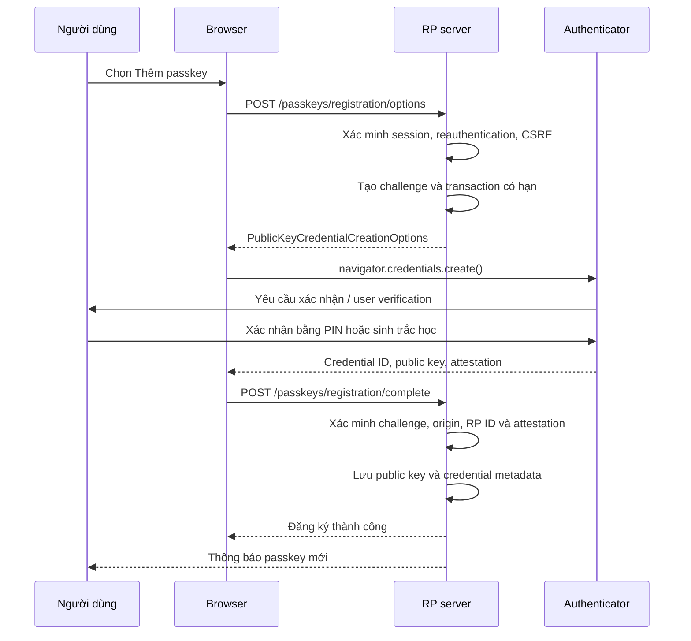

# Passkey enrollment — Đăng ký passkey

## 1. Passkey enrollment là gì?

**Passkey enrollment** là quá trình đăng ký một credential dựa trên cặp khóa công khai/riêng vào tài khoản của người dùng, thường thông qua WebAuthn. Authenticator tạo cặp khóa cho đúng relying party (RP); private key được giữ trong authenticator hoặc môi trường đồng bộ passkey, còn public key và credential ID được gửi tới máy chủ để lưu. Khi đăng nhập về sau, authenticator dùng private key ký challenge mới và máy chủ xác minh bằng public key đã đăng ký.

Ví dụ: Linh đã đăng nhập ứng dụng ngân hàng bằng mật khẩu và MFA. Linh chọn “Thêm passkey trên điện thoại này”. Máy chủ tạo challenge ngẫu nhiên và các tùy chọn WebAuthn, gắn transaction với tài khoản và phiên hiện tại. Trình duyệt yêu cầu điện thoại tạo credential; Linh xác nhận bằng sinh trắc học hoặc PIN thiết bị. Máy chủ kiểm tra kết quả đăng ký, lưu public key và credential ID. Lần sau, Linh có thể đăng nhập bằng passkey mà không phải nhập mật khẩu.

Trong mô-đun **SECURITY_AUTHENTICATION_FUNDAMENTALS**, enrollment là thời điểm một credential mới được liên kết với danh tính/tài khoản. Đây là thao tác nhạy cảm: nếu attacker chiếm session hoặc lừa người dùng thêm passkey của attacker, họ có thể duy trì quyền truy cập ngay cả sau khi mật khẩu được đổi. Vì vậy, đăng ký passkey cần xác thực lại phù hợp, challenge một lần, kiểm tra origin/RP ID, lưu credential an toàn, thông báo và có quy trình thu hồi.

### Mục tiêu học tập

Sau bài này, người học có thể:

- Giải thích WebAuthn registration ceremony và vai trò của RP, browser, authenticator.
- Phân biệt credential ID, public key, private key, user handle và attestation.
- Thiết kế challenge/options cho bước tạo credential.
- Kiểm tra clientDataJSON, authenticatorData, origin, RP ID hash và user verification.
- Chọn resident/discoverable credential, platform/cross-platform authenticator và attestation theo nhu cầu.
- Lưu credential, quản lý nhiều passkey, đồng bộ và thu hồi đúng cách.
- Chống đăng ký trái phép, replay, CSRF, XSS và account takeover.

## 2. Passkey, WebAuthn và credential

Passkey là cách người dùng sử dụng credential mật mã khóa công khai để đăng nhập. WebAuthn là API web tiêu chuẩn cho trình duyệt và authenticator thực hiện các ceremony tạo credential và xác thực. CTAP là giao thức giao tiếp giữa client platform và authenticator bên ngoài trong các trường hợp phù hợp.

Khi đăng ký:

- **Relying Party (RP):** ứng dụng/dịch vụ muốn đăng ký passkey cho tài khoản.
- **User:** người sở hữu tài khoản và xác nhận thao tác.
- **User Agent:** browser hoặc nền tảng thực thi WebAuthn.
- **Authenticator:** thành phần tạo và giữ private key, ví dụ authenticator tích hợp trên điện thoại/laptop, security key hoặc nền tảng passkey đồng bộ.
- **RP server:** tạo challenge, gửi options, xác minh kết quả và lưu public key.

Credential mới thường có:

| Thành phần | Ý nghĩa |
|---|---|
| Credential ID | Định danh credential để RP tìm public key tương ứng; không phải private key |
| Public key | Khóa công khai RP lưu để xác minh assertion trong lần đăng nhập sau |
| Private key | Khóa bí mật do authenticator giữ; không gửi cho RP |
| User handle | Định danh opaque của tài khoản tại RP, được dùng trong WebAuthn |
| RP ID | Phạm vi relying party mà credential được ràng buộc |
| Attestation | Bằng chứng tùy chọn về nguồn gốc/đặc tính authenticator theo chính sách |
| Sign counter | Bộ đếm chữ ký nếu authenticator hỗ trợ; chỉ là một tín hiệu phát hiện rủi ro |

**Mỗi credential được ràng buộc với RP ID.** Một trang giả mạo ở domain khác không thể yêu cầu authenticator tạo assertion hợp lệ cho RP thật chỉ bằng cách sao chép giao diện. Đây là một lý do passkey có khả năng chống phishing tốt hơn mật khẩu/OTP.

### Passkey đồng bộ và passkey gắn thiết bị

- **Synced passkey:** credential có thể được đồng bộ an toàn qua hệ sinh thái của nhà cung cấp nền tảng giữa các thiết bị của người dùng. Tính di động thuận tiện hơn, nhưng mô hình tin cậy còn bao gồm tài khoản đồng bộ, bảo vệ thiết bị và cơ chế khôi phục của nhà cung cấp.
- **Device-bound passkey:** credential gắn với một authenticator/thiết bị và private key không được đồng bộ theo mô hình đó. Quản trị thiết bị và dự phòng trở nên quan trọng hơn.

RP không nên suy luận một credential là “an toàn hơn” chỉ từ nhãn platform hay cross-platform. Hãy xem chính sách, khả năng bảo vệ khóa, user verification, tín hiệu backup và threat model thực tế.

## 3. Registration ceremony diễn ra như thế nào?

WebAuthn registration thường dùng `navigator.credentials.create()` ở phía client. Máy chủ phải khởi tạo transaction trước, sau đó kiểm tra attestation response trước khi lưu credential.



### Bước 1 — Xác định tài khoản và ý định đăng ký

Người dùng thường phải đăng nhập vào tài khoản trước khi thêm passkey. Với thao tác thêm credential, đặc biệt cho tài khoản nhạy cảm, yêu cầu reauthentication hoặc step-up bằng yếu tố đã tin cậy gần đây.

Máy chủ phải xác định account ID từ session đã xác minh, không lấy account ID tùy ý từ request body. Có thể yêu cầu người dùng xác nhận tên thiết bị hoặc nhãn passkey để họ dễ nhận biết trong trang quản lý credential.

### Bước 2 — Tạo challenge và registration transaction

RP server sinh challenge ngẫu nhiên bằng CSPRNG, thường tối thiểu 16 byte entropy theo yêu cầu WebAuthn; triển khai thực tế thường dùng 32 byte. Server lưu challenge cùng:

- Account/user handle đang đăng ký.
- Session hoặc authentication transaction đã khởi tạo yêu cầu.
- RP ID và origin được phép.
- Chính sách user verification và attestation.
- Thời điểm tạo, thời điểm hết hạn và trạng thái đã dùng/chưa dùng.
- Danh sách credential hiện có để đưa vào `excludeCredentials` khi phù hợp.

Challenge phải ngắn hạn, gắn với đúng tài khoản và transaction, chỉ được tiêu thụ một lần. Không chấp nhận challenge do client tự tạo hoặc client tự gửi lại mà server chưa phát hành.

### Bước 3 — Tạo PublicKeyCredentialCreationOptions

Server gửi options cho browser. Các trường thường gồm:

| Trường | Ý nghĩa |
|---|---|
| `challenge` | Thử thách ngẫu nhiên do server sinh |
| `rp.id`, `rp.name` | RP ID và tên hiển thị |
| `user.id` | User handle opaque, ổn định, tối đa 64 byte |
| `user.name`, `user.displayName` | Nhãn hiển thị, không phải bí mật |
| `pubKeyCredParams` | Danh sách thuật toán public key RP chấp nhận |
| `timeout` | Thời gian gợi ý cho client |
| `authenticatorSelection` | Chính sách authenticator, resident key và user verification |
| `attestation` | Mức attestation RP yêu cầu |
| `excludeCredentials` | Credential ID đã có, nhằm tránh đăng ký trùng khi authenticator hỗ trợ |
| `extensions` | Extension tùy chọn được RP hỗ trợ |

`user.id` không nên là email, số điện thoại hay username có thể thay đổi. Dùng một định danh opaque được tạo và quản lý ổn định ở server. User handle không phải credential bí mật.

### Bước 4 — Browser gọi authenticator

Browser chuyển options thành dữ liệu WebAuthn phù hợp rồi gọi:

```javascript
const credential = await navigator.credentials.create({
  publicKey: creationOptions
});
```

Authenticator có thể yêu cầu user presence (UP) và user verification (UV), chẳng hạn người dùng chạm security key, nhập PIN hoặc xác nhận bằng sinh trắc học. Authenticator tạo cặp khóa cho RP, giữ private key và trả về credential ID, public key cùng attestation object theo định dạng WebAuthn.

Private key **không được gửi tới RP server**. Browser không nhận private key để ứng dụng JavaScript tự lưu hoặc xuất ra.

### Bước 5 — Gửi registration response về server

Client gửi các trường từ `PublicKeyCredential` như:

- `id` và `rawId`.
- `type` phải là `public-key`.
- `response.clientDataJSON`.
- `response.attestationObject`.
- `response.getTransports()` nếu client hỗ trợ.
- `clientExtensionResults` nếu có extension.

Các binary field phải được serialize Base64URL đúng chuẩn. Server không được tin dữ liệu JSON do client gửi chỉ vì nó có hình dạng đúng; phải giải mã và xác minh bằng thư viện WebAuthn server phù hợp.

### Bước 6 — Server xác minh và lưu credential

Server xác minh challenge, origin, RP ID hash, flags, public key, thuật toán, attestation theo policy và tính duy nhất của credential ID. Chỉ khi mọi kiểm tra bắt buộc đạt, server mới gắn credential với account và đánh dấu transaction đã tiêu thụ.

## 4. Những trường cần chọn khi tạo credential

### 4.1. RP ID

RP ID thường là domain hiện tại hoặc domain cha được phép theo quy tắc WebAuthn. Credential được ràng buộc với RP ID này. Khi xác minh, server kiểm tra `rpIdHash` trong authenticator data khớp SHA-256 của RP ID mong đợi.

Không đặt RP ID thành domain không kiểm soát hoặc domain rộng hơn mức cần thiết. Chọn RP ID quá rộng có thể mở rộng phạm vi credential tới các subdomain; chọn quá hẹp có thể làm passkey không dùng được giữa các host của cùng ứng dụng. Quyết định này cần được thiết kế trước khi triển khai.

### 4.2. User handle

`user.id` là byte sequence định danh tài khoản trong RP, có độ dài tối đa 64 byte. Nên dùng giá trị opaque, ổn định và không chứa PII. Khi xác minh response, user handle phải gắn với tài khoản đang đăng ký; không cho client đổi account ID giữa transaction.

### 4.3. Public key credential parameters

`pubKeyCredParams` liệt kê loại credential và thuật toán public key RP chấp nhận. Chỉ bật các thuật toán được thư viện và hạ tầng xác minh hỗ trợ, phù hợp chính sách mật mã. Không chấp nhận mọi thuật toán chỉ để tăng khả năng tương thích.

### 4.4. User presence và user verification

- **User Presence (UP):** có tín hiệu người dùng hiện diện/tương tác, ví dụ chạm security key.
- **User Verification (UV):** authenticator xác minh người dùng cục bộ, ví dụ PIN hoặc sinh trắc học.

UP không đồng nghĩa UV. Nếu chính sách yêu cầu xác thực người dùng cục bộ, đặt `userVerification: "required"` và server phải kiểm tra cờ UV trong authenticator data. Không chỉ tin client nói rằng người dùng đã xác nhận.

### 4.5. Resident/discoverable credential

Credential có thể được tạo theo chế độ discoverable (trước đây thường gọi resident credential). Khi bật, authenticator có thể tìm credential theo RP ID mà không cần RP gửi danh sách credential ID trước. Điều này hỗ trợ luồng username-less: người dùng chọn passkey trước rồi RP nhận user handle/credential để xác định tài khoản.

Tùy chọn `residentKey` có thể là `required`, `preferred` hoặc `discouraged` theo mục tiêu và khả năng authenticator. Nếu trải nghiệm đăng nhập không cần nhập username, thường cần discoverable credential. `requireResidentKey` là thuộc tính tương thích cũ; triển khai mới nên dùng `residentKey`.

### 4.6. Authenticator attachment

`authenticatorAttachment` có thể gợi ý `platform` hoặc `cross-platform`:

- Platform: authenticator tích hợp trên thiết bị, thường dùng sinh trắc học/PIN của nền tảng.
- Cross-platform: authenticator bên ngoài như security key.

Đây là bộ lọc trải nghiệm; không nên xem attachment như bằng chứng đủ để kết luận thiết bị đạt một mức assurance cụ thể. Nếu không có yêu cầu cứng, để browser/authenticator lựa chọn có thể giúp người dùng dùng passkey đồng bộ hoặc thiết bị dự phòng.

## 5. Attestation là gì và khi nào cần?

Attestation là dữ liệu authenticator gửi trong registration response để RP có thể xác minh một số thông tin về nguồn gốc hoặc đặc tính của authenticator, tùy format và chính sách. Nó không chứng minh danh tính thật của người dùng và cũng không thay thế việc xác minh user presence/verification.

### Các lựa chọn phổ biến

| Attestation conveyance | Ý nghĩa khái quát | Khi cân nhắc |
|---|---|---|
| `none` | Không yêu cầu bằng chứng attestation có danh tính authenticator; giảm thu thập thông tin thiết bị | Phù hợp nhiều dịch vụ tiêu dùng và ứng dụng không cần kiểm soát model |
| `indirect` | Client có thể chuyển đổi/làm ẩn attestation theo khả năng và policy | Chỉ dùng khi có nhu cầu và hiểu tác động privacy |
| `direct` | RP yêu cầu attestation trực tiếp theo format được hỗ trợ | Môi trường cần kiểm soát loại authenticator |
| `enterprise` | Attestation doanh nghiệp theo chính sách và hỗ trợ nền tảng | Triển khai enterprise có quản lý thiết bị và yêu cầu tuân thủ |

Attestation có thể làm lộ model, nhà sản xuất hoặc định danh thiết bị. Chỉ yêu cầu mức attestation cần thiết; cân nhắc quyền riêng tư và khả năng tương thích.

Nếu policy yêu cầu xác minh attestation, server phải kiểm tra attestation statement, chữ ký, chứng chỉ/chain và trust metadata theo format. Có thể dùng nguồn metadata FIDO đáng tin cậy để đánh giá authenticator. Không được tin certificate chỉ vì nó xuất hiện trong `attestationObject`.

Với nhiều ứng dụng, `attestation: "none"` là lựa chọn hợp lý. RP vẫn xác minh đầy đủ challenge, origin, RP ID, flags và public key. Attestation không phải điều kiện để passkey chống phishing.

## 6. Xác minh registration response ở server

Đây là bước quyết định một passkey có được phép gắn vào tài khoản hay không. Nên dùng thư viện WebAuthn server được duy trì thay vì tự viết bộ giải mã CBOR, parser authenticator data hoặc logic xác minh chữ ký.

### 6.1. clientDataJSON

Sau khi giải mã `clientDataJSON`, server kiểm tra:

- `type` đúng là `webauthn.create`.
- `challenge` đúng challenge server đã phát hành cho transaction này.
- `origin` khớp chính xác một origin được phép, gồm scheme, host và port theo chính sách.
- `crossOrigin` và `topOrigin` nếu có phù hợp với chính sách nhúng/cross-origin.
- Transaction gắn với đúng browser session, account và RP.

Không chấp nhận origin chỉ vì nó có cùng hậu tố chuỗi với domain thật. So khớp origin theo parser/chuẩn, không dùng phép kiểm tra chuỗi lỏng lẻo như `endsWith("example.com")`.

### 6.2. authenticatorData

Authenticator data chứa các trường nhị phân có cấu trúc. Trong registration, các thành phần quan trọng gồm:

- `rpIdHash`: SHA-256 của RP ID.
- Flags: trạng thái UP, UV và các cờ khác.
- `signCount`: bộ đếm nếu authenticator cung cấp.
- Attested credential data khi cờ AT được đặt: AAGUID, credential ID và credential public key.
- Extension data nếu cờ ED được đặt.

Server kiểm tra `rpIdHash`, yêu cầu UP và UV theo policy, sự hiện diện của attested credential data và thuật toán public key. Credential ID và public key phải được parse đúng theo cấu trúc WebAuthn.

### 6.3. Attestation object

`attestationObject` là cấu trúc CBOR chứa format (`fmt`), authenticator data (`authData`) và attestation statement (`attStmt`). Việc xác minh attestation phụ thuộc format và chính sách RP. Nếu chọn `none`, không có chứng cứ attestation danh tính authenticator cần xác minh theo cách như direct attestation.

### Bảng kiểm tra tối thiểu

| Kiểm tra | Điều kiện chấp nhận |
|---|---|
| Transaction | Tồn tại, chưa hết hạn, chưa dùng và gắn đúng session/account |
| Challenge | Khớp chính xác challenge server đã lưu |
| Type | `webauthn.create` |
| Origin | Nằm trong allowlist chính xác |
| RP ID hash | Khớp RP ID mong đợi |
| UP | Có nếu policy yêu cầu user presence |
| UV | Có nếu policy yêu cầu user verification |
| Credential ID | Không trùng credential đã lưu trong phạm vi cần kiểm tra |
| Public key | Parse thành công và thuật toán được chấp nhận |
| Attestation | Xác minh theo conveyance/policy; không tin chứng chỉ tùy tiện |
| User binding | Gắn với user handle/account đã xác thực, không lấy account từ client |
| Replay | Transaction/challenge được tiêu thụ nguyên tử |

User handle không được authenticator gửi lại như một trường riêng trong registration response. RP đã biết user handle từ options do server tạo; vì vậy phải lưu nó trong registration transaction và gắn credential mới với account tương ứng ở phía server.

### Challenge phải dùng một lần

Không chỉ kiểm tra challenge rồi cập nhật trạng thái bằng hai thao tác rời rạc. Hai request đồng thời có thể cùng vượt qua kiểm tra. Hãy dùng transaction database hoặc compare-and-set để chỉ một request tiêu thụ challenge thành công. Khi lưu credential, thao tác tiêu thụ challenge và tạo credential cần nhất quán; nếu ghi một phần thất bại, không để lại trạng thái đăng ký không rõ ràng.

## 7. Lưu credential sau khi đăng ký

Sau khi verifier xác nhận response hợp lệ, RP lưu credential record. Dữ liệu thường cần:

| Trường lưu | Mục đích |
|---|---|
| Account/user ID nội bộ | Chủ sở hữu credential |
| User handle | Liên kết WebAuthn với user tại RP |
| Credential ID | Tìm credential khi xác thực |
| Credential public key | Xác minh assertion về sau |
| Signature counter | Tín hiệu phát hiện clone/rủi ro nếu authenticator hỗ trợ |
| Transports | Gợi ý phương thức giao tiếp để cải thiện UX |
| AAGUID/attestation metadata | Chỉ lưu khi cần policy, hỗ trợ hoặc audit |
| Backup eligibility/state | Tín hiệu về khả năng backup/sync theo WebAuthn |
| Created at / last used at | Quản lý vòng đời và hiển thị cho người dùng |
| User-visible label | Nhãn như “Điện thoại cá nhân” do người dùng đặt |
| Status | Active, revoked hoặc trạng thái quản trị tương ứng |

Public key không cần giữ bí mật nhưng phải bảo vệ tính toàn vẹn. Credential ID không phải mật khẩu; không dùng nó thay proof-of-possession. Private key không được lưu tại RP.

### Signature counter và passkey đồng bộ

Một số authenticator có sign counter tăng dần, giúp phát hiện credential bị clone nếu counter quay lùi hoặc không như mong đợi. Tuy nhiên, nhiều passkey đồng bộ có thể dùng counter bằng 0 hoặc không bảo đảm một bộ đếm tăng đơn điệu toàn cục. Vì vậy:

- Không mặc định từ chối mọi assertion chỉ vì counter bằng 0.
- Xem counter là một tín hiệu rủi ro, không phải bằng chứng tuyệt đối.
- Kết hợp với trạng thái backup, thiết bị, session, IP/risk và hành vi.
- Áp dụng policy khác nhau theo loại authenticator và kiến trúc.

### Backup eligibility và backup state

WebAuthn có các cờ cho biết credential có đủ điều kiện backup và hiện đang ở trạng thái backup theo tín hiệu authenticator. Các cờ này có thể giúp RP hiểu mô hình credential, nhưng không cho phép suy ra chính xác nhà cung cấp đồng bộ hoặc mức bảo vệ tài khoản nền tảng. Dùng chúng như metadata hỗ trợ policy, không phải danh tính thiết bị duy nhất.

## 8. Quản lý nhiều passkey và trải nghiệm người dùng

Người dùng nên có thể đăng ký hơn một passkey để tránh mất quyền truy cập khi thiết bị hỏng hoặc thất lạc. Có thể khuyến khích:

- Passkey trên điện thoại chính.
- Passkey trên máy tính cá nhân.
- Security key dự phòng cho tài khoản đặc quyền hoặc người dùng có nhu cầu.

Không bắt buộc mọi người dùng phải có cùng loại thiết bị. Hỗ trợ các lựa chọn phù hợp, hướng dẫn đặt tên và cho phép kiểm tra lần sử dụng gần nhất.

### Trang quản lý passkey

Trang quản lý có thể hiển thị:

- Nhãn do người dùng đặt.
- Ngày đăng ký.
- Lần sử dụng gần nhất nếu có.
- Loại thông tin hỗ trợ như platform/cross-platform hoặc transports, nếu có thể hiển thị chính xác.
- Trạng thái active/revoked.
- Hành động đổi nhãn hoặc xóa credential sau reauthentication.

Không hiển thị raw credential ID, attestation certificate hoặc thông tin thiết bị chi tiết không cần thiết. Tránh gọi IP hoặc user-agent là tên thiết bị đã được xác minh.

### Tránh khóa tài khoản khi xóa passkey

Nếu người dùng chỉ còn một passkey và đang dùng nó để đăng nhập, việc xóa credential cuối cùng có thể làm họ mất quyền truy cập. Yêu cầu reauthentication bằng yếu tố độc lập hoặc quy trình recovery, và cân nhắc bắt buộc đăng ký yếu tố thay thế trước khi xóa credential cuối.

Sau khi thêm passkey, gửi thông báo qua kênh liên hệ đã xác minh. Thông báo không cần chứa credential ID hoặc bí mật; nên nêu thời điểm, loại thay đổi và cách báo cáo nếu người dùng không thực hiện.

## 9. Synced passkeys, device-bound credential và chính sách

RP có thể phải hỗ trợ nhiều loại passkey:

| Tiêu chí | Synced passkey | Device-bound credential |
|---|---|---|
| Khả năng dùng nhiều thiết bị | Có thể đồng bộ qua tài khoản nền tảng | Thường gắn với authenticator/thiết bị |
| Khôi phục khi mất một thiết bị | Có thể dùng bản đồng bộ khác nếu tài khoản nền tảng còn an toàn | Cần credential dự phòng hoặc recovery |
| Quản lý khóa | Phụ thuộc nền tảng và cơ chế backup | Phụ thuộc thiết bị/security key |
| Privacy/attestation | Có thể hạn chế khả năng nhận diện thiết bị cụ thể | Một số mô hình enterprise có thể dùng attestation để kiểm soát |
| Vận hành | Thuận tiện cho người dùng phổ thông | Có thể phù hợp chính sách thiết bị hoặc đặc quyền |

Không nên dựa riêng vào attestation để buộc mọi người dùng phải dùng một nhà sản xuất nếu không có lý do rõ. Nếu tổ chức cần thiết bị được quản lý, kết hợp attestation/metadata với device management, policy IdP và kiểm soát endpoint.

### Đăng ký passkey trong enterprise

Với tài khoản quản trị hoặc dữ liệu nhạy cảm, policy có thể yêu cầu:

- Reauthentication bằng yếu tố hiện có trước khi đăng ký.
- User verification bắt buộc.
- Passkey hoặc security key đạt tiêu chí tổ chức.
- Attestation/metadata kiểm tra nếu có yêu cầu thiết bị được phê duyệt.
- Phê duyệt bổ sung cho thay đổi credential ở tài khoản đặc quyền.
- Thông báo và audit bất biến.
- Ít nhất một phương thức dự phòng được kiểm soát.

## 10. Các rủi ro khi enrollment

### 10.1. Attacker đăng ký passkey của họ vào tài khoản nạn nhân

Nếu attacker chiếm session, họ có thể gọi endpoint đăng ký và thêm public key mà họ kiểm soát. Sau đó, dù nạn nhân đổi mật khẩu, attacker vẫn có credential riêng.

Kiểm soát:

- Yêu cầu reauthentication/step-up trước enrollment.
- Gắn challenge với account và session đã xác minh.
- CSRF protection cho endpoint options/complete.
- Thông báo tức thời qua kênh độc lập.
- Có trang quản lý credential và khả năng revoke.
- Với tài khoản đặc quyền, có thể yêu cầu approval hoặc delay theo policy.

### 10.2. CSRF và session swapping

Attacker có thể cố khiến browser của nạn nhân gửi yêu cầu đăng ký trong ngữ cảnh session không mong muốn hoặc gắn response vào tài khoản khác. Bảo vệ endpoint bằng CSRF token/Origin policy phù hợp, cookie SameSite, transaction server-side và ràng buộc account/session.

### 10.3. XSS và script độc hại

XSS trong origin RP có thể thao tác giao diện và gọi API bằng session của người dùng. Dù JavaScript không đọc được private key, script độc hại có thể khởi tạo enrollment và dụ người dùng xác nhận. Chống XSS, bảo vệ session, yêu cầu reauthentication và hiển thị rõ thao tác thêm credential.

### 10.4. Replay hoặc transaction substitution

Challenge bị phát lại, hết hạn hoặc lấy từ transaction của tài khoản khác có thể tạo credential sai liên kết. Dùng challenge ngẫu nhiên, TTL ngắn, one-time consume, transaction binding và kiểm tra account/session ở cả bước options lẫn complete.

### 10.5. Origin/RP ID validation yếu

So khớp origin bằng chuỗi hậu tố hoặc chấp nhận wildcard tùy tiện có thể làm một origin không được phép đăng ký credential. Dùng origin allowlist chính xác và RP ID cố định theo cấu hình server.

### 10.6. Attestation bị tin quá mức

Attestation có thể giúp đánh giá authenticator theo policy nhưng không chứng minh người đang đăng ký là chủ tài khoản. Không bỏ qua xác thực session hoặc user verification chỉ vì attestation chain hợp lệ.

### 10.7. Đăng ký quá nhiều credential

Attacker hoặc script có thể tạo nhiều passkey để làm rối trang quản lý hoặc tăng bề mặt truy cập. Giới hạn tần suất, giới hạn số credential theo policy, audit và yêu cầu step-up khi thêm/xóa hàng loạt.

## 11. Ví dụ browser JavaScript tạo passkey

Ví dụ sau minh họa cách browser nhận options từ server và gọi WebAuthn. Server phải tạo options và xác minh response như các phần trên; không tin options hoặc response chỉ vì browser gửi lên.

```javascript
function base64urlToBuffer(value) {
  const padded = value.replace(/-/g, "+").replace(/_/g, "/")
    .padEnd(Math.ceil(value.length / 4) * 4, "=");
  const binary = atob(padded);
  return Uint8Array.from(binary, ch => ch.charCodeAt(0)).buffer;
}

function bufferToBase64url(buffer) {
  const bytes = new Uint8Array(buffer);
  let binary = "";
  for (const byte of bytes) binary += String.fromCharCode(byte);
  return btoa(binary).replace(/\+/g, "-")
    .replace(/\//g, "_").replace(/=+$/g, "");
}

async function enrollPasskey() {
  const optionsResponse = await fetch("/passkeys/registration/options", {
    method: "POST",
    credentials: "same-origin",
    headers: {
      "Content-Type": "application/json",
      "X-CSRF-Token": readCsrfToken()
    },
    body: JSON.stringify({})
  });
  if (!optionsResponse.ok) throw new Error("Không tạo được registration options");

  const options = await optionsResponse.json();
  options.challenge = base64urlToBuffer(options.challenge);
  options.user.id = base64urlToBuffer(options.user.id);
  options.excludeCredentials = (options.excludeCredentials ?? []).map(item => ({
    ...item,
    id: base64urlToBuffer(item.id)
  }));

  const credential = await navigator.credentials.create({
    publicKey: options
  });
  if (!credential) throw new Error("Người dùng đã hủy đăng ký");

  const response = {
    id: credential.id,
    rawId: bufferToBase64url(credential.rawId),
    type: credential.type,
    response: {
      clientDataJSON: bufferToBase64url(credential.response.clientDataJSON),
      attestationObject: bufferToBase64url(credential.response.attestationObject),
      transports: credential.response.getTransports
        ? credential.response.getTransports()
        : []
    },
    clientExtensionResults: credential.getClientExtensionResults()
  };

  const completeResponse = await fetch("/passkeys/registration/complete", {
    method: "POST",
    credentials: "same-origin",
    headers: {
      "Content-Type": "application/json",
      "X-CSRF-Token": readCsrfToken()
    },
    body: JSON.stringify(response)
  });
  if (!completeResponse.ok) throw new Error("Server từ chối passkey");
  return completeResponse.json();
}
```

Ví dụ giả định server trả về challenge và user ID dưới dạng Base64URL. Cần xử lý lỗi browser/platform, timeout, người dùng hủy, authenticator không hỗ trợ và response không hợp lệ. `readCsrfToken()` là hàm ứng dụng cung cấp CSRF token; không bỏ CSRF protection để đơn giản hóa ví dụ.

## 12. Ví dụ Java mô hình hóa lưu credential

Ví dụ sau mô tả record và service boundary ở backend. Phần xác minh WebAuthn thực tế nên giao cho thư viện chuyên dụng đã được kiểm thử:

```java
import java.time.Instant;

enum PasskeyStatus {
    ACTIVE, REVOKED
}

record PasskeyCredential(
    String accountId,
    String credentialId,
    byte[] publicKeyCose,
    byte[] userHandle,
    long signatureCounter,
    String aaguid,
    boolean backupEligible,
    boolean backedUp,
    Instant createdAt,
    Instant lastUsedAt,
    PasskeyStatus status
) {}

interface WebAuthnRegistrationVerifier {
    VerifiedRegistration verify(
        RegistrationTransaction transaction,
        RegistrationResponse response
    );
}

record RegistrationTransaction(
    String transactionId,
    String accountId,
    byte[] userHandle,
    byte[] challenge,
    String expectedOrigin,
    String expectedRpId,
    boolean userVerificationRequired,
    Instant expiresAt
) {}

record RegistrationResponse(
    String credentialId,
    byte[] clientDataJson,
    byte[] attestationObject
) {}

record VerifiedRegistration(
    String credentialId,
    byte[] publicKeyCose,
    long signatureCounter,
    String aaguid,
    boolean backupEligible,
    boolean backedUp
) {}

interface RegistrationStore {
    RegistrationTransaction findPending(String transactionId);
    boolean consumeOnce(String transactionId, Instant now);
    boolean credentialExists(String credentialId);
    void save(PasskeyCredential credential);
}

final class PasskeyEnrollmentService {
    private final WebAuthnRegistrationVerifier verifier;
    private final RegistrationStore store;

    PasskeyEnrollmentService(WebAuthnRegistrationVerifier verifier,
                             RegistrationStore store) {
        this.verifier = verifier;
        this.store = store;
    }

    boolean complete(String transactionId,
                     RegistrationResponse response,
                     Instant now) {
        RegistrationTransaction tx = store.findPending(transactionId);
        if (tx == null || tx.expiresAt() == null
                || !now.isBefore(tx.expiresAt())) {
            return false;
        }

        // Verifier kiểm tra challenge, origin, RP ID, flags,
        // public key, attestation và user binding theo policy.
        VerifiedRegistration verified = verifier.verify(tx, response);
        if (verified == null
                || store.credentialExists(verified.credentialId())) {
            return false;
        }

        // Trong production: consumeOnce và save phải cùng transaction
        // hoặc cơ chế atomic tương đương để ngăn replay/race condition.
        if (!store.consumeOnce(transactionId, now)) return false;

        PasskeyCredential credential = new PasskeyCredential(
            tx.accountId(),
            verified.credentialId(),
            verified.publicKeyCose(),
            tx.userHandle(),
            verified.signatureCounter(),
            verified.aaguid(),
            verified.backupEligible(),
            verified.backedUp(),
            now,
            null,
            PasskeyStatus.ACTIVE
        );
        store.save(credential);
        return true;
    }
}
```

Đây là mô hình kiến trúc, không phải implementation đầy đủ:

- `WebAuthnRegistrationVerifier` phải kiểm tra đúng WebAuthn specification bằng thư viện đáng tin cậy; không tự parse CBOR hoặc xác minh attestation bằng code minh họa.
- `RegistrationTransaction` phải được lấy theo session/account hiện tại, không cho client chọn account ID.
- User handle lấy từ transaction server-side đã dùng để tạo options; không giả định registration response chứa user handle.
- `consumeOnce` và `save` cần nằm trong một database transaction hoặc workflow idempotent/atomic; ví dụ interface tách riêng để minh họa trách nhiệm.
- Verifier phải đối chiếu credential ID trong attested credential data với `rawId`/credential ID client gửi; không tin một trường ID riêng lẻ.
- Credential ID phải được kiểm tra uniqueness theo phạm vi RP và database constraint.
- Bảo vệ tính toàn vẹn public key, user handle và trạng thái credential; private key không tồn tại trong record.
- Lưu metadata tối thiểu cần thiết; tránh thu thập AAGUID/attestation nếu không có mục đích rõ.

## 13. Recovery và vòng đời passkey

Enrollment chỉ là bước đầu. Hệ thống cần hỗ trợ quản lý credential xuyên suốt:

1. Đăng ký passkey sau xác thực đủ mạnh.
2. Hiển thị passkey trong trang quản lý.
3. Cho phép đổi nhãn và xem thông tin sử dụng cần thiết.
4. Yêu cầu reauthentication trước khi xóa hoặc thay đổi credential.
5. Thu hồi passkey bị mất, nghi bị lộ hoặc thuộc thiết bị không còn tin cậy.
6. Gửi thông báo khi credential được thêm/xóa.
7. Duy trì phương thức recovery độc lập và hướng dẫn người dùng đăng ký passkey dự phòng.

Nếu passkey bị mất, người dùng cần dùng passkey khác, recovery code hoặc quy trình account recovery đã thiết kế. Không tự động bỏ MFA chỉ vì người dùng báo mất thiết bị. Sau recovery, đánh giá session/token cũ, credential bị mất và kênh liên hệ.

### Xóa credential cuối cùng

Trước khi xóa passkey cuối cùng:

- Kiểm tra người dùng vừa reauthenticate bằng bằng chứng đủ mạnh.
- Cảnh báo nếu tài khoản sẽ không còn passkey.
- Yêu cầu đăng ký phương thức thay thế hoặc xác nhận recovery path còn hoạt động.
- Ghi audit và gửi thông báo.
- Không cho một request không có session hợp lệ xóa credential của tài khoản khác.

## 14. Kiểm thử passkey enrollment

| Ca kiểm thử | Kết quả mong đợi |
|---|---|
| Challenge hợp lệ, origin đúng, RP ID đúng | Đăng ký thành công |
| Challenge sai hoặc hết hạn | Từ chối |
| Challenge đã được dùng | Từ chối |
| Hai request dùng cùng transaction đồng thời | Chỉ một request thành công |
| `clientDataJSON.type` không phải `webauthn.create` | Từ chối |
| Origin khác allowlist | Từ chối |
| RP ID hash không khớp | Từ chối |
| UV bắt buộc nhưng cờ UV không có | Từ chối |
| Credential ID đã tồn tại | Từ chối hoặc xử lý duplicate theo policy, không ghi đè |
| Thuật toán public key không được phép | Từ chối |
| Attestation không đạt policy bắt buộc | Từ chối |
| Response thuộc transaction/account khác | Từ chối |
| CSRF token/Origin không hợp lệ | Từ chối endpoint |
| Người dùng hủy authenticator prompt | Không tạo credential |
| Đăng ký passkey mới trên session quá cũ | Yêu cầu reauthentication |
| Xóa passkey cuối cùng khi không còn recovery | Chặn hoặc yêu cầu thiết lập phương thức thay thế |
| Credential bị revoke | Không còn được chấp nhận khi đăng nhập |

### Audit và giám sát

Ghi account ID, transaction ID, thời điểm, kết quả, loại thao tác, nhãn do người dùng đặt và metadata cần thiết. Không ghi private key (không được gửi), challenge/token nhạy cảm ở dạng có thể replay, toàn bộ attestation object hoặc dữ liệu sinh trắc học/PIN.

Theo dõi số lần enrollment thất bại, số credential mới theo tài khoản, đăng ký ngay sau recovery hoặc login bất thường, nhiều credential được thêm trong thời gian ngắn và các thay đổi không được người dùng nhận biết.

## 15. Checklist triển khai

- [ ] Chỉ cho phép enrollment từ session/account đã xác thực.
- [ ] Yêu cầu reauthentication/step-up phù hợp trước khi thêm credential.
- [ ] Challenge dùng CSPRNG, ngắn hạn, gắn transaction/account/session và chỉ dùng một lần.
- [ ] RP ID và origin lấy từ cấu hình server, không lấy từ client.
- [ ] User handle opaque, ổn định và không chứa PII.
- [ ] Chỉ cho phép thuật toán public key được hỗ trợ.
- [ ] Chọn user verification/resident key/attachment theo trải nghiệm và policy.
- [ ] Server kiểm tra type, challenge, origin, RP ID hash, UP/UV và credential public key.
- [ ] Attestation chỉ được yêu cầu khi có mục đích và được xác minh theo trust policy.
- [ ] Credential ID có uniqueness constraint; lưu public key và metadata tối thiểu.
- [ ] Không lưu hoặc truyền private key, PIN hay dữ liệu sinh trắc học tới RP.
- [ ] Có CSRF protection, chống XSS, rate limit và audit.
- [ ] Hỗ trợ nhiều passkey, recovery, revoke và thông báo thay đổi.
- [ ] Có kiểm thử replay, race condition, origin mismatch, RP ID mismatch và enrollment trái phép.

## 16. Tổng kết

Passkey enrollment là ceremony WebAuthn tạo credential khóa công khai/riêng và gắn public key với tài khoản tại RP. Server phát hành challenge và options; browser gọi authenticator; authenticator tạo credential và trả attestation response; server xác minh transaction, challenge, origin, RP ID, flags, public key và attestation theo policy rồi mới lưu credential.

**Private key ở lại authenticator; RP chỉ lưu credential ID và public key cùng metadata cần thiết.** Đăng ký passkey là thay đổi bảo mật của tài khoản nên phải có xác thực lại, chống CSRF/replay, ràng buộc đúng account/session, thông báo và quy trình recovery/revoke. Khi quản lý tốt toàn bộ vòng đời, passkey giúp đăng nhập chống phishing mà vẫn giữ quyền kiểm soát credential ở đúng chủ thể và relying party.
