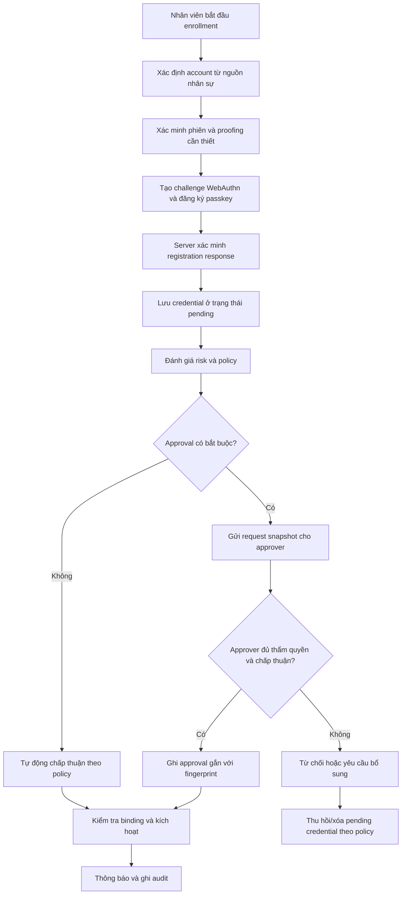

# Enrollment approval

**Enrollment approval** là quy trình xem xét và cho phép một yêu cầu đăng ký danh tính, tài khoản hoặc phương thức xác thực trở thành hợp lệ trong một hệ thống. Trong môi trường doanh nghiệp, một người có thể tự khai thông tin và bắt đầu đăng ký, nhưng hệ thống vẫn cần xác minh danh tính, kiểm tra quyền được tham gia, đánh giá rủi ro và xác nhận rằng credential mới thực sự được gắn với đúng account. Với các phương thức nhạy cảm như passkey, khóa bảo mật, chứng chỉ client hoặc quyền quản trị, việc phê duyệt cần có kiểm soát rõ ràng.

Bài học thuộc chương **Enrollment** của module **SECURITY_AUTHENTICATION_FUNDAMENTALS**. Người học sẽ phân biệt identity proofing với enrollment và approval; xác định ai có thẩm quyền phê duyệt; thiết kế trạng thái yêu cầu, xác minh và binding credential; bảo vệ luồng thêm password, MFA, passkey, chứng chỉ và identity federation; đồng thời kiểm soát thông báo, audit, thu hồi và xử lý ngoại lệ.

Điểm cần nhớ: **approval là quyết định quản trị theo policy, không phải một yếu tố xác thực mới**. Một người quản lý bấm Approve không tự chứng minh người yêu cầu là đúng chủ thể; một phiên đăng nhập hợp lệ cũng không có nghĩa người đó có quyền tự đăng ký mọi credential hoặc nhận mọi vai trò. Hệ thống phải kiểm tra cả danh tính, thẩm quyền, bằng chứng kiểm soát credential và phạm vi được phép.

## 1. Enrollment và approval nằm ở đâu trong vòng đời danh tính?

Enrollment là quá trình đưa một chủ thể, account hoặc authenticator vào hệ thống và thiết lập mối liên kết đáng tin cậy. Approval là một điểm kiểm soát trong quy trình đó, nơi người hoặc policy có thẩm quyền quyết định yêu cầu có được tiếp tục hay không.

Một quy trình thường có các giai đoạn:

1. **Initiation:** người dùng, quản trị viên hoặc hệ thống nguồn tạo yêu cầu enrollment.
2. **Identity/account resolution:** xác định account đích và tenant từ nguồn dữ liệu có thẩm quyền.
3. **Proofing:** thu thập và kiểm tra bằng chứng để xác minh danh tính hoặc quyền kiểm soát account theo mức rủi ro.
4. **Credential registration:** tạo hoặc đăng ký authenticator, ví dụ passkey, TOTP, security key hay client certificate.
5. **Approval:** người hoặc policy được ủy quyền xem xét danh tính, phương thức, phạm vi quyền và rủi ro của yêu cầu.
6. **Binding and activation:** liên kết credential đã được kiểm chứng với đúng account, sau đó mới cho phép sử dụng.
7. **Notification and audit:** thông báo kết quả, lưu dấu vết và cung cấp khả năng báo cáo nếu thay đổi không được yêu cầu.
8. **Lifecycle management:** gia hạn, thay thế, thu hồi và rà soát credential trong suốt thời gian sử dụng.

Không phải mọi hệ thống đều cần phê duyệt thủ công. Một enrollment rủi ro thấp có thể được tự động chấp nhận theo policy sau khi proofing và kiểm tra đạt yêu cầu. Approval thủ công hoặc dual control thường phù hợp hơn với account đặc quyền, thay đổi trust, chứng chỉ có quyền cao, enrollment từ thiết bị không quen thuộc hoặc recovery có thể làm mất các yếu tố hiện tại.

### 1.1. Ví dụ: nhân viên đăng ký passkey

Một nhân viên mới đã được tạo account từ hệ thống nhân sự. Người đó đăng nhập bằng phương thức bootstrap tạm thời, đăng ký passkey trên thiết bị công ty và yêu cầu kích hoạt quyền truy cập ứng dụng quản trị.

Hệ thống cần trả lời các câu hỏi riêng biệt:

- Account có được tạo từ nguồn nhân sự đáng tin và thuộc đúng tenant không?
- Người đang đăng ký có thực sự kiểm soát account đó không?
- Passkey có được tạo cho đúng RP ID và có chứng minh quyền sở hữu private key tương ứng không?
- Thiết bị và loại authenticator có đáp ứng policy cho account quản trị không?
- Ai có thẩm quyền phê duyệt việc kích hoạt quyền quản trị?
- Approval có gắn với đúng credential và đúng yêu cầu hay có thể bị dùng lại cho một passkey khác?

Chỉ khi các điều kiện bắt buộc đều đạt, credential và quyền tương ứng mới được kích hoạt.

## 2. Phân biệt identity proofing, authentication, enrollment và approval

Bốn khái niệm này có liên quan nhưng trả lời những câu hỏi khác nhau.

| Khái niệm | Câu hỏi cần trả lời | Ví dụ |
| --- | --- | --- |
| **Identity proofing** | Người hoặc tổ chức được khai báo có đúng là chủ thể mà hệ thống định danh không? | Đối chiếu hồ sơ nhân sự, kiểm tra giấy tờ hoặc xác minh qua quy trình được phê duyệt. |
| **Authentication** | Người đang thực hiện thao tác có kiểm soát credential đã đăng ký không? | Đăng nhập bằng passkey, mật khẩu và MFA. |
| **Enrollment** | Account hoặc authenticator nào được tạo và liên kết với chủ thể nào? | Đăng ký khóa bảo mật và lưu public key vào account. |
| **Approval** | Chủ thể có thẩm quyền hoặc policy có cho phép yêu cầu này được tiếp tục không? | Quản lý phê duyệt quyền truy cập ứng dụng đặc quyền. |

Approval không thể thay thế proofing. Nếu người yêu cầu chưa được xác minh danh tính, việc quản lý bấm đồng ý không làm bằng chứng đó trở nên hợp lệ. Ngược lại, proofing thành công không tự cấp quyền truy cập mọi hệ thống; quyền vẫn cần được phê duyệt theo vai trò và phạm vi.

### 2.1. Không nhầm assurance level với approval

Các khung assurance như Identity Assurance Level (IAL), Authenticator Assurance Level (AAL) hoặc Federation Assurance Level (FAL) mô tả những thuộc tính bảo đảm khác nhau của proofing, xác thực và federation. Approval là quyết định workflow của tổ chức. Một yêu cầu được hai quản lý phê duyệt không tự động đạt AAL cao; một passkey có khả năng chống phishing cũng không chứng minh người đăng ký có quyền vào tenant.

Policy nên nêu rõ điều kiện kỹ thuật và điều kiện quản trị. Ví dụ: account quản trị phải có identity proofing đạt mức tổ chức yêu cầu, đăng ký authenticator chống phishing với user verification, được hai approver độc lập chấp thuận và chỉ nhận role đúng phạm vi.

## 3. Những loại enrollment có thể cần approval

Approval không chỉ dành cho việc tạo account. Trong hệ thống xác thực, nhiều thao tác thay đổi trust hoặc quyền truy cập cũng là enrollment hoặc re-enrollment.

| Loại yêu cầu | Ví dụ | Vì sao có thể cần approval |
| --- | --- | --- |
| **Account enrollment** | Tạo account cho nhân viên hoặc đối tác. | Xác nhận nguồn danh tính, tenant, sponsor và thời hạn quan hệ. |
| **Authenticator enrollment** | Thêm passkey, TOTP, security key hoặc smart card. | Credential mới sẽ trở thành cách đăng nhập hợp lệ vào account. |
| **Authenticator replacement** | Thay thiết bị bị mất hoặc thêm phương thức dự phòng. | Có thể là recovery attack nhằm chiếm account. |
| **Privileged enrollment** | Đăng ký phương thức cho admin, IAM operator hoặc người phê duyệt. | Sai sót có thể ảnh hưởng nhiều account hoặc toàn hệ thống. |
| **Certificate enrollment** | Cấp client certificate cho workload hoặc người dùng. | Chứng chỉ có thể xác thực service hoặc cấp quyền theo trust policy. |
| **Federation enrollment** | Kết nối một IdP hoặc tenant bên ngoài. | Thay đổi issuer, subject mapping và nguồn danh tính được tin cậy. |
| **Recovery enrollment** | Cấp recovery code hoặc phương thức khôi phục mới. | Recovery có thể trở thành đường vòng bỏ qua MFA hiện tại. |
| **Role/access enrollment** | Thêm user vào nhóm hoặc role ứng dụng. | Xác thực đúng người không đồng nghĩa người đó được cấp quyền mới. |

Hãy xác định approval theo **hậu quả của yêu cầu**, không chỉ theo tên thao tác. Ví dụ thêm một passkey cho account nhân viên thông thường có thể tự phục vụ sau re-authentication; thêm passkey cho break-glass administrator hoặc thay khóa ký production cần kiểm soát mạnh hơn.

## 4. Ai có thể phê duyệt?

Approver phải có thẩm quyền đối với account, tài nguyên hoặc thay đổi được yêu cầu. Vai trò approver có thể đến từ quản lý trực tiếp, owner của ứng dụng, tenant administrator, security team, PKI administrator hoặc policy engine.

### 4.1. Tách requester, verifier, approver và executor

Với thao tác rủi ro cao, không nên để một người tự yêu cầu, tự xác minh, tự phê duyệt và tự thực thi.

| Vai trò | Trách nhiệm | Giới hạn cần có |
| --- | --- | --- |
| **Requester** | Tạo yêu cầu, nêu mục đích và account/resource đích. | Không tự phê duyệt yêu cầu của mình khi policy yêu cầu độc lập. |
| **Verifier** | Kiểm tra danh tính, nguồn dữ liệu và bằng chứng kiểm soát account/credential. | Không bỏ qua proofing chỉ vì requester là đồng nghiệp quen biết. |
| **Approver** | Quyết định có cho phép theo policy, phạm vi và rủi ro không. | Chỉ phê duyệt trong phạm vi thẩm quyền; không sửa nội dung yêu cầu sau khi duyệt. |
| **Executor** | Kích hoạt credential hoặc cấp quyền đã được duyệt. | Chỉ thực thi đúng request/version đã phê duyệt. |
| **Auditor** | Rà soát bằng chứng, approval và kết quả. | Có quyền đọc độc lập; không sửa sự kiện gốc. |

Trong quy trình đơn giản, verifier và approver có thể là cùng một vai trò nếu policy cho phép. Với quyền cao, cần separation of duties (SoD), phê duyệt hai người hoặc một policy engine độc lập.

### 4.2. Thẩm quyền phải được kiểm tra phía server

Không tin trường `approved=true`, email approver hoặc tên hiển thị do client gửi. Server cần xác định actor từ phiên đã xác thực, kiểm tra role hiện tại, tenant, resource scope, quan hệ quản lý và policy tại thời điểm phê duyệt.

Nếu approver vừa bị thu hồi role hoặc rời tổ chức, approval mới của họ phải bị từ chối. Một approval hợp lệ phải có actor identity, thời gian, request ID, policy/version và kết quả có thể kiểm toán.

## 5. Approval phải gắn với nội dung yêu cầu cụ thể

Một lỗi nghiêm trọng là phê duyệt một yêu cầu chung chung, sau đó hệ thống cho phép thay đổi account, credential hoặc quyền mà approver chưa xem.

Approval cần gắn với một **request snapshot** bất biến hoặc fingerprint của các trường quan trọng:

- Account/user identity đích và tenant.
- Loại authenticator hoặc credential được đăng ký.
- Credential ID hoặc fingerprint public key nếu đã có.
- RP ID/origin với WebAuthn, hoặc issuer/subject với federation.
- Role, scope, application hoặc resource được yêu cầu.
- Mục đích, ticket, sponsor và thời hạn.
- Rủi ro, bằng chứng proofing và policy version.
- Thời điểm, approver và hạn hiệu lực của quyết định.

Nếu bất kỳ trường quan trọng nào thay đổi sau approval, yêu cầu cần quay lại trạng thái pending hoặc yêu cầu phê duyệt lại. Không dùng approval của passkey A để kích hoạt passkey B; không dùng approval cấp quyền tenant A cho tenant B.

### 5.1. Approval token hoặc challenge một lần

Một hệ thống có thể tạo approval reference hoặc challenge ngẫu nhiên gắn với request. Executor chỉ được thực hiện khi reference còn hiệu lực, chưa dùng và khớp fingerprint request. Nếu có nhiều node, việc chuyển trạng thái approved sang executed phải nguyên tử.

Approval reference không phải credential để người dùng đăng nhập. Nó là bằng chứng workflow rằng một quyết định cụ thể đã được ghi nhận.

## 6. Luồng enrollment approval mẫu

Ví dụ dưới đây mô tả nhân viên đăng ký passkey và yêu cầu quyền truy cập ứng dụng nội bộ.



Các bước kỹ thuật phải được sắp xếp sao cho credential chưa được sử dụng để đăng nhập trước khi policy yêu cầu approval được thỏa mãn. Tùy kiến trúc, có thể lưu public key dưới trạng thái pending sau khi đã xác minh ceremony, hoặc chỉ tạo credential record active sau approval; điều quan trọng là mọi endpoint xác thực đều từ chối credential pending.

### 6.1. Trạng thái yêu cầu

Một state machine có thể gồm:

| Trạng thái | Ý nghĩa | Chuyển tiếp hợp lệ |
| --- | --- | --- |
| `draft` | Người dùng đang chuẩn bị yêu cầu. | `submitted` hoặc `cancelled`. |
| `submitted` | Yêu cầu đã gửi và chờ kiểm tra. | `proofing`, `pending_approval` hoặc `rejected`. |
| `proofing` | Đang xác minh danh tính/bằng chứng. | `pending_approval`, `approved` hoặc `rejected`. |
| `pending_approval` | Đã đủ bằng chứng cần thiết, đang chờ approver. | `approved`, `rejected` hoặc `expired`. |
| `approved` | Có quyết định chấp thuận hợp lệ. | `activated` hoặc `expired` nếu chưa thực thi kịp. |
| `activated` | Credential/quyền đã được kích hoạt. | `revoked` hoặc trạng thái lifecycle khác. |
| `rejected` | Yêu cầu bị từ chối. | Yêu cầu mới nếu có căn cứ; không sửa request cũ để lách approval. |
| `expired` | Yêu cầu hoặc approval hết hạn. | Tạo transaction mới với bằng chứng mới. |
| `cancelled` | Requester hủy trước khi kích hoạt. | Tạo yêu cầu mới nếu cần. |
| `revoked` | Credential/quyền đã kích hoạt bị thu hồi. | Enrollment lại theo quy trình mới. |

Không cho client tự chuyển trạng thái bằng cách gửi một giá trị tùy ý. State transition phải do server thực hiện sau khi kiểm tra điều kiện, actor và trạng thái hiện tại. Các chuyển tiếp cần chống race condition và xử lý idempotent.

## 7. Proofing trước approval

Approver cần có đủ thông tin để quyết định, nhưng không nên được yêu cầu tự điều tra danh tính bằng những dữ liệu không có nguồn đáng tin. Quy trình proofing phải được định nghĩa trước.

### 7.1. Nguồn dữ liệu có thẩm quyền

Với nhân viên, nguồn có thể là HR directory hoặc hệ thống quản lý nhân sự được tổ chức chỉ định. Với đối tác, có thể là quy trình sponsor, hợp đồng và danh sách liên hệ đã xác minh. Với người dùng cá nhân, có thể là phương thức proofing phù hợp với mức rủi ro và yêu cầu pháp lý.

Email xác nhận chỉ chứng minh khả năng truy cập mailbox tại thời điểm đó; nó không mặc nhiên chứng minh danh tính pháp lý hoặc quyền đại diện tổ chức. Số điện thoại, tên hiển thị, ảnh đại diện hoặc lời xác nhận của đồng nghiệp cũng không tự tạo ra bằng chứng proofing mạnh.

### 7.2. Bằng chứng phải phù hợp mục đích

- Đăng ký account thông thường có thể dùng nguồn danh tính đã xác minh trước và xác nhận quyền kiểm soát email.
- Đăng ký authenticator mới cần chứng minh người đang thao tác có quyền trên account hiện tại, thường qua re-authentication hoặc step-up.
- Đăng ký cho admin hoặc thay đổi recovery cần bằng chứng mạnh hơn và phê duyệt độc lập.
- Cấp client certificate cho workload cần xác minh owner, service identity, environment và quyền sử dụng khóa.
- Liên kết IdP cần xác minh issuer, subject mapping, tenant và thẩm quyền admin.

Không thu thập bản sao giấy tờ, sinh trắc hoặc dữ liệu nhạy cảm vượt quá nhu cầu. Chỉ lưu kết quả proofing, nguồn, thời điểm và reference cần thiết theo chính sách retention.

## 8. Approval cho từng loại authenticator

Approval cần hiểu loại credential đang được thêm và điều kiện kỹ thuật của nó.

### 8.1. Password

Đăng ký hoặc reset mật khẩu thường không cần manager approval cho từng lần nếu người dùng đã được xác thực và quy trình tự phục vụ đáp ứng policy. Tuy nhiên, reset do helpdesk thực hiện, đặt mật khẩu bootstrap, đổi thông tin recovery hoặc reset account đặc quyền có thể cần xác minh bổ sung và approval.

Server cần lưu password verifier bằng password hashing phù hợp, không lưu mật khẩu rõ. Approval không được gửi mật khẩu cho approver hoặc qua email.

### 8.2. TOTP và push authenticator

TOTP enrollment thường tạo secret/seed và yêu cầu người dùng chứng minh đã cấu hình authenticator bằng cách trả một mã hợp lệ. Seed là bí mật; không đưa vào ticket hoặc approval screen.

Nếu cần approval, approver chỉ xem metadata an toàn: account, loại authenticator, thời điểm, trạng thái proofing và risk signals. Họ không cần xem TOTP seed hoặc OTP. Push enrollment cần xác minh binding với thiết bị/app và có quy trình từ chối enrollment lạ.

### 8.3. Passkey và security key

Với WebAuthn, server tạo challenge, RP ID và user context; authenticator tạo credential và trả attestation/credential response. Server phải xác minh challenge, origin, RP ID hash, dữ liệu credential và user verification theo policy trước khi liên kết public key.

Approval có thể cần cho account đặc quyền hoặc thiết bị không đạt policy. Nó phải gắn với đúng credential ID/public key fingerprint và account đích. Không cho approver duyệt một yêu cầu “thêm passkey” chung rồi requester có thể gửi bất kỳ public key nào sau đó.

Attestation có thể cung cấp tín hiệu về authenticator model hoặc nguồn gốc theo loại attestation, nhưng không phải bằng chứng tuyệt đối rằng thiết bị an toàn hoặc người đăng ký là chủ tài khoản. Chỉ yêu cầu và lưu attestation khi threat model thực sự cần; cân nhắc quyền riêng tư và tính tương thích.

### 8.4. Certificate và workload identity

Enrollment chứng chỉ cần ràng buộc yêu cầu với identity của người dùng/workload, Subject/SAN, issuer/CA, key usage, extended key usage, thời hạn, environment và owner. Approver cần xem scope sử dụng và hậu quả nếu private key bị lộ.

Private key nên được tạo và giữ trong nơi bảo vệ phù hợp, ví dụ TPM/HSM hoặc secret/key manager theo kiến trúc. Approval không được biến thành quy trình gửi private key qua email. CA chỉ cấp chứng chỉ sau khi xác minh request, thẩm quyền requester và policy issuance.

### 8.5. Federation và liên kết identity

Thêm một IdP hoặc liên kết account bên ngoài có thể làm thay đổi nguồn danh tính được tin cậy. Approval cần xem issuer/entity ID, metadata provenance, endpoint, signing keys, tenant, subject mapping và nhóm/role được ánh xạ.

Không tự động hợp nhất account chỉ vì email từ IdP mới trùng với email hiện có. Cần xác minh quyền kiểm soát account đích và phê duyệt thay đổi mapping theo mức rủi ro.

## 9. Risk-based approval và step-up

Không phải yêu cầu nào cũng cần cùng số người duyệt. Policy có thể đánh giá:

- Loại account: cá nhân, nhân viên, service account hay administrator.
- Hành động: thêm authenticator, thay recovery, cấp role, đổi IdP hay cấp chứng chỉ.
- Mức quyền: đọc dữ liệu, ghi dữ liệu, quản trị tenant, ký token hoặc quản trị CA.
- Tình trạng phiên: thời điểm đăng nhập gần nhất, phương thức đã dùng, user verification và session age.
- Thiết bị và bối cảnh: thiết bị đã quản lý, tín hiệu rủi ro, vị trí bất thường, nguồn mạng.
- Lịch sử: số lần enrollment gần đây, thay đổi liên tiếp, failed proofing hoặc approval bất thường.
- Mức ảnh hưởng: một user, một tenant hay nhiều tenant.

### 9.1. Ví dụ ma trận policy

| Yêu cầu | Kiểm soát tham khảo |
| --- | --- |
| Nhân viên thêm passkey thứ hai vào account thường | Re-authentication, WebAuthn verification, notification; tự động approve nếu policy đạt. |
| Nhân viên mất điện thoại và reset MFA | Recovery proofing, thu hồi phương thức cũ, notification; helpdesk approval theo policy. |
| Thêm passkey cho tenant administrator | Step-up bằng phương thức hiện có, kiểm tra thiết bị, hai approver độc lập hoặc security review. |
| Cấp chứng chỉ cho service production | Workload owner approval, PKI policy, ràng buộc SAN/EKU/environment, audit. |
| Kết nối IdP mới cho tenant | Tenant admin approval, kiểm tra metadata/issuer/keys, security review và thử nghiệm trước khi kích hoạt. |
| Thêm recovery method sau khi account bị chiếm nghi ngờ | Tạm dừng thay đổi, proofing tăng cường, thu hồi session/credential nghi vấn và phê duyệt độc lập. |

Bảng này là ví dụ thiết kế, không phải mức bắt buộc cho mọi tổ chức. Tổ chức cần định nghĩa ngưỡng và quyền phê duyệt cụ thể trong policy.

### 9.2. Step-up không đồng nghĩa approval

Step-up yêu cầu người dùng chứng minh lại bằng phương thức mạnh hơn hoặc xác thực gần thời điểm thao tác. Approval là quyết định của người/policy khác. Một yêu cầu có thể cần cả hai: requester step-up để chứng minh đang kiểm soát account, sau đó approver độc lập xác nhận quyền đăng ký credential đặc quyền.

## 10. Chống approval phishing và social engineering

Attacker thường khai thác sự vội vàng, áp lực công việc hoặc giao diện approval thiếu ngữ cảnh. Một yêu cầu giả có thể được trình bày như “cần reset MFA gấp”, “đổi điện thoại” hoặc “khóa tài khoản sắp hết hạn”.

Biện pháp bảo vệ:

- Approver phải đăng nhập bằng account riêng và MFA phù hợp với mức quyền.
- Hiển thị chính xác account đích, tenant, loại credential, scope, thiết bị và lý do.
- Không phê duyệt chỉ dựa trên email hoặc tin nhắn ngoài hệ thống.
- Với thao tác rủi ro cao, xác minh requester qua kênh độc lập đã biết, không dùng số điện thoại/email mới do chính request cung cấp.
- Yêu cầu re-authentication cho approver trước khi duyệt thay đổi đặc quyền.
- Cảnh báo khi một approver nhận số lượng request bất thường hoặc requester liên tục thúc giục.
- Không cho phép sửa request sau approval; thay đổi cần request mới.
- Cho approver quyền từ chối, yêu cầu thêm bằng chứng hoặc chuyển security review.

Approval UI nên trình bày **ý nghĩa và tác động** của hành động, không chỉ các mã kỹ thuật. Ví dụ, hiển thị “Thêm passkey mới vào account quản trị của tenant A” rõ ràng hơn một nút “Approve credential operation”.

## 11. Notification và cơ hội phát hiện enrollment trái phép

Sau khi authenticator hoặc recovery method được thêm, người dùng cần biết thay đổi nào đã xảy ra và cách báo cáo nếu không phải họ thực hiện.

Notification nên gửi qua kênh đã đăng ký và đủ độc lập với thao tác vừa thay đổi. Nếu thay email khôi phục, không chỉ gửi thông báo tới email mới; cần thông báo tới kênh cũ đã được xác minh hoặc kênh độc lập khác theo policy.

Thông báo nên nêu:

- Account và tenant bị thay đổi.
- Loại authenticator hoặc quyền vừa thêm/xóa.
- Thời gian và thiết bị/bối cảnh ở mức có thể chia sẻ an toàn.
- Yêu cầu/ticket reference và trạng thái approval.
- Cách thu hồi hoặc liên hệ security nếu thao tác không được yêu cầu.

Không đưa secret, recovery code, private key, TOTP seed hoặc token vào notification. Thông báo không thay thế audit và không được chứa dữ liệu khiến người khác chiếm account khi đọc được email.

## 12. Audit trail và bằng chứng approval

Enrollment approval cần có audit trail đủ để trả lời ai đã yêu cầu, ai xác minh, ai phê duyệt, credential nào được gắn, policy nào được áp dụng và khi nào kích hoạt.

Một audit event minh họa:

```json
{
  "event_id": "evt-71c2",
  "timestamp": "2026-11-22T06:15:00Z",
  "request_id": "enr-4f82",
  "actor_id": "staff-27",
  "actor_role": "tenant_security_approver",
  "action": "authenticator.enrollment.approve",
  "target_user_id": "usr-57",
  "tenant_id": "org-7",
  "credential_type": "webauthn",
  "credential_fingerprint": "sha256:public-key-fingerprint",
  "policy_version": "enrollment-policy-v3",
  "approval_id": "apr-93a1",
  "result": "approved"
}
```

Ví dụ không chứa private key, token hoặc bí mật authenticator. Audit event nên được ghi vào nơi có quyền quản trị tách biệt với người thực hiện enrollment. Nếu approver có thể xóa cả request và log, quy trình không có bằng chứng độc lập.

Các trường quan trọng:

- Request ID và correlation ID xuyên suốt các service.
- Actor identity đã xác minh, role và tenant.
- Target account/identity và credential metadata.
- Proofing method/result và reference tới bằng chứng đã bảo vệ.
- Approval decision, approver, timestamp, reason code và policy version.
- Trạng thái trước/sau và kết quả activation/revocation.
- Nguồn request, thiết bị/bối cảnh rủi ro ở mức cần thiết.

Không ghi password, OTP, TOTP seed, recovery code, private key, access/refresh token, cookie hoặc toàn bộ dữ liệu giấy tờ vào log.

## 13. Thu hồi, từ chối và cleanup

Approval không phải quyết định vĩnh viễn. Yêu cầu có thể bị từ chối, hết hạn, bị hủy hoặc credential đã kích hoạt có thể bị thu hồi sau khi phát hiện sai sót.

- **Rejected:** ghi lý do ở mức phù hợp, không tiết lộ chi tiết giúp attacker điều chỉnh tấn công.
- **Expired:** xóa hoặc vô hiệu hóa challenge/approval reference; không cho tái sử dụng.
- **Cancelled:** requester hủy; pending credential cần được dọn theo policy.
- **Revoked:** vô hiệu credential ở RP/IdP/CA và kiểm tra session/token phát sinh.
- **Superseded:** credential cũ được thay thế; đảm bảo credential mới đã hoạt động trước khi thu hồi nếu quy trình cần tránh lockout.
- **Abandoned:** request không hoàn tất; xóa pending data sau TTL và lưu audit tối thiểu.

Khi credential đã bị kích hoạt nhầm, cần xác định session/token đã tạo từ credential đó và thu hồi theo khả năng hệ thống. Xóa một dòng trong giao diện quản lý không bảo đảm mọi bản sao, session hoặc token đã phát hành đều bị vô hiệu hóa.

## 14. API và pseudocode thực thi approval

Một API enrollment an toàn nên tách thao tác gửi yêu cầu, quyết định phê duyệt và kích hoạt. Client không được tự chọn trạng thái cuối.

Ví dụ các endpoint khái niệm:

```http
POST /v1/enrollments
GET  /v1/enrollments/{requestId}
POST /v1/enrollments/{requestId}/approve
POST /v1/enrollments/{requestId}/reject
POST /v1/enrollments/{requestId}/activate
POST /v1/enrollments/{requestId}/cancel
```

Các endpoint thực tế phải kiểm tra authorization theo actor, tenant và request state. Không để requester gọi endpoint approve bằng cùng principal nếu policy yêu cầu người duyệt độc lập.

### 14.1. Pseudocode phía server

```text
submitEnrollment(request, requester):
    require requester is authenticated
    account = resolveTargetAccountFromTrustedDirectory(request.accountRef)
    require requesterMayEnrollFor(requester, account)

    proofing = verifyRequiredIdentityAndAccountControl(requester, account)
    require proofing.satisfies(policyFor(request.credentialType, account))

    credentialEvidence = validateRegistrationCeremony(request.credentialResponse)
    requestSnapshot = freeze({
        accountId: account.id,
        tenantId: account.tenantId,
        credentialType: request.credentialType,
        credentialFingerprint: fingerprint(credentialEvidence.publicKey),
        requestedRoles: request.roles,
        purpose: request.purpose,
        policyVersion: currentPolicy.version
    })

    decision = evaluateEnrollmentRisk(requestSnapshot, proofing)
    status = decision.requiresApproval ? "pending_approval" : "approved"

    saveEnrollmentAtomically(
        requestSnapshot,
        credentialEvidence,
        proofing.reference,
        status,
        shortExpiry
    )
    audit("enrollment.submitted", requestSnapshot)
    return requestId


approveEnrollment(requestId, approver):
    require approver is authenticated with required stepUp
    enrollment = loadEnrollmentForUpdate(requestId)
    require enrollment.status == "pending_approval"
    require nowUtc() < enrollment.expiresAt
    require approverMayApprove(approver, enrollment.snapshot)
    require approver.id != enrollment.requesterId
    require approvalPolicySatisfied(enrollment, approver)

    recordApprovalAgainstFingerprint(
        requestId,
        hash(enrollment.snapshot),
        approver.id,
        currentPolicy.version
    )
    transitionStateAtomically(requestId, "approved")
    audit("enrollment.approved", requestId, approver.id)


activateEnrollment(requestId, executor):
    enrollment = loadEnrollmentForUpdate(requestId)
    require enrollment.status == "approved"
    require approvalMatchesCurrentSnapshot(enrollment)
    require credentialProofStillValid(enrollment)
    require targetAccountIsActive(enrollment.accountId)
    require policyStillAllowsActivation(enrollment)

    activateCredentialAndBindToAccount(enrollment)
    transitionStateAtomically(requestId, "activated")
    notifyAccountThroughIndependentChannel(enrollment)
    audit("enrollment.activated", requestId, executor.id)
```

Pseudocode chỉ diễn tả nguyên tắc. Hệ thống thực tế cần transaction database, xử lý idempotency, phân quyền chi tiết, bảo vệ challenge, giới hạn request và quản lý lỗi. Nếu approval đã được ghi nhưng activation thất bại, cần trạng thái retry rõ ràng; không phát hành credential hai lần hoặc bỏ qua kiểm tra fingerprint.

### 14.2. Điều kiện bắt buộc trước activation

Trước khi kích hoạt, kiểm tra lại:

- Request chưa hết hạn, chưa bị hủy hoặc thu hồi.
- Snapshot hiện tại giống nội dung đã được duyệt.
- Credential proof/public key vẫn khớp request đã xác minh.
- Account và tenant còn hoạt động, requester vẫn có quyền thực hiện.
- Approver vẫn đủ thẩm quyền theo policy hoặc approval còn hiệu lực theo quy định.
- Không có sự kiện rủi ro mới buộc phải review lại.
- Credential chưa được gắn với account khác hoặc đã được kích hoạt ở transaction khác.

Việc kiểm tra lại ngăn khoảng thời gian giữa approval và activation bị lợi dụng để thay đổi mục tiêu hoặc nội dung yêu cầu.

## 15. Tình huống thực hành: helpdesk yêu cầu reset MFA cho administrator

**Bối cảnh:** Một người gọi helpdesk nói rằng đã mất điện thoại và không thể dùng MFA. Họ yêu cầu agent reset MFA cho account administrator. Agent tìm thấy account theo email và nhận được một ticket ghi “khẩn cấp”. Quy trình cũ cho phép agent tự xác minh bằng vài thông tin hồ sơ, tự phê duyệt và tự reset.

**Phân tích rủi ro:**

1. Email hoặc thông tin hồ sơ có thể bị lộ; chúng không đủ chứng minh người gọi là chủ account.
2. Account đích có quyền cao, nên hậu quả của recovery sai rất lớn.
3. Một agent đang nắm cả quyền xác minh, phê duyệt và thực thi.
4. Không có step-up, kênh độc lập, notification hoặc audit tách biệt.
5. Kẻ tấn công có thể thêm authenticator của họ, đăng nhập và tiếp tục thay đổi role hoặc recovery.

**Thiết kế lại:**

- Tạm dừng recovery tự phục vụ cho account đặc quyền khi tín hiệu rủi ro cao.
- Xác minh requester bằng quy trình proofing đã định nghĩa, sử dụng nguồn/kênh độc lập đã có từ trước.
- Yêu cầu một security approver hoặc hai approver độc lập theo policy.
- Gắn approval với account, credential action và request snapshot; không cho thay target sau khi duyệt.
- Thu hồi authenticator bị mất, đánh giá session/token hiện tại và yêu cầu enrollment mới có kiểm chứng.
- Gửi notification qua kênh độc lập, ghi audit tới kho log tách biệt và theo dõi hoạt động sau recovery.

**Bài tập:** Nếu người yêu cầu là administrator thật nhưng approver đang vắng mặt, có nên bỏ approval không? Chỉ dùng break-glass theo policy đã định nghĩa: giới hạn quyền, thời hạn ngắn, xác minh mạnh, cảnh báo tức thời, audit độc lập và hậu kiểm. Không tạo ngoại lệ tùy hứng trong lúc xử lý ticket.

## 16. Checklist thiết kế enrollment approval

- [ ] Phân biệt identity proofing, authentication, enrollment và approval.
- [ ] Xác định account, tenant và nguồn danh tính có thẩm quyền trước khi tạo credential.
- [ ] Định nghĩa loại enrollment nào tự động, loại nào cần một approver hoặc dual control.
- [ ] Kiểm tra approver có quyền trên đúng tenant, account, resource và hành động.
- [ ] Tách requester, verifier, approver và executor cho thao tác rủi ro cao.
- [ ] Yêu cầu step-up cho requester/approver khi phù hợp; không coi approval là yếu tố MFA.
- [ ] Gắn approval với request snapshot/fingerprint gồm target, credential, scope, tenant và policy version.
- [ ] Không cho sửa request quan trọng sau approval; thay đổi cần review lại.
- [ ] Xác minh registration ceremony và proof-of-possession trước activation.
- [ ] Credential ở trạng thái pending không được dùng để đăng nhập hoặc cấp quyền.
- [ ] Áp dụng policy riêng cho passkey, TOTP, certificate, recovery và federation.
- [ ] Không coi email, SMS hoặc lời xác nhận đồng nghiệp là proofing đủ mạnh mặc định.
- [ ] Notification tới kênh độc lập khi thêm, thay hoặc thu hồi authenticator.
- [ ] Audit actor, approver, request, credential fingerprint, policy version và kết quả; không log secret.
- [ ] Dùng state machine, TTL, idempotency và atomic transition để chống replay/race.
- [ ] Có xử lý reject, cancel, expire, abandoned request, revoke và cleanup.
- [ ] Kiểm thử approver bị thu hồi quyền, tenant mismatch, snapshot bị thay đổi và approval bị phát lại.
- [ ] Có quy trình break-glass với giới hạn, cảnh báo và hậu kiểm độc lập.

## 17. Câu hỏi tự kiểm tra

**1. Enrollment approval có phải là một yếu tố xác thực không?**  
Không. Approval là quyết định quản trị hoặc policy cho phép yêu cầu tiếp tục; nó không chứng minh người yêu cầu đang kiểm soát authenticator.

**2. Người quản lý phê duyệt có thay thế identity proofing không?**  
Không. Approver có thể xác nhận nhu cầu công việc hoặc thẩm quyền, nhưng danh tính và quyền kiểm soát account phải được kiểm chứng bằng quy trình proofing phù hợp.

**3. Vì sao approval cần gắn với fingerprint của credential?**  
Để bảo đảm approver đã duyệt đúng public key/credential và account đích. Nếu credential thay đổi sau đó, approval cũ không còn áp dụng.

**4. Có nên để credential pending đăng nhập được không?**  
Không. Credential chưa qua mọi kiểm tra và approval bắt buộc phải bị từ chối ở authentication endpoint cho tới khi activation hoàn tất.

**5. Khi nào cần dual control?**  
Với thay đổi có tác động lớn như enrollment cho administrator, cấp chứng chỉ production, đổi trust anchor hoặc recovery có thể chiếm account. Một người không nên tự kiểm soát toàn bộ quy trình.

**6. Email verification có chứng minh danh tính pháp lý không?**  
Không. Nó thường chỉ chứng minh khả năng truy cập mailbox; cần nguồn proofing khác nếu mục đích yêu cầu assurance cao hơn.

**7. Nếu request thay đổi sau khi được phê duyệt thì sao?**  
Từ chối activation bằng approval cũ và đưa yêu cầu về review hoặc tạo request mới. Approval chỉ áp dụng cho snapshot đã được duyệt.

**8. Tại sao cần notification sau khi thêm passkey?**  
Để chủ account nhận biết enrollment trái phép và có cơ hội báo cáo, thu hồi credential/session trước khi thiệt hại lan rộng.

**9. Nếu approval thành công nhưng activation lỗi thì xử lý thế nào?**  
Giữ trạng thái workflow rõ ràng, retry idempotent và kiểm tra snapshot/approval còn hiệu lực; không tạo credential trùng hoặc bỏ qua kiểm tra.

**10. Break-glass có thể bỏ qua mọi kiểm soát không?**  
Không. Nó là quy trình khẩn cấp được định nghĩa trước, có phạm vi, thời hạn, cảnh báo, audit độc lập và hậu kiểm.

**Ghi nhớ:** Enrollment approval bảo đảm việc thêm account, authenticator, chứng chỉ hoặc nguồn danh tính được thực hiện đúng thẩm quyền và đúng phạm vi. Hãy proofing trước, xác minh credential, gắn approval với nội dung request bất biến, tách nhiệm vụ theo rủi ro, chỉ kích hoạt sau khi mọi điều kiện đạt và duy trì notification, audit cùng khả năng thu hồi trong toàn bộ vòng đời.
