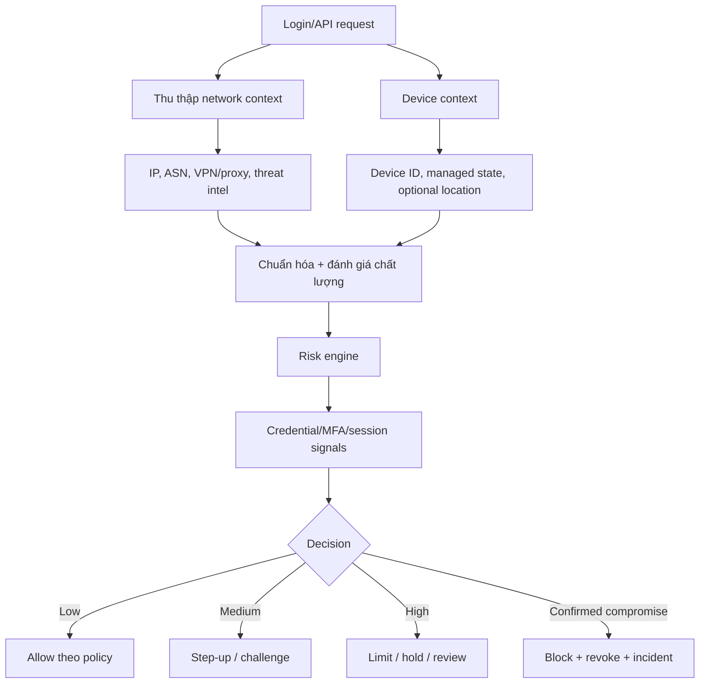

# Vị trí truy cập — Sử dụng location như ngữ cảnh đánh giá đăng nhập

Một nhân viên thường đăng nhập từ laptop công ty tại Hà Nội, nhưng hôm nay tài khoản xuất hiện từ một địa chỉ IP ở quốc gia khác. Hệ thống cần quyết định đây là chuyến công tác hợp lệ, kết nối qua VPN, mạng di động định tuyến bất thường hay dấu hiệu kẻ tấn công vừa lấy được mật khẩu và token. Vị trí có thể giúp phát hiện rủi ro, nhưng dữ liệu vị trí thường chỉ là ước lượng và có thể bị che giấu hoặc giả mạo. Nếu coi một địa chỉ IP là bằng chứng chắc chắn về danh tính, hệ thống có thể khóa nhầm người dùng hoặc bỏ sót attacker dùng proxy.

**Vị trí truy cập (access location)** là một nhóm tín hiệu ngữ cảnh được quan sát hoặc suy ra tại thời điểm người dùng/thiết bị truy cập dịch vụ. Tín hiệu có thể đến từ địa chỉ IP, mạng/ASN, VPN/proxy, thiết bị có quyền cung cấp vị trí hoặc thông tin địa lý khác. Hệ thống dùng chúng để đánh giá mức rủi ro, chọn yêu cầu xác thực bổ sung và phát hiện bất thường.

Bài học thuộc chương **Authentication context** của học phần **SECURITY_AUTHENTICATION_FUNDAMENTALS**. Nội dung kết nối vị trí với credential, mật khẩu, MFA, passkey, chứng chỉ, token, phiên, liên kết danh tính và khôi phục tài khoản. Người học sẽ biết mô hình hóa ranh giới tin cậy, phòng chống giả mạo/ngụy trang vị trí, replay và lạm dụng đăng nhập; đồng thời cân bằng bảo mật, quyền riêng tư và khả năng tiếp cận.

## 1. Kết quả học tập

Sau bài này, người học có thể:

- Giải thích vị trí truy cập là tín hiệu ngữ cảnh, không phải bằng chứng danh tính hoặc yếu tố xác thực độc lập.
- Phân biệt IP geolocation, GPS/device location, mạng/ASN, VPN/proxy và vị trí được khai báo.
- Đánh giá độ chính xác, độ mới, nguồn gốc và mức tin cậy của từng tín hiệu vị trí.
- Mô hình hóa các rủi ro như impossible travel, đăng nhập từ mạng lạ, proxy residential, VPN, Tor và credential stuffing phân tán.
- Thiết kế chính sách risk-based authentication để cho phép, yêu cầu step-up, giới hạn hoặc chặn theo bằng chứng tổng hợp.
- Tránh false positive do VPN công ty, mạng di động, NAT, roaming, sai lệch cơ sở dữ liệu địa lý và người dùng đi lại.
- Bảo vệ quyền riêng tư bằng data minimization, retention giới hạn, phân quyền và giải thích minh bạch.
- Liên kết quyết định vị trí với session, token, MFA/passkey và quy trình ứng phó mà không biến dữ liệu địa lý thành quyền truy cập.
- Viết tiêu chí kiểm thử cho spoofing, proxy, geovelocity, dữ liệu thiếu, sai lệch và thu hồi phiên.

## 2. Vị trí truy cập có ý nghĩa gì trong authentication context?

Authentication context là tập hợp thông tin mô tả điều kiện một lần xác thực diễn ra: thời điểm, thiết bị, mạng, vị trí, phương thức xác thực, mức bảo đảm, trạng thái phiên và tín hiệu rủi ro. Vị trí là một thành phần của bức tranh đó.

Ví dụ, một sự kiện đăng nhập có thể chứa:

| Nhóm ngữ cảnh | Dữ liệu ví dụ | Ý nghĩa |
| --- | --- | --- |
| Thời gian | Timestamp UTC, độ lệch đồng hồ | Phát hiện hoạt động ngoài giờ hoặc chuỗi sự kiện không hợp lý |
| Vị trí mạng | IP public, quốc gia/khu vực ước lượng | Ước lượng điểm thoát mạng |
| Nhà mạng | ASN, ISP, loại mạng | Phân biệt mạng doanh nghiệp, cloud hosting, mobile carrier |
| Định tuyến riêng tư | VPN, proxy, Tor hoặc egress gateway đã biết | Hiểu vì sao IP không phản ánh vị trí thiết bị |
| Thiết bị | Device ID, browser/app, trạng thái quản lý | Đối chiếu thiết bị quen thuộc hoặc thiết bị mới |
| Vị trí thiết bị | GPS/OS location nếu người dùng cho phép | Bổ sung tín hiệu có độ chính xác và quyền riêng tư khác nhau |
| Xác thực | Password, passkey, MFA, certificate; thời điểm xác thực | Đánh giá bằng chứng xác thực và độ mới |
| Phiên/token | Session age, token binding, refresh history | Đánh giá liệu request thuộc phiên đang hoạt động hợp lệ |

Vị trí có thể giúp trả lời: “Lần truy cập này có khác thường so với lịch sử và chính sách không?” Nó không trả lời chắc chắn: “Người này là ai?” hoặc “Người này có quyền truy cập dữ liệu nào?”.

### Vị trí không phải yếu tố xác thực

Một địa chỉ IP ở văn phòng không chứng minh người gửi là nhân viên; attacker có thể dùng máy bị chiếm trong mạng nội bộ hoặc VPN của công ty. Một tọa độ GPS gần văn phòng cũng không chứng minh người dùng là chủ tài khoản; GPS có thể sai, bị giả lập hoặc do thiết bị khác cung cấp. Vị trí nên là **risk signal** kết hợp với credential, device context và hành vi.

## 3. Các nguồn dữ liệu vị trí

### 3.1. IP geolocation

IP geolocation tra cứu địa chỉ IP public trong cơ sở dữ liệu để ước lượng quốc gia, khu vực, thành phố hoặc tọa độ gần đúng. Dữ liệu thường dựa trên phân bổ địa chỉ, thông tin nhà mạng, định tuyến, khảo sát và tín hiệu quan sát.

Ưu điểm:

- Có thể lấy từ request mà không yêu cầu người dùng cấp quyền GPS.
- Phù hợp với phân tích mạng, phát hiện IP cloud/hosting, ASN hoặc điểm thoát bất thường.
- Có thể áp dụng cho web, API và workload nếu IP client được xác định đúng.

Giới hạn:

- Thường phản ánh điểm thoát mạng, không phải vị trí vật lý của người dùng.
- Sai số có thể lớn; dữ liệu thành phố/tọa độ không nên được xem là chính xác tuyệt đối.
- VPN, proxy, Tor, corporate egress, carrier-grade NAT và mạng di động có thể làm IP khác xa thiết bị.
- Cơ sở dữ liệu có thể chậm cập nhật hoặc gán nhầm dải IP.
- Một IP có thể được nhiều người dùng chung.

Vì vậy, IP geolocation phù hợp để tạo tín hiệu rủi ro ở mức quốc gia/khu vực hoặc phân loại mạng; không nên dùng để xác định địa chỉ nhà hoặc theo dõi chính xác cá nhân.

### 3.2. GPS và vị trí do thiết bị cung cấp

Browser hoặc mobile app có thể yêu cầu quyền location từ hệ điều hành/trình duyệt. Nếu người dùng cho phép, thiết bị có thể cung cấp tọa độ, độ chính xác ước lượng, timestamp và nguồn cảm biến.

Các giới hạn:

- Quyền có thể bị từ chối, bị thu hồi hoặc chỉ cấp trong một khoảng thời gian.
- Tọa độ có thể được ước lượng từ GPS, Wi-Fi, mạng di động hoặc kết hợp cảm biến.
- Thiết bị có thể giả lập vị trí, bị root/jailbreak, bị điều khiển hoặc gửi dữ liệu đã sửa.
- Trình duyệt không bảo đảm mọi tọa độ là kết quả trực tiếp từ GPS.
- Thu thập GPS có thể gây tác động lớn tới quyền riêng tư và trải nghiệm người dùng.

Không yêu cầu vị trí chính xác nếu IP/network context đã đủ cho quyết định. Nếu cần GPS cho một nghiệp vụ cụ thể, giải thích mục đích, xin quyền đúng cách, chỉ thu thập tại thời điểm cần và không giữ lâu hơn mức cần thiết.

### 3.3. Network context: ASN, ISP và loại mạng

ASN (Autonomous System Number) cho biết mạng/tổ chức định tuyến một dải IP. Kết hợp ASN, ISP, reverse DNS, loại mạng và thông tin threat intelligence có thể giúp nhận biết:

- Mạng doanh nghiệp hoặc egress gateway đã đăng ký.
- Nhà mạng di động hoặc mạng dân dụng.
- Cloud hosting/data center thường được dùng cho automation.
- VPN/proxy/Tor exit node được biết tới.
- Dải IP có lịch sử lạm dụng hoặc bot traffic.

Các phân loại này không đồng nghĩa người dùng xấu. Nhiều tổ chức hợp pháp chạy dịch vụ qua cloud; người dùng cá nhân có thể dùng VPN để bảo vệ quyền riêng tư; IP residential có thể được sử dụng bởi proxy botnet. Cần dùng tín hiệu mạng như một yếu tố trong risk model, không dùng một nhãn đơn lẻ để kết luận gian lận.

### 3.4. Vị trí do người dùng tự khai báo

Địa chỉ trong hồ sơ, quốc gia người dùng chọn hoặc vị trí nhập trong form là dữ liệu khai báo. Nó hữu ích cho cấu hình tài khoản hoặc nghiệp vụ, nhưng không xác minh vị trí hiện tại. Không trộn lẫn địa chỉ thường trú, địa chỉ thanh toán và vị trí truy cập thành cùng một thuộc tính.

## 4. Độ tin cậy và chất lượng của tín hiệu

Mỗi tín hiệu vị trí cần được đánh giá theo nguồn, độ chính xác, độ mới và khả năng bị giả mạo. Không nên chỉ lưu một trường `country=VN` rồi coi đó là sự thật chắc chắn.

| Nguồn | Độ chính xác điển hình | Khả năng giả mạo/che giấu | Cách dùng phù hợp |
| --- | --- | --- | --- |
| IP geolocation | Quốc gia/khu vực có thể hữu ích; thành phố/tọa độ có thể sai đáng kể | Cao qua VPN/proxy/Tor, egress và định tuyến | Tín hiệu mạng, phát hiện bất thường mức thô |
| ASN/ISP | Mô tả mạng/nhà cung cấp, không mô tả người | Có thể bị che bởi proxy/VPN hoặc dữ liệu phân loại sai | Phân loại mạng và threat intelligence |
| GPS/device location | Có thể chính xác hơn trong điều kiện phù hợp; phụ thuộc thiết bị và môi trường | Có thể bị mock/spoof hoặc inject | Chỉ dùng khi nghiệp vụ cần và có consent phù hợp |
| Wi-Fi/cell location | Ước lượng theo hạ tầng gần thiết bị | Có thể sai, bị thay đổi hoặc thiếu dữ liệu | Tín hiệu bổ sung, không phải bằng chứng độc lập |
| Hồ sơ địa chỉ | Phản ánh dữ liệu đã khai báo/xác minh trước đó | Có thể cũ hoặc không liên quan vị trí hiện tại | Đối chiếu thông tin hồ sơ, không dùng làm current location |
| Corporate network assertion | Có thể cho biết request đi qua egress được quản lý | Egress có thể bị dùng chung hoặc cấu hình sai | Kiểm tra mạng tin cậy khi kết hợp device/user auth |

### Gắn metadata vào location signal

Một bản ghi ngữ cảnh nên giữ tối thiểu:

- Nguồn (`IP_GEO`, `DEVICE_GEO`, `NETWORK_INTEL`, `USER_DECLARED`).
- Giá trị thô cần thiết hoặc reference đã giảm định danh theo policy.
- Kết quả chuẩn hóa (quốc gia/khu vực, ASN, network type).
- Timestamp quan sát và tuổi dữ liệu.
- Độ chính xác/uncertainty nếu nguồn cung cấp.
- Confidence hoặc quality label cùng phiên bản provider/database.
- Cờ VPN/proxy/Tor/hosting và nguồn của cờ.

Không tự đặt confidence cao khi provider không cung cấp căn cứ. Giá trị “không rõ” là một trạng thái hợp lệ; không biến dữ liệu thiếu thành “vị trí đáng ngờ” mặc định.

## 5. Đánh giá thay đổi vị trí và impossible travel

Một kỹ thuật phát hiện bất thường là so sánh vị trí ước lượng của các lần đăng nhập liên tiếp. Nếu hai lần xuất hiện cách xa nhau trong khoảng thời gian rất ngắn, hệ thống có thể tạo tín hiệu **impossible travel** hoặc **geovelocity anomaly**.

Ví dụ:

- Lần 1: IP ước lượng ở TP. Hồ Chí Minh lúc 08:00 UTC.
- Lần 2: IP ước lượng ở một khu vực cách xa hàng nghìn km lúc 08:15 UTC.
- Nếu cùng tài khoản, cùng thời gian và không có VPN/egress giải thích, chuỗi sự kiện đáng để đánh giá thêm.

### 5.1. Tính vận tốc địa lý chỉ là ước lượng

Có thể tính khoảng cách địa lý giữa hai điểm ước lượng rồi chia cho khoảng thời gian:

```text
estimated_velocity = estimated_distance / elapsed_time
```

Không nên diễn giải kết quả như tốc độ di chuyển thực tế. Hai điểm IP có thể là điểm thoát VPN khác nhau, thành phố trong database có thể chỉ là trung tâm của dải IP, timestamp có thể lệch hoặc request được gửi qua hệ thống trung gian.

### 5.2. Tránh kết luận tự động

Impossible travel là tín hiệu, không phải bằng chứng chắc chắn về account takeover. Trước khi nâng rủi ro, xem xét:

- Có VPN doanh nghiệp, secure web gateway hoặc proxy đa vùng không?
- Thiết bị có thay đổi mạng từ Wi-Fi sang mobile carrier không?
- IP thuộc cloud/hosting hay egress của nhà cung cấp được tổ chức sử dụng?
- Timestamp có cùng chuẩn UTC và nguồn đồng hồ đáng tin không?
- Có nhiều request song song từ ứng dụng/đồng bộ không?
- Tín hiệu thiết bị, credential, MFA và hành vi có nhất quán không?

Nếu vị trí thay đổi bất thường nhưng passkey chống phishing, thiết bị quen thuộc và phiên có sender constraint, mức rủi ro có thể khác với đăng nhập mật khẩu từ thiết bị mới cùng IP botnet.

## 6. VPN, proxy, Tor và mạng trung gian

### VPN

VPN chuyển lưu lượng qua một điểm thoát khác. IP geolocation thường phản ánh vị trí của VPN exit, không phải vị trí thiết bị. VPN doanh nghiệp có thể làm hàng nghìn nhân viên xuất hiện từ một số IP tập trung; VPN cá nhân có thể làm người dùng có vẻ đang ở quốc gia khác.

### Proxy và secure gateway

Proxy forward, reverse proxy và secure web gateway có thể thay đổi IP mà ứng dụng nhìn thấy. Backend chỉ nên tin header như `X-Forwarded-For` hoặc `Forwarded` khi request đến từ proxy được cấu hình tin cậy; không đọc header do client trực tiếp gửi để xác định IP thật.

### Tor và anonymization network

Tor có thể được sử dụng cho quyền riêng tư, nghiên cứu hoặc lạm dụng. Việc IP thuộc Tor exit node là một tín hiệu về cách kết nối, không tự chứng minh hành vi xấu. Chính sách có thể yêu cầu step-up hoặc giới hạn một số giao dịch nhạy cảm, nhưng cần đánh giá tác động tới người dùng hợp pháp.

### Residential proxy và botnet

Attacker có thể dùng IP dân dụng phân tán để tránh quy tắc chặn data center. Vì vậy, “IP residential” không đồng nghĩa người dùng thật; “IP hosting” cũng không đồng nghĩa attacker. Cần kết hợp velocity, reputation, device integrity, credential risk và hành vi API.

## 7. Risk-based authentication theo vị trí

Một hệ thống có thể dùng location context để chọn mức kiểm soát phù hợp:

| Mức quyết định | Điều kiện ví dụ | Hành động gợi ý |
| --- | --- | --- |
| Rủi ro thấp | Thiết bị quen thuộc, mạng phù hợp lịch sử, credential mạnh, không có dấu hiệu khác thường | Cho phép theo policy hiện tại |
| Rủi ro vừa | Quốc gia/khu vực mới, VPN chưa biết, ASN lạ hoặc thiết bị mới nhưng không có tín hiệu gian lận rõ | Step-up bằng passkey/MFA, xác minh phiên hoặc gửi cảnh báo |
| Rủi ro cao | Impossible travel kèm credential stuffing, device anomaly hoặc token reuse | Tạm dừng giao dịch nhạy cảm, yêu cầu xác thực mạnh hơn hoặc review |
| Rủi ro rất cao | Bằng chứng compromise rõ, token bị replay, thiết bị/credential bị báo mất | Chặn request, thu hồi phiên/token và kích hoạt incident response |

Đây là khung minh họa, không phải bảng điểm phổ quát. Chính sách cần xét giá trị tài nguyên, phương thức xác thực đã dùng, thiết bị, trạng thái phiên, lịch sử và khả năng false positive.

### 7.1. Step-up authentication

Khi location signal làm tăng rủi ro, hệ thống có thể yêu cầu:

- Passkey/WebAuthn hoặc security key chống phishing.
- MFA bổ sung theo chính sách và mức bảo đảm.
- Xác thực lại trước thao tác nhạy cảm.
- Kiểm tra thiết bị được quản lý hoặc certificate/workload identity.
- Chờ hoặc review thủ công khi có dấu hiệu takeover.

Không nên chỉ yêu cầu OTP qua cùng email đang có nguy cơ bị chiếm. Phương thức step-up cần độc lập và có mức bảo đảm phù hợp với threat model. Nếu người dùng không thể hoàn tất, cung cấp recovery có kiểm soát thay vì tự hạ cấp.

### 7.2. Location không nâng AAL/ACR

Đăng nhập từ văn phòng hoặc quốc gia “quen thuộc” không làm tăng mức bảo đảm xác thực. Các claim như `acr`, `amr` hoặc `auth_time` (khi có trong OIDC profile/hợp đồng) phải phản ánh phương thức và thời điểm xác thực theo issuer. Không tự đặt `acr=high` chỉ vì IP nằm trong mạng công ty.

Location có thể ảnh hưởng quyết định risk engine, nhưng không thay đổi bằng chứng mật mã đã được xác minh. Một phiên được cấp quyền sau step-up phải lưu rõ phương thức xác thực, thời điểm và ngữ cảnh cần thiết.

## 8. Mô hình hóa luồng quyết định vị trí



### Luồng xử lý đề xuất

1. Xác định IP client từ kết nối hoặc proxy chain đã tin cậy.
2. Thu thập ASN/network reputation và IP geolocation từ provider được phê duyệt.
3. Chỉ yêu cầu device location nếu nghiệp vụ có căn cứ và người dùng đã được thông báo/cho phép theo policy.
4. Gắn timestamp, source, accuracy, confidence và provider version.
5. So sánh với lịch sử phiên và baseline phù hợp; không suy luận từ một lần đăng nhập duy nhất.
6. Kết hợp với credential, MFA/passkey, device posture, token/session state và hành vi.
7. Chọn allow, step-up, hold/review hoặc block; ghi lý do quyết định ở dạng có thể audit.
8. Giới hạn dữ liệu lưu, thiết lập retention và hỗ trợ khiếu nại/false positive.

## 9. Ranh giới tin cậy và các lỗi triển khai

Các nguồn vị trí có mức tin cậy khác nhau:

- Browser/device gửi dữ liệu vị trí: đầu vào client, có thể thiếu hoặc bị giả mạo.
- IP từ socket: phản ánh peer kết nối tới edge/proxy, không nhất thiết là thiết bị cuối.
- Forwarded header: chỉ đáng tin khi request đến từ proxy được cấu hình tin cậy.
- Geolocation provider: kết quả suy luận từ database, có sai số và độ trễ.
- Corporate network assertion: cần xác minh gateway và cấu hình mạng; không tin một header client tự khai.

### Những lỗi cần tránh

- Tin `X-Forwarded-For` đầu tiên mà không xác định proxy chain tin cậy.
- Dùng tọa độ IP geolocation như địa chỉ GPS chính xác.
- Coi mọi VPN/Tor/proxy là hành vi gian lận.
- Khóa tài khoản chỉ vì quốc gia mới hoặc người dùng đi du lịch.
- Cho phép đăng nhập chỉ vì IP thuộc allowlist, bỏ qua credential/MFA.
- Gắn location vào access token như claim bất biến dù vị trí có thể thay đổi sau vài phút.
- Lưu tọa độ chính xác và lịch sử vị trí lâu dài khi không cần.
- Dùng một database geolocation không rõ phiên bản/nguồn mà không theo dõi sai số.
- Dùng vị trí làm yếu tố duy nhất cho step-up hoặc account recovery.
- Bỏ qua các thiết bị chia sẻ IP, NAT, carrier-grade NAT và egress đa vùng.

### Trust boundary cho proxy

Nếu ứng dụng đứng sau load balancer/CDN, cần cấu hình danh sách proxy tin cậy và chỉ lấy client IP theo quy tắc của hạ tầng. Proxy ở biên phải loại bỏ hoặc ghi đè header forwarded do client gửi; backend chỉ nhận metadata từ hop được xác thực. Nếu backend cho phép truy cập trực tiếp ngoài proxy, attacker có thể giả địa chỉ IP bằng header.

## 10. Quyền riêng tư và quản trị dữ liệu vị trí

Vị trí có thể tiết lộ nơi làm việc, nhà ở, lịch sinh hoạt, thói quen và các mối quan hệ. Dù mục tiêu là bảo mật đăng nhập, dữ liệu này vẫn cần được xem là nhạy cảm theo bối cảnh và quy định áp dụng.

### 10.1. Data minimization

- Ưu tiên quốc gia/khu vực hoặc network category khi đủ dùng; tránh giữ tọa độ chính xác.
- Không yêu cầu GPS nếu IP/network signal đáp ứng mục tiêu.
- Không thu thập vị trí liên tục ở nền chỉ để đánh giá đăng nhập.
- Chỉ xử lý location tại sự kiện truy cập hoặc hành động có rủi ro cần thiết.
- Tách dữ liệu vị trí khỏi hồ sơ marketing/analytics và không dùng lại ngoài mục đích đã thông báo.

### 10.2. Retention và truy cập

- Xác định thời gian lưu theo nhu cầu phát hiện gian lận, điều tra và nghĩa vụ pháp lý.
- Xóa hoặc giảm độ chính xác sau khi hết nhu cầu; cân nhắc chỉ giữ decision metadata thay cho tọa độ thô.
- Mã hóa dữ liệu khi truyền/lưu và giới hạn người/role được truy cập.
- Audit việc truy vấn, xuất và chia sẻ lịch sử vị trí.
- Không đưa IP đầy đủ, tọa độ hoặc thông tin vị trí nhạy cảm vào log công khai.
- Thông báo rõ mục đích, nguồn, quyền của người dùng và cách xử lý dữ liệu theo pháp luật áp dụng.

### 10.3. Không dùng vị trí để phân biệt đối xử

Người dùng có thể truy cập qua mạng công cộng, vùng nông thôn, thiết bị cũ, VPN vì lý do an toàn hoặc quốc gia có cơ sở dữ liệu IP kém chính xác. Risk model cần được kiểm tra về false positive và tác động không công bằng. Có đường review/appeal và phương thức xác thực thay thế cho người dùng hợp lệ.

## 11. Liên hệ vị trí với session, token và account recovery

### Session

Vị trí có thể được ghi như metadata của sự kiện đăng nhập/phiên, nhưng không nên trở thành định danh phiên. Khi location thay đổi, hệ thống đánh giá rủi ro và có thể yêu cầu step-up; không tự tạo một tài khoản khác hoặc thay subject mapping.

### Token

Access token thường mang audience, scope và thời hạn. Không nên nhúng vị trí hiện tại vào JWT dài hạn như một thuộc tính ổn định. Nếu cần ràng buộc ngữ cảnh, lưu ở server/session hoặc dùng cơ chế token binding phù hợp; resource server vẫn phải kiểm tra token và quyền.

### Account recovery

Vị trí quen thuộc có thể là tín hiệu bổ sung, nhưng không phải bằng chứng đủ để reset mật khẩu, tắt MFA hoặc thêm passkey. Kẻ tấn công có thể dùng VPN tại cùng khu vực hoặc chiếm thiết bị trong mạng quen thuộc. Recovery cần bằng chứng độc lập, quy trình xác minh và audit.

### Liên kết danh tính

Không dùng vị trí/IP để tự động gộp hai external identity hoặc liên kết tài khoản. Mapping danh tính cần issuer/subject đã xác minh và quy trình account linking; location chỉ hỗ trợ phát hiện hành vi bất thường.

## 12. Tình huống thực tế: nhân viên đăng nhập qua VPN doanh nghiệp

Một nhân viên làm việc từ xa ở TP. Hồ Chí Minh. Laptop công ty luôn kết nối VPN và toàn bộ traffic tới SaaS đi qua egress gateway ở Singapore. Hệ thống đăng nhập thấy IP Singapore, trong khi hồ sơ và các phiên trước ghi nhận Việt Nam.

### Phân tích đúng

1. IP geolocation cho biết điểm thoát VPN ở Singapore; không chứng minh nhân viên đang ở Singapore.
2. ASN/IP range có thể khớp gateway doanh nghiệp đã đăng ký.
3. Device certificate hoặc trạng thái thiết bị quản lý có thể hỗ trợ xác nhận workload/thiết bị.
4. Passkey/WebAuthn chứng minh người dùng kiểm soát credential gắn với RP; location không thay thế bằng chứng này.
5. Nếu các tín hiệu còn lại phù hợp, hệ thống có thể cho phép theo policy mà không buộc nhân viên xác minh lại mỗi lần.

### Khi nào cần step-up?

Nếu cùng tài khoản xuất hiện đồng thời từ VPN egress hợp lệ và một residential proxy chưa biết, có refresh token reuse hoặc device posture bất thường, risk engine có thể yêu cầu passkey/MFA hoặc tạm dừng thao tác nhạy cảm. Quyết định dựa trên tổ hợp tín hiệu, không chỉ quốc gia.

## 13. Pseudocode: đánh giá location context

Ví dụ khái niệm. Hàm scoring và ngưỡng phải được hiệu chỉnh theo dữ liệu, rủi ro nghiệp vụ và false-positive review; không dùng trực tiếp các trọng số minh họa như chính sách production.

```ts
type LocationSignal = {
  source: "IP_GEO" | "DEVICE_GEO" | "NETWORK_INTEL";
  country?: string;
  region?: string;
  asn?: string;
  networkType?: "CORPORATE" | "MOBILE" | "RESIDENTIAL" | "HOSTING" | "UNKNOWN";
  isKnownVpn?: boolean;
  isTorExit?: boolean;
  observedAt: number;
  confidence: "LOW" | "MEDIUM" | "HIGH";
};

async function assessLoginContext(event) {
  const location = await collectTrustedLocationSignals(event);
  const device = await assessDeviceContext(event.device);
  const credential = await assessAuthenticationEvidence(event.auth);
  const session = await assessSessionHistory(event.accountId);

  const anomaly = compareWithRecentTrustedEvents({
    location,
    device,
    session,
    maxAge: configuredBaselineWindow()
  });

  const risk = riskPolicy.evaluate({
    locationQuality: location.quality,
    locationAnomaly: anomaly,
    device,
    credential,
    session
  });

  if (risk.confirmedCompromise) {
    await revokeAffectedSessionsAndTokens(event.accountId);
    return { decision: "BLOCK_AND_RESPOND", risk };
  }
  if (risk.requiresStepUp) {
    return { decision: "STEP_UP", method: "PHISHING_RESISTANT", risk };
  }
  if (risk.requiresReview) {
    return { decision: "HOLD_FOR_REVIEW", risk };
  }
  return { decision: "ALLOW", risk };
}
```

Đây là pseudocode minh họa trách nhiệm. `collectTrustedLocationSignals` phải lấy IP từ network/proxy chain tin cậy, gắn nguồn và confidence; không tin tọa độ hoặc header client tự khai. `riskPolicy.evaluate` cần giải thích được yếu tố tác động và hỗ trợ override/review. Không block chỉ vì tín hiệu location quality thấp hoặc thiếu.

## 14. Tiêu chí chấp nhận và kiểm thử

| Tình huống | Kết quả mong đợi |
| --- | --- |
| Đăng nhập từ IP có geolocation mới nhưng thiết bị và passkey quen thuộc | Đánh giá theo tổng thể; không tự động coi là takeover |
| Người dùng đi qua VPN doanh nghiệp đa vùng | Nhận diện egress đã cấu hình; không diễn giải IP exit thành vị trí thiết bị |
| IP geolocation không có dữ liệu hoặc confidence thấp | Đánh dấu unknown/low confidence; không tự tăng rủi ro cực đại |
| Client gửi `X-Forwarded-For` giả trực tiếp tới backend | Backend bỏ qua header không đến từ proxy tin cậy |
| VPN/proxy/Tor được phát hiện | Áp dụng policy theo rủi ro; không mặc định block mọi người dùng |
| Impossible travel giữa hai IP | Tạo anomaly signal; xét VPN, ASN, thiết bị, timestamp và các tín hiệu khác trước khi quyết định |
| GPS permission bị từ chối | Luồng đăng nhập vẫn có phương thức thay thế nếu GPS không phải yêu cầu nghiệp vụ bắt buộc |
| GPS tọa độ có timestamp cũ hoặc accuracy kém | Không dùng như vị trí hiện tại đáng tin |
| Device location bị spoof/inject | Tín hiệu bị đánh dấu không tin cậy hoặc được đối chiếu; không dùng làm bằng chứng duy nhất |
| Đăng nhập từ mạng công ty nhưng credential bị stuffing | Vẫn phát hiện theo credential/behavior/device; mạng tin cậy không bỏ qua xác thực |
| Location signal yêu cầu step-up | Phương thức step-up đáp ứng policy; không tự hạ cấp sang kênh recovery yếu |
| Location thay đổi sau khi access token đã cấp | Không coi claim location cũ là vị trí hiện tại; đánh giá theo request/session policy |
| Người dùng bị chặn nhầm khi đi công tác | Có review/appeal và phương thức xác thực thay thế |
| Logout/revoke sau confirmed compromise | Phiên/token bị thu hồi theo SLA; location metadata không làm chậm phản ứng |
| Dữ liệu vị trí hết retention | Tọa độ/IP chi tiết được xóa hoặc giảm độ chính xác theo policy; audit truy cập vẫn tuân thủ yêu cầu |

### Chỉ số vận hành

Theo dõi tỷ lệ login anomaly theo nguồn vị trí, tỷ lệ step-up và tỷ lệ hoàn tất, false-positive/appeal, số vụ token/session compromise, độ trễ provider geolocation, tỷ lệ unknown/low-confidence, tỷ lệ VPN/hosting được phân loại và thời gian xử lý review. Không tối ưu bằng cách thu thập tọa độ chính xác hơn mức cần thiết.

## 15. Bài tập tự kiểm tra

Một nền tảng SaaS có nhân viên ở nhiều quốc gia. Một số người dùng VPN doanh nghiệp, một số dùng mạng di động; tài khoản quản trị có quyền truy cập dữ liệu khách hàng. Hệ thống muốn phát hiện đăng nhập bất thường bằng IP geolocation và impossible travel.

Hãy:

1. Phân biệt IP geolocation, GPS/device location, ASN và vị trí hồ sơ; chỉ rõ mỗi loại chứng minh điều gì.
2. Thiết kế sự kiện login context có source, timestamp, accuracy/confidence và network type.
3. Giải thích vì sao hai IP cách xa nhau trong 15 phút chưa đủ chứng minh account takeover.
4. Đề xuất risk-based policy cho đăng nhập từ VPN mới, Tor exit, residential proxy và mạng di động.
5. Chọn phương thức step-up cho tài khoản quản trị và giải thích vì sao location không làm tăng AAL/ACR.
6. Mô tả cách xử lý forwarded IP header khi ứng dụng nằm sau CDN/load balancer.
7. Xác định dữ liệu vị trí nào cần giữ, retention và quyền truy cập.
8. Viết test case cho spoofing, proxy, false positive, missing location và session revocation.

**Gợi ý đánh giá:** lời giải tốt phải xem location là tín hiệu có độ tin cậy hữu hạn, mô hình hóa đúng proxy boundary, kết hợp với credential/device/session và có quy trình step-up/review. Không dùng IP hoặc GPS như bằng chứng danh tính, không khóa tài khoản chỉ vì một quốc gia mới và không thu thập vị trí liên tục khi không cần.

---

**Ghi nhớ:** vị trí truy cập là **ngữ cảnh để đánh giá rủi ro**, không phải credential hay bằng chứng danh tính. IP geolocation thường chỉ cho biết điểm thoát mạng; GPS có thể thiếu, sai hoặc bị giả mạo; VPN/proxy và mạng di động tạo ra sai lệch hợp lệ. Hãy đánh giá nguồn, độ chính xác và thời điểm của tín hiệu, kết hợp với thiết bị/credential/session, dùng step-up theo rủi ro và bảo vệ quyền riêng tư bằng thu thập tối thiểu cùng retention rõ ràng.
