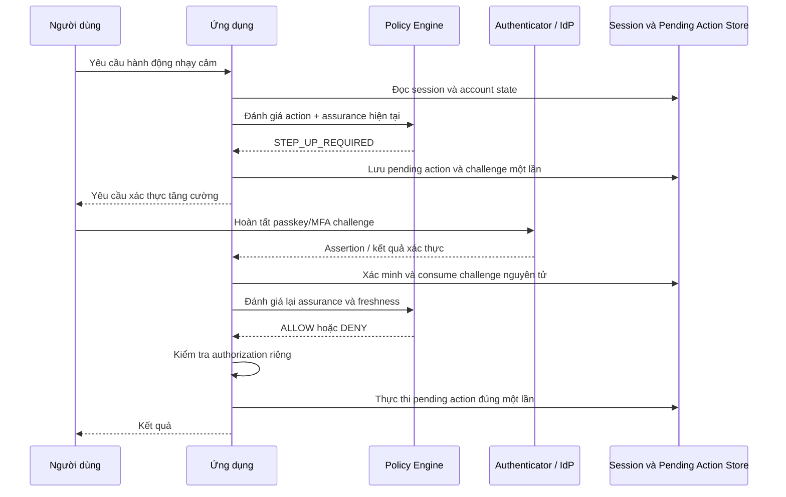

# Step-up authentication — Xác thực tăng cường theo ngữ cảnh

## Mục tiêu học tập

Một người dùng có thể đã đăng nhập thành công từ đầu buổi sáng và đang sử dụng ứng dụng bình thường. Đến lúc thay đổi thông tin khôi phục, thêm phương thức thanh toán hoặc phê duyệt giao dịch giá trị lớn, ứng dụng cần bằng chứng xác thực mạnh hơn hoặc mới hơn so với bằng chứng đang có trong phiên.

**Step-up authentication (xác thực tăng cường)** là quá trình yêu cầu người dùng cung cấp thêm hoặc sử dụng một bằng chứng xác thực đáp ứng mức bảo đảm cao hơn, hoặc có độ mới phù hợp hơn, trước khi thực hiện một hành động cụ thể. Hệ thống đánh giá ngữ cảnh phiên hiện tại, chính sách của hành động và tín hiệu rủi ro để quyết định có cần step-up hay không.

Step-up thường không tạo ra một tài khoản mới. Nó bổ sung bằng chứng xác thực cho principal và phiên hiện tại, sau đó hệ thống đánh giá lại yêu cầu đang chờ. Step-up thành công cũng không tự cấp quyền nghiệp vụ: authorization vẫn phải kiểm tra principal, action, resource, tenant và trạng thái tài khoản.

Bài học thuộc chương **Step-up** của mô-đun **SECURITY_AUTHENTICATION_FUNDAMENTALS**. Mô-đun tìm hiểu credential, mật khẩu, MFA, passkey, chứng chỉ, token, phiên, liên kết danh tính và khôi phục tài khoản. Step-up kết nối các cơ chế đó với chính sách yêu cầu assurance phù hợp tại thời điểm thực hiện hành động nhạy cảm.

Sau bài học, bạn có thể:

- Phân biệt step-up authentication với đăng nhập mới, reauthentication, MFA và authorization.
- Xác định hành động nào cần bằng chứng mạnh hơn hoặc mới hơn.
- Đánh giá assurance context gồm phương thức, mức bảo đảm, thời điểm xác thực và trạng thái phiên.
- Chọn authenticator phù hợp với rủi ro, đặc biệt khi cần khả năng chống phishing.
- Thiết kế challenge có thời hạn, một lần, ràng buộc với subject, session và hành động.
- Kết hợp step-up với OIDC, SAML, WebAuthn/passkey và session management.
- Bảo vệ giao dịch khỏi replay, đổi nội dung sau xác thực, race condition và hạ cấp phương thức.
- Thiết kế fallback, recovery, audit và kiểm thử step-up theo rủi ro.

## 1. Step-up authentication là gì?

Sau khi người dùng đăng nhập, ứng dụng thường duy trì một phiên đã xác thực. Phiên đó có thể đủ cho các thao tác thường ngày như xem hồ sơ hoặc đọc nội dung. Nhưng một số hành động có hậu quả lớn hơn, chẳng hạn:

- Chuyển tiền hoặc phê duyệt thanh toán.
- Thêm, xóa hoặc thay đổi authenticator.
- Đổi mật khẩu, email hoặc số điện thoại khôi phục.
- Tạo API key, cấp quyền quản trị hoặc thay đổi chính sách truy cập.
- Xuất dữ liệu nhạy cảm hoặc truy cập hồ sơ đặc biệt.
- Liên kết một danh tính bên ngoài hoặc thiết bị mới.
- Khôi phục tài khoản sau khi mất credential.

Step-up yêu cầu bằng chứng bổ sung hoặc mạnh hơn trước khi ứng dụng cho phép hành động đó. Mục tiêu là đưa mức bảo đảm của lần xác thực gần nhất lên mức phù hợp với rủi ro của thao tác, đồng thời giới hạn khoảng thời gian mà bằng chứng đó được xem là đủ mới.

### Step-up không nhất thiết là “thêm một yếu tố”

Tùy ngữ cảnh, step-up có thể là:

- Yêu cầu một yếu tố thứ hai khi phiên hiện tại mới chỉ xác thực bằng mật khẩu.
- Yêu cầu passkey hoặc security key chống phishing thay cho OTP dễ bị lừa chuyển tiếp.
- Yêu cầu xác thực lại bằng cùng authenticator nhưng trong một thời hạn gần hơn.
- Yêu cầu xác minh người dùng có hiện diện và thực hiện user verification trên authenticator.
- Yêu cầu ký hoặc xác nhận nội dung giao dịch cụ thể, thay vì chỉ xác thực chung cho phiên.

Một lần step-up có thể dùng nhiều yếu tố, nhưng việc thêm một mã OTP không tự động bảo đảm mức assurance mong muốn. Phương thức phải phù hợp threat model và policy.

### Ví dụ

Một nhân viên đăng nhập vào cổng quản trị bằng mật khẩu và MFA lúc 08:30. Đến 11:00, nhân viên muốn tạo API key có quyền truy cập dữ liệu production.

Policy có thể yêu cầu:

- Một authenticator chống phishing, chẳng hạn passkey với user verification.
- Bằng chứng xác thực trong 5 phút gần nhất.
- Phiên vẫn ACTIVE và thuộc đúng tài khoản.
- Hành động tạo key được ràng buộc với transaction đang chờ.
- Sau step-up, hệ thống vẫn kiểm tra nhân viên có quyền tạo key trong project đó hay không.

Nếu người dùng hoàn tất step-up nhưng không có quyền quản trị project, yêu cầu vẫn bị từ chối. Step-up xác minh assurance; authorization quyết định quyền.

## 2. Phân biệt step-up, reauthentication, MFA và authorization

Các thuật ngữ liên quan nhưng không đồng nghĩa.

| Khái niệm | Câu hỏi | Ví dụ |
| --- | --- | --- |
| **Authentication** | Người đang truy cập có kiểm soát authenticator đã đăng ký không? | Đăng nhập bằng passkey |
| **MFA** | Lần xác thực có sử dụng nhiều yếu tố độc lập theo policy không? | Mật khẩu và security key |
| **Reauthentication** | Người dùng có thể chứng minh lại quyền kiểm soát authenticator không? | Nhập lại mật khẩu hoặc dùng passkey trước khi đổi email |
| **Step-up authentication** | Bằng chứng hiện tại có đủ mạnh và đủ mới cho hành động này không; nếu chưa thì cần bổ sung gì? | Yêu cầu passkey mới trước khi xuất dữ liệu |
| **Authorization** | Principal được phép thực hiện hành động trên tài nguyên nào? | Chỉ quản trị viên của project được tạo key |
| **Transaction confirmation** | Người dùng đã xác nhận chính nội dung giao dịch đang chờ chưa? | Xác nhận người nhận và số tiền trước khi chuyển |

Step-up có thể bao gồm reauthentication hoặc MFA, nhưng policy nên mô tả rõ kết quả cần đạt thay vì chỉ ghi “yêu cầu MFA”. Một hệ thống có thể yêu cầu phương thức chống phishing và độ mới tối đa 5 phút; một hệ thống khác chỉ cần xác thực lại gần đây bằng authenticator đã đăng ký.

### Step-up không phải đăng nhập lại toàn bộ

Người dùng thường vẫn ở cùng ứng dụng và phiên. Ứng dụng tạm giữ hành động, chuyển người dùng qua một challenge xác thực, rồi tiếp tục hoặc từ chối hành động sau khi kiểm tra kết quả.

Nếu phiên đã bị thu hồi, tài khoản bị đình chỉ hoặc subject không còn hợp lệ, hệ thống không nên tiếp tục step-up như thể chỉ thiếu một yếu tố. Trạng thái đó cần bị từ chối hoặc chuyển sang quy trình recovery riêng.

### Step-up không thay authorization

Không gắn quyền admin chỉ vì người dùng vừa dùng passkey. Passkey xác minh quyền kiểm soát credential theo giao thức; policy ứng dụng vẫn phải xác định principal được phép làm gì.

## 3. Khi nào cần step-up?

Policy cần dựa trên mức nhạy cảm của hành động, assurance hiện tại và tín hiệu rủi ro. Không nên yêu cầu step-up cho mọi request, vì điều đó làm người dùng mệt mỏi và tạo cơ hội cho attacker lừa họ chấp nhận prompt liên tục.

### Nhóm hành động thường cần step-up

| Nhóm hành động | Ví dụ | Yêu cầu có thể áp dụng |
| --- | --- | --- |
| Credential và recovery | Thêm passkey, đổi mật khẩu, đổi email khôi phục | Reauthentication gần đây; authenticator mạnh; thông báo kênh cũ |
| Tài chính | Thêm người nhận, chuyển tiền, phê duyệt thanh toán | MFA mạnh; xác nhận giao dịch; ràng buộc nội dung |
| Quản trị | Cấp role, tạo API key, thay policy | Phishing-resistant authentication; thời hạn ngắn |
| Dữ liệu nhạy cảm | Xuất dữ liệu cá nhân, mở hồ sơ y tế | Step-up theo mức nhạy cảm và mục đích |
| Thiết bị mới | Đăng ký thiết bị hoặc credential mới | Xác minh bổ sung; kiểm tra phiên và kênh thông báo |
| Hành vi rủi ro | Session có dấu hiệu chiếm đoạt, thay đổi bất thường | Challenge mạnh hơn hoặc từ chối/điều tra |

### Tín hiệu rủi ro

Có thể xem xét:

- Hành động có hậu quả khó đảo ngược.
- Số tiền, loại tài nguyên, phạm vi quyền hoặc mức nhạy cảm.
- Thời điểm xác thực gần nhất và phương thức đã dùng.
- Thiết bị hoặc trình duyệt mới, thay đổi trạng thái thiết bị.
- Tín hiệu credential compromise, malware hoặc session hijacking.
- Tần suất và chuỗi hành động bất thường.
- Thay đổi mạng, địa lý hoặc ASN so với lịch sử.
- Nhiều lần challenge thất bại hoặc prompt bị từ chối.
- Tài khoản vừa thay đổi thông tin khôi phục hoặc authenticator.

IP, vị trí hoặc thiết bị mới chỉ là tín hiệu hỗ trợ, không phải bằng chứng chắc chắn của gian lận. Người dùng có thể đổi mạng khi đi lại, dùng NAT chung hoặc thay điện thoại hợp lệ. Không tự động từ chối chỉ dựa trên một tín hiệu yếu; đánh giá tổng hợp và cung cấp phương thức hỗ trợ khi cần.

### Phân cấp quyết định

Một policy có thể trả về một trong các kết quả:

- **ALLOW:** assurance hiện tại đủ mạnh, đủ mới và đáp ứng mọi ràng buộc.
- **STEP_UP:** phiên còn hợp lệ nhưng cần challenge bổ sung.
- **DENY:** phiên bị thu hồi, tài khoản không hoạt động, risk policy chặn hoặc không thể đáp ứng điều kiện bắt buộc.
- **REVIEW:** cần kiểm tra thủ công hoặc xử lý ngoại lệ.

Không nên biến lỗi dịch vụ xác thực thành ALLOW. Nếu authenticator service hoặc risk engine không khả dụng, hành vi phải theo policy fail-safe của hành động; với thao tác đặc quyền hoặc tài chính, thường không nên thực hiện hành động khi chưa có bằng chứng bắt buộc.

## 4. Assurance context: sức mạnh và độ mới của xác thực

Step-up cần một mô hình biểu diễn kết quả xác thực hiện tại. Chỉ lưu cờ MFA đã hoàn tất thường không đủ vì không cho biết phương thức nào đã dùng, thời điểm nào, có chống phishing hay không và kết quả gắn với phiên nào.

### Thành phần của assurance context

Một context có thể gồm:

- Subject: tài khoản hoặc principal đã xác thực.
- Session ID hoặc session family: phiên được xác thực.
- Authenticated-at: thời điểm xác thực người dùng.
- Step-up-at: thời điểm hoàn tất step-up gần nhất.
- Methods: các phương thức thực tế đã dùng, theo quy ước có kiểm soát.
- Assurance class: lớp assurance do hệ thống xác định từ bằng chứng đã kiểm tra.
- Phishing-resistant: bằng chứng có đáp ứng policy chống phishing hay không.
- User-verified: authenticator đã thực hiện user verification khi policy yêu cầu hay chưa.
- Authenticator ID: credential nào đã tham gia, nếu cần audit.
- Transaction binding: digest hoặc reference của hành động được xác nhận, nếu có.
- Issuer và audience: nguồn phát hành và nơi được phép dùng context/token.
- Expiry hoặc freshness window: giới hạn thời gian của bằng chứng.

Các giá trị này phải được tạo từ kết quả xác minh thực tế. Không cho client tự gửi assurance class HIGH hoặc phishing resistant true trong request body.

### Độ mới (freshness)

Một xác thực mạnh có thể không còn đủ mới sau nhiều giờ. Policy thường đặt giới hạn riêng theo hành động:

- Xem hồ sơ nhạy cảm: xác thực gần đây trong một khoảng vừa phải.
- Thêm authenticator: reauthentication trong vài phút.
- Phê duyệt giao dịch: xác nhận cho chính giao dịch đang chờ.
- Cấp quyền đặc biệt: phishing-resistant authentication trong thời gian rất ngắn.

Ví dụ:

```text
proofTime = stepUpAt nếu có, ngược lại authenticatedAt
isFresh = now < proofTime + maxAuthenticationAge
```

Độ mới được tính theo thời điểm xác thực thật, không phải thời điểm access token được refresh hoặc session cookie được gia hạn. IAT của token là thời điểm token phát hành; auth_time là thời điểm xác thực người dùng theo ý nghĩa của giao thức.

### Assurance không tự tăng khi refresh token

Nếu người dùng đăng nhập bằng mật khẩu và TOTP rồi refresh access token, token mới không được tự khai rằng người dùng vừa xác thực bằng passkey. Renewal có thể kế thừa context cũ theo policy; chỉ một challenge được xác minh mới có thể cập nhật step-up time và assurance tương ứng.

## 5. Chọn phương thức step-up

Phương thức cần được chọn theo hậu quả của hành động và mức chống tấn công cần thiết.

| Phương thức | Điểm mạnh | Giới hạn |
| --- | --- | --- |
| Mật khẩu nhập lại | Dễ triển khai, quen thuộc | Có thể bị phishing, keylogging hoặc reuse |
| TOTP | Tăng lớp xác thực, hoạt động offline | Có thể bị phishing real-time và relay |
| SMS OTP | Dễ tiếp cận với nhiều người | SIM swap, SS7/telecom risk, phishing và relay |
| Email OTP | Dễ triển khai cho thao tác rủi ro thấp | Email compromise và phụ thuộc kênh khôi phục |
| Push approval | UX thuận tiện | MFA fatigue, prompt bombing và social engineering |
| Passkey/WebAuthn | Ràng buộc origin/RP ID, có thể chống phishing mạnh | Cần kiểm tra đúng origin, challenge, credential và user verification |
| Hardware security key | Có thể cung cấp phishing resistance và bảo vệ khóa tốt | Mất thiết bị, enrollment và recovery cần thiết kế |
| Client certificate/mTLS | Phù hợp thiết bị/workload hoặc smart card | Quản lý PKI, khóa và ánh xạ danh tính phức tạp |

Nếu policy yêu cầu phishing resistance, không nên coi SMS OTP, email OTP hoặc TOTP là tương đương passkey/WebAuthn. Một phương thức có thể được chấp nhận cho use case này nhưng không phù hợp use case khác.

### WebAuthn/passkey cho step-up

Một flow WebAuthn assertion thường gồm:

1. Server tạo challenge ngẫu nhiên, ngắn hạn và một lần.
2. Challenge được lưu cùng subject, session, RP ID, origin dự kiến, policy và hành động đang chờ.
3. Browser gọi WebAuthn API với allowCredentials phù hợp và yêu cầu user verification nếu policy cần.
4. Authenticator tạo assertion ký challenge cùng dữ liệu authenticator/client.
5. Server xác minh challenge, chữ ký bằng public key đã đăng ký, credential ID, RP ID hash, origin, flags và trạng thái credential.
6. Server kiểm tra user verification flag nếu yêu cầu, rồi ghi nhận assurance theo policy.
7. Server tiêu thụ challenge nguyên tử và tiếp tục đánh giá hành động đang chờ.

Không được chỉ kiểm tra rằng browser gửi một credential ID hợp lệ. Server phải xác minh chữ ký và dữ liệu client/authenticator theo WebAuthn. Challenge phải gắn với đúng session và hành động để assertion không thể dùng cho một giao dịch khác.

### User presence và user verification

Trong WebAuthn, user presence cho biết có thao tác hiện diện theo cơ chế authenticator; user verification cho biết authenticator đã thực hiện phương thức xác minh người dùng cục bộ theo khả năng của nó. Nếu policy yêu cầu user verification, server phải kiểm tra cờ tương ứng trong authenticator data.

User verification không có nghĩa server nhận được PIN hoặc dữ liệu sinh trắc học. Thông tin xác minh thường được xử lý bên trong authenticator; relying party nhận bằng chứng giao thức cho biết điều kiện UV đã được đáp ứng.

### Push approval và MFA fatigue

Nếu dùng push, cần hiển thị ngữ cảnh rõ ràng, hạn chế số prompt, áp dụng number matching hoặc thông tin giao dịch khi nền tảng hỗ trợ, và phát hiện prompt lặp bất thường. Không gửi liên tục thông báo phê duyệt chỉ để người dùng cuối cùng bấm Accept. Khi người dùng từ chối hoặc báo cáo prompt không phải của mình, hệ thống cần dừng challenge và đánh giá nguy cơ chiếm tài khoản.

## 6. Luồng step-up end-to-end

Một flow an toàn phải bảo đảm challenge thuộc đúng người dùng, phiên và hành động; hành động chưa được thực thi trước khi challenge đạt; và kết quả step-up không thể bị dùng lại.

### Các bước

1. Người dùng yêu cầu một hành động nhạy cảm.
2. Backend xác thực session hiện tại và xác định principal từ context đã xác minh.
3. Policy engine lấy yêu cầu assurance của action/resource/tenant.
4. Engine so sánh assurance hiện tại, độ mới, trạng thái tài khoản và risk signals.
5. Nếu đủ điều kiện, tiếp tục authorization và thực hiện action.
6. Nếu cần step-up, backend tạo pending action và challenge ngẫu nhiên.
7. Challenge được ràng buộc với subject, session, action, resource, transaction digest, policy version và expiry.
8. Người dùng hoàn tất authenticator challenge.
9. Backend xác minh bằng chứng, tiêu thụ challenge một lần và cập nhật assurance context.
10. Backend kiểm tra lại session/account status và đánh giá policy lần nữa.
11. Backend kiểm tra authorization độc lập.
12. Backend thực thi đúng pending action đã được ràng buộc; không dùng dữ liệu transaction mới từ client.
13. Ghi audit kết quả và thông báo theo policy.

### Sơ đồ



Nếu policy trả về DENY sau challenge, không thực thi hành động. Nếu session đã hết hạn hoặc bị thu hồi trong lúc người dùng đang step-up, kết quả challenge không tự hồi sinh phiên cũ.

### Pending action

Pending action nên chứa reference tới dữ liệu đã được server xác thực, ví dụ:

- Subject ID và session ID/family.
- Action type và resource ID.
- Tenant hoặc account scope.
- Transaction digest, số tiền/người nhận hoặc nội dung quan trọng đã chuẩn hóa.
- Challenge ID và challenge hash/reference.
- Policy version và yêu cầu assurance.
- Created time, expiry và trạng thái.
- Idempotency key.
- Trạng thái PENDING, VERIFIED, EXECUTED, EXPIRED, CANCELLED hoặc REJECTED.

Không lưu dữ liệu bí mật dư thừa trong challenge store. Nếu giao dịch thay đổi sau khi người dùng xác nhận, digest không còn khớp và hệ thống phải yêu cầu xác nhận lại.

## 7. Ràng buộc step-up với đúng hành động

Xác thực một lần trong phiên có thể không đủ để bảo vệ giao dịch. Attacker có thể chờ người dùng hoàn tất step-up rồi thay đổi người nhận hoặc số tiền trước khi backend thực thi.

Với hành động có nội dung cụ thể, cần transaction binding:

1. Backend chuẩn hóa nội dung hành động.
2. Tạo digest từ các trường có ý nghĩa bảo mật, chẳng hạn loại hành động, tài khoản nguồn, người nhận, số tiền, đơn vị tiền, tenant và nonce giao dịch.
3. Gắn digest vào pending action/challenge.
4. Hiển thị nội dung đã chuẩn hóa cho người dùng trước khi xác nhận.
5. Sau khi xác minh, backend chỉ thực thi payload có digest trùng với payload đã được xác nhận.
6. Nếu bất kỳ trường trọng yếu nào thay đổi, hủy challenge cũ và tạo challenge mới.

Ví dụ: người dùng xác nhận chuyển 5.000.000 VND cho tài khoản nhận A. Nếu client sửa người nhận thành B sau step-up, digest khác và giao dịch phải bị từ chối hoặc yêu cầu xác nhận lại.

### Không nhầm step-up với transaction signing

Step-up xác minh người dùng có thể thực hiện một lần xác thực đủ mạnh. Transaction signing hoặc dynamic linking gắn bằng chứng với nội dung giao dịch cụ thể. Một passkey assertion thông thường không tự hiển thị và ký các trường giao dịch theo cách người dùng có thể kiểm tra độc lập trên mọi nền tảng.

Nếu yêu cầu pháp lý hoặc threat model đòi hỏi xác nhận giao dịch độc lập, cần cơ chế phù hợp: trusted display, transaction authorization protocol hoặc thiết bị xác nhận chuyên dụng. Không tuyên bố rằng bất kỳ MFA prompt nào cũng chứng minh người dùng đã duyệt đúng số tiền và người nhận.

## 8. Step-up với OIDC và SAML

Trong hệ thống federation, RP có thể yêu cầu IdP thực hiện xác thực mới hoặc đáp ứng assurance context cụ thể. RP phải kiểm tra kết quả trả về; chỉ gửi tham số yêu cầu không chứng minh IdP đã đáp ứng.

### OIDC

Các tham số và claim có thể dùng:

- **max_age:** yêu cầu thời gian từ lần xác thực người dùng gần nhất không vượt quá giới hạn; RP cần kiểm tra auth_time trong ID token theo yêu cầu.
- **prompt=login:** yêu cầu OP tương tác/xác thực lại theo hành vi của OP và profile.
- **acr_values:** yêu cầu một hoặc nhiều authentication context class; RP phải biết semantics của issuer và kiểm tra acr trả về.
- **acr:** claim mô tả authentication context class mà OP khẳng định.
- **amr:** claim mô tả phương thức xác thực đã sử dụng; giá trị và cách diễn giải cần theo hợp đồng issuer.
- **auth_time:** thời điểm người dùng được xác thực; không thay bằng thời điểm token phát hành.

Ví dụ yêu cầu minh họa:

```text
GET /authorize?
  response_type=code&
  client_id=admin-portal&
  scope=openid&
  max_age=300&
  acr_values=urn:example:assurance:phishing-resistant&
  prompt=login&
  state=RANDOM_STATE&
  nonce=RANDOM_NONCE
```

Đây là ví dụ về ý nghĩa tham số, không phải URI hoặc ACR class chuẩn chung. acr_values cần dùng giá trị đã thống nhất với OP; không tự đặt tên class rồi giả định IdP hiểu. Nếu IdP không đáp ứng mức yêu cầu, RP phải từ chối hành động hoặc chọn fallback được policy cho phép.

### SAML

SAML AuthnRequest có thể chỉ định RequestedAuthnContext và AuthnContextClassRef, cùng cách so sánh theo profile. SP cần xác minh AuthnContext trong assertion có đáp ứng yêu cầu không, đồng thời kiểm tra issuer, audience, recipient, thời gian, InResponseTo và chữ ký.

Không chỉ nhìn thấy một AuthnContext URI rồi kết luận assurance cao. SP cần có mapping đáng tin giữa class URI, policy của IdP và phương thức thực tế được chấp nhận.

### Federation không xóa trách nhiệm của RP

RP phải:

- Chỉ tin issuer đã cấu hình.
- Kiểm tra chữ ký, audience, expiry và correlation.
- Xác minh auth_time, acr, amr hoặc AuthnContext theo hợp đồng.
- Ràng buộc kết quả step-up với đúng session và pending action.
- Không chấp nhận response cũ hoặc response của transaction khác.
- Kiểm tra authorization cục bộ sau khi xác thực thành công.

## 9. Session continuity, rotation và giới hạn sau step-up

Một trải nghiệm tốt thường giữ người dùng trong cùng ứng dụng và phiên logic. Tuy nhiên, thay đổi assurance hoặc quyền của phiên cần quản lý cẩn thận.

### Session continuity

Sau khi step-up thành công:

- Gắn kết quả với đúng subject và session family.
- Ghi thời điểm step-up, phương thức và assurance class đã xác minh.
- Giữ thời điểm xác thực ban đầu nếu chưa có lần xác thực mới theo semantics tương ứng.
- Cập nhật freshness riêng cho step-up.
- Chỉ cho phép các action đáp ứng policy sử dụng context đó.
- Giữ nguyên idle timeout và absolute lifetime theo policy; không mặc định reset absolute lifetime.

### Session ID rotation

Có thể xoay session ID sau step-up khi:

- Người dùng được nâng quyền hoặc thay đổi security context.
- Session ID có nguy cơ bị lộ hoặc bị fixation.
- Policy yêu cầu credential phiên mới sau reauthentication.

Rotation phải nguyên tử: tạo ID mới, chuyển trạng thái đã xác minh, vô hiệu hóa ID cũ và phát cookie mới. Không cho ID cũ tiếp tục hoạt động như alias không giới hạn. Nếu hai request cùng hoàn tất step-up, chỉ một kết quả được tiêu thụ cho pending action.

### Phạm vi và thời hạn của step-up

Không nên nâng toàn bộ phiên lên quyền cao vô thời hạn chỉ vì người dùng vừa xác thực mạnh một lần. Context có thể được giới hạn:

- Theo thời gian, ví dụ 5 phút.
- Theo action type, chỉ cho phép thao tác đang chờ.
- Theo resource hoặc tenant.
- Theo session family và thiết bị.
- Theo transaction digest.
- Theo policy version.

Với hành động cực kỳ nhạy cảm, có thể dùng step-up một lần gắn với một pending action thay vì một cờ “đã step-up” dùng chung cho mọi request.

## 10. Fallback, recovery và từ chối challenge

Fallback là phần dễ làm suy yếu toàn bộ policy. Nếu yêu cầu passkey chống phishing nhưng người dùng chọn SMS OTP khi không có passkey, hệ thống đã hạ mức bảo đảm. Điều đó chỉ được chấp nhận nếu policy cho phép và hành động vẫn an toàn ở mức đó.

### Nguyên tắc fallback

- Xác định trước phương thức thay thế và mức assurance của nó.
- Không âm thầm hạ cấp từ phishing-resistant xuống OTP dễ phishing.
- Hiển thị rõ khi phương thức thay thế có mức bảo vệ thấp hơn.
- Với hành động không thể hạ cấp, chuyển sang quy trình hỗ trợ/recovery có kiểm soát.
- Yêu cầu xác minh bổ sung và thông báo qua kênh đã đăng ký khi thay đổi authenticator.
- Áp dụng rate limit, cooldown và kiểm soát social engineering.
- Ghi audit việc dùng fallback và lý do.

### Khi người dùng từ chối hoặc không hoàn tất

Nếu người dùng bấm Cancel, từ chối push hoặc challenge hết hạn:

- Không thực hiện pending action.
- Hủy hoặc giữ pending action theo thời hạn ngắn đã định.
- Không đánh dấu assurance đã tăng.
- Giới hạn số lần thử và tốc độ gửi challenge.
- Cho phép người dùng quay lại màn hình an toàn mà không làm mất dữ liệu không nhạy cảm.
- Nếu có dấu hiệu prompt bombing, dừng push và cảnh báo theo policy.

### Recovery khi mất authenticator

Recovery phải có assurance tương xứng với tài khoản và hành động. Không cho phép reset passkey hoặc MFA chỉ bằng email OTP nếu email là kênh yếu hơn và việc thay authenticator mở ra quyền truy cập nhạy cảm.

Một quy trình có thể yêu cầu nhiều bước: kiểm tra session/thiết bị hiện có, xác minh bằng authenticator dự phòng, thông báo kênh cũ, thời gian chờ cho thay đổi rủi ro cao và review khi có tín hiệu bất thường. Recovery thành công cần thu hồi credential/session cũ có nguy cơ và tạo audit trail.

## 11. Chống replay, race condition và lạm dụng challenge

Challenge step-up là một credential tạm thời. Nếu challenge có thể đoán, dùng lại hoặc chuyển giữa tài khoản, attacker có thể tái sử dụng bằng chứng của phiên khác.

### Yêu cầu cho challenge

- Sinh challenge bằng CSPRNG với entropy đủ lớn.
- Có expiry ngắn theo use case.
- Gắn với subject, session/family, client, action và transaction digest.
- Dùng một lần; consume nguyên tử ở server.
- Không để client tự thay đổi required assurance hoặc transaction.
- Không ghi challenge, assertion hoặc token nhạy cảm vào log.
- Rate limit theo account, session, credential và nguồn phù hợp.
- Có idempotency cho việc thực thi action, tách khỏi việc tiêu thụ challenge.

### Race condition

Hai request có thể cùng cố sử dụng một challenge hoặc một pending action. Cần transaction/CAS hoặc cơ chế khóa phù hợp để bảo đảm:

- Chỉ một request consume challenge thành công.
- Pending action chỉ chuyển từ PENDING sang VERIFIED một lần.
- Hành động tài chính/đặc quyền chỉ thực thi một lần.
- Retry mạng không tạo giao dịch trùng.
- Challenge hết hạn hoặc session bị revoke giữa flow sẽ không được chấp nhận.

### Prompt bombing và fatigue

Giới hạn số challenge được gửi trong một khoảng thời gian, gắn push request với ngữ cảnh rõ, hỗ trợ từ chối/report, và dừng gửi khi có nhiều lần từ chối. Không dùng số lần prompt như cơ chế gây áp lực để người dùng chấp thuận.

## 12. Java: mô hình hóa policy step-up

Ví dụ dưới đây minh họa quyết định dựa trên assurance class, độ mới và trạng thái phiên. Việc xác minh chữ ký passkey, OTP hoặc token phải do thư viện/protocol verifier chuyên biệt thực hiện trước khi tạo AuthContext.

```java
import java.time.Duration;
import java.time.Instant;

enum AssuranceClass {
    PASSWORD,
    MFA,
    PHISHING_RESISTANT
}

enum StepUpDecision {
    ALLOW,
    CHALLENGE,
    DENY
}

record AuthContext(
        String subjectId,
        String sessionId,
        AssuranceClass assurance,
        Instant authenticatedAt,
        Instant stepUpAt,
        boolean sessionActive
) {}

record StepUpPolicy(
        AssuranceClass requiredAssurance,
        Duration maxAuthenticationAge,
        boolean transactionBindingRequired
) {}

record ActionContext(
        String action,
        String resourceId,
        String transactionDigest,
        boolean transactionBindingVerified
) {}

class StepUpPolicyEngine {

    StepUpDecision evaluate(
            AuthContext auth,
            StepUpPolicy policy,
            ActionContext action,
            Instant now,
            boolean accountActive,
            boolean authorizationAllowed) {

        if (auth == null || policy == null || action == null || now == null
                || policy.requiredAssurance() == null
                || policy.maxAuthenticationAge() == null
                || !auth.sessionActive()
                || !accountActive) {
            return StepUpDecision.DENY;
        }

        if (!authorizationAllowed) {
            return StepUpDecision.DENY;
        }

        Instant proofTime = auth.stepUpAt() != null
                ? auth.stepUpAt()
                : auth.authenticatedAt();

        boolean assuranceStrongEnough =
                auth.assurance() != null
                && auth.assurance().ordinal()
                        >= policy.requiredAssurance().ordinal();

        boolean proofIsFresh = proofTime != null
                && now.isBefore(proofTime.plus(
                        policy.maxAuthenticationAge()));

        boolean transactionIsBound =
                !policy.transactionBindingRequired()
                || action.transactionBindingVerified();

        return assuranceStrongEnough && proofIsFresh && transactionIsBound
                ? StepUpDecision.ALLOW
                : StepUpDecision.CHALLENGE;
    }
}
```

Đây là policy sketch, không phải thư viện xác thực hoàn chỉnh. Thứ tự enum chỉ là thứ tự minh họa; production nên dùng mapping rõ ràng từ phương thức đã xác minh sang policy class, tránh suy ra assurance chỉ từ tên phương thức. transactionBindingVerified chỉ được đặt sau khi backend xác minh digest và challenge; không nhận giá trị boolean từ client. Authorization thực tế cần kiểm tra resource, tenant, action và policy trong cùng quyết định hoặc một bước độc lập có kiểm soát.

### Pseudocode tạo challenge ràng buộc giao dịch

```java
// PSEUDOCODE: các hàm crypto và persistence cần implementation an toàn.
PendingAction pending = actionService.createPending(
        verifiedSubject,
        verifiedSession,
        normalizedAction,
        normalizedResource,
        transactionDigest,
        policyVersion,
        expiresAt
);

byte[] challenge = secureRandomBytes(32);

challengeStore.save(
        hash(challenge),
        pending.id(),
        verifiedSubject.id(),
        verifiedSession.id(),
        transactionDigest,
        requiredAssurance,
        expiresAt,
        "PENDING"
);

return challengeToClient(challenge);
```

Khi nhận assertion, server phải tìm challenge bằng hash/reference, xác minh subject/session/action/digest/expiry, xác minh bằng chứng authenticator và chuyển trạng thái PENDING sang CONSUMED trong một transaction. Chỉ sau đó mới cập nhật assurance context và thực thi pending action theo idempotency key.

## 13. Lỗi triển khai thường gặp

| Lỗi | Hậu quả | Cách phòng tránh |
| --- | --- | --- |
| Chỉ kiểm tra cờ MFA đã hoàn tất | Không biết phương thức và độ mới | Lưu assurance context có nguồn và thời điểm |
| Refresh token làm mới auth_time | Phiên cũ bị coi như vừa xác thực | Giữ semantics của auth_time, iat và stepUpAt |
| Chấp nhận OTP cho policy chống phishing | Attacker relay OTP real-time | Chọn authenticator theo assurance bắt buộc |
| Step-up thành công tự cấp admin | Xác thực bị nhầm với authorization | Kiểm tra quyền theo action/resource/tenant |
| Challenge không gắn session | Assertion có thể chuyển giữa các phiên | Bind subject, session và client |
| Challenge không gắn giao dịch | Payload có thể đổi sau xác thực | Transaction digest và pending action bất biến |
| Challenge dùng lại được | Replay assertion hoặc xác nhận lặp | Expiry, one-time consume và chống replay |
| Client gửi assurance level | Attacker tự khai mức cao | Chỉ tạo context sau protocol verification |
| Chỉ yêu cầu acr_values mà không kiểm tra acr | IdP không đáp ứng nhưng RP vẫn cho qua | Xác minh claim trả về và hợp đồng issuer |
| Tin amr không có mapping | Diễn giải sai phương thức hoặc assurance | Mapping issuer-specific có kiểm soát |
| Prompt push liên tục | MFA fatigue và prompt bombing | Rate limit, number matching, reject/report |
| Fallback hạ cấp âm thầm | Bỏ qua yêu cầu bảo vệ ban đầu | Policy fallback tường minh và audit |
| Hai request consume cùng challenge | Action thực thi hai lần | Transaction/CAS và idempotency |
| Session bị revoke trong lúc challenge | Challenge cũ hồi sinh quyền truy cập | Kiểm tra lại session/account trước thực thi |
| Không xoay session sau nâng quyền | Session fixation hoặc context cũ còn dùng | Rotation nguyên tử khi policy yêu cầu |
| Không có đường recovery | Người dùng hợp lệ bị khóa hoặc support bị social engineer | Recovery có assurance tương xứng, review và audit |
| Chỉ dựa vào IP/device signal | False positive với người dùng hợp lệ | Đánh giá nhiều tín hiệu, không coi một tín hiệu yếu là kết luận |
| Log challenge/token/assertion | Rò rỉ credential tạm thời | Redaction, access control và retention ngắn |

## 14. Bảng kiểm thử step-up authentication

| Trường hợp | Thao tác/dữ liệu | Kết quả mong đợi |
| --- | --- | --- |
| Assurance đủ mạnh và còn mới | Thực hiện action theo policy | Không yêu cầu challenge mới; vẫn kiểm tra authorization |
| Assurance yếu | Session chỉ có mật khẩu, action yêu cầu phishing-resistant | Yêu cầu step-up phù hợp |
| Assurance đã cũ | Passkey được dùng quá freshness window | Yêu cầu xác thực lại |
| Account bị đình chỉ | Session còn cookie nhưng account SUSPENDED | DENY |
| Session bị revoke trong lúc challenge | Thu hồi session trước callback | Challenge không được chấp nhận để tiếp tục |
| Challenge hết hạn | Gửi assertion sau expiry | Từ chối |
| Challenge replay | Gửi lại assertion/challenge đã consume | Từ chối |
| Sai subject | Challenge thuộc user A, assertion/session của user B | Từ chối |
| Sai session | Challenge thuộc session A, callback tới session B | Từ chối |
| Sai origin/RP ID WebAuthn | Assertion từ origin hoặc RP ID khác | Từ chối |
| Sai chữ ký passkey | Sửa authenticator/client data | Từ chối |
| Thiếu user verification | Policy yêu cầu UV nhưng assertion không có UV flag | Từ chối |
| OTP bị relay | OTP được dùng từ phiên khác hoặc sau khi hết hạn | Từ chối theo binding/expiry |
| Push bị từ chối | Người dùng chọn Deny | Không thực hiện pending action; ghi nhận risk event |
| Prompt vượt rate limit | Gửi quá nhiều challenge | Throttle hoặc block theo policy |
| Transaction amount thay đổi | Số tiền khác digest đã xác nhận | Từ chối và yêu cầu challenge mới |
| Transaction recipient thay đổi | Người nhận khác digest đã xác nhận | Từ chối và yêu cầu challenge mới |
| Hai request cùng consume | Cùng challenge gửi đồng thời | Chỉ một request thành công |
| Retry sau response timeout | Client gửi lại yêu cầu thực thi | Idempotency ngăn action trùng |
| Authorization thất bại sau step-up | User xác thực mạnh nhưng thiếu quyền | DENY |
| OIDC auth_time quá cũ | IdP trả ID token cũ hơn max_age | RP từ chối step-up |
| OIDC acr không đáp ứng | OP trả class thấp hơn yêu cầu | RP từ chối hoặc dùng fallback được policy cho phép |
| SAML AuthnContext không phù hợp | Assertion không đáp ứng RequestedAuthnContext | SP từ chối action |
| Fallback yếu hơn policy | User chọn SMS khi action bắt buộc phishing-resistant | Không cho hạ cấp |
| Logout trong lúc pending | User logout trước khi challenge hoàn tất | Hủy pending action và từ chối callback |
| Credential bị thu hồi | Passkey bị xóa/revoke trước khi xác minh | Từ chối assertion theo trạng thái credential |

Ngoài unit test, cần integration test với nhiều tab, thiết bị, callback trễ, clock skew, IdP outage, credential rotation, account suspension, transaction retry và session revocation. Kiểm tra audit log không chứa challenge thô, OTP, token, cookie hoặc dữ liệu sinh trắc học.

## 15. Checklist thiết kế step-up

Trước khi triển khai, hãy trả lời:

1. **Action:** Hành động nào yêu cầu assurance bổ sung? Hậu quả nếu bị lạm dụng là gì?
2. **Current context:** Phiên hiện tại đã xác thực bằng phương thức nào, khi nào và từ nguồn nào?
3. **Required assurance:** Cần MFA, phishing resistance, user verification hay transaction confirmation?
4. **Freshness:** Bằng chứng phải mới trong bao lâu? Dùng auth_time hay stepUpAt theo semantics nào?
5. **Authenticator:** Phương thức nào đáp ứng yêu cầu? Có fallback và mapping assurance rõ không?
6. **Challenge:** Challenge có entropy, expiry, one-time use và rate limit không?
7. **Binding:** Challenge gắn với subject, session, client, action, resource và transaction digest ra sao?
8. **Federation:** OIDC acr/amr/auth_time hoặc SAML AuthnContext được kiểm tra thế nào?
9. **Session:** Session có tiếp tục hợp lệ không? Có cần rotate ID hoặc giới hạn context theo action không?
10. **Authorization:** Sau step-up, principal có quyền trên resource/tenant cụ thể không?
11. **Concurrency:** Consume challenge và execute action có nguyên tử/idempotent không?
12. **Fallback/recovery:** Có hạ assurance không? Quy trình mất authenticator có đủ mạnh và có audit không?
13. **Privacy:** Có lưu tối thiểu evidence và log không chứa bí mật không?
14. **Operations:** Có metric cho challenge success/failure, timeout, deny, prompt fatigue và revoke latency không?

## 16. Bài tập vận dụng

Một ứng dụng quản trị cho phép nhân viên đăng nhập bằng mật khẩu và TOTP. Sau đăng nhập, phiên có thời hạn 8 giờ. Nhân viên có thể tạo API key production, thêm passkey và thay đổi email khôi phục. Hiện tại, hệ thống chỉ kiểm tra cờ MFA đã hoàn tất trong session; cờ này được giữ nguyên đến khi logout. API tạo key nhận projectId và quyền từ browser sau khi người dùng hoàn tất một push prompt. Không có transaction binding hoặc giới hạn số prompt.

**Yêu cầu:**

1. Chỉ ra rủi ro của việc dùng cờ MFA cho mọi hành động trong suốt 8 giờ.
2. Xác định assurance và freshness cần cho tạo API key, thêm passkey và đổi email khôi phục.
3. Thiết kế step-up chống phishing cho thao tác tạo key production; giải thích vì sao TOTP/push không nhất thiết đáp ứng policy.
4. Mô tả challenge gắn với subject, session, project, quyền key và transaction digest.
5. Thiết kế flow WebAuthn có challenge một lần, kiểm tra origin/RP ID, chữ ký và user verification.
6. Đề xuất session continuity/rotation và cách xử lý khi account hoặc session bị revoke trong lúc challenge.
7. Thiết kế fallback/recovery khi người dùng mất passkey mà không hạ cấp âm thầm.
8. Viết test cho replay, hai request đồng thời, thay project/quyền sau step-up, prompt bombing, auth_time cũ và authorization thất bại.

**Gợi ý tự đánh giá:** Step-up phải nâng đúng bằng chứng còn thiếu cho đúng hành động. Assurance cần có nguồn xác minh và thời điểm; challenge phải dùng một lần, ràng buộc với session và payload; sau đó vẫn kiểm tra authorization. Một lần MFA trong quá khứ không phải giấy phép vô thời hạn cho mọi hành động nhạy cảm.

---

**Điểm cần nhớ:** Step-up authentication đánh giá **mức mạnh, độ mới và phạm vi của bằng chứng xác thực** so với rủi ro của hành động. Challenge cần gắn với đúng subject, session và transaction; kết quả phải được xác minh và tiêu thụ một lần. Step-up không thay thế authorization, không tự nâng assurance khi refresh token và không được có fallback yếu hơn policy mà không có quyết định rõ ràng.
