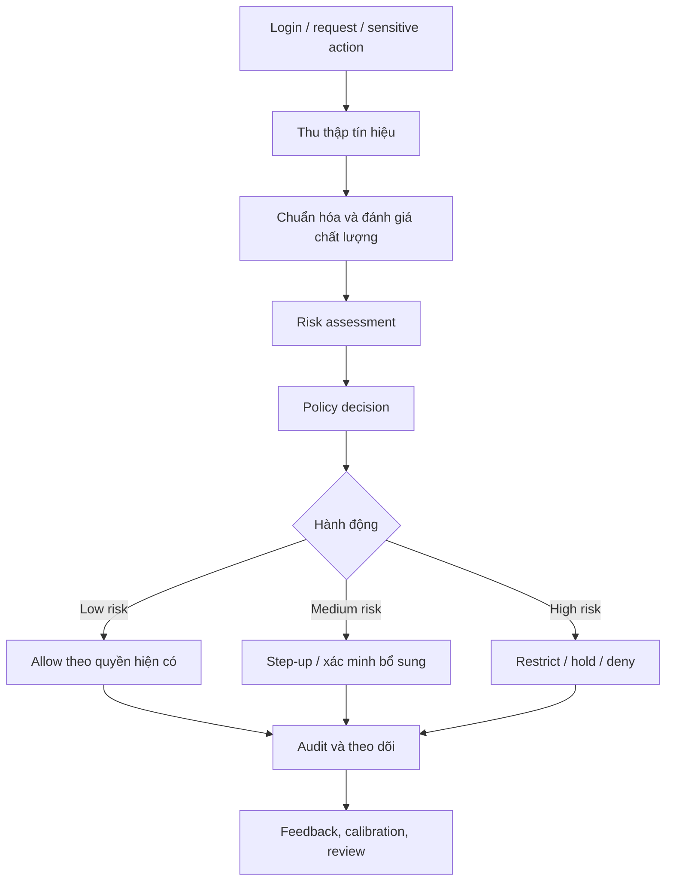
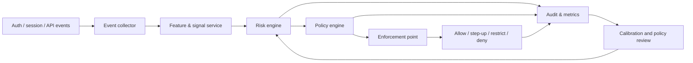

# Đánh giá risk thích ứng

## 1. Risk-based authentication là gì?

**Risk-based authentication (RBA)**, hay xác thực dựa trên rủi ro, là cách hệ thống đánh giá ngữ cảnh của một lần đăng nhập hoặc một thao tác để chọn mức kiểm tra phù hợp. Hệ thống kết hợp nhiều tín hiệu như thiết bị, vị trí gần đúng, mạng, hành vi, lịch sử tài khoản và độ nhạy của hành động. Từ kết quả đánh giá, policy có thể cho phép tiếp tục, yêu cầu xác thực bổ sung, giới hạn thao tác hoặc từ chối.

Ví dụ: An thường đăng nhập ứng dụng nhân sự từ laptop công ty ở Việt Nam, vào giờ làm việc và dùng passkey. Hôm nay có một lần đăng nhập bằng mật khẩu từ một thiết bị chưa từng thấy, qua mạng có dấu hiệu rủi ro, sau đó yêu cầu thay email khôi phục. Hệ thống có thể yêu cầu passkey hoặc MFA chống phishing trước khi cho thay đổi thông tin tài khoản. Nếu các tín hiệu cho thấy credential có thể bị đánh cắp, hệ thống có thể tạm chặn thao tác và yêu cầu quy trình khôi phục an toàn.

RBA giúp điều chỉnh mức bảo vệ theo bối cảnh và giảm ma sát ở những tình huống quen thuộc, ít rủi ro. Tuy nhiên, **điểm risk không phải bằng chứng danh tính và không thay thế một authenticator mạnh**. Hệ thống vẫn phải xác minh credential, quản lý session và thực hiện authorization riêng.

Trong mô-đun **SECURITY_AUTHENTICATION_FUNDAMENTALS**, đánh giá risk thích ứng kết nối mật khẩu, MFA, passkey, thiết bị, session, token, federation và account recovery. Nó giúp hệ thống phản ứng với đăng nhập bất thường, phishing, replay, credential stuffing, chiếm session và hành vi lạm dụng theo chính sách có thể kiểm soát.

### Mục tiêu học tập

Sau bài này, người học có thể:

- Giải thích RBA và phân biệt risk assessment với authentication assurance và authorization.
- Phân loại tín hiệu risk theo tài khoản, thiết bị, mạng, hành vi và giao dịch.
- Thiết kế pipeline thu thập, chuẩn hóa, chấm điểm và ra quyết định.
- Phân biệt tín hiệu đáng tin, tín hiệu không chắc chắn và dữ liệu do client tự khai.
- Chọn hành động thích ứng như allow, monitor, step-up, restrict hoặc deny.
- Áp dụng RBA cho đăng nhập, session đang hoạt động và thao tác nhạy cảm.
- Hạn chế false positive, false negative, privacy risk và khả năng attacker thao túng tín hiệu.
- Theo dõi, hiệu chỉnh và kiểm thử policy theo dữ liệu vận hành.

## 2. Vì sao cần đánh giá risk thích ứng?

Một chính sách đăng nhập chỉ dựa vào một yếu tố hoặc một ngưỡng cố định có thể không phù hợp với mọi tình huống. Nếu mọi lần đăng nhập đều yêu cầu cùng một quy trình rất nặng, trải nghiệm bị ảnh hưởng và người dùng có thể tìm cách né tránh. Nếu mọi lần đăng nhập chỉ yêu cầu một mật khẩu, hệ thống dễ bị tấn công khi mật khẩu bị lộ.

RBA giúp hệ thống xét **ngữ cảnh của request**:

- Một đăng nhập quen thuộc, thiết bị đã có credential tin cậy và hành vi phù hợp có thể tiếp tục theo policy thông thường.
- Một đăng nhập mới nhưng không có dấu hiệu xấu có thể cần step-up nhẹ hoặc xác minh bổ sung tùy mức nhạy cảm.
- Một request có nhiều dấu hiệu độc lập đáng ngờ có thể cần xác thực chống phishing, giới hạn quyền hoặc từ chối.
- Một thao tác rủi ro cao như thêm passkey, thay email recovery, tạo API key hoặc chuyển tiền có thể yêu cầu xác thực mới ngay cả khi session hiện tại đang hợp lệ.

RBA không chỉ dành cho màn hình login. Một session hợp lệ có thể trở nên rủi ro sau khi thiết bị thay đổi, token bị dùng từ môi trường bất thường hoặc tài khoản có tín hiệu bị xâm nhập. Vì vậy, hệ thống có thể đánh giá lại risk trong suốt vòng đời session.

## 3. Phân biệt risk, authentication và authorization

Ba câu hỏi này liên quan nhưng khác nhau:

| Khái niệm | Câu hỏi | Ví dụ |
|---|---|---|
| Authentication | Chủ thể có chứng minh được quyền kiểm soát authenticator không? | Xác minh passkey assertion hoặc mật khẩu và MFA |
| Risk assessment | Request/session hiện tại có dấu hiệu bất thường hoặc nguy hiểm đến mức nào? | Thiết bị mới, IP rủi ro, tốc độ thử đăng nhập cao |
| Authorization | Chủ thể đã xác thực có được phép thực hiện hành động trên tài nguyên này không? | User được phép xem hồ sơ của phòng ban mình |

Một request có risk thấp không có nghĩa người dùng có quyền admin. Một request có risk cao cũng không chứng minh người gửi là attacker; nó chỉ làm tăng nhu cầu kiểm tra hoặc giới hạn. Quyết định cuối cùng phải kết hợp kết quả xác thực, risk, assurance và authorization.

### Risk score không phải assurance level

- **Assurance** mô tả mức tin cậy của quy trình xác thực và bằng chứng danh tính theo một tiêu chuẩn/chính sách.
- **Risk** mô tả khả năng và tác động của việc request hiện tại là gian lận hoặc bị chiếm quyền trong một bối cảnh cụ thể.

Ví dụ, người dùng vừa xác thực bằng passkey chống phishing có thể có assurance cao. Nhưng nếu phiên đó xuất hiện trên thiết bị đã bị malware kiểm soát hoặc thực hiện thao tác bất thường, risk vẫn có thể cao. Ngược lại, một đăng nhập từ vị trí mới không tự động làm yếu đi tính mật mã của passkey.

Không được suy ra một mức AAL cụ thể từ một risk score, hoặc coi một claim MFA là bằng chứng rằng mọi rủi ro của session đã biến mất.

## 4. Mô hình đánh giá risk

Một pipeline RBA có thể chia thành bốn phần:

1. **Signal collection:** thu thập tín hiệu từ request, tài khoản, thiết bị, session, threat intelligence và lịch sử.
2. **Risk assessment:** kiểm tra chất lượng, độ mới, độ tin cậy và mối liên hệ giữa tín hiệu; tính risk hoặc phân loại risk.
3. **Policy decision:** kết hợp risk với assurance, loại thao tác, tenant và policy để chọn hành động.
4. **Enforcement and feedback:** thực hiện hành động, ghi audit, thu thập kết quả và hiệu chỉnh policy.



Không nên để một model hoặc một rule trực tiếp cấp quyền. Risk engine cung cấp đánh giá; policy engine quyết định hành động trong phạm vi đã được phê duyệt.

## 5. Các nhóm tín hiệu risk

Không có một tín hiệu đơn lẻ nào đủ để xác định chắc chắn người dùng là hợp lệ hay attacker. Nên kết hợp các nhóm tín hiệu độc lập, đánh giá chất lượng và không tin dữ liệu client tự khai nếu chưa được xác minh.

### 5.1. Tín hiệu tài khoản và lịch sử xác thực

- Tần suất đăng nhập thất bại trong khoảng thời gian ngắn.
- Credential stuffing hoặc password spraying từ nhiều nguồn.
- Tài khoản mới, tài khoản lâu không hoạt động hoặc vừa được mở khóa.
- Mật khẩu vừa bị reset, recovery vừa hoàn tất hoặc authenticator vừa thay đổi.
- Có cảnh báo credential compromise hoặc thông tin đăng nhập xuất hiện trong sự cố đã biết.
- Nhiều session mới trong thời gian ngắn hoặc một tài khoản đăng nhập đồng thời theo cách bất thường.

Những tín hiệu này thường hữu ích khi xét theo thời gian và baseline của từng tài khoản/nhóm tài khoản. Một lần đăng nhập sai mật khẩu có thể do người dùng gõ nhầm; một đợt thử hàng trăm tài khoản với mẫu giống nhau lại có ý nghĩa khác.

### 5.2. Tín hiệu thiết bị và authenticator

- Thiết bị hoặc browser profile đã từng được dùng hay chưa.
- Cookie/device binding hoặc khóa thiết bị đã đăng ký có còn hợp lệ không.
- Thay đổi bất thường về browser, hệ điều hành hoặc đặc tính thiết bị.
- Trạng thái thiết bị được quản lý, mã hóa hoặc tuân thủ policy nếu tổ chức có nguồn dữ liệu đáng tin.
- Authenticator vừa được thêm, xóa, reset hoặc thay thế.
- Kết quả xác thực có user verification hay không, và phương thức có chống phishing hay không.

User-Agent và browser fingerprint có thể bị giả mạo hoặc thay đổi sau khi cập nhật. Chúng chỉ là tín hiệu hỗ trợ, không phải danh tính thiết bị được chứng minh bằng mật mã. Nếu dùng device-bound key hoặc attestation, cần xác minh đúng giao thức và hiểu giới hạn của nguồn attestation.

### 5.3. Tín hiệu mạng và vị trí

- IP address, ASN, nhà cung cấp mạng và reputation của dải địa chỉ.
- VPN, proxy, Tor exit node hoặc hạ tầng hosting có rủi ro theo dữ liệu threat intelligence.
- Quốc gia/khu vực gần đúng và thay đổi vị trí trong thời gian ngắn.
- Sự thay đổi đột ngột giữa mạng doanh nghiệp và mạng công cộng.
- Tốc độ và số lượng request từ cùng IP, subnet hoặc ASN.

IP geolocation không chính xác tuyệt đối. VPN, NAT, mạng di động, proxy doanh nghiệp, roaming và định tuyến có thể khiến vị trí suy ra khác vị trí thật. “Impossible travel” chỉ là tín hiệu cần xem xét, không phải bằng chứng độc lập để khóa tài khoản.

### 5.4. Tín hiệu hành vi

- Nhịp độ gõ hoặc thao tác, nếu có lý do và cơ sở pháp lý để thu thập.
- Thứ tự thao tác khác với lịch sử thông thường.
- Tốc độ duyệt trang, gọi API hoặc thử nhiều chức năng.
- Thay đổi đột ngột về thời điểm và mẫu sử dụng.
- Hành vi tự động hóa hoặc tương tác giống bot.

Behavioral signals có thể xâm phạm quyền riêng tư và dễ tạo false positive cho người dùng có khuyết tật, thiết bị hỗ trợ, công việc theo ca hoặc thói quen thay đổi. Chỉ dùng tín hiệu cần thiết, kiểm tra tác động và không biến một kiểu hành vi phổ biến thành tiêu chuẩn duy nhất.

### 5.5. Tín hiệu theo hành động và giao dịch

- Hành động có độ nhạy cảm cao: đổi mật khẩu, email, MFA, passkey, recovery factor hoặc thông tin thanh toán.
- Tạo API key, thêm OAuth app, cấp quyền admin hoặc thay đổi policy.
- Giao dịch có giá trị, tần suất hoặc người nhận bất thường.
- Truy cập dữ liệu nhạy cảm hoặc tải dữ liệu hàng loạt.
- Yêu cầu thực hiện hành động ngay sau recovery hoặc thay đổi credential.

Độ nhạy cảm của hành động là một phần của policy, ngay cả khi tín hiệu thiết bị và mạng có vẻ bình thường. Ví dụ, thay email recovery cần step-up vì nó có thể thay đổi con đường chiếm lại tài khoản.

### 5.6. Threat intelligence và tín hiệu hệ thống

- IP/domain/device indicator có liên quan tới chiến dịch tấn công.
- Credential compromise feed từ nguồn đã được đánh giá.
- Sự cố nội bộ như IdP, token issuer hoặc session store bị cảnh báo.
- Dấu hiệu abuse đang diễn ra ở cùng tenant hoặc ứng dụng.

Threat intelligence có thể lỗi thời, sai hoặc có phạm vi bao phủ không đồng đều. Mỗi nguồn cần provenance, thời gian cập nhật, mức confidence và cơ chế loại bỏ indicator cũ.

## 6. Chất lượng và độ tin cậy của tín hiệu

Tín hiệu có thể thiếu, cũ, sai hoặc bị attacker thao túng. Risk engine cần lưu không chỉ giá trị mà còn nguồn, thời điểm và confidence.

| Thuộc tính | Câu hỏi |
|---|---|
| Provenance | Tín hiệu đến từ browser, server, IdP, device management hay nguồn ngoài? |
| Freshness | Tín hiệu được tạo khi nào và còn phù hợp không? |
| Confidence | Nguồn có độ chính xác và mức kiểm chứng ra sao? |
| Integrity | Attacker có thể sửa hoặc giả mạo dữ liệu này không? |
| Coverage | Có phải mọi người dùng/thiết bị đều có tín hiệu tương đương? |
| Privacy | Có thực sự cần thu thập và lưu tín hiệu này không? |

Không có tín hiệu không đồng nghĩa risk bằng 0. Ví dụ, hệ thống không biết trạng thái thiết bị vì client không hỗ trợ device management; kết quả nên là “unknown”, không tự động xem là thiết bị sạch hoặc độc hại.

### Tách tín hiệu quan sát khỏi kết luận

Nên lưu các sự kiện thô cần thiết và kết quả đánh giá có thể giải thích:

- Observation: IP thuộc ASN mới đối với tài khoản.
- Context: người dùng đang đi công tác và dùng mạng di động.
- Assessment: tín hiệu vị trí có confidence thấp, tác động nhỏ.
- Decision: không step-up chỉ dựa trên tín hiệu này; tiếp tục kiểm tra các yếu tố khác.

Không ghi một nhãn “fraud” như sự thật chỉ vì request có IP mới hoặc user-agent lạ.

## 7. Risk score và các mức risk

Một triển khai có thể dùng rule-based score, mô hình thống kê hoặc machine learning. Dù dùng cách nào, phải định nghĩa rõ chiều điểm và ý nghĩa.

Ví dụ minh họa trong bài này: điểm từ 0 đến 100, **điểm càng cao nghĩa là risk càng cao**. Các ngưỡng sau chỉ để giải thích mô hình, không phải ngưỡng mặc định cho production:

| Điểm ví dụ | Mức | Cách hiểu |
|---:|---|---|
| 0–24 | Low | Chưa thấy tín hiệu đáng kể; vẫn cần xác thực và authorization bình thường |
| 25–54 | Medium | Có tín hiệu mới hoặc bất thường; xem xét xác minh bổ sung |
| 55–79 | High | Nhiều tín hiệu đáng ngờ hoặc một tín hiệu có độ tin cậy/tác động lớn |
| 80–100 | Critical | Có bằng chứng mạnh về abuse/compromise hoặc policy yêu cầu chặn |

### Cách tính điểm

Mô hình rule-based có thể cộng/trừ điểm theo tín hiệu, nhưng phải:

- Định nghĩa trọng số dựa trên dữ liệu và threat model.
- Giới hạn đóng góp để một tín hiệu yếu không chi phối toàn bộ quyết định.
- Tránh cộng nhiều tín hiệu tương quan như IP mới, ASN mới và quốc gia mới như ba bằng chứng độc lập.
- Xét độ mới và confidence; tín hiệu cũ nên giảm ảnh hưởng hoặc hết hiệu lực.
- Có xử lý riêng cho tín hiệu mạnh như credential compromise đã xác minh.
- Giữ được lý do khiến điểm tăng để audit và giải thích.

Ví dụ: IP mới và browser mới cùng xuất hiện có thể chỉ là người dùng đổi thiết bị khi đi công tác. Nếu đồng thời có password spraying, session cookie bị dùng từ hai khu vực không phù hợp và yêu cầu đổi recovery email, risk tăng đáng kể. Mô hình cần xét mối liên hệ, không chỉ đếm số tín hiệu.

### Không nên coi score là xác suất nếu chưa hiệu chuẩn

Điểm 70/100 không tự động có nghĩa xác suất gian lận là 70%. Chỉ gọi là xác suất khi mô hình được hiệu chuẩn trên dữ liệu đại diện, có đánh giá calibration và được giám sát theo thời gian. Nếu không, gọi nó là score hoặc risk band.

## 8. Từ risk assessment đến hành động

Policy engine chuyển đánh giá risk thành hành động. Nên định nghĩa hành động rõ và có fallback an toàn.

| Hành động | Khi cân nhắc | Ví dụ |
|---|---|---|
| Allow | Risk thấp và các điều kiện authentication/authorization đều đạt | Tiếp tục session theo quyền hiện có |
| Monitor | Có tín hiệu cần theo dõi nhưng chưa đủ lý do gây ma sát | Ghi sự kiện, tăng giám sát session |
| Step-up | Cần bằng chứng mới hoặc mạnh hơn | Yêu cầu passkey, security key hoặc MFA phù hợp |
| Restrict | Có thể cho phép một số chức năng ít rủi ro | Chỉ cho xem thông tin, tạm chặn đổi recovery |
| Hold / review | Cần đánh giá thêm trước hành động có hậu quả lớn | Giữ giao dịch để kiểm tra bổ sung |
| Deny / revoke | Có bằng chứng mạnh hoặc vi phạm policy bắt buộc | Từ chối đăng nhập, revoke session/token bị nghi chiếm |

Không phải mọi medium risk đều cần challenge, và không phải mọi high risk đều giải quyết được bằng OTP. Nếu attacker đã kiểm soát email hoặc SIM, gửi OTP tới chính kênh đó có thể không tạo thêm assurance. Hãy chọn step-up độc lập và chống phishing khi rủi ro liên quan tới credential theft.

### Quy tắc quyết định nên xét nhiều chiều

Một quyết định có thể phụ thuộc vào:

- Risk band và confidence của assessment.
- Loại hành động (đăng nhập, đọc dữ liệu, thay credential, giao dịch).
- Assurance hiện tại và thời điểm xác thực gần nhất.
- Phương thức step-up khả dụng và đã đăng ký.
- Trạng thái account/session/credential.
- Policy tenant, vai trò, thiết bị được quản lý và yêu cầu pháp lý.

Ví dụ, cùng risk score 40 có thể được phép đọc trang thông thường nhưng cần step-up trước khi thêm passkey hoặc tạo token dài hạn.

Với thao tác thay credential, recovery factor, API key hoặc thực hiện giao dịch, policy có thể đặt yêu cầu xác thực mới làm điều kiện nền ngay cả khi risk thấp. Risk thích ứng quyết định có cần thêm biện pháp như giới hạn, hold hoặc xác minh mạnh hơn hay không; nó không được hạ thấp yêu cầu bảo vệ bắt buộc của thao tác.

## 9. Step-up authentication thích ứng

Step-up là yêu cầu thêm hoặc làm mới bằng chứng xác thực khi policy cần assurance cao hơn hoặc xác thực gần đây hơn.

### Chọn yếu tố step-up

Ưu tiên yếu tố phù hợp với threat:

- **Passkey/WebAuthn:** chống phishing nhờ ràng buộc origin/RP ID và proof-of-possession.
- **Security key:** phù hợp tài khoản đặc quyền hoặc môi trường có policy thiết bị.
- **MFA app/TOTP:** có thể tăng bảo vệ so với chỉ mật khẩu nhưng vẫn có nguy cơ phishing và relay.
- **Push approval:** cần number matching/context và kiểm soát fatigue; không chỉ dựa vào nút Approve.
- **SMS/voice OTP:** có giới hạn trước SIM swap, phishing và interception; không nên là lựa chọn mạnh nhất cho thao tác đặc quyền.

Nếu người dùng không có phương thức step-up phù hợp, policy có thể giới hạn thao tác và đưa họ vào recovery đã kiểm soát. Không tự động hạ mức xác thực chỉ để hoàn tất giao dịch.

### Step-up phải gắn với đúng transaction

Với thao tác nhạy cảm, challenge nên gắn với session, user, hành động và ngữ cảnh cần xác nhận. Với giao dịch tài chính, hiển thị hoặc ký xác nhận thông tin quan trọng như người nhận và số tiền giúp giảm rủi ro người dùng phê duyệt nội dung khác với dự định.

Sau step-up, server kiểm tra bằng chứng và cập nhật authentication context. Không chỉ dựa vào cờ do browser gửi lên rằng “MFA đã xong”.

## 10. Đánh giá risk trong suốt session

Risk không dừng ở thời điểm login. Một session đã xác thực có thể thay đổi bối cảnh:

- IP/ASN hoặc thiết bị thay đổi bất thường.
- Token bị dùng đồng thời ở nhiều nơi.
- Refresh token reuse hoặc dấu hiệu replay.
- User vừa thay mật khẩu, recovery factor hoặc passkey.
- Có cảnh báo compromise từ IdP hoặc threat intelligence.
- Một hành động nhạy cảm được gọi sau thời gian dài không hoạt động.

Hệ thống có thể thực hiện continuous/risk-adaptive session management:

1. Ghi nhận session context ban đầu: thời điểm xác thực, authenticator, assurance và thiết bị.
2. Theo dõi các sự kiện có giá trị bảo mật trong session.
3. Đánh giá lại khi có sự kiện quan trọng hoặc trước thao tác nhạy cảm.
4. Yêu cầu step-up, giới hạn, revoke hoặc buộc đăng nhập lại theo policy.
5. Đồng bộ trạng thái revoke giữa các instance và resource server theo SLA.

Không nên đánh giá lại bằng fingerprint liên tục đến mức tạo ra ma sát vô ích hoặc thu thập quá nhiều dữ liệu. Chọn event và tần suất dựa trên risk, khả năng xử lý và privacy.

### Token và session

Nếu ứng dụng dùng JWT tự chứa, việc tăng risk hoặc logout không tự làm token biến mất. Có thể cần token lifetime ngắn, introspection, denylist, token version, session lookup hoặc sender-constrained token theo kiến trúc. Refresh token rotation và reuse detection giúp phát hiện một số tình huống token bị sao chép.

## 11. Ví dụ tình huống đánh giá risk

### Tình huống A — Thiết bị mới nhưng passkey hợp lệ

Người dùng đăng nhập từ laptop mới và xác minh bằng passkey đúng RP ID/origin. Thiết bị mới là tín hiệu mới, nhưng proof-of-possession của passkey hợp lệ và không có dấu hiệu abuse khác.

**Cách xử lý:** có thể cho phép theo policy, ghi nhận thiết bị mới và gửi thông báo. Không cần khóa tài khoản chỉ vì thiết bị chưa từng thấy.

### Tình huống B — Credential stuffing

Một nguồn mạng thử nhiều username với mật khẩu phổ biến hoặc mật khẩu bị lộ. Nhiều tài khoản có số lần thất bại tăng nhanh.

**Cách xử lý:** rate limit theo nhiều chiều, phát hiện pattern trên nhiều tài khoản, áp dụng bot defense phù hợp và yêu cầu xác thực bổ sung khi cần. Tránh khóa vĩnh viễn tài khoản nạn nhân chỉ vì attacker thử mật khẩu sai.

### Tình huống C — Đăng nhập bất thường và đổi recovery

Một session mới xuất hiện từ môi trường lạ, sau đó yêu cầu đổi email recovery và thêm authenticator. Các thao tác này có thể cho attacker khả năng chiếm tài khoản lâu dài.

**Cách xử lý:** yêu cầu step-up bằng authenticator hiện có, thông báo qua kênh độc lập, có thể trì hoãn thay đổi recovery theo policy và revoke session đáng ngờ.

### Tình huống D — Impossible travel

Một tài khoản xuất hiện ở hai quốc gia trong khoảng thời gian rất ngắn. Nhưng người dùng đang dùng VPN doanh nghiệp và mạng di động, khiến IP geolocation khác nhau.

**Cách xử lý:** xem đây là tín hiệu cần thêm ngữ cảnh. Kiểm tra session/device binding, authenticator, thời gian, ASN và các dấu hiệu độc lập. Không từ chối chỉ dựa vào hai vị trí IP.

### Tình huống E — Session bị phát lại

Một session token hợp lệ được sử dụng từ hai client có hành vi không tương thích, hoặc refresh token cũ bị sử dụng sau khi rotation.

**Cách xử lý:** đánh giá dấu hiệu token theft, revoke token family/session theo policy, yêu cầu xác thực lại và điều tra nguồn rò rỉ.

### Tình huống F — Giao dịch có rủi ro cao trong session quen thuộc

Người dùng đã đăng nhập nhiều giờ trên thiết bị quen thuộc nhưng chuẩn bị chuyển một khoản tiền lớn tới người nhận mới.

**Cách xử lý:** risk theo giao dịch có thể cao dù login risk thấp. Yêu cầu xác nhận giao dịch/step-up phù hợp và áp dụng giới hạn hoặc hold theo policy.

## 12. Các kiểu tấn công nhằm né RBA

| Tấn công | Mục tiêu của attacker | Biện pháp |
|---|---|---|
| IP rotation / proxy hopping | Tránh rate limit hoặc reputation theo IP | Giới hạn theo account, device, ASN, subnet, session và velocity; tránh chỉ dựa vào IP |
| Device fingerprint spoofing | Giả thiết bị quen thuộc | Xem fingerprint là tín hiệu yếu; dùng khóa/device binding đã xác minh khi phù hợp |
| Low-and-slow attack | Giữ mỗi lần thử dưới ngưỡng | Theo dõi cửa sổ dài, nhiều tài khoản và pattern phân tán |
| Account warming | Dùng tài khoản từ từ để tạo baseline giả | Không để lịch sử mới tự động trở thành tín hiệu tin cậy; yêu cầu credential mạnh và kiểm soát thay đổi |
| MFA fatigue | Dụ người dùng phê duyệt push liên tục | Number matching, rate limit, hiển thị context, hủy request cũ và cảnh báo |
| Signal poisoning | Tạo hành vi hoặc thiết bị giả để làm sai baseline/model | Kiểm soát chất lượng nhãn, provenance, feedback và giới hạn ảnh hưởng của dữ liệu tự khai |
| Session theft | Dùng cookie/token hợp lệ để vượt login checks | Bảo vệ session, sender constraint khi phù hợp, continuous monitoring và revoke |
| Recovery abuse | Khai thác quy trình recovery để thay đổi credential | Risk assessment riêng cho recovery, xác minh độc lập, delay/notification |
| Model evasion | Điều chỉnh hành vi để ở dưới ngưỡng phát hiện | Defense in depth, kiểm thử adversarial, threshold review và nhiều lớp kiểm soát |

RBA là một lớp phòng thủ. Nó không thay thế rate limiting, bot protection, password screening, MFA chống phishing, session security, fraud controls hoặc authorization.

## 13. Thiết kế kiến trúc risk engine

Một kiến trúc tham khảo có thể gồm:

- **Event collector:** nhận sự kiện từ authentication gateway, IdP, session service, API và hệ thống thiết bị.
- **Signal store:** lưu tín hiệu có TTL, provenance, tenant và quyền truy cập được kiểm soát.
- **Feature service:** chuẩn hóa và tạo feature cần thiết từ sự kiện.
- **Risk engine:** áp dụng rule/model và trả risk band, confidence cùng lý do.
- **Policy engine:** quyết định allow, monitor, step-up, restrict, hold hoặc deny.
- **Enforcement point:** thực hiện quyết định tại login gateway, session service hoặc API.
- **Audit/analytics:** lưu quyết định và kết quả để điều tra, đo false positive/negative và hiệu chỉnh.

### Ranh giới tin cậy

- Dữ liệu browser gửi lên là untrusted cho tới khi được xác minh.
- Device management/attestation chỉ đáng tin trong phạm vi nguồn, khóa và quy trình đã cấu hình.
- Risk service không được tự tạo hoặc nâng role.
- Policy engine cần xác minh request identity, tenant và action từ nguồn server-side.
- Resource server vẫn phải xác thực token/session và kiểm tra authorization.
- Một lỗi hoặc timeout của risk engine phải có fallback được định nghĩa; không fail-open cho mọi thao tác nhạy cảm.



### Tách risk assessment khỏi policy

Risk engine nên trả về kết quả có cấu trúc, ví dụ:

- Risk band: medium.
- Score: giá trị theo thang nội bộ đã định nghĩa.
- Confidence: medium.
- Reasons: thiết bị mới, session vừa được tạo.
- Signal freshness: thời điểm quan sát.
- Model/rule version: phiên bản đã đánh giá.

Policy engine sau đó kết hợp loại action, assurance hiện tại, tenant và trạng thái tài khoản để chọn step-up hoặc restrict. Việc tách này giúp thay policy mà không phải viết lại logic thu thập tín hiệu.

## 14. Ví dụ Java minh họa risk policy

Đoạn Java sau minh họa một mô hình rule-based đơn giản. Điểm càng cao nghĩa là risk càng cao. Trọng số và ngưỡng chỉ để minh họa; production phải hiệu chỉnh trên dữ liệu và policy của tổ chức.

```java
enum RiskBand {
    LOW, MEDIUM, HIGH, CRITICAL
}

enum ActionType {
    READ_PROFILE,
    CHANGE_RECOVERY_EMAIL,
    ADD_PASSKEY,
    CREATE_API_KEY,
    TRANSFER_FUNDS
}

enum Decision {
    ALLOW,
    MONITOR,
    STEP_UP,
    RESTRICT,
    HOLD,
    DENY
}

record RiskSignals(
    boolean newDevice,
    boolean suspiciousNetwork,
    boolean credentialCompromiseConfirmed,
    boolean abnormalVelocity,
    boolean recentRecovery,
    boolean unusualSessionUse
) {}

record RiskAssessment(
    int score,
    RiskBand band,
    String reason
) {}

final class RiskAssessmentService {

    RiskAssessment assess(RiskSignals signals) {
        if (signals == null) {
            throw new IllegalArgumentException("signals is required");
        }
        int score = 0;
        StringBuilder reasons = new StringBuilder();

        if (signals.newDevice()) {
            score += 10;
            reasons.append("new-device;");
        }
        if (signals.suspiciousNetwork()) {
            score += 15;
            reasons.append("suspicious-network;");
        }
        if (signals.abnormalVelocity()) {
            score += 20;
            reasons.append("abnormal-velocity;");
        }
        if (signals.recentRecovery()) {
            score += 15;
            reasons.append("recent-recovery;");
        }
        if (signals.unusualSessionUse()) {
            score += 20;
            reasons.append("unusual-session-use;");
        }
        if (signals.credentialCompromiseConfirmed()) {
            score = 100;
            reasons.append("credential-compromise-confirmed;");
        }

        score = Math.min(score, 100);
        RiskBand band = score < 25 ? RiskBand.LOW
                : score < 55 ? RiskBand.MEDIUM
                : score < 80 ? RiskBand.HIGH
                : RiskBand.CRITICAL;

        return new RiskAssessment(score, band, reasons.toString());
    }
}

final class AdaptivePolicy {

    Decision decide(RiskAssessment risk,
                    ActionType action,
                    boolean strongRecentAuthentication) {
        if (risk == null || risk.band() == null || action == null) {
            return Decision.DENY;
        }
        if (risk.band() == RiskBand.CRITICAL) {
            return Decision.DENY;
        }
        boolean sensitiveAction =
                action == ActionType.CHANGE_RECOVERY_EMAIL
                || action == ActionType.ADD_PASSKEY
                || action == ActionType.CREATE_API_KEY
                || action == ActionType.TRANSFER_FUNDS;
        if (sensitiveAction && !strongRecentAuthentication) {
            return Decision.STEP_UP;
        }
        if (risk.band() == RiskBand.HIGH) {
            return action == ActionType.READ_PROFILE
                    ? Decision.RESTRICT
                    : Decision.STEP_UP;
        }
        if (risk.band() == RiskBand.MEDIUM) {
            return Decision.MONITOR;
        }
        return sensitiveAction ? Decision.MONITOR : Decision.ALLOW;
    }
}
```

Giới hạn của ví dụ:

- Boolean signals không thể hiện provenance, freshness, confidence hoặc trạng thái unknown; hệ thống thật cần mô hình dữ liệu đầy đủ hơn.
- Các trọng số không phải khuyến nghị chung và không nên sao chép thẳng vào production.
- credential compromise confirmed chỉ được đặt khi nguồn có độ tin cậy cao và đã qua xác minh; không dùng một cảnh báo IP đơn lẻ cho tín hiệu này.
- Policy minh họa cần bổ sung authorization, tenant, assurance, loại authenticator, trạng thái account và cách xử lý lỗi risk service.
- Quyết định DENY cần có cơ sở mạnh, audit và đường hỗ trợ/recovery để giảm khóa nhầm người dùng hợp lệ.

## 15. Hiệu chỉnh và vận hành RBA

RBA cần được vận hành như một hệ thống policy/model có vòng đời, không phải một con số đặt một lần.

### Bắt đầu với rule rõ ràng

Một cách triển khai có kiểm soát:

1. Xác định threat model và hành động cần bảo vệ.
2. Chọn một số tín hiệu có nguồn rõ, chất lượng đủ và mục đích sử dụng hợp lệ.
3. Xây rule có lý do dễ hiểu, giới hạn phạm vi và thời gian hiệu lực.
4. Chạy chế độ shadow/observe để tính risk nhưng chưa tác động người dùng.
5. So sánh kết quả với sự cố đã xác minh và tác động đến người dùng.
6. Thử step-up cho một nhóm nhỏ, có theo dõi và rollback.
7. Mở rộng dần sau khi false positive/negative ở mức chấp nhận được.

### Metrics cần theo dõi

| Chỉ số | Ý nghĩa |
|---|---|
| Account takeover rate | Tỷ lệ tài khoản bị chiếm theo định nghĩa/sự cố đã xác minh |
| False positive rate | Người dùng hợp lệ bị đánh giá risk cao hoặc bị chặn nhầm |
| False negative rate | Sự cố gian lận không được phát hiện/đánh giá đủ cao |
| Step-up rate | Tỷ lệ request bị yêu cầu xác thực bổ sung |
| Step-up success/failure | Người dùng hoàn tất hoặc thất bại ở bước bổ sung |
| Abandonment rate | Người dùng bỏ dở luồng do ma sát |
| Challenge latency | Thời gian tăng thêm do đánh giá và xác thực |
| Recovery/contact rate | Số trường hợp phải nhờ hỗ trợ do policy chặn nhầm |
| Calibration/drift | Mức score còn phản ánh risk và phân phối dữ liệu có thay đổi không |

Không tối ưu riêng cho số lượng fraud bị chặn. Một policy có thể giảm fraud nhưng tạo quá nhiều false positive, khiến người dùng mất quyền truy cập hoặc tìm cách né kiểm soát.

### Nhãn và phản hồi

Nhãn “gian lận” cần dựa trên kết quả đủ tin cậy như điều tra, xác nhận của chủ tài khoản hoặc kết luận từ quy trình fraud. Một login thất bại hay người dùng gọi hỗ trợ không tự động là fraud. Dữ liệu bị thiên lệch bởi chính policy trước đó: nếu một nhóm người dùng luôn bị challenge, hệ thống sẽ có nhiều dữ liệu về nhóm đó hơn.

Khi dùng machine learning:

- Tách dữ liệu huấn luyện, validation và kiểm thử theo thời gian.
- Kiểm tra leakage từ kết quả xảy ra sau quyết định.
- Đo calibration và hiệu năng theo nhóm/thiết bị/khu vực có cơ sở pháp lý.
- Giám sát drift, thay đổi nền tảng và chiến thuật attacker.
- Có giải thích, versioning, approval và rollback.
- Không tự động học từ mọi quyết định của model hoặc phản hồi chưa xác minh.

## 16. Privacy, fairness và trải nghiệm người dùng

RBA có thể sử dụng dữ liệu nhạy cảm hoặc suy ra thói quen. Cần giới hạn việc thu thập và sử dụng:

- Chỉ thu thập tín hiệu cần thiết cho mục đích bảo mật đã xác định.
- Ưu tiên dữ liệu tổng quát/ít nhận dạng hơn khi đủ dùng.
- Đặt thời hạn lưu và kiểm soát quyền truy cập.
- Không suy luận chủng tộc, tôn giáo, sức khỏe, xu hướng chính trị hoặc thuộc tính nhạy cảm để chấm risk.
- Không dùng vị trí/IP làm đại diện trực tiếp cho mức độ đáng tin của một người.
- Kiểm tra false positive giữa nhóm người dùng có thiết bị, mạng, khả năng tiếp cận và điều kiện làm việc khác nhau.
- Giải thích hành động với người dùng bằng thông tin hữu ích nhưng không tiết lộ chi tiết giúp attacker né detection.

### Không trừng phạt người dùng vì hoàn cảnh

Người dùng đi công tác, dùng mạng di động, VPN doanh nghiệp, thiết bị hỗ trợ hoặc thay đổi ca làm có thể khác baseline. Hệ thống nên có phương thức step-up dễ tiếp cận, recovery rõ ràng và hỗ trợ xử lý false positive. Không dùng một đặc điểm địa lý hoặc hành vi làm căn cứ duy nhất để khóa tài khoản.

### Thông báo và giải thích

Thông báo có thể nói “Chúng tôi cần xác minh thêm trước khi thay đổi thông tin khôi phục” thay vì tiết lộ “IP thuộc ASN X bị chấm 37 điểm”. Người dùng cần biết bước tiếp theo, cách xác minh và cách báo cáo nếu không thực hiện thao tác.

## 17. Kiểm thử RBA

Nên kiểm thử cả kết quả đúng và hành vi ở các tình huống biên:

| Ca kiểm thử | Kết quả mong đợi |
|---|---|
| Thiết bị quen thuộc, passkey hợp lệ, hành động ít nhạy cảm | Tiếp tục nếu authentication và authorization đạt |
| Thiết bị mới nhưng không có tín hiệu xấu khác | Không tự động khóa; áp dụng policy phù hợp |
| Nhiều lần thử mật khẩu trên nhiều tài khoản | Phát hiện velocity/pattern và rate limit |
| IP mới nhưng user đang roaming/VPN | Không dựa riêng IP để deny |
| Credential compromise đã xác minh | Chặn/step-up/revoke theo incident policy |
| Thêm passkey sau session cũ | Yêu cầu reauthentication/step-up |
| Đổi recovery email sau login bất thường | Step-up độc lập hoặc hold theo policy |
| Giao dịch rủi ro cao trong session quen thuộc | Đánh giá transaction risk và xác minh riêng |
| Risk service timeout | Áp dụng fallback được định nghĩa; không fail-open cho thao tác nhạy cảm |
| Tín hiệu thiếu hoặc stale | Đánh dấu unknown/low confidence, không coi là zero risk |
| Một tín hiệu yếu bị lặp nhiều lần | Không cộng trùng nếu các tín hiệu tương quan |
| Attacker xoay IP hoặc device fingerprint | Kết hợp tín hiệu đa chiều và rate limit |
| Model/policy version mới | Có shadow comparison, approval và rollback |
| Người dùng hợp lệ bị false positive | Có quy trình hỗ trợ/recovery và audit lý do |
| Revoke session ở một instance | Các instance/resource server đồng bộ theo SLA |

### Kiểm thử adversarial

Thử các tình huống attacker cố né hệ thống:

- Chia nhỏ tốc độ thử qua nhiều IP.
- Dùng residential proxy hoặc VPN.
- Tạo lịch sử hoạt động để làm quen thiết bị.
- Gửi user-agent/fingerprint giả.
- Tận dụng tài khoản mới hoặc tài khoản lâu không hoạt động.
- Phát lại session/token sau khi risk đã tăng.
- Tấn công recovery hoặc thêm authenticator ngay sau khi chiếm session.

Kết quả kiểm thử phải được ghi lại cùng policy/model version và điều kiện đầu vào, để có thể tái hiện và đánh giá tác động.

## 18. Checklist thiết kế và vận hành

- [ ] Xác định threat model, tài sản và hành động cần đánh giá risk.
- [ ] Phân biệt risk assessment, authentication assurance và authorization.
- [ ] Thu thập tín hiệu có provenance, freshness, confidence và integrity rõ.
- [ ] Không coi IP, geolocation, User-Agent hoặc fingerprint là bằng chứng danh tính.
- [ ] Tách account risk, session risk và transaction risk khi cần.
- [ ] Định nghĩa score direction, risk band và ngưỡng theo dữ liệu/policy thực tế.
- [ ] Không coi score là xác suất nếu chưa hiệu chuẩn.
- [ ] Policy có allow, monitor, step-up, restrict, hold và deny rõ ràng.
- [ ] Chọn step-up theo threat; ưu tiên phishing-resistant cho thao tác nhạy cảm.
- [ ] Gắn step-up với đúng user, session và transaction.
- [ ] Đánh giá lại session/token khi có sự kiện rủi ro quan trọng.
- [ ] Có fallback khi risk engine lỗi; không fail-open cho hành động quan trọng.
- [ ] Giới hạn dữ liệu, retention và quyền truy cập; kiểm tra fairness/privacy.
- [ ] Có shadow mode, rollout theo giai đoạn, metrics và rollback.
- [ ] Nhãn fraud và feedback được xác minh trước khi dùng huấn luyện.
- [ ] Kiểm thử false positive, false negative và chiến thuật né detection.
- [ ] Có audit decision, reason code và policy/model version nhưng không lộ secret.

## 19. Tổng kết

Đánh giá risk thích ứng giúp hệ thống chọn mức bảo vệ theo bối cảnh của login, session hoặc hành động. Nó kết hợp tín hiệu tài khoản, thiết bị, mạng, hành vi, giao dịch và threat intelligence; đánh giá chất lượng tín hiệu; rồi dùng policy để quyết định allow, monitor, step-up, restrict, hold hoặc deny.

Risk score chỉ là một đầu vào của quyết định. Nó không xác minh danh tính, không thay thế assurance và không cấp quyền truy cập. Một triển khai tốt cần kết hợp authenticator mạnh, session/token security, authorization, privacy, khả năng giải thích, giám sát và quy trình hỗ trợ người dùng hợp lệ. Khi được hiệu chỉnh trên dữ liệu đáng tin và kiểm thử trước các chiến thuật né detection, RBA có thể tăng bảo vệ mà vẫn giữ trải nghiệm phù hợp với mức rủi ro.
