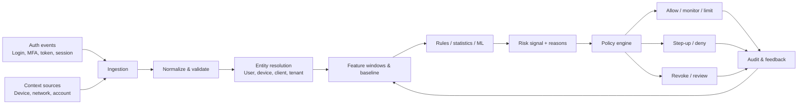

# Behavior anomaly

**Behavior anomaly** (bất thường hành vi) là một hoạt động xác thực hoặc sử dụng phiên có đặc điểm khác đáng kể so với hành vi hợp lệ đã quan sát được của một người dùng, thiết bị, client hoặc workload. Ví dụ gồm đăng nhập vào thời điểm hiếm gặp, thử nhiều mật khẩu trên nhiều account, thay đổi liên tục thiết bị, refresh token theo nhịp bất thường hoặc truy cập hàng loạt tài nguyên mà chủ thể thường không sử dụng.

Phát hiện bất thường giúp hệ thống nhận ra dấu hiệu có thể liên quan tới credential stuffing, account takeover, session hijacking, MFA fatigue, bot hoặc lạm dụng token. Tuy nhiên, **bất thường không đồng nghĩa với tấn công**. Người dùng có thể đi công tác, đổi thiết bị, làm ca đêm hoặc bắt đầu công việc mới. Hệ thống phải kết hợp tín hiệu hành vi với bằng chứng xác thực, trạng thái account, context thiết bị/mạng và mức nhạy cảm của hành động trước khi quyết định.

Bài học thuộc chương **Risk-based authentication** của module **SECURITY_AUTHENTICATION_FUNDAMENTALS**. Người học sẽ biết chọn tín hiệu hành vi phù hợp, xây dựng baseline, áp dụng rule/statistical/ML detection, đánh giá rủi ro và false positive, xử lý data drift/evasion, bảo vệ quyền riêng tư và kết nối kết quả phát hiện với step-up, rate limit, review hoặc thu hồi phiên.

## 1. Behavior anomaly là gì?

Một hành vi được xem là bất thường khi nó lệch khỏi một mô hình tham chiếu có ý nghĩa trong một ngữ cảnh cụ thể. Mô hình tham chiếu có thể là lịch sử của chính chủ thể, nhóm người có vai trò tương tự, đặc điểm của một loại client hoặc chính sách cố định của tổ chức.

Ví dụ:

- Một tài khoản thường đăng nhập từ laptop đã quản lý vào giờ làm việc, đột nhiên có nhiều lần đăng nhập thất bại từ nhiều ASN và nhiều quốc gia.
- Một phiên vốn chỉ đọc hồ sơ bắt đầu đổi email khôi phục, thêm passkey mới rồi tạo API key trong vài phút.
- Một workload bình thường gọi một endpoint mỗi 10 phút, đột nhiên gửi hàng nghìn request trong thời gian ngắn.
- Một người dùng đăng nhập thành công bằng passkey nhưng ngay sau đó refresh token được sử dụng từ một thiết bị khác.
- Nhiều account khác nhau bị thử bằng cùng một mật khẩu hoặc cùng một chuỗi user-agent từ một cụm IP.

Các dấu hiệu này có thể cho thấy tấn công, nhưng cũng có thể do thay đổi hợp lệ, lỗi ứng dụng, automation hoặc cấu hình sai. Hệ thống phát hiện cần cung cấp **tín hiệu và mức độ tin cậy**, còn policy engine quyết định cách phản ứng.

### 1.1. Phân biệt anomaly, risk và compromise

| Khái niệm | Ý nghĩa | Ví dụ |
| --- | --- | --- |
| **Anomaly** | Quan sát khác baseline hoặc quy tắc dự kiến. | Người dùng đăng nhập vào giờ chưa từng thấy. |
| **Risk signal** | Dữ liệu làm tăng hoặc giảm đánh giá rủi ro. | IP thuộc nguồn proxy rủi ro cao; token reuse được phát hiện. |
| **Risk score/level** | Kết quả tổng hợp tín hiệu theo một mô hình/policy. | Request được xếp mức trung bình hoặc cao. |
| **Compromise** | Có bằng chứng đủ mạnh rằng account, credential hoặc session bị chiếm quyền. | Chủ account xác nhận không thực hiện giao dịch; token bị đánh cắp được dùng trái phép. |
| **Security decision** | Hành động được policy chọn dựa trên risk và yêu cầu bảo vệ. | Step-up, giới hạn, từ chối, revoke hoặc review. |

Một anomaly đơn lẻ không chứng minh account bị compromise. Ngược lại, một cuộc tấn công tinh vi có thể bắt chước hành vi bình thường và không tạo anomaly rõ ràng. Không dùng điểm anomaly như kết luận pháp chứng hoặc làm lý do duy nhất để kỷ luật người dùng.

### 1.2. Behavior anomaly không phải authentication factor

Hành vi gõ phím, tốc độ di chuyển chuột, vị trí, IP, thời gian đăng nhập hoặc device fingerprint là tín hiệu phân tích. Chúng không tự động trở thành yếu tố knowledge, possession hay inherence.

Behavioral biometrics có thể được sử dụng trong một số sản phẩm chuyên biệt, nhưng cần đánh giá riêng về độ chính xác, khả năng giả mạo, quyền riêng tư, consent và tiêu chuẩn áp dụng. Không mặc định rằng “cách gõ bàn phím giống trước đây” chứng minh danh tính như một passkey hoặc security key.

## 2. Các nguồn tín hiệu hành vi trong authentication

Tín hiệu cần gắn với một chủ thể và một sự kiện cụ thể: account, authenticator, device, session, client, tenant, request và thời điểm. Chỉ thu thập những dữ liệu có mục đích bảo mật rõ ràng.

### 2.1. Login behavior

Các tín hiệu thường dùng:

- Số lần đăng nhập thành công/thất bại trong cửa sổ thời gian.
- Tỷ lệ thất bại trước một lần đăng nhập thành công.
- Tần suất thử username/password và phân bố trên nhiều account.
- Thời điểm đăng nhập theo lịch sử hợp lệ.
- Số địa chỉ IP, ASN, thiết bị hoặc user-agent được thấy gần đây.
- Tần suất password reset, MFA challenge, passkey registration và recovery.
- Khoảng thời gian giữa đăng nhập, step-up và hành động nhạy cảm.

Ví dụ, 30 lần thất bại trên một account có thể là người dùng quên mật khẩu; cùng một nguồn thử một mật khẩu trên 500 account có thể là credential stuffing hoặc password spraying. Ngữ cảnh phân bố quan trọng hơn một con số đứng riêng.

### 2.2. Session và token behavior

Sau khi đăng nhập, các tín hiệu có thể gồm:

- Session được sử dụng từ các context khác nhau trong thời gian ngắn.
- Refresh token rotation bị reuse hoặc xuất hiện nhiều nhánh không mong muốn.
- Access token được dùng cho audience/resource không thường thấy.
- Một session chuyển từ đọc sang thay đổi credential hoặc quyền.
- Cookie/session identifier xuất hiện đồng thời ở nhiều thiết bị không giải thích được.
- Số lần refresh, thời gian giữa các lần refresh và mẫu retry bất thường.
- Session tiếp tục hoạt động sau sự kiện account disable hoặc credential revoke.

Phải phân biệt hành vi bất thường với thiết kế client hợp lệ. Nhiều tab, mobile background refresh, retry sau timeout hoặc nhiều service cùng dùng một token có thể tạo mẫu request trùng lặp. Cần hiểu kiến trúc trước khi kết luận.

### 2.3. Hành vi thay đổi account và authenticator

Một chuỗi sự kiện có thể đáng chú ý hơn từng event riêng lẻ:

1. Đăng nhập từ thiết bị mới.
2. Yêu cầu reset password hoặc MFA.
3. Thêm recovery email/phone mới.
4. Đăng ký passkey hoặc authenticator mới.
5. Thu hồi phương thức cũ.
6. Tạo token/API key hoặc thêm quyền.
7. Tải dữ liệu nhạy cảm.

Đây có thể là account takeover sau khi attacker chiếm session. Hệ thống nên phân tích chuỗi và thứ tự sự kiện, đồng thời áp dụng delay/notification/step-up cho thay đổi có hậu quả lớn.

### 2.4. Workload và client behavior

Với machine-to-machine authentication, baseline có thể được xây theo client identity, workload, environment và API route:

- Request rate và burst size.
- Endpoint/method được gọi.
- Tenant/resource được truy cập.
- Phân bố response code.
- Thời gian hoạt động, lịch batch và chu kỳ refresh.
- Credential rotation và nguồn mạng đã được phê duyệt.
- Thay đổi đột ngột về scope usage hoặc data volume.

Không gộp mọi workload vào một baseline. Một job export hàng đêm và một API tương tác thời gian thực có hành vi khác nhau; so sánh chúng sẽ tạo nhiều cảnh báo sai.

## 3. Xây dựng baseline hành vi

Baseline là mô hình mô tả hoạt động hợp lệ mà hệ thống dùng làm điểm tham chiếu. Baseline cần phản ánh đúng chủ thể và công việc, có thời hạn, được cập nhật có kiểm soát và không bị attacker dễ dàng đầu độc.

### 3.1. Baseline theo nhiều cấp

| Cấp baseline | Dữ liệu tham chiếu | Điểm mạnh | Hạn chế |
| --- | --- | --- | --- |
| **Per-user** | Lịch sử của một account. | Phát hiện thay đổi riêng của người dùng. | Người dùng mới thiếu dữ liệu; lịch sử có thể bị đầu độc. |
| **Per-device** | Hành vi của một thiết bị/workstation. | Phát hiện session dùng trên thiết bị lạ. | Thiết bị dùng chung hoặc reset có thể gây nhầm. |
| **Per-role/peer group** | Người có cùng vai trò, công việc hoặc tenant. | Có dữ liệu cho user mới và so sánh theo nhiệm vụ. | Nhóm không đồng nhất có thể tạo baseline sai. |
| **Per-client/workload** | Integration hoặc service identity. | Phù hợp machine-to-machine và lịch batch. | Cần inventory và owner chính xác. |
| **Global/system** | Mẫu tấn công và giới hạn toàn hệ thống. | Nhận ra chiến dịch phân tán. | Dễ bỏ qua khác biệt theo tenant và vai trò. |

Thực tế thường kết hợp nhiều cấp. Ví dụ, một login có thể so với lịch sử user, thiết bị hiện tại, nhóm nhân viên cùng role và tín hiệu toàn hệ thống về password spraying.

### 3.2. Cửa sổ thời gian và mùa vụ

Hành vi thay đổi theo ngày trong tuần, mùa, kỳ học, đợt triển khai hoặc ca làm việc. Baseline dùng một cửa sổ quá ngắn có thể phản ứng quá mức; cửa sổ quá dài có thể chậm nhận ra account đã bị chiếm.

Có thể duy trì:
- Cửa sổ ngắn để phát hiện burst và chuỗi sự kiện tức thời.
- Cửa sổ trung hạn để nhận ra xu hướng trong vài ngày/tuần.
- Cửa sổ dài hơn để hiểu mùa vụ và hoạt động hiếm gặp.

Không lấy dữ liệu tương lai hoặc dữ liệu sau sự cố để xây baseline cho đánh giá quá khứ. Khi điều tra, phải giữ được phiên bản baseline/model và thời điểm dữ liệu được quan sát.

### 3.3. Cold start và người dùng mới

Người dùng mới, account mới, thiết bị mới hoặc workload mới chưa có lịch sử đủ dài. Không nên mặc định họ có rủi ro cao chỉ vì thiếu baseline, cũng không nên mặc định an toàn.

Có thể dùng:
- Policy nền theo role, tenant và loại account.
- Bằng chứng từ nguồn danh tính có thẩm quyền.
- Device posture và phương thức xác thực đã đăng ký.
- Giới hạn quyền/tốc độ ban đầu.
- Step-up cho hành động nhạy cảm trong giai đoạn đầu.
- Baseline peer group khi nhóm đủ tương đồng.

Thiếu dữ liệu phải được biểu diễn là “unknown” hoặc “insufficient history”, không chuyển thành “normal”.

### 3.4. Không để baseline tự học mọi hoạt động một cách vô điều kiện

Nếu mọi hoạt động mới đều tự động trở thành hành vi bình thường, attacker có thể từ từ đầu độc baseline. Ví dụ attacker chiếm account rồi tăng dần số lần truy cập dữ liệu, thêm thiết bị và thay đổi lịch sử để hệ thống quen với hành vi đó.

Cần:
- Loại trừ hoặc giảm trọng số các sự kiện đang bị đánh dấu rủi ro.
- Chỉ cập nhật baseline sau khi có đủ thời gian và tín hiệu tin cậy.
- Giữ baseline/version cũ để so sánh và rollback.
- Tách feedback của analyst khỏi dữ liệu tự động.
- Rà soát các thay đổi đột ngột ở account đặc quyền và workload quan trọng.

## 4. Phương pháp phát hiện bất thường

Không có một thuật toán phù hợp cho mọi loại hành vi. Nên chọn cách đơn giản, giải thích được trước; chỉ dùng mô hình phức tạp khi có dữ liệu, năng lực vận hành và lợi ích rõ ràng.

### 4.1. Rule-based detection

Rule dựa trên điều kiện cụ thể, ví dụ:
- Nhiều lần đăng nhập thất bại trong thời gian ngắn.
- Một IP thử một mật khẩu trên nhiều account.
- Một session thêm authenticator mới rồi thay recovery method ngay sau đó.
- Refresh token đã bị tiêu thụ được sử dụng lại.
- Một workload gọi endpoint quản trị ngoài allowlist.

Ưu điểm là dễ giải thích, dễ kiểm thử và có thể thực thi nhanh. Hạn chế là rule cứng dễ tạo false positive, dễ bị né tránh bằng cách giảm tốc độ hoặc phân tán nguồn.

Rule nên có scope, threshold, time window, exception có thời hạn, owner và version. Không tạo allowlist vĩnh viễn chỉ để dập cảnh báo mà không có review.

### 4.2. Statistical detection

Phương pháp thống kê so sánh một giá trị với phân phối lịch sử hoặc nhóm tương đồng. Ví dụ:
- Z-score cho số lượng login thất bại khi dữ liệu gần phân phối chuẩn.
- Median và median absolute deviation (MAD) khi dữ liệu có outlier hoặc lệch.
- Percentile cho request rate hoặc data volume.
- Tần suất và khoảng cách thời gian giữa các sự kiện.
- Entropy hoặc số lượng account/ASN/thiết bị trong một cửa sổ.

Ví dụ, nếu một account thường có 1–3 lần đăng nhập mỗi ngày, 80 lần trong 10 phút là dấu hiệu đáng xem xét. Nhưng với một service account, 80 lần có thể bình thường. Phải chọn baseline đúng loại chủ thể.

### 4.3. Sequence và graph analysis

Một sự kiện riêng lẻ có thể bình thường nhưng chuỗi sự kiện lại bất thường. Sequence analysis quan sát thứ tự, thời gian và quan hệ giữa các event. Graph analysis tìm cụm account, IP, device, token hoặc client có quan hệ đáng chú ý.

Ví dụ:
- Nhiều account dùng chung một device fingerprint mới.
- Một IP thử nhiều username, sau đó đăng nhập thành công vào vài account.
- Một token được dùng từ nhiều client/session khác nhau.
- Một account mới liên kết với nhiều tenant trong thời gian ngắn.

Graph/sequence cần dữ liệu chính xác về entity resolution. Nếu NAT, proxy hoặc thiết bị dùng chung bị gộp sai, hệ thống có thể tạo mối liên hệ giả.

### 4.4. Machine learning

Các nhóm mô hình có thể gồm:

- **Unsupervised:** tìm điểm hoặc cụm lệch khỏi phân bố đã học khi thiếu nhãn tấn công.
- **Supervised:** học từ sự kiện đã được phân loại là hợp lệ hoặc độc hại.
- **Semi-supervised:** học chủ yếu từ dữ liệu được cho là bình thường, sau đó phát hiện lệch.
- **Sequence models:** học chuỗi event và thời gian giữa chúng.
- **Graph models:** phát hiện quan hệ bất thường giữa account, device, IP, token và client.

ML không tự tạo ra sự thật. Nhãn sự cố có thể thiếu, thiên lệch hoặc đến muộn; dữ liệu train có thể phản ánh hành vi của attacker; mô hình phức tạp có thể khó giải thích và vận hành. Dùng ML như một nguồn risk signal, có version, kiểm định và giám sát, không để model tự ý cấp quyền.

### 4.5. Hybrid detection

Một kiến trúc thực tế có thể kết hợp:
- Rule bắt buộc cho điều kiện chắc chắn, như credential revoked hoặc token sai audience.
- Statistical/ML score để phát hiện mẫu chưa biết.
- Policy engine quyết định theo action/resource sensitivity.
- Human review cho trường hợp mơ hồ nhưng tác động cao.

Điều kiện bắt buộc như chữ ký sai, issuer không được tin, account bị khóa hoặc credential revoked không được bù trừ bằng một behavior score thấp.

## 5. Từ anomaly đến quyết định xác thực

Anomaly detector nên trả về các feature, reason code, score hoặc mức confidence cùng thời điểm và nguồn dữ liệu. Policy engine quyết định hành động dựa trên toàn bộ ngữ cảnh.

### 5.1. Các phản ứng có thể áp dụng

| Phản ứng | Khi phù hợp | Ví dụ |
| --- | --- | --- |
| **Allow** | Anomaly thấp hoặc đã được giải thích; các điều kiện bắt buộc đều đạt. | Người dùng đổi IP do chuyển sang mạng di động. |
| **Monitor** | Có dấu hiệu nhẹ, cần quan sát thêm. | Login vào giờ lạ nhưng dùng passkey và thiết bị quen thuộc. |
| **Rate limit / throttle** | Tốc độ hoặc số lần thử vượt mức hợp lý. | Nhiều lần password failure từ một nguồn. |
| **Step-up** | Cần thêm bằng chứng trước hành động nhạy cảm. | Thiết bị mới muốn thay recovery method. |
| **Limit scope** | Có thể cho phép một phần ít rủi ro. | Chỉ đọc dữ liệu, tạm chặn export hoặc thay đổi account. |
| **Deny** | Điều kiện bắt buộc không đạt hoặc rủi ro vượt ngưỡng. | Token revoked, account disabled, credential invalid. |
| **Revoke / contain** | Có bằng chứng mạnh về session/credential compromise. | Refresh token reuse theo policy hoặc session được xác nhận bị đánh cắp. |
| **Human review** | Tín hiệu mâu thuẫn và hậu quả cao. | Cấp quyền admin hoặc thay IdP tenant. |

Không phải mọi cảnh báo đều cần MFA prompt. Nếu request có chữ ký sai hoặc account bị đình chỉ, step-up không sửa được điều kiện đó. Nếu chỉ có anomaly mơ hồ, step-up bằng authenticator phù hợp có thể giúp phân biệt người dùng hợp lệ với attacker.

### 5.2. Không để score ghi đè policy bắt buộc

Một risk score thấp không thể làm token sai chữ ký trở nên hợp lệ. Một thiết bị compliant không thể cấp quyền vào tenant khác. Một lần step-up thành công không tự thêm role hoặc bỏ qua approval.

Tách rõ:
- **Hard deny conditions:** token/credential không hợp lệ, issuer/audience sai, account disabled, revoked.
- **Risk conditions:** hành vi bất thường, context mới, device posture thiếu mới.
- **Required assurance:** mức xác thực bắt buộc cho action.
- **Authorization:** quyền của subject/client trên resource cụ thể.
- **Workflow approval:** phê duyệt riêng nếu action cần.

### 5.3. Gắn quyết định với request cụ thể

Risk result cần gắn với subject, session, device, tenant, action/resource, thời điểm, model/policy version và thời hạn. Không tạo một “low-risk flag” lâu dài cho account để mọi request sau đều được miễn đánh giá.

Nếu action hoặc resource thay đổi sau step-up, phải đánh giá lại hoặc yêu cầu xác nhận mới. Với thao tác nhạy cảm, kiểm tra lại trạng thái ngay trước khi commit để tránh race giữa đánh giá và thực thi.

## 6. Các kịch bản bất thường thường gặp

### 6.1. Credential stuffing

Attacker dùng danh sách username/password bị lộ từ dịch vụ khác để thử đăng nhập hàng loạt. Dấu hiệu:
- Một IP hoặc cụm nguồn thử nhiều account.
- Nhiều lần thất bại với một số ít mật khẩu phổ biến.
- Tỷ lệ thành công thấp nhưng phân bố rộng.
- User-agent, TLS/client fingerprint hoặc nhịp request lặp lại.

Kiểm soát: rate limit theo nhiều chiều (account, IP, ASN, device, client), phát hiện phân tán, password screening, MFA/passkey và thông báo khi có đăng nhập bất thường. Không chỉ khóa theo IP vì attacker có thể phân tán nguồn và NAT có thể chứa nhiều người dùng hợp lệ.

### 6.2. Password spraying

Attacker thử một hoặc vài mật khẩu phổ biến trên nhiều account để tránh ngưỡng lockout từng account. Phát hiện cần quan sát ở cấp nguồn, tenant, dải thời gian và tập account, không chỉ số lần thất bại của một user.

### 6.3. Account takeover sau đăng nhập

Attacker có thể dùng credential hợp lệ hoặc session bị đánh cắp. Dấu hiệu sau login:
- Thêm authenticator/recovery method mới.
- Đổi email, password hoặc số điện thoại.
- Tạo API key hoặc OAuth grant.
- Thay role, tenant membership hoặc thông tin thanh toán.
- Export dữ liệu lớn hoặc truy cập resource khác thường.

Biện pháp: step-up bằng phương thức đã đăng ký trước đó, delay có kiểm soát cho thay đổi nhạy cảm, notification tới kênh cũ, audit và revoke session/token khi có bằng chứng compromise.

### 6.4. MFA fatigue và push bombing

Một attacker liên tục gửi push approval để người dùng mệt mỏi và chấp nhận nhầm. Tín hiệu gồm số challenge bất thường, nhiều deny/timeout, request lặp trong thời gian ngắn hoặc challenge không gắn với thao tác người dùng vừa bắt đầu.

Biện pháp: number matching hoặc transaction context khi phương thức hỗ trợ, giới hạn số challenge, thông báo rõ client/location/action, phát hiện push bombing và ưu tiên phương thức phishing-resistant như passkey/security key.

### 6.5. Session hijacking và token replay

Một token hoặc cookie bị lấy có thể được sử dụng từ context khác. Phát hiện có thể dựa vào đồng thời sử dụng, thay đổi device/session, refresh token reuse, request pattern và resource access. Cần nhớ IP khác không đủ chứng minh token bị đánh cắp; người dùng có thể đổi mạng.

Biện pháp: bảo vệ cookie/token, sender-constrained token khi phù hợp, refresh rotation, replay detection, session revocation và step-up cho hành động nhạy cảm.

### 6.6. Workload compromise

Service account có thể bị lạm dụng sau khi secret bị lộ. Dấu hiệu gồm scope usage mới, gọi API từ môi trường không mong đợi, tăng data volume, truy cập tenant khác hoặc hoạt động ngoài lịch. Kiểm soát cần key riêng theo workload, short-lived credential/workload identity, least privilege, quota, egress policy và rotation/revoke.

## 7. Kiến trúc pipeline phát hiện

Một pipeline có thể tách thu thập event, chuẩn hóa, làm giàu context, tạo feature, phát hiện, policy và phản ứng.



### 7.1. Event schema

Mỗi event nên có tối thiểu:
- Event ID duy nhất và event type.
- Event time, ingestion time và clock/source metadata.
- Subject/account/client/workload ID theo định danh ổn định.
- Session ID hoặc credential ID dạng tham chiếu an toàn.
- Tenant, action, resource và kết quả.
- Nguồn mạng/device ở mức cần thiết, kèm provenance.
- Correlation/transaction ID để nối các event liên quan.

Không dùng email hoặc display name làm entity key duy nhất nếu chúng có thể thay đổi. Không đưa raw password, OTP, private key, session cookie, access token hoặc refresh token vào event.

### 7.2. Chuẩn hóa và entity resolution

Các hệ thống có thể ghi thời gian, IP, device ID và account ID theo định dạng khác nhau. Chuẩn hóa cần bảo toàn nguồn gốc và không làm mất thông tin có ý nghĩa. Ví dụ, proxy có thể thêm header địa chỉ IP; pipeline chỉ tin header từ proxy đã cấu hình và phải giữ thông tin về hop tin cậy.

Entity resolution cần tránh gộp nhầm:
- IP chung của NAT không đồng nghĩa cùng một người.
- User-agent giống nhau không đồng nghĩa cùng thiết bị.
- Một device có thể được dùng chung theo chính sách.
- Một account có thể đổi email hoặc liên kết nhiều identity provider.
- Một service client có thể chạy trên nhiều instance hợp lệ.

Sai entity resolution sẽ làm baseline và graph analysis sai theo.

### 7.3. Pseudocode tính risk signal

```text
evaluateAuthenticationEvent(event):
    require event.subjectId exists
    require event.eventId is unique
    require event.source is trustedForItsFields

    context = loadCurrentContext(
        subject = event.subjectId,
        session = event.sessionId,
        device = event.deviceId,
        tenant = event.tenantId
    )

    features = buildFeatures(
        recentLoginFailures(event.subjectId),
        distinctAccountsFromSource(event.sourceId),
        sessionContextChanges(event.sessionId),
        authenticatorChanges(event.subjectId),
        tokenRefreshPattern(event.sessionId),
        resourceActionSequence(event.subjectId)
    )

    ruleSignals = evaluateSecurityRules(event, features)
    anomalySignals = scoreAgainstVersionedBaseline(event, features, context)

    decisionInput = {
        hardConditions: evaluateHardSecurityConditions(event, context),
        ruleSignals: ruleSignals,
        anomalySignals: anomalySignals,
        actionSensitivity: classifyAction(event.action, event.resource),
        assurance: context.authenticationAssurance,
        policyVersion: currentPolicy.version
    }

    decision = policyEngine.evaluate(decisionInput)
    auditDecision(event.eventId, decision, decisionInput)
    executeAllowedResponse(decision)
```

Đây là pseudocode minh họa. Các phép kiểm chữ ký, issuer, audience, credential validity và authorization phải được thực hiện bởi thành phần chuyên trách; anomaly score không thay thế các kiểm tra bắt buộc. Pipeline cần timeout, giới hạn tài nguyên, xử lý event duplicate/out-of-order và khả năng tiếp tục an toàn khi một nguồn context lỗi.

## 8. False positive, false negative và cách xử lý

- **False positive:** hoạt động hợp lệ bị đánh dấu bất thường.
- **False negative:** hành vi tấn công không bị phát hiện.
- **True positive:** phát hiện đúng hoạt động độc hại.
- **True negative:** hành vi hợp lệ được đánh giá bình thường.

Trong authentication, false positive có thể làm người dùng bị khóa, mất quyền truy cập hoặc phải recovery không cần thiết. False negative có thể để attacker tiếp tục chiếm account. Mục tiêu không phải đạt một con số accuracy tổng quát mà là cân bằng theo hành động, tài sản và hậu quả.

### 8.1. Các chỉ số cần theo dõi

| Chỉ số | Ý nghĩa | Cách sử dụng |
| --- | --- | --- |
| **Precision** | Trong cảnh báo được gắn nhãn, tỷ lệ thực sự là bất thường/tấn công. | Đánh giá chất lượng cảnh báo và tải analyst. |
| **Recall** | Trong sự cố đã biết, tỷ lệ được phát hiện. | Đánh giá khả năng bắt được các tình huống tấn công. |
| **False positive rate** | Tỷ lệ hoạt động hợp lệ bị cảnh báo. | Theo dõi tác động tới người dùng và vận hành. |
| **Detection latency** | Thời gian từ event tới cảnh báo/quyết định. | Đánh giá tốc độ containment. |
| **Step-up completion/abandonment** | Người dùng hoàn thành hay bỏ qua step-up. | Tìm friction và khả năng bị attacker lạm dụng. |
| **Account lockout rate** | Tỷ lệ account bị khóa bởi policy. | Phát hiện threshold quá nhạy hoặc lockout abuse. |
| **Analyst disposition** | Tỷ lệ cảnh báo được xác nhận, bác bỏ hoặc chưa rõ. | Cải thiện rule/model và phân loại nguyên nhân. |

Không so sánh model chỉ bằng accuracy khi dữ liệu tấn công hiếm. Một mô hình luôn dự đoán “bình thường” vẫn có thể đạt accuracy cao nhưng bỏ lọt gần như mọi cuộc tấn công. Cần đánh giá precision/recall, false positive theo nhóm, detection latency và chi phí xử lý.

### 8.2. Xử lý người dùng hợp lệ bị challenge

Cần có đường xử lý khi người dùng không thể hoàn thành step-up:
- Cung cấp phương thức thay thế đã được đăng ký và đạt policy.
- Hướng dẫn recovery qua kênh chính thức.
- Không cho helpdesk bỏ qua kiểm tra chỉ vì người dùng đang vội.
- Giải thích ở mức phù hợp rằng cần xác minh thêm, không tiết lộ rule threshold chi tiết cho attacker.
- Có cơ chế appeal/review khi false positive ảnh hưởng công việc.
- Ghi lại kết quả xử lý để cải thiện policy nhưng không tự động coi mọi lần người dùng hoàn thành MFA là nhãn “normal”.

### 8.3. Tránh lockout như một công cụ chống brute force duy nhất

Khóa account sau một số lần thất bại cố định có thể bị attacker dùng để gây denial of service cho người dùng. Kết hợp rate limit theo account/source/device, progressive delay, bot detection, breached-password screening và MFA; thông báo an toàn khi có hoạt động đáng ngờ.

## 9. Evasion, poisoning và model drift

Attacker có thể điều chỉnh hành vi để tránh ngưỡng phát hiện hoặc đầu độc baseline.

### 9.1. Low-and-slow và phân tán

Thay vì gửi hàng trăm request từ một IP, attacker có thể gửi ít request qua nhiều IP, device hoặc thời gian. Rule đơn giản theo IP sẽ bỏ sót.

Cần phân tích nhiều chiều: account, source cluster, ASN, client, tenant, device, password reuse pattern và chuỗi hành động. Tuy nhiên, các mối liên hệ suy ra phải có độ tin cậy và tránh gộp nhầm người dùng chung mạng.

### 9.2. Baseline poisoning

Attacker chiếm account rồi thực hiện hành vi từ từ để mô hình coi đó là bình thường. Hệ thống cần:
- Không học tự động từ event chưa được đánh giá hoặc có risk signal cao.
- Dùng baseline peer group và policy độc lập làm điểm neo.
- Theo dõi thay đổi baseline đột ngột.
- Giữ model version, training data provenance và khả năng rollback.
- Tách dữ liệu feedback đã xác minh khỏi dữ liệu event thô.

### 9.3. Model drift

Hành vi hợp lệ thay đổi khi tổ chức đổi lịch, triển khai ứng dụng mới, chuyển cloud hoặc thay chính sách làm việc. Model cũ có thể tạo nhiều cảnh báo sai hoặc bỏ sót mẫu mới.

Theo dõi phân phối feature, score, alert rate, false positive theo role/tenant, drift theo thời gian và tác động của thay đổi sản phẩm. Khi retrain, dùng dữ liệu được kiểm tra, version hóa model, chạy shadow/canary và có rollback. Không tự động đưa model mới vào enforcement mạnh chỉ vì offline metric tăng.

### 9.4. Adversarial adaptation

Attacker có thể dò ngưỡng qua phản hồi của hệ thống, thử thay đổi tốc độ, user-agent hoặc thứ tự thao tác. Không hiển thị chi tiết rule/threshold cho client. Tuy nhiên, vẫn cần thông báo đủ để người dùng hiểu vì sao cần xác minh và cách tiếp tục hợp lệ.

## 10. Quyền riêng tư và quản trị dữ liệu hành vi

Dữ liệu hành vi có thể tiết lộ giờ làm việc, vị trí, thói quen, quan hệ và hoạt động cá nhân. Thu thập quá mức có thể gây rủi ro riêng tư, pháp lý và lòng tin.

Nguyên tắc:
- Xác định mục đích bảo mật cụ thể trước khi thu thập.
- Thu thập tối thiểu; ưu tiên aggregate/feature thay cho raw telemetry khi có thể.
- Không theo dõi nội dung riêng tư, thao tác ngoài phạm vi hoặc vị trí chính xác nếu không cần thiết.
- Thông báo minh bạch cho người dùng theo chính sách tổ chức.
- Đặt retention phù hợp; xóa hoặc aggregate dữ liệu khi hết mục đích.
- Giới hạn truy cập theo vai trò; audit truy vấn và export dữ liệu hành vi.
- Bảo vệ dữ liệu bằng encryption, access control và phân vùng tenant.
- Kiểm tra thiên lệch theo nhóm, vai trò, địa điểm và loại thiết bị; tránh dùng proxy feature gây phân biệt không hợp lý.

Không sử dụng anomaly score để đánh giá hiệu suất nhân viên hoặc ra quyết định nhân sự nếu mục đích thu thập chỉ là bảo vệ authentication và chưa có cơ sở/quy trình riêng được phê duyệt.

## 11. Vận hành detection và human review

Một hệ thống phát hiện tốt cần có owner, runbook, giám sát và quy trình phản hồi. Cảnh báo không được chỉ đẩy vào dashboard rồi bỏ đó.

### 11.1. Nội dung cảnh báo hữu ích

Một alert nên nêu:
- Subject/client/session liên quan bằng ID nội bộ.
- Hành động và tài nguyên bị ảnh hưởng.
- Thời gian, tenant và nguồn event.
- Tín hiệu bất thường chính và baseline so sánh.
- Model/rule version, score/confidence và reason code.
- Các kiểm tra bắt buộc đã đạt/trượt.
- Hành động tự động đã thực hiện.
- Bằng chứng còn thiếu và bước điều tra tiếp theo.

Không đưa password, OTP, token, cookie, private key hoặc dữ liệu cá nhân không cần thiết vào alert.

### 11.2. Human review có giới hạn rõ

Analyst có thể phân loại:
- Confirmed malicious.
- Expected/legitimate change.
- Benign automation/configuration issue.
- Insufficient evidence.
- Duplicate/related incident.

Quyền analyst phải được giới hạn; việc dismiss alert không tự động tạo allowlist vô thời hạn. Với sự kiện đặc quyền, có thể cần second reviewer hoặc security approval để mở lại quyền.

### 11.3. Feedback loop

Kết quả điều tra có thể cải thiện detection, nhưng phải kiểm tra chất lượng nhãn. Một cảnh báo bị đóng vì “người dùng hoàn thành MFA” không nhất thiết chứng minh event ban đầu là hợp lệ; attacker cũng có thể đã vượt qua hoặc lừa người dùng.

Lưu reason code, nguồn xác minh, độ chắc chắn và thời điểm feedback. Khi dùng dữ liệu cho training, loại bỏ dữ liệu trùng, dữ liệu sai nhãn và thông tin không cần thiết.

## 12. Kiểm thử behavior anomaly detection

Kiểm thử cần bao gồm cả tình huống tấn công lẫn thay đổi hợp lệ để tránh hệ thống chỉ giỏi chặn người dùng bình thường.

| Kịch bản | Kết quả mong đợi |
| --- | --- |
| Nhiều account bị thử cùng mật khẩu trong thời gian ngắn | Phát hiện spraying ở cấp nguồn/tenant; rate limit hoặc challenge theo policy. |
| Một account đăng nhập từ IP di động mới nhưng passkey hợp lệ | Không tự động kết luận compromise; có thể monitor hoặc allow. |
| Session thêm recovery method rồi export dữ liệu | Phát hiện chuỗi sự kiện; step-up/limit/review theo policy. |
| Refresh token cũ bị reuse sau rotation | Xử lý theo token family policy; revoke hoặc yêu cầu re-authentication. |
| Nhiều tab tạo request song song | Không coi request hợp lệ là bot chỉ vì burst; baseline theo client behavior. |
| Người dùng mới chưa có lịch sử | Dùng policy/peer group; đánh dấu insufficient history. |
| Risk engine mất kết nối | Fallback theo resource sensitivity; không bỏ kiểm tra token và account bắt buộc. |
| Attacker gửi request chậm và phân tán | Phát hiện tương quan nhiều chiều nếu dữ liệu đủ tin cậy. |
| Model mới làm alert rate tăng đột biến | Chạy shadow/canary, điều tra drift và rollback nếu cần. |
| Client gửi header trusted-device giả | Bỏ qua header không đáng tin và dùng nguồn server-side. |

Cần kiểm thử end-to-end với event thật qua gateway, IdP, session service, API và SIEM. Unit test cho model hoặc rule không chứng minh toàn bộ pipeline hoạt động đúng.

## 13. Tình huống thực hành: tài khoản học viên có chuỗi hành vi bất thường

**Bối cảnh:** Học viên An thường đăng nhập bằng passkey từ laptop cá nhân, xem lịch học và tiến độ. Trong 12 phút, hệ thống quan sát:

1. Nhiều lần đăng nhập thất bại từ một cụm nguồn mới.
2. Một lần đăng nhập thành công bằng password từ browser chưa từng thấy.
3. Session yêu cầu reset MFA.
4. Một recovery email mới được thêm.
5. Client tạo OAuth grant có quyền đọc hồ sơ và chứng chỉ.
6. Account tải một lượng lớn dữ liệu cá nhân.

**Phân tích:**

- Một IP mới hoặc giờ lạ riêng lẻ chưa đủ kết luận.
- Chuỗi reset MFA, thêm recovery channel, tạo grant và export dữ liệu trong thời gian ngắn làm tăng đáng kể rủi ro.
- Nếu đăng nhập thành công bằng phương thức yếu hơn passkey vốn thường dùng, cần xem xét context và policy; không giả định password login là hợp lệ chỉ vì mật khẩu đúng.
- OAuth grant mới có thể duy trì quyền truy cập sau khi session web kết thúc.
- Cần kiểm tra liệu An có thực hiện yêu cầu thay đổi hay không qua kênh độc lập.

**Phản ứng phù hợp:**

- Tạm dừng export và thay đổi recovery method.
- Yêu cầu step-up bằng passkey đã đăng ký trước đó nếu còn đáng tin và policy cho phép.
- Thông báo tới kênh cũ đã xác minh.
- Nếu có bằng chứng compromise, revoke session, refresh token và grant mới; xử lý authenticator/recovery vừa thêm.
- Rà soát log theo session/client/grant ID và xác định dữ liệu đã bị truy cập.
- Mở quy trình recovery có proofing phù hợp nếu An mất quyền kiểm soát authenticator cũ.
- Ghi lại quyết định và kết quả điều tra để cải thiện detection.

**Câu hỏi:** Nếu An xác nhận đã đi công tác và đổi mạng, có nên bỏ toàn bộ cảnh báo không? Không. Việc đi công tác giải thích một số tín hiệu mạng/vị trí, nhưng không tự giải thích reset MFA, recovery email mới, OAuth grant và export dữ liệu. Cần đánh giá từng sự kiện và bằng chứng độc lập.

## 14. Checklist triển khai behavior anomaly detection

- [ ] Xác định mục tiêu phát hiện: credential stuffing, spraying, account takeover, session/token abuse hay workload compromise.
- [ ] Phân biệt anomaly, risk signal, risk score, compromise và security decision.
- [ ] Chọn event có provenance; gắn subject, device, session, client, tenant, action và timestamp.
- [ ] Không thu thập password, OTP, private key, cookie hoặc token thô để xây baseline.
- [ ] Xây baseline phù hợp theo user, role, device, workload và global campaign.
- [ ] Xử lý cold start; thiếu lịch sử không có nghĩa là bình thường hoặc độc hại.
- [ ] Kết hợp rule, thống kê, sequence/graph và ML theo dữ liệu/năng lực thực tế.
- [ ] Version hóa rule/model, feature, baseline và policy; giữ khả năng rollback.
- [ ] Không để anomaly score ghi đè hard security checks hoặc authorization.
- [ ] Gắn risk decision với request/action/resource cụ thể và thời hạn ngắn.
- [ ] Chọn allow, monitor, throttle, step-up, limit, deny, revoke hoặc review theo mức rủi ro.
- [ ] Có quy trình xử lý false positive và đường recovery an toàn.
- [ ] Theo dõi precision, recall, false positive rate, detection latency và analyst disposition.
- [ ] Phát hiện low-and-slow, distributed attacks, baseline poisoning và model drift.
- [ ] Có shadow/canary trước khi bật model mới vào enforcement.
- [ ] Thu thập tối thiểu, giới hạn retention và audit truy cập dữ liệu hành vi.
- [ ] Kiểm thử hành vi tấn công cùng thay đổi hợp lệ, nhiều tab, NAT, VPN và outage.
- [ ] Có alert owner, runbook, incident response và feedback loop đã kiểm chứng.

## 15. Câu hỏi tự kiểm tra

**1. Behavior anomaly là gì?**  
Là hành vi lệch khỏi baseline hoặc quy tắc dự kiến trong một ngữ cảnh cụ thể, có thể là dấu hiệu rủi ro nhưng không tự chứng minh tấn công.

**2. Một IP mới có đủ để khóa account không?**  
Không. IP có thể thay đổi do VPN, NAT, mạng di động hoặc đi công tác. Cần kết hợp tín hiệu và độ nhạy của hành động.

**3. Baseline nên xây theo user hay theo nhóm?**  
Thường kết hợp nhiều cấp: lịch sử user, thiết bị, role/peer group, workload và tín hiệu toàn hệ thống. Người dùng mới cần baseline thay thế theo policy.

**4. Rule-based detection có ưu điểm gì?**  
Dễ giải thích, kiểm thử và thực thi nhanh; nhưng có thể cứng nhắc, tạo false positive hoặc bị né bằng cách phân tán/giảm tốc độ.

**5. ML anomaly score có thể tự quyết định cho phép request không?**  
Không nên. Score là một risk signal; policy vẫn phải kiểm tra credential, token, account, assurance và authorization bắt buộc.

**6. False positive và false negative khác nhau thế nào?**  
False positive đánh dấu nhầm hoạt động hợp lệ là bất thường; false negative bỏ sót hành vi độc hại.

**7. Vì sao cần chống baseline poisoning?**  
Attacker có thể thực hiện hành vi chiếm account từ từ để hệ thống học nó thành bình thường, làm giảm khả năng phát hiện về sau.

**8. Khi risk engine không khả dụng, có thể bỏ kiểm tra xác thực không?**  
Không. Có thể dùng fallback đã định nghĩa theo độ nhạy, nhưng vẫn phải giữ các kiểm tra bắt buộc như chữ ký, issuer, audience, expiry và account state.

**9. Vì sao cần phân tích chuỗi sự kiện thay vì từng event riêng lẻ?**  
Một lần đổi IP có thể bình thường, nhưng đổi MFA, thêm recovery method, tạo grant rồi export dữ liệu trong thời gian ngắn có thể tạo mẫu account takeover rõ hơn.

**10. Làm thế nào tránh biến behavior analytics thành giám sát quá mức?**  
Chỉ thu thập tín hiệu cần thiết cho mục đích bảo mật, giảm chi tiết raw telemetry, giới hạn retention/access, minh bạch mục đích và kiểm tra thiên lệch.

**Ghi nhớ:** Behavior anomaly giúp phát hiện những thay đổi đáng chú ý trong login, session, token và hành vi sử dụng account. Hãy xây baseline đúng chủ thể, kết hợp rule/thống kê/ML có kiểm soát, đánh giá false positive và drift, bảo vệ dữ liệu hành vi, rồi để policy chọn phản ứng phù hợp. Bất thường là tín hiệu để điều tra và điều chỉnh mức xác minh; nó không tự chứng minh danh tính bị chiếm quyền và không thay thế authentication hay authorization.
