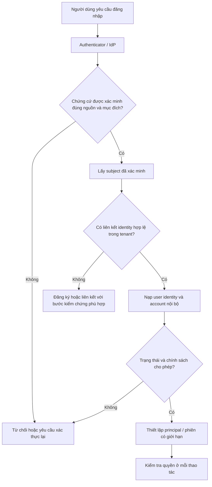

# User identity

**User identity (danh tính người dùng)** là biểu diễn một người dùng trong một miền hệ thống, giúp hệ thống phân biệt người đó với các chủ thể khác và liên kết những thông tin, chứng cứ xác thực, lịch sử và quyền có liên quan. Danh tính người dùng là nền tảng cho đăng nhập bằng mật khẩu, MFA, passkey, chứng chỉ, liên kết danh tính với nhà cung cấp bên ngoài, duy trì phiên và khôi phục truy cập.

Một hệ thống có thể biết “người dùng nào đang được nhắc đến” mà chưa biết người đó đã **chứng minh quyền kiểm soát danh tính** hay chưa. Ngược lại, một lần đăng nhập thành công chỉ xác nhận chứng cứ theo một cơ chế xác thực nhất định; nó không tự động chứng minh tên thật, vai trò trong tổ chức hoặc quyền truy cập mọi tài nguyên.

Sau bài này, người học có thể mô tả thành phần của user identity, chọn identifier ổn định, phân biệt xác minh danh tính với xác thực, đánh giá độ tin cậy của thuộc tính danh tính và thiết kế ánh xạ từ danh tính đã xác thực đến người dùng nội bộ một cách an toàn.

## 1. User identity nằm ở đâu trong hệ thống?

Ví dụ, một nhân viên dùng email công ty để đăng nhập hệ thống học tập. Có ít nhất bốn lớp thông tin phải phân biệt:

| Khái niệm | Câu hỏi cần trả lời | Ví dụ |
| --- | --- | --- |
| **Người thực tế (real-world person)** | Con người nào đang tương tác? | Một nhân viên tên Mai. |
| **User identity (danh tính người dùng)** | Hệ thống biểu diễn và phân biệt chủ thể ấy bằng gì? | `user_identity_id=usr-8c5`, liên kết với `(issuer, subject)`. |
| **Account (tài khoản)** | Dịch vụ quản lý trạng thái truy cập và dữ liệu của người dùng qua bản ghi nào? | Account học tập đang hoạt động trong tenant `org-7`. |
| **Authenticator / credential** | Người đăng nhập dùng chứng cứ nào để chứng minh quyền kiểm soát? | Mật khẩu, passkey, TOTP, khóa trong thiết bị. |
| **Principal / session** | Sau khi xác thực, server thực hiện yêu cầu thay mặt ai? | Phiên gắn với account và tenant đã xác định. |
| **Authorization (phân quyền)** | Principal này được làm gì trên tài nguyên cụ thể? | Chỉ được xem khóa học đã được cấp quyền. |

Một người có thể có nhiều user identity ở các hệ thống hoặc tổ chức khác nhau. Một user identity có thể liên kết nhiều phương thức đăng nhập; cùng một tài khoản cũng có thể cần quản lý nhiều liên kết danh tính theo chính sách ứng dụng. Các quan hệ này **không nhất thiết là một-một**.

Khái niệm *user* trong sản phẩm đôi khi chỉ “bản ghi người dùng” và đôi khi chỉ “người dùng đã xác thực”. Khi thiết kế giao diện lập trình và dữ liệu, nên đặt tên rõ: `user_identity_id`, `account_id`, `authenticator_id` và `principal`; tránh dùng một biến `user` chung cho mọi bước.

## 2. Thành phần của một danh tính người dùng

Danh tính số thường bao gồm một hoặc nhiều **identifier**, tập **attribute/claim** và những **liên kết** với nguồn cấp danh tính. Đặc biệt, mỗi thông tin cần có **nguồn phát hành, thời điểm và trạng thái kiểm chứng** phù hợp.

### 2.1. Identifier: phân biệt chủ thể

Identifier là một giá trị nhận biết subject trong một **phạm vi xác định**.

- **Định danh nội bộ:** `user_identity_id` hoặc mã người dùng do ứng dụng tự sinh. Nên ổn định, khó đoán khi có lợi cho bảo mật, không chứa email/số điện thoại và không tái sử dụng cho chủ thể khác.
- **Định danh từ nhà cung cấp danh tính (IdP):** Với OpenID Connect (OIDC), thường dùng cặp `(iss, sub)`: `iss` xác định bên phát hành và `sub` xác định subject trong miền phát hành tương ứng.
- **Tên đăng nhập:** username hoặc email giúp người dùng nhớ và nhập; có thể thay đổi, trùng ở những miền khác nhau hoặc được cấp lại.
- **Mã nghiệp vụ:** mã nhân viên, mã học viên, mã khách hàng có quy tắc cấp phát riêng; cần làm rõ tính ổn định và phạm vi trước khi dùng để gắn danh tính.

Nếu cùng một người có hai identity ở hai IdP, không thể kết luận hai bản ghi là một chỉ vì chúng có tên hiển thị hoặc email giống nhau. Một số IdP còn cấp `sub` khác nhau cho cùng một người ở những ứng dụng khách khác nhau.

### 2.2. Attributes và claims: mô tả chủ thể

**Attribute** là thuộc tính như tên hiển thị, email liên hệ, số điện thoại, đơn vị, chức danh. **Claim** là khẳng định về một subject do một nguồn đưa ra; trong token OIDC, `sub`, `email` và `email_verified` là những ví dụ.

| Thuộc tính / claim | Có thể sử dụng để làm gì? | Không nên suy luận điều gì? |
| --- | --- | --- |
| `sub` kèm `iss` được xác minh | Ánh xạ subject IdP đến liên kết danh tính đã lưu. | Không mặc nhiên chứng minh danh tính pháp lý ngoài đời. |
| `email` | Hiển thị, liên lạc, đề xuất tên đăng nhập. | Không tự động quyết định chủ sở hữu account khác. |
| `email_verified=true` | Biết IdP đưa ra khẳng định rằng email đã được xác minh theo quy trình của họ. | Không bảo đảm email còn thuộc cùng người, hay có thể dùng email để gộp account. |
| `name`, `picture` | Giao diện và trải nghiệm người dùng. | Không phải bằng chứng xác thực hoặc nguồn cấp quyền. |
| `groups`, `department` | Gợi ý hoặc cung cấp đầu vào cho chính sách khi nguồn đủ tin cậy. | Không mặc định có hiệu lực trên mọi tenant hay mọi thời điểm. |
| `auth_time`, `amr`, `acr` nếu có | Đánh giá một số đặc điểm/thời điểm của lần xác thực theo thỏa thuận với IdP. | Không đồng nghĩa đã thực hiện xác minh danh tính ngoài đời hoặc đủ quyền làm hành động nhạy cảm. |

Một mẫu biểu diễn khái niệm:

```json
{
  "tenant_id": "org-7",
  "user_identity_id": "usr-8c5",
  "state": "active",
  "external_subjects": [
    {
      "issuer": "https://identity.example.org/org-7",
      "subject": "00u-b23"
    }
  ],
  "attributes": {
    "display_name": {
      "value": "Trần Mai",
      "source": "hr-directory",
      "last_confirmed_at": "2026-10-01T08:00:00Z"
    },
    "email": {
      "value": "mai@example.org",
      "source": "enterprise-idp",
      "verified_at": "2026-10-01T08:00:00Z"
    }
  }
}
```

Đây là cấu trúc minh họa, không phải mẫu bắt buộc. Điểm chính là danh tính có **định danh riêng** và thuộc tính đi kèm **nguồn gốc**. Không đưa mật khẩu, khóa riêng, mã OTP hoặc toàn bộ ID token vào hồ sơ như những trường thông tin hiển thị thông thường.

### 2.3. Độ tin cậy, nguồn gốc và độ mới

Khi dùng một claim để ra quyết định, cần hỏi:

1. **Ai phát hành?** Có phải IdP hoặc hệ thống hồ sơ được tổ chức chấp nhận cho loại thông tin này?
2. **Thông điệp có được xác minh?** Token/chữ ký/kênh truyền có hợp lệ và được gửi đúng cho dịch vụ này?
3. **Nó nói điều gì?** `email_verified` là một khẳng định cụ thể, không phải chứng chỉ quyền truy cập dữ liệu.
4. **Còn hiệu lực không?** Chức vụ, nhóm hoặc số điện thoại có thể thay đổi sau khi token được phát hành.
5. **Phạm vi nào?** Claim từ tenant A không tự động cấp quyền trong tenant B.

**Không có thuộc tính danh tính nào đáng tin chỉ vì nó xuất hiện trong JSON.** Client có thể tự gửi tên, email hay vai trò bất kỳ. Ứng dụng chỉ dùng claims nhạy cảm khi chúng đến từ nguồn đã xác thực, đúng phạm vi và đạt mức tin cậy cần thiết.

## 3. Identity proofing khác authentication như thế nào?

Ba hoạt động thường bị nhầm lẫn:

| Hoạt động | Mục tiêu | Câu hỏi thực tế |
| --- | --- | --- |
| **Identity proofing** (xác minh danh tính) | Thu thập và kiểm tra chứng cứ để liên hệ danh tính số với một người hoặc một thực thể thực tế theo yêu cầu nghiệp vụ. | “Người đăng ký có thực sự là nhân viên được cấp quyền này không?” |
| **Authentication** (xác thực) | Kiểm tra người đang đăng nhập chứng minh được quyền kiểm soát authenticator gắn với danh tính đã khai báo. | “Họ có giữ passkey hoặc biết bí mật cần thiết không?” |
| **Authorization** (phân quyền) | Xác định principal được thực hiện hành động trên tài nguyên cụ thể. | “Người vừa đăng nhập có được sửa hồ sơ của phòng ban khác không?” |

Ví dụ, một diễn đàn có thể cho người dùng tạo identity với biệt danh, email liên hệ và passkey mà không cần xác minh tên trên giấy tờ. Một hệ thống cấp chứng chỉ nghề nghiệp có thể cần kiểm tra hồ sơ thực, sau đó mới gắn người đã kiểm tra với định danh nội bộ. Hai hệ thống đều có thể dùng MFA mạnh; mức xác minh danh tính thực tế của chúng vẫn khác nhau.

Có thể phân tích yêu cầu bảo đảm theo ba góc nhìn: **mức độ xác minh danh tính**, **mức độ bảo đảm của việc xác thực** và **mức độ bảo đảm khi chuyển thông tin giữa các bên** (liên kết danh tính/federation). Các khía cạnh này liên quan nhưng không thay thế nhau. Passkey có khả năng chống phishing tốt giúp bảo vệ quá trình xác thực, song không tự xác minh họ tên hay tư cách nhân viên.

## 4. Từ đăng nhập đến user identity nội bộ

Trong kiến trúc sử dụng IdP, ứng dụng cần xác minh bằng chứng trước, rồi ánh xạ subject được tin cậy sang user identity nội bộ. Quy trình mẫu:



Các ranh giới tin cậy đáng chú ý:

- **Người dùng → dịch vụ xác thực:** Email, user ID và mã do ứng dụng khách đưa lên chỉ là đầu vào. Password, passkey, MFA hay chứng chỉ phải được kiểm tra bởi cơ chế tương ứng, kèm biện pháp chống replay/phishing/lạm dụng.
- **IdP → relying party (ứng dụng):** Với OIDC, ứng dụng cần xác minh ID token theo giao thức và luồng đang sử dụng: chữ ký, khóa phát hành đáng tin, `iss`, `aud`, thời hạn, và `nonce` khi luồng yêu cầu. Các kiểm tra giao thức khác như `state`, PKCE và xác minh redirect cũng thuộc phần triển khai luồng thích hợp.
- **External subject → user identity:** Chỉ tra cứu liên kết đã được xác lập hợp lệ, ví dụ `(tenant_id, issuer, subject)`. Không tự gộp identity dựa trên email trùng.
- **User identity → account / principal:** Xác thực thành công vẫn phải xét account bị khóa, giới hạn tenant, trạng thái người dùng và chính sách hiện hành.
- **Principal → tài nguyên:** Mỗi yêu cầu cần kiểm tra phân quyền phía server; một định danh hợp lệ không thay thế authorization.

Giả mã minh họa:

```text
authenticateViaIdp(tenantId, idToken, requestContext):
    claims = verifyOidcResponse(idToken, requestContext)
    # verifyOidcResponse thực hiện toàn bộ kiểm tra giao thức cần thiết.

    binding = findBinding(tenantId, claims.iss, claims.sub)
    if binding is absent:
        return requireVerifiedRegistrationOrLinking()

    identity = loadUserIdentity(tenantId, binding.userIdentityId)
    account = resolvePermittedAccount(tenantId, identity)

    if identity.state != "active" or account is absent:
        return deny()

    return establishScopedPrincipal(tenantId, identity.id, account.id)
```

Trong hệ thống quản lý trực tiếp mật khẩu hoặc passkey, bước xác minh được thực hiện nội bộ; ứng dụng vẫn phải gắn credential với định danh đã đăng ký, kiểm tra tình trạng user/account và thiết lập principal cho đúng miền tin cậy. **ID token dùng cho đăng nhập không được coi mặc nhiên là access token hợp lệ cho API bất kỳ.**

## 5. Thiết kế và lưu trữ định danh ổn định

Một mô hình dữ liệu khái niệm tách user identity khỏi liên kết IdP như sau (PostgreSQL):

```sql
CREATE TABLE user_identities (
    tenant_id         UUID NOT NULL,
    user_identity_id  UUID NOT NULL,
    state             TEXT NOT NULL
                      CHECK (state IN ('pending', 'active', 'suspended', 'closed')),
    created_at        TIMESTAMPTZ NOT NULL DEFAULT CURRENT_TIMESTAMP,
    PRIMARY KEY (tenant_id, user_identity_id)
);

CREATE TABLE external_identity_bindings (
    tenant_id         UUID NOT NULL,
    issuer            TEXT NOT NULL,
    subject           TEXT NOT NULL,
    user_identity_id  UUID NOT NULL,
    linked_at         TIMESTAMPTZ NOT NULL DEFAULT CURRENT_TIMESTAMP,
    PRIMARY KEY (tenant_id, issuer, subject),
    FOREIGN KEY (tenant_id, user_identity_id)
        REFERENCES user_identities (tenant_id, user_identity_id)
);
```

Trong thiết kế này:

- `user_identity_id` là định danh do dịch vụ sở hữu; thay email hoặc thay cách đăng nhập không làm đổi khóa này.
- Khóa `(tenant_id, issuer, subject)` bảo đảm một subject của một IdP chỉ liên kết với một user identity trong cùng tenant; một user identity có thể có nhiều liên kết ngoài.
- Thông tin liên hệ, bằng chứng xác minh, credential, lịch sử đổi thuộc tính và quyền được quản lý bằng thành phần/bảng riêng, với chính sách lưu giữ thích hợp.
- Account và quyền truy cập có thể được mô hình hóa tách khỏi danh tính người dùng. Không cấp quyền trực tiếp chỉ vì một bản ghi danh tính tồn tại.
- Nếu ứng dụng dùng định danh duy nhất toàn hệ thống thay vì duy nhất theo tenant, vẫn phải kiểm tra tenant và quyền truy cập trên từng tài nguyên.

Không nên dùng email, username hoặc mã nhân viên làm khóa ngoại cho dữ liệu nghiệp vụ nếu các giá trị ấy có thể đổi, trùng hoặc tái cấp. Khi cần đặt ràng buộc duy nhất cho tên đăng nhập, phải xác định quy tắc so khớp, phạm vi tenant, Unicode/chữ hoa và cách xử lý xung đột tại cơ sở dữ liệu. Việc chuẩn hóa email tùy tiện có thể gộp hai địa chỉ mà nhà cung cấp coi là khác nhau.

## 6. Vòng đời của user identity

Một identity cần được quản lý từ lúc xuất hiện đến khi mất hiệu lực. Các trạng thái dưới đây chỉ là ví dụ; quy trình thực tế tùy sản phẩm.

| Giai đoạn | Việc cần quản lý | Rủi ro điển hình |
| --- | --- | --- |
| **Đăng ký/provisioning** | Tạo định danh, xác định tenant, kiểm soát ai được cấp identity. | Đăng ký hàng loạt, trùng danh tính, nhận sai tenant. |
| **Identity proofing (nếu cần)** | Xác minh bằng chứng về người thật hoặc tư cách tổ chức, ghi nhận nguồn và thời điểm. | Tin tài liệu giả hoặc coi một email đã kiểm tra là đủ cho nghiệp vụ nhạy cảm. |
| **Gắn authenticator** | Đăng ký mật khẩu, MFA, passkey hoặc chứng chỉ, bảo vệ thao tác thêm/xóa. | Kẻ tấn công gắn authenticator của mình vào identity người khác. |
| **Đăng nhập hoạt động** | Kiểm tra chứng cứ, rủi ro đăng nhập, trạng thái identity/account và phiên. | Phishing, đoán mật khẩu, replay, vượt quyền qua token sai mục đích. |
| **Cập nhật thuộc tính** | Thay tên, email, điện thoại, nhóm; lưu nguồn thay đổi và tái xác minh khi cần. | Địa chỉ được tái cấp; quyền cũ tồn tại sau khi đổi bộ phận. |
| **Liên kết/gỡ liên kết IdP** | Xác nhận quyền kiểm soát identity cũ và mới theo rủi ro; ghi nhận sự kiện. | Account takeover do tự liên kết email trùng. |
| **Khôi phục** | Đánh giá chứng cứ, cấp lại quyền kiểm soát, thông báo thay đổi và quản lý phiên cũ. | Chiếm email/SIM hoặc lạm dụng luồng hỗ trợ để lấy lại account. |
| **Đình chỉ/đóng** | Ngăn đăng nhập, xử lý session và token đã cấp, gỡ quyền và lưu/xóa dữ liệu theo chính sách. | Người nghỉ việc vẫn dùng phiên cũ, quyền không bị thu hồi kịp thời. |

**Thay đổi thuộc tính không đồng nghĩa thay đổi chủ thể.** Nếu người dùng đổi địa chỉ email hợp lệ, dữ liệu và nhật ký có thể tiếp tục tham chiếu cùng `user_identity_id`. Ngược lại, khi một địa chỉ email được cấp lại cho người khác, không chuyển lịch sử hoặc quyền của identity cũ sang identity mới.

**Khôi phục quyền truy cập cũng là một quyết định gắn danh tính.** Khi mất passkey hoặc thiết bị MFA, hệ thống phải đánh giá yêu cầu khôi phục tương xứng mức rủi ro. Không nên xem việc nhận được SMS/email là bằng chứng tuyệt đối về chủ sở hữu identity ban đầu. Những thay đổi nhạy cảm có thể cần xác thực lại, thông báo trên kênh độc lập và thu hồi phiên theo chính sách.

## 7. Các nguy cơ khi quản lý user identity

| Sai lầm thiết kế | Điều có thể xảy ra | Biện pháp |
| --- | --- | --- |
| Tự gộp hai identity khi cùng email | Người mới được cấp lại hộp thư hoặc IdP yếu có thể chiếm dữ liệu của người cũ. | Liên kết theo subject đã xác minh, yêu cầu chứng minh quyền kiểm soát identity đích. |
| Chỉ lưu `sub`, bỏ `iss` | Trùng subject giữa các nhà cung cấp hoặc ánh xạ sai. | Khóa liên kết gồm issuer và subject, thêm tenant theo mô hình dữ liệu. |
| Coi claim `email_verified` là xác minh danh tính pháp lý | Chấp nhận nhầm tư cách cá nhân hoặc tổ chức. | Định nghĩa riêng yêu cầu identity proofing; hiểu đúng nguồn và mức bảo đảm claim. |
| Tin `user_id`/`role` do client gửi hoặc JWT chỉ được giải mã mà chưa xác minh | Mạo danh principal, nâng quyền hoặc lỗi truy cập trực tiếp đối tượng (IDOR). | Xác minh chứng cứ theo giao thức, xây principal phía server, kiểm tra authorization trên tài nguyên. |
| Chấp nhận token từ issuer hoặc audience không phù hợp | Một token cấp cho dịch vụ khác bị dùng để đăng nhập trái phép. | Giới hạn IdP đáng tin, kiểm tra `iss`, `aud` và ngữ cảnh sử dụng. |
| Không cập nhật identity/account khi người dùng nghỉ việc | Phiên tồn tại tiếp tục truy cập tài nguyên. | Quản lý vô hiệu hóa, thời hạn phiên và cơ chế thu hồi phù hợp. |
| Để quá trình liên kết hoặc khôi phục không được bảo vệ | Kẻ tấn công thêm credential/IdP của mình vào identity hợp lệ. | Xác thực lại khi cần, chống giả mạo yêu cầu, kiểm soát vòng đời, ghi log và thông báo. |
| Đưa email, claims, token hoặc khóa bí mật vào URL/log công khai | Rò rỉ dữ liệu cá nhân và thông tin xác thực. | Tối thiểu hóa dữ liệu, che thông tin nhạy cảm, không ghi token/bí mật. |
| Dùng danh tính tenant A để truy cập tài nguyên tenant B | Lộ dữ liệu xuyên tổ chức. | Gắn tenant với principal, truy vấn dữ liệu và kiểm tra quyền tại server. |

Các biện pháp bảo vệ khỏi phishing, replay, credential stuffing và đăng nhập tự động cần được triển khai tại lớp xác thực tương ứng. Quản lý identity chính xác giúp hệ thống biết *chứng cứ nào thuộc chủ thể nào* và *quyền của chủ thể đó đang có hiệu lực ở đâu*.

## 8. Quyền riêng tư và quản trị thuộc tính danh tính

User identity thường chứa dữ liệu cá nhân. Mục tiêu bảo mật và mục tiêu riêng tư cần được xem xét cùng nhau:

1. **Thu thập tối thiểu:** Chỉ lưu thuộc tính cần cho nghiệp vụ. Nếu ứng dụng chỉ cần mã người dùng và một cách liên hệ, không nên yêu cầu thêm giấy tờ hoặc thông tin nhạy cảm mà không có căn cứ.
2. **Tách mục đích sử dụng:** Email nhận thông báo có thể khác tên đăng nhập; một claim dùng để hiển thị không mặc nhiên dùng để cấp quyền.
3. **Giới hạn quyền đọc/sửa:** Không để mọi dịch vụ hoặc nhân viên hỗ trợ truy cập toàn bộ hồ sơ identity. Phân quyền cả thao tác xem, sửa, liên kết và xuất dữ liệu.
4. **Theo dõi nguồn và lịch sử thay đổi:** Biết thuộc tính từ đâu, ai sửa, khi nào được xác minh, và cách xử lý khi nguồn không còn đáng tin.
5. **Quản lý thời hạn lưu trữ:** Xác định việc xóa/ẩn danh dữ liệu khi đóng tài khoản, đồng thời giữ nhật ký tối thiểu theo nhu cầu an toàn và nghĩa vụ áp dụng.
6. **Tránh đồng nhất người dùng xuyên ngữ cảnh:** Dùng định danh có phạm vi phù hợp; không tùy tiện nối dữ liệu giữa các dịch vụ chỉ vì email trùng hoặc cùng một IdP.

Một subject ổn định giúp tham chiếu dữ liệu nhất quán, nhưng chính sự ổn định đó cũng có thể tạo khả năng theo dõi xuyên dịch vụ. Khi thiết kế federation, hãy xem xét định danh theo từng ứng dụng (*pairwise subject*) nếu nhà cung cấp hỗ trợ và nhu cầu riêng tư yêu cầu.

## 9. Tình huống thực hành: email bị cấp lại

**Bối cảnh:** Hà có identity `U1` trên nền tảng đào tạo thuộc tenant `T1`. Hà từng liên kết IdP công ty với `iss=I1`, `sub=S1` và email `ha@company.example`. Sau khi Hà rời công ty, email này được cấp cho nhân viên mới là Nam; Nam được IdP cấp subject mới `S2`. Hệ thống tự liên kết identity khi email trong token trùng với email đang lưu.

**Phân tích:**

1. Token của Nam có thể hợp lệ nhưng chứng minh một subject **khác**: `(I1, S2)`. Kết quả `email_verified=true` không biến Nam thành Hà.
2. Nếu ứng dụng tìm `U1` bằng email rồi nối `S2` vào đó, Nam có thể chiếm hồ sơ, tiến độ học và quyền truy cập trước đây của Hà.
3. Ứng dụng phải kiểm tra token đúng giao thức; tra cứu liên kết bằng `(tenant_id, issuer, subject)`. Khi chưa có liên kết, yêu cầu quy trình tạo identity mới hoặc liên kết có chứng cứ đủ mạnh, không tự lấy `U1` vì email giống nhau.
4. Quá trình nghỉ việc cần đình chỉ quyền và xử lý các phiên hiện có của Hà. Email có thể được đổi hoặc cấp lại mà dữ liệu của Hà vẫn tham chiếu `U1` theo chính sách lưu giữ.

**Mở rộng:** Nam cũng được mời vào tenant `T2`. Dù Nam dùng cùng IdP và subject, quyền của Nam ở `T1` không tự áp dụng ở `T2`. Hãy đưa tenant vào bước xác định identity hoặc membership tương ứng và kiểm tra quyền riêng ở mỗi tenant.

## 10. Checklist cho thiết kế user identity

- [ ] Xác định rõ user identity, account, authenticator, principal và phạm vi của từng mã định danh.
- [ ] Có identifier nội bộ ổn định, không dựa vào email hoặc số điện thoại có thể tái cấp.
- [ ] Lưu hoặc truy xuất được nguồn và mức kiểm chứng cho claims được dùng trong quyết định bảo mật.
- [ ] Phân biệt identity proofing, authentication và authorization theo rủi ro nghiệp vụ.
- [ ] Xác minh chứng cứ đăng nhập/ID token trước khi lấy subject; chỉ tin issuer và audience đã cấu hình phù hợp.
- [ ] Liên kết IdP/credential mới qua quy trình xác minh quyền kiểm soát, không tự gộp theo email.
- [ ] Luôn kiểm tra tenant, trạng thái identity/account và quyền trên tài nguyên cụ thể.
- [ ] Có quy trình đổi thuộc tính, đình chỉ, khôi phục, thu hồi phiên và xử lý người dùng nghỉ việc.
- [ ] Có kiểm soát quyền riêng tư, giới hạn dữ liệu trong log, thời hạn lưu và khả năng rà soát thay đổi.
- [ ] Kiểm thử tình huống email bị cấp lại, issuer khác nhau cùng `sub`, cùng identity trên nhiều tenant và liên kết đồng thời.

## 11. Câu hỏi tự kiểm tra

**1. Một người đăng nhập bằng passkey có được coi là đã xác minh danh tính pháp lý không?**  
Không. Passkey giúp chứng minh quyền kiểm soát authenticator gắn với một account/identity theo cấu hình relying party; kiểm tra danh tính pháp lý là quy trình riêng khi nghiệp vụ cần.

**2. Vì sao `email_verified=true` chưa đủ để gộp hai user identity?**  
Claim thể hiện khẳng định xác minh email từ nguồn phát hành; email vẫn có thể đổi chủ, còn quyền sở hữu account đích chưa được chứng minh.

**3. Với OIDC, nên dùng gì để nhận biết một external subject?**  
Cặp `(iss, sub)` của thông điệp đã được xác minh, kết hợp phạm vi tenant nếu chính sách hệ thống yêu cầu.

**4. Người dùng đổi email có cần đổi `user_identity_id` không?**  
Thông thường không. Email là thuộc tính có thể thay đổi; khóa nội bộ được giữ ổn định để tham chiếu đúng chủ thể.

**5. Có phải “xác thực thành công” đồng nghĩa “được sửa mọi khóa học trong tenant”?**  
Không. Ứng dụng phải xác định đúng principal, account và tenant, sau đó kiểm tra authorization ở mỗi tài nguyên và thao tác.

**Ghi nhớ:** User identity là cách hệ thống biểu diễn và phân biệt người dùng trong một miền tin cậy. Identifier ổn định, claims có nguồn gốc, liên kết IdP có kiểm chứng và vòng đời được quản lý tốt giúp các cơ chế mật khẩu, MFA, passkey, token, phiên và khôi phục tài khoản bảo vệ đúng người dùng, đúng ngữ cảnh.
