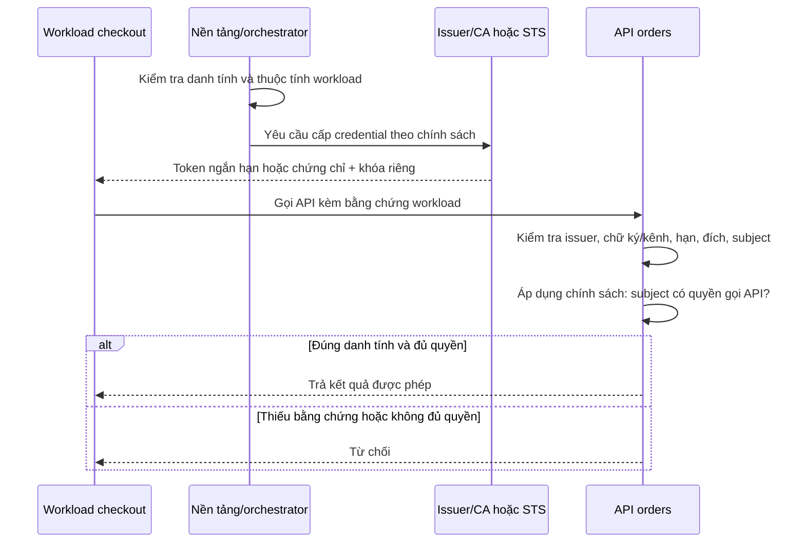

# Nhận diện workload

Khi một người đăng nhập, hệ thống cần biết yêu cầu đến từ tài khoản nào. Trong hệ thống phân tán, một câu hỏi tương tự xuất hiện hàng nghìn lần mà không có con người trực tiếp thao tác: **service nào đang gọi API này, job nào đang đọc dữ liệu, hay tiến trình nào đang yêu cầu lấy bí mật?** Đó là bài toán nhận diện **workload**.

Ví dụ, `checkout` cần gọi `orders` để tra trạng thái đơn hàng. Chỉ dựa vào địa chỉ IP, tên DNS hoặc một header `X-Service-Name: checkout` không chứng minh được bên gọi thực sự là `checkout`: các thông tin đó có thể thay đổi, bị chuyển tiếp hoặc bị giả mạo. Một thiết kế an toàn cần **danh tính workload được cấp từ nguồn đáng tin**, bằng chứng mật mã gắn với danh tính đó, và chính sách giới hạn rõ workload được phép làm gì.

Bài học này thuộc phần **Identity** của nền tảng xác thực: tập trung vào cách xác định và kiểm chứng chủ thể là ứng dụng, service, container, job hoặc máy; đồng thời liên hệ tới credential, chứng chỉ, token, phiên, chống phishing/replay và ranh giới tin cậy trong hệ thống có nhiều thành phần.

## 1. Workload là gì? Vì sao cần danh tính riêng?

**Workload** là phần mềm đang thực thi và thực hiện một công việc: một API service, container, Pod, serverless function, batch job, tiến trình trên VM hoặc tác vụ CI/CD. **Workload identity** là định danh mà hạ tầng và các dịch vụ tin cậy dùng để nhận biết workload ấy khi nó giao tiếp hoặc truy cập tài nguyên.

Một workload có thể có nhiều bản sao (replica) chạy trên nhiều máy. Hệ thống cần quyết định chúng chia sẻ một danh tính theo *vai trò* hay cần danh tính riêng theo *phiên bản triển khai, instance hoặc môi trường*. Quyết định này ảnh hưởng trực tiếp tới phạm vi thiệt hại nếu một instance bị xâm nhập.

| Khái niệm | Ví dụ | Lưu ý |
| --- | --- | --- |
| Workload | Container chạy dịch vụ `checkout` | Là tiến trình thực tế, có vòng đời ngắn và có thể thay thế |
| Danh tính workload | `spiffe://prod.example/ns/payments/sa/checkout` | Là tên chủ thể trong một miền tin cậy được xác định |
| Credential | Token có thời hạn, cặp khóa/chứng chỉ mTLS | Là bằng chứng để chứng minh quyền kiểm soát danh tính, cần bảo vệ và xoay vòng |
| Bên cấp danh tính (issuer) | Kubernetes control plane, CA, hệ thống workload identity | Chỉ được tin theo cấu hình và phạm vi thẩm quyền cụ thể |
| Bên xác minh (verifier) | API `orders`, gateway hoặc STS | Kiểm chứng credential trước khi tạo principal |
| Quyền truy cập | `orders.read` đối với tenant được phép | Là bài toán **phân quyền**, tách biệt với việc xác định ai đang gọi |

**Danh tính không đồng nghĩa với credential.** Workload có thể giữ một định danh ổn định qua nhiều lần khởi động, trong khi token hoặc chứng chỉ được thay thường xuyên. Khi workload bị gỡ bỏ hoặc thay vai trò, hệ thống phải ngừng cấp credential và xử lý những credential còn hiệu lực theo chính sách.

### Không nhầm workload identity với user identity

Nếu người dùng An gọi `checkout`, rồi `checkout` gọi `orders`, có ít nhất hai chủ thể:

- **Người dùng An:** chủ thể thực hiện hành động nghiệp vụ, thường được chứng minh qua phiên người dùng hoặc access token.
- **Service `checkout`:** chủ thể kỹ thuật đại diện cho phần mềm đang gọi `orders`, thường được chứng minh bằng credential workload.

`orders` có thể cần kiểm tra **cả hai**: `checkout` có quyền gọi API và An có quyền xem đơn hàng tương ứng. Không được tự suy ra “An” chỉ vì `checkout` gửi `userId=An`; ngược lại, cũng không được gán cho An toàn bộ quyền hệ thống của service.

## 2. Nhận diện, xác thực, phân quyền và chứng thực môi trường

Các khái niệm có liên quan nhưng trả lời các câu hỏi khác nhau:

1. **Nhận diện (identification):** workload tự khai hoặc được hệ thống gán là chủ thể nào, trong phạm vi nào? Ví dụ: service account `payments/checkout`.
2. **Xác thực (authentication):** bằng chứng hiện tại có xác nhận bên yêu cầu kiểm soát credential gắn với danh tính ấy không? Ví dụ: chữ ký hợp lệ từ khóa riêng của chứng chỉ client.
3. **Chứng thực môi trường/khối lượng công việc (attestation):** hạ tầng đã kiểm tra những thuộc tính nào trước khi cấp danh tính? Ví dụ: Pod được Kubernetes tạo trong namespace xác định, đang chạy trên node được tin cậy, có selector hoặc metadata phù hợp.
4. **Phân quyền (authorization):** danh tính đã xác thực được phép gọi API hoặc đọc bí mật nào? Ví dụ: `checkout` được đọc đơn hàng, nhưng không được xuất toàn bộ dữ liệu khách hàng.

Attestation phụ thuộc năng lực và cấu hình của hạ tầng. Việc chứng thực một node **không tự động chứng minh** mã nguồn, image, tính toàn vẹn tiến trình hoặc danh tính của người vận hành workload. Một Kubernetes ServiceAccount token chứng minh quyền sử dụng danh tính ServiceAccount theo điều kiện cấp token; **không mặc nhiên xác minh image hay mã đang chạy**. Cần chính sách triển khai, kiểm soát admission, image signing hoặc cơ chế attestation mạnh hơn nếu nghiệp vụ đòi hỏi.

### Mô hình danh tính rõ ràng

Trong thực tế, tên ngắn `checkout` thường không đủ. Ít nhất phải xét:

| Thuộc tính | Câu hỏi cần trả lời |
| --- | --- |
| Trust domain / issuer | Danh tính do hệ thống hoặc tổ chức nào cấp? |
| Environment | Production hay staging? Có cho phép dùng chéo môi trường không? |
| Namespace / tenant / project | Workload thuộc miền quản trị nào? |
| Service account / role | Danh tính đại diện cho chức năng nào? |
| Instance / deployment (nếu cần) | Có phải cần phân biệt từng Pod, job hoặc bản triển khai? |
| Lifecycle | Khi workload biến mất, credential bị vô hiệu hoặc hết hạn thế nào? |

Ví dụ `spiffe://prod.example/ns/payments/sa/checkout` và `spiffe://staging.example/ns/payments/sa/checkout` là hai danh tính khác nhau nếu được cấp trong hai trust domain khác nhau. Không được cho phép truy cập production chỉ bằng cách so khớp phần cuối `/sa/checkout`.

## 3. Chuỗi tin cậy: từ workload đang chạy tới danh tính được chấp nhận

Trong môi trường tự động, không thể yêu cầu mỗi Pod đăng nhập bằng mật khẩu. Hệ thống thường dùng một **chuỗi cấp và kiểm chứng danh tính**: hạ tầng xác định workload, issuer cấp credential, workload trình bằng chứng, dịch vụ đích xác minh rồi áp dụng chính sách.



Sơ đồ mô tả luồng logic; thực tế chứng chỉ và token có cách trình bày bằng chứng khác nhau, và một hệ thống cấp phát có thể dùng agent trên node hoặc giao thức federation. Những **ranh giới tin cậy** cần nhận diện gồm:

- **Workload ↔ nền tảng:** tiến trình có quyền xin credential cho subject nào? Một Pod không được tự chọn danh tính có đặc quyền cao mà không qua chính sách cấp phát.
- **Nền tảng ↔ issuer:** issuer có thật sự tin bằng chứng về node, Pod, môi trường hoặc role? Ai quản lý khóa ký và chính sách cấp danh tính?
- **Workload ↔ dịch vụ đích:** dịch vụ đích có kiểm chứng credential độc lập không? Dữ liệu do bên gọi tự đặt trong HTTP header không phải bằng chứng xác thực.
- **Dịch vụ đích ↔ tài nguyên:** sau khi xác thực workload, quyền có được giới hạn cho hành động và tài nguyên được chỉ định không?

### Các bất biến cần bảo toàn

1. **Chỉ chủ thể hợp lệ nhận được credential:** quá trình cấp token/chứng chỉ phải ràng buộc với workload và môi trường đã được kiểm tra.
2. **Credential thuộc đúng chủ thể:** bên nhận không lấy `serviceName` từ body, header hoặc tham số URL làm danh tính đã xác thực.
3. **Bằng chứng có phạm vi và hiệu lực:** kiểm tra thời hạn, bên cấp, mục đích sử dụng, đối tượng nhận (`aud` với token), trust domain và trạng thái thu hồi khi có cơ chế hỗ trợ.
4. **Danh tính được nối tiếp nhất quán:** proxy, gateway và các service phía sau không được âm thầm thay subject hoặc bỏ qua kiểm chứng.
5. **Quyền nhỏ nhất:** workload chỉ nhận quyền tương ứng với nhiệm vụ; production và staging không chia sẻ quyền chỉ vì cùng tên ứng dụng.

## 4. Ba cách nhận diện workload thường gặp

### 4.1. Chứng chỉ client và mTLS

Trong **mutual TLS (mTLS)**, hai phía xác thực nhau bằng chứng chỉ trong quá trình bắt tay TLS. Workload nắm private key tương ứng với chứng chỉ mà một CA được tin cậy đã cấp; service đích kiểm tra chuỗi chứng chỉ, hạn sử dụng, các ràng buộc certificate usage và danh tính được mã hóa trong chứng chỉ.

Với hệ sinh thái **SPIFFE**, workload có thể mang SPIFFE ID dưới dạng URI, ví dụ:

```text
spiffe://prod.example/ns/payments/sa/checkout
```

SPIFFE ID thể hiện chủ thể trong **trust domain** `prod.example`; với X.509-SVID, định danh được đặt trong trường URI Subject Alternative Name của chứng chỉ. Khi kiểm tra, server cần áp dụng trust bundle được cấu hình cho trust domain tương ứng và chính sách cho phép đúng SPIFFE ID hoặc tập ID được duyệt. Không nên chỉ tin trường `Common Name`, tên DNS hay việc “chứng chỉ được một CA bất kỳ ký”.

**Điểm mạnh:** bằng chứng gắn với kết nối TLS; có thể tự động cấp và xoay chứng chỉ ngắn hạn, giảm nhu cầu chia sẻ secret tĩnh. **Giới hạn:** nếu khóa riêng bị đánh cắp, kẻ tấn công vẫn có thể giả mạo cho tới khi credential hết hạn hoặc bị vô hiệu; mTLS chỉ nhận diện peer của kết nối, không tự thực hiện phân quyền nghiệp vụ hoặc chứng minh danh tính người dùng cuối.

### 4.2. Kubernetes ServiceAccount token

Kubernetes có danh tính **ServiceAccount** để workload trong Pod sử dụng khi tương tác với các bên tin cậy. Một token được phát hành phù hợp có các claim như `iss` (issuer), `sub` (subject), `aud` (đối tượng nhận), `exp` (hết hạn). Subject thường có dạng `system:serviceaccount:<namespace>:<name>`.

Ví dụ tối giản về **projected ServiceAccount token** dành riêng cho API `orders`:

```yaml
apiVersion: v1
kind: ServiceAccount
metadata:
  name: checkout
  namespace: payments
---
apiVersion: v1
kind: Pod
metadata:
  name: checkout-demo
  namespace: payments
spec:
  serviceAccountName: checkout
  automountServiceAccountToken: false
  containers:
    - name: checkout
      image: registry.example.invalid/checkout:1.0
      volumeMounts:
        - name: orders-token
          mountPath: /var/run/workload-identity
          readOnly: true
  volumes:
    - name: orders-token
      projected:
        sources:
          - serviceAccountToken:
              path: token
              audience: orders-api
              expirationSeconds: 3600
```

Đây là ví dụ cấu hình việc **cấp và gắn token vào Pod**, không tự động cấu hình API `orders` chấp nhận token. Kubernetes quản lý việc phát hành và làm mới token chiếu vào volume; ứng dụng phải đọc phiên bản token hiện hành, không giữ mãi bản đã hết hạn. Trong môi trường triển khai thực tế, cần cấu hình namespace, image, chính sách quyền và các kiểm soát Pod tương ứng.

Khi nhận token, `orders` phải xác thực token qua **TokenReview** với audience mong đợi hoặc cơ chế xác minh issuer/chữ ký được tin cậy, có đầy đủ kiểm tra thời hạn, audience và vòng đời token phù hợp. Sau đó chỉ chấp nhận subject được phép, chẳng hạn `system:serviceaccount:payments:checkout`; không dựa vào JSON do client tự giải mã mà bỏ qua chữ ký. Token của ServiceAccount dùng cho một audience **không được mặc nhiên chấp nhận** ở dịch vụ khác. Nếu cần kiểm tra trạng thái đối tượng mà token được gắn (như Pod hoặc ServiceAccount), TokenReview có thể phù hợp hơn xác minh JWT thuần túy tùy kiến trúc và phiên bản Kubernetes.

**Giới hạn cần nhớ:** hai Pod cùng dùng ServiceAccount `checkout` thường cùng nhận diện ở cấp danh tính ServiceAccount. Nếu muốn phân biệt chính xác Pod, deployment hoặc image, phải bổ sung thuộc tính được issuer chứng thực và kiểm soát tương ứng; tự đọc tên Pod từ header không đủ.

### 4.3. Workload identity federation và token exchange

Một workload chạy ở hệ thống A có thể cần truy cập API cloud tại hệ thống B. Thay vì đặt access key dài hạn của B vào container, hệ thống có thể dùng **federation**:

1. Workload nhận token ngắn hạn do issuer A phát hành, ràng buộc với danh tính và audience phù hợp.
2. Workload gửi token đó tới **security token service (STS)** hoặc điểm trao đổi token của B.
3. B kiểm tra chữ ký, issuer, audience, thời hạn, subject và điều kiện tin cậy đã cấu hình; sau đó phát credential ngắn hạn cho role được cho phép.
4. Workload dùng credential mới để gọi tài nguyên B trong phạm vi role đó.

Ví dụ, chỉ `system:serviceaccount:payments:checkout` của **đúng Kubernetes cluster/issuer** mới được đổi token để lấy quyền đọc một queue. Không nên cấu hình điều kiện tin cậy kiểu “bất kỳ token từ issuer này đều được quyền quản trị”. Phải kiểm soát các thuộc tính mà STS thực sự xác minh, đồng thời tránh nhầm token dành cho dịch vụ khác bằng việc kiểm tra `aud` và đúng đối tác tin cậy.

### So sánh nhanh

| Cơ chế | Chứng cứ điển hình | Điểm cần bảo vệ |
| --- | --- | --- |
| Secret/API key tĩnh | Bên gọi biết secret | Secret khó xoay, dễ bị sao chép và chia sẻ; không chứng minh instance nào đang chạy |
| mTLS với chứng chỉ workload | Quyền sử dụng private key và chứng chỉ do CA tin cậy cấp | Private key, vòng đời chứng chỉ, trust domain và quy tắc cho phép ID |
| ServiceAccount token | Token ký bởi issuer của cluster với subject và audience | Nơi lưu token, kiểm chứng audience/issuer, quyền của ServiceAccount |
| Workload federation | Token của issuer nguồn được STS đổi thành credential đích | Điều kiện trust của STS, role mapping, audience và token ngắn hạn |

Những cơ chế này có thể kết hợp. Chọn cơ chế phụ thuộc hạ tầng, mô hình đe dọa, vòng đời workload và khả năng tự động cấp/thu hồi credential.

## 5. Từ danh tính đã xác thực tới quyết định truy cập

Xét `orders` chỉ cho phép workload `checkout` của namespace `payments` đọc trạng thái đơn hàng; thao tác cập nhật thanh toán phải thuộc workload khác. Hệ thống cần phân biệt **principal đã xác thực** với các trường do request tự khai.

```text
# Pseudocode minh họa: không phải bản triển khai xác thực token hoàn chỉnh.
request -> verifier:
    credential = lấy từ mTLS hoặc Authorization header
    principal = verifyCredential(
        credential,
        trustedIssuer = "issuer-prod",
        expectedAudience = "orders-api",
        allowedAlgorithmsAndKeys = configuredTrust,
        checkExpiration = true
    )
    if principal invalid: DENY

    if principal.subject != "system:serviceaccount:payments:checkout": DENY
    if principal.environment != "production": DENY
    if request.action != "orders.read": DENY
    if !policyAllows(principal, request.resource): DENY

    ALLOW
```

`environment` trong ví dụ phải đến từ issuer/claim được xác minh hoặc ánh xạ cấu hình đáng tin, **không** được lấy từ `request.body.environment`. Với mTLS, thay phần kiểm tra JWT bằng kiểm chứng chứng chỉ, trust domain và peer identity. Đoạn mã trên diễn đạt **mục tiêu chính sách**, không thay thế thư viện kiểm chứng token, CA hay hệ thống phân quyền.

Nếu request còn đại diện cho người dùng, nên lưu riêng danh tính workload và người dùng, xác minh ngữ cảnh ủy quyền tương ứng. Một service dùng đặc quyền máy để thực hiện thao tác thay người dùng phải có quy tắc rõ ai được ủy quyền và được thực hiện thao tác gì; đây là nơi dễ mắc lỗi **confused deputy** (dịch vụ có quyền cao bị lợi dụng làm thay việc cho bên không đủ quyền).

## 6. Những lỗi nhận diện workload dễ tạo lỗ hổng

| Sai sót | Hệ quả | Hướng phòng vệ |
| --- | --- | --- |
| Tin `X-Service-Name: checkout` do client gửi | Kẻ tấn công tự xưng là service tin cậy | Chỉ gán principal sau khi xác thực mTLS/token; proxy phải bỏ header nhận diện do client tự đặt |
| Cho phép dựa vào IP nội bộ hoặc DNS | Workload trong cùng mạng có thể giả mạo vị trí tin cậy | Áp dụng xác thực danh tính cho từng kết nối/yêu cầu; IP chỉ là tín hiệu bổ sung |
| Hai môi trường dùng chung credential hoặc issuer nhưng thiếu ràng buộc | Token staging được dùng ở production | Phân tách trust domain/issuer, audience và chính sách môi trường |
| Nhiều service dùng một tài khoản có quyền cao | Khó truy vết, một nơi bị xâm nhập có thể ảnh hưởng cả hệ thống | Danh tính riêng theo vai trò, tách quyền theo nhu cầu tối thiểu |
| Token bị đọc từ log, secret volume hoặc metadata endpoint | Kẻ tấn công replay token trong khoảng hiệu lực | Giảm quyền truy cập token, TTL ngắn, không log credential, hạn chế SSRF/metadata access, cân nhắc ràng buộc token với kênh hoặc khóa khi hỗ trợ |
| Chỉ giải mã JWT mà không xác minh chữ ký và `aud` | Chấp nhận token giả hoặc token cho dịch vụ khác | Kiểm tra issuer, thuật toán, khóa, chữ ký, thời hạn, audience và subject |
| Kẻ tấn công triển khai Pod với ServiceAccount đặc quyền | Nhận credential hợp lệ cho danh tính có quyền cao | RBAC và admission policy cho quyền tạo Pod/chọn ServiceAccount, giới hạn cấp phát credential |
| Bỏ qua việc thu hồi/luân chuyển credential | Workload bị xóa nhưng credential vẫn dùng được | Credential sống ngắn, tự động rotation, xử lý thu hồi và vô hiệu hóa khi cần |

**Replay không biến mất chỉ vì token đã được ký.** Chữ ký chứng minh issuer và tính toàn vẹn; một token mang theo (bearer token) bị đánh cắp có thể bị sử dụng lại khi còn hạn. Giảm thời gian tồn tại, giới hạn `aud` và quyền, bảo vệ token khỏi bị lộ; khi cần bảo vệ mạnh hơn, dùng cơ chế xác nhận quyền giữ khóa (proof of possession) hoặc ràng buộc với kênh phù hợp.

**Phishing dưới dạng cấp phát sai danh tính:** không giống thao tác người dùng nhập mật khẩu vào trang giả, workload thường đối mặt với giả mạo endpoint cấp token, chuyển hướng request, chiếm secret hoặc lạm dụng metadata API. Cấu hình tin cậy của issuer, bảo vệ DNS/TLS, kiểm soát egress và quy tắc truy cập metadata là những thành phần cần đánh giá trong mô hình đe dọa.

## 7. Thiết kế vòng đời danh tính workload an toàn

Một hệ thống nên xem danh tính workload là **tài nguyên có vòng đời**, không phải một chuỗi tên cấu hình xong là đủ:

1. **Khai báo:** xác định danh tính cần cấp cho mỗi service, job, môi trường và phạm vi tenant. Tránh dùng một danh tính toàn hệ thống cho các tác vụ khác nhau.
2. **Cấp phát:** issuer kiểm tra thuộc tính workload từ nguồn tin cậy và chỉ cấp credential theo chính sách. Không cho ứng dụng tự chọn subject tùy ý.
3. **Sử dụng:** workload trình credential qua kênh được bảo vệ; verifier kiểm tra đầy đủ trước khi gán principal và áp dụng policy.
4. **Gia hạn:** tự động xoay token/chứng chỉ ngắn hạn; ứng dụng có thể tải lại credential mà không gián đoạn kéo dài. Không ghi credential ra log hoặc nhúng trong image.
5. **Thay đổi/thu hồi:** khi role, namespace, workload hoặc quan hệ tin cậy thay đổi, cập nhật chính sách cấp phát và quyền nhận token; xử lý credential đã cấp theo thời hạn và cơ chế thu hồi thực tế.
6. **Quan sát:** ghi nhật ký **subject đã xác thực**, issuer/trust domain, hành động, quyết định cho phép/từ chối, thời gian và correlation ID; tránh ghi nguyên token, private key hoặc secret.

### Bộ câu hỏi kiểm tra trước khi đưa vào production

| Câu hỏi | Kỳ vọng |
| --- | --- |
| Một Pod khác cùng mạng gửi `X-Service-Name: checkout` có được chấp nhận không? | Không; phải có bằng chứng xác thực workload hợp lệ |
| Token có chữ ký đúng nhưng `aud=metrics-api` có gọi được `orders-api` không? | Không; audience phải khớp dịch vụ đích |
| Chứng chỉ từ CA của staging có được nhận như production không? | Không, trừ khi có quan hệ tin cậy và policy được thiết kế rõ ràng |
| Token hết hạn hoặc credential đã bị thu hồi theo cơ chế hỗ trợ có được dùng tiếp không? | Không; verifier và hệ thống cấp phát áp dụng vòng đời thích hợp |
| Job `reporting` dùng chung ServiceAccount với `checkout` có bị phân biệt được không? | Không nếu chỉ dựa vào cùng ServiceAccount; phải cấp danh tính riêng hoặc có bằng chứng khác được xác minh |
| `checkout` đã xác thực có thể tự thực hiện thao tác quản trị không? | Không; quyền truy cập độc lập với kết quả xác thực |
| Workload bị chiếm quyền nhưng vẫn có token hợp lệ thì sao? | Cần quyền tối thiểu, TTL ngắn, phát hiện bất thường, cô lập và thu hồi; xác thực đơn thuần không phát hiện được mọi hành vi độc hại |

## 8. Tình huống luyện tập

**Bối cảnh:** công ty có ba workload trong cluster: `checkout`, `orders` và `billing`. Cả ba đang dùng cùng secret `API_KEY`, gateway nhận header `X-Service-Name` để ghi log, còn `orders` mặc định cho mọi request nội bộ đọc dữ liệu đơn hàng.

**Yêu cầu:** thiết kế lại luồng để `checkout` được đọc đơn hàng, `billing` chỉ được cập nhật trạng thái thanh toán, còn một Pod lạ hoặc workload của môi trường thử nghiệm không thể mạo danh hai service trên.

**Hướng giải:**

- Cấp danh tính riêng cho `checkout`, `orders`, `billing`, tách trust domain hoặc issuer theo môi trường. Gắn credential động với mỗi workload bằng projected token/federation hoặc mTLS.
- Gateway hoặc service đích xác minh credential và trích principal từ kết quả xác minh; header tên service chỉ dùng cho mục đích không nhạy cảm nếu được xử lý thích hợp.
- Định nghĩa policy `checkout -> orders.read`, `billing -> payment.update`; từ chối các hoạt động ngoài quyền, kể cả khi credential hợp lệ.
- Bảo vệ nơi cấp credential, chống việc Pod không được phép mượn ServiceAccount, giới hạn thời gian sống và xử lý token bị lộ.
- Kiểm thử bằng request từ Pod lạ, token sai audience, credential staging, token hết hạn, subject hợp lệ nhưng yêu cầu quyền sai.

### Tự kiểm tra

1. **Vì sao tên DNS hoặc IP không đủ để nhận diện workload?** Vì chúng mô tả đường mạng/vị trí, không chứng minh bên gọi đang kiểm soát credential được cấp cho đúng subject.
2. **ServiceAccount token chứng minh điều gì và chưa chứng minh điều gì?** Token hợp lệ chứng minh những claim issuer cấp về danh tính ServiceAccount trong phạm vi token; riêng token đó không mặc nhiên chứng minh image hay toàn bộ tính toàn vẹn của tiến trình.
3. **Một token đúng chữ ký nhưng gửi tới sai API có nên được chấp nhận?** Không. Audience và ràng buộc ngữ cảnh là một phần của xác thực.
4. **Nếu mTLS xác thực thành công, có cần phân quyền?** Có. Xác thực cho biết peer nào đang giao tiếp; phân quyền quyết định peer được làm gì.

**Ghi nhớ:** Nhận diện workload an toàn là chuỗi kiểm soát **workload thực thi → nguồn cấp danh tính đáng tin → credential gắn đúng chủ thể → verifier xác thực đúng ngữ cảnh → phân quyền tối thiểu**. Khi các mắt xích được kiểm tra nhất quán, hệ thống mới có thể tin rằng một request giữa các service đến từ workload đã được công nhận, thay vì chỉ từ một tên hoặc địa chỉ được tự khai.
