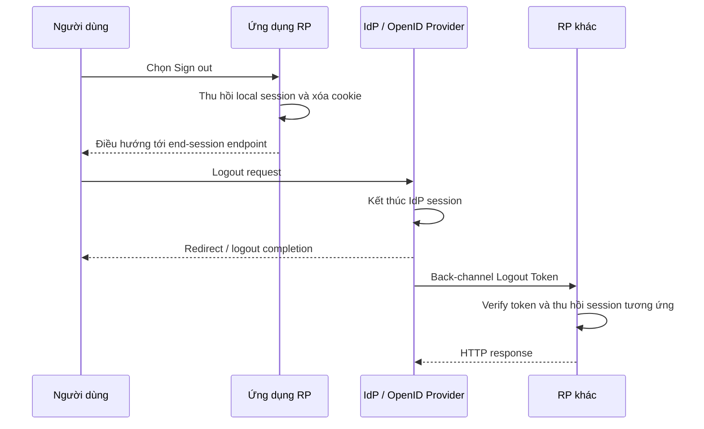

# Logout là gì?

## Mục tiêu học tập

Một người dùng có thể đăng nhập vào ứng dụng trên máy tính dùng chung, điện thoại cá nhân và nhiều trình duyệt. Khi họ chọn Logout, họ mong muốn người khác không thể tiếp tục sử dụng phiên của mình. Tuy nhiên, chỉ xóa cookie trên trang hiện tại chưa chắc đã vô hiệu hóa session ở server, refresh token ở authorization server hoặc phiên SSO tại Identity Provider (IdP).

**Logout (đăng xuất)** là quy trình kết thúc hoặc thu hồi trạng thái xác thực đang cho phép một client hoặc người dùng tiếp tục truy cập. Tùy kiến trúc, quy trình có thể bao gồm vô hiệu hóa session phía server, xóa cookie phía client, thu hồi refresh token, kết thúc phiên tại IdP, thông báo các relying party (RP) khác và yêu cầu các resource server ngừng chấp nhận credential đã bị thu hồi.

Logout là một hành động trong vòng đời phiên và credential. Nó không đồng nghĩa với xóa tài khoản, xóa dữ liệu người dùng, khóa tài khoản hoặc thu hồi mọi credential trên mọi thiết bị. Phạm vi phải được xác định rõ: đăng xuất khỏi ứng dụng hiện tại, thiết bị hiện tại, một phiên cụ thể hay tất cả phiên của tài khoản.

Bài học thuộc chương **Đăng xuất** của mô-đun **SECURITY_AUTHENTICATION_FUNDAMENTALS**. Mô-đun tìm hiểu credential, mật khẩu, MFA, passkey, chứng chỉ, token, phiên, liên kết danh tính và khôi phục tài khoản. Logout kết thúc quyền sử dụng các phiên và token đã được cấp, đồng thời phối hợp các thành phần trong hệ thống để giảm nguy cơ tiếp tục truy cập sau khi người dùng rời đi.

Sau bài học, bạn có thể:

- Phân biệt logout, session expiration, revocation, account suspension và account deletion.
- Mô tả những trạng thái cần kết thúc ở browser, application server, authorization server và IdP.
- Thiết kế logout cho cookie session, access token và refresh token.
- Giải thích giới hạn thu hồi access token dạng JWT tự chứa.
- Phân biệt local logout, logout all devices, OIDC RP-Initiated Logout, front-channel/back-channel logout và SAML Single Logout.
- Phòng chống logout CSRF, session fixation, token leakage và logout race condition.
- Thiết kế xử lý lỗi, retry, audit, thông báo và trải nghiệm trên thiết bị dùng chung.
- Kiểm thử logout, token revocation, session invalidation và đồng bộ logout giữa nhiều ứng dụng.

## 1. Logout giải quyết vấn đề gì?

Sau khi xác thực thành công, ứng dụng tạo một hoặc nhiều credential phiên. Browser có thể giữ session cookie; ứng dụng mobile có thể giữ refresh token; backend có thể lưu session record; IdP có thể giữ SSO session. Những credential này cho phép tiếp tục truy cập mà không cần nhập lại mật khẩu mỗi request.

Khi người dùng không còn muốn sử dụng phiên, hoặc khi có sự cố bảo mật, hệ thống cần kết thúc quyền truy cập. Nếu chỉ chuyển về trang đăng nhập mà không vô hiệu hóa trạng thái phía server, credential cũ có thể tiếp tục hoạt động.

Ví dụ:

- Người dùng bấm Logout trên máy tính ở thư viện. Cookie phải bị xóa và session server phải bị thu hồi.
- Nhân viên mất điện thoại. Admin cần thu hồi phiên trên thiết bị đó mà không nhất thiết đăng xuất các thiết bị khác.
- Người dùng chọn Logout everywhere sau khi nghi ngờ tài khoản bị chiếm. Tất cả session và refresh-token family liên quan phải bị vô hiệu hóa theo policy.
- Người dùng đăng xuất khỏi một ứng dụng SSO. RP cần xác định có kết thúc IdP session hoặc thông báo các RP khác hay không.
- Tài khoản bị đình chỉ. Các phiên đang hoạt động không được tiếp tục chỉ vì cookie hoặc access token chưa hết hạn.

### Logout có nhiều phạm vi

| Phạm vi | Ý nghĩa | Ví dụ |
| --- | --- | --- |
| **Local logout** | Kết thúc phiên trong ứng dụng hiện tại | Đăng xuất khỏi portal HR |
| **Current-device logout** | Kết thúc phiên hoặc credential của thiết bị hiện tại | Đăng xuất điện thoại đang dùng |
| **Session-specific revocation** | Thu hồi một session cụ thể trong danh sách thiết bị | Thu hồi phiên laptop bị mất |
| **Logout all devices** | Thu hồi tất cả session/token family thuộc tài khoản theo policy | Người dùng chọn “Đăng xuất mọi nơi” |
| **IdP logout** | Kết thúc phiên SSO tại nhà cung cấp danh tính | Kết thúc phiên đăng nhập ở IdP |
| **Federated logout** | Phối hợp logout giữa IdP và các RP/SP | OIDC logout hoặc SAML SLO |

Tên nút trên giao diện cần phản ánh đúng phạm vi. Nút Logout ở một ứng dụng không nên hứa rằng người dùng đã bị đăng xuất khỏi mọi dịch vụ nếu hệ thống chỉ xóa session cục bộ.

## 2. Phân biệt logout, expiration, revocation và suspension

Những thao tác này có thể cùng làm người dùng mất quyền truy cập, nhưng nguyên nhân và phạm vi khác nhau.

| Khái niệm | Ý nghĩa | Tác nhân thường gặp |
| --- | --- | --- |
| **Logout** | Người dùng hoặc client chủ động kết thúc phiên | Người dùng bấm Sign out |
| **Session expiration** | Phiên hết hiệu lực theo idle timeout hoặc absolute lifetime | Hệ thống kiểm tra thời hạn |
| **Revocation** | Server chủ động làm session/token không còn được chấp nhận | Người dùng, admin hoặc security policy |
| **Account suspension** | Tạm đình chỉ tài khoản và chặn các phiên/quyền liên quan | Admin, fraud/security process |
| **Credential revocation** | Vô hiệu hóa một authenticator hoặc credential | Mất passkey, khóa chứng chỉ bị lộ |
| **Account deletion** | Xóa hoặc đóng tài khoản theo quy trình dữ liệu và pháp lý | Người dùng hoặc tổ chức |

Logout thường là yêu cầu kết thúc một phạm vi phiên. Revocation là cơ chế kỹ thuật để server ngừng chấp nhận credential. Một hệ thống logout an toàn thường gọi các thao tác revocation phù hợp rồi xóa credential phía client.

Session expiration không cần người dùng bấm Logout. Khi idle timeout hoặc absolute lifetime đạt giới hạn, server từ chối session dù browser vẫn còn cookie.

Account suspension có thể cần thu hồi nhiều session, refresh token, API key hoặc credential. Xóa cookie ở một browser không đủ để đình chỉ tài khoản.

## 3. Các trạng thái cần kết thúc khi logout

Một flow logout cần biết credential được lưu ở đâu và thành phần nào có quyền quyết định nó còn hợp lệ.

### Browser và client

- Xóa cookie session bằng cookie có cùng tên, domain và path đã được cấp.
- Xóa token trong secure storage hoặc memory theo kiến trúc client.
- Xóa dữ liệu nhạy cảm khỏi UI state, cache ứng dụng và các màn hình có thể bị người dùng kế tiếp nhìn thấy.
- Chuyển về trang công khai hoặc màn hình xác nhận đã đăng xuất.
- Không đặt token hoặc session ID trong URL, referrer hay log.

Xóa cookie chỉ làm browser ngừng gửi cookie đó. Nó không chứng minh session phía server đã bị thu hồi.

### Application server

- Đánh dấu session record là REVOKED hoặc xóa record theo chính sách lưu trữ.
- Từ chối mọi request tiếp theo dùng session ID cũ.
- Tăng session version/authentication epoch nếu thiết kế dùng cơ chế này.
- Thu hồi các credential con gắn với session khi cần.
- Ghi audit event với subject, session reference, thời gian, lý do và nguồn yêu cầu.
- Không ghi cookie, session ID thô, access token hoặc refresh token vào log.

Server-side session state là nguồn thẩm quyền cho cookie session. Cookie hết hạn ở browser nhưng server vẫn giữ session ACTIVE là trạng thái không nhất quán; cookie đã bị xóa nhưng server vẫn chấp nhận session ID bị sao chép cũng là lỗi bảo mật.

### Authorization server

Nếu ứng dụng dùng OAuth/OIDC:

- Thu hồi refresh token hoặc token family theo policy.
- Xóa token khỏi secure storage ở client.
- Có thể thu hồi grant hoặc token liên quan nếu người dùng chọn logout/revoke authorization.
- Xác định access token đang còn hiệu lực sẽ được xử lý như thế nào.
- Không giả định revoke refresh token lập tức làm mọi access token JWT đã phát hành bị vô hiệu hóa ở tất cả resource server.

### Identity Provider

Trong SSO, IdP có thể có session riêng. Local logout tại RP không tự động kết thúc IdP session. Nếu người dùng yêu cầu IdP logout, RP cần điều hướng tới end-session endpoint hoặc dùng cơ chế federation phù hợp. Logout ở IdP cũng không tự động kết thúc mọi RP session nếu không có front-channel/back-channel logout hoặc cơ chế kiểm tra trạng thái.

## 4. Logout cho server-side session và cookie

Đối với web application dùng session cookie, server lưu session state và browser giữ một session identifier ngẫu nhiên.

### Quy trình local logout

1. Browser gửi yêu cầu logout qua HTTPS, thường bằng POST có CSRF protection.
2. Server xác thực session hiện tại và xác định principal từ session đã xác minh.
3. Server đánh dấu session REVOKED hoặc xóa record bằng thao tác nguyên tử.
4. Server vô hiệu hóa session ID cũ để mọi request sau đó bị từ chối.
5. Server trả Set-Cookie với cùng tên, path và domain để xóa cookie.
6. Browser xóa dữ liệu nhạy cảm ở UI và điều hướng tới trang công khai.
7. Server ghi audit event nhưng không ghi credential thô.

### Xóa cookie đúng phạm vi

Để browser xóa đúng cookie, response cần đặt cookie cùng tên và phạm vi domain/path đã dùng khi tạo cookie, với thời hạn đã hết hoặc Max-Age bằng 0. Nếu ứng dụng từng phát nhiều cookie cùng tên nhưng khác path/domain, cần xóa từng cookie tương ứng.

Cookie flags vẫn cần được cấu hình an toàn:

- Secure: chỉ gửi qua HTTPS.
- HttpOnly: JavaScript không đọc trực tiếp session cookie.
- SameSite: chọn theo luồng ứng dụng và SSO; vẫn cần đánh giá CSRF.
- Path và Domain: giới hạn phạm vi cần thiết.
- Prefix __Host- khi cookie đáp ứng các điều kiện của prefix.

Không nên chỉ dựa vào cookie Max-Age để kết luận logout thành công. Server phải từ chối session cũ.

### Logout CSRF

Nếu endpoint logout chấp nhận GET không có bảo vệ, một trang bên ngoài có thể khiến browser tự gửi request đăng xuất. Đây thường là vấn đề availability và trải nghiệm, nhưng cũng có thể bị lạm dụng để gây gián đoạn hoặc phá luồng xác thực.

Kiểm soát phù hợp:

- Dùng POST cho thao tác thay đổi trạng thái.
- Áp dụng CSRF token hoặc cơ chế bảo vệ tương đương của framework.
- Kiểm tra Origin/Referer theo policy khi phù hợp.
- Cấu hình SameSite cookie phù hợp nhưng không xem đó là biện pháp duy nhất.
- Không dùng GET để thực hiện logout chỉ vì muốn link đơn giản.
- Nếu cần hỗ trợ liên kết logout, hiển thị trang xác nhận rồi yêu cầu thao tác POST.

### Logout và back button

Sau logout, browser có thể hiển thị trang cũ từ back-forward cache hoặc cache HTTP. Việc trang cũ còn nhìn thấy không nhất thiết có nghĩa session vẫn hợp lệ, nhưng dữ liệu nhạy cảm có thể lộ cho người dùng tiếp theo trên máy dùng chung.

Đối với trang chứa dữ liệu nhạy cảm, cân nhắc Cache-Control phù hợp như no-store và xóa dữ liệu UI khi logout. Mỗi request tới tài nguyên được bảo vệ vẫn phải xác minh session phía server; không chỉ ẩn nút hoặc redirect bằng JavaScript.

## 5. Logout cho access token và refresh token

Trong OAuth 2.0/OIDC, access token và refresh token có vòng đời riêng.

### Vai trò của từng token

| Credential | Vai trò | Khi logout |
| --- | --- | --- |
| Access token | Gọi resource server trong audience/scope được cấp | Xóa ở client; xử lý token còn hạn theo cơ chế resource-server policy |
| Refresh token | Xin access token mới từ authorization server | Thu hồi token/family theo policy và xóa khỏi secure storage |
| ID token | Assertion về kết quả xác thực dành cho OIDC client | Dùng làm gợi ý logout khi profile hỗ trợ; không phải access token |
| Session cookie | Duy trì phiên browser với ứng dụng | Thu hồi server-side session và xóa cookie |
| Client secret | Xác thực confidential client | Không phải credential người dùng; không xóa khi user logout |

### OAuth token revocation

OAuth Token Revocation endpoint theo RFC 7009 cho phép client yêu cầu authorization server thu hồi token. Client gửi token và loại hint nếu được hỗ trợ qua HTTPS; authorization server xác định token và áp dụng quy tắc thu hồi.

Các điểm cần nhớ:

- Endpoint phải được xác thực và bảo vệ theo profile client.
- Client không gửi token qua URL hoặc query string.
- Authorization server có thể thu hồi token liên quan hoặc grant theo policy.
- Response thành công không nhất thiết cho client biết token có tồn tại hay đã bị thu hồi trước đó.
- Client cần xóa token cục bộ ngay cả khi yêu cầu revoke thất bại hoặc mạng không khả dụng.
- Không log request body chứa token.

Thu hồi refresh token ngăn client xin access token mới bằng token đó. Tuy nhiên, access token đã phát hành có thể tiếp tục được resource server chấp nhận đến khi hết hạn nếu resource server chỉ kiểm tra chữ ký và exp.

### JWT access token và giới hạn revocation

JWT access token thường tự chứa claim và được resource server xác minh offline. Điều này giảm round-trip nhưng khiến logout/revocation tức thời khó hơn.

Một số chiến lược:

- Access token có thời hạn ngắn để giới hạn cửa sổ sử dụng.
- Resource server kiểm tra introspection hoặc trạng thái token khi phù hợp.
- Dùng denylist/jti registry cho token cần thu hồi nhanh, với chi phí state lookup.
- Dùng session version hoặc account authentication epoch trong claim và so sánh với trạng thái hiện tại.
- Với hành động đặc quyền, kiểm tra trạng thái server-side thay vì chỉ dựa vào JWT còn hạn.
- Thiết kế sender-constrained token như mTLS hoặc DPoP nếu profile/client hỗ trợ, nhằm giảm khả năng token bị dùng từ nơi khác.

Không có một cơ chế duy nhất phù hợp mọi hệ thống. Chọn trade-off theo yêu cầu thu hồi, tải hệ thống và hậu quả nếu token bị lạm dụng sau logout.

### Refresh token rotation và token family

Nếu hệ thống rotation refresh token, cần quản lý token family. Khi logout một phiên, authorization server có thể thu hồi token family gắn với session đó. Nếu logout all devices, policy có thể thu hồi mọi family của subject.

Không nhầm thu hồi một refresh token với thu hồi mọi credential của tài khoản. Phạm vi phải dựa trên quan hệ token-family/session/account được lưu ở server.

## 6. Local logout, logout all devices và quản lý session registry

Một người dùng có thể có nhiều phiên hợp lệ. Ứng dụng nên phân biệt logout hiện tại với logout toàn bộ thiết bị.

### Session registry

Một registry có thể lưu:

| Trường | Mục đích |
| --- | --- |
| session reference | ID nội bộ hoặc hash dùng để quản lý phiên |
| subject ID | Chủ thể sở hữu phiên |
| device/session label | Nhãn thiết bị do ứng dụng suy ra hoặc người dùng đặt |
| createdAt | Thời điểm tạo phiên |
| lastActivityAt | Hoạt động gần nhất đủ điều kiện |
| absoluteExpiresAt | Giới hạn tuổi thọ tuyệt đối |
| status | ACTIVE, REVOKED, EXPIRED hoặc SUSPENDED |
| token family reference | Liên kết refresh-token family nếu có |
| revokedAt / revokeReason | Thời điểm và lý do thu hồi |

Không coi user-agent, IP hoặc device label là bằng chứng danh tính. Các trường này hỗ trợ quản lý và điều tra, có thể thay đổi hoặc bị giả mạo.

### Logout hiện tại

- Thu hồi session hiện tại.
- Thu hồi token family gắn với session nếu policy yêu cầu.
- Xóa cookie/token phía client.
- Không nhất thiết ảnh hưởng phiên khác của cùng tài khoản.
- Hiển thị rõ người dùng vẫn có thể đăng nhập ở thiết bị khác.

### Logout all devices

- Xác minh yêu cầu logout all devices theo policy.
- Thu hồi toàn bộ session ACTIVE của subject.
- Thu hồi refresh-token families và các credential phiên liên quan.
- Tăng authentication epoch/session version nếu hệ thống sử dụng.
- Phát sự kiện để các node/cache và ứng dụng tích hợp cập nhật trạng thái.
- Thông báo qua kênh liên hệ đã xác minh nếu phù hợp.
- Yêu cầu xác thực lại khi người dùng truy cập lần sau.

Với hành động có rủi ro cao, có thể yêu cầu reauthentication trước khi logout all devices hoặc thu hồi thiết bị khác. Tuy nhiên, nếu tài khoản bị chiếm đoạt và người dùng đang dùng một phiên đáng tin để khẩn cấp thu hồi các phiên khác, quy trình incident response có thể cần đường đi phù hợp hơn.

## 7. SSO logout: IdP và nhiều Relying Party

Trong SSO, IdP và từng RP thường duy trì session độc lập. Logout cần phân biệt kết thúc session cục bộ và kết thúc phiên federation.

### Local RP logout

RP xóa session của chính ứng dụng. IdP session có thể vẫn còn. Nếu người dùng mở một RP khác, IdP có thể đăng nhập họ tự động mà không hỏi lại credential.

Đây không nhất thiết là lỗi; đó là hành vi SSO. Nhưng giao diện phải nói rõ phạm vi logout và policy có thể cung cấp nút “Sign out everywhere” nếu cần.

### OIDC RP-Initiated Logout

OIDC RP-Initiated Logout cho phép RP điều hướng browser tới end-session endpoint của OpenID Provider (OP). Tùy profile và cấu hình, request có thể chứa:

- id_token_hint để OP nhận diện session liên quan.
- post_logout_redirect_uri đã đăng ký.
- state để liên kết response quay về với logout transaction.
- client_id nếu profile/OP yêu cầu hoặc hỗ trợ.

RP phải dùng endpoint lấy từ metadata/registration tin cậy, không nhận URL logout tùy ý từ request người dùng. post_logout_redirect_uri cần được đăng ký và so khớp chính xác. Sau khi logout cục bộ, RP có thể điều hướng tới OP để kết thúc IdP session.

Một redirect về trang RP không tự chứng minh mọi RP khác đã bị logout.

### OIDC Front-Channel Logout

Front-channel logout dùng browser để thông báo tới các RP, thường qua iframe hoặc điều hướng theo cơ chế profile. Nó phụ thuộc browser, cookie policy và khả năng tải nội dung bên thứ ba. Cookie SameSite và các biện pháp chống tracking của browser có thể ảnh hưởng khả năng hoàn tất.

RP cần xử lý logout notification theo profile và chỉ thu hồi session liên quan. Không dùng một URL GET không xác thực như một lệnh xóa tất cả session của bất kỳ subject nào.

### OIDC Back-Channel Logout

Back-channel logout cho phép OP gửi Logout Token trực tiếp tới endpoint của RP qua kênh server-to-server. RP cần xác minh Logout Token theo OIDC Back-Channel Logout specification:

- Chữ ký hợp lệ từ issuer đã cấu hình.
- iss và aud phù hợp OP/client.
- Có event claim logout theo specification.
- Có sid hoặc sub phù hợp với session cần kết thúc, theo quy tắc của profile.
- jti chưa được xử lý trước đó; chống replay.
- Không có nonce trong Logout Token theo yêu cầu của specification.
- Kiểm tra thời gian và các điều kiện token khác theo profile.

RP thu hồi session được định danh bởi sid hoặc các session liên quan đến sub theo semantics đã cấu hình. Endpoint back-channel phải giới hạn request size, timeout, retry và ghi audit. Không coi request nội bộ là đáng tin chỉ vì nó đến từ mạng riêng.

### SAML Single Logout (SLO)

SAML SLO cho phép IdP và SP trao đổi LogoutRequest/LogoutResponse theo binding và profile đã cấu hình. SP cần xác minh chữ ký, issuer, destination, session index, correlation và trạng thái replay.

SAML SLO không được hỗ trợ đồng nhất bởi mọi sản phẩm. Một logout có thể thất bại hoặc bị trễ ở một SP; cần xác định timeout, retry và hành vi khi một participant không phản hồi. Không khẳng định logout toàn liên kết thành công nếu một số participant chưa xác nhận.

### Sơ đồ logout liên kết



Sơ đồ là mô hình khái quát. Thứ tự, callback và participant phụ thuộc giao thức; back-channel logout không cần browser tham gia vào request từ OP tới RP.

## 8. Logout trong ứng dụng mobile và desktop

Mobile và desktop có thể giữ token trong secure storage, keychain, keystore hoặc credential store. Logout cần xóa credential và đồng bộ revocation phía server.

### Mobile app

- Xóa access/refresh token khỏi secure storage sau khi gửi yêu cầu revoke phù hợp.
- Xóa dữ liệu tài khoản khỏi cache và màn hình.
- Dừng background refresh, push action và job gắn với session.
- Xóa cookie trong webview nếu ứng dụng quản lý webview session riêng.
- Không xóa dữ liệu dùng chung hoặc dữ liệu offline của tài khoản khác trên thiết bị.
- Xử lý logout khi offline: đánh dấu local logged-out, xóa credential và gửi revoke khi có kết nối nếu token còn được giữ an toàn cho retry theo policy.

Nếu client xóa refresh token trước khi gửi revoke và không còn bản sao được bảo vệ để retry, server có thể không nhận được yêu cầu thu hồi. Có thể thiết kế một logout transaction có trạng thái, nhưng không giữ token thô trong log hoặc nơi không an toàn chỉ để retry.

### Desktop app

- Xóa token và session cookie khỏi profile/credential store do ứng dụng quản lý.
- Dừng background process có thể tiếp tục dùng token.
- Hủy subscription hoặc connection có xác thực gắn với session nếu cần.
- Xóa cache chứa dữ liệu nhạy cảm theo policy.
- Nếu app dùng browser SSO ngoài, local logout không nhất thiết xóa browser IdP session.

### Thiết bị dùng chung

Trên kiosk hoặc máy tính công cộng, logout cần dọn dữ liệu UI/cache phù hợp, đóng hoặc khóa cửa sổ ứng dụng, xóa session cookie và đảm bảo server đã thu hồi session. Không lưu lựa chọn “remember me” hoặc refresh token trên thiết bị không đáng tin.

## 9. Logout, WebSocket, background jobs và API session

Một phiên có thể được sử dụng ngoài HTTP request thông thường. Logout cần xem xét những kết nối và tác vụ đã xác thực đang hoạt động.

### WebSocket và streaming

Kết nối WebSocket đã được xác thực có thể tồn tại sau khi session bị thu hồi. Server cần liên kết connection với subject/session reference và đóng hoặc từ chối message tiếp theo khi nhận revoke event. Với hệ thống có nhiều node, cần phát sự kiện tới node đang giữ connection.

### Background jobs

Một tác vụ nền được tạo trước logout có thể tiếp tục chạy. Cần xác định:

- Job có chạy dưới service identity riêng hay thay mặt user?
- Job cần bị hủy khi user logout hay vẫn được phép hoàn tất?
- Job có kiểm tra authorization lại tại thời điểm thực thi không?
- Token delegated có bị thu hồi cùng session không?
- Có audit để truy vết hành động được khởi tạo trước logout không?

Không dùng session cookie người dùng làm credential dài hạn cho worker. Dùng service/workload identity và quyền tối thiểu, với policy lifecycle riêng.

### API key và credential dài hạn

Logout thường không tự thu hồi API key hoặc client certificate đã được cấp. Nếu người dùng muốn thu hồi các credential này, cần thao tác quản lý credential riêng hoặc logout all/recovery policy rõ ràng.

## 10. Tính nhất quán, cache và lỗi phân tán

Trong hệ thống nhiều node, logout có thể cập nhật session store nhưng một node khác vẫn đang giữ cache session ACTIVE. Nếu cache không được invalidation, request tiếp theo có thể được chấp nhận.

### Thiết kế revocation propagation

- Dùng session store có trạng thái authoritative.
- Phát sự kiện revoke qua message bus hoặc cơ chế invalidation phù hợp.
- Giới hạn TTL của cache để giảm thời gian stale.
- Dùng session version/auth epoch nếu phù hợp.
- Xác định SLA thu hồi cho thao tác thường và thao tác nhạy cảm.
- Với action có hậu quả cao, kiểm tra trạng thái session/account ở nguồn có thẩm quyền.
- Khi không thể xác minh trạng thái revocation, chọn fail-closed cho hành động rủi ro cao theo policy.

### Logout khi mạng lỗi

Nếu browser không kết nối được server:

- Xóa credential local để thiết bị ngừng tự gửi request.
- Hiển thị rằng việc kết thúc phiên phía server có thể chưa được xác nhận, nếu hệ thống không nhận được xác nhận.
- Khi có kết nối, thực hiện revoke theo cơ chế retry an toàn nếu còn thông tin cần thiết.
- Cung cấp trang quản lý phiên trên thiết bị khác hoặc quy trình hỗ trợ để thu hồi session từ xa.

Không báo “đã đăng xuất mọi nơi” nếu hệ thống chỉ xóa cookie cục bộ và chưa xác nhận thu hồi các session khác.

### Retry và idempotency

Logout thường nên idempotent: gửi cùng yêu cầu nhiều lần không tạo lỗi nghiêm trọng hoặc khôi phục session. Thu hồi một session đã REVOKED có thể trả kết quả thành công theo semantics API. Với logout liên federation, cần correlation ID, deduplication và retry có giới hạn để tránh vòng lặp hoặc xử lý lặp.

## 11. Java/Spring Security: local logout cho session cookie

Ví dụ sau minh họa cấu hình Spring Security cho web app dùng session. Cú pháp có thể thay đổi theo phiên bản Spring Security; cần đối chiếu dependency của ứng dụng trước khi triển khai.

```java
import org.springframework.context.annotation.Bean;
import org.springframework.context.annotation.Configuration;
import org.springframework.security.config.annotation.web.builders.HttpSecurity;
import org.springframework.security.web.SecurityFilterChain;
import org.springframework.security.web.authentication.logout.CookieClearingLogoutHandler;
import org.springframework.security.web.authentication.logout.SecurityContextLogoutHandler;

@Configuration
class WebSecurityConfiguration {

    @Bean
    SecurityFilterChain securityFilterChain(HttpSecurity http)
            throws Exception {

        http
            .authorizeHttpRequests(auth -> auth
                .requestMatchers("/", "/login", "/assets/**").permitAll()
                .anyRequest().authenticated()
            )
            .formLogin(form -> form.permitAll())
            .logout(logout -> logout
                .logoutUrl("/logout")
                .addLogoutHandler(new SecurityContextLogoutHandler())
                .addLogoutHandler(new CookieClearingLogoutHandler("JSESSIONID"))
                .invalidateHttpSession(true)
                .clearAuthentication(true)
                .deleteCookies("JSESSIONID")
                .logoutSuccessUrl("/?signedOut")
                .permitAll()
            );

        return http.build();
    }
}
```

Spring Security mặc định bảo vệ logout bằng CSRF khi CSRF protection được bật; form logout nên gửi POST kèm CSRF token. Không vô hiệu hóa CSRF chỉ để làm một đường link GET logout hoạt động. SecurityContextLogoutHandler và invalidateHttpSession hỗ trợ kết thúc session server-side; cookie clearing xóa cookie phía browser.

Đây là local logout. Cấu hình trên không tự thu hồi OAuth refresh-token family, không kết thúc IdP session và không triển khai OIDC back-channel logout hoặc SAML SLO. Nếu ứng dụng dùng OAuth2/OIDC, cần bổ sung token revocation và federation logout theo kiến trúc.

### Pseudocode revoke session an toàn

```java
// PSEUDOCODE: cập nhật session state bằng transaction/CAS.
LogoutResult logout(
        VerifiedPrincipal principal,
        SessionReference currentSession,
        Instant now) {

    if (principal == null || currentSession == null) {
        return LogoutResult.NOT_AUTHENTICATED;
    }

    int changed = sessionStore.revokeIfActive(
            principal.subjectId(),
            currentSession.id(),
            now,
            "USER_LOGOUT"
    );

    tokenFamilyStore.revokeForSession(
            principal.subjectId(),
            currentSession.id(),
            now
    );

    eventPublisher.publish(
            new SessionRevoked(
                    principal.subjectId(),
                    currentSession.reference(),
                    now
            )
    );

    return changed == 1
            ? LogoutResult.REVOKED
            : LogoutResult.ALREADY_INACTIVE;
}
```

Pseudocode minh họa ý tưởng; trong production, session revocation và token-family revocation cần transaction/outbox hoặc cơ chế retry nhất quán. Không để lỗi revoke token family bị che giấu trong khi UI tuyên bố logout all devices đã hoàn tất. Logout local có thể thành công dù revoke bên ngoài đang chờ; trạng thái và phạm vi phải được biểu diễn rõ.

## 12. Lỗi triển khai thường gặp

| Lỗi | Hậu quả | Cách phòng tránh |
| --- | --- | --- |
| Chỉ redirect về trang login | Session cũ vẫn còn hợp lệ | Thu hồi session server-side |
| Chỉ xóa cookie browser | Cookie bị sao chép vẫn dùng được | Invalidate session ID ở server |
| Logout endpoint dùng GET không CSRF | Website khác có thể ép browser logout | POST và CSRF protection |
| Xóa cookie sai path/domain | Browser vẫn giữ cookie cũ | Xóa đúng tên và phạm vi cookie |
| Không revoke refresh token | Client hoặc attacker tiếp tục lấy access token | Thu hồi token/family theo phạm vi |
| Nghĩ revoke refresh token thu hồi ngay JWT access token | Resource server vẫn chấp nhận token còn hạn | Short TTL, introspection/denylist/version khi cần |
| Không phân biệt local và global logout | Người dùng hiểu sai phạm vi đã đăng xuất | Giao diện và API nêu rõ phạm vi |
| Không thu hồi session ở node khác | Request vẫn được chấp nhận từ cache stale | Invalidation, version và TTL có giới hạn |
| Back-channel logout không verify token | Attacker có thể giả logout event | Verify issuer, audience, event, sid/sub và replay |
| SAML SLO tin response chưa xác minh | Logout nhầm session hoặc bị giả mạo | Verify signature, issuer, destination và correlation |
| Chỉ xóa session mà bỏ WebSocket | Kết nối cũ tiếp tục nhận message | Gắn connection với session và xử lý revoke event |
| Background job dùng session user lâu dài | Job tiếp tục sau logout ngoài ý muốn | Service identity và lifecycle riêng |
| Logout báo thành công khi revoke chưa xong | Người dùng có kỳ vọng sai | Trạng thái hoàn tất/chờ xử lý rõ ràng |
| Retry tạo nhiều sự kiện hoặc lỗi | Logout phân tán không ổn định | Idempotency, deduplication và correlation ID |
| Log token/cookie khi logout | Lộ credential trong hệ thống log | Redaction và audit metadata tối thiểu |
| Logout tự thu hồi API key không rõ policy | Làm gián đoạn integration hợp lệ | Tách session logout khỏi credential management |
| Không thông báo thay đổi phiên đáng ngờ | Người dùng không phát hiện session bị thu hồi | Notification qua kênh đã xác minh theo policy |

## 13. Bảng kiểm thử logout

| Trường hợp | Thao tác/dữ liệu | Kết quả mong đợi |
| --- | --- | --- |
| Local logout thành công | Người dùng POST logout với CSRF hợp lệ | Session server bị revoke và cookie bị xóa |
| Dùng cookie cũ sau logout | Gửi request được bảo vệ bằng session ID cũ | Server từ chối |
| Logout lặp | Gửi lại yêu cầu cho session đã revoke | Idempotent; không tạo session mới |
| Logout CSRF | Website khác cố ép request logout | CSRF protection từ chối |
| GET logout | Gửi GET tới endpoint thay đổi trạng thái | Không thực hiện logout nếu policy yêu cầu POST |
| Cookie path/domain sai | Xóa cookie với phạm vi khác cookie gốc | Test phát hiện cookie còn tồn tại |
| Session hết hạn trước logout | Logout với session đã EXPIRED | Không hồi sinh session; trả kết quả phù hợp |
| Logout current device | Thu hồi session hiện tại | Phiên khác vẫn hoạt động theo policy |
| Logout all devices | Thu hồi mọi session ACTIVE | Các session cũ bị từ chối trên mọi node |
| Refresh token bị revoke | Dùng refresh token cũ sau logout | Authorization server từ chối |
| Access JWT còn hạn | Gọi API sau refresh-token revocation | Hành vi đúng với TTL/introspection/version policy |
| OIDC end-session | RP gửi request tới OP đã cấu hình | IdP session kết thúc theo profile |
| OIDC post-logout URI không đăng ký | Thử redirect tới URI lạ | OP từ chối redirect |
| Back-channel logout hợp lệ | OP gửi Logout Token đúng | RP thu hồi session sid/sub tương ứng |
| Logout Token sai chữ ký | Thay payload/signature | RP từ chối |
| Logout Token replay | Gửi lại jti đã xử lý | RP từ chối hoặc deduplicate |
| Logout Token sai audience | Token dành cho client khác | RP từ chối |
| SAML LogoutRequest hợp lệ | Request đúng issuer/signature/session index | SP kết thúc session tương ứng |
| SAML LogoutRequest sai issuer | Gửi từ nguồn ngoài trust | SP từ chối |
| Participant SLO timeout | Một RP không phản hồi | Ghi trạng thái partial/failure, không báo all complete |
| Cache stale | Request tới node chưa nhận revoke event | Bị chặn theo SLA và cơ chế version/TTL |
| WebSocket sau logout | Gửi message trên connection cũ | Connection đóng hoặc message bị từ chối |
| Background job | Logout khi job đang chạy | Job theo lifecycle/service policy đã định |
| Logout khi offline | Client không liên hệ được server | Xóa local credential; không tuyên bố server revoke đã xác nhận |
| Audit redaction | Kiểm tra log logout | Không có cookie, session ID thô, token hoặc secret |
| Thiết bị dùng chung | Logout rồi bấm Back | Dữ liệu nhạy cảm không được lộ và API bảo vệ từ chối |

Ngoài unit test, cần integration test với nhiều browser, mobile storage, nhiều node, cache invalidation, token endpoint, IdP/SP test environment, callback retry, clock skew, WebSocket và background worker. Dùng token giả lập trong test; không ghi credential production vào fixture hoặc log.

## 14. Checklist thiết kế logout

Trước khi phát hành, hãy trả lời:

1. **Scope:** Logout hiện tại, thiết bị hiện tại, một session hay tất cả thiết bị?
2. **State:** Session/cookie/token được lưu ở client, application server, authorization server và IdP nào?
3. **Server invalidation:** Server có từ chối credential cũ ngay sau logout theo SLA không?
4. **Cookie:** Xóa đúng tên, domain, path; có Secure, HttpOnly, SameSite phù hợp không?
5. **CSRF:** Logout endpoint có POST và CSRF protection không?
6. **Token revocation:** Refresh token/token family/grant nào cần thu hồi?
7. **Access token:** JWT còn hạn được xử lý bằng TTL, introspection, denylist hay session version?
8. **Federation:** Có OIDC RP-Initiated Logout, front/back-channel logout hoặc SAML SLO không?
9. **Validation:** Logout notification có verify issuer, audience, signature, sid/sub, event và replay không?
10. **Distributed state:** Cache, WebSocket và node khác nhận revoke event trong bao lâu?
11. **Failure:** Nếu mạng/IdP/token endpoint lỗi, UI mô tả trạng thái logout ra sao?
12. **Idempotency:** Retry có an toàn và không thực thi lặp không?
13. **Privacy/audit:** Log có tránh token/cookie và chỉ giữ metadata cần thiết không?
14. **User experience:** Người dùng có biết local logout khác logout everywhere không?
15. **Recovery:** Nếu nghi ngờ tài khoản bị chiếm, người dùng có cách thu hồi phiên từ thiết bị khác không?

## 15. Bài tập vận dụng

Một doanh nghiệp dùng OIDC SSO cho ba ứng dụng: HR, finance và source-control. Mỗi ứng dụng tạo session cookie riêng. Mobile app giữ refresh token trong secure storage; access token là JWT có thời hạn 20 phút. Nút Logout hiện tại chỉ xóa cookie của ứng dụng đang mở và chuyển về trang login. IdP vẫn giữ SSO session. Một số API dùng cache để xác minh session version với TTL 15 phút. WebSocket kết nối không đóng khi session bị revoke.

**Yêu cầu:**

1. Liệt kê những credential/session còn tồn tại sau khi người dùng bấm Logout ở HR.
2. Thiết kế local logout cho HR và mô tả phần nào phải xử lý ở browser, HR server và authorization server.
3. Đề xuất logout all devices, bao gồm session registry, refresh-token family, session version và thông báo các node.
4. Mô tả OIDC RP-Initiated Logout và back-channel logout để kết thúc IdP/RP session; nêu giới hạn nếu một RP không phản hồi.
5. Giải thích access JWT còn hạn 20 phút được xử lý thế nào sau refresh-token revocation.
6. Thiết kế cơ chế đóng WebSocket và xử lý background job sau session revocation.
7. Đề xuất cách hiển thị trạng thái nếu logout local thành công nhưng federation/token revocation còn pending.
8. Viết test cho cookie cũ, CSRF logout, token reuse, cache stale, logout token replay và participant timeout.

**Gợi ý tự đánh giá:** Xóa cookie không thu hồi session server; local RP logout không tự kết thúc IdP session; revoke refresh token không luôn làm JWT access token mất hiệu lực ngay; cache và WebSocket cần nhận sự kiện thu hồi; UI phải nói đúng phạm vi đã hoàn tất.

---

**Điểm cần nhớ:** Logout an toàn là quy trình **vô hiệu hóa credential phía server theo đúng phạm vi, xóa credential phía client và phối hợp các session/token liên quan**. Với cookie session, phải revoke session server-side; với OAuth/OIDC, cần quản lý refresh-token family và giới hạn của access token còn hạn; với SSO, cần cơ chế logout federation và xác minh thông điệp. Một giao diện quay về trang đăng nhập chỉ là một phần của logout, không phải bằng chứng rằng mọi phiên đã kết thúc.
