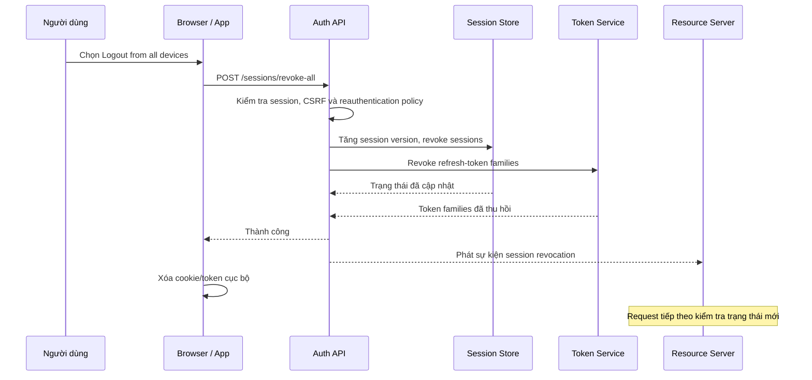

# Logout from all devices — Đăng xuất khỏi tất cả thiết bị

## 1. Logout from all devices là gì?

**Logout from all devices** là thao tác yêu cầu hệ thống chấm dứt mọi phiên đăng nhập đang hoạt động của một tài khoản trên các thiết bị và trình duyệt, bao gồm cả phiên hiện tại nếu policy yêu cầu. Đây là một hành động quản lý session ở phía server: hệ thống phải đánh dấu session không còn hợp lệ, thu hồi hoặc vô hiệu hóa refresh-token liên quan, cập nhật trạng thái thiết bị tin cậy nếu policy quy định, và truyền trạng thái thu hồi tới các dịch vụ có thể tiếp tục chấp nhận phiên cũ.

Ví dụ: Minh đăng nhập tài khoản email trên laptop ở công ty, điện thoại cá nhân và máy tính bảng dùng chung. Minh phát hiện điện thoại bị thất lạc nên chọn “Đăng xuất khỏi tất cả thiết bị”. Máy chủ vô hiệu hóa các session của tài khoản, thu hồi refresh-token family tương ứng, tăng phiên bản xác thực của tài khoản và gửi sự kiện thu hồi tới các dịch vụ. Khi laptop hoặc máy tính bảng gửi request tiếp theo, session cũ bị từ chối và người dùng phải đăng nhập lại.

Xóa cookie ở browser hiện tại chỉ làm browser đó quên cookie. Nó không tự động đăng xuất điện thoại khác, không thu hồi refresh token đã phát hành và không khiến một JWT tự chứa lập tức hết hiệu lực. Vì vậy, logout all devices phải được thực hiện ở phía server và cần cơ chế kiểm tra trạng thái thu hồi.

Trong mô-đun **SECURITY_AUTHENTICATION_FUNDAMENTALS**, thao tác này kết nối session, cookie, access token, refresh token, federation, passkey và account recovery. Mục tiêu là khôi phục quyền kiểm soát tài khoản khi thiết bị mất, session bị nghi đánh cắp hoặc người dùng muốn chấm dứt toàn bộ các phiên cũ.

### Mục tiêu học tập

Sau bài này, người học có thể:

- Phân biệt logout hiện tại, logout một thiết bị và logout tất cả thiết bị.
- Thiết kế mô hình session registry và liên kết session với refresh-token family.
- Thu hồi session ở phía server, xử lý JWT và token opaque đúng cách.
- Phối hợp logout giữa nhiều dịch vụ, resource server và IdP.
- Hiểu giới hạn của front-channel logout, back-channel logout và OAuth token revocation.
- Ngăn CSRF, replay, refresh-token race condition và việc dùng lại session đã thu hồi.
- Thiết kế audit, thông báo, trải nghiệm người dùng và kiểm thử logout all devices.

## 2. Phân biệt các loại logout

Từ “logout” có thể chỉ nhiều thao tác khác nhau. Trước khi thiết kế API hoặc giao diện, cần xác định phạm vi chính xác:

| Thao tác | Phạm vi | Kết quả mong đợi |
|---|---|---|
| Logout current session | Phiên hiện tại trên browser/app | Session hiện tại bị vô hiệu hóa; cookie/token cục bộ được xóa |
| Logout this device | Các phiên gắn với một thiết bị cụ thể | Các session của thiết bị đó bị thu hồi |
| Logout all devices | Tất cả session của tài khoản trên mọi thiết bị | Mọi session đang hoạt động của tài khoản bị vô hiệu hóa |
| Logout at IdP | Phiên đăng nhập tại Identity Provider | Phiên IdP kết thúc theo khả năng của IdP |
| Federated logout | Phiên tại nhiều RP/SP liên kết | Các bên phối hợp kết thúc session theo giao thức |
| Revoke connected app | Grant/ủy quyền của một ứng dụng bên thứ ba | Ứng dụng không còn được dùng grant/token tương ứng |
| Remove passkey | Credential đăng nhập đã đăng ký | Passkey đó không còn được chấp nhận cho xác thực mới |

Logout all devices không đồng nghĩa xóa passkey, xóa mật khẩu, xóa recovery code hoặc thu hồi mọi OAuth consent. Credential là phương tiện xác thực; session là trạng thái đăng nhập đã được thiết lập. Người dùng có thể vẫn giữ passkey sau khi mọi session bị logout để đăng nhập lại khi cần.

Tương tự, đăng xuất khỏi ứng dụng của tổ chức không bảo đảm phiên tại IdP hoặc các ứng dụng khác đã kết thúc. Cần nói rõ phạm vi trong giao diện để người dùng không hiểu nhầm.

## 3. Session là gì và session nằm ở đâu?

Session là trạng thái do hệ thống duy trì sau khi người dùng xác thực thành công. Session thường gắn với account, thời điểm xác thực, phương thức xác thực, thiết bị hoặc client, quyền/assurance context và thời hạn.

Một mô hình session có thể lưu:

| Trường | Mục đích |
|---|---|
| Session ID | Định danh ngẫu nhiên của phiên; phải khó đoán |
| Account ID | Chủ sở hữu session |
| Created at | Thời điểm tạo |
| Last activity | Lần hoạt động gần nhất |
| Authenticated at | Thời điểm xác thực gần nhất |
| Authentication context | Phương thức, MFA/UV, assurance và thông tin cần thiết |
| Device/client label | Nhãn hiển thị và thông tin thiết bị ở mức cần thiết |
| Status | Active, revoked, expired hoặc trạng thái khác |
| Expires at | Hạn tuyệt đối hoặc hạn không hoạt động |
| Session version | Phiên bản xác thực tại thời điểm tạo, nếu dùng generation/version |
| Refresh-token family | Liên kết tới chuỗi refresh token được cấp cho session |

### Stateful session

Với session stateful, browser thường giữ một cookie chứa session ID ngẫu nhiên; dữ liệu session nằm ở server-side store. Khi nhận request, server tra session ID, kiểm tra trạng thái, thời hạn và account.

Ưu điểm của mô hình này là server có thể thu hồi session ngay bằng cách đánh dấu record revoked hoặc xóa record. Cookie bị xóa ở browser chỉ là bước dọn phía client; quyết định hợp lệ hay không vẫn nằm ở server.

### Stateless token/JWT

Với JWT tự chứa, resource server có thể xác minh chữ ký và claim mà không cần tra session store. Nếu token còn hạn và chữ ký hợp lệ, nó có thể tiếp tục được chấp nhận sau khi người dùng nhấn logout all devices, trừ khi kiến trúc có thêm kiểm tra thu hồi.

Các lựa chọn thường gặp:

- Access token có thời hạn ngắn và refresh token được quản lý/thu hồi phía server.
- Introspection hoặc session lookup để resource server hỏi trạng thái hiện tại.
- Token denylist theo `jti` hoặc session identifier, với TTL đến khi token hết hạn.
- Account/session version được kiểm tra khi xác minh request.
- Sender-constrained token khi hệ sinh thái hỗ trợ, để giảm giá trị token bị đánh cắp.

Không có cơ chế nào miễn phí: kiểm tra trạng thái mỗi request tăng phụ thuộc vào store/service; cache làm tăng độ trễ thu hồi; token TTL ngắn giảm cửa sổ lạm dụng nhưng tăng số lần refresh.

## 4. Mô hình logout all devices

Một thiết kế phổ biến kết hợp session registry, refresh-token family và account session version:

1. Mỗi lần đăng nhập tạo session record phía server.
2. Mỗi session có thể gắn một refresh-token family.
3. Mọi access token/session có thể mang session ID hoặc version tương ứng.
4. Logout all devices tăng account session version hoặc revoke toàn bộ session record.
5. Refresh token của các family liên quan bị thu hồi.
6. Các service nhận sự kiện thu hồi và cập nhật cache/denylist.
7. Request tiếp theo từ thiết bị cũ bị từ chối khi server kiểm tra trạng thái.



Đây là sơ đồ logic. Trong hệ thống phân tán, session store, token service và resource server có thể là các thành phần riêng. Cần có transaction/outbox hoặc cơ chế retry để sự kiện thu hồi không bị mất giữa lúc database commit và lúc gửi message.

## 5. Vì sao phải thu hồi ở server?

Một browser có thể đã sao chép cookie hoặc token sang nơi khác. Nếu logout chỉ xóa cookie trong browser hiện tại, bản sao vẫn dùng được. Tương tự, người dùng có thể đã đăng nhập trên nhiều thiết bị mà mỗi thiết bị giữ một refresh token riêng.

Logout all devices cần xử lý:

- Session server-side đang active.
- Refresh token và các token rotation descendants.
- Access token còn hiệu lực nếu resource server có khả năng kiểm tra trạng thái.
- Remembered-device/trusted-device state nếu policy yêu cầu thu hồi.
- Session tại các ứng dụng nội bộ hoặc RP liên kết theo khả năng giao thức.
- Cache session/token ở các instance và gateway.

**Xóa cookie không phải là thu hồi session.** Nó chỉ xóa một bản tham chiếu ở client. Server phải từ chối session ID đó kể cả khi attacker vẫn còn cookie.

## 6. Session registry và session version

### 6.1. Session registry theo tài khoản

Session registry lưu các session đang hoạt động theo account ID. Logout all devices truy vấn các session của tài khoản, đánh dấu revoked và thu hồi token family liên quan.

Có thể hiển thị danh sách thiết bị để người dùng tự đăng xuất từng phiên. Thông tin như browser, hệ điều hành, thời điểm hoạt động và vị trí gần đúng chỉ nên hiển thị khi có cơ sở và phải ghi rõ đây là ước lượng.

### 6.2. Account session version

Một cách bổ sung là lưu `sessionVersion` hoặc `authEpoch` ở account. Khi tạo session/token, hệ thống ghi version hiện tại vào session/token. Logout all devices tăng version ở account. Khi xác minh request, server so sánh version của session/token với version hiện tại.

Ví dụ:

- Account hiện có `sessionVersion = 12`.
- Ba thiết bị đang dùng session version 12.
- Logout all devices tăng account version lên 13.
- Mọi session mang version 12 bị từ chối khi kiểm tra version.
- Đăng nhập mới tạo session mang version 13.

Version chỉ có tác dụng nếu resource server thực sự kiểm tra nó. Nếu version được cache quá lâu hoặc JWT được chấp nhận mà không tra trạng thái, session cũ vẫn có thể hoạt động cho tới khi token hết hạn.

### 6.3. Kết hợp registry và version

Registry hỗ trợ quản lý từng session, hiển thị thiết bị, logout một thiết bị và audit. Version tạo một điểm thu hồi toàn tài khoản gọn và có thể được kiểm tra bởi nhiều service. Hệ thống nhạy cảm có thể dùng cả hai: tăng version để vô hiệu hóa diện rộng, đồng thời cập nhật registry và token families để quản lý chi tiết.

## 7. Thu hồi refresh token và access token

### 7.1. Refresh-token rotation

Khi refresh token được xoay vòng, token cũ bị vô hiệu hóa và token mới được phát hành. Các token thuộc cùng một chuỗi thường được quản lý thành một **token family**. Nếu token cũ đã bị dùng lại sau khi rotation, hệ thống có thể phát hiện dấu hiệu token theft và thu hồi cả family theo policy.

Logout all devices cần revoke mọi family thuộc tài khoản. Chỉ thu hồi refresh token hiện tại ở browser đang dùng là không đủ nếu các thiết bị khác có family riêng.

### 7.2. Access token opaque

Với opaque access token, resource server có thể dùng introspection hoặc tra cứu trạng thái theo cơ chế của Authorization Server. Khi token bị revoke, introspection có thể trả về inactive. Hiệu lực tức thời phụ thuộc cache và cách resource server thực thi kết quả.

### 7.3. Access token JWT

JWT có chữ ký hợp lệ không tự biết account đã logout all devices. Các chiến lược:

- TTL ngắn để giới hạn cửa sổ sử dụng.
- Claim `sid` hoặc version gắn với session/account và kiểm tra trạng thái tại resource server.
- Denylist `jti` hoặc session ID tới khi token hết hạn.
- Introspection hoặc centralized session check cho API nhạy cảm.
- Revoke refresh token để ngăn cấp access token mới.

Chỉ revoke refresh token không làm một access token JWT đang còn hạn tự biến mất. Nếu cần thu hồi gần như tức thời, resource server phải có một cách nhận biết trạng thái revoke.

### 7.4. OAuth token revocation endpoint

OAuth Token Revocation (RFC 7009) định nghĩa endpoint để client yêu cầu Authorization Server thu hồi token. Hành vi thu hồi access token/refresh token và các token liên quan phụ thuộc server implementation và policy. Ứng dụng không nên giả định một request revoke sẽ tự động kết thúc mọi local session hoặc session tại mọi resource server.

Nếu có nhiều issuer hoặc nhiều tenant, phải gọi đúng revocation endpoint của issuer đã phát hành token và xác thực client đúng cách. Không gửi token tới endpoint không được xác minh.

## 8. Logout ở nhiều ứng dụng: OIDC và SAML

### 8.1. OpenID Connect RP-Initiated Logout

OIDC RP-Initiated Logout cho phép RP chuyển người dùng tới OP logout endpoint để kết thúc session tại OP theo cơ chế được hỗ trợ. RP thường cần `id_token_hint` và có thể dùng `post_logout_redirect_uri` đã đăng ký. Sau khi xử lý local logout, RP có thể khởi tạo logout tại OP.

Điều này không đảm bảo mọi RP khác đã kết thúc session ngay. Cần hiểu cấu hình Front-Channel Logout hoặc Back-Channel Logout và cách OP liên kết session với từng RP.

### 8.2. OIDC Back-Channel Logout

OP gửi Logout Token tới RP qua back channel. RP xác minh Logout Token theo OIDC Back-Channel Logout, kiểm tra issuer, audience, sự kiện logout, thời hạn và các claim session như `sid`/`sub` theo profile. RP dùng thông tin đó để tìm và thu hồi session tương ứng.

Back-channel thường đáng tin cậy hơn việc phụ thuộc browser đang mở từng ứng dụng, nhưng cần endpoint bảo mật, xác minh token, xử lý lặp/idempotent và retry. Một Logout Token hợp lệ cũng cần được gắn đúng session; không thu hồi tất cả người dùng chỉ vì một subject/issuer chưa được phân giải chính xác.

### 8.3. OIDC Front-Channel Logout

Front-channel logout dùng browser để gọi logout URL của các RP. Nó có thể bị ảnh hưởng bởi browser privacy controls, third-party cookie restrictions, tab đóng hoặc mạng lỗi. RP cần xử lý idempotent và không coi việc browser đã điều hướng qua URL là bằng chứng duy nhất mọi session đã bị thu hồi.

### 8.4. SAML Single Logout

SAML Single Logout (SLO) cho phép IdP và SP trao đổi LogoutRequest/LogoutResponse để kết thúc các session liên quan. Khả năng thực tế phụ thuộc cấu hình binding, endpoint, session index và hỗ trợ của từng bên. SLO có thể thất bại một phần; ứng dụng vẫn cần local session revocation và trạng thái thu hồi độc lập.

### 8.5. Federation không thay thế local logout

Khi người dùng chọn logout all devices tại ứng dụng, ứng dụng phải thu hồi các session local trước hoặc theo một workflow nhất quán. Việc redirect tới IdP không thể thay thế việc revoke session local. Ngược lại, logout ở IdP có thể không xóa session đã tạo ở RP nếu không có cơ chế thông báo hoặc TTL phù hợp.

## 9. Thiết kế API logout all devices

Một API có thể là:

```http
POST /api/v1/sessions/revoke-all
Cookie: __Host-session=...
X-CSRF-Token: ...
Content-Type: application/json

{}
```

Server xác định account từ session đã xác thực, không nhận account ID tùy ý từ body để thu hồi session của người khác. Nếu hỗ trợ API token/mobile client, phải xác định rõ credential gọi endpoint và cách xác thực request.

### Các bước xử lý phía server

1. Xác thực session hiện tại và kiểm tra account còn active.
2. Kiểm tra CSRF/Origin và policy reauthentication.
3. Xác định phạm vi: tất cả session gồm session hiện tại hay giữ lại session hiện tại theo lựa chọn rõ ràng.
4. Trong transaction, tăng account session version hoặc tạo revocation generation mới.
5. Đánh dấu toàn bộ session cũ revoked và thu hồi refresh-token families.
6. Ghi audit/outbox event cùng transaction.
7. Commit thay đổi.
8. Phát sự kiện tới cache, gateway, resource server và federation connector; retry nếu downstream lỗi.
9. Xóa cookie/token cục bộ; nếu current session nằm trong phạm vi thu hồi, yêu cầu đăng nhập lại.
10. Gửi thông báo bảo mật qua kênh đã xác minh.

### Phản hồi API

API có thể trả `204 No Content` sau khi trạng thái thu hồi đã được commit ở hệ thống authoritative. Nếu downstream propagation là eventual, tài liệu API và UX phải phân biệt “đã yêu cầu thu hồi” với “mọi resource server đã áp dụng”. Không báo thành công toàn diện nếu các service quan trọng vẫn có thể chấp nhận session cũ mà không có giới hạn.

Request lặp lại nên an toàn (idempotent): gọi revoke-all nhiều lần không làm hỏng trạng thái và không khôi phục token/session cũ.

## 10. CSRF, xác thực lại và chống lạm dụng logout

Logout all devices thay đổi trạng thái bảo mật của toàn tài khoản. Nếu endpoint không có CSRF protection, attacker có thể dụ browser đang đăng nhập gửi request logout. Điều này thường tạo denial of service hoặc gây gián đoạn công việc; trong một số luồng, attacker có thể lợi dụng logout để đưa nạn nhân vào một quy trình đăng nhập giả.

Kiểm soát:

- Dùng POST/DELETE, không dùng GET để thay đổi trạng thái.
- Với cookie-based session, kiểm tra CSRF token và Origin/Referer theo policy.
- Dùng cookie `Secure`, `HttpOnly`, `SameSite` phù hợp; cookie prefix `__Host-session` khi điều kiện đáp ứng.
- Reauthentication hoặc step-up trước thao tác có tác động lớn, nhất là nếu request đến từ session lâu hoặc risk cao.
- Rate limit và audit các yêu cầu lặp bất thường.
- Không cho client chỉ định tùy ý account ID hoặc session owner.
- Hiển thị rõ thao tác sẽ đăng xuất mọi thiết bị và có thể yêu cầu đăng nhập lại.

Reauthentication không nhất thiết phải là nhập mật khẩu nếu tài khoản dùng passkey. Hệ thống có thể yêu cầu xác thực mới bằng authenticator phù hợp với policy và gắn kết quả với đúng thao tác logout.

### Không để attacker dùng logout để che dấu hoạt động

Nếu tài khoản đang bị chiếm, attacker có thể chọn logout all devices để đẩy chủ tài khoản ra khỏi mọi thiết bị. Vì vậy:

- Gửi cảnh báo qua kênh liên hệ đã xác minh.
- Ghi audit actor/session/IP/device context ở mức cần thiết.
- Có quy trình hỗ trợ khôi phục nếu người dùng không thực hiện thao tác.
- Không xóa lịch sử session hoặc sự kiện trước khi điều tra.
- Với tài khoản đặc quyền, có thể cần phê duyệt hoặc cảnh báo tăng cường theo policy.

## 11. Race condition và tính nhất quán phân tán

Logout all devices thường chạy đồng thời với request refresh token, API call và session validation. Nếu không thiết kế thứ tự và tính nguyên tử, có thể xảy ra:

- Refresh token được dùng đúng lúc revoke, tạo token mới sau khi logout.
- Một instance vẫn dùng cache session active cũ.
- Event revoke được publish trước khi database commit, downstream nhận trạng thái chưa tồn tại.
- Database commit xong nhưng message publish thất bại, các service không biết cần revoke.
- Hai request logout hoặc refresh cùng lúc làm sai trạng thái token family.

### Biện pháp

- Thực hiện revoke và thay đổi session version trong transaction database.
- Dùng transactional outbox để publish event sau commit một cách bền vững.
- Kiểm tra version/trạng thái session ngay trước khi phát hành token mới.
- Dùng atomic consume/rotation cho refresh token; không cho token đã revoke sinh descendant.
- Định nghĩa SLA propagation và thời gian tối đa cache được phép giữ trạng thái active.
- Với thao tác cực nhạy cảm, kiểm tra trạng thái authoritative hoặc dùng cơ chế đồng bộ mạnh hơn.
- Thiết kế event idempotent; nhận lặp không làm sai trạng thái.

### Race giữa refresh và revoke

Giả sử request A đang đổi refresh token trong khi request B logout all devices. Nếu A phát hành token mới sau khi B đã revoke family, thiết bị vẫn có thể tiếp tục phiên. Token service cần đồng bộ trạng thái family và account session version trong cùng thứ tự nhất quán. Một cách là kiểm tra version trước và sau khi rotation trong transaction/compare-and-set; nếu version đổi, hủy token response.

## 12. Thiết kế trải nghiệm người dùng

Giao diện nên giải thích chính xác phạm vi:

- “Đăng xuất khỏi thiết bị này” chỉ thu hồi session hiện tại/thiết bị được chọn.
- “Đăng xuất khỏi tất cả thiết bị” thu hồi mọi session đã đăng ký cho tài khoản.
- Người dùng sẽ cần đăng nhập lại trên các thiết bị.
- Passkey và phương thức đăng nhập đã đăng ký vẫn còn, trừ khi người dùng chọn xóa riêng.
- Ứng dụng bên thứ ba hoặc phiên IdP có thể cần thao tác revoke/logout riêng nếu không được hệ thống phối hợp.

### Trang quản lý thiết bị

Có thể hiển thị:

- Thiết bị hoặc browser label.
- Thời điểm tạo và hoạt động gần nhất.
- Vị trí gần đúng nếu có cơ sở và được giải thích là ước lượng.
- Session hiện tại được đánh dấu rõ.
- Nút logout từng session và logout all devices.

Không hiển thị session ID, cookie, refresh token hoặc access token. Thông tin user-agent/IP không nên được mô tả như danh tính thiết bị đã xác minh.

### Có nên giữ lại thiết bị hiện tại?

Một số sản phẩm cung cấp lựa chọn “Đăng xuất mọi thiết bị khác”. Đây là hành động khác với “Đăng xuất tất cả, kể cả thiết bị này”. API và UI cần thể hiện rõ phạm vi; server xác định current session từ credential đã xác thực, không tin cờ `keepCurrent=true` do client gửi mà không ràng buộc.

Nếu logout all devices bao gồm session hiện tại, server phải hoàn tất việc revoke và trả response trước khi browser xóa cookie/chuyển tới trang đăng nhập. Không dựa vào request tiếp theo trên session đã bị revoke để hoàn tất thao tác.

## 13. Recovery sau logout all devices

Người dùng thường logout all devices sau khi mất thiết bị hoặc nghi ngờ tài khoản bị chiếm. Logout chỉ chấm dứt session; nó không tự giải quyết nguyên nhân compromise.

Một quy trình xử lý sự cố có thể gồm:

1. Logout all devices và thu hồi refresh-token families.
2. Kiểm tra hoạt động gần đây, thiết bị và session đáng ngờ.
3. Đổi mật khẩu nếu mật khẩu có thể bị lộ; ưu tiên dùng thiết bị sạch.
4. Kiểm tra và xóa passkey/authenticator lạ sau khi xác minh chủ tài khoản.
5. Kiểm tra email/phone recovery, recovery code và phương thức MFA.
6. Thu hồi OAuth grants, app password, API key hoặc token bên thứ ba đáng ngờ.
7. Kiểm tra rule chuyển tiếp email, ứng dụng được cấp quyền và thay đổi bảo mật khác nếu phù hợp.
8. Đăng nhập lại trên thiết bị tin cậy và đăng ký phương thức dự phòng.

Không tự động xóa tất cả passkey hoặc recovery method khi logout all devices. Việc đó có thể khóa chủ tài khoản và cần một quy trình thu hồi credential riêng. Tuy nhiên, nếu có bằng chứng credential bị attacker thêm, phải có quy trình xác minh và revoke kịp thời.

## 14. Ví dụ Java mô hình hóa revoke-all

Ví dụ sau minh họa ranh giới service. Các thao tác database cần cùng transaction; việc phát sự kiện nên dùng outbox để tránh mất thông báo sau commit.

```java
import java.time.Instant;

record AccountSecurityState(
    String accountId,
    long sessionVersion
) {}

record RevocationEvent(
    String eventId,
    String accountId,
    long newSessionVersion,
    Instant occurredAt
) {}

interface AccountSecurityRepository {
    AccountSecurityState lockByAccountId(String accountId);
    void updateSessionVersion(String accountId, long newVersion);
}

interface SessionRepository {
    void revokeAllOlderThanVersion(
        String accountId,
        long newVersion,
        Instant revokedAt
    );
}

interface RefreshTokenFamilyRepository {
    void revokeAllForAccount(String accountId, Instant revokedAt);
}

interface RevocationOutbox {
    void append(RevocationEvent event);
}

interface TransactionRunner {
    <T> T inTransaction(java.util.function.Supplier<T> work);
}

final class LogoutAllDevicesService {
    private final AccountSecurityRepository accounts;
    private final SessionRepository sessions;
    private final RefreshTokenFamilyRepository refreshTokens;
    private final RevocationOutbox outbox;
    private final TransactionRunner transactions;

    LogoutAllDevicesService(
            AccountSecurityRepository accounts,
            SessionRepository sessions,
            RefreshTokenFamilyRepository refreshTokens,
            RevocationOutbox outbox,
            TransactionRunner transactions) {
        this.accounts = accounts;
        this.sessions = sessions;
        this.refreshTokens = refreshTokens;
        this.outbox = outbox;
        this.transactions = transactions;
    }

    long revokeAll(String authenticatedAccountId, Instant now) {
        if (authenticatedAccountId == null
                || authenticatedAccountId.isBlank()
                || now == null) {
            throw new IllegalArgumentException("authenticated account and time are required");
        }

        return transactions.inTransaction(() -> {
            AccountSecurityState state =
                    accounts.lockByAccountId(authenticatedAccountId);
            if (state == null) {
                throw new IllegalStateException("account not found");
            }

            long newVersion = Math.addExact(state.sessionVersion(), 1);
            accounts.updateSessionVersion(authenticatedAccountId, newVersion);
            sessions.revokeAllOlderThanVersion(
                    authenticatedAccountId, newVersion, now);
            refreshTokens.revokeAllForAccount(authenticatedAccountId, now);

            outbox.append(new RevocationEvent(
                    java.util.UUID.randomUUID().toString(),
                    authenticatedAccountId,
                    newVersion,
                    now
            ));
            return newVersion;
        });
    }
}
```

Giới hạn của ví dụ:

- `authenticatedAccountId` phải được lấy từ principal/session đã xác thực ở server; không lấy từ request body hoặc query parameter.
- Endpoint gọi service cần CSRF protection nếu dùng cookie, kiểm tra reauthentication policy, authorization và audit actor/session.
- `TransactionRunner` phải bảo đảm tất cả repository và outbox cùng tham gia một transaction database thật.
- `revokeAllOlderThanVersion` phải đánh dấu mọi session cũ, kể cả session không có refresh token.
- Token service cần kiểm tra account session version trước khi refresh và khi resource server xác minh token/session.
- Outbox publisher cần retry, idempotency và dead-letter handling; resource server phải có SLA cập nhật cache/denylist.
- Logout current session ở phạm vi all devices có nghĩa cookie hiện tại cũng bị vô hiệu hóa; response phải được gửi trước khi client xóa cookie.

## 15. Kiểm thử logout all devices

| Ca kiểm thử | Kết quả mong đợi |
|---|---|
| Tài khoản có nhiều session ở nhiều thiết bị | Tất cả session cũ bị đánh dấu revoked |
| Browser hiện tại nằm trong phạm vi revoke | Cookie bị xóa và request tiếp theo phải đăng nhập lại |
| Refresh token của thiết bị khác được dùng sau revoke | Token endpoint từ chối |
| Refresh token rotation đồng thời với revoke-all | Không phát hành token descendant sau version/revoke mới |
| Access token opaque bị revoke | Introspection/trạng thái trả inactive theo SLA |
| JWT còn hạn sau revoke | Resource server từ chối qua version, denylist, introspection hoặc cơ chế đã thiết kế |
| Cache một instance giữ trạng thái cũ | Cache được invalidate trong SLA; thao tác nhạy cảm kiểm tra authoritative |
| Outbox publisher tạm lỗi | Event được retry; không mất sự kiện sau database commit |
| Event revoke được gửi lặp | Consumer xử lý idempotent |
| CSRF token thiếu/sai | Endpoint từ chối |
| Account ID khác được gửi trong body | Bị bỏ qua hoặc từ chối; không revoke tài khoản khác |
| User chưa reauthenticate theo policy | Yêu cầu step-up hoặc từ chối |
| OIDC Back-Channel Logout Token sai chữ ký/audience | RP từ chối token |
| OIDC/SAML logout một bên thất bại | Local session vẫn bị revoke; lỗi downstream được ghi nhận/retry |
| Người dùng logout all devices nhưng passkey còn hợp lệ | Passkey vẫn có thể dùng để đăng nhập mới |
| OAuth grant bên thứ ba chưa bị thu hồi | UI không tuyên bố grant đã bị revoke; xử lý qua luồng riêng |
| Request revoke-all gửi lặp | Kết quả idempotent, không khôi phục session |
| Session bị revoke nhưng token được cache ở API gateway | Gateway từ chối sau khi nhận trạng thái mới theo SLA |

### Audit và giám sát

Ghi account ID, actor/session hiện tại, thời điểm, phạm vi logout, số session/token family bị thu hồi và kết quả propagation. Không ghi cookie, session ID thô, refresh token hoặc access token.

Theo dõi thời gian từ database commit tới khi các resource server áp dụng revoke, số session còn active sau thao tác, lỗi outbox, refresh-token reuse và các lần gọi revoke-all bất thường. Đây là các chỉ số giúp xác minh logout thực sự có hiệu lực xuyên hệ thống.

## 16. Checklist triển khai

- [ ] Phân biệt logout current session, this device, all devices, IdP logout và revoke connected app.
- [ ] Có session registry hoặc cơ chế version/revocation tương đương ở server.
- [ ] Thu hồi tất cả session và refresh-token families của account.
- [ ] Access token còn hạn có cơ chế revoke/validation phù hợp với SLA.
- [ ] JWT validation kiểm tra session/account version hoặc denylist/introspection khi cần.
- [ ] Kiểm tra trạng thái revoke trước khi phát hành token mới.
- [ ] Thực hiện version update, session revoke, token revoke và outbox trong transaction nhất quán.
- [ ] Consumer xử lý event idempotent, retry và cập nhật cache theo SLA.
- [ ] Endpoint POST/DELETE có CSRF protection, authentication và reauthentication policy.
- [ ] Account ID lấy từ principal server-side; không tin account ID client gửi.
- [ ] Xác định rõ có giữ session hiện tại hay revoke cả session hiện tại.
- [ ] Có OIDC/SAML logout integration nếu cần, nhưng local revoke vẫn được thực hiện.
- [ ] UI giải thích passkey/credential và OAuth grants có vòng đời riêng.
- [ ] Có thông báo, audit và recovery khi người dùng nghi tài khoản bị chiếm.
- [ ] Kiểm thử refresh race, JWT còn hạn, cache stale, event failure và logout một phần.

## 17. Tổng kết

Logout from all devices là thao tác thu hồi trạng thái đăng nhập của tài khoản trên mọi thiết bị. Nó phải được thực hiện ở server bằng session registry, account session version hoặc cơ chế revoke tương đương; đồng thời xử lý refresh-token families và truyền trạng thái tới các resource server. Xóa cookie ở một browser không đủ, và JWT còn hạn có thể tiếp tục được chấp nhận nếu hệ thống không kiểm tra trạng thái thu hồi.

Trong môi trường nhiều ứng dụng, OIDC/SAML logout và OAuth token revocation giúp phối hợp giữa các bên nhưng không thay thế local session revocation. Một thiết kế tốt cần bảo vệ endpoint khỏi CSRF, xử lý race condition và cache phân tán, có audit/thông báo, và giải thích rõ rằng session bị logout không đồng nghĩa passkey hay mọi quyền ứng dụng bên thứ ba đã bị xóa.
