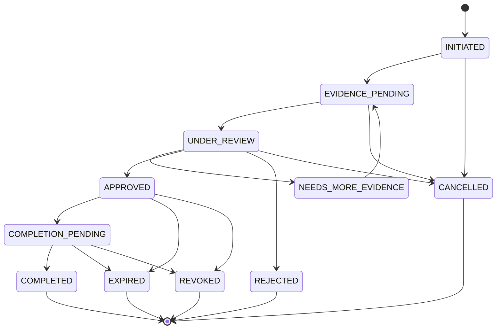

# Recovery approval — Phê duyệt yêu cầu khôi phục tài khoản

## Mục tiêu học tập

Người dùng có thể mất điện thoại chứa passkey, quên mật khẩu, mất quyền truy cập email khôi phục hoặc nghi ngờ authenticator đã bị đánh cắp. Hệ thống cần giúp chủ tài khoản hợp lệ lấy lại quyền truy cập, nhưng cũng phải ngăn attacker dùng chính quy trình hỗ trợ để chiếm tài khoản.

**Recovery approval (phê duyệt khôi phục)** là bước ra quyết định có kiểm soát đối với một yêu cầu khôi phục tài khoản. Người có thẩm quyền hoặc một policy engine đánh giá bằng chứng, trạng thái tài khoản, rủi ro, lịch sử yêu cầu và phạm vi thay đổi trước khi cho phép tiến trình recovery tiếp tục. Việc phê duyệt chỉ cho phép một hành động khôi phục đã xác định; nó không tự chứng minh người đang cầm thiết bị là chủ tài khoản và không tự cấp quyền truy cập.

Một quy trình an toàn tách rõ ba việc: xác minh người yêu cầu, phê duyệt yêu cầu theo policy, rồi hoàn tất recovery bằng một challenge ngắn hạn gắn với đúng tài khoản và yêu cầu. Sau khi hoàn tất, hệ thống phải quản lý credential cũ, session, token và thông báo bảo mật theo chính sách.

Bài học thuộc chương **Account recovery** của mô-đun **SECURITY_AUTHENTICATION_FUNDAMENTALS**. Mô-đun tìm hiểu credential, mật khẩu, MFA, passkey, chứng chỉ, token, phiên, liên kết danh tính và khôi phục tài khoản. Recovery approval kết nối các yếu tố này thành quy trình ra quyết định có thể kiểm toán khi người dùng không còn dùng được phương thức xác thực bình thường.

Sau bài học, bạn có thể:

- Phân biệt recovery approval với authentication, identity proofing, account recovery và authorization.
- Thiết kế vòng đời yêu cầu khôi phục từ lúc tạo đến phê duyệt, từ chối, hết hạn và hoàn tất.
- Đánh giá bằng chứng sở hữu tài khoản và mức assurance cần cho từng loại recovery.
- Chọn chính sách tự động, một người duyệt, hai người duyệt hoặc quorum theo rủi ro.
- Áp dụng separation of duties, reviewer reauthentication và chống thông đồng.
- Ràng buộc quyết định phê duyệt với đúng subject, yêu cầu, credential cần thay và thời hạn.
- Phòng chống social engineering, request flooding, replay, race condition và recovery abuse.
- Thiết kế thông báo, cooling-off period, fallback và quy trình khiếu nại.
- Thu hồi credential/session có nguy cơ và phát hành authenticator mới an toàn.
- Xây dựng audit trail, Java policy model và bộ kiểm thử cho recovery approval.

## 1. Recovery approval giải quyết vấn đề gì?

Account recovery là quy trình khôi phục quyền kiểm soát tài khoản khi người dùng không thể hoàn tất đăng nhập thông thường. Tình huống có thể là quên mật khẩu, mất thiết bị có passkey, mất khóa bảo mật, mất điện thoại TOTP, thay đổi số điện thoại hoặc nghi ngờ tài khoản đã bị chiếm.

Nếu quy trình quá dễ, attacker có thể thuyết phục bộ phận hỗ trợ đổi email, reset MFA hoặc cấp credential mới cho họ. Nếu quy trình quá khó, người dùng hợp lệ bị khóa khỏi tài khoản và có thể tìm cách vượt qua kiểm soát.

Recovery approval tạo một điểm quyết định có kiểm soát. Trước khi cho phép thay đổi có ảnh hưởng tới quyền truy cập, hệ thống phải biết:

- Yêu cầu đến từ tài khoản nào và ai đang khởi tạo.
- Người yêu cầu còn bằng chứng nào chứng minh quyền kiểm soát tài khoản.
- Credential nào bị mất, bị nghi ngờ hoặc cần thay thế.
- Thay đổi dự kiến có ảnh hưởng đến email, số điện thoại, passkey, MFA, session hoặc quyền quản trị không.
- Có dấu hiệu chiếm đoạt, social engineering, thiết bị lạ hoặc yêu cầu bất thường không.
- Ai hoặc policy nào có quyền quyết định.
- Phê duyệt có giới hạn phạm vi, thời gian và số lần sử dụng không.
- Sau phê duyệt, người yêu cầu phải làm gì để hoàn tất recovery.

### Ví dụ

Một nhân viên mất điện thoại có passkey duy nhất. Người đó gọi help desk và yêu cầu xóa passkey cũ, thêm email cá nhân làm email khôi phục và cấp quyền đăng nhập lại.

Nếu nhân viên hỗ trợ chỉ kiểm tra tên và mã nhân viên rồi chấp thuận, attacker biết các thông tin đó có thể chiếm tài khoản. Một quy trình có kiểm soát hơn sẽ:

1. Tạo case recovery có mã duy nhất và ghi rõ credential bị mất.
2. Thu thập bằng chứng còn lại, ví dụ recovery code đã phát trước đó, một authenticator dự phòng hoặc xác minh qua kênh tổ chức đã đăng ký.
3. Đánh giá risk signals và kiểm tra thay đổi gần đây trên tài khoản.
4. Chuyển reviewer độc lập phê duyệt nếu yêu cầu vượt ngưỡng tự động.
5. Phê duyệt đúng phạm vi: cho phép enrollment passkey mới sau khi claimant hoàn tất challenge; không tự động thay email khôi phục nếu chưa có bằng chứng riêng.
6. Gửi thông báo qua kênh cũ và kênh tổ chức phù hợp.
7. Khi recovery hoàn tất, thu hồi passkey bị mất, các session có nguy cơ và token family liên quan.

Phê duyệt là một quyết định trong workflow; nó không phải một nút “tin người gọi” và không được dựa chỉ trên thông tin mà attacker có thể tra cứu.

## 2. Phân biệt approval, proofing, authentication và authorization

| Khái niệm | Câu hỏi cần trả lời | Ví dụ |
| --- | --- | --- |
| **Identity proofing** | Hồ sơ danh tính ban đầu có được thiết lập bằng evidence phù hợp không? | Đối chiếu hồ sơ nhân viên với nguồn chính thức |
| **Authentication** | Người đang truy cập có kiểm soát authenticator đã đăng ký không? | Đăng nhập bằng passkey |
| **Account recovery** | Làm sao khôi phục quyền kiểm soát khi đăng nhập bình thường không còn khả thi? | Thay passkey đã mất bằng credential mới |
| **Recovery approval** | Yêu cầu recovery cụ thể có đáp ứng policy để được tiếp tục không? | Reviewer phê duyệt case thay authenticator |
| **Authorization** | Principal hoặc reviewer có quyền thực hiện hành động nào? | Nhân viên hỗ trợ được tạo case nhưng không được tự duyệt |
| **Credential enrollment** | Credential mới được đăng ký và gắn vào tài khoản ra sao? | Người dùng tạo passkey mới sau khi recovery được phép |

Các khái niệm này bổ sung cho nhau. Một người có thể vượt qua identity proofing khi mở tài khoản, nhưng sau nhiều năm vẫn mất authenticator. Recovery approval không lặp lại toàn bộ proofing trong mọi trường hợp; nó đánh giá bằng chứng và rủi ro của yêu cầu khôi phục cụ thể. Nếu evidence ban đầu bị nghi ngờ hoặc danh tính bị gắn nhầm, workflow có thể phải chuyển sang re-proofing.

### Approval không thay authentication

Reviewer có thể phê duyệt case, nhưng người yêu cầu vẫn cần hoàn tất bước recovery được thiết kế để ràng buộc kết quả với tài khoản. Không cấp session đăng nhập chỉ vì một nhân viên đã bấm Approve.

### Approval không thay authorization

Một reviewer được quyền xem case chưa chắc có quyền phê duyệt. Một admin có quyền quản trị hệ thống chưa chắc được phép tự duyệt recovery của chính tài khoản mình. Role, scope, tenant, separation of duties và conflict-of-interest phải được kiểm tra riêng.

## 3. Phân loại yêu cầu recovery trước khi phê duyệt

Không phải mọi yêu cầu đều có cùng mức rủi ro. Đổi mật khẩu khi còn passkey đang hoạt động khác với yêu cầu xóa tất cả MFA và thay đổi kênh liên hệ chính.

| Loại yêu cầu | Bằng chứng có thể có | Rủi ro chính | Kiểm soát gợi ý |
| --- | --- | --- | --- |
| Quên mật khẩu, còn passkey | Passkey hiện có hoặc session tin cậy | Credential cũ bị lộ | Reauthentication bằng passkey, reset có thông báo |
| Mất một authenticator, còn phương thức dự phòng | Recovery code hoặc authenticator khác | Attacker lợi dụng fallback | Kiểm tra phương thức dự phòng, thu hồi đúng credential |
| Mất tất cả authenticator | Evidence độc lập, proofing bổ sung, review | Account takeover qua help desk | Review tăng cường, dual control hoặc quy trình trực tiếp |
| Đổi email/số điện thoại khôi phục | Session và bằng chứng hiện có | Attacker đổi kênh để chặn cảnh báo | Step-up, thông báo kênh cũ, cooling-off |
| Tài khoản đặc quyền | Hardware key, xác minh tổ chức, manager/security approval | Chiếm quyền quản trị hoặc production | Phê duyệt nhiều bên, phishing-resistant evidence |
| Tài khoản bị nghi ngờ chiếm đoạt | Incident evidence, log, thiết bị tin cậy | Attacker đang duy trì session | Đóng băng thay đổi nhạy cảm, incident review |
| Tài khoản doanh nghiệp/service | Owner, manager, system owner, certificate inventory | Thay nhầm owner hoặc workload credential | Approval theo chủ sở hữu và quy trình PKI/workload |
| Tài khoản người dùng đã qua đời hoặc không còn năng lực tự quản lý | Hồ sơ pháp lý hoặc đại diện hợp lệ | Tiết lộ dữ liệu, chuyển quyền sai | Quy trình pháp lý riêng; không dùng recovery thông thường |

Định tuyến case theo loại yêu cầu và hậu quả. Không cho người yêu cầu tự chọn một nhãn rủi ro thấp để né quy trình phê duyệt mạnh hơn.

## 4. Bằng chứng dùng để xét duyệt recovery

Reviewer phải đánh giá evidence theo điều nó chứng minh, nguồn phát hành và khả năng bị attacker kiểm soát. Một kênh liên hệ đã xác minh chỉ chứng minh quyền truy cập kênh ở thời điểm kiểm tra; nó không tự chứng minh danh tính pháp lý hoặc quyền sở hữu tài khoản.

### Các nhóm evidence

- **Authenticator còn hoạt động:** passkey, security key, TOTP hoặc thiết bị tin cậy khác. Đây thường là bằng chứng trực tiếp về quyền kiểm soát credential đã đăng ký.
- **Recovery code:** mã dự phòng được phát trước và lưu theo cách người dùng có thể giữ riêng. Mỗi mã cần có entropy cao, chỉ dùng một lần và có thể thu hồi.
- **Session đang hoạt động:** session đã được xác minh trước đó, nhưng cần xem tuổi phiên, thiết bị, assurance và dấu hiệu takeover. Cookie bị đánh cắp không phải evidence đáng tin chỉ vì server vẫn nhận.
- **Kênh liên hệ đã xác minh:** email/số điện thoại đã gắn với tài khoản từ trước. Kênh này có thể hỗ trợ thông báo hoặc challenge, nhưng không nên là bằng chứng duy nhất cho recovery có rủi ro cao.
- **Nguồn tổ chức:** hồ sơ nhân sự, manager, directory hoặc service owner. Cần xác minh reviewer/kênh liên hệ qua nguồn độc lập đã quản lý.
- **Identity proofing evidence:** giấy tờ, nguồn dữ liệu có thẩm quyền hoặc xác minh trực tiếp khi policy yêu cầu. Cần kiểm tra tính hợp lệ, claimant binding và quyền riêng tư.
- **Thiết bị/credential đã đăng ký:** chứng thư thiết bị hoặc khóa bảo mật có thể hỗ trợ chứng minh quyền kiểm soát; phải kiểm tra trạng thái thu hồi và phạm vi.
- **Bằng chứng sự cố:** cảnh báo đăng nhập, thay đổi credential, thông báo người dùng hoặc incident record. Đây là tín hiệu điều tra, không tự chứng minh người yêu cầu là chủ tài khoản.

### Đánh giá theo nhiều chiều

| Chiều đánh giá | Câu hỏi reviewer cần đặt ra |
| --- | --- |
| Nguồn | Evidence do ai phát hành hoặc xác nhận? Nguồn có thẩm quyền với thuộc tính này không? |
| Tính mới | Evidence được xác minh khi nào? Có thể đã thay đổi hoặc bị thu hồi không? |
| Độc lập | Các evidence có thực sự độc lập hay cùng phụ thuộc một email/thiết bị? |
| Binding | Evidence có gắn với đúng subject và yêu cầu recovery không? |
| Toàn vẹn | Có bị sửa, replay hoặc chuyển từ case khác không? |
| Mục đích | Evidence có chứng minh đúng điều policy cần không? |
| Mâu thuẫn | Có dữ liệu nào xung đột hoặc thay đổi bất thường không? |
| Khả năng thay thế | Người dùng có phương thức hợp lệ khác nếu không thể dùng evidence mặc định không? |

### Không cộng điểm máy móc

Ba tín hiệu yếu không nhất thiết tương đương một evidence mạnh. Ví dụ, biết tên, ngày sinh và email không chứng minh quyền sở hữu tài khoản nếu cả ba đều có thể bị lấy từ nguồn công khai hoặc rò rỉ. Một policy có thể dùng risk score để định tuyến, nhưng các yêu cầu bắt buộc như authenticator hiện có, bằng chứng độc lập hoặc approval của hai vai trò vẫn phải được đáp ứng.

## 5. Vòng đời recovery request

Mỗi yêu cầu cần một trạng thái rõ ràng và các chuyển trạng thái được kiểm soát. Không dùng một cờ boolean APPROVED duy nhất cho toàn bộ quy trình.

### Các trạng thái gợi ý

| Trạng thái | Ý nghĩa | Chuyển tiếp hợp lệ gợi ý |
| --- | --- | --- |
| INITIATED | Yêu cầu vừa được tạo | EVIDENCE_PENDING, CANCELLED, EXPIRED |
| EVIDENCE_PENDING | Đang chờ claimant cung cấp evidence | UNDER_REVIEW, CANCELLED, EXPIRED |
| UNDER_REVIEW | Policy/reviewer đang đánh giá | APPROVED, REJECTED, NEEDS_MORE_EVIDENCE |
| NEEDS_MORE_EVIDENCE | Chưa đủ cơ sở quyết định | EVIDENCE_PENDING, EXPIRED, REJECTED |
| APPROVED | Cho phép tiếp tục recovery trong phạm vi xác định | COMPLETION_PENDING, EXPIRED, REVOKED |
| REJECTED | Không chấp nhận yêu cầu | APPEAL_PENDING hoặc CLOSED |
| COMPLETION_PENDING | Chờ claimant hoàn tất challenge và enrollment | COMPLETED, EXPIRED, REVOKED |
| COMPLETED | Recovery đã hoàn tất | Trạng thái kết thúc |
| CANCELLED | Người dùng hoặc hệ thống hủy | Trạng thái kết thúc |
| EXPIRED | Quá thời hạn | Trạng thái kết thúc |
| REVOKED | Quyết định bị thu hồi do evidence/risk mới | Điều tra hoặc case mới |

Tên trạng thái có thể khác theo implementation, nhưng cần phân biệt phê duyệt với hoàn tất. Case APPROVED chưa đồng nghĩa tài khoản đã được khôi phục.

### Sơ đồ workflow



Mọi chuyển trạng thái cần ghi actor, thời điểm, reason code, policy version và correlation ID. Không cho client tự gửi trạng thái tiếp theo. Backend phải xác minh transition hiện tại và thực hiện cập nhật có điều kiện.

## 6. Quyết định tự động hay cần người duyệt?

Một số recovery đơn giản có thể được xử lý tự động nếu bằng chứng còn lại đủ mạnh và policy cho phép. Các trường hợp có rủi ro cao, evidence mâu thuẫn hoặc tài khoản đặc quyền thường cần review của con người.

| Mô hình | Khi phù hợp | Rủi ro cần quản lý |
| --- | --- | --- |
| Policy tự động | Còn authenticator mạnh, recovery code hợp lệ, thay đổi giới hạn | Lỗi rule, dữ liệu stale, automation abuse |
| Một reviewer | Case có rủi ro vừa, tổ chức nhỏ, có audit | Insider threat, social engineering, nhầm lẫn |
| Hai reviewer độc lập | Tài khoản đặc quyền hoặc mất toàn bộ authenticator | Collusion, hai reviewer dùng cùng evidence yếu |
| Quorum nhiều vai trò | Tài khoản quan trọng, thay đổi owner hoặc quyền production | Chậm xử lý, phối hợp và tính sẵn sàng |
| Security/legal review | Có dấu hiệu gian lận, tranh chấp danh tính hoặc yêu cầu pháp lý | Quy trình kéo dài, cần bảo vệ dữ liệu |

### Tiêu chí chọn approval model

- Giá trị tài sản và hậu quả nếu cấp nhầm quyền.
- Mức assurance của evidence hiện có.
- Số lượng authenticator bị mất hoặc bị nghi ngờ.
- Vai trò của tài khoản: user thường, admin, finance approver, service owner.
- Thay đổi có thể đảo ngược hay không.
- Tín hiệu fraud, insider threat hoặc social engineering.
- Yêu cầu pháp lý, hợp đồng và chính sách tổ chức.
- Khả năng đáp ứng SLA mà không làm giảm assurance.

Một policy nên định nghĩa rõ ngưỡng, vai trò và ngoại lệ. Không dùng câu “manager có thể duyệt nếu cần” mà không chỉ rõ manager nào, xác minh ra sao và khi nào phải có reviewer thứ hai.

## 7. Separation of duties và dual control

**Separation of duties** tách người khởi tạo, người xác minh và người phê duyệt để một cá nhân không thể tự tạo bằng chứng, tự xác nhận và tự cấp quyền. **Dual control** yêu cầu ít nhất hai người hoặc hai vai trò độc lập cùng chấp thuận một hành động quan trọng.

### Nguyên tắc

- Người yêu cầu không được phê duyệt yêu cầu của chính mình.
- Agent tạo case không tự động có quyền duyệt case.
- Reviewer phải có role phù hợp và được xác thực lại trước khi phê duyệt.
- Với dual control, hai reviewer phải độc lập; không tính hai tài khoản của cùng một người.
- Reviewer thứ hai phải xem evidence và quyết định của mình, không chỉ bấm đồng ý theo reviewer thứ nhất.
- Người quản lý không được duyệt thay nếu chính họ là người nhận lợi ích hoặc có xung đột lợi ích.
- Emergency override cần một policy riêng, lý do, thời hạn và audit tăng cường.

### Quorum

Với tài khoản đặc quyền, policy có thể yêu cầu 2 trong 3 vai trò: account owner manager, security reviewer và system owner. Quorum phải gắn với danh sách reviewer được xác định trước, không cho requester thêm người duyệt tùy ý sau khi tạo case.

Cần định nghĩa:

- Số phiếu thuận tối thiểu.
- Vai trò bắt buộc có mặt.
- Reviewer nào không được tham gia vì conflict.
- Một phiếu từ chối có quyền phủ quyết hay chỉ làm chuyển review.
- Cách xử lý reviewer mất quyền giữa chừng.
- Thời hạn phiếu và case.
- Quy tắc khi policy thay đổi trong lúc case đang mở.

### Không để hai reviewer cùng dựa vào một nguồn yếu

Dual control không tự tạo assurance. Nếu hai reviewer chỉ gọi vào cùng số điện thoại do attacker kiểm soát, cả hai có thể bị lừa giống nhau. Cần độc lập về vai trò và bằng chứng, đồng thời đánh giá lineage của evidence.

## 8. Reviewer authentication và giao diện phê duyệt

Người duyệt là một principal có quyền cao trong workflow. Nếu tài khoản reviewer bị chiếm, attacker có thể phê duyệt recovery cho các tài khoản khác.

### Bảo vệ reviewer

- Yêu cầu MFA mạnh, ưu tiên phishing-resistant authentication cho case nhạy cảm.
- Reauthentication gần đây trước khi approve/reject.
- Kiểm tra role, tenant, case scope và conflict-of-interest ở server.
- Giới hạn quyền theo loại recovery và mức rủi ro.
- Không cho reviewer sửa evidence hoặc target account mà không tạo revision/audit.
- Tách quyền xem dữ liệu nhạy cảm khỏi quyền phê duyệt nếu không cần.
- Cảnh báo đăng nhập reviewer bất thường và thay đổi role.
- Dùng session timeout ngắn hơn cho console phê duyệt có quyền cao.

### Giao diện reviewer cần hiển thị

- Subject/account ID nội bộ và mức nhạy cảm của tài khoản.
- Loại yêu cầu, credential bị mất và credential dự kiến được thay.
- Evidence đã kiểm tra, nguồn, thời điểm, kết quả và giới hạn.
- Risk signals và mâu thuẫn chưa giải quyết.
- Lịch sử recovery gần đây và các thay đổi bảo mật liên quan.
- Policy version, approval requirement và trạng thái quorum.
- Hành động chính xác được phép sau khi approve.
- Thời hạn và điều kiện của approval.
- Lý do bắt buộc khi approve, reject hoặc yêu cầu bổ sung.

Không hiển thị số định danh, ảnh giấy tờ hoặc dữ liệu sinh trắc học đầy đủ nếu reviewer không cần. Che bớt dữ liệu và ghi audit khi mở evidence.

### Phê duyệt trong console tin cậy

Thông báo email hoặc chat chỉ nên thông báo có case đang chờ và dẫn người duyệt tới console chính thức. Không dùng nút trong email làm cơ chế phê duyệt cuối cùng nếu không có xác thực mạnh, anti-CSRF, kiểm tra case scope và reauthentication. Không chấp nhận quyết định chỉ dựa trên cuộc gọi hoặc tin nhắn không được xác minh.

## 9. Ràng buộc approval với đúng recovery request

Một approval có thể trở nên nguy hiểm nếu nó chỉ ghi “đã duyệt user X” mà không xác định credential, action và thời hạn. Attacker có thể thay đổi mục tiêu sau khi reviewer đã phê duyệt.

### Approval scope

Approval record nên ràng buộc ít nhất:

- Recovery request ID duy nhất.
- Subject/account ID.
- Loại recovery và credential cần thu hồi/thay.
- Action được phép: reset password, enroll passkey, replace TOTP, update recovery channel hoặc hành động cụ thể khác.
- Evidence references và kết quả đánh giá.
- Risk classification và policy version.
- Reviewer IDs, role và decision time.
- Số phiếu cần thiết và trạng thái quorum.
- Expiry, one-time completion limit và trạng thái sử dụng.
- Target authenticator/channel nếu đã xác định và có thể ràng buộc an toàn.
- Lý do và audit correlation ID.

Không cho approval của “reset mật khẩu” tự động cho phép đổi email khôi phục, xóa mọi MFA và cấp role admin. Mỗi thay đổi phải được bao phủ bởi policy và approval scope riêng.

### Snapshot và immutability

Khi bắt đầu review, tạo snapshot bất biến của request và evidence references. Nếu requester đổi loại recovery, target credential, email hoặc thiết bị sau đó, case phải được tạo revision mới hoặc đưa về review lại. Không âm thầm cập nhật dữ liệu dưới một approval cũ.

### One-time completion token

Sau khi đạt approval, server có thể phát một completion token ngẫu nhiên:

- Có entropy cao và thời hạn ngắn.
- Chỉ dùng một lần.
- Gắn với request ID, subject, session hoặc transaction context phù hợp.
- Chỉ cho phép đúng hành động đã phê duyệt.
- Lưu hash/token reference phía server thay vì token thô.
- Không đặt token trong URL có thể rò qua history, referrer hoặc analytics nếu có phương án an toàn hơn.
- Bị vô hiệu hóa khi request bị revoke, hết hạn hoặc hoàn tất.

Completion token không phải session đăng nhập tổng quát. Nó chỉ cho phép hoàn tất một bước recovery cụ thể.

## 10. Risk signals, social engineering và chống lạm dụng

Attacker thường nhắm vào quy trình hỗ trợ vì có thể khai thác áp lực thời gian, sự đồng cảm hoặc thiếu thông tin của reviewer.

### Tín hiệu cần đánh giá

- Nhiều recovery request cho cùng account trong thời gian ngắn.
- Nhiều account dùng cùng thiết bị, số điện thoại hoặc evidence.
- Yêu cầu đổi đồng thời email, số điện thoại và toàn bộ authenticator.
- Request ngay sau khi đổi mật khẩu, thêm credential hoặc đăng nhập bất thường.
- Thiết bị/IP mới kết hợp với credential compromise hoặc hành vi lạ.
- Người yêu cầu thúc ép bỏ qua quy trình, yêu cầu giữ bí mật với chủ tài khoản hoặc đề nghị chuyển approval sang kênh cá nhân.
- Reviewer nhận yêu cầu ngoài quy trình từ người có chức vụ.
- Evidence mâu thuẫn, nguồn không khả dụng hoặc dấu hiệu chỉnh sửa.
- Thay đổi target account hoặc credential sau khi đã có approval.

IP, địa lý, ASN và device fingerprint là tín hiệu hỗ trợ; không coi riêng một tín hiệu là bằng chứng danh tính. Cần xem tổng hợp và khả năng người dùng hợp lệ đang đi lại, dùng mạng chung hoặc thay thiết bị.

### Chống social engineering cho help desk

- Dùng quy trình và nguồn xác minh đã công bố, không dùng thông tin caller tự cung cấp làm bằng chứng duy nhất.
- Không gọi lại số điện thoại do caller vừa đọc; dùng số đã có trong directory đáng tin cậy.
- Không bỏ qua dual control vì lý do “khẩn cấp” qua điện thoại hoặc chat.
- Không gửi OTP hoặc completion token cho reviewer hay người quản lý.
- Không tiết lộ account tồn tại hay trạng thái recovery trước khi xác thực phù hợp.
- Cho nhân viên quyền dừng và chuyển case khi bị gây áp lực.
- Huấn luyện tình huống giả danh lãnh đạo, nhà cung cấp, đồng nghiệp hoặc nhân viên hỗ trợ.
- Audit mọi override và rà soát các case do cùng agent xử lý bất thường.

### Rate limit và chống enumeration

- Giới hạn số request theo account, IP/device và các chiều phù hợp.
- Dùng thông báo bên ngoài không tiết lộ tài khoản có tồn tại hay không.
- Không cho phép requester dò xem email/số điện thoại nào đang gắn với tài khoản.
- Áp dụng cooldown khi nhiều yêu cầu thất bại.
- Phát hiện automation và duplicate evidence.
- Không khóa tài khoản vĩnh viễn chỉ vì attacker spam recovery; tránh tạo denial of service.

## 11. Cooling-off period và thông báo bảo mật

Một số thay đổi recovery cần thời gian chờ để chủ tài khoản phát hiện và phản đối. Cooling-off period đặc biệt hữu ích khi thay đổi email/số điện thoại khôi phục, xóa authenticator cuối cùng hoặc khôi phục tài khoản đặc quyền.

### Khi nào dùng thời gian chờ?

- Mất toàn bộ authenticator và cần review thủ công.
- Thay đổi kênh recovery chính.
- Thêm credential mới sau quy trình proofing từ xa có rủi ro.
- Tài khoản admin hoặc tài khoản có quyền tài chính.
- Có tín hiệu thiết bị/session đáng ngờ.
- Người dùng không thể xác minh qua phương thức đã đăng ký trước đó.

Thời gian chờ cần theo rủi ro và yêu cầu pháp lý; không có một số giờ/ngày chung cho mọi dịch vụ. Với tình huống khẩn cấp, có thể có quy trình ngoại lệ nhưng cần evidence mạnh hơn, người duyệt độc lập và audit riêng.

### Thông báo

Thông báo qua kênh cũ đã xác minh khi có yêu cầu recovery, approval, enrollment credential mới hoặc thay đổi recovery channel. Nội dung nên nêu:

- Có yêu cầu recovery hoặc thay đổi bảo mật.
- Thời điểm và loại hành động.
- Cách báo cáo nếu người nhận không khởi tạo yêu cầu.
- Kênh chính thức để liên hệ hỗ trợ.
- Trạng thái đã hoàn tất hay còn chờ.

Không đưa completion token, OTP, mật khẩu hoặc dữ liệu nhạy cảm vào thông báo. Không gửi link chứa token bearer có thể dùng trực tiếp để chiếm quyền.

### Cơ chế phản đối

Nếu chủ tài khoản báo không phải họ khởi tạo recovery, hệ thống cần:

1. Dừng hoặc đóng băng pending action theo policy.
2. Đánh dấu case cần security review.
3. Thu thập thông tin sự cố mà không yêu cầu người dùng gửi bí mật.
4. Thu hồi challenge/completion token chưa dùng.
5. Đánh giá session và credential đang hoạt động.
6. Thông báo cho security/help desk theo quy trình.
7. Không cho requester ban đầu tiếp tục bằng một approval cũ.

## 12. Hoàn tất recovery sau khi được duyệt

Approval chỉ cho phép tiến trình đi tiếp. Claimant vẫn phải hoàn tất một ceremony an toàn để tạo credential mới và gắn đúng vào subject.

### Quy trình completion

1. Người dùng truy cập kênh recovery chính thức.
2. Backend xác minh completion token, request ID, subject, expiry và trạng thái approval/quorum.
3. Backend kiểm tra case chưa bị revoke, account chưa bị đình chỉ và risk policy chưa thay đổi.
4. Người dùng chứng minh quyền kiểm soát challenge cuối theo phương thức được policy cho phép.
5. Người dùng enrollment authenticator mới hoặc đặt lại credential đúng phạm vi.
6. Backend lưu credential mới và xác minh enrollment thành công.
7. Backend thu hồi authenticator bị mất/compromised và token/session liên quan theo policy.
8. Backend tiêu thụ completion token và chuyển case sang COMPLETED bằng transaction/CAS.
9. Hệ thống thông báo qua kênh cũ và mới phù hợp.
10. Người dùng đăng nhập bằng authenticator mới; chỉ sau đó mới được cấp session theo authorization bình thường.

### Không tự động khôi phục mọi thứ

- Nếu chỉ mất một passkey, không nhất thiết reset mật khẩu.
- Nếu email khôi phục bị nghi ngờ, không gửi completion token về email đó.
- Nếu có dấu hiệu account takeover, thu hồi session khác và credential có nguy cơ.
- Nếu account đang suspended, recovery không tự gỡ suspension.
- Nếu người dùng chỉ được duyệt reset mật khẩu, không tự cho phép đổi owner, role hoặc payment destination.

### Thu hồi credential cũ

Khi recovery hoàn tất, đánh giá credential cũ theo loại và tình trạng:

- Passkey trên thiết bị bị mất: xóa credential tương ứng khỏi registry.
- TOTP device bị mất: thu hồi seed/credential và recovery code liên quan.
- Refresh token bị lộ: revoke token family.
- Session cookie có nguy cơ: revoke session và tăng session version/auth epoch.
- Certificate bị lộ: revoke certificate theo PKI process, kiểm tra CRL/OCSP hoặc trạng thái tương ứng.
- API key bị lộ: revoke key và kiểm tra hoạt động đã sử dụng key.

Không xóa audit record về credential đã thu hồi. Giữ metadata cần thiết để phát hiện reuse hoặc điều tra.

## 13. Trạng thái account và recovery lock

Một yêu cầu recovery có thể được phê duyệt trong lúc trạng thái account thay đổi. Backend phải kiểm tra lại điều kiện tại thời điểm completion.

Các trạng thái account có thể gồm ACTIVE, SUSPENDED, LOCKED, DEPROVISIONED hoặc PENDING_DELETION theo mô hình tổ chức. Recovery approval không được tự chuyển trạng thái account sang ACTIVE nếu không có quyền và quy trình riêng.

Nếu tài khoản bị đình chỉ do fraud hoặc incident:

- Có thể cho phép người dùng gửi appeal hoặc cung cấp evidence.
- Không cấp credential/session mới cho tới khi suspension được giải quyết theo policy.
- Giữ nguyên audit trail và evidence liên quan.
- Nếu suspension là nhầm lẫn, yêu cầu reviewer có thẩm quyền gỡ trạng thái bằng quyết định riêng.
- Phân biệt recovery do mất credential với appeal chống đình chỉ.

Recovery lock có thể ngăn nhiều case đồng thời cho cùng subject. Khi case mới được tạo, các case cũ đang pending có thể bị hủy hoặc gộp theo policy. Cần tránh để hai case cùng phê duyệt hai email hoặc credential khác nhau cho cùng một account.

## 14. Java: mô hình hóa recovery approval

Ví dụ sau mô tả decision policy và separation of duties. Nó không xác minh giấy tờ, không thực hiện WebAuthn, không tính fraud score và không thay thế database transaction.

```java
import java.time.Instant;
import java.util.Set;

enum RecoveryStatus {
    INITIATED,
    EVIDENCE_PENDING,
    UNDER_REVIEW,
    NEEDS_MORE_EVIDENCE,
    APPROVED,
    REJECTED,
    COMPLETION_PENDING,
    COMPLETED,
    EXPIRED,
    CANCELLED,
    REVOKED
}

enum RecoveryAction {
    RESET_PASSWORD,
    REPLACE_PASSKEY,
    REPLACE_TOTP,
    CHANGE_RECOVERY_CHANNEL,
    REVOKE_SESSIONS
}

enum ReviewerRole {
    SUPPORT_AGENT,
    SECURITY_REVIEWER,
    ACCOUNT_OWNER_MANAGER,
    SYSTEM_OWNER
}

enum ApprovalDecision {
    APPROVE,
    REJECT,
    REQUEST_EVIDENCE
}

record RecoveryRequest(
        String requestId,
        String subjectId,
        RecoveryAction action,
        RecoveryStatus status,
        String policyVersion,
        Instant expiresAt
) {}

record Reviewer(
        String reviewerId,
        String personId,
        Set<ReviewerRole> roles,
        boolean stronglyAuthenticated,
        boolean active
) {}

record ApprovalVote(
        String reviewerId,
        ApprovalDecision decision,
        Instant decidedAt,
        String reasonCode
) {}

record ApprovalPolicy(
        Set<ReviewerRole> eligibleRoles,
        int requiredApprovals,
        boolean requireIndependentReviewers
) {}

class RecoveryApprovalPolicy {

    boolean canVote(
            RecoveryRequest request,
            Reviewer reviewer,
            String requesterId,
            String requesterPersonId,
            Set<String> existingReviewerIds,
            Set<String> existingReviewerPersonIds,
            Instant now,
            ApprovalPolicy policy) {

        if (request == null || reviewer == null || policy == null
                || now == null || requesterId == null
                || requesterPersonId == null
                || reviewer.reviewerId() == null
                || reviewer.reviewerId().isBlank()
                || reviewer.personId() == null
                || reviewer.personId().isBlank()
                || reviewer.roles() == null || reviewer.roles().isEmpty()
                || policy.eligibleRoles() == null
                || policy.requiredApprovals() < 1
                || existingReviewerIds == null
                || existingReviewerPersonIds == null
                || !reviewer.active()
                || !reviewer.stronglyAuthenticated()
                || request.status() != RecoveryStatus.UNDER_REVIEW
                || request.expiresAt() == null
                || !now.isBefore(request.expiresAt())) {
            return false;
        }

        if (reviewer.reviewerId().equals(requesterId)
                || reviewer.personId().equals(requesterPersonId)
                || existingReviewerIds.contains(reviewer.reviewerId())) {
            return false;
        }

        boolean hasEligibleRole = reviewer.roles().stream()
                .anyMatch(policy.eligibleRoles()::contains);

        if (!hasEligibleRole) {
            return false;
        }

        return !policy.requireIndependentReviewers()
                || !existingReviewerPersonIds.contains(reviewer.personId());
    }
}
```

Đây chỉ là một phần kiểm tra quyền vote. Production phải kiểm tra reviewer không có conflict-of-interest, role/tenant scope, reviewer identity độc lập, số phiếu đã ghi, policy version, evidence completeness và trạng thái case. Điều kiện quorum phải được tính phía server; không nhận số phiếu hoặc danh sách reviewer từ client.

### Pseudocode phê duyệt nguyên tử

```sql
-- Pseudocode SQL: khóa case hoặc dùng optimistic version/CAS.
BEGIN;

-- Xác minh case đang UNDER_REVIEW, chưa hết hạn và đúng policy version.
-- Xác minh reviewer được phép, không phải requester và chưa bỏ phiếu.
INSERT INTO recovery_approval_votes (
    request_id, reviewer_id, decision, reason_code, decided_at
) VALUES (
    :request_id, :reviewer_id, 'APPROVE', :reason_code, :now
);

-- Tính quorum từ các vote hợp lệ đã lưu phía server.
-- Nếu đạt quorum, chuyển trạng thái có điều kiện:
UPDATE recovery_requests
SET status = 'APPROVED',
    approved_at = :now,
    version = version + 1
WHERE request_id = :request_id
  AND status = 'UNDER_REVIEW'
  AND expires_at > :now
  AND version = :expected_version;

COMMIT;
```

Nếu không có dòng nào được cập nhật hoặc transaction bị conflict, không phát completion token. Retry phải đọc lại trạng thái và vote đã lưu; không chèn vote trùng hoặc thực thi hai lần.

### Pseudocode completion

```sql
-- Pseudocode SQL: chỉ hoàn tất một request đã được duyệt và còn hiệu lực.
BEGIN;

UPDATE recovery_requests
SET status = 'COMPLETED',
    completed_at = :now,
    version = version + 1
WHERE request_id = :request_id
  AND subject_id = :verified_subject_id
  AND status = 'COMPLETION_PENDING'
  AND expires_at > :now
  AND version = :expected_version;

-- Chỉ khi đúng một dòng được cập nhật:
-- tiêu thụ completion token, lưu credential mới,
-- thu hồi credential/session cũ theo policy trong cùng transaction
-- hoặc dùng transactional outbox cho hệ thống ngoài.

COMMIT;
```

Các thao tác với IdP, email provider hoặc token service có thể nằm ngoài database transaction. Dùng outbox, idempotency key và retry có giới hạn; lưu trạng thái từng bước để tránh case báo COMPLETED khi một credential cũ chưa được thu hồi như yêu cầu.

## 15. Lỗi triển khai thường gặp

| Lỗi | Hậu quả | Cách phòng tránh |
| --- | --- | --- |
| Chỉ cần email OTP để reset MFA | Attacker chiếm email có thể chiếm tài khoản | Evidence độc lập và policy theo rủi ro |
| Reviewer tin thông tin caller tự khai | Social engineering help desk | Dùng nguồn đã xác minh và quy trình callback đáng tin |
| Người tạo case tự duyệt | Một người có thể chiếm tài khoản qua workflow | Separation of duties và conflict check |
| Dual control nhưng cùng evidence yếu | Hai reviewer cùng bị lừa | Độc lập cả vai trò và nguồn evidence |
| Approval chỉ gắn với subject | Có thể đổi target credential/action sau duyệt | Bind request, action, credential, policy và expiry |
| Approval không hết hạn | Quyết định cũ được dùng nhiều tháng sau | Expiry ngắn và re-evaluation khi risk thay đổi |
| APPROVED bị coi là COMPLETED | Cấp session trước enrollment/recovery ceremony | Tách approval và completion |
| Completion token dùng nhiều lần | Replay để thay credential nhiều lần | One-time token, consume nguyên tử |
| Client tự khai trạng thái quorum | Bỏ qua reviewer hoặc vote | Tính quorum ở server từ vote đã lưu |
| Reviewer không reauthenticate | Session reviewer bị chiếm có thể duyệt case | Strong authentication và freshness |
| Thông báo chứa link bearer token | Token có thể rò qua email/history/referrer | Thông báo không chứa secret; completion qua flow an toàn |
| Không có cooling-off cho thay đổi lớn | Attacker đổi kênh liên hệ rồi chặn cảnh báo | Cooling-off và thông báo kênh cũ |
| Recovery không thu hồi credential cũ | Attacker tiếp tục dùng authenticator bị mất | Revoke credential/session/token family theo policy |
| Không kiểm tra account suspension | Recovery vô tình mở tài khoản bị đình chỉ | Recheck account state trước completion |
| Hai case chạy song song | Hai credential hoặc recovery channel được cấp đồng thời | Recovery lock, version/CAS và deduplication |
| Lỗi provider bị coi là thành công | Token cũ vẫn hoạt động dù UI báo hoàn tất | Outbox, retry và trạng thái partial rõ ràng |
| Log evidence thô | Lộ giấy tờ, OTP, token và dữ liệu nhạy cảm | Redaction, access control và retention |
| Không có appeal | Người dùng hợp lệ bị từ chối không có đường sửa sai | Review/appeal với evidence thay thế |
| Emergency override không audit | Insider có thể bỏ qua kiểm soát | Policy riêng, dual control và audit tăng cường |

## 16. Bảng kiểm thử recovery approval

| Trường hợp | Thao tác/dữ liệu | Kết quả mong đợi |
| --- | --- | --- |
| Recovery có authenticator dự phòng | Claimant xác minh bằng passkey còn hoạt động | Cho phép flow theo policy, không cần bypass |
| Mất toàn bộ authenticator | Chỉ có email tự khai | Không tự động approve recovery nhạy cảm |
| Recovery code hợp lệ | Mã chưa dùng, gắn với subject | Chấp nhận theo policy và consume một lần |
| Recovery code replay | Gửi lại mã đã consume | Từ chối |
| Evidence hết hạn | Tài liệu hoặc approval quá hạn | Yêu cầu evidence/approval mới |
| Evidence mâu thuẫn | Nguồn tổ chức và claimant không khớp | NEEDS_MORE_EVIDENCE hoặc review |
| Nguồn xác minh unavailable | API nguồn chính thức timeout | Defer/pending, không tự approve |
| Requester tự duyệt | Reviewer ID trùng requester | Từ chối vote |
| Reviewer thiếu role | Agent chỉ có quyền tạo case | Không cho approve |
| Reviewer session cũ | Reauthentication quá freshness window | Yêu cầu reviewer xác thực lại |
| Hai reviewer cùng người | Hai account thuộc cùng principal | Không tính đủ dual control |
| Quorum chưa đạt | Thiếu một vote bắt buộc | Case vẫn UNDER_REVIEW |
| Quorum đạt | Đủ reviewer độc lập và role bắt buộc | Chuyển APPROVED một lần |
| Vote trùng | Reviewer gửi lại cùng vote | Idempotent hoặc từ chối duplicate |
| Approval hết hạn | Completion sau expiry | Từ chối |
| Target credential đổi sau approve | Request sửa action hoặc email | Hủy approval hoặc tạo revision/review mới |
| Completion token replay | Dùng lại token đã consume | Từ chối |
| Completion token sai subject | Token của user A dùng cho user B | Từ chối |
| Account bị SUSPENDED | Case đã APPROVED nhưng account bị đình chỉ trước completion | Không hoàn tất |
| Session bị revoke | Session cũ bị thu hồi trong lúc recovery | Không dùng session cũ để hoàn tất |
| Người dùng phản đối | Chủ tài khoản báo không tạo request | Hủy/revoke pending approval và chuyển security review |
| Thay recovery channel | Đổi email/số điện thoại | Thông báo kênh cũ và áp dụng cooling-off theo policy |
| Credential cũ chưa revoke | Token service lỗi sau enrollment mới | Không báo COMPLETED; giữ trạng thái partial/retry |
| Hai case đồng thời | Cùng subject có hai request active | Lock/deduplication ngăn cấp credential cạnh tranh |
| Recovery admin account | Tài khoản đặc quyền mất toàn bộ MFA | Dual control/quorum và evidence mạnh |
| Help desk social engineering | Caller yêu cầu bỏ qua quy trình | Agent dừng và chuyển review |
| Account enumeration | Gửi recovery cho email không tồn tại | Response bên ngoài không tiết lộ trạng thái tài khoản |
| Audit redaction | Kiểm tra event và log | Không có OTP, token, password hoặc evidence thô |

Ngoài unit test, cần integration test với nhiều reviewer, callback chậm, retry, hai case đồng thời, account suspension, IdP/token-service outage, notification failure, outbox replay và quyền truy cập kho evidence. Dùng account/evidence giả lập trong fixture; không ghi bí mật production vào test data.

## 17. Checklist thiết kế recovery approval

Trước khi phát hành workflow, hãy trả lời:

1. **Scope:** Loại recovery nào đang được yêu cầu và credential/action nào sẽ thay đổi?
2. **Evidence:** Người yêu cầu còn authenticator, recovery code, session hoặc nguồn tổ chức nào? Evidence chứng minh điều gì?
3. **Risk:** Account có quyền gì? Có dấu hiệu takeover, fraud, insider threat hoặc request flooding không?
4. **Decision model:** Tự động, một reviewer, dual control hay quorum? Vì sao mức đó phù hợp?
5. **Separation:** Requester, agent, reviewer và approver có độc lập không? Có conflict-of-interest không?
6. **Reviewer assurance:** Reviewer có role đúng và reauthenticate đủ mạnh/gần đây không?
7. **Approval scope:** Quyết định gắn với request ID, subject, action, credential, policy version và expiry nào?
8. **State machine:** Các trạng thái và transition có được kiểm tra phía server không?
9. **Completion:** Claimant hoàn tất challenge/enrollment thế nào? Token có one-time và short-lived không?
10. **Revocation:** Credential, session, refresh-token family hoặc certificate cũ được thu hồi ra sao?
11. **Notification:** Kênh cũ được thông báo thế nào? Có cooling-off và cơ chế phản đối không?
12. **Failure:** Provider outage, reviewer timeout hoặc revoke failure được biểu diễn ra sao?
13. **Privacy:** Reviewer thấy dữ liệu nào? Evidence lưu bao lâu? Log có redaction không?
14. **Audit:** Có lưu actor, decision, reason, policy version, vote và correlation ID không?
15. **Appeal:** Người dùng hợp lệ bị từ chối có phương thức thay thế và khiếu nại không?

## 18. Bài tập vận dụng

Một hệ thống doanh nghiệp cho phép nhân viên đăng nhập bằng passkey và TOTP. Một nhân viên mất điện thoại, gọi help desk yêu cầu xóa tất cả MFA, đổi email khôi phục sang địa chỉ cá nhân và cấp session mới. Help desk hiện chỉ kiểm tra tên, mã nhân viên và tên manager. Agent tạo case cũng có thể tự bấm Approve. Approval không hết hạn, không ghi rõ credential nào được thay. Sau khi duyệt, hệ thống gửi link reset chứa token có thể dùng nhiều lần qua email mới.

**Yêu cầu:**

1. Chỉ ra ít nhất tám điểm yếu trong workflow hiện tại.
2. Thiết kế evidence phù hợp cho trường hợp còn passkey dự phòng và trường hợp mất toàn bộ authenticator.
3. Đề xuất approval model cho nhân viên thường, admin và service owner.
4. Thiết kế separation of duties, reviewer reauthentication và dual control.
5. Xác định các trường phải được bind trong approval record và completion token.
6. Thiết kế state machine từ INITIATED đến COMPLETED, gồm NEEDS_MORE_EVIDENCE, EXPIRED và REVOKED.
7. Thêm thông báo kênh cũ, cooling-off và cách chủ tài khoản phản đối request giả.
8. Mô tả completion ceremony, enrollment passkey mới và thu hồi credential/session cũ.
9. Viết test cho self-approval, reviewer trùng người, token replay, account suspension, hai case đồng thời và provider revoke failure.

**Gợi ý tự đánh giá:** Tên và mã nhân viên có thể công khai; tên manager không chứng minh người gọi là nhân viên. Approval cần độc lập, giới hạn scope và thời gian. Email mới do requester cung cấp không thể là kênh duy nhất nhận completion token. Phê duyệt không đồng nghĩa recovery đã hoàn tất; credential mới phải được enrollment an toàn và credential cũ phải được xử lý theo policy.

---

**Điểm cần nhớ:** Recovery approval là một quyết định có kiểm soát về **ai được phép tiếp tục khôi phục tài khoản, thay credential nào, dựa trên evidence nào và trong thời hạn nào**. Thiết kế an toàn cần phân tách requester/reviewer, xác minh reviewer, dùng approval scope bất biến, chống replay và social engineering, có thông báo/cooling-off phù hợp, rồi hoàn tất enrollment và thu hồi credential cũ. Một case được duyệt chưa phải một tài khoản đã được khôi phục; trạng thái chỉ COMPLETED khi toàn bộ bước được xác minh và ghi nhận.
