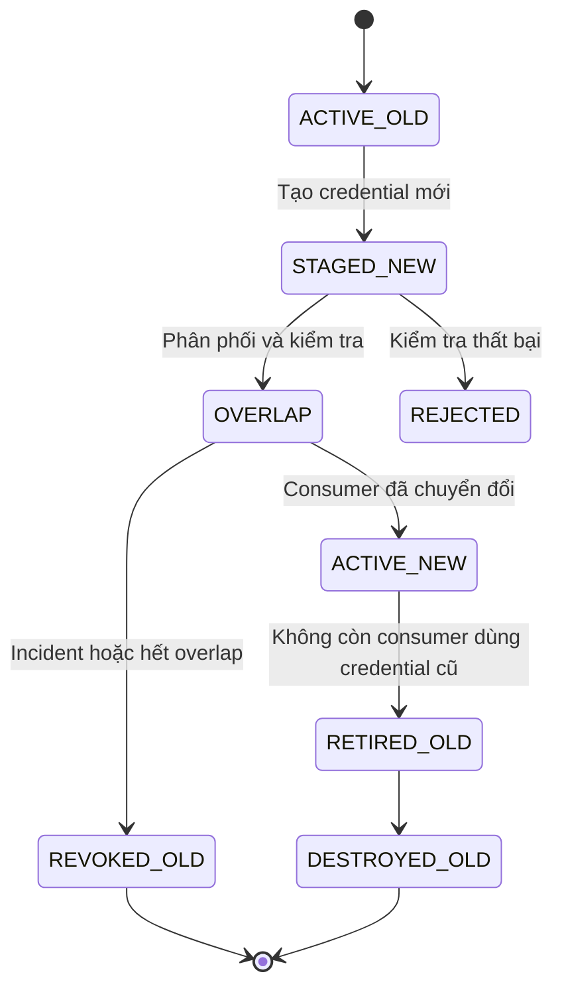

# Xoay vòng credential

## Mục tiêu học tập

Một dịch vụ có thể dùng mật khẩu để đăng nhập cơ sở dữ liệu, API key để gọi API đối tác, certificate để xác thực workload và khóa riêng để ký token. Những credential này có vòng đời khác nhau, nhưng đều có thể bị lộ, hết hạn, dùng sai phạm vi hoặc không còn cần thiết. Nếu thay credential quá sớm mà consumer chưa cập nhật, dịch vụ có thể ngừng hoạt động; nếu giữ credential cũ quá lâu, attacker có thêm thời gian sử dụng nó.

**Credential rotation (xoay vòng credential)** là quy trình thay một credential đang được tin cậy bằng credential mới, chuyển các thành phần phụ thuộc sang credential mới, xác minh hoạt động và vô hiệu hóa credential cũ theo một kế hoạch có kiểm soát. Credential có thể là mật khẩu, API key, client secret, khóa mã hóa, khóa ký token, SSH key, chứng thư số hoặc credential của workload.

Rotation là một phần của credential lifecycle, bên cạnh issuance, enrollment, storage, use, renewal, revocation và destruction. Mục tiêu là giảm thời gian phơi nhiễm của credential, giới hạn tác động khi bị lộ và duy trì tính liên tục của dịch vụ.

Bài học thuộc chương **Credential lifecycle** của mô-đun **SECURITY_AUTHENTICATION_FUNDAMENTALS**. Mô-đun tìm hiểu nguyên lý xác thực danh tính từ credential, mật khẩu, MFA, passkey và chứng chỉ đến token, phiên, liên kết danh tính và khôi phục tài khoản. Xoay vòng credential giúp quản lý những bằng chứng xác thực này trong suốt vòng đời, từ lúc cấp phát đến khi thay thế hoặc thu hồi.

Sau bài học, bạn có thể:

- Phân biệt rotation, renewal, revocation, replacement và rekeying.
- Xác định khi nào cần rotation định kỳ, rotation theo sự kiện hoặc rotation khẩn cấp.
- Thiết kế staged rollout, overlap, cutover và retirement để tránh downtime.
- Chọn chiến lược phù hợp cho password, API/client secret, SSH key, certificate, signing key và encryption key.
- Quản lý version, key identifier, KMS/HSM, secret manager và quyền truy cập credential.
- Phân biệt rotation của signing key, encryption key và refresh token.
- Xử lý compromise, rollback, consumer chưa cập nhật và hệ thống phân tán.
- Xây dựng audit trail, automation, Java policy model và bộ kiểm thử rotation.

## 1. Xoay vòng credential là gì?

Credential là dữ liệu hoặc vật mang bí mật/khóa được hệ thống dùng để xác thực hoặc bảo vệ một hoạt động. Ví dụ:

- Mật khẩu người dùng hoặc mật khẩu tài khoản dịch vụ.
- API key và OAuth client secret.
- Private key dùng ký JWT, ký artifact hoặc xác thực SSH.
- TLS certificate và private key tương ứng.
- Khóa mã hóa dữ liệu hoặc khóa bọc khóa (Key Encryption Key — KEK).
- Credential của workload, service account hoặc thiết bị.
- Recovery code và seed của authenticator, theo quy trình thay thế phù hợp.

Theo thời gian, credential có thể bị sao chép, lưu nhầm vào log, đưa lên repository, lộ qua máy bị malware, bị nhân viên cũ giữ lại hoặc không còn phù hợp với chính sách. Rotation thay credential để thu hẹp khoảng thời gian mà credential cũ có thể được sử dụng.

### Rotation không chỉ là tạo một chuỗi mới

Một lần rotation hoàn chỉnh cần xử lý cả producer và consumer:

1. Tạo credential mới tại nguồn có thẩm quyền.
2. Phân phối credential mới tới consumer được phép.
3. Chuyển consumer sang sử dụng credential mới.
4. Xác minh consumer đã hoạt động bằng credential mới.
5. Ngừng chấp nhận credential cũ.
6. Thu hồi, xóa hoặc hủy credential cũ theo đúng loại.
7. Kiểm tra log, metric và audit để xác nhận không còn phụ thuộc vào credential cũ.

Nếu chỉ tạo secret mới nhưng consumer vẫn dùng secret cũ, rotation chưa hoàn tất. Nếu xóa credential cũ trước khi mọi consumer chuyển đổi, hệ thống có thể bị outage.

### Ví dụ

Một backend đang gọi dịch vụ thanh toán bằng API key phiên bản A. Nhà cung cấp cho phép đồng thời hai key.

- Backend tạo key B và lưu trong secret manager.
- Một nhóm instance được cập nhật để đọc key B.
- Health check và log xác nhận request dùng key B thành công.
- Toàn bộ instance còn lại được chuyển sang B.
- Sau khi quan sát không còn request hợp lệ dùng A, quản trị viên thu hồi A.
- Secret A bị xóa khỏi nơi lưu trữ theo retention policy; audit giữ lại metadata về lần rotation.

Việc chuyển đổi có overlap giúp tránh downtime. Nếu key A đã bị lộ, cần thu hồi khẩn cấp theo incident policy; không kéo dài overlap chỉ để thuận tiện vận hành.

## 2. Phân biệt rotation, renewal, revocation, replacement và rekeying

Các thuật ngữ này có liên hệ nhưng mô tả những hành động khác nhau.

| Khái niệm | Ý nghĩa | Ví dụ |
| --- | --- | --- |
| **Rotation** | Chuyển từ credential hiện tại sang credential mới theo một quy trình | Thay API key A bằng key B |
| **Renewal** | Gia hạn hoặc cấp lại credential/chứng thư theo vòng đời | Gia hạn TLS certificate trước khi hết hạn |
| **Revocation** | Làm credential không còn được chấp nhận trước khi hết hạn | Thu hồi certificate bị lộ |
| **Replacement** | Thay credential cũ bằng credential mới; có thể xảy ra sau mất hoặc hỏng | Đăng ký passkey mới khi mất thiết bị |
| **Rekeying** | Tạo khóa mật mã mới và chuyển hoạt động sang khóa mới | Thay khóa ký JWT hoặc khóa mã hóa |
| **Re-enrollment** | Đăng ký lại authenticator hoặc credential với hệ thống | Đăng ký lại TOTP sau khi mất điện thoại |
| **Retirement** | Kết thúc sử dụng credential cũ sau khi chuyển đổi | Gỡ SSH public key cũ khỏi máy chủ |

Renewal không nhất thiết tạo private key mới nếu quy trình gia hạn dùng lại key pair cũ; rekeying thì có tạo khóa mới. Certificate có thể được renew với cùng key hoặc cấp certificate mới cho key mới. Cần ghi rõ chính sách để tránh gọi mọi thao tác cấp lại là rotation.

Rotation cũng khác refresh-token rotation trong OAuth. Refresh-token rotation thay refresh token sau mỗi lần sử dụng hoặc theo policy để phát hiện reuse; credential lifecycle rotation thường thay secret/key/certificate theo thời gian hoặc sự kiện. Hai cơ chế có thể cùng tồn tại nhưng có semantics và xử lý sự cố riêng.

## 3. Vì sao và khi nào cần rotation?

Không có một lịch cố định phù hợp với mọi credential. Tần suất cần dựa trên loại credential, khả năng tự động hóa, mức độ nhạy cảm, thời gian phơi nhiễm, tiêu chuẩn và threat model.

### Các lý do rotation

- Credential đạt ngày hết hạn hoặc tới chu kỳ theo policy.
- Có dấu hiệu lộ secret, private key hoặc token.
- Nhân viên, vendor hoặc workload owner rời tổ chức.
- Thay đổi quyền, phạm vi truy cập hoặc trust relationship.
- Phát hiện credential được chia sẻ, dùng chung hoặc lưu sai vị trí.
- Có thay đổi thuật toán, độ dài khóa hoặc tiêu chuẩn mật mã.
- Thay đổi nhà cung cấp, môi trường hoặc hệ thống quản lý secret.
- Sau incident, forensic hoặc yêu cầu tuân thủ.
- Credential được cấp cho mục đích tạm thời và đã hết nhu cầu.

### Rotation theo lịch và theo sự kiện

| Loại | Trigger | Cách xử lý |
| --- | --- | --- |
| **Scheduled rotation** | Lịch hoặc thời hạn theo policy | Tự động tạo và chuyển đổi theo kế hoạch |
| **Event-driven rotation** | Thay đổi owner, vendor, quyền hoặc môi trường | Rotation gắn với change workflow |
| **Emergency rotation** | Compromise hoặc nghi ngờ compromise | Thu hồi nhanh, thay thế, điều tra và xác minh phạm vi |
| **Cryptographic migration** | Thuật toán/độ dài khóa không còn phù hợp | Tạo khóa mới, chuyển dữ liệu/chữ ký và retire khóa cũ |
| **Workload short-lived renewal** | Credential workload gần hết TTL | Tự động cấp credential ngắn hạn mới |

### Không ép đổi mật khẩu theo lịch nếu không có căn cứ

Ép người dùng đổi mật khẩu thường xuyên mà không có dấu hiệu compromise có thể khiến họ chọn biến thể dễ đoán, ghi mật khẩu ra giấy hoặc tái sử dụng mẫu cũ. Với mật khẩu người dùng, ưu tiên mật khẩu dài, chặn mật khẩu phổ biến/đã lộ, MFA và phát hiện credential stuffing; yêu cầu đổi khi có bằng chứng hoặc nghi ngờ compromise, hoặc khi chính sách áp dụng có lý do cụ thể.

Điều này không có nghĩa mọi secret đều được giữ vô thời hạn. Service secret, signing key, certificate và encryption key có vòng đời kỹ thuật riêng. Chúng cần rotation theo rủi ro, cryptoperiod, khả năng tự động hóa và yêu cầu của hệ thống.

### Xác định cryptoperiod và maximum lifetime

Cryptoperiod là khoảng thời gian một khóa được phép dùng cho một mục đích mật mã nhất định. Nó phụ thuộc thuật toán, độ dài khóa, lượng dữ liệu được xử lý, môi trường, mức độ phơi nhiễm và chính sách quản lý khóa.

Không lấy một con số chung cho mọi khóa. Khóa ký token, khóa mã hóa dữ liệu, khóa TLS và khóa root CA có vai trò và phạm vi tác động khác nhau. Thời hạn cần được định nghĩa trong crypto policy và key management policy, đồng thời có quy trình xử lý compromise ngoài lịch.

## 4. Mô hình vòng đời credential

Một mô hình vòng đời giúp biết credential đang ở trạng thái nào và ai có quyền chuyển trạng thái.

### Các trạng thái gợi ý

| Trạng thái | Ý nghĩa | Hành động được phép |
| --- | --- | --- |
| REQUESTED | Có yêu cầu cấp credential | Xác minh requester và scope |
| STAGED | Credential mới đã được tạo, chưa dùng rộng rãi | Kiểm tra metadata và phân phối an toàn |
| ACTIVE | Credential được phép dùng cho mục đích đã định | Xác thực/ký/mã hóa theo policy |
| OVERLAP | Credential mới và cũ cùng được chấp nhận có giới hạn | Chuyển consumer, theo dõi usage |
| DEPRECATED | Credential cũ không nên dùng cho tác vụ mới | Chỉ xử lý tương thích nếu policy cho phép |
| REVOKED | Credential không còn được chấp nhận | Từ chối mọi lần dùng mới |
| RETIRED | Đã ngừng sử dụng và loại khỏi cấu hình hoạt động | Chỉ giữ metadata audit cần thiết |
| DESTROYED | Bí mật/khóa đã được hủy theo quy trình | Không thể khôi phục khóa từ nguồn quản lý |

Không phải credential nào cũng cần mọi trạng thái. Ví dụ, mật khẩu người dùng có thể chuyển trực tiếp từ cũ sang mới trong một giao dịch; certificate hoặc signing key thường cần giai đoạn overlap để các hệ thống xác minh chuyển đổi.

### Quy tắc chuyển trạng thái

- Chỉ nguồn có thẩm quyền mới được tạo hoặc kích hoạt credential.
- Credential mới phải được kiểm tra trước khi đưa vào ACTIVE.
- OVERLAP phải có thời hạn, scope và tiêu chí kết thúc.
- DEPRECATED không đồng nghĩa được phép tiếp tục dùng vô thời hạn.
- REVOKED phải có hiệu lực tại các verifier theo SLA.
- DESTROYED chỉ sau khi không còn dữ liệu hoặc backup cần giải mã bằng khóa đó, trừ khi có cơ chế lưu trữ/escrow được phê duyệt.
- Không chuyển credential REVOKED trở lại ACTIVE; nếu cần dùng lại, cấp credential mới.

### Sơ đồ rotation có overlap



Sơ đồ là mô hình khái quát. Với emergency rotation, credential cũ có thể chuyển thẳng sang REVOKED và không có overlap. Với encryption key, khóa cũ có thể phải ở trạng thái decrypt-only để đọc dữ liệu đã mã hóa trước đó; không được xóa nó trước khi re-encryption hoặc rewrap hoàn tất.

## 5. Quy trình rotation an toàn

Một quy trình có kiểm soát cần xác định trước owner, consumer, scope, thời hạn và tiêu chí hoàn tất.

### Bước 1: Inventory và ownership

- Xác định credential ID/version, loại, mục đích và owner.
- Liệt kê producer, consumer, service, môi trường và vùng triển khai.
- Xác định credential có được dùng trong CI/CD, batch job, mobile, database, partner hay disaster recovery không.
- Tìm nơi lưu: secret manager, KMS/HSM, environment, config, mounted file, keystore hoặc thiết bị.
- Xác định quyền tạo, đọc, dùng, rotate và revoke.
- Kiểm tra credential có bị dùng chung cho nhiều service không.

Nếu không biết consumer nào dùng credential, không thể kết luận rotation đã hoàn tất. Inventory phải được duy trì liên tục, không chỉ tạo vào ngày xảy ra incident.

### Bước 2: Lập kế hoạch

Ghi rõ:

- Trigger và mức khẩn cấp.
- Credential mới sẽ được tạo ở đâu và bởi ai.
- Phương thức phân phối tới consumer.
- Thời điểm bắt đầu overlap và thời điểm kết thúc.
- Kiểm tra health, metric và log nào chứng minh chuyển đổi thành công.
- Điều kiện rollback.
- Ai có quyền revoke credential cũ.
- Cách xử lý consumer offline hoặc khôi phục từ backup.
- Thời gian tối đa credential cũ được phép còn hiệu lực.

Không gửi secret mới qua chat, ticket, email hoặc tài liệu không được bảo vệ. Consumer nên lấy secret từ secret manager hoặc workload identity.

### Bước 3: Tạo credential mới

- Sinh secret/khóa bằng CSPRNG hoặc dịch vụ KMS/HSM phù hợp.
- Tạo version/identifier mới; không ghi đè version cũ khi cần overlap.
- Chọn thuật toán, độ dài khóa và key usage theo policy.
- Gán owner, purpose, scope, not-before, expiry và trạng thái.
- Lưu private key/secret trong nơi quản lý được bảo vệ.
- Chỉ phân phối public key/certificate hoặc secret tới consumer được phép.
- Không ghi bí mật thô vào log, telemetry hoặc shell history.

### Bước 4: Staged rollout

- Cập nhật một nhóm consumer nhỏ hoặc môi trường canary.
- Xác minh kết nối, xác thực, chữ ký hoặc giải mã bằng credential mới.
- Theo dõi lỗi xác thực, latency, rate, retry và fallback.
- Mở rộng theo từng nhóm nếu canary ổn định.
- Kiểm tra cả worker, batch, failover node và disaster recovery path.
- Đảm bảo consumer reload secret an toàn, không cần restart đồng loạt nếu kiến trúc hỗ trợ.

### Bước 5: Cutover và xác minh

- Đưa credential mới thành credential mặc định cho tác vụ mới.
- Xác minh request mới được ký/xác thực bằng version mới.
- Đếm usage của credential cũ tại verifier/provider.
- Xác nhận không còn consumer hợp lệ phụ thuộc credential cũ.
- Kiểm tra backup, job định kỳ, integration và vùng DR.
- Đợi hết cửa sổ overlap đã định, có xét TTL, clock skew và cache.

### Bước 6: Revoke và retire credential cũ

- Ngừng chấp nhận credential cũ tại verifier hoặc provider.
- Thu hồi refresh-token family, certificate hoặc key reference theo loại.
- Xóa credential cũ khỏi consumer/config/cache/secret manager theo policy.
- Hủy khóa trong KMS/HSM khi chắc chắn không còn nhu cầu giải mã/verify hợp lệ.
- Giữ metadata audit: key ID, version, owner, thời gian, reason và người phê duyệt.
- Xác minh việc sử dụng credential cũ bị từ chối.

### Bước 7: Đóng change và theo dõi

- Ghi kết quả, metric và lỗi trong quá trình chuyển đổi.
- Cập nhật inventory và ngày rotation tiếp theo.
- Kiểm tra credential cũ không xuất hiện trong repository, log hoặc cấu hình.
- Đóng ticket/change chỉ khi tiêu chí hoàn tất được đáp ứng.
- Tạo follow-up nếu còn consumer ngoại lệ hoặc credential chưa thể retire.

## 6. Overlap, cutover và rollback

Overlap cho phép verifier chấp nhận credential cũ và mới trong một khoảng chuyển đổi. Đây là kỹ thuật hữu ích khi producer/consumer không thể cập nhật đồng thời.

### Khi overlap phù hợp

- Nhiều instance cần rollout theo từng đợt.
- JWT được ký bằng khóa mới nhưng resource server cần thời gian nhận JWKS.
- TLS certificate mới được triển khai trên nhiều endpoint.
- SSH public key mới cần được cài trên nhiều máy.
- API provider cho phép hai API key hoạt động đồng thời.
- Khóa mã hóa mới được dùng cho dữ liệu mới trong khi khóa cũ còn cần giải mã dữ liệu cũ.

### Ràng buộc overlap

- Thời gian overlap có giới hạn và có owner.
- Chỉ chấp nhận hai version đã biết; không mở wildcard.
- Credential mới được dùng cho mọi tác vụ mới ngay khi canary đạt.
- Credential cũ chỉ còn được chấp nhận cho tương thích, không phát hành mới.
- Theo dõi usage của từng version.
- Có thời điểm hard cutoff và cảnh báo trước.
- Không kéo dài overlap chỉ vì chưa tìm được consumer không được quản lý; cần quyết định rủi ro riêng.

### Rollback

Rollback phải được thiết kế trước cutover. Có thể quay lại credential cũ nếu credential mới bị lỗi kỹ thuật và credential cũ chưa bị compromise, chưa bị revoke và vẫn còn trong overlap. Không rollback sang credential đã bị nghi lộ hoặc bị thu hồi.

Với emergency rotation, rollback thường không phù hợp; cần khắc phục consumer để dùng credential mới hoặc cấp credential thứ ba. Đối với signing key, rollback có thể làm verifier chấp nhận lại key cũ; chỉ thực hiện nếu key cũ vẫn đáng tin và policy cho phép.

### Tiêu chí dừng rollout

Dừng rollout hoặc quay về trạng thái an toàn khi:

- Authentication/signature verification error tăng vượt ngưỡng.
- Consumer không lấy được version mới.
- KMS/HSM hoặc secret manager không khả dụng.
- Có mismatch thuật toán, key ID, certificate chain hoặc permission.
- Health check không chứng minh được credential mới hoạt động.
- Có dấu hiệu compromise của credential mới.
- Rotation làm mất khả năng đọc dữ liệu hoặc xác minh token hợp lệ.

## 7. Rotation cho từng loại credential

Mỗi loại credential có semantics riêng. Không áp dụng một runbook duy nhất cho tất cả.

### 7.1. Password người dùng

Mật khẩu là bí mật do người dùng biết, thường được lưu dưới dạng password hash có salt và cost factor phù hợp.

- Khi password bị lộ hoặc có dấu hiệu compromise, yêu cầu đổi mật khẩu và đánh giá session/token liên quan.
- Chặn mật khẩu phổ biến, đã xuất hiện trong breach corpus hoặc quá yếu.
- Không gửi mật khẩu mới cho người dùng qua email/chat.
- Không lưu mật khẩu dạng plaintext; dùng password hashing phù hợp.
- Sau reset, thu hồi session hoặc yêu cầu đăng nhập lại theo policy.
- Thông báo qua kênh đã xác minh khi mật khẩu thay đổi.
- Không ép đổi định kỳ nếu không có căn cứ rủi ro hoặc yêu cầu áp dụng.

Đổi mật khẩu không tự thu hồi passkey, TOTP hoặc API key. Nếu incident cho thấy toàn bộ account bị compromise, phải đánh giá và thu hồi các credential khác riêng.

### 7.2. API key và OAuth client secret

Nhiều provider hỗ trợ hai secret active cùng lúc. Quy trình thông thường:

1. Tạo key/secret version mới.
2. Lưu vào secret manager và phân quyền consumer.
3. Cập nhật consumer theo canary.
4. Xác minh request mới bằng version mới.
5. Theo dõi usage của version cũ.
6. Revoke version cũ tại provider.
7. Xóa bản sao cũ khỏi nơi lưu trữ và xác minh key cũ bị từ chối.

Nếu provider chỉ cho phép một secret active, cần cửa sổ bảo trì hoặc một cơ chế credential song song như user/service account mới. Không xoay secret bằng cách ghi đè đồng thời ở provider và consumer nếu không có phương án khôi phục.

OAuth client secret dùng để xác thực confidential client; nó không phải password của end-user. Rotation cần cập nhật đúng client registration và tất cả instance dùng secret đó. Public client không thể bảo vệ client secret; không nhúng secret vào ứng dụng mobile/browser.

### 7.3. SSH key

Với SSH public-key authentication:

- Sinh key pair mới trên thiết bị/agent đáng tin.
- Bảo vệ private key bằng file permission, passphrase hoặc hardware-backed key theo policy.
- Thêm public key mới vào account/host được phép.
- Thử kết nối bằng key mới ở một phiên riêng.
- Cập nhật automation, bastion, CI runner và recovery host.
- Gỡ public key cũ khỏi authorized_keys hoặc hệ thống quản lý tập trung.
- Thu hồi key bị lộ ở mọi nơi có thể đã được cài.
- Kiểm tra audit log để tìm hoạt động đáng ngờ trong khoảng thời gian key có nguy cơ.

Không gửi private key cho server hoặc đồng nghiệp. Chỉ public key được phân phối tới verifier.

### 7.4. TLS certificate và private key

Certificate có thời hạn và được xác minh theo chain tới trust anchor. Rotation thường gồm:

- Tạo key pair mới trong nơi bảo vệ phù hợp.
- Tạo CSR với SAN, subject và extended key usage đúng mục đích.
- CA cấp certificate mới.
- Kiểm tra chain, validity, SAN, EKU, key usage và thuật toán.
- Cài certificate mới trên endpoint/keystore.
- Kiểm tra handshake từ client thực tế.
- Triển khai trên toàn bộ node/load balancer/region.
- Thu hồi certificate cũ nếu bị compromise hoặc không còn cần.
- Theo dõi expiry và tự động renewal.

Không chỉ kiểm tra ngày hết hạn. Certificate có thể hợp lệ về thời gian nhưng sai hostname, thiếu intermediate, sai EKU hoặc private key không khớp.

### 7.5. JWT signing key

Khi issuer ký JWT bằng private key bất đối xứng, resource server thường xác minh bằng public key được công bố qua JWKS.

Một quy trình rollover thường là:

1. Sinh key pair mới và key ID (kid) duy nhất.
2. Công bố public key mới trong JWKS trước khi bắt đầu ký bằng key đó.
3. Đợi verifier refresh JWKS hoặc xác nhận cache đã nhận key mới.
4. Chuyển issuer sang ký token mới bằng private key mới.
5. Tiếp tục công bố public key cũ trong thời gian token cũ còn hợp lệ, cộng clock skew và cache margin.
6. Theo dõi verification error và token usage theo kid.
7. Sau khi hết cửa sổ hợp lệ của token cũ, gỡ public key cũ khỏi JWKS.
8. Hủy hoặc archive private key cũ theo key management policy.

Không xóa public key cũ ngay khi bắt đầu ký bằng key mới; token cũ còn hạn sẽ không thể verify. Nếu private key cũ bị lộ, phải xử lý khẩn cấp: ngừng ký, loại bỏ trust key theo incident plan, thu hồi token/session hoặc kiểm tra thêm trạng thái server-side. Không duy trì overlap bình thường khi attacker có thể ký token giả bằng key cũ.

### 7.6. Encryption key và envelope encryption

Trong envelope encryption, dữ liệu được mã hóa bằng Data Encryption Key (DEK), còn DEK được bọc bởi Key Encryption Key (KEK) trong KMS/HSM.

Có hai thao tác khác nhau:

- **KEK rotation / rewrap:** tạo KEK mới và dùng nó bọc lại DEK. Ciphertext dữ liệu có thể không cần mã hóa lại.
- **DEK rotation / re-encryption:** tạo DEK mới và mã hóa lại dữ liệu. Có thể cần xử lý dữ liệu lớn, backup, replica và bản sao lịch sử.

Không xóa KEK cũ khi vẫn còn DEK hoặc backup chỉ được bọc bằng KEK đó. Cần lập inventory ciphertext, version metadata và khả năng giải mã trước khi retire. Nếu khóa bị compromise, đánh giá dữ liệu đã được mã hóa trong cryptoperiod và nguy cơ attacker đã lấy ciphertext/DEK.

### 7.7. Passkey, TOTP và recovery code

Passkey thường là credential gắn với một authenticator và public key được RP lưu. Khi thay thiết bị:

- Enroll passkey mới bằng session/step-up phù hợp.
- Xác minh credential mới hoạt động.
- Thông báo thay đổi qua kênh đã xác minh.
- Gỡ credential cũ nếu thiết bị mất hoặc bị compromise.
- Không xóa credential cuối cùng trước khi có phương thức recovery hợp lệ, trừ khi incident yêu cầu khóa khẩn cấp.

TOTP replacement cần sinh seed mới và đăng ký lại; seed cũ phải bị vô hiệu hóa sau khi xác minh seed mới. Recovery code cần được tạo lại và toàn bộ mã cũ phải được consume/revoke khi có yêu cầu regenerate. Không coi việc hiển thị QR mới là hoàn tất nếu server chưa xác minh mã TOTP đầu tiên.

### 7.8. Workload identity và short-lived credential

Workload identity có thể cấp certificate hoặc token ngắn hạn tự động dựa trên môi trường chạy, attestation hoặc trust relationship. Thay vì phân phối một secret dài hạn cho mọi container:

- Dùng workload identity để xác thực với secret manager/KMS.
- Cấp credential ngắn hạn theo workload, audience và scope.
- Tự động renew trước expiry với jitter.
- Xác minh credential mới trước khi credential cũ hết hạn.
- Thu hồi identity binding khi workload/host bị decommission hoặc compromise.
- Không dùng image/container template chứa secret tĩnh.

Credential ngắn hạn giảm cửa sổ sử dụng khi bị lộ, nhưng không thay thế authorization, revocation và kiểm soát identity của workload.

## 8. Secret manager, KMS và HSM

Rotation cần một nguồn quản lý credential đáng tin. Không nên để mỗi ứng dụng tự sinh, lưu và phân phối secret theo cách riêng.

### Secret manager

Secret manager có thể cung cấp:

- Versioning và metadata owner/purpose.
- Access control theo workload identity.
- Audit cho thao tác read/create/rotate/revoke.
- Secret injection hoặc API retrieval.
- Rotation automation và notification.
- Secret lease hoặc dynamic credentials.
- Chính sách retention và destruction.

Ứng dụng chỉ nên đọc secret mà workload identity của nó được phép dùng. Không cấp một quyền rộng cho mọi service chỉ vì chúng chạy trong cùng cluster.

### KMS và HSM

KMS quản lý key lifecycle, policy, version, cryptographic operation và audit. HSM có thể bảo vệ private key trong phần cứng và thực hiện thao tác ký/giải mã mà không xuất private key ra ngoài.

- Dùng key alias/version để consumer tham chiếu ổn định.
- Phân tách quyền quản trị key với quyền sử dụng key.
- Áp dụng approval cho thao tác phá hủy hoặc thay đổi policy nhạy cảm.
- Dùng key usage đúng mục đích: signing, encryption, key wrapping.
- Theo dõi key state, rotation date, expiry và access event.
- Kiểm tra backup, disaster recovery và quy trình khôi phục KMS/HSM.

### Không ghi secret vào cấu hình tĩnh

Tránh commit secret vào source code, Docker image, Helm values, build artifact, log, shell history hoặc file cấu hình chia sẻ. Environment variable cũng có thể bị lộ qua process inspection, crash dump hoặc diagnostics; dùng secret injection phù hợp nền tảng và giới hạn quyền truy cập.

## 9. Rotation trong hệ thống phân tán

Một hệ thống có nhiều service, region, worker, queue consumer và partner không thể cập nhật đồng thời. Cần quản lý version và trạng thái từng consumer.

### Consumer inventory

Một record rotation có thể theo dõi:

- Credential ID và version.
- Owner và purpose.
- Danh sách consumer/service/environment.
- Version hiện tại từng consumer đang dùng.
- Thời điểm nhận version mới.
- Health/verification result.
- Last usage của credential cũ.
- Planned cutoff và actual revocation.
- Ngoại lệ hoặc consumer offline.

Không dựa vào việc secret manager đã có version mới để kết luận mọi consumer đã chuyển đổi. Cần telemetry hoặc xác nhận từ consumer.

### Event-driven rollout

Có thể phát sự kiện credential version mới tới consumer. Consumer:

1. Nhận thông báo không chứa secret thô.
2. Lấy version mới từ secret manager bằng identity của chính nó.
3. Validate định dạng/metadata.
4. Tạo client/connection mới bằng credential mới.
5. Health check bằng client mới.
6. Chuyển traffic sang client mới.
7. Đóng connection cũ.
8. Báo version đang hoạt động về control plane.

Nếu reload thất bại, consumer giữ trạng thái an toàn và phát cảnh báo. Không xóa credential đang hoạt động trước khi client mới được xác minh.

### Cache và propagation delay

Secret manager, JWKS, DNS, TLS terminator và application cache có thể cập nhật chậm. Kế hoạch overlap cần tính:

- Cache TTL và thời gian refresh.
- Token lifetime và clock skew.
- Queue/job có thể chạy theo lịch dài.
- Instance offline hoặc scale-to-zero.
- Disaster recovery region không thường xuyên nhận deploy.
- Consumer bên thứ ba có SLA cập nhật riêng.

Hard cutoff chỉ nên diễn ra khi các consumer bắt buộc đã chuyển đổi hoặc exception đã được chủ sở hữu rủi ro chấp thuận.

## 10. Emergency rotation khi credential bị lộ

Khi có dấu hiệu compromise, ưu tiên ngăn attacker tiếp tục sử dụng credential. Việc giữ overlap để tránh downtime có thể làm tăng thiệt hại.

### Quy trình incident

1. **Contain:** xác định credential và scope; chặn hoặc thu hồi ngay nếu mức rủi ro yêu cầu.
2. **Identify consumers:** tìm service, account, environment, log, artifact và backup có thể chứa credential.
3. **Issue replacement:** tạo credential mới trong KMS/secret manager hoặc provider đáng tin.
4. **Update consumers:** chuyển consumer sang credential mới qua kênh được bảo vệ.
5. **Revoke old credential:** ngừng chấp nhận credential cũ; không chờ chu kỳ định kỳ.
6. **Invalidate dependent state:** thu hồi token/session/certificate hoặc credential phái sinh có thể bị ảnh hưởng.
7. **Investigate:** tìm cách lộ, thời gian phơi nhiễm, hoạt động sử dụng trái phép và dữ liệu bị truy cập.
8. **Recover:** khôi phục dịch vụ, kiểm tra quyền tối thiểu và xác minh mọi consumer.
9. **Notify:** thông báo incident theo nghĩa vụ và policy.
10. **Learn:** sửa secret sprawl, quyền truy cập, automation và monitoring để tránh tái diễn.

### Phạm vi ảnh hưởng

Một secret có thể đã được sao chép sang nhiều nơi. Chỉ thay secret trong secret manager không xóa bản sao trong image, log, artifact, developer workstation hoặc backup. Cần xác định nơi lộ và xử lý theo retention/incident policy.

Nếu private signing key bị lộ, attacker có thể tạo token giả trong phạm vi verifier tin key đó. Cần đánh giá token đã phát hành, audience, thời gian, session và authorization. Nếu encryption key bị lộ, dữ liệu cũ đã bị lấy có thể vẫn bị giải mã; rotation không thể làm dữ liệu đã lộ trở lại bí mật.

### Không nhầm rotation với xóa dấu vết

Không xóa audit log hoặc bằng chứng sự cố trong quá trình rotation. Thu hồi credential để ngăn sử dụng mới; giữ log cần thiết để điều tra theo quyền và retention policy.

## 11. Java: mô hình hóa policy rotation

Ví dụ dưới đây mô tả quyết định có thể bắt đầu rotation và thời điểm được phép retire credential cũ. Nó không tự sinh key, gọi KMS, cập nhật provider hoặc xác minh consumer.

```java
import java.time.Instant;
import java.util.Set;

enum CredentialKind {
    USER_PASSWORD,
    API_SECRET,
    CLIENT_SECRET,
    SSH_KEY,
    TLS_CERTIFICATE,
    TOKEN_SIGNING_KEY,
    DATA_ENCRYPTION_KEY,
    WORKLOAD_CREDENTIAL
}

enum RotationTrigger {
    SCHEDULED,
    EXPIRING,
    OWNER_CHANGE,
    POLICY_CHANGE,
    SUSPECTED_COMPROMISE,
    CONFIRMED_COMPROMISE
}

enum RotationState {
    REQUESTED,
    STAGED,
    OVERLAP,
    CUTOVER,
    REVOKED_OLD,
    COMPLETED,
    BLOCKED
}

record CredentialMetadata(
        String credentialId,
        String version,
        CredentialKind kind,
        String owner,
        Set<String> consumers,
        Instant expiresAt,
        boolean compromised
) {}

record RotationPolicy(
        boolean allowOverlap,
        boolean requireConsumerConfirmation,
        int minimumHealthyConsumers
) {}

record RotationContext(
        RotationTrigger trigger,
        RotationState state,
        Set<String> migratedConsumers,
        Set<String> healthyConsumers,
        Instant overlapDeadline
) {}

class CredentialRotationPolicy {

    boolean canStart(
            CredentialMetadata credential,
            RotationPolicy policy,
            RotationTrigger trigger) {

        if (credential == null || policy == null || trigger == null
                || credential.credentialId() == null
                || credential.version() == null
                || credential.owner() == null
                || credential.consumers() == null
                || credential.consumers().isEmpty()) {
            return false;
        }

        if (credential.compromised()) {
            return true;
        }

        return trigger == RotationTrigger.SCHEDULED
                || trigger == RotationTrigger.EXPIRING
                || trigger == RotationTrigger.OWNER_CHANGE
                || trigger == RotationTrigger.POLICY_CHANGE
                || trigger == RotationTrigger.SUSPECTED_COMPROMISE
                || trigger == RotationTrigger.CONFIRMED_COMPROMISE;
    }

    boolean canRetireOld(
            CredentialMetadata credential,
            RotationPolicy policy,
            RotationContext context,
            Instant now) {

        if (credential == null || policy == null || context == null
                || now == null
                || credential.consumers() == null
                || policy.minimumHealthyConsumers() < 1
                || context.state() != RotationState.CUTOVER
                || context.migratedConsumers() == null
                || context.healthyConsumers() == null
                || credential.compromised()) {
            return false;
        }

        boolean allConsumersMigrated =
                context.migratedConsumers().containsAll(
                        credential.consumers());

        boolean enoughHealthy =
                context.healthyConsumers().size()
                        >= policy.minimumHealthyConsumers();

        boolean confirmationSatisfied =
                !policy.requireConsumerConfirmation() || allConsumersMigrated;

        boolean overlapFinished = !policy.allowOverlap()
                || (context.overlapDeadline() != null
                    && !now.isBefore(context.overlapDeadline()));

        return confirmationSatisfied
                && enoughHealthy
                && overlapFinished;
    }
}
```

Đây là policy sketch. Production cần phân biệt emergency revoke với planned overlap: credential đã compromised phải đi theo đường revoke khẩn cấp và không được retire theo quy trình overlap thông thường. Khi policy yêu cầu consumer confirmation, phải có xác nhận chuyển đổi từ inventory; minimumHealthyConsumers chỉ là ngưỡng health bổ sung, không thay thế việc xác minh từng consumer bắt buộc. Với encryption key, tiêu chí retire phải tính cả backup, dữ liệu cũ và khả năng giải mã; với signing key, phải tính token lifetime, JWKS cache và clock skew.

### Pseudocode versioned secret rollout

```text
newVersion = secretManager.createVersion(credentialId)
publishRotationEvent(credentialId, newVersion)

for each consumer in inventory:
    consumer.fetch(newVersion)
    consumer.validate(newVersion)
    consumer.switchAfterHealthCheck(newVersion)
    reportActiveVersion(consumer, newVersion)

if allRequiredConsumersReport(newVersion):
    provider.disable(oldVersion)
    secretManager.markRevoked(oldVersion)
```

Đây là luồng minh họa. Việc gửi event chỉ thông báo có version mới; không gửi secret thô trong message bus. Các bước đổi credential tại provider, update consumer và revoke cần idempotency, retry có giới hạn và audit.

## 12. Lỗi triển khai thường gặp

| Lỗi | Hậu quả | Cách phòng tránh |
| --- | --- | --- |
| Chỉ tạo secret mới nhưng consumer vẫn dùng secret cũ | Rotation chưa hoàn tất | Inventory, rollout và xác minh active version |
| Thu hồi credential cũ trước khi consumer cập nhật | Outage hàng loạt | Staged rollout và overlap có giới hạn khi an toàn |
| Overlap vô thời hạn | Credential cũ vẫn có thể bị lạm dụng | Hard cutoff, owner và metric usage |
| Dùng chung một secret cho nhiều service | Một lần lộ ảnh hưởng toàn hệ thống | Credential riêng theo workload/purpose |
| Lưu secret trong source hoặc image | Secret tồn tại trong history/artifact | Secret manager và quét secret |
| Ghi secret vào log | Credential bị lộ qua telemetry | Redaction và kiểm soát log |
| Không theo dõi consumer offline | Rotation tưởng hoàn tất nhưng DR vẫn dùng key cũ | Inventory cả batch, DR và consumer ít hoạt động |
| Xóa public signing key quá sớm | Token hợp lệ cũ không verify được | Giữ public key trong cửa sổ token lifetime và cache |
| Giữ signing key đã compromise trong overlap | Attacker tiếp tục ký token giả | Emergency revoke và incident response |
| Xóa KEK khi DEK/backup còn phụ thuộc | Mất khả năng giải mã dữ liệu | Inventory ciphertext và rewrap trước khi destroy |
| Coi renew certificate là rekey | Private key cũ tiếp tục được dùng ngoài dự kiến | Ghi rõ key reuse hay key pair mới |
| Không kiểm tra SAN/EKU/chain | TLS handshake hoặc identity validation sai | Verify certificate profile và client thực tế |
| Không revoke SSH key ở mọi host | Attacker vẫn truy cập qua host chưa cập nhật | Central inventory và audit từng host |
| Ép đổi password thường xuyên vô căn cứ | Người dùng chọn mật khẩu dễ đoán | Trigger theo compromise và policy phù hợp |
| Không thu hồi session/token sau password compromise | Attacker giữ phiên đã tạo | Revoke session/token family theo incident scope |
| Rotation automation không idempotent | Cấp nhiều version hoặc revoke nhầm | Versioning, CAS và idempotency key |
| Rollback sang credential đã lộ | Khôi phục lại đường tấn công | Không rollback credential compromised |
| Không có owner | Rotation bị bỏ quên hoặc không ai xác nhận | Owner, expiry, alert và escalation |
| Chỉ dựa vào lịch | Không phản ứng khi compromise xảy ra giữa kỳ | Event-driven/emergency rotation |
| Không giữ audit metadata | Không truy vết được ai tạo, dùng hoặc thu hồi key | Audit actor, version, purpose và reason |

## 13. Bảng kiểm thử credential rotation

| Trường hợp | Thao tác/dữ liệu | Kết quả mong đợi |
| --- | --- | --- |
| Planned rotation | Tạo version mới và chuyển consumer theo đợt | Dịch vụ hoạt động, version mới được dùng |
| Consumer chưa cập nhật | Một instance vẫn dùng credential cũ | Không revoke sớm nếu policy overlap; cảnh báo owner |
| Consumer offline | DR node chưa nhận version mới | Không báo hoàn tất; xử lý exception/DR |
| Credential mới không hợp lệ | Provider từ chối secret/key mới | Dừng rollout, giữ trạng thái an toàn |
| Overlap hết hạn | Consumer bắt buộc đã chuyển đổi | Revoke credential cũ |
| Overlap quá hạn | Còn usage credential cũ | Không kéo dài tự động; alert và yêu cầu quyết định |
| Emergency compromise | Credential cũ xác nhận bị lộ | Revoke theo incident policy, không chờ overlap bình thường |
| JWT signing rollover | Verifier nhận JWKS mới trước khi issuer ký | Token mới verify được |
| JWT old token | Token cũ còn trong lifetime | Verify bằng public key cũ trong cửa sổ hợp lệ |
| JWT old key removed too early | Token cũ chưa hết hạn | Test phải phát hiện verification failure |
| TLS certificate mismatch | SAN/EKU/chain sai | Không deploy hoặc health check fail |
| SSH key replacement | Public key mới được cài và thử | Key mới hoạt động; key cũ bị gỡ sau xác minh |
| API key revocation | Gọi provider bằng key cũ | Provider từ chối |
| KEK rewrap | DEK được bọc bằng KEK mới | Dữ liệu cũ vẫn giải mã được qua key version mới |
| KEK dependency remains | Backup còn cần KEK cũ | Không destroy KEK cũ |
| Secret manager outage | Consumer không lấy được version mới | Không chuyển sang secret không xác minh; alert |
| KMS permission regression | Workload mất quyền ký/giải mã | Canary fail, dừng rollout |
| Duplicate rotation request | Retry cùng request ID | Idempotent, không tạo nhiều rotation ngoài ý muốn |
| Concurrent rotation | Hai operator khởi tạo cùng credential | CAS/lock chỉ cho một workflow hợp lệ |
| Revocation propagation | Node khác nhận event chậm | Đạt SLA hoặc fail-closed theo action risk |
| Secret leakage scan | Quét repository/log/artifact sau rotation | Không còn bản sao không được phép hoặc có remediation |
| Audit review | Kiểm tra record rotation | Có actor, owner, version, trigger, decision và thời gian |
| Password compromise | User password bị xác nhận lộ | Reset và revoke session theo policy |
| MFA replacement | Seed cũ bị mất, seed mới được xác minh | Seed cũ vô hiệu; recovery code cũ bị thu hồi |
| Workload renewal | Credential ngắn hạn được cấp trước expiry | Workload chuyển đổi không gián đoạn |
| Rollback | Version mới lỗi nhưng version cũ còn an toàn | Rollback theo plan và ghi audit |
| Compromised rollback | Credential cũ đã bị revoke do compromise | Không được kích hoạt lại |

Ngoài unit test, cần integration test với secret manager/KMS, provider thật trong môi trường staging, nhiều instance/region, cache/JWKS, clock skew, backup/restore, consumer offline, incident revoke và retry. Không dùng secret production hoặc private key thật trong fixture.

## 14. Checklist thiết kế rotation

Trước khi bắt đầu, hãy trả lời:

1. **Credential:** Đang xoay loại credential nào, version nào và dùng cho mục đích gì?
2. **Owner:** Ai chịu trách nhiệm, ai được tạo, ai được dùng và ai được revoke?
3. **Inventory:** Những consumer, region, job, backup và vendor nào đang phụ thuộc?
4. **Trigger:** Rotation theo lịch, expiry, owner change, policy change hay compromise?
5. **Risk:** Credential cũ có nghi bị lộ không? Có thể overlap an toàn không?
6. **Generation:** Secret/key được tạo bằng CSPRNG, KMS/HSM hoặc CA nào?
7. **Storage:** Credential mới được lưu/phân phối thế nào? Có versioning và least privilege không?
8. **Rollout:** Canary, health check và active-version telemetry ra sao?
9. **Overlap:** Có thời hạn, scope, owner và hard cutoff không?
10. **Cutover:** Tiêu chí nào chứng minh mọi consumer đã chuyển đổi?
11. **Revocation:** Credential cũ bị vô hiệu hóa ở provider, verifier, cache và node nào?
12. **Data/key dependency:** Backup, ciphertext, token và certificate chain còn phụ thuộc khóa cũ không?
13. **Rollback:** Có thể quay lại không? Credential cũ còn đáng tin và chưa bị revoke chứ?
14. **Audit:** Có ghi actor, reason, policy, version, timestamp và kết quả không?
15. **Incident:** Nếu compromise, ai có quyền emergency revoke và quy trình thông báo là gì?
16. **Automation:** Workflow có idempotent, retry an toàn, alert và owner escalation không?

## 15. Bài tập vận dụng

Một nền tảng microservice dùng chung một API secret để gọi dịch vụ thanh toán. Secret được lưu trong biến môi trường của 18 service, một số job batch và một DR region. Một developer vô tình commit secret vào repository riêng tư. Provider hỗ trợ tạo hai API key cùng lúc. Một service chỉ reload biến môi trường khi restart; một batch job chạy mỗi tuần. Hệ thống cũng dùng JWT ký bằng RSA; resource server cache JWKS trong 6 giờ và access token có thời hạn 30 phút.

**Yêu cầu:**

1. Xác định credential nào bị compromise và các nơi cần điều tra ngoài secret manager/repository.
2. Thiết kế emergency rotation cho API key, bao gồm inventory 18 service, batch job và DR region.
3. Chọn thứ tự tạo key mới, phân phối, canary, rollout, kiểm tra usage key cũ và revoke.
4. Đề xuất cách xử lý service chỉ reload khi restart và job chạy theo lịch tuần.
5. Thiết kế rollover cho RSA signing key, xét JWKS cache 6 giờ, token lifetime 30 phút và clock skew.
6. Nêu điều kiện để giữ hoặc bỏ public key cũ; giải thích vì sao emergency signing-key compromise cần xử lý khác planned rollover.
7. Đề xuất cách tách credential theo workload để một secret không còn được chia sẻ cho toàn bộ microservice.
8. Viết test cho consumer offline, key cũ còn usage, JWKS cache stale, rollback, provider outage và audit.
9. Xác định metric/cảnh báo để phát hiện rotation bị kẹt hoặc credential cũ tiếp tục được dùng.

**Gợi ý tự đánh giá:** Secret đã commit cần được coi là có khả năng bị sao chép dù repository riêng tư. Provider hỗ trợ hai key cho phép overlap có kiểm soát, nhưng compromise cần revoke key cũ sau khi containment và chuyển consumer theo incident plan. Với JWT, verifier phải nhận public key mới trước khi issuer ký bằng private key mới; thời gian giữ public key cũ cần tính token lifetime, JWKS cache và clock skew. Credential riêng cho từng workload giúp giới hạn blast radius.

---

**Điểm cần nhớ:** Xoay vòng credential là quy trình thay thế có kiểm soát: **tạo version mới, phân phối, chuyển consumer, xác minh, thu hồi credential cũ và cập nhật inventory/audit**. Overlap giúp duy trì dịch vụ khi credential cũ vẫn đáng tin; compromise cần containment và revocation theo incident policy. Rotation chỉ hoàn tất khi mọi consumer và đường dự phòng đã được xử lý, credential cũ không còn được chấp nhận và hệ thống vẫn hoạt động với credential mới.
