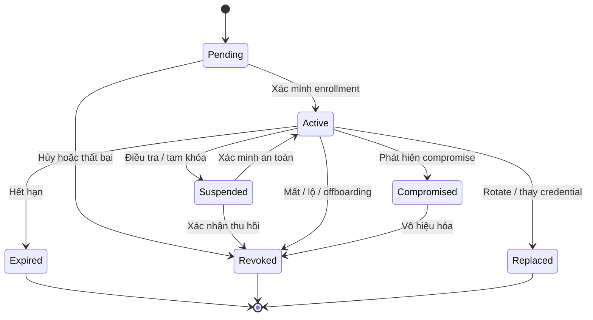
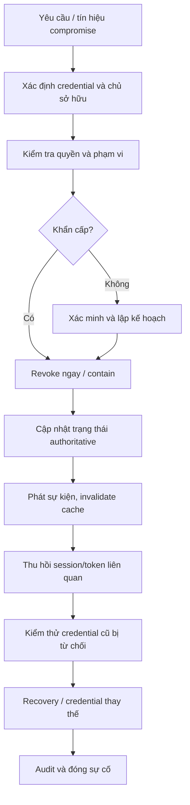

# Thu hồi credential

## 1. Thu hồi credential là gì?

**Credential revocation** là hành động làm cho một credential không còn được hệ thống chấp nhận để xác thực hoặc chứng minh quyền truy cập. Credential có thể là mật khẩu, passkey/WebAuthn, khóa bảo mật, chứng chỉ số, API key, recovery code, refresh token hoặc một bí mật dùng chung giữa dịch vụ. Khi credential bị mất, lộ, hết hạn, thay thế hoặc không còn được phép sử dụng, hệ thống cần chuyển nó sang trạng thái không hợp lệ và bảo đảm các thành phần liên quan thực thi trạng thái đó.

Ví dụ: nhân viên nghỉ việc và bàn giao laptop cho bộ phận IT. Tổ chức cần vô hiệu hóa credential đăng nhập của nhân viên, thu hồi passkey hoặc security key thuộc phạm vi quản lý, vô hiệu hóa chứng chỉ máy, API key và refresh token liên quan, chấm dứt session còn hoạt động, đồng thời cập nhật các hệ thống xác minh. Nếu chỉ xóa tài khoản khỏi danh bạ hoặc đổi mật khẩu ở một ứng dụng, credential khác có thể vẫn mở đường truy cập.

**Thu hồi credential khác với xóa một cookie hoặc đăng xuất một browser.** Credential là bằng chứng dùng để xác thực; session/token là trạng thái hoặc quyền truy cập được tạo ra sau khi xác thực. Thu hồi credential ngăn việc dùng credential đó trong tương lai theo phạm vi hệ thống đã cập nhật. Muốn chấm dứt các phiên đã được tạo trước đó, cần thêm bước revoke session/token.

Trong mô-đun **SECURITY_AUTHENTICATION_FUNDAMENTALS**, thu hồi credential kết nối mật khẩu, MFA, passkey, chứng chỉ, token, session, federation và account recovery. Đây là năng lực thiết yếu khi xử lý mất thiết bị, lộ bí mật, nhân sự offboarding, thay khóa, nghi ngờ account takeover và ứng phó sự cố.

### Mục tiêu học tập

Sau bài này, người học có thể:

- Phân biệt credential, authenticator, session, access token và quyền được cấp.
- Xác định thời điểm và phạm vi cần thu hồi credential.
- Thiết kế vòng đời credential với trạng thái active, suspended, revoked, expired và replaced.
- Thu hồi mật khẩu, passkey, MFA factor, certificate, API key và token theo cơ chế phù hợp.
- Phân biệt disable, revoke, delete, rotate và expire.
- Thiết kế propagation, cache invalidation, audit và kiểm tra trạng thái thu hồi.
- Xử lý race condition giữa xác minh, refresh, rotate và revoke.
- Xây dựng quy trình recovery, offboarding và incident response an toàn.

## 2. Credential, session và token: thu hồi cái gì?

Một tài khoản có thể có nhiều credential và nhiều session cùng lúc. Thu hồi một credential không tự động thu hồi tất cả credential khác hoặc session đã tạo trước đó.

| Đối tượng | Vai trò | Ví dụ thao tác thu hồi |
|---|---|---|
| Credential | Bằng chứng xác thực | Vô hiệu hóa password verifier, passkey public key, certificate hoặc API key |
| Authenticator/device | Thiết bị hoặc thành phần giữ credential | Gỡ thiết bị khỏi danh sách tin cậy, chặn authenticator theo policy |
| Session | Trạng thái đăng nhập đã được thiết lập | Revoke session ID hoặc tăng account session version |
| Access token | Quyền truy cập API trong phạm vi và thời hạn | Introspection, denylist, audience/version check hoặc chờ TTL ngắn |
| Refresh token | Credential xin access token mới | Revoke token hoặc cả token family |
| OAuth grant | Quyền client được người dùng cấp | Revoke authorization grant và token liên quan |
| Certificate | Credential khóa công khai gắn với subject | Đưa serial vào CRL/OCSP hoặc trạng thái revoked của CA |
| Recovery method | Con đường khôi phục tài khoản | Thu hồi recovery code, email/phone factor hoặc recovery key |

### Một ví dụ về phạm vi

Người dùng phát hiện điện thoại bị mất, trên đó có passkey và ứng dụng giữ refresh token:

1. Thu hồi passkey/credential của thiết bị nếu credential đó bị nghi lộ hoặc không còn được phép.
2. Thu hồi refresh-token family và các session gắn với thiết bị.
3. Kiểm tra access token còn hiệu lực; revoke hoặc chặn theo kiến trúc.
4. Giữ lại passkey trên laptop khác nếu không có lý do thu hồi.
5. Yêu cầu người dùng xác minh lại và thiết lập phương thức dự phòng.

Nếu chỉ xóa passkey, một session cũ hoặc refresh token bị đánh cắp vẫn có thể hoạt động. Nếu chỉ logout session, passkey bị lộ vẫn có thể tạo session mới. Incident response cần xem toàn bộ đường truy cập.

## 3. Khi nào cần thu hồi credential?

Các tình huống thường gặp:

### 3.1. Credential bị mất hoặc bị lộ

- Mật khẩu xuất hiện trong breach đã xác minh.
- Điện thoại/security key chứa passkey bị mất hoặc bị đánh cắp.
- API key bị commit nhầm vào repository công khai.
- Private key hoặc client secret có dấu hiệu bị truy cập trái phép.
- Recovery code bị chụp ảnh, chia sẻ hoặc nghi đã bị sử dụng.

Khi có bằng chứng compromise, ưu tiên revoke nhanh, xác định phạm vi sử dụng và tạo credential mới qua một quy trình đã xác minh. Không chờ credential hết hạn nếu cửa sổ lạm dụng còn mở.

### 3.2. Credential không còn cần thiết

- Nhân viên nghỉ việc hoặc chuyển vai trò.
- Nhà cung cấp kết thúc hợp đồng.
- Thiết bị được thanh lý hoặc chuyển chủ.
- Ứng dụng tích hợp bị gỡ.
- Một service account hoặc key không còn được sử dụng.

Thu hồi cần gắn với quy trình offboarding và inventory để tránh credential cũ bị bỏ quên.

### 3.3. Credential hết hạn hoặc bị thay thế

Certificate có thời hạn, API key được rotate, passkey bị thay bằng credential khác hoặc recovery code đã dùng. Hệ thống cần chuyển credential cũ sang trạng thái không hợp lệ sau khi credential thay thế được xác minh và policy cho phép.

### 3.4. Thay đổi bảo mật của tài khoản

Sau recovery, đổi quyền sở hữu, nghi ngờ account takeover hoặc thay đổi yếu tố xác thực, tổ chức có thể cần revoke credential/session cũ để ngăn attacker duy trì quyền truy cập. Phạm vi cần dựa trên bằng chứng và threat model, tránh xóa mọi credential hợp lệ khiến chủ tài khoản bị khóa.

## 4. Vòng đời và trạng thái credential

Một credential registry có thể dùng các trạng thái:

| Trạng thái | Ý nghĩa | Có được dùng để xác thực mới? |
|---|---|---|
| Pending | Đang đăng ký, chưa hoàn tất xác minh | Không |
| Active | Đã xác minh và được phép sử dụng | Có, theo policy |
| Suspended | Tạm dừng để điều tra hoặc chờ xác minh | Không |
| Revoked | Đã bị thu hồi; không được khôi phục bằng cách bật lại cùng record | Không |
| Expired | Đã qua thời hạn hiệu lực | Không |
| Replaced | Được thay thế bởi credential mới | Không |
| Compromised | Được đánh dấu có khả năng bị lộ; thường phải bị vô hiệu hóa ngay | Không |

Tên trạng thái cụ thể có thể khác giữa hệ thống. Điều quan trọng là định nghĩa transition và bảo đảm mọi verifier áp dụng nhất quán.

### Transition điển hình



Một credential đã revoked không nên được kích hoạt lại bằng cách đổi trạng thái thành active. Nếu người dùng muốn dùng lại phương thức đó, hãy thực hiện enrollment mới, tạo credential ID/key mới và ghi nhận liên kết với credential cũ nếu cần audit.

### Revoke, suspend, delete, rotate và expire

| Hành động | Ý nghĩa | Ví dụ |
|---|---|---|
| Suspend | Tạm ngừng trong khi điều tra hoặc chờ xác minh | Tạm chặn certificate có hoạt động bất thường |
| Revoke | Chấm dứt hiệu lực theo policy | Thu hồi API key bị lộ |
| Delete | Xóa record/dữ liệu theo retention policy | Xóa metadata sau thời gian lưu bắt buộc |
| Rotate | Thay credential cũ bằng credential mới | Tạo API key mới, sau đó revoke key cũ |
| Expire | Hết hiệu lực theo thời hạn | Certificate qua notAfter |

Revoke thường là quyết định bảo mật; delete là quyết định lưu trữ dữ liệu. Không xóa record ngay khi revoke nếu cần audit, điều tra, chống tái sử dụng ID hoặc chứng minh credential đã bị thu hồi.

## 5. Quy trình thu hồi chuẩn

Một quy trình có thể gồm:

1. **Identify:** xác định credential chính xác, chủ sở hữu, loại, issuer, phạm vi và phụ thuộc.
2. **Authorize:** xác minh actor có quyền thu hồi và request thuộc đúng account/tenant.
3. **Assess:** xác định lý do, mức độ khẩn cấp, credential/session/token liên quan và nguy cơ khóa nhầm.
4. **Revoke:** cập nhật trạng thái authoritative; chặn verifier chấp nhận credential.
5. **Propagate:** phát sự kiện tới cache, IdP, resource server, gateway, ứng dụng và hệ thống quản lý thiết bị.
6. **Contain:** revoke session/token/grant có liên quan nếu credential có thể đã được dùng.
7. **Notify:** thông báo qua kênh đã xác minh, không tiết lộ bí mật hoặc dữ liệu điều tra nhạy cảm.
8. **Recover/replace:** cấp credential mới sau khi xác minh chủ thể và thiết bị.
9. **Verify:** thử xác thực bằng credential cũ phải thất bại; credential mới hoạt động theo policy.
10. **Audit:** lưu actor, lý do, thời điểm, phạm vi, kết quả propagation và correlation ID.



Với credential compromise đang diễn ra, bước containment có thể phải chạy ngay trong khi điều tra chi tiết tiếp tục. Hệ thống nên hỗ trợ thao tác khẩn cấp có quyền hạn rõ ràng và audit đầy đủ.

## 6. Thu hồi mật khẩu

Mật khẩu thường được lưu dưới dạng password verifier (hash có salt và tham số KDF), không phải plaintext. Thu hồi mật khẩu có thể là:

- Đặt tài khoản vào trạng thái buộc đổi mật khẩu trước lần đăng nhập tiếp theo.
- Thay password verifier sau khi người dùng xác thực và đặt mật khẩu mới.
- Vô hiệu hóa password authentication nếu tài khoản chuyển sang passkey/certificate-only.
- Đánh dấu credential bị compromise và từ chối mật khẩu cũ.

### Những điểm cần bảo đảm

- Không lưu hoặc log mật khẩu plaintext.
- Không chỉ xóa hash khỏi database rồi coi là đã thu hồi mọi phiên.
- Kiểm tra mật khẩu mới với blocklist mật khẩu phổ biến/bị lộ theo policy.
- Sau reset do compromise, revoke session và refresh token cũ theo phạm vi phù hợp.
- Thông báo thay đổi qua kênh đã xác minh.
- Không gửi mật khẩu mới qua email/chat; dùng luồng đặt lại có token ngắn hạn, một lần.

Nếu đổi password verifier thành công, mật khẩu cũ sẽ không còn xác thực được ở verifier đó. Nhưng nếu ứng dụng có nhiều password store, LDAP replica hoặc service cache, cần đồng bộ thay đổi tới tất cả nơi kiểm tra mật khẩu.

## 7. Thu hồi passkey và WebAuthn credential

Passkey tại RP được đại diện bởi credential ID và public key đã lưu. RP không có private key để xóa khỏi authenticator. Thu hồi passkey có nghĩa là RP đánh dấu credential record revoked hoặc xóa khỏi tập credential được phép, khiến assertion dùng credential ID đó bị từ chối.

### Quy trình

1. Xác định credential ID và account owner từ registry phía server.
2. Yêu cầu reauthentication/step-up trước thao tác quản lý credential.
3. Đánh dấu credential revoked trong authoritative store.
4. Đảm bảo verifier tra trạng thái revoked trước khi chấp nhận assertion.
5. Nếu thiết bị bị mất hoặc nghi compromise, revoke session/refresh token có liên quan.
6. Gửi thông báo và hướng dẫn đăng ký passkey dự phòng.

### Passkey đồng bộ

Với synced passkey, xóa credential ở RP chặn credential đó tại RP. Nó không nhất thiết xóa bản đồng bộ trong hệ sinh thái của nhà cung cấp passkey, và cũng không tự thu hồi passkey đó ở các RP khác. Người dùng có thể cần quản lý credential ở nền tảng đồng bộ nếu thiết bị/tài khoản nền tảng bị compromise.

### Credential ID và public key

Credential ID không phải secret và không thể thay thế bằng chứng ký. Tuy vậy, record cần được bảo vệ tính toàn vẹn để attacker không thể thay public key gắn với account hoặc bật lại credential đã revoke. Không xóa metadata audit trước khi hết thời hạn retention.

### Sign counter và trạng thái backup

Counter hoặc backup eligibility/state là tín hiệu hỗ trợ phát hiện bất thường, không phải cơ chế revoke. Nếu passkey đồng bộ có counter bằng 0, không kết luận credential không thể bị thu hồi hoặc chắc chắn bị clone. Trạng thái revoke của RP vẫn là quyết định authoritative đối với việc RP chấp nhận credential.

## 8. Thu hồi MFA factor và recovery credential

MFA có thể gồm TOTP seed, push authenticator, SMS/voice destination, security key, passkey hoặc recovery code. Mỗi loại có cách thu hồi khác nhau.

| Factor | Cách thu hồi | Điểm cần lưu ý |
|---|---|---|
| TOTP | Đánh dấu seed không còn active và xóa/khóa secret theo retention policy | Thu hồi tất cả seed cũ; không chấp nhận mã từ seed đã thay |
| Push authenticator | Gỡ device registration/key binding và thu hồi push token | Chấm dứt pending approval, kiểm tra device/session liên quan |
| SMS/voice | Gỡ hoặc thay số điện thoại sau khi xác minh | SMS number có thể được tái cấp; không coi số điện thoại là bằng chứng mạnh |
| Security key | Xóa credential public key/ID ở RP hoặc IdP | Private key vẫn nằm trên key; RP phải từ chối assertion |
| Recovery code | Đánh dấu code đã dùng/thu hồi cả batch và phát batch mới | Không cho code cũ dùng lại |
| Email recovery | Gỡ hoặc thay địa chỉ sau xác minh | Kiểm tra mailbox compromise và delay thay đổi khi cần |

### Thu hồi recovery code

Recovery code thường được tạo theo batch và mỗi code chỉ dùng một lần. Nếu một code bị lộ, có thể revoke riêng code đó nếu hệ thống hỗ trợ; nếu không, revoke toàn batch và phát batch mới sau khi xác minh. Lưu verifier/hash của code thay vì plaintext nếu thiết kế cho phép, và không hiển thị lại code cũ sau khi tạo.

### Thu hồi factor không đồng nghĩa xóa mọi MFA

Nếu người dùng mất một điện thoại, có thể chỉ cần gỡ TOTP/push registration trên thiết bị đó, giữ passkey trên laptop và security key dự phòng. Khi nghi ngờ account takeover, phạm vi cần rộng hơn và có thể yêu cầu reset nhiều factor cùng lúc. Luôn kiểm tra nguy cơ khóa chủ tài khoản trước khi xóa factor cuối.

## 9. Thu hồi certificate và public-key credential

Certificate X.509 có thời hạn notBefore/notAfter, issuer, subject, serial number và public key. Khi certificate bị compromise hoặc không còn được phép, relying party cần biết trạng thái revoked.

### 9.1. Certificate Revocation List (CRL)

CA phát hành CRL liệt kê serial number của certificate bị thu hồi cùng thông tin hiệu lực và thời điểm cập nhật. Relying party tải CRL và kiểm tra certificate serial có nằm trong danh sách hay không.

Giới hạn:

- CRL có thể lớn.
- Có khoảng trễ giữa lúc revoke và lúc CRL mới được phát hành/tải về.
- Cache CRL cũ có thể khiến certificate đã revoke vẫn được chấp nhận.
- Cần xử lý nextUpdate, signature của CRL và issuer đúng.

### 9.2. Online Certificate Status Protocol (OCSP)

OCSP cho phép relying party hỏi responder về trạng thái certificate, thường theo serial và issuer. Kết quả có thể là good, revoked hoặc unknown. good không nhất thiết chứng minh certificate được cấp hợp lệ trong mọi khía cạnh; nó chỉ là trạng thái theo dữ liệu responder và profile.

OCSP response cần xác minh chữ ký, responder authorization, thời gian thisUpdate/nextUpdate và issuer/certificate tương ứng. OCSP stapling cho phép TLS server gửi response đã ký kèm handshake để client không phải tự hỏi responder trong một số trường hợp.

### 9.3. Fail-open và fail-closed

Nếu CRL/OCSP không truy cập được, hệ thống phải có policy rõ:

- **Fail-closed:** từ chối khi không thể xác minh trạng thái; phù hợp một số hệ thống đặc quyền/nhạy cảm nhưng có thể ảnh hưởng availability.
- **Fail-open có giới hạn:** chấp nhận tạm thời theo policy và cache/TTL; tăng rủi ro dùng certificate đã bị revoke.
- **Soft-fail có kiểm soát:** đánh dấu trạng thái unknown, áp dụng quyền hạn thấp hơn hoặc yêu cầu kênh xác minh khác.

Không có lựa chọn đúng cho mọi hệ thống. Quyết định phụ thuộc loại certificate, tài sản được bảo vệ, threat model và yêu cầu vận hành. unknown không nên bị hiểu nhầm là good.

### 9.4. Thu hồi private key bị lộ

Nếu private key bị lộ, revoke certificate chỉ là một phần xử lý. Cần:

1. Ngừng sử dụng key/certificate bị compromise.
2. Thu hồi certificate tại CA và cập nhật CRL/OCSP.
3. Sinh key pair mới trong môi trường tin cậy.
4. Cấp certificate mới sau khi xác minh subject và quy trình cấp.
5. Cập nhật trust store, service configuration và phụ thuộc.
6. Điều tra dữ liệu đã ký hoặc kết nối bằng key cũ trong thời gian compromise.

Không dùng lại private key đã nghi lộ chỉ vì certificate mới được cấp.

## 10. Thu hồi API key, service credential và client secret

API key, service account password và OAuth client secret thường không gắn với thao tác tương tác của người dùng, nên có thể bị quên trong script, CI/CD, container, secret manager hoặc cấu hình ứng dụng.

### Quy trình rotate an toàn

1. Xác định mọi consumer đang dùng key cũ.
2. Tạo key mới với quyền tối thiểu và thời hạn phù hợp.
3. Đưa key mới vào secret manager và cập nhật consumer.
4. Xác minh consumer mới hoạt động bằng key mới.
5. Revoke key cũ tại issuer/gateway.
6. Kiểm tra log để xác nhận không còn request hợp lệ bằng key cũ.
7. Xóa bản sao secret cũ khỏi nơi lưu trữ theo retention/incident policy.

Nếu key đã bị lộ, không nên duy trì overlap lâu chỉ để tiện migration. Có thể cần revoke ngay, chấp nhận downtime có kiểm soát và cấp lại credential mới sau khi containment.

### Quyền và phạm vi

Mỗi API key nên gắn owner/service, scope, resource/audience, environment, created/expiry time và trạng thái. Không dùng chung một key cho nhiều ứng dụng nếu việc thu hồi một key sẽ làm gián đoạn quá nhiều dịch vụ.

Client secret trong OAuth là credential của confidential client. Khi secret bị lộ, cần rotate secret tại Authorization Server, cập nhật client và revoke token/session/grant nếu threat model cho thấy token đã bị lấy. Đổi secret không tự thu hồi access token đã phát hành.

## 11. Thu hồi access token, refresh token và OAuth grant

### Access token

Access token là quyền truy cập được cấp cho client. Revoke access token phụ thuộc định dạng và kiến trúc:

- Opaque token: trạng thái có thể được cập nhật tại Authorization Server và kiểm tra qua introspection.
- JWT: chữ ký hợp lệ vẫn có thể được xác minh offline; cần denylist, session/account version, introspection hoặc TTL ngắn để giới hạn hiệu lực.
- Sender-constrained token: ràng buộc token với khóa của client giúp giảm khả năng sử dụng token bị đánh cắp, nhưng không thay thế revoke.

### Refresh token

Refresh token có thể tạo access token mới nên thường cần revoke nhanh hơn. Nếu dùng rotation, quản lý token family và phát hiện reuse. Khi revoke family, mọi descendant cần bị vô hiệu hóa theo policy.

### OAuth grant

Grant là quyền mà resource owner đã cấp cho client. Revoke grant có thể làm mất hiệu lực refresh token hoặc các token liên quan theo implementation. Cần phân biệt:

- Revoke một token cụ thể.
- Revoke token family.
- Revoke toàn bộ grant của client cho user.
- Disable client registration.
- Revoke mọi grant của user hoặc tenant.

Không được mặc định thao tác “logout” ở RP sẽ revoke OAuth grant. UI cần có luồng quản lý ứng dụng được kết nối riêng.

## 12. Thu hồi trong federation và nhiều hệ thống

Một credential có thể được xác minh tại IdP rồi dùng để tạo session ở nhiều RP. Thu hồi credential ở IdP có thể ngăn lần xác thực tiếp theo, nhưng các session RP đã tạo trước đó có thể còn hoạt động.

Một kế hoạch offboarding/federation nên xem xét:

- Disable user hoặc credential tại IdP.
- Revoke refresh token và session tại IdP.
- Phát OIDC Back-Channel Logout hoặc SAML Single Logout nếu được hỗ trợ.
- Revoke local session tại từng RP hoặc giảm thời hạn session theo policy.
- Đồng bộ provisioning/deprovisioning qua SCIM hoặc lifecycle workflow.
- Thu hồi certificate, API key và service credential được cấp riêng.
- Kiểm tra tài khoản local đã được link với federated subject.

Không phụ thuộc hoàn toàn vào browser-based front-channel logout để thu hồi mọi session. Một RP offline hoặc không nhận được logout message vẫn có thể giữ local session. Cần local TTL, back-channel event, revocation lookup hoặc cơ chế khác để giới hạn cửa sổ.

## 13. Propagation, cache và consistency

Trong hệ thống phân tán, credential status có thể được cache ở nhiều tầng:

- Authentication gateway.
- IdP hoặc credential service.
- Session store.
- API gateway/resource server.
- Mobile/backend service.
- Certificate validation cache.
- Device management hoặc federation connector.

Nếu chỉ cập nhật database chính mà không invalidate cache, một service có thể tiếp tục chấp nhận credential cũ.

### Thiết kế propagation

1. Ghi trạng thái revoked vào authoritative store.
2. Ghi outbox event cùng transaction.
3. Publisher gửi event có credential ID, owner, version, reason code và timestamp; không gửi secret.
4. Consumer xác minh nguồn, áp dụng trạng thái idempotent và invalidate cache.
5. Consumer retry khi lỗi, có dead-letter handling và cảnh báo.
6. Verifier kiểm tra version/status phù hợp với SLA.
7. Reconciliation job tìm service chưa nhận event hoặc trạng thái lệch.

### Versioning và tombstone

Credential record có thể mang `version` hoặc `revocationVersion`. Khi revoke, tăng version và ghi tombstone để các replica biết credential đã bị xóa/thu hồi. Nếu chỉ xóa record khỏi database, replica cũ có thể không biết rằng credential đã bị thu hồi và tiếp tục dùng cache cũ.

### Định nghĩa SLA thu hồi

Hệ thống cần nêu rõ:

- Bao lâu sau revoke, verifier trung tâm từ chối credential?
- Bao lâu các API/resource server nhận trạng thái mới?
- Cache được phép giữ trạng thái active tối đa bao lâu?
- Khi event bus hoặc status service lỗi, hành động nào fail-closed?
- Làm sao xác minh mọi consumer đã áp dụng?

“Revoke thành công” phải có nghĩa được định nghĩa rõ. Với hệ thống phân tán eventual consistency, có thể báo “đã thu hồi tại hệ thống chính; đang đồng bộ tới các dịch vụ” thay vì khẳng định tức thời tất cả nơi đã cập nhật.

## 14. Race condition giữa xác minh và thu hồi

Giả sử request xác thực bắt đầu khi credential còn active. Trong lúc verifier đang kiểm tra chữ ký, một admin thu hồi credential. Nếu verifier chỉ kiểm tra trạng thái ở đầu request, nó có thể hoàn tất đăng nhập sau khi credential đã bị revoke.

Các kiểm soát:

- Kiểm tra trạng thái/version trước khi xác minh và ngay trước khi tạo session/token.
- Dùng transaction hoặc compare-and-set để gắn quyết định xác thực với credential version.
- Khi revoke, tăng version trong authoritative store.
- Không phát token nếu version đã thay đổi trong lúc xử lý.
- Gắn credential ID/version vào authentication event để session service có thể kiểm tra lại.

### Race giữa rotate và revoke

Một request rotate API key hoặc refresh token có thể chạy song song với revoke. Nếu rotate phát hành key/token mới sau khi family đã bị thu hồi, quyền truy cập được tái tạo ngoài ý muốn. Cần khóa/compare-and-set theo credential family, kiểm tra trạng thái trước và sau rotation, và bảo đảm thao tác revoke thắng mọi request chưa commit.

## 15. Ví dụ Java mô hình hóa thu hồi credential

Đoạn Java sau minh họa một service quản lý trạng thái credential. Repository và outbox cần cùng tham gia transaction thực tế. Không lưu secret trong event hoặc log.

```java
import java.time.Instant;
import java.util.UUID;

enum CredentialStatus {
    PENDING, ACTIVE, SUSPENDED, REVOKED, EXPIRED, REPLACED, COMPROMISED
}

record CredentialRecord(
    String credentialId,
    String accountId,
    String credentialType,
    CredentialStatus status,
    long version,
    Instant createdAt,
    Instant revokedAt
) {}

record CredentialRevokedEvent(
    String eventId,
    String credentialId,
    String accountId,
    long newVersion,
    String reasonCode,
    Instant occurredAt
) {}

interface CredentialRepository {
    CredentialRecord lockById(String credentialId);
    void markRevoked(String credentialId, long newVersion, Instant now);
}

interface RevocationEventOutbox {
    void append(CredentialRevokedEvent event);
}

interface CredentialTransaction {
    <T> T execute(java.util.function.Supplier<T> work);
}

final class CredentialRevocationService {
    private final CredentialRepository credentials;
    private final RevocationEventOutbox outbox;
    private final CredentialTransaction transaction;

    CredentialRevocationService(
            CredentialRepository credentials,
            RevocationEventOutbox outbox,
            CredentialTransaction transaction) {
        this.credentials = credentials;
        this.outbox = outbox;
        this.transaction = transaction;
    }

    boolean revoke(String credentialId,
                   String authenticatedAccountId,
                   String reasonCode,
                   Instant now) {
        if (credentialId == null || credentialId.isBlank()
                || authenticatedAccountId == null
                || authenticatedAccountId.isBlank()
                || reasonCode == null || reasonCode.isBlank()
                || now == null) {
            throw new IllegalArgumentException("required revocation data is missing");
        }

        return transaction.execute(() -> {
            CredentialRecord current = credentials.lockById(credentialId);
            if (current == null || current.accountId() == null
                    || !current.accountId().equals(authenticatedAccountId)
                    || current.status() == null) {
                return false;
            }

            if (current.status() == CredentialStatus.REVOKED
                    || current.status() == CredentialStatus.EXPIRED
                    || current.status() == CredentialStatus.REPLACED) {
                return true; // Idempotent: đã không còn active
            }

            long nextVersion = Math.addExact(current.version(), 1);
            credentials.markRevoked(credentialId, nextVersion, now);
            outbox.append(new CredentialRevokedEvent(
                    UUID.randomUUID().toString(),
                    credentialId,
                    authenticatedAccountId,
                    nextVersion,
                    reasonCode,
                    now
            ));
            return true;
        });
    }
}
```

Đây là ví dụ về ranh giới service, không phải một implementation hoàn chỉnh. Khi triển khai cần:

- Lấy actor và account ID từ principal đã xác thực; admin flow cần kiểm tra quyền quản trị và tenant.
- Phân biệt actor tự thu hồi credential của mình với admin thu hồi credential của người khác.
- Xác định policy riêng cho `SUSPENDED`, `COMPROMISED`, `EXPIRED` và `REPLACED`; ví dụ trên minh họa trạng thái terminal đơn giản.
- Thực hiện lock/version check để hai request revoke/rotate đồng thời không ghi đè trạng thái mới.
- Ghi credential status và outbox event trong cùng transaction database.
- Consumer cập nhật verifier/cache/session/token liên quan theo event idempotent.
- Không đưa password, private key, TOTP seed, API secret hoặc token vào event.
- Sau revoke, verifier phải từ chối credential theo authoritative status/version.

## 16. Audit, notification và bằng chứng

Một sự kiện revoke nên ghi đủ thông tin để trả lời:

- Ai yêu cầu thu hồi và họ có quyền gì?
- Credential nào bị thu hồi, thuộc account/tenant nào?
- Lý do: lost, compromised, offboarding, replaced, expired hay user-requested?
- Thời điểm yêu cầu và thời điểm authoritative status được cập nhật?
- Những session/token/grant liên quan nào đã được xử lý?
- Consumer nào đã nhận event, consumer nào đang lỗi?
- Có credential mới hoặc recovery action nào được thực hiện sau đó?

Không ghi bí mật thô. Có thể ghi credential ID nội bộ hoặc identifier đã bảo vệ, loại credential, version, reason code và correlation ID. Với sự cố, bảo toàn log và bằng chứng theo retention/legal policy.

Thông báo cho người dùng nên nêu loại credential, thời điểm và hành động tiếp theo. Không đưa private key, recovery code, access token hoặc chi tiết điều tra có thể giúp attacker hiểu hệ thống phòng thủ.

## 17. Kiểm thử thu hồi credential

| Ca kiểm thử | Kết quả mong đợi |
|---|---|
| Credential active được revoke | Verifier từ chối lần sử dụng tiếp theo |
| Credential đã revoke được revoke lần nữa | Kết quả idempotent; không tạo trạng thái active |
| User cố revoke credential của account khác | Bị từ chối |
| Admin revoke trong tenant khác | Bị từ chối nếu không có quyền liên tenant |
| Credential bị revoke trong lúc authentication đang chạy | Không phát session/token mới sau khi version thay đổi |
| Cache giữ trạng thái active cũ | Invalidate theo SLA; request nhạy cảm kiểm tra authoritative |
| Event bus tạm lỗi | Outbox giữ event và retry |
| Event revoke được gửi lặp | Consumer áp dụng idempotent |
| Password verifier cũ sau reset | Mật khẩu cũ bị từ chối ở mọi verifier/replica |
| Passkey bị revoke | Assertion với credential ID cũ bị từ chối |
| TOTP seed bị revoke | OTP sinh từ seed cũ bị từ chối |
| Recovery code đã dùng/revoke | Không thể dùng lại |
| Certificate serial có trạng thái revoked | Relying party từ chối theo CRL/OCSP policy |
| OCSP trả unknown hoặc stale | Áp dụng đúng fail-open/fail-closed/soft-fail policy |
| API key cũ sau rotation | Request bằng key cũ bị từ chối |
| Refresh token family bị revoke | Không phát hành token descendant |
| Access JWT còn hạn sau revoke | Resource server áp dụng version/denylist/introspection/TTL policy |
| Credential bị revoke nhưng session cũ còn active | Session/token liên quan được xử lý theo incident policy |
| Credential record bị delete khỏi primary store | Tombstone/replica vẫn ngăn chấp nhận credential cũ |
| Credential mới được cấp sau recovery | Credential mới hoạt động; credential cũ vẫn revoked |

### Diễn tập sự cố

Thực hành các kịch bản:

- API key production bị lộ trong repository công khai.
- Điện thoại chứa passkey và refresh token bị thất lạc.
- Private key của certificate máy chủ bị nghi compromise.
- Nhân viên nghỉ việc nhưng service credential còn nằm trong CI/CD.
- Tài khoản bị recovery trái phép và attacker thêm MFA factor.

Đo thời gian từ phát hiện tới revoke, thời gian propagation, số session/token còn dùng được, tác động dịch vụ và thời gian khôi phục. Sau diễn tập, cập nhật inventory và runbook.

## 18. Checklist thiết kế và vận hành

- [ ] Có inventory credential theo account, owner, type, issuer, scope, expiry và trạng thái.
- [ ] Định nghĩa rõ active, suspended, revoked, expired, replaced và compromised.
- [ ] Revoke không đồng nghĩa delete; giữ audit/tombstone theo retention policy.
- [ ] Có quy trình khẩn cấp khi credential bị lộ hoặc thiết bị bị mất.
- [ ] Revoke đúng loại credential: password, passkey, MFA, certificate, API key, recovery code và token.
- [ ] Đánh giá session, refresh token, access token và OAuth grant đã được tạo trước đó.
- [ ] Có transaction/version và chống race giữa verify, rotate và revoke.
- [ ] Có event/outbox, retry, idempotency, cache invalidation và reconciliation.
- [ ] Định nghĩa SLA propagation và fallback khi status service/CRL/OCSP lỗi.
- [ ] Không ghi secret, private key, token hoặc recovery code vào log/event.
- [ ] Yêu cầu actor authorization và tenant boundary cho mọi thao tác revoke.
- [ ] Thông báo qua kênh đã xác minh và cung cấp recovery an toàn.
- [ ] Xác minh credential cũ bị từ chối và credential mới hoạt động.
- [ ] Kiểm thử offboarding, compromise, cache stale, event failure và token còn hạn.
- [ ] Định kỳ rà soát credential không owner, không dùng hoặc quá hạn.

## 19. Tổng kết

Thu hồi credential là việc làm cho một bằng chứng xác thực không còn được chấp nhận. Nó phải được áp dụng tại nơi xác minh credential và lan truyền tới các cache, dịch vụ, IdP, resource server hoặc relying party liên quan. Cần phân biệt thu hồi credential với logout session, revoke token, revoke OAuth grant và xóa record; mỗi đối tượng có vòng đời và cơ chế riêng.

Một quy trình vững chắc bắt đầu từ inventory và quyền hạn, cập nhật trạng thái authoritative, xử lý session/token liên quan, phát sự kiện có thể retry, xác minh hiệu lực và hỗ trợ recovery. Với password, passkey, MFA, certificate và API key, chi tiết kỹ thuật khác nhau nhưng nguyên tắc chung giống nhau: **credential đã bị thu hồi phải bị verifier từ chối, các quyền truy cập đã được tạo từ credential đó phải được đánh giá riêng, và toàn bộ thay đổi phải có thể kiểm toán.**
