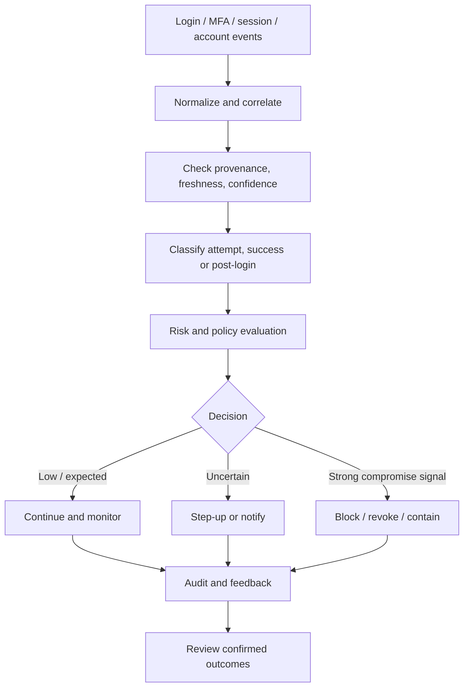

# Suspicious login — Đăng nhập đáng ngờ

## 1. Suspicious login là gì?

**Suspicious login** là một lần đăng nhập hoặc một chuỗi hoạt động xác thực có tín hiệu cho thấy tài khoản có thể đang bị người khác sử dụng, credential có thể đã bị lộ, hoặc request đang bị thao túng. Tín hiệu có thể đến từ thiết bị mới, mạng bất thường, mật khẩu bị thử trên nhiều tài khoản, MFA prompt không do người dùng khởi tạo, passkey/credential vừa được thêm, hoặc session tiếp tục hoạt động theo cách không phù hợp.

Ví dụ: Huy thường đăng nhập hệ thống công việc từ laptop cá nhân bằng passkey. Một tối, hệ thống ghi nhận nhiều lần thử mật khẩu thất bại cho tài khoản của Huy, sau đó có một đăng nhập thành công từ browser chưa từng thấy. Vài phút sau, tài khoản yêu cầu thêm phương thức MFA và đổi email khôi phục. Chuỗi sự kiện này đáng điều tra vì có thể là credential stuffing tiếp theo là chiếm tài khoản và thiết lập persistence.

Một lần đăng nhập từ thiết bị mới hoặc IP mới chưa đủ kết luận tài khoản đã bị chiếm. Người dùng có thể đổi điện thoại, đi công tác, dùng VPN hoặc chuyển mạng. Hệ thống cần kết hợp tín hiệu, xác định request thành công hay thất bại, đánh giá mức tin cậy của nguồn và chọn hành động tương xứng.

Trong mô-đun **SECURITY_AUTHENTICATION_FUNDAMENTALS**, xử lý đăng nhập đáng ngờ kết nối credential, phishing, MFA, passkey, session, token, risk-based authentication và account recovery. Mục tiêu là phát hiện dấu hiệu sớm, giảm khả năng attacker duy trì quyền truy cập và hướng dẫn người dùng xác minh sự kiện qua kênh an toàn.

### Mục tiêu học tập

Sau bài này, người học có thể:

- Phân biệt login attempt đáng ngờ, đăng nhập thành công bất thường và session bị nghi chiếm.
- Nhận diện tín hiệu liên quan tới phishing, credential stuffing, AiTM, MFA fatigue và token theft.
- Kết hợp tín hiệu mà không kết luận chỉ từ IP, vị trí hoặc fingerprint.
- Thiết kế luồng cảnh báo và xác minh “Đây có phải bạn không?” an toàn.
- Xây dựng quy trình phản ứng khi người dùng xác nhận hoặc phủ nhận một lần đăng nhập.
- Bảo vệ session, token, authenticator và recovery channel sau sự cố.
- Thiết kế telemetry, audit, rate limit, privacy và kiểm thử phát hiện.

## 2. Phân loại sự kiện đăng nhập đáng ngờ

Không phải mọi sự kiện đều có cùng ý nghĩa. Cần phân biệt ít nhất ba nhóm:

| Nhóm | Ví dụ | Ý nghĩa |
|---|---|---|
| Attempt bất thường nhưng thất bại | Password spraying, OTP sai nhiều lần, request từ bot | Có dấu hiệu dò tìm hoặc lạm dụng; chưa chứng minh attacker đã vào được |
| Đăng nhập thành công bất thường | Credential hợp lệ từ thiết bị mới, MFA được phê duyệt ngoài ý muốn | Có thể là người dùng hợp lệ hoặc credential/session đã bị chiếm |
| Hoạt động sau đăng nhập đáng ngờ | Thêm passkey, đổi recovery email, tạo API key, tải dữ liệu lớn | Có thể là persistence hoặc hành động của attacker sau khi chiếm session |

Một hệ thống chỉ gửi cảnh báo sau login thành công có thể bỏ lỡ giai đoạn dò mật khẩu và MFA fatigue. Ngược lại, nếu gửi cảnh báo cho mọi lần gõ sai mật khẩu, người dùng sẽ bị quá tải thông báo. Cần phân loại theo mức độ, tần suất, account impact và khả năng xác minh.

### Attempt, authentication và session là ba điểm khác nhau

- **Login attempt:** request đang cố xác thực. Nó có thể bị từ chối trước khi tạo session.
- **Authentication result:** kết quả xác minh credential và các yếu tố bổ sung.
- **Session activity:** request sử dụng trạng thái đã xác thực; attacker có thể dùng cookie/token bị đánh cắp mà không cần đăng nhập lại.

Vì vậy, cảnh báo “đăng nhập mới” cần nói rõ đó là lần thử thất bại, đăng nhập thành công hay hoạt động từ session hiện có. Không mô tả một lần thử thất bại như thể attacker đã truy cập được tài khoản.

## 3. Các tín hiệu thường gặp

### 3.1. Thiết bị hoặc browser mới

- Thiết bị chưa từng xuất hiện trong lịch sử của tài khoản.
- Browser, hệ điều hành hoặc device binding thay đổi bất thường.
- Một tài khoản có nhiều session mới trong thời gian ngắn.
- Thiết bị mới xuất hiện ngay sau password reset hoặc account recovery.

Thiết bị mới có thể hoàn toàn hợp lệ. User-Agent và browser fingerprint có thể thay đổi sau cập nhật hoặc bị giả mạo; chúng là tín hiệu hỗ trợ chứ không phải bằng chứng danh tính thiết bị. Device-bound key hoặc thông tin từ hệ thống quản lý thiết bị có thể có giá trị hơn nếu được xác minh đúng cách.

### 3.2. Mạng và vị trí bất thường

- IP/ASN mới hoặc có reputation xấu theo nguồn threat intelligence.
- VPN, proxy, Tor exit node hoặc hosting provider xuất hiện trong ngữ cảnh bất thường.
- Vị trí địa lý suy ra thay đổi nhanh.
- Tốc độ request cao hoặc nhiều tài khoản cùng bị thử từ một nguồn.

IP geolocation có thể sai do VPN, NAT, roaming, mạng di động và định tuyến. “Impossible travel” là tín hiệu để kiểm tra thêm, không phải kết luận tự động rằng tài khoản bị chiếm. Không nên khóa tài khoản chỉ vì người dùng đang ở quốc gia khác.

### 3.3. Hành vi xác thực bất thường

- Nhiều mật khẩu sai, nhiều username bị thử theo cùng mẫu.
- Một mật khẩu hợp lệ được dùng trên nhiều tài khoản.
- OTP/TOTP sai liên tục hoặc nhiều MFA push bất ngờ.
- MFA được phê duyệt ngay sau chuỗi push lặp lại.
- Passkey hoặc authenticator mới được đăng ký sau login bất thường.
- Login thành công sau một đợt password spraying.

MFA prompt mà người dùng không khởi tạo là tín hiệu đáng chú ý. Người dùng không nên phê duyệt chỉ để prompt biến mất; cần từ chối prompt và báo cáo qua ứng dụng/kênh hỗ trợ chính thức.

### 3.4. Hoạt động sau login

- Thay đổi mật khẩu, email, số điện thoại hoặc recovery factor.
- Thêm/xóa passkey, security key, TOTP hoặc thiết bị tin cậy.
- Tạo API key, app password hoặc OAuth authorization grant.
- Tắt MFA, thay đổi policy hoặc thêm admin.
- Tạo rule chuyển tiếp email, thay đổi mailbox delegation hoặc export dữ liệu.
- Truy cập dữ liệu nhạy cảm hoặc tải lượng lớn khác baseline.

Các hành động này có thể là công việc hợp lệ, nhưng cũng là cách attacker duy trì quyền truy cập hoặc lấy dữ liệu. Đánh giá theo account role và độ nhạy cảm của hành động.

### 3.5. Tín hiệu phishing và AiTM

- Người dùng báo đã nhập mật khẩu/OTP vào trang đăng nhập từ email hoặc tin nhắn.
- Login thành công sau khi user truy cập URL giả mạo.
- Có dấu hiệu MFA relay hoặc push approval không mong đợi.
- Token/session được sử dụng từ một client khác ngay sau khi người dùng đăng nhập.
- OAuth consent được cấp cho ứng dụng không rõ nguồn gốc.

Trong tấn công adversary-in-the-middle (AiTM), trang trung gian có thể chuyển tiếp thông tin đăng nhập và MFA real-time tới dịch vụ thật, rồi lấy session cookie. Đổi mật khẩu đơn thuần có thể không chấm dứt session cookie đã bị đánh cắp; cần revoke session/token và kiểm tra persistence.

## 4. Đánh giá tín hiệu và tránh kết luận sai

Một tín hiệu cần được xem xét theo nguồn, thời gian, confidence, khả năng giả mạo và quan hệ với các sự kiện khác.

| Thuộc tính | Câu hỏi cần trả lời |
|---|---|
| Provenance | Dữ liệu đến từ server, IdP, browser, thiết bị quản lý hay nguồn ngoài? |
| Freshness | Sự kiện xảy ra khi nào; có còn phù hợp với trạng thái hiện tại? |
| Confidence | Nguồn có được xác minh và có độ chính xác ra sao? |
| Integrity | Attacker có thể sửa hoặc giả mạo tín hiệu không? |
| Correlation | Có sự kiện độc lập nào củng cố hoặc làm yếu nhận định? |
| Impact | Nếu sai, hậu quả của allow hoặc deny là gì? |

Ví dụ, IP mới và browser mới cùng xuất hiện có thể chỉ là người dùng đổi laptop khi đi công tác. Nếu cùng lúc có password spraying, MFA push không mong đợi, rồi đổi recovery email, chuỗi sự kiện có ý nghĩa nghiêm trọng hơn.

### Unknown không phải là safe

Nếu thiết bị không cung cấp telemetry, hệ thống không nên tự coi thiết bị là sạch. Ghi nhận trạng thái unknown và áp dụng policy dựa trên các bằng chứng còn lại. Tương tự, thiếu threat intelligence không có nghĩa IP tốt.

### Không cộng trùng tín hiệu tương quan

IP mới, ASN mới và quốc gia mới có thể bắt nguồn từ cùng một quan sát mạng. Coi chúng là ba bằng chứng độc lập sẽ phóng đại risk. Hãy nhóm tín hiệu theo nguồn và quan hệ, giới hạn trọng số và lưu reason code để điều tra.

### Phân biệt anomaly với compromise

- **Anomaly:** khác baseline; có thể hợp lệ.
- **Suspicious:** có một hoặc nhiều tín hiệu cần kiểm tra.
- **Confirmed compromise:** có bằng chứng đủ mạnh, ví dụ người dùng xác nhận không thực hiện, credential bị lộ đã xác minh, hoặc điều tra xác nhận session bị chiếm.

Không nâng một anomaly đơn lẻ thành confirmed compromise chỉ vì score cao. Nếu quyết định chặn tự động, phải có policy, bằng chứng và quy trình hỗ trợ/recovery rõ ràng.

## 5. Pipeline phát hiện suspicious login

Một pipeline điển hình:

1. Thu thập sự kiện từ login gateway, IdP, MFA provider, session service và API.
2. Chuẩn hóa account, device, network, timestamp, result và authentication context.
3. Liên kết sự kiện theo account/session/device và cửa sổ thời gian.
4. Đánh giá chất lượng, freshness và độ tin cậy của tín hiệu.
5. Phân loại attempt, successful login hoặc post-login activity.
6. Tính risk/đánh giá rule và áp dụng policy.
7. Thực hiện monitor, step-up, restrict, revoke hoặc deny.
8. Gửi thông báo phù hợp và lưu audit.
9. Thu thập phản hồi người dùng/điều tra đã xác minh để cải thiện detection.



Không để detector tự cấp role hoặc quyền. Detector đưa ra assessment; policy engine quyết định; authentication/session/resource server thực thi và vẫn kiểm tra authorization bình thường.

## 6. Chính sách phản ứng theo mức độ

Hành động cần phù hợp với loại sự kiện, độ tin cậy và tác động:

| Mức tình huống | Ví dụ | Hành động có thể áp dụng |
|---|---|---|
| Thấp | Một lần đăng nhập thất bại, không có dấu hiệu khác | Ghi nhận; không làm phiền người dùng |
| Cần chú ý | Thiết bị mới, login thành công nhưng authenticator mạnh hợp lệ | Gửi thông báo nhẹ; tăng theo dõi |
| Đáng ngờ | Nhiều login fail, MFA push không mong đợi hoặc hoạt động recovery bất thường | Step-up độc lập, giới hạn thao tác nhạy cảm, yêu cầu xác minh |
| Nghi compromise cao | Người dùng phủ nhận login thành công, session bị dùng từ môi trường không tương thích, credential compromise đã xác minh | Revoke session/token, chặn credential liên quan, bắt đầu incident response |
| Compromise đã xác nhận | Điều tra xác nhận attacker kiểm soát account | Containment diện rộng, recovery có kiểm soát, kiểm tra persistence và thông báo |

Không phải mọi high risk đều giải quyết được bằng OTP. Nếu attacker đang relay OTP hoặc kiểm soát email/SIM, gửi thêm mã qua cùng kênh không tạo thêm bằng chứng độc lập. Ưu tiên passkey/WebAuthn hoặc security key chống phishing khi phù hợp.

### Step-up authentication

Step-up có thể yêu cầu:

- Passkey/WebAuthn gắn với đúng RP ID và origin.
- Security key đã đăng ký.
- MFA độc lập chưa bị nghi compromise.
- Reauthentication cho thao tác nhạy cảm.
- Xác nhận giao dịch theo đúng người nhận/số tiền nếu hành động là giao dịch.

Step-up phải gắn với đúng account, session và transaction. Server xác minh kết quả; không tin cờ “MFA complete” do browser gửi.

### Restrict thay vì khóa toàn bộ khi phù hợp

Trong một số tình huống chưa đủ bằng chứng để revoke toàn account, có thể tạm chặn thay đổi recovery, thêm authenticator, tạo API key hoặc chuyển tiền, trong khi cho phép người dùng truy cập trang bảo mật để tự kiểm tra. Với dấu hiệu compromise đã xác nhận, cần containment mạnh hơn.

## 7. Cảnh báo đăng nhập an toàn cho người dùng

Thông báo login có thể giúp người dùng nhận ra sự kiện họ không thực hiện. Tuy nhiên, bản thân thông báo cũng có thể bị attacker giả mạo để dẫn người dùng tới trang phishing.

### Nội dung nên có

- Nêu rõ sự kiện là login thành công hay login attempt thất bại.
- Thời điểm và múi giờ.
- Thiết bị/browser ở mức khái quát, nếu nguồn đủ tin cậy.
- Vị trí gần đúng và nói rõ đây là ước lượng.
- Phương thức xác thực ở mức không tiết lộ bí mật.
- Hướng dẫn mở ứng dụng/trang bảo mật bằng bookmark hoặc địa chỉ đã biết.
- Cách liên hệ support qua kênh chính thức.

### Nội dung không nên có

- Mật khẩu, OTP, recovery code, session ID hoặc token.
- Link đăng nhập trực tiếp từ email/SMS bất ngờ.
- Yêu cầu reply mật khẩu hoặc gửi mã xác minh cho nhân viên hỗ trợ.
- Số điện thoại hoặc URL hỗ trợ không được xác minh.
- Chi tiết detector có thể giúp attacker điều chỉnh hành vi né tránh.

Thông báo có thể chứa link tới security center nếu tổ chức có cơ chế chống phishing rõ ràng, nhưng hướng dẫn an toàn nhất vẫn là mở ứng dụng chính thức hoặc tự nhập domain đã biết. Không yêu cầu người dùng đăng nhập qua link lạ chỉ để “xác nhận không phải mình”.

### Ví dụ thông báo

```text
Chúng tôi ghi nhận một lần đăng nhập thành công vào tài khoản của bạn.

Thời điểm: 21:14, 22/11/2026 (UTC+7)
Thiết bị: Browser trên máy tính, chưa từng thấy trước đây
Vị trí gần đúng: Thành phố Hồ Chí Minh
Phương thức: Passkey

Nếu đây là bạn, không cần hành động.
Nếu không phải bạn, hãy tự mở ứng dụng chính thức hoặc nhập địa chỉ
dịch vụ mà bạn thường dùng, vào mục Bảo mật để kiểm tra phiên đăng nhập.
Không chia sẻ mật khẩu, OTP hoặc recovery code với bất kỳ ai.
```

Đây chỉ là nội dung minh họa. Hệ thống chỉ hiển thị phương thức/vị trí nếu có dữ liệu chính xác và được phép sử dụng. Không gửi ví dụ này như một thông báo thật.

## 8. Luồng “Đây có phải bạn không?”

Nút phản hồi trong thông báo hoặc security center cần dẫn tới một quy trình xác minh an toàn. Không để một cú click không xác thực tự động khóa tài khoản của người khác.

### Nếu người dùng xác nhận “Đúng, là tôi”

- Ghi nhận phản hồi gắn với sự kiện và account.
- Không tự động biến thiết bị thành trusted chỉ từ một click trong email.
- Nếu cần ghi nhớ thiết bị, yêu cầu hoàn tất đăng nhập bằng authenticator và policy phù hợp.
- Không bỏ qua các tín hiệu risk khác hoặc policy cho thao tác nhạy cảm.

### Nếu người dùng chọn “Không phải tôi”

1. Xác minh người dùng qua security center/app chính thức hoặc session/credential độc lập còn tin cậy.
2. Thu hồi session/token tương ứng; nếu chưa xác định được session, cân nhắc revoke all devices theo policy.
3. Chặn credential hoặc authenticator bị nghi compromise.
4. Yêu cầu đổi mật khẩu nếu mật khẩu có thể đã bị lộ.
5. Kiểm tra passkey, MFA factor, recovery email/phone, OAuth grants và API keys mới thêm.
6. Kiểm tra hoạt động sau login: thay đổi tài khoản, rule email, tải dữ liệu và quyền admin.
7. Gửi thông báo xác nhận containment và hướng dẫn recovery.

Nếu người dùng chưa thể xác minh qua kênh tin cậy, đưa họ vào account recovery. Không gửi mã xác thực tới địa chỉ/số điện thoại mới do chính session đáng ngờ vừa thêm.

### Không biến phản hồi email thành một lỗ hổng

Một attacker có thể biết địa chỉ email và gửi request giả mạo “not me” để khóa tài khoản nạn nhân. Phản hồi từ email chỉ nên tạo tín hiệu cần xác minh; hành động revoke diện rộng cần được bảo vệ bởi policy và xác minh bổ sung. Với một số sự cố nghiêm trọng, có thể tạm hold phiên đáng ngờ ngay nhưng phải có đường khôi phục cho chủ tài khoản.

## 9. Phòng thủ trước các kiểu tấn công đăng nhập

### 9.1. Credential stuffing

Attacker thử username/password từ các vụ rò rỉ trước đó trên nhiều dịch vụ.

Biện pháp:

- Rate limit theo account, IP, subnet, ASN và velocity; không chỉ giới hạn theo một IP.
- Phát hiện pattern nhiều account bị thử cùng nguồn hoặc cùng mật khẩu.
- Dùng password blocklist và kiểm tra mật khẩu bị lộ khi đổi mật khẩu.
- MFA, ưu tiên phương thức chống phishing.
- Trả lỗi đăng nhập không tiết lộ account có tồn tại hay không.
- Không khóa tài khoản vĩnh viễn chỉ vì attacker liên tục gửi mật khẩu sai; dùng throttling/risk control.

### 9.2. Password spraying

Attacker thử một vài mật khẩu phổ biến trên nhiều tài khoản để tránh ngưỡng lockout từng account.

Biện pháp:

- Correlate theo IP/ASN/device và tập tài khoản trong cửa sổ dài.
- Theo dõi phân phối lỗi và mẫu username.
- Adaptive rate limit, bot defense và MFA.
- Cảnh báo khi nhiều account có chuỗi thử giống nhau.

### 9.3. Adversary-in-the-middle (AiTM)

Trang trung gian chuyển tiếp login tới IdP thật, thu thập password/OTP và có thể lấy session cookie.

Biện pháp:

- Dùng passkey/WebAuthn hoặc security key chống phishing; credential được ràng buộc origin/RP ID.
- Không dựa riêng vào TOTP/SMS OTP để chống AiTM.
- Bảo vệ session cookie, dùng Secure/HttpOnly/SameSite phù hợp và TLS.
- Revoke session/token khi nghi cookie bị đánh cắp.
- Theo dõi login và session use bất thường sau MFA.

### 9.4. MFA fatigue và push bombing

Attacker gửi liên tục push request để người dùng mệt mỏi và phê duyệt nhầm.

Biện pháp:

- Number matching hoặc hiển thị context thiết bị/vị trí.
- Rate limit và giới hạn số prompt.
- Cho phép từ chối/báo cáo prompt bất ngờ.
- Hủy prompt cũ khi có request mới và audit chuỗi push.
- Chuyển sang passkey/security key khi phù hợp.

### 9.5. Session/token theft

Attacker lấy cookie, refresh token hoặc access token và sử dụng sau khi người dùng đã đăng nhập.

Biện pháp:

- Bảo vệ token storage và chống XSS.
- Không đặt token trong URL hoặc log.
- Dùng access token TTL ngắn, refresh rotation/reuse detection.
- Dùng sender-constrained token khi hệ sinh thái hỗ trợ.
- Kiểm tra session/version và revoke khi có bằng chứng compromise.

### 9.6. OAuth consent phishing

Người dùng bị dụ cấp quyền cho ứng dụng bên thứ ba không đáng tin.

Biện pháp:

- Hiển thị rõ tên client, publisher và scope.
- Hạn chế consent tự phục vụ với scope nhạy cảm.
- Theo dõi grant mới hoặc scope rộng bất thường.
- Cho phép người dùng xem và revoke connected apps.
- Revoke grant/token liên quan khi xác nhận lạm dụng.

## 10. Bảo vệ trang đăng nhập và kênh hỗ trợ

Trang đăng nhập là mục tiêu phishing phổ biến. Hệ thống cần làm cho trang thật dễ nhận biết và hạn chế khả năng attacker dùng thương hiệu để lừa người dùng.

- Dùng HTTPS và domain đăng nhập ổn định, dễ nhận biết.
- Dùng passkey/WebAuthn để browser/authenticator kiểm tra origin.
- Không nhúng form đăng nhập của IdP vào iframe/embedded webview không phù hợp.
- Không gửi password hoặc OTP qua chat, email hoặc support ticket.
- Hướng dẫn người dùng tự mở domain/app đã biết thay vì bấm link bất ngờ.
- Có kênh report phishing và quy trình xử lý URL giả mạo.
- Kiểm soát redirect URI, open redirect và link trong email.
- Dùng CSP, chống XSS và bảo vệ cookie/session.

Biểu tượng khóa HTTPS chỉ cho biết kết nối được mã hóa tới domain đang mở; nó không chứng minh domain đó là dịch vụ đúng. Hướng dẫn người dùng xác minh domain và dùng password manager/passkey có thể giúp phát hiện trang giả mạo.

### Hỗ trợ khách hàng

Nhân viên hỗ trợ không được yêu cầu người dùng đọc OTP, recovery code, mật khẩu hoặc private key. Quy trình hỗ trợ phải xác minh danh tính theo policy và ghi audit. Không thay đổi email/phone recovery chỉ dựa trên thông tin mà người gọi cung cấp hoặc một email “khẩn cấp”.

## 11. Xử lý sau khi nghi ngờ tài khoản bị chiếm

Một playbook có thể chia thành containment, eradication, recovery và monitoring.

### Containment

- Revoke session và refresh-token family đáng ngờ; nếu phạm vi chưa rõ, cân nhắc revoke all devices.
- Chặn credential bị xác nhận compromise.
- Tạm hạn chế thay đổi recovery, thêm authenticator, tạo API key và giao dịch nhạy cảm.
- Bảo toàn log/sự kiện để điều tra.

### Eradication

- Đổi mật khẩu từ thiết bị sạch nếu mật khẩu có nguy cơ bị lộ.
- Xóa passkey/MFA factor lạ sau khi xác minh chủ tài khoản.
- Revoke OAuth grants, app passwords, API keys, certificates hoặc service credential bị lạm dụng.
- Kiểm tra mailbox forwarding, delegation, inbox rules, admin role và thiết bị tin cậy.
- Vá nguyên nhân như phishing, XSS, malware hoặc token storage yếu.

### Recovery

- Xác minh chủ tài khoản qua phương thức độc lập.
- Khôi phục recovery email/phone an toàn.
- Đăng ký lại MFA/passkey dự phòng.
- Đăng nhập mới và xác nhận các thiết bị còn tin cậy.
- Thông báo các thay đổi bảo mật và cách liên hệ nếu còn hoạt động lạ.

### Monitoring

- Theo dõi login, refresh, MFA, recovery và credential enrollment sau containment.
- Cảnh báo khi credential cũ tiếp tục được thử.
- Theo dõi session/token còn hoạt động trong thời gian propagation.
- Chỉ đóng incident khi đã xác minh không còn persistence và quyền truy cập trái phép.

Đổi mật khẩu không đủ nếu attacker còn session cookie, refresh token, passkey lạ hoặc OAuth grant. Cần rà soát mọi con đường duy trì quyền truy cập.

## 12. Telemetry và dữ liệu audit

Một login event có thể chứa:

| Trường | Mục đích |
|---|---|
| Event ID | Correlation và idempotency |
| Account reference | Liên kết sự kiện với tài khoản mà không lộ dữ liệu thừa |
| Timestamp | Thời điểm và múi giờ |
| Result | Success, failure, challenged, blocked |
| Authentication method | Password, passkey, TOTP, certificate, federation |
| Session reference | Liên kết hoạt động sau login |
| Device/network summary | Tín hiệu đánh giá, có provenance |
| Risk reason codes | Giải thích quyết định |
| Policy/model version | Tái hiện quyết định |
| Correlation ID | Liên kết gateway, IdP, MFA và resource logs |

Không log password, OTP, recovery code, private key, cookie, access token, refresh token hoặc toàn bộ authorization header. IP, vị trí và fingerprint cần có retention, access control và mục đích sử dụng rõ.

### Chỉ số theo dõi

- Login failure rate theo account, IP, ASN và client.
- Số account bị password spraying/credential stuffing trong cùng cửa sổ.
- MFA prompt count, deny rate và push approval bất thường.
- Login success từ thiết bị mới và tỷ lệ được xác nhận là hợp lệ.
- Tỷ lệ người dùng chọn “Không phải tôi”.
- Thời gian từ report tới revoke session/token.
- Tỷ lệ session cũ còn hoạt động sau containment.
- False positive, false negative và abandonment rate.

Phản hồi “Đúng là tôi” không tự động là nhãn benign hoàn hảo; phản hồi có thể bị nhầm hoặc bị attacker kiểm soát email. Nhãn compromise nên dựa trên điều tra hoặc bằng chứng đủ tin cậy.

## 13. Ví dụ Java phân loại login event

Đoạn Java sau minh họa cách tách sự kiện khỏi quyết định policy. Các tín hiệu boolean và ngưỡng chỉ để minh họa; production cần provenance, freshness, confidence, trạng thái unknown và dữ liệu có kiểm soát.

```java
import java.time.Instant;
import java.util.Set;

enum LoginResult {
    SUCCESS, FAILURE, CHALLENGED, BLOCKED
}

enum LoginSignal {
    NEW_DEVICE,
    SUSPICIOUS_NETWORK,
    PASSWORD_SPRAY_PATTERN,
    MFA_PUSH_NOT_REQUESTED,
    RECENT_RECOVERY,
    CREDENTIAL_COMPROMISE_CONFIRMED,
    UNUSUAL_POST_LOGIN_ACTION
}

enum LoginResponse {
    RECORD_ONLY,
    NOTIFY,
    STEP_UP,
    RESTRICT_SENSITIVE_ACTIONS,
    REVOKE_SESSION,
    CONTAIN_ACCOUNT
}

record LoginEvent(
    String eventId,
    String accountId,
    Instant occurredAt,
    LoginResult result,
    Set<LoginSignal> signals
) {}

record LoginAssessment(
    int score,
    boolean confirmedCompromise,
    Set<LoginSignal> reasons
) {}

final class SuspiciousLoginDetector {

    LoginAssessment assess(LoginEvent event) {
        if (event == null || event.eventId() == null
                || event.eventId().isBlank()
                || event.accountId() == null || event.accountId().isBlank()
                || event.occurredAt() == null
                || event.result() == null || event.signals() == null) {
            throw new IllegalArgumentException("login event is incomplete");
        }

        int score = 0;
        Set<LoginSignal> signals = Set.copyOf(event.signals());

        if (signals.contains(LoginSignal.NEW_DEVICE)) score += 10;
        if (signals.contains(LoginSignal.SUSPICIOUS_NETWORK)) score += 15;
        if (signals.contains(LoginSignal.PASSWORD_SPRAY_PATTERN)) score += 25;
        if (signals.contains(LoginSignal.MFA_PUSH_NOT_REQUESTED)) score += 25;
        if (signals.contains(LoginSignal.RECENT_RECOVERY)) score += 15;
        if (signals.contains(LoginSignal.UNUSUAL_POST_LOGIN_ACTION)) score += 20;

        boolean confirmed = signals.contains(
                LoginSignal.CREDENTIAL_COMPROMISE_CONFIRMED);
        if (confirmed) score = 100;

        return new LoginAssessment(Math.min(score, 100), confirmed, signals);
    }
}

final class SuspiciousLoginPolicy {

    LoginResponse decide(LoginEvent event, LoginAssessment assessment) {
        if (event == null || event.result() == null || assessment == null
                || assessment.reasons() == null
                || assessment.score() < 0 || assessment.score() > 100) {
            return LoginResponse.CONTAIN_ACCOUNT;
        }

        if (assessment.confirmedCompromise()) {
            return LoginResponse.CONTAIN_ACCOUNT;
        }

        if (event.result() == LoginResult.FAILURE) {
            return assessment.score() >= 40
                    ? LoginResponse.NOTIFY
                    : LoginResponse.RECORD_ONLY;
        }

        if (assessment.score() >= 70) {
            return LoginResponse.REVOKE_SESSION;
        }
        if (assessment.score() >= 45) {
            return LoginResponse.STEP_UP;
        }
        if (assessment.score() >= 20) {
            return LoginResponse.NOTIFY;
        }
        return LoginResponse.RECORD_ONLY;
    }
}
```

Giới hạn của ví dụ:

- Score không phải xác suất compromise và các trọng số không phải ngưỡng production.
- `CREDENTIAL_COMPROMISE_CONFIRMED` chỉ được đặt từ nguồn đã xác minh, không phải từ một IP reputation đơn lẻ.
- Một login failure không chứng minh attacker đã truy cập; policy trong production cần xét velocity và nhiều account.
- Trước khi revoke session hoặc contain account, cần kiểm tra phạm vi, xác thực actor và có quy trình recovery.
- Không dùng phản hồi email đơn lẻ làm bằng chứng duy nhất để gắn nhãn confirmed compromise.

## 14. Kiểm thử suspicious login

| Ca kiểm thử | Kết quả mong đợi |
|---|---|
| Một login failure đơn lẻ từ IP mới | Ghi nhận; không tự động khóa |
| Nhiều account bị thử cùng mẫu mật khẩu | Phát hiện spraying/credential stuffing |
| Login thành công bằng passkey từ thiết bị mới | Đánh giá ngữ cảnh; không mặc định compromise |
| Người dùng nhận MFA push không yêu cầu | Có cách từ chối/report; không khuyến khích approve |
| Login thành công sau chuỗi MFA push bất thường | Step-up/contain theo policy và điều tra |
| Người dùng phủ nhận login thành công | Xác minh độc lập, revoke session/token phù hợp |
| Attacker dùng cookie sau khi đổi mật khẩu | Session/token bị revoke hoặc bị từ chối theo policy |
| Login sau khi account recovery vừa hoàn tất | Tăng kiểm tra với hành động nhạy cảm |
| Thiết bị fingerprint thay đổi sau browser update | Không kết luận compromise chỉ từ fingerprint |
| Impossible travel qua VPN/roaming | Kết hợp tín hiệu khác; không deny chỉ từ IP |
| OAuth grant mới với scope nhạy cảm | Cảnh báo/step-up/revoke grant theo policy |
| Email cảnh báo bị giả mạo | Người dùng được hướng dẫn tự mở app/domain đã biết |
| “Not me” click từ email không xác thực | Chỉ tạo tín hiệu; không tự động khóa account |
| Risk/detection service timeout | Fallback được định nghĩa; thao tác nhạy cảm không fail-open |
| Event bị gửi lặp | Consumer idempotent, không gửi cảnh báo trùng không kiểm soát |
| Login event thiếu device telemetry | Đánh dấu unknown, không coi là thiết bị an toàn |

### Diễn tập tabletop

Thử một kịch bản từ đầu tới cuối: người dùng nhận email giả mạo, nhập mật khẩu và OTP vào trang AiTM, attacker lấy session cookie, đăng nhập từ thiết bị khác, thêm recovery factor rồi tạo OAuth grant. Nhóm vận hành cần chứng minh có thể phát hiện, xác minh với chủ tài khoản, revoke session/token, thu hồi credential/grant, khôi phục recovery channel và kiểm tra persistence.

Ghi lại thời gian phát hiện, thời gian containment, số session/token còn dùng được, số dịch vụ đã nhận revoke event và các điểm người dùng bị hướng dẫn sai. Cập nhật runbook sau mỗi lần diễn tập.

## 15. Checklist thiết kế và vận hành

- [ ] Phân biệt login attempt thất bại, login thành công và hoạt động sau login.
- [ ] Kết hợp tín hiệu account, device, network, MFA, session và action.
- [ ] Ghi provenance, freshness, confidence và trạng thái unknown.
- [ ] Không dùng IP, geolocation hoặc fingerprint làm bằng chứng duy nhất.
- [ ] Phát hiện credential stuffing, password spraying, MFA fatigue, AiTM và token theft.
- [ ] Có policy allow/monitor/notify/step-up/restrict/revoke/contain rõ ràng.
- [ ] Ưu tiên passkey/WebAuthn hoặc security key chống phishing cho step-up phù hợp.
- [ ] Gắn step-up với đúng account, session và transaction.
- [ ] Cảnh báo phân biệt login failure với login success.
- [ ] Thông báo không yêu cầu mật khẩu, OTP hoặc recovery code; hướng dẫn mở app/domain đã biết.
- [ ] “Not me” phải qua xác minh; không để click email đơn lẻ khóa tài khoản.
- [ ] Khi compromise, revoke cả session/token và credential/grant liên quan.
- [ ] Kiểm tra recovery method, passkey/MFA mới, OAuth grant, API key và persistence.
- [ ] Bảo vệ log; không ghi password, OTP, token, cookie hoặc private key.
- [ ] Có metrics, incident playbook, tabletop và kiểm thử false positive/negative.

## 16. Tổng kết

Suspicious login là một tín hiệu cần điều tra theo ngữ cảnh, không phải kết luận tự động rằng tài khoản đã bị chiếm. Hệ thống cần phân biệt login attempt thất bại, đăng nhập thành công bất thường và hành động đáng ngờ sau login; kết hợp tín hiệu có nguồn đáng tin; rồi áp dụng policy từ monitor/notify tới step-up, restrict, revoke hoặc contain.

Thông báo cho người dùng cũng là một phần của bề mặt phishing. Cảnh báo phải nêu đúng loại sự kiện, không chứa bí mật, không yêu cầu người dùng cung cấp OTP và hướng dẫn họ tự mở ứng dụng/domain chính thức. Khi người dùng phủ nhận login hoặc có bằng chứng compromise, cần xác minh độc lập, thu hồi session/token và credential liên quan, kiểm tra persistence và khôi phục tài khoản an toàn. Một hệ thống tốt bảo vệ người dùng mà không biến mỗi lần đổi thiết bị hay mạng thành một sự cố giả.
