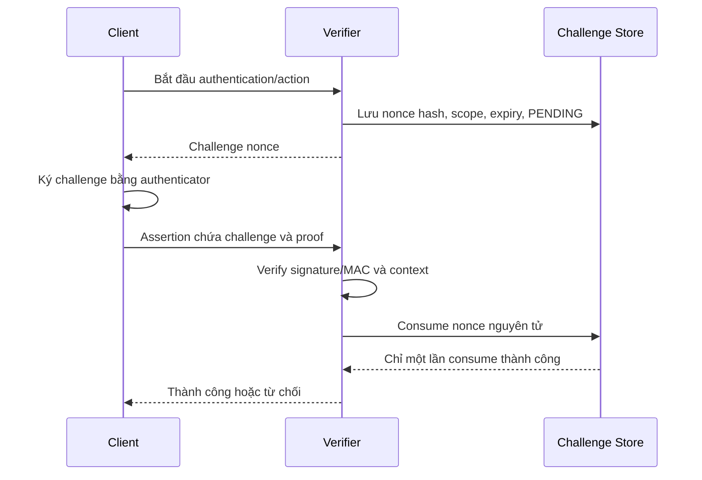

# Nonce chống replay

## Mục tiêu học tập

Một request hợp lệ có thể bị ghi lại trên đường truyền, trong log trung gian hoặc tại một thiết bị đã bị kiểm soát. Attacker có thể gửi lại request đó để lặp giao dịch, tái sử dụng assertion đăng nhập hoặc thực hiện một hành động đã được người dùng phê duyệt. Mã hóa đường truyền giúp bảo vệ dữ liệu khi truyền, nhưng không tự ngăn một thông điệp hợp lệ bị gửi lại trong một ngữ cảnh khác hoặc sau khi đã được xử lý.

**Nonce (number used once)** là một giá trị được tạo cho một lần trao đổi hoặc một hành động cụ thể. Verifier kiểm tra nonce có thuộc đúng challenge/request, còn hạn và chưa từng được tiêu thụ hay không. Khi xác minh thành công, verifier đánh dấu nonce đã dùng một cách nguyên tử. Nhờ vậy, bản sao của thông điệp không thể được chấp nhận lần thứ hai trong cùng phạm vi bảo vệ.

Nonce là một thành phần của replay protection, không phải cơ chế xác thực độc lập. Một nonce ngẫu nhiên nhưng không được lưu trạng thái hoặc không được kiểm tra khi nhận request sẽ không ngăn replay. Một nonce chỉ có tác dụng khi được ràng buộc với principal, phiên, audience, hành động và dữ liệu cần bảo vệ, rồi được verifier tiêu thụ đúng một lần.

Bài học thuộc chương **Chống replay** của mô-đun **SECURITY_AUTHENTICATION_FUNDAMENTALS**. Mô-đun tìm hiểu credential, mật khẩu, MFA, passkey, chứng chỉ, token, phiên, liên kết danh tính và khôi phục tài khoản. Nonce giúp bảo vệ các luồng xác thực và giao dịch khỏi việc tái sử dụng thông điệp cũ, đặc biệt khi hệ thống có nhiều dịch vụ hoặc nhiều node xử lý song song.

Sau bài học, bạn có thể:

- Giải thích replay attack và phân biệt nonce với timestamp, counter, salt, IV, CSRF token và idempotency key.
- Tạo nonce bằng nguồn ngẫu nhiên mật mã và chọn kích thước phù hợp.
- Ràng buộc nonce với subject, session, client, audience, HTTP method, resource và payload.
- Thiết kế challenge có thời hạn, một lần và được consume nguyên tử.
- Xây dựng replay cache phân tán, xử lý race condition, retry và clock skew.
- Áp dụng nonce trong API ký HMAC, OAuth/OIDC, WebAuthn, TOTP/HOTP và giao thức xác thực.
- Hiểu giới hạn của nonce đối với TLS 0-RTT, access token và thông điệp được ký.
- Xây dựng Java model, sơ đồ luồng, test matrix và vận hành replay protection an toàn.

## 1. Replay attack là gì?

Replay attack xảy ra khi attacker thu được một thông điệp hoặc bằng chứng hợp lệ rồi gửi lại nó để verifier chấp nhận thêm một lần nữa. Attacker có thể không cần biết mật khẩu, private key hoặc nội dung bí mật; họ chỉ cần sao chép một thông điệp đã được tạo hợp lệ trong một phiên trước.

Ví dụ:

- Một request chuyển tiền đã được ký được gửi lại lần thứ hai.
- Một assertion đăng nhập hợp lệ bị phát lại sau khi người dùng đã đăng xuất.
- Một challenge-response cũ được gửi trong phiên mới.
- Một webhook thanh toán được gửi lại để tạo đơn hàng hoặc ghi nhận thanh toán trùng.
- Một mã TOTP đã dùng được phát lại trong cùng cửa sổ thời gian.
- Một request API đã ký được chuyển sang endpoint hoặc tenant khác.
- Một early-data request của TLS 1.3 được phát lại tới nhiều server nếu ứng dụng không thiết kế chống replay.

### Ví dụ giao dịch

Người dùng xác nhận chuyển 2.000.000 VND cho người nhận A. Ứng dụng gửi request đã được xác thực tới backend. Attacker ghi lại request và gửi lại sau đó.

Nếu backend chỉ kiểm tra chữ ký hoặc access token còn hợp lệ mà không kiểm tra request đã được xử lý, giao dịch có thể được thực hiện hai lần. Chữ ký vẫn đúng vì attacker không sửa thông điệp. Authentication của request vẫn hợp lệ vì thông điệp gốc được tạo bởi client hợp lệ.

Replay protection cần xác định đây là một lần thực thi duy nhất. Backend có thể dùng nonce một lần được gắn với transaction, lưu trạng thái đã tiêu thụ và dùng idempotency key cho lớp xử lý nghiệp vụ. Hai lớp này giải quyết các vấn đề liên quan nhưng không hoàn toàn giống nhau.

### Replay khác giả mạo

| Tấn công | Cách attacker thực hiện | Kiểm soát liên quan |
| --- | --- | --- |
| Replay | Gửi lại thông điệp hợp lệ đã ghi được | Nonce, counter, timestamp window, replay cache |
| Forgery | Tạo thông điệp giả không có credential hợp lệ | MAC, chữ ký số, xác thực token |
| Tampering | Sửa nội dung trên đường truyền | MAC/chữ ký, TLS, hash ràng buộc payload |
| Credential theft | Lấy mật khẩu, token hoặc private key | Bảo vệ credential, rotation, revocation |
| Session hijacking | Chiếm cookie hoặc session đang hoạt động | Secure cookie, session binding, revocation |
| Duplicate delivery | Hệ thống gửi cùng message nhiều lần do retry | Idempotency, deduplication, transactional processing |

Một request có thể vừa bị sửa vừa bị replay. Vì vậy, nonce không thay thế chữ ký/MAC, và chữ ký/MAC không thay thế kiểm soát chống replay.

## 2. Nonce là gì và cần bảo đảm điều gì?

Nonce là giá trị được tạo cho một lần sử dụng trong một phạm vi xác định. Tùy giao thức, nonce có thể do verifier cấp trước như một challenge, hoặc do client tạo và đưa vào request để verifier phát hiện trùng lặp.

Một nonce tốt cần đáp ứng các thuộc tính phù hợp với giao thức:

1. **Uniqueness:** không bị lặp trong phạm vi mà verifier dùng để phát hiện replay.
2. **Unpredictability:** attacker khó đoán trước giá trị nếu nonce được dùng như challenge chống preplay hoặc challenge-response.
3. **Scope binding:** nonce gắn với đúng subject, client, session, audience và hành động.
4. **Freshness:** nonce có thời hạn hoặc gắn với một phiên/epoch cụ thể.
5. **Single use:** chỉ một lần tiêu thụ thành công.
6. **Integrity:** nonce không thể bị thay thế mà verifier vẫn chấp nhận payload cũ.
7. **Atomic consumption:** hai request đồng thời không thể cùng tiêu thụ một nonce.

### Uniqueness và unpredictability

Hai thuộc tính này có liên quan nhưng khác nhau.

- Uniqueness ngăn một giá trị xuất hiện hai lần trong phạm vi kiểm tra.
- Unpredictability ngăn attacker đoán challenge trước khi verifier phát hành.

Với challenge do server phát hành cho WebAuthn hoặc một challenge-response protocol, cần cả ngẫu nhiên khó đoán và không tái sử dụng. Với một số protocol counter hoặc sequence number, tính duy nhất theo thứ tự có thể là cơ chế chính; không phải protocol nào cũng yêu cầu nonce có tính bí mật.

### Kích thước và nguồn sinh

Dùng cryptographically secure random number generator (CSPRNG) của nền tảng. Với challenge mới cho mỗi giao dịch, 128 bit entropy ngẫu nhiên là mức thiết kế phổ biến; có thể dùng 256 bit nếu chi phí lưu trữ/truyền tải không đáng kể. Không dùng timestamp, UUID v1, số tăng dần đơn giản, Math.random hoặc giá trị lấy từ tên user làm nonce ngẫu nhiên.

Nếu giao thức yêu cầu nonce không trùng tuyệt đối trong một namespace, cần thêm unique constraint hoặc cơ chế sequence bên cạnh xác suất collision thấp. Đừng xem xác suất collision rất thấp là thay thế cho thiết kế lưu trạng thái đúng.

### Nonce không phải bí mật xác thực

Nonce thường không cần giữ bí mật sau khi phát hành. Attacker có thể nhìn thấy nonce trong request mà vẫn không thể dùng lại nếu nonce đã được gắn với một payload, một session và trạng thái đã tiêu thụ. Bảo vệ chính nằm ở tính duy nhất, binding, freshness và kiểm tra single-use, không phải che giấu nonce.

## 3. Phân biệt nonce với các giá trị thường bị nhầm

| Giá trị | Mục đích chính | Có tự ngăn replay không? |
| --- | --- | --- |
| Nonce | Phân biệt một lần trao đổi/request | Có thể, nếu verifier lưu và tiêu thụ một lần |
| Timestamp | Giới hạn thông điệp trong một cửa sổ thời gian | Không; cùng thông điệp có thể được gửi lại trong cửa sổ |
| Counter/sequence number | Phát hiện thứ tự cũ hoặc số đã xử lý | Có, nếu verifier lưu trạng thái và kiểm tra thứ tự/duplicate |
| Salt | Làm đầu vào hash khác nhau, thường cho password hashing | Không |
| IV/initialization vector | Khởi tạo chế độ mã hóa theo yêu cầu thuật toán | Không tự ngăn replay thông điệp |
| CSRF token | Ràng buộc request thay đổi trạng thái với browser/session | Có thể chống một số request giả mạo, nhưng semantics khác nonce protocol |
| OAuth state | Liên kết authorization response với request do client khởi tạo và chống CSRF | Có thể chống response injection nếu kiểm tra đúng; không thay nonce OIDC |
| OIDC nonce | Liên kết ID token với authentication request và chống token replay/injection | Có, trong phạm vi client kiểm tra claim và lưu request state |
| PKCE verifier | Chứng minh client đang đổi authorization code là bên khởi tạo flow | Không phải nonce; giảm code interception |
| Idempotency key | Định danh một thao tác nghiệp vụ để retry không tạo hiệu ứng lặp | Có, nếu server lưu kết quả và xử lý idempotent |
| Message ID | Định danh một message/event | Chỉ khi consumer deduplicate và lưu trạng thái |

### Nonce và salt

Salt trong password hashing thường được lưu công khai cùng password hash. Mục đích là khiến cùng một mật khẩu tạo hash khác nhau và làm rainbow table khó dùng. Salt không được tiêu thụ một lần theo từng request, do đó không phải cơ chế chống replay cho login message.

### Nonce và IV

IV/nonce trong thuật toán mã hóa là đầu vào mật mã có quy tắc riêng. Ví dụ, AES-GCM yêu cầu nonce không được tái sử dụng với cùng key; reuse có thể làm lộ thông tin hoặc phá tính xác thực. Điều đó khác với nonce challenge ở tầng giao thức. Nonce của GCM không tự ngăn attacker phát lại một ciphertext hợp lệ; ứng dụng vẫn cần replay cache hoặc sequence number nếu không chấp nhận bản tin cũ.

### Nonce và idempotency key

Idempotency key thường được client tạo cho một thao tác nghiệp vụ và giữ nguyên khi retry cùng thao tác. Server lưu kết quả hoặc trạng thái để request lặp không tạo hiệu ứng lần hai. Nonce challenge thường là giá trị một lần do verifier cấp và bị tiêu thụ khi xác minh.

Có thể dùng cả hai: nonce chứng minh request đang gắn với challenge hiện hành; idempotency key đảm bảo retry nghiệp vụ không tạo giao dịch trùng khi response bị mất. Không dùng một key làm hai vai trò nếu semantics của nó không đáp ứng cả hai.

## 4. Challenge-response: verifier cấp nonce trước

Đây là mô hình phổ biến trong authentication và step-up.

### Quy trình tổng quát

1. Client yêu cầu bắt đầu một hành động hoặc authentication ceremony.
2. Verifier tạo nonce ngẫu nhiên.
3. Verifier lưu hash/reference của nonce cùng subject dự kiến, client, session, audience, action, expiry và trạng thái PENDING.
4. Verifier gửi nonce tới client qua kênh đã xác thực hoặc trong protocol flow.
5. Client dùng authenticator để ký hoặc tạo response bao gồm nonce.
6. Verifier xác minh chữ ký/MAC, nonce, audience, context và thời hạn.
7. Verifier consume nonce bằng thao tác nguyên tử.
8. Verifier chỉ tiếp tục đúng hành động được ràng buộc với challenge.

### Sơ đồ



Nếu attacker ghi lại assertion sau khi nonce đã được consume, lần gửi lại phải bị từ chối. Nếu attacker gửi assertion trước người dùng thật và consume thành công, hệ thống vẫn cần bảo vệ session, channel binding và context; nonce một lần chỉ bảo đảm một lần chấp nhận, không tự xác định ai là người gửi đầu tiên.

### Ràng buộc context

Một challenge record nên chứa hoặc tham chiếu:

- Nonce hash hoặc challenge ID.
- Subject ID hoặc subject dự kiến.
- Session ID/family hoặc login transaction ID.
- Client ID và audience.
- Action type, resource ID và tenant.
- HTTP method/path hoặc protocol operation nếu áp dụng.
- Hash của payload đã canonicalize nếu action có nội dung.
- Policy/assurance requirement.
- Created time, expiry và trạng thái.
- Correlation ID và version để chống race.

Không chỉ lưu nonce theo một key global mà không có namespace. Một challenge được tạo cho user A không được dùng trong session của user B hoặc audience khác.

## 5. Tạo nonce an toàn

Nonce cần được sinh bởi nguồn ngẫu nhiên phù hợp, không tự thiết kế thuật toán sinh.

### Nguyên tắc

- Dùng SecureRandom trong Java hoặc CSPRNG tương đương của nền tảng.
- Tạo nonce mới cho mỗi challenge hoặc request theo protocol.
- Chọn entropy phù hợp; challenge 128 bit ngẫu nhiên trở lên thường đủ cho nhiều flow web.
- Encode bằng Base64url hoặc hex theo định dạng giao thức.
- Không cắt ngắn làm giảm entropy.
- Không đưa thông tin cá nhân, email, timestamp đơn độc hoặc counter đơn giản vào giá trị nonce.
- Không tái sử dụng nonce giữa môi trường test và production.
- Có unique constraint hoặc collision handling nếu protocol yêu cầu uniqueness được bảo đảm.

### Ví dụ Java tạo challenge

```java
import java.security.SecureRandom;
import java.util.Base64;

final class NonceGenerator {
    private static final SecureRandom RANDOM = new SecureRandom();
    private static final int NONCE_BYTES = 32;

    private NonceGenerator() {}

    static String newNonce() {
        byte[] bytes = new byte[NONCE_BYTES];
        RANDOM.nextBytes(bytes);
        return Base64.getUrlEncoder()
                .withoutPadding()
                .encodeToString(bytes);
    }
}
```

Ví dụ tạo 256 bit ngẫu nhiên và mã hóa Base64url không padding. Nonce này vẫn cần được lưu/kiểm tra ở verifier và gắn với đúng context. Việc tạo ra một chuỗi đủ ngẫu nhiên chưa có nghĩa replay protection đã được triển khai.

### Không dùng timestamp làm nonce

Timestamp có thể giúp giới hạn freshness nhưng nhiều request có thể xảy ra cùng một thời điểm và attacker có thể gửi lại trong cửa sổ cho phép. Nếu cần timestamp, kết hợp timestamp với nonce duy nhất và kiểm tra cả hai. Clock skew phải được quản lý theo policy.

## 6. Lưu trữ và tiêu thụ nonce một lần

Đây là phần quyết định nonce có thực sự ngăn replay hay không. Verifier phải nhớ nonce nào đã được phát hành, nonce nào đã được dùng và nonce nào đã hết hạn.

### Mô hình trạng thái

| Trạng thái | Ý nghĩa | Hành động |
| --- | --- | --- |
| PENDING | Challenge đã phát hành, chưa được dùng | Chấp nhận kiểm tra proof trong thời hạn |
| CONSUMED | Challenge đã được dùng thành công | Từ chối mọi lần gửi lại |
| EXPIRED | Hết thời hạn mà chưa dùng | Từ chối |
| REVOKED | Challenge bị hủy do session/case bị thu hồi | Từ chối |
| FAILED | Có thể ghi nhận lần xác minh thất bại theo policy | Không tự chuyển lại PENDING |

Không nhất thiết lưu trạng thái CONSUMED vô thời hạn. Có thể giữ replay marker ít nhất đến khi challenge hết hiệu lực cộng với cửa sổ clock skew/retry được phép. Với giao dịch tài chính hoặc protocol yêu cầu chống replay dài hơn, retention phải theo nghiệp vụ và threat model.

### Consume nguyên tử

Giả sử hai request giống hệt nhau đến hai node cùng lúc. Nếu mỗi node đọc PENDING trước khi node nào cập nhật CONSUMED, cả hai có thể chấp nhận. Cần một thao tác nguyên tử như:

- SQL UPDATE có điều kiện trạng thái PENDING và expiry.
- Unique constraint trên nonce hash hoặc request ID đã tiêu thụ.
- Compare-and-set (CAS).
- Redis script/transaction bảo đảm check-and-set trong một thao tác.
- Replay cache dùng storage chia sẻ có semantics atomic.

Chỉ request thay đổi đúng một record từ PENDING sang CONSUMED mới được đi tiếp. Request còn lại phải nhận kết quả replay/duplicate.

### SQL minh họa

```sql
UPDATE auth_challenges
SET status = 'CONSUMED',
    consumed_at = :now
WHERE nonce_hash = :nonce_hash
  AND subject_id = :subject_id
  AND session_id = :session_id
  AND audience = :audience
  AND action_digest = :action_digest
  AND status = 'PENDING'
  AND expires_at > :now;
```

Backend kiểm tra số dòng bị cập nhật. Chỉ khi đúng một dòng được cập nhật mới coi challenge đã được consume. Nếu 0 dòng, nonce không tồn tại, sai context, hết hạn, đã dùng hoặc đã bị revoke; phản hồi bên ngoài có thể thống nhất để tránh tiết lộ chi tiết nội bộ.

### Lưu hash thay vì nonce thô

Nếu nonce là bearer challenge và database bị đọc trái phép, lưu hash nonce giúp giảm khả năng attacker lấy trực tiếp giá trị để sử dụng. Hash cần dùng hàm phù hợp và canonical encoding; vì nonce có entropy cao, hash thông thường như SHA-256 có thể phù hợp cho lookup. Không dùng hash này để thay chữ ký/MAC xác minh assertion.

Nếu cần so sánh secret trong một giao thức có entropy thấp, hash nhanh không đủ chống brute force. Thiết kế phải dựa trên entropy của nonce và threat model. Challenge cần đủ ngẫu nhiên ngay từ đầu.

## 7. Nonce trong hệ thống phân tán

Một ứng dụng chạy nhiều instance cần replay state dùng chung. Nếu mỗi node giữ cache riêng, attacker có thể gửi cùng request tới node khác để vượt qua kiểm tra.

### Rủi ro khi dùng local memory

- Request đầu tới node A, nonce được đánh dấu CONSUMED trong memory A.
- Attacker gửi bản sao tới node B.
- Node B chưa thấy nonce và coi request là mới.
- Cùng một hành động được chấp nhận hai lần.

Do đó, replay cache phải có phạm vi bao phủ mọi verifier có thể nhận cùng request. Dùng database/Redis/consistent store hoặc phân vùng routing có bảo đảm. Sticky session không đủ làm ranh giới bảo mật nếu attacker có thể đổi node hoặc failover.

### TTL và cleanup

Replay marker có thể dùng TTL để tự dọn, nhưng TTL phải đủ dài để bao phủ:

- Challenge expiry.
- Clock skew cho phép.
- Độ trễ mạng và retry window.
- Thời gian xử lý bất đồng bộ nếu protocol cho phép.
- Độ trễ propagation giữa node/region.

Không xóa replay marker ngay khi challenge hết hạn nếu còn request đang trên đường tới node khác. Với multi-region, cần hiểu consistency model; eventual consistency có thể cho phép hai region cùng chấp nhận trong khoảng propagation. Với hành động rủi ro cao, cần strong consistency hoặc một nơi authoritative cho consume.

### Khi replay store không khả dụng

Không thể kiểm tra single-use nếu kho replay state bị lỗi. Hành vi phải theo risk policy:

- Với giao dịch tài chính, thay đổi credential hoặc hành động đặc quyền: fail closed hoặc tạm hoãn.
- Với một số thao tác đọc ít nhạy cảm: có thể dùng cơ chế khác đã được thiết kế và đánh giá.
- Không tự bỏ qua kiểm tra nonce để “giữ dịch vụ hoạt động”.
- Ghi metric và cảnh báo; không log nonce thô.

## 8. Nonce kết hợp timestamp và counter

Nonce có thể được dùng riêng hoặc kết hợp với timestamp/counter.

### Timestamp window

Một API có thể yêu cầu timestamp nằm trong một cửa sổ, ví dụ vài phút quanh thời gian server hiện tại. Điều này giới hạn thời gian request bị replay, nhưng không ngăn replay trong chính cửa sổ đó.

Thiết kế thường kết hợp:

- Timestamp để xác định freshness.
- Nonce duy nhất để phát hiện cùng request.
- MAC/chữ ký để bảo vệ timestamp, nonce và payload.
- Replay cache để lưu nonce đã chấp nhận.

Server cần đồng bộ thời gian, đặt clock skew hợp lý và từ chối timestamp quá cũ/quá xa trong tương lai. Không mở cửa sổ lớn tùy tiện vì nó tăng thời gian replay có thể xảy ra.

### Counter/sequence number

Counter tăng dần hữu ích khi hai bên duy trì trạng thái lâu dài, ví dụ thiết bị, token hardware hoặc protocol có sequence number.

Verifier lưu counter cuối đã chấp nhận và từ chối counter nhỏ hơn hoặc bằng giá trị đó theo semantics protocol. Cần xử lý packet out-of-order, reset thiết bị, đồng bộ nhiều node và chống attacker ép counter bị desync.

### Sliding window

Một số giao thức chấp nhận một cửa sổ sequence number để hỗ trợ message đến không theo thứ tự. Verifier giữ bitmap hoặc tập sequence number đã thấy trong window. Chỉ sequence chưa dùng và nằm trong phạm vi hợp lệ mới được chấp nhận. Kích thước window là trade-off giữa out-of-order delivery và replay exposure.

### Chọn cơ chế

| Bối cảnh | Cơ chế thường phù hợp |
| --- | --- |
| Challenge-response ngắn hạn | Nonce ngẫu nhiên + single-use store |
| API request ký HMAC | Timestamp + nonce + MAC + replay cache |
| Thiết bị có trạng thái và sequence | Counter + MAC/signature |
| Webhook giao hàng ít nhất một lần | Event ID + idempotency/deduplication |
| Giao dịch tài chính | Challenge/nonce + transaction digest + idempotency |
| Authenticator TOTP | Time step + chặn reuse trong step đã chấp nhận |
| Token ký số tự chứa | jti/nonce hoặc session state tùy yêu cầu revocation/replay |

## 9. Ràng buộc nonce với HTTP request đã ký

Với API dùng HMAC hoặc chữ ký số, nonce phải nằm trong dữ liệu được ký. Nếu nonce nằm ngoài MAC/signature, attacker có thể thay nonce mới vào request cũ và khiến verifier tưởng đó là request mới.

### Canonical request

Một request signature có thể bao gồm:

- HTTP method.
- Canonical path và query.
- Host hoặc audience.
- Timestamp.
- Nonce.
- Content-Type.
- Digest của body.
- Client ID hoặc key ID.

Verifier phải canonicalize giống client và ký/xác minh đúng cùng một biểu diễn. Khác biệt về encoding, thứ tự query, Unicode normalization hoặc body serialization có thể gây signature mismatch hoặc mở đường bypass.

### Ví dụ header minh họa

```text
Authorization: HMAC keyId="client-17", signature="..."
X-Request-Timestamp: 2026-11-22T10:15:30Z
X-Request-Nonce: 8jF...random...
X-Content-SHA256: ...
```

Signature phải bao gồm timestamp, nonce, method, path, audience và body digest. Server kiểm tra timestamp, tính lại signature bằng secret/key đã đăng ký, xác minh scope rồi consume nonce trong replay store trước khi thực hiện action.

Không chỉ tin header nonce vì client gửi. Header phải được ràng buộc bằng MAC/chữ ký và kiểm tra uniqueness. Nếu nonce bị gửi lại, verifier từ chối dù chữ ký vẫn hợp lệ.

### Thứ tự xử lý đề xuất

1. Giới hạn kích thước request và parse an toàn.
2. Xác định client/key ID từ cấu hình tin cậy.
3. Kiểm tra timestamp và định dạng nonce.
4. Canonicalize request và xác minh MAC/chữ ký.
5. Kiểm tra audience, scope và quyền cơ bản.
6. Consume nonce nguyên tử trong namespace của client/credential.
7. Thực thi nghiệp vụ với idempotency key nếu cần.
8. Ghi audit metadata không chứa secret.

Có thể kiểm tra sơ bộ replay trước khi tốn công xác minh chữ ký để giảm tải, nhưng không được đánh dấu nonce đã tiêu thụ trước khi request được xác minh hợp lệ, nếu không attacker có thể gửi nonce rác để làm cạn hoặc khóa challenge. Cần thiết kế thứ tự và trạng thái RESERVED/CONSUMED phù hợp để chống cả replay lẫn denial of service.

## 10. Nonce trong OAuth 2.0 và OpenID Connect

Các tham số OAuth/OIDC có mục đích khác nhau. Không gộp state, nonce và PKCE thành một giá trị dùng chung.

### OAuth state

Client tạo state khó đoán cho mỗi authorization request, lưu nó cùng browser session/transaction và kiểm tra giá trị trả về trong authorization response. State giúp liên kết response với request ban đầu và chống login CSRF/authorization response injection.

- State cần khó đoán và một lần theo transaction.
- Client kiểm tra state trước khi xử lý code/response.
- State phải gắn với browser/session và authorization transaction.
- Hủy hoặc consume state sau khi response được xử lý.
- Không dùng state để chứng minh ID token thuộc authentication request; đó là vai trò của OIDC nonce.

### OIDC nonce

OIDC client có thể gửi nonce trong Authentication Request. OpenID Provider đưa giá trị tương ứng vào claim nonce của ID Token. Client so khớp claim với nonce đã lưu cho transaction và từ chối token không khớp hoặc nonce đã được xử lý.

Nonce giúp chống việc ID token từ một authentication transaction khác bị đưa vào flow hiện tại. Client cần lưu nonce trong trạng thái transaction, kiểm tra claim và consume transaction một lần. Không chỉ kiểm tra nonce có tồn tại; phải so khớp chính xác với request đang chờ.

### PKCE

PKCE dùng code verifier và code challenge để ràng buộc authorization code với client đã khởi tạo flow. Nó giảm rủi ro code interception. PKCE không thay thế state hoặc OIDC nonce:

- state bảo vệ correlation/CSRF của authorization response.
- OIDC nonce ràng buộc ID token với authentication request.
- PKCE ràng buộc code redemption với verifier bí mật tạm thời của client.

Mỗi giá trị cần có entropy, lifecycle và validation riêng theo specification.

### Xử lý authorization response

Client chỉ xử lý response nếu transaction tương ứng đang chờ, state đúng, issuer/client/redirect context đúng và code được đổi qua token endpoint theo PKCE khi áp dụng. Sau khi hoàn tất, client tiêu thụ transaction để response lặp không tạo một lần đăng nhập mới.

## 11. Nonce trong WebAuthn/passkey

WebAuthn dùng challenge do relying party (RP) tạo cho mỗi ceremony. Authenticator ký dữ liệu client/authenticator có chứa challenge; RP xác minh challenge khi nhận assertion hoặc attestation.

### Assertion ceremony

1. RP tạo challenge ngẫu nhiên và lưu cùng user/session/RP ID/origin dự kiến.
2. Browser nhận PublicKeyCredentialRequestOptions.
3. Authenticator tạo assertion với client data chứa challenge.
4. RP kiểm tra challenge khớp giá trị đã phát hành.
5. RP kiểm tra type, origin, RP ID hash, chữ ký, credential ID, flags và user verification theo policy.
6. RP kiểm tra credential chưa bị thu hồi và thuộc user phù hợp.
7. RP consume challenge một lần và cập nhật authentication context.

Nếu challenge không được lưu/consume đúng cách, assertion có thể bị phát lại. Chỉ kiểm tra chữ ký passkey không đủ vì chữ ký của assertion cũ vẫn hợp lệ về mặt mật mã.

### Binding và expiry

Challenge cần gắn với đúng:

- User hoặc account được chọn.
- Login transaction/session.
- RP ID và expected origin.
- Operation: registration hay authentication.
- Credential allowlist hoặc policy nếu áp dụng.
- Thời hạn và trạng thái sử dụng.

Không dùng lại challenge giữa registration và authentication. Không cho assertion của RP A được chấp nhận ở RP B. WebAuthn client data có challenge và origin; RP phải xác minh cả hai, không chỉ so sánh challenge.

## 12. Nonce trong TOTP, HOTP và challenge MFA

TOTP tạo mã dựa trên secret và time step; HOTP dựa trên counter. Các mã này là output thay đổi theo thời gian/counter, nhưng verifier vẫn cần chống reuse trong phạm vi policy.

### TOTP

TOTP thường cho phép clock drift trong một số time step lân cận. Nếu verifier chấp nhận một mã ở step T, cần lưu step đã chấp nhận cho credential/account để không chấp nhận lại cùng mã trong cùng step. Nếu chỉ kiểm tra mã có đúng trong cửa sổ thời gian mà không lưu step, attacker có thể replay mã nhiều lần cho tới khi step hết hiệu lực.

Lưu ý: hai time step khác nhau có xác suất nhỏ tạo cùng một giá trị mã ngắn; policy chống reuse nên dựa trên step đã khớp và trạng thái credential, không chỉ lưu chuỗi OTP đã thấy mà không có context.

### HOTP

HOTP dùng counter tăng dần. Verifier tìm counter hợp lệ trong look-ahead window, sau đó cập nhật counter đã chấp nhận một cách nguyên tử. Không cập nhật counter chỉ dựa vào một request chưa xác minh; đồng thời xử lý đồng bộ thiết bị và resynchronization có giới hạn.

### MFA challenge

Nếu một push approval hoặc OTP challenge gắn với login transaction, phải ràng buộc challenge với subject, session, action và expiry. Không để một mã được gửi cho đăng nhập có thể dùng để approve thêm authenticator hoặc chuyển tiền.

## 13. Nonce, signed webhook và message queue

Webhook thường được gửi theo mô hình at-least-once. Provider có thể retry khi receiver timeout, vì vậy receiver có thể nhận cùng event nhiều lần dù không có attacker. Đây là duplicate delivery; nếu attacker chủ động gửi lại thì đó là replay. Cả hai cần được xử lý.

### Webhook

- Xác minh chữ ký/MAC trên raw body hoặc canonical payload theo specification provider.
- Kiểm tra timestamp trong cửa sổ cho phép.
- Dùng event ID hoặc delivery ID duy nhất để deduplicate.
- Lưu trạng thái event đã xử lý với unique constraint.
- Trả response phù hợp khi nhận event duplicate mà không thực thi nghiệp vụ lần nữa.
- Không dùng timestamp một mình làm khóa deduplication.
- Bảo đảm event ID được scope theo provider/account/endpoint.

### Message queue

Consumer có thể nhận message lặp khi ack bị mất hoặc broker redeliver. Dùng message ID và transactional inbox/deduplication store. Ghi nhận kết quả nghiệp vụ cùng marker đã xử lý trong transaction nếu có thể.

Không dùng nonce ngẫu nhiên mới cho mỗi lần retry của cùng event nếu mục tiêu là nhận diện duplicate; khi retry, event ID cần giữ nguyên. Nonce challenge và idempotency/message ID có lifecycle khác nhau.

## 14. TLS 1.3 0-RTT và giới hạn của replay protection

TLS 1.3 early data (0-RTT) có thể được gửi trước khi handshake hoàn tất để giảm độ trễ. Do đặc tính của early data, một số request có thể bị replay trong các điều kiện nhất định. TLS 1.3 cung cấp cơ chế và hướng dẫn chống replay ở mức triển khai, nhưng ứng dụng vẫn phải phân loại thao tác.

Không nên cho phép early data thực hiện các thao tác không idempotent hoặc nhạy cảm như:

- Chuyển tiền, đặt hàng hoặc tạo giao dịch.
- Thay đổi mật khẩu, email hoặc authenticator.
- Tạo API key hoặc cấp quyền.
- Thực hiện lệnh có hiệu ứng phụ không thể đảo ngược.
- Hoàn tất recovery hoặc phê duyệt giao dịch.

Nếu endpoint chấp nhận 0-RTT, chỉ cho phép request an toàn/idempotent theo thiết kế và có thể bổ sung replay cache ở server/CDN/load balancer. Cần hiểu phạm vi replay protection của TLS termination và multi-region deployment; một node không nhất thiết biết early data đã được node khác nhận.

Nonce ở tầng ứng dụng có thể bổ sung kiểm soát, nhưng phải được xác minh trong request và lưu trạng thái chia sẻ. Không tuyên bố rằng TLS mã hóa là đủ để ngăn mọi replay.

## 15. Java: mô hình hóa challenge và consume một lần

Ví dụ dưới đây minh họa service quản lý challenge cho một hành động xác thực. Persistence được biểu diễn bằng interface để nhấn mạnh rằng implementation thực tế cần storage chia sẻ và atomic update.

```java
import java.security.MessageDigest;
import java.time.Instant;
import java.util.Base64;
import java.util.Optional;
import java.util.UUID;

enum ChallengeStatus {
    PENDING,
    CONSUMED,
    EXPIRED,
    REVOKED
}

record ChallengeRecord(
        String id,
        String nonceHash,
        String subjectId,
        String sessionId,
        String audience,
        String actionDigest,
        Instant expiresAt,
        ChallengeStatus status
) {}

interface ChallengeStore {
    void insert(ChallengeRecord record);

    // Atomically changes PENDING to CONSUMED only if all scope fields match
    // and expiresAt is later than now. Returns true for exactly one caller.
    boolean consume(
            String nonceHash,
            String subjectId,
            String sessionId,
            String audience,
            String actionDigest,
            Instant now
    );
}

final class ReplayProtectedChallengeService {
    private final java.security.SecureRandom random =
            new java.security.SecureRandom();
    private final ChallengeStore store;

    ReplayProtectedChallengeService(ChallengeStore store) {
        this.store = store;
    }

    String issue(
            String subjectId,
            String sessionId,
            String audience,
            String actionDigest,
            Instant expiresAt,
            Instant now) {

        if (subjectId == null || sessionId == null || audience == null
                || actionDigest == null || expiresAt == null
                || now == null || !expiresAt.isAfter(now)) {
            throw new IllegalArgumentException("Invalid challenge scope");
        }

        byte[] bytes = new byte[32];
        random.nextBytes(bytes);
        String nonce = Base64.getUrlEncoder()
                .withoutPadding()
                .encodeToString(bytes);

        ChallengeRecord record = new ChallengeRecord(
                UUID.randomUUID().toString(),
                sha256(nonce),
                subjectId,
                sessionId,
                audience,
                actionDigest,
                expiresAt,
                ChallengeStatus.PENDING
        );

        store.insert(record);
        return nonce;
    }

    boolean consume(
            String nonce,
            String subjectId,
            String sessionId,
            String audience,
            String actionDigest,
            Instant now) {

        if (nonce == null || subjectId == null || sessionId == null
                || audience == null || actionDigest == null || now == null) {
            return false;
        }

        return store.consume(
                sha256(nonce),
                subjectId,
                sessionId,
                audience,
                actionDigest,
                now
        );
    }

    private static String sha256(String value) {
        try {
            byte[] digest = MessageDigest.getInstance("SHA-256")
                    .digest(value.getBytes(java.nio.charset.StandardCharsets.UTF_8));
            return Base64.getUrlEncoder()
                    .withoutPadding()
                    .encodeToString(digest);
        } catch (java.security.NoSuchAlgorithmException ex) {
            throw new IllegalStateException("SHA-256 unavailable", ex);
        }
    }
}
```

Interface consume phải được triển khai bằng transaction/CAS hoặc primitive atomic tương đương. Nếu implementation chỉ đọc record rồi cập nhật ở hai câu lệnh không khóa, hai request đồng thời có thể cùng thấy PENDING. Ví dụ cũng giả định proof chữ ký/MAC đã được xác minh trước khi gọi consume; nonce không thay thế bước xác thực.

### SQL consume nguyên tử

```sql
UPDATE auth_challenges
SET status = 'CONSUMED',
    consumed_at = :now
WHERE nonce_hash = :nonce_hash
  AND subject_id = :subject_id
  AND session_id = :session_id
  AND audience = :audience
  AND action_digest = :action_digest
  AND status = 'PENDING'
  AND expires_at > :now;
```

Kiểm tra update count bằng 1. Nếu 0, request phải bị từ chối hoặc xử lý như duplicate theo API contract. Không tự insert lại challenge khi consume thất bại.

## 16. Lỗi triển khai thường gặp

| Lỗi | Hậu quả | Cách phòng tránh |
| --- | --- | --- |
| Tạo nonce nhưng không lưu trạng thái | Không biết nonce đã dùng hay chưa | Replay store và consume một lần |
| Dùng timestamp làm nonce | Nhiều request có thể trùng và request cũ vẫn replay trong window | Nonce ngẫu nhiên + timestamp |
| Dùng Math.random hoặc UUID thời gian | Giá trị có thể đoán hoặc không phù hợp yêu cầu | CSPRNG và entropy đủ |
| Không gắn nonce với subject/session | Challenge của user/phiên khác có thể bị dùng | Bind subject, session, client và audience |
| Không ký nonce cùng payload | Attacker thay nonce trên request cũ | Bao gồm nonce và digest trong MAC/signature |
| Consume bằng read-then-write | Hai node cùng chấp nhận một nonce | Atomic update/CAS/unique constraint |
| Replay cache chỉ ở local memory | Gửi lại request sang node khác để bypass | Shared store hoặc partition authoritative |
| TTL quá ngắn | Request hợp lệ bị từ chối do latency/clock skew | Chọn TTL theo flow và cửa sổ mạng |
| TTL quá dài | Tăng thời gian challenge bị chiếm dụng | Expiry ngắn và cleanup có kiểm soát |
| Consume trước khi verify proof | Attacker có thể làm cạn challenge bằng request giả | Verify proof rồi atomic consume; có rate limit |
| Không kiểm tra audience/action | Assertion có thể dùng ở endpoint khác | Ràng buộc context và payload digest |
| Chỉ xác minh chữ ký | Chữ ký cũ vẫn hợp lệ khi bị replay | Kết hợp replay state |
| OIDC dùng chung state và nonce | Không kiểm tra đúng mục đích từng tham số | Tách state, nonce và PKCE |
| TOTP không chặn reuse | Mã đã dùng có thể được replay trong time step | Lưu accepted step theo credential |
| Webhook không deduplicate event ID | Retry hoặc replay tạo hiệu ứng nghiệp vụ lặp | Inbox/dedup store và idempotent handler |
| JWKS/token được tin mà không kiểm tra trạng thái | Token cũ có thể còn được dùng sau sự cố | TTL, revocation/session state theo risk |
| Replay store outage nhưng fail open | Request lặp được chấp nhận | Fail closed cho hành động nhạy cảm |
| Multi-region eventual consistency | Hai region có thể consume cùng nonce | Strong consistency hoặc routing tới authority |
| Log nonce/challenge thô | Lộ challenge còn hiệu lực | Hash/reference và redaction |
| Nonce GCM bị tái sử dụng cùng key | Phá vỡ bảo đảm bảo mật của AEAD | Unique nonce theo key, quản lý counter/key rotation |

## 17. Bảng kiểm thử replay protection

| Trường hợp | Thao tác/dữ liệu | Kết quả mong đợi |
| --- | --- | --- |
| Challenge hợp lệ | Nonce đúng, proof hợp lệ, context đúng, còn hạn | Consume một lần và tiếp tục |
| Replay cùng request | Gửi lại assertion sau khi đã consume | Từ chối |
| Hai request đồng thời | Cùng nonce tới hai node | Chỉ một request consume thành công |
| Sai subject | Nonce của user A dùng bởi user B | Từ chối |
| Sai session | Nonce được cấp cho session A nhưng gửi từ B | Từ chối |
| Sai audience | Challenge của API A dùng ở API B | Từ chối |
| Sai action digest | Nonce của giao dịch A dùng cho giao dịch B | Từ chối |
| Nonce đoán được | Thử giá trị tuần tự hoặc timestamp | Generator test phát hiện không dùng nguồn phù hợp |
| Nonce trùng | Giả lập collision khi insert | Unique constraint xử lý; không ghi đè challenge cũ |
| Challenge hết hạn | Gửi proof sau expiry | Từ chối |
| Challenge bị revoke | Logout/recovery revoke challenge đang chờ | Từ chối |
| Clock skew | Client/server lệch thời gian trong giới hạn | Xử lý theo policy; không mở window quá mức |
| Timestamp quá cũ | Request nằm ngoài freshness window | Từ chối |
| Timestamp tương lai | Timestamp vượt skew cho phép | Từ chối |
| Signature hợp lệ nhưng replay | MAC đúng, nonce đã dùng | Từ chối |
| Nonce bị thay | Sửa nonce mà không có chữ ký hợp lệ | Signature/MAC verification fail |
| Replay store unavailable | Storage không thể atomic consume | Fail closed cho action nhạy cảm |
| Multi-region race | Cùng nonce tới hai region | Chỉ một region/authority chấp nhận |
| OAuth state mismatch | Authorization response có state khác | Client từ chối response |
| OIDC nonce mismatch | ID token claim nonce không khớp transaction | Client từ chối token |
| OIDC response replay | Dùng lại authorization transaction đã hoàn tất | Từ chối |
| PKCE verifier sai | Đổi code với verifier khác | Token endpoint từ chối |
| WebAuthn challenge replay | Assertion cũ được gửi lại | RP từ chối |
| TOTP reuse | Dùng lại mã trong cùng time step | Verifier từ chối |
| HOTP counter replay | Gửi counter đã được chấp nhận | Verifier từ chối |
| Webhook duplicate | Cùng event ID được gửi nhiều lần | Nghiệp vụ chỉ thực hiện một lần |
| Webhook chữ ký sai | Payload thay đổi sau khi ký | Từ chối |
| TLS 0-RTT unsafe action | Early data gọi endpoint chuyển tiền | Endpoint không thực thi early data |
| Retry sau timeout | Client retry cùng business operation | Idempotency trả kết quả cũ, không tạo hiệu ứng mới |
| Cleanup quá sớm | Replay marker bị xóa khi request cũ còn có thể đến | Test phát hiện marker retention không đủ |
| Log review | Kiểm tra log challenge | Không có nonce/token/challenge thô |

Ngoài unit test, cần integration test với nhiều node, shared replay store, database failover, Redis failover, multi-region, clock skew, retry, callback trễ và tải đồng thời. Dùng nonce và key giả lập trong fixture; không lưu challenge đang hoạt động hoặc credential production vào test data.

## 18. Checklist thiết kế nonce chống replay

Trước khi phát hành, hãy trả lời:

1. **Threat:** Thông điệp nào có thể bị ghi lại và gửi lại? Hậu quả của replay là gì?
2. **Protocol:** Nonce do verifier hay client tạo? Giao thức yêu cầu uniqueness, unpredictability hay cả hai?
3. **Entropy:** Có dùng CSPRNG và kích thước phù hợp không?
4. **Scope:** Nonce gắn với subject, session, client, audience, action và resource nào?
5. **Payload:** Method/path/body digest hoặc transaction content có được ký cùng nonce không?
6. **Freshness:** Có expiry, timestamp window hoặc counter không? Clock skew được xử lý thế nào?
7. **Single use:** Verifier có consume nguyên tử và từ chối lần thứ hai không?
8. **Storage:** Replay cache có chia sẻ giữa các node/region nhận request không?
9. **Consistency:** Storage có đủ consistency để hai region không cùng chấp nhận một nonce không?
10. **Failure:** Khi replay store lỗi, hành động nào fail closed?
11. **Retry:** Duplicate delivery và retry nghiệp vụ dùng idempotency key/message ID ra sao?
12. **Protocol integration:** OAuth state, OIDC nonce, PKCE, WebAuthn challenge và TOTP được kiểm tra đúng semantics không?
13. **TLS:** Endpoint có nhận early data 0-RTT không? Có thao tác không idempotent cần loại bỏ không?
14. **Retention:** Replay marker được giữ đủ lâu nhưng có cleanup không?
15. **Observability:** Có metric cho replay detected, challenge expired, collision, consume conflict và storage outage không?
16. **Privacy:** Log có tránh nonce thô, assertion, token và dữ liệu nhạy cảm không?

## 19. Bài tập vận dụng

Một API thanh toán dùng HMAC để xác minh request. Client gửi method, path, timestamp, body và chữ ký. API cho phép timestamp lệch tối đa 5 phút nhưng không có nonce hoặc replay cache. Một request chuyển tiền hợp lệ bị ghi lại và gửi lại ba lần trong vòng 5 phút. API chạy trên 4 instance, mỗi instance có cache cục bộ riêng. Webhook từ nhà cung cấp thanh toán cũng có thể được retry nhiều lần với cùng event ID.

**Yêu cầu:**

1. Giải thích vì sao HMAC và timestamp window hiện tại chưa ngăn replay.
2. Thiết kế canonical request có method, path, audience, timestamp, nonce và body digest.
3. Mô tả cách client tạo nonce và đưa nonce vào nội dung được ký.
4. Thiết kế replay store dùng chung cho bốn instance và thao tác consume nguyên tử.
5. Ràng buộc nonce với client/key ID, session hoặc transaction, endpoint và payload.
6. Phân biệt nonce của request với idempotency key của giao dịch thanh toán.
7. Thiết kế deduplication webhook bằng event ID trong transaction nghiệp vụ.
8. Xác định TTL, clock skew, retention và hành vi khi replay store không khả dụng.
9. Viết test cho hai request đồng thời, request gửi sang node khác, payload thay đổi, replay trong 5 phút và webhook retry.
10. Đề xuất metric để phát hiện replay, storage outage và consumer xử lý trùng.

**Gợi ý tự đánh giá:** HMAC chứng minh request được tạo bởi bên có key và không bị sửa; nó không chứng minh request chưa từng được gửi trước đó. Timestamp chỉ giới hạn cửa sổ replay. Nonce cần được ký cùng payload, lưu trong replay store chia sẻ và consume một lần. Idempotency key/event ID giữ ổn định qua retry để nghiệp vụ chỉ tạo hiệu ứng một lần.

---

**Điểm cần nhớ:** Nonce chống replay chỉ hiệu quả khi **được tạo đủ ngẫu nhiên, ràng buộc với đúng context và payload, có thời hạn, được verifier lưu trạng thái và consume nguyên tử một lần**. Timestamp giới hạn freshness nhưng không ngăn replay trong cửa sổ; chữ ký/MAC bảo vệ tính xác thực nhưng không ngăn gửi lại thông điệp cũ. Hệ thống phân tán phải dùng replay state có consistency phù hợp, còn retry nghiệp vụ cần idempotency/deduplication riêng.
