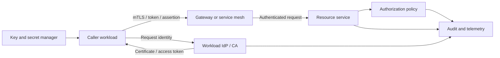
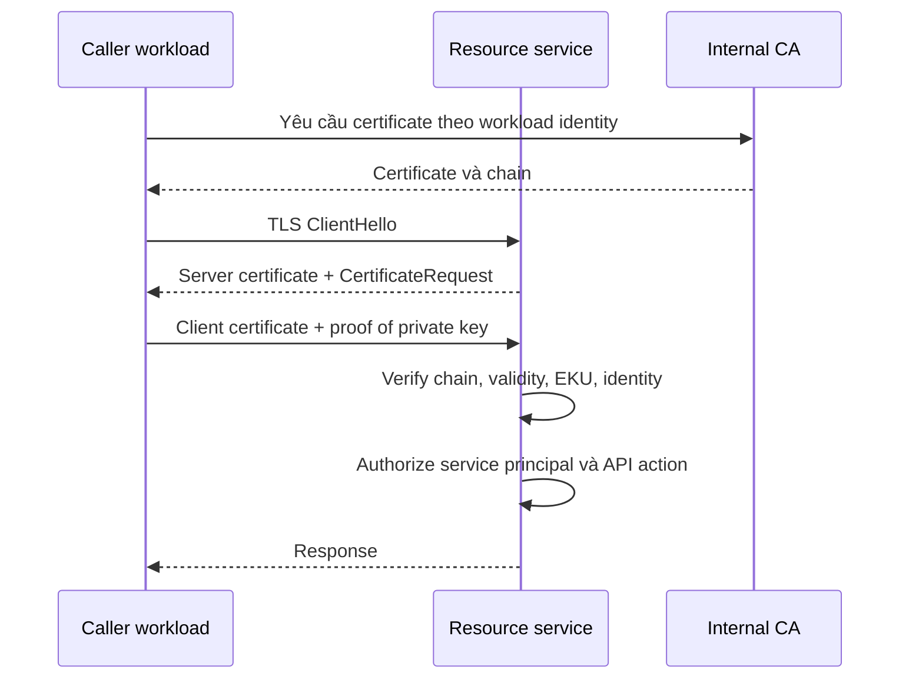
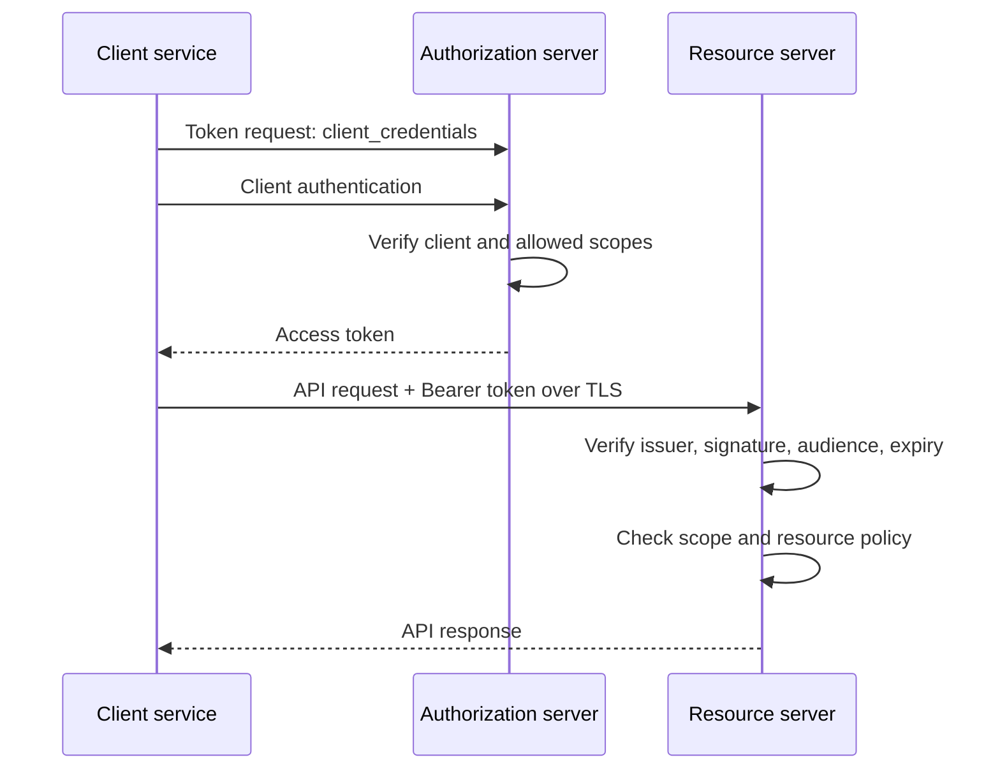

# Service-to-service authentication — Xác thực giữa các dịch vụ

## 1. Service-to-service authentication là gì?

**Service-to-service authentication** là quá trình một workload chứng minh danh tính của nó với workload khác trước khi được phép gọi API hoặc trao đổi dữ liệu. Workload có thể là backend service, microservice, job nền, worker, ứng dụng chạy trong container, function hoặc máy chủ tự động. Không có người dùng trực tiếp nhập mật khẩu trong mỗi request; hệ thống dùng danh tính máy và credential được cấp, quản lý cho workload.

Ví dụ: dịch vụ `order-service` cần gọi `payment-service` để tạo giao dịch. `payment-service` phải xác minh request thực sự đến từ workload `order-service` đã được tổ chức cấp danh tính. Sau đó, policy kiểm tra `order-service` có quyền gọi thao tác `payments:create` trong tenant và môi trường đó hay không. Một request có chữ ký hoặc token hợp lệ chỉ chứng minh danh tính/credential theo cơ chế tương ứng; nó không tự động cấp mọi quyền cho caller.

Trong mô-đun **SECURITY_AUTHENTICATION_FUNDAMENTALS**, xác thực giữa các dịch vụ mở rộng các nguyên lý credential, chứng chỉ, token, ranh giới tin cậy, replay protection và authorization sang môi trường machine-to-machine. Mục tiêu là bảo đảm mỗi workload có danh tính riêng, dùng credential có vòng đời kiểm soát được và chỉ nhận quyền tối thiểu cần thiết.

### Mục tiêu học tập

Sau bài này, người học có thể:

- Phân biệt workload identity, authentication và authorization.
- Chọn giữa mTLS, OAuth 2.0 Client Credentials, private-key JWT và workload identity federation.
- Thiết kế cấp phát, lưu trữ, rotate và revoke service credential.
- Xác minh certificate, token issuer, audience, expiry, signature và scope.
- Bảo vệ token khỏi replay, theft, confused deputy và giả mạo identity header.
- Thiết kế trust boundary giữa workload, gateway, service mesh, IdP và resource server.
- Xây dựng kiểm thử và audit cho luồng gọi service-to-service.

## 2. Vì sao dịch vụ cần danh tính riêng?

Trong một hệ thống phân tán, mỗi service có thể chạy trên nhiều instance, ở nhiều node hoặc cloud account. Một request nội bộ vẫn có thể đến từ:

- Workload hợp lệ đang thực hiện đúng chức năng.
- Workload bị compromise hoặc chạy code không được phép.
- Container/job giả mạo tên service khác.
- Attacker đã lấy token, private key hoặc API key.
- Một proxy/gateway cấu hình sai và chuyển tiếp request từ ranh giới không tin cậy.

Không nên xem request là đáng tin chỉ vì nó đến từ private network, Kubernetes cluster, VPC hoặc địa chỉ IP nội bộ. Network location có thể thay đổi, bị mở rộng nhầm hoặc bị attacker xâm nhập. Mỗi service cần xác minh danh tính caller theo một cơ chế mật mã và kiểm tra quyền theo từng API/action.

### Human identity và workload identity

| Loại danh tính | Chủ thể | Credential thường gặp |
|---|---|---|
| Human identity | Người dùng, quản trị viên | Password, passkey, MFA, certificate |
| Workload identity | Service, job, process, device hoặc application | X.509 certificate, OAuth client assertion, workload token, private key |

Không dùng tài khoản người dùng cá nhân hoặc mật khẩu của nhân viên làm credential cố định cho service. Khi nhân viên rời tổ chức, credential của workload có thể bị mất owner hoặc bị thu hồi nhầm. Workload cần principal, owner, environment và lifecycle riêng.

### Authentication không thay thế authorization

Một luồng gọi service cần trả lời hai câu hỏi:

1. **Authentication:** caller là workload nào, được xác minh bằng credential/issuer nào?
2. **Authorization:** workload đó có được phép gọi resource/action cụ thể với scope, tenant và điều kiện hiện tại không?

Ví dụ, `reporting-service` có thể được xác thực thành công nhưng chỉ được phép đọc dữ liệu báo cáo đã tổng hợp. Nó không được phép gọi endpoint hoàn tiền hoặc đọc dữ liệu thẻ thanh toán. Resource server phải kiểm tra quyền ở mỗi request, kể cả khi mTLS handshake hoặc token validation đã thành công.

## 3. Danh tính workload và ranh giới tin cậy

Một workload identity nên có định danh ổn định và duy nhất trong phạm vi trust domain. Ví dụ:

- `spiffe://corp.example/ns/payments/sa/order-service`
- `urn:service:prod:payments:order-service`
- Một OAuth client ID gắn với service registration.
- Một URI SAN trong X.509 certificate do CA nội bộ cấp.

Tên identity phải được cấp và quản lý bởi control plane đáng tin. Không để caller tự gửi header `X-Service-Name: order-service` rồi resource server coi đó là bằng chứng xác thực.

### Các thành phần trong trust model

- **Workload/caller:** tiến trình cần gọi API và giữ hoặc nhận credential.
- **Identity provider (IdP) / workload identity provider:** xác minh workload và cấp assertion/token/certificate.
- **Credential issuer/CA:** ký certificate hoặc token theo policy.
- **Secret/key manager:** lưu hoặc cung cấp private key, secret và cơ chế rotation.
- **Gateway/service mesh:** có thể thực hiện TLS termination, mTLS hoặc chuyển tiếp identity đã xác minh.
- **Resource server/callee:** xác minh caller và quyết định authorization.
- **Audit/telemetry:** ghi nhận danh tính, resource, action, kết quả và correlation ID.



Mỗi mũi tên là một ranh giới cần xác minh. Gateway chỉ được chuyển tiếp danh tính caller nếu nó đã xác thực caller và resource server chỉ tin metadata từ gateway qua một kênh được bảo vệ. Nếu request có thể đi thẳng tới resource server, resource server phải tự xác minh credential hoặc chặn đường bypass.

### Không tin header identity từ client

Các header như `X-Forwarded-Client-Cert`, `X-Authenticated-Service`, `X-User-Identity` hoặc `X-Principal` có thể bị giả mạo nếu client tự gửi. Nếu gateway dùng header để chuyển identity:

- Gateway phải xóa header cùng tên do client gửi trước khi thêm giá trị đã xác minh.
- Backend chỉ nhận traffic từ gateway qua network policy/mTLS đã định nghĩa.
- Header được bảo vệ trên hop gateway-to-backend.
- Backend xác minh gateway identity và chỉ chấp nhận header từ proxy tin cậy.
- Không cho phép route trực tiếp bỏ qua gateway nếu policy phụ thuộc metadata đó.

## 4. Các mô hình xác thực service-to-service

Không có một cơ chế phù hợp cho mọi hệ thống. Chọn dựa trên môi trường triển khai, khả năng cấp identity, trust boundary, yêu cầu thu hồi, độ nhạy cảm và chi phí vận hành.

| Mô hình | Cách chứng minh | Điểm mạnh | Điểm cần quản lý |
|---|---|---|---|
| API key / shared secret | Caller gửi secret đã cấp | Đơn giản, tương thích hệ thống cũ | Secret tĩnh, dễ copy, scope/rotation/revoke |
| Mutual TLS (mTLS) | Hai phía xác minh certificate trong TLS handshake | Xác thực hai chiều, bảo vệ kênh, có thể ràng buộc token với certificate | CA, private key, certificate rotation và TLS termination |
| OAuth 2.0 Client Credentials | Client xác thực với authorization server để nhận access token | Scope/audience, TTL, tập trung cấp và revoke token | Bảo vệ client credential và validation ở resource server |
| Private-key JWT client authentication | Client ký JWT assertion bằng private key | Không phải chia sẻ client secret với token endpoint | Key lifecycle, assertion audience/expiry/jti và chống replay |
| Workload identity federation | Trao đổi identity assertion từ môi trường tin cậy lấy token/certificate | Giảm long-lived secret trong workload | Trust policy, issuer/audience/subject binding |
| SPIFFE/SPIRE identity | Workload nhận SVID từ workload identity control plane | Danh tính workload chuẩn hóa, credential ngắn hạn | Trust domain, attestation và vận hành control plane |

### Chọn mô hình theo môi trường

- Trong một service mesh có CA và control plane được quản lý tốt, mTLS với certificate ngắn hạn là lựa chọn phổ biến.
- Khi cần scope, audience và policy tập trung cho nhiều API, OAuth 2.0 Client Credentials có thể phù hợp.
- Khi workload chạy trên cloud/container platform có identity federation, ưu tiên lấy credential ngắn hạn qua federation thay vì nhúng secret dài hạn.
- Với hệ thống cũ chỉ hỗ trợ API key, giới hạn scope, owner, TTL, rate và quy trình rotate; lập kế hoạch chuyển sang cơ chế có identity rõ hơn.
- Có thể kết hợp mTLS và OAuth access token: mTLS bảo vệ kênh/nhận diện client, token thể hiện scope và quyền truy cập API.

## 5. Mutual TLS (mTLS)

TLS thông thường xác thực server với client. Với **mutual TLS**, client và server đều trình certificate trong handshake và xác minh certificate của bên kia theo trust store/policy. Điều này giúp server xác minh workload caller bằng certificate và client xác minh server đích.

### Luồng cơ bản

1. Caller kết nối tới endpoint bằng TLS.
2. Server trình certificate; caller xác minh chain, hostname/SAN, validity và trust.
3. Server yêu cầu client certificate.
4. Caller trình certificate và chứng minh đang sở hữu private key tương ứng bằng chữ ký trong handshake.
5. Server xác minh certificate chain, thời hạn, EKU, trust anchor và identity theo policy.
6. Server ánh xạ identity trong certificate sang service principal và kiểm tra authorization.
7. Request được xử lý trong kênh TLS đã xác thực.



### Xác minh certificate

Resource server hoặc TLS terminator cần kiểm tra:

- Certificate chain dẫn tới trust anchor được cấu hình.
- Thời hạn `notBefore`/`notAfter`.
- Extended Key Usage có mục đích client authentication phù hợp.
- Key usage và thuật toán/chìa khóa được policy cho phép.
- Subject Alternative Name (SAN) chứa service identity mong đợi.
- Certificate chưa bị thu hồi theo policy CRL/OCSP hoặc cơ chế trạng thái nội bộ.
- Issuer và trust domain đúng môi trường; không dùng certificate dev ở production.

Không nên chỉ so khớp Common Name (CN) hoặc tin bất kỳ certificate nào được ký bởi một CA rộng. Hãy xác định identity bằng SAN theo profile đã chọn, ví dụ URI SAN cho SPIFFE ID, và ánh xạ chính xác tới principal được cấp quyền.

### Private key và certificate lifecycle

Private key nên được tạo và giữ trong secret manager, HSM, TPM hoặc workload keystore phù hợp. Khi có thể, tạo key trong môi trường workload để private key không phải di chuyển qua pipeline. Certificate nên có thời hạn ngắn vừa đủ để giảm cửa sổ rủi ro, nhưng phải có tự động gia hạn và giám sát hết hạn.

Khi rotate:

1. Cấp certificate mới cho cùng workload identity theo policy.
2. Cho phép overlap có giới hạn để instance chuyển sang certificate mới.
3. Xác minh handshake và authorization hoạt động bằng certificate mới.
4. Ngừng cấp hoặc thu hồi certificate cũ.
5. Xác minh mọi instance đã chuyển và không còn dùng certificate cũ.

Nếu private key bị lộ, thu hồi certificate và điều tra mọi kết nối đã dùng nó. Thay certificate mà không xử lý session/token đã được tạo có thể để attacker tiếp tục truy cập.

### TLS termination

Nếu load balancer/service mesh terminate mTLS, backend không trực tiếp nhìn thấy client certificate ở tầng TLS. Gateway phải xác minh certificate và truyền identity qua một kênh nội bộ được bảo vệ. Backend cần xác thực gateway, chỉ tin header do gateway tạo và chặn request trực tiếp từ nguồn không tin cậy.

## 6. OAuth 2.0 Client Credentials

OAuth 2.0 Client Credentials Grant (RFC 6749, Section 4.4) dành cho confidential client truy cập tài nguyên dưới danh nghĩa chính client. Không có user resource owner tham gia trong grant này. Access token đại diện cho client/workload và quyền được cấp cho client theo policy của authorization server.

### Luồng cơ bản

1. Service caller đã được đăng ký với authorization server.
2. Caller xác thực client bằng phương thức được cấu hình.
3. Caller gửi grant type `client_credentials` và scope/resource cần thiết.
4. Authorization server xác minh client, policy, tenant và quyền được cấp.
5. Server phát access token có thời hạn và audience phù hợp.
6. Caller gửi token tới resource server qua TLS.
7. Resource server xác minh token và kiểm tra quyền cho API/action.



Ví dụ request dạng form:

```http
POST /oauth2/token HTTP/1.1
Host: identity.example.internal
Content-Type: application/x-www-form-urlencoded
Authorization: Basic <client-authentication>

grant_type=client_credentials&scope=payments.create
```

Đây là request minh họa. Không ghi client secret hoặc assertion vào log, trace hay tài liệu triển khai. Client secret nên được gửi bằng phương thức xác thực client đã cấu hình; không tự tạo cơ chế gửi secret trong body nếu server hỗ trợ một phương thức chuẩn phù hợp hơn.

### Client authentication methods

- **Client secret:** shared secret được cấp cho confidential client. Dễ triển khai nhưng phải lưu và rotate an toàn; tránh dùng chung secret giữa môi trường hoặc nhiều service.
- **`private_key_jwt` (RFC 7523):** client ký JWT assertion bằng private key. Authorization server xác minh chữ ký theo public key đã đăng ký. Assertion phải có issuer/subject client phù hợp, audience là token endpoint, thời hạn ngắn và `jti` để hỗ trợ chống replay.
- **Mutual-TLS client authentication (RFC 8705):** client chứng minh danh tính bằng certificate trong TLS handshake. Có thể kết hợp certificate-bound access token để token chỉ dùng được khi client có private key tương ứng.

Client secret gửi qua HTTP Basic không biến nó thành credential an toàn nếu transport không dùng TLS. Luôn dùng TLS và bảo vệ log/proxy/telemetry ở token endpoint.

### Access token phải giới hạn đúng tài nguyên

Token cần thể hiện quyền và đích đến cụ thể:

- `iss`: issuer được tin cậy.
- `aud`: resource server/API đích.
- `exp`, `nbf`, `iat`: thời hạn và thời điểm.
- `scope` hoặc claim quyền tương đương: action được cấp.
- `client_id`/subject theo profile: workload/client được đại diện.
- `jti` hoặc `sid` nếu kiến trúc cần định danh token/session.

Không phát một token có audience rộng cho mọi API nếu có thể cấp token riêng theo resource. Scope cần theo nguyên tắc least privilege và không được resource server diễn giải rộng hơn policy.

### Refresh token trong Client Credentials

Client Credentials thường dùng access token ngắn hạn và lấy token mới bằng cách client xác thực lại. Không mặc định rằng authorization server sẽ cấp refresh token cho grant này. Nếu hệ thống có refresh-token extension riêng, phải xác định rõ rotation, binding, revocation và lifecycle.

## 7. Xác thực client bằng private_key_jwt

`private_key_jwt` cho phép client gửi một JWT assertion được ký bằng private key đã đăng ký với authorization server. Nó là phương thức xác thực client tại token endpoint; nó không tự thay thế access token và không tự cấp quyền API.

Assertion thường có các claim:

| Claim | Mục đích |
|---|---|
| `iss` | Client identifier |
| `sub` | Client identifier theo profile |
| `aud` | Token endpoint hoặc audience được authorization server yêu cầu |
| `exp` | Thời điểm hết hạn ngắn |
| `iat` | Thời điểm phát hành |
| `jti` | ID duy nhất để phát hiện assertion bị phát lại |

Authorization server cần:

- Xác minh chữ ký bằng public key đã đăng ký cho đúng client.
- Chỉ chấp nhận thuật toán đã allowlist; không tin `alg` do attacker tùy ý chọn.
- Kiểm tra `iss`, `sub`, `aud`, `exp` và `iat`.
- Dùng `jti` một lần hoặc cơ chế chống replay tương đương trong cửa sổ hiệu lực.
- Ràng buộc key với client registration và hỗ trợ rotate/revoke key.
- Không ghi assertion nguyên vẹn vào log.

Nếu assertion bị phát lại trong thời hạn còn hiệu lực mà server không lưu `jti`, attacker có thể thử xác thực client bằng assertion đã đánh cắp. TTL ngắn giúp giảm cửa sổ nhưng không thay thế replay detection.

## 8. Workload identity federation

Workload identity federation cho phép workload dùng danh tính đã được một nền tảng tin cậy xác minh để đổi lấy credential cho hệ thống đích, thay vì nhúng một client secret dài hạn vào image hoặc source code.

Ví dụ, job chạy trong CI/CD có thể nhận OIDC token ngắn hạn từ nền tảng pipeline. Cloud identity provider xác minh issuer, audience, subject và các điều kiện của token; nếu trust policy khớp, provider cấp access token hoặc credential ngắn hạn cho workload.

### Luồng trao đổi identity

1. Workload nhận identity assertion từ môi trường thực thi.
2. Workload gửi assertion tới token exchange/STS endpoint qua TLS.
3. Provider xác minh chữ ký, issuer, audience, subject, expiry và trust policy.
4. Provider ánh xạ assertion sang service principal được phép.
5. Provider cấp credential ngắn hạn có scope/resource giới hạn.
6. Workload dùng credential đó để gọi resource server.
7. Credential hết hạn; workload lấy credential mới khi vẫn đáp ứng trust policy.

### Điều kiện trust policy

- Issuer phải là nguồn identity đã được đăng ký và tin cậy.
- Audience phải khớp mục đích token exchange.
- Subject/repository/namespace/service account phải khớp chính xác.
- Chỉ cho phép branch, environment, cluster hoặc workload cần thiết.
- Token nguồn phải còn hạn và chữ ký phải hợp lệ.
- Không cho một CI job không tin cậy lấy identity của production workload.

Đừng chỉ kiểm tra issuer chung rồi chấp nhận mọi subject do issuer phát hành. Trust policy quá rộng có thể cho phép workload ở repository/namespace khác mạo danh production service.

### Federation giảm secret dài hạn, nhưng không loại bỏ rủi ro

Nếu attacker chiếm được workload runtime, họ có thể lấy assertion/token ngắn hạn khi workload đang chạy. Vì vậy vẫn cần sandboxing, least privilege, giới hạn audience, TTL ngắn, audit và khả năng revoke/disable trust binding.

## 9. SPIFFE và workload identity

SPIFFE định nghĩa cách biểu diễn identity cho workload và các loại SVID (SPIFFE Verifiable Identity Document). Hai dạng thường gặp:

- **X.509-SVID:** certificate X.509 có SPIFFE ID trong URI SAN, thường được dùng với mTLS.
- **JWT-SVID:** JWT mang SPIFFE ID, dùng trong các trường hợp cần token identity; phải giới hạn audience và thời hạn.

SPIRE là một implementation/control plane có thể xác minh workload attestation và cấp SVID theo registration entry. Workload chứng minh thuộc tính môi trường/identity với SPIRE agent; agent lấy SVID từ server theo trust policy.

### SPIFFE ID và trust domain

Ví dụ:

```text
spiffe://corp.example/ns/finance/sa/invoice-worker
```

URI này mô tả trust domain và đường dẫn identity. Resource server phải so khớp SPIFFE ID theo policy đã đăng ký, không chỉ kiểm tra certificate được ký bởi bất kỳ CA nào. Không dùng cùng trust domain cho môi trường production và development nếu policy cần tách biệt.

### X.509-SVID và JWT-SVID

| Tiêu chí | X.509-SVID | JWT-SVID |
|---|---|---|
| Proof | Private key trong TLS handshake hoặc chữ ký | JWT signature |
| Binding | Kênh TLS/mTLS | Audience trong token |
| Dùng phổ biến | Service-to-service mTLS | Trường hợp cần identity assertion dạng token |
| Rủi ro chính | Private key/certificate bị lộ, trust bundle sai | Token bị replay hoặc audience quá rộng |

JWT-SVID dạng bearer có thể bị replay nếu bị lấy cắp; dùng audience ngắn gọn, TTL ngắn và bảo vệ transport. Không coi một SPIFFE ID trong payload là danh tính hợp lệ nếu chưa xác minh chữ ký và trust domain.

## 10. Kết hợp mTLS và OAuth access token

Hai cơ chế có thể bổ sung cho nhau:

- mTLS xác minh client certificate ở tầng kết nối và mã hóa kênh.
- OAuth access token mang scope/audience và quyền được authorization server cấp.
- Certificate-bound access token có thể ràng buộc token với certificate client, giảm khả năng token bị dùng từ một máy khác không có private key tương ứng.

Trong mô hình này, resource server kiểm tra cả TLS client identity và token binding. Chỉ xác minh token bearer mà bỏ qua binding sẽ làm mất lợi ích chống replay của mô hình certificate-bound.

Nếu TLS terminate ở proxy, cần bảo đảm identity certificate được chuyển tiếp có xác thực và không thể bị client giả mạo bằng header. Nếu backend không thể xác minh binding, phải đặt kiểm soát ở trusted proxy và giới hạn đường truy cập.

## 11. Token validation tại resource server

Resource server là nơi quyết định có chấp nhận token cho request hiện tại hay không. Với JWT access token, tối thiểu cần:

1. Chọn issuer/trust configuration từ cấu hình tin cậy, không lấy issuer tùy ý từ token để tải key.
2. Xác minh chữ ký với key thuộc issuer và thuật toán nằm trong allowlist.
3. Kiểm tra `iss` chính xác.
4. Kiểm tra `aud` chứa resource server hiện tại.
5. Kiểm tra `exp`, `nbf` và thời gian theo clock policy có giới hạn.
6. Kiểm tra token type/profile nếu hệ thống áp dụng.
7. Kiểm tra client/workload identity và scope/permission.
8. Kiểm tra trạng thái revoke/session/version nếu policy yêu cầu.
9. Thực hiện authorization theo resource, tenant và action.

Không chấp nhận token chỉ vì decode được Base64URL. JWT payload không được mã hóa mặc định; không đặt secret hoặc dữ liệu nhạy cảm vào claim.

### JWKS và key rotation

Nếu issuer cung cấp JWKS:

- Chỉ lấy JWKS từ endpoint tin cậy đã cấu hình.
- Cache key hợp lý và refresh khi `kid` mới xuất hiện theo cơ chế có giới hạn.
- Không để attacker tạo `kid` tùy ý khiến server tải URL do token chỉ định.
- Hỗ trợ overlap key cũ/mới trong khoảng rotate.
- Khi key bị compromise, có quy trình loại key khỏi trust set và xử lý token đã ký bằng key đó.

### Opaque token và introspection

Với opaque token, resource server hỏi authorization server qua introspection endpoint được xác thực. Cần kiểm tra `active`, audience, scope và metadata trả về. Cache introspection có thể giảm latency nhưng làm tăng cửa sổ chấp nhận token đã revoke; đặt TTL theo risk và SLA.

## 12. Authorization giữa các service

Danh tính workload không nên được ánh xạ trực tiếp thành quyền rộng. Policy cần giới hạn:

- Caller service identity.
- Target service/resource.
- Action hoặc HTTP method/route.
- Scope/permission.
- Tenant hoặc data partition.
- Environment (dev, staging, production).
- Điều kiện bổ sung như mTLS identity, token audience hoặc approval.

Ví dụ policy:

| Caller | Target/action | Quyền |
|---|---|---|
| `order-service` | `payment-service:payments:create` | Cho phép |
| `order-service` | `payment-service:payments:refund` | Từ chối nếu chưa có grant riêng |
| `reporting-service` | `customer-service:reports:read` | Chỉ đọc dữ liệu đã tổng hợp |
| `ci-deploy-prod` | `deployment-api:release:write` | Chỉ trong production deployment window |
| `analytics-job` | `identity-api:users:read` | Từ chối nếu không có scope phù hợp |

Tránh wildcard như `service:*` hoặc `admin` cho mọi workload chỉ vì chúng nằm trong cùng cluster. Tách role theo nhiệm vụ, environment và data sensitivity.

### Confused deputy

Confused deputy xảy ra khi service có quyền rộng bị một caller ít quyền dụ thực hiện hành động thay mặt caller. Ví dụ, `document-service` có quyền đọc mọi tenant; một service caller gửi `tenantId` tùy ý và document service tin giá trị đó. Service phải ràng buộc tenant/subject với identity và authorization context đã xác minh, không dùng input do caller kiểm soát làm nguồn cấp quyền.

## 13. Bảo vệ credential và secret của workload

### Không nhúng secret vào code hoặc image

Tránh:

- Hard-code API key/client secret trong source.
- Đưa secret vào Docker image layer hoặc public build artifact.
- Commit `.env`, kubeconfig, private key hoặc certificate password vào repository.
- Truyền secret qua command line, URL hoặc log.
- Dùng chung một secret giữa nhiều service hoặc environment.

Ưu tiên secret manager, workload identity, HSM/TPM hoặc cơ chế cấp credential runtime. Hạn chế quyền đọc secret theo workload identity; audit truy cập và xoay secret khi có thay đổi owner hoặc compromise.

### Secret delivery

Secret manager cần xác thực workload trước khi cấp secret. Nếu bootstrap identity cũng là một secret tĩnh, phải có kế hoạch bảo vệ, rotate và recovery cho chính bootstrap credential đó. Tránh tạo một secret gốc có quyền đọc mọi secret.

### Least privilege và blast radius

- Mỗi workload có identity riêng.
- Tách production khỏi staging/development.
- Tách key theo service và mục đích.
- Cấp scope/resource tối thiểu.
- Giới hạn network egress và destination.
- Không cho service đọc secret không liên quan.
- Thu hồi credential khi workload bị xóa, đổi owner hoặc không còn sử dụng.

## 14. Rotation, expiry và revocation

Service credential cần lifecycle tự động:

1. Provision identity và credential cho workload đã được xác minh.
2. Lưu private key/secret trong nơi bảo vệ phù hợp.
3. Theo dõi expiry, last-used, owner và consumer.
4. Rotate trước khi hết hạn với overlap có giới hạn.
5. Xác minh credential mới đã được mọi instance sử dụng.
6. Revoke credential cũ và invalidate cache/token liên quan.
7. Reconcile để tìm instance vẫn dùng credential cũ.
8. Khi workload offboard, revoke identity binding và credential, session/token đã cấp.

### Short-lived credential

Credential ngắn hạn giảm thời gian attacker có thể sử dụng sau khi đánh cắp. Tuy nhiên, thời hạn ngắn chỉ hữu ích khi:

- Workload có thể tự động lấy credential mới một cách an toàn.
- Issuer và verifier kiểm tra expiry.
- Clock synchronization đủ chính xác.
- Credential mới không được cấp cho workload đã bị disable.
- Token cũ không được cache quá TTL cho phép.

### Rotation không phải revoke

Phát hành key mới chưa làm key cũ mất hiệu lực. Trong giai đoạn overlap, cả hai key có thể cùng hoạt động. Cần theo dõi migration và revoke key cũ ở thời điểm rõ ràng. Khi compromise, ưu tiên containment và revoke khẩn cấp thay vì overlap dài.

## 15. Các kiểu tấn công và biện pháp phòng thủ

| Tấn công | Mục tiêu | Biện pháp |
|---|---|---|
| Credential theft | Lấy API key, secret hoặc private key | Secret manager, short TTL, HSM/TPM, audit, rotate/revoke |
| Service impersonation | Giả danh workload khác | mTLS, workload identity, xác minh issuer/subject/SAN |
| Bearer token replay | Dùng lại access token bị lấy cắp | TLS, audience hẹp, TTL ngắn, sender-constrained token |
| Assertion replay | Phát lại `private_key_jwt` | `jti` one-time, `aud`, `exp` ngắn, replay cache |
| Confused deputy | Dụ service quyền rộng gọi thay | Authorization theo caller/resource/action/tenant |
| SSRF to metadata service | Lấy workload/cloud credential từ metadata endpoint | Egress controls, metadata protection, identity binding, không để user URL điều khiển fetch tùy ý |
| Header spoofing | Giả mạo identity qua proxy header | Strip inbound headers, trusted proxy, mTLS hop-to-hop |
| Token audience confusion | Dùng token cho API khác | Kiểm tra `aud` chính xác và resource-specific token |
| Algorithm/key confusion | Lừa verifier chọn key/algorithm sai | Algorithm allowlist, issuer-bound JWKS, key type validation |
| Long-lived secret persistence | Duy trì truy cập sau incident | Credential inventory, rotation, revoke, offboarding |
| Service mesh bypass | Gọi trực tiếp backend bỏ qua mTLS/gateway | Network policy, backend authn/authz độc lập |
| Over-privileged workload | Tận dụng service identity có quyền rộng | Least privilege, environment isolation, policy review |

### Replay và proof-of-possession

Bearer token có thể được bất kỳ ai sở hữu token sử dụng trong phạm vi hiệu lực. TLS bảo vệ token khi truyền nhưng không ngăn replay sau khi token bị lấy từ memory, log hoặc endpoint bị compromise. Có thể giảm rủi ro bằng:

- Access token TTL ngắn.
- Audience chỉ cho đúng resource server.
- mTLS-bound access token hoặc DPoP khi profile/client hỗ trợ.
- Refresh token rotation và reuse detection nếu dùng refresh token.
- `jti`/nonce one-time cho assertion hoặc signed request.
- Idempotency key và chống replay ở tầng nghiệp vụ cho thao tác tạo giao dịch.

DPoP là cơ chế proof-of-possession ở tầng ứng dụng; nó không thay thế TLS. mTLS-bound token ràng buộc token với certificate client theo profile RFC 8705.

## 16. Ví dụ Java: kiểm tra workload identity từ URI SAN

Ví dụ dưới đây minh họa bước ánh xạ URI SAN trong certificate sang service principal. Nó chỉ nên chạy **sau khi TLS stack đã xác minh chain, validity, key usage/EKU và trust policy**. Hàm này không thay thế certificate path validation, CRL/OCSP hoặc authorization.

```java
import java.security.cert.CertificateParsingException;
import java.security.cert.X509Certificate;
import java.util.Collection;
import java.util.List;

final class WorkloadCertificateIdentity {

    static String requireExpectedSpiffeId(
            X509Certificate clientCertificate,
            String expectedSpiffeId) {
        if (clientCertificate == null
                || expectedSpiffeId == null
                || expectedSpiffeId.isBlank()) {
            throw new SecurityException("client certificate or expected SPIFFE ID is missing");
        }

        try {
            Collection<List<?>> names =
                    clientCertificate.getSubjectAlternativeNames();
            if (names == null) {
                throw new SecurityException("certificate has no SAN");
            }

            for (List<?> entry : names) {
                if (entry.size() < 2 || !(entry.get(0) instanceof Integer type)) {
                    continue;
                }

                // GeneralName uniformResourceIdentifier has type 6.
                if (type == 6 && entry.get(1) instanceof String uri
                        && uri.equals(expectedSpiffeId)) {
                    return uri;
                }
            }
        } catch (CertificateParsingException ex) {
            throw new SecurityException("cannot parse certificate SAN", ex);
        }

        throw new SecurityException("expected workload identity was not found");
    }
}
```

Lưu ý:

- `expectedSpiffeId` phải là SPIFFE ID đầy đủ lấy từ policy tin cậy. Ví dụ so sánh exact string ở trên cần đi cùng kiểm tra/canonicalization URI khi cấu hình identity; không chấp nhận chỉ một prefix trust domain hoặc chuỗi do caller gửi.
- Certificate phải được TLS stack xác minh chain tới trust bundle được cấu hình. Không gọi hàm trên với certificate do client gửi trong HTTP header chưa được xác thực.
- Cần kiểm tra certificate còn hạn, EKU clientAuth, key usage, thuật toán và trạng thái revoke theo policy.
- Sau khi lấy identity, tiếp tục kiểm tra authorization cho resource/action/tenant.

## 17. Ví dụ Java: policy authorization cho service principal

Đoạn code sau minh họa việc tách identity đã xác minh khỏi quyền được cấp. Identity phải đến từ mTLS verifier hoặc token verifier đáng tin cậy, không lấy trực tiếp từ request body.

```java
import java.util.Set;

record ServicePrincipal(
    String serviceId,
    String environment,
    Set<String> scopes,
    String audience,
    Set<String> tenantIds
) {}

record ServiceRequest(
    String resource,
    String action,
    String tenantId
) {}

final class ServiceAuthorizationPolicy {

    boolean isAllowed(ServicePrincipal principal, ServiceRequest request) {
        if (principal == null || request == null
                || principal.serviceId() == null
                || principal.environment() == null
                || principal.scopes() == null
                || principal.audience() == null
                || principal.tenantIds() == null
                || request.resource() == null
                || request.action() == null
                || request.tenantId() == null) {
            return false;
        }

        if (!"production".equals(principal.environment())) {
            return false;
        }
        if (!"payment-api".equals(principal.audience())) {
            return false;
        }
        if (!principal.tenantIds().contains(request.tenantId())) {
            return false;
        }

        if ("order-service".equals(principal.serviceId())
                && "payments".equals(request.resource())
                && "create".equals(request.action())) {
            return principal.scopes().contains("payments:create");
        }

        return false;
    }
}
```

Ví dụ này cố ý deny-by-default và chỉ cho một tổ hợp caller/resource/action. Production cần bổ sung tenant binding, policy store, audit, policy version, service identity provenance và kiểm tra token/certificate trước khi tạo `ServicePrincipal`.

## 18. Kiểm thử service-to-service authentication

| Ca kiểm thử | Kết quả mong đợi |
|---|---|
| Caller có certificate hợp lệ, SAN đúng và trust chain đúng | TLS xác thực caller thành công |
| Certificate hết hạn hoặc chưa có hiệu lực | Handshake bị từ chối |
| Certificate do CA không tin cậy ký | Handshake bị từ chối |
| SAN thuộc service khác | Identity mapping từ chối |
| Certificate đúng nhưng caller không có scope | Authentication thành công, authorization từ chối |
| Token sai issuer hoặc audience | Resource server từ chối |
| JWT hết hạn hoặc chưa có hiệu lực | Resource server từ chối |
| JWT dùng thuật toán không allowlist | Resource server từ chối |
| `private_key_jwt` assertion có `aud` sai | Token endpoint từ chối |
| Assertion `jti` đã dùng | Token endpoint từ chối replay |
| Workload federation subject ngoài trust policy | Token exchange từ chối |
| Token bearer bị dùng ở resource khác | Audience check từ chối |
| mTLS-bound token dùng với certificate khác | Binding validation từ chối |
| Caller gửi header `X-Authenticated-Service` giả | Gateway strip/ignore; identity lấy từ credential đã xác minh |
| Backend bị gọi trực tiếp bỏ qua gateway | Network/authentication policy từ chối |
| API key cũ sau rotation/revoke | Request bị từ chối |
| Secret manager không truy cập được | Workload không tự hạ xuống credential mặc định |
| Token/JWKS endpoint timeout | Fail-closed hoặc fallback theo policy; không bỏ qua chữ ký |
| Credential rotate trong khi request đang xác minh | Không phát token/quyền từ credential đã revoke |
| Workload ở staging gọi production API | Environment/audience policy từ chối |
| Service bị offboard nhưng instance còn chạy | Identity binding/credential bị revoke; request mới bị từ chối |

### Kiểm thử vận hành

- Đo thời gian cấp, rotate và revoke certificate/token.
- Kiểm tra mọi instance tự gia hạn trước expiry.
- Diễn tập CA/JWKS rotation và key compromise.
- Kiểm tra cache status và propagation tới tất cả resource server.
- Xác nhận log có service identity, target, action, result và correlation ID nhưng không chứa secret.
- Thử truy cập chéo tenant, chéo environment và gọi API bằng scope rộng hơn policy.

## 19. Checklist triển khai

- [ ] Mỗi workload có identity riêng, owner, environment và lifecycle.
- [ ] Không dựa vào private network hoặc header tự khai để xác thực service.
- [ ] Chọn mTLS, OAuth Client Credentials, private_key_jwt hoặc federation theo trust model.
- [ ] Ưu tiên credential ngắn hạn và tự động cấp/rotate.
- [ ] Private key/secret nằm trong secret manager, HSM/TPM hoặc workload keystore phù hợp.
- [ ] mTLS kiểm tra chain, SAN, EKU, validity và trust domain.
- [ ] Token kiểm tra issuer, audience, signature, algorithm, expiry và scope.
- [ ] Assertion có audience, expiry ngắn và replay protection.
- [ ] Authorization kiểm tra caller, resource, action, tenant và environment.
- [ ] Backend không tin identity header từ client hoặc proxy chưa xác thực.
- [ ] Chặn đường bypass gateway/service mesh nếu policy phụ thuộc nó.
- [ ] Có rotation, revoke, expiry monitoring và offboarding workflow.
- [ ] Có cơ chế chống replay/token theft và xử lý session/token đã phát hành.
- [ ] Audit không ghi password, API key, private key, client secret hoặc bearer token.
- [ ] Kiểm thử negative case, trust boundary, cross-tenant và credential compromise.

## 20. Tổng kết

Service-to-service authentication cho phép workload chứng minh danh tính của nó trước khi gọi một dịch vụ khác. Các cơ chế thường dùng gồm mTLS, OAuth 2.0 Client Credentials, private-key JWT, workload identity federation và SPIFFE/SPIRE. Mỗi cơ chế cần một trust anchor rõ, credential có vòng đời quản lý được và quy trình xác minh ở đúng ranh giới.

Authentication chỉ xác nhận caller theo credential/issuer; authorization vẫn phải giới hạn caller theo resource, action, audience, scope, tenant và environment. Thiết kế an toàn ưu tiên workload identity riêng, credential ngắn hạn, private key được bảo vệ, rotation/revocation có propagation, chống replay và kiểm thử đường bypass. Không coi service trong private network là đáng tin mặc định và không dùng một secret chung để đại diện cho nhiều workload.
