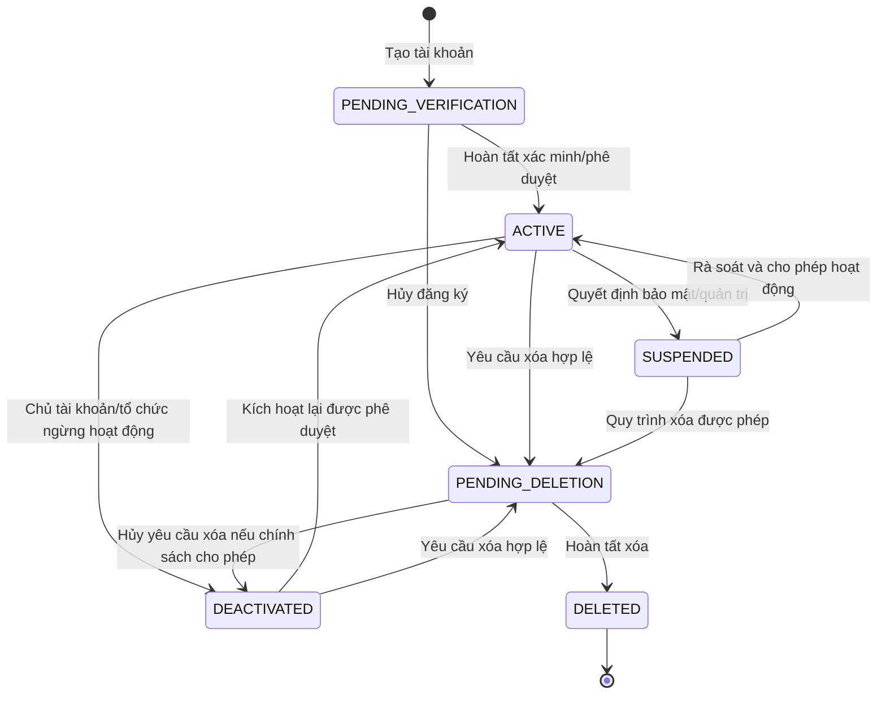
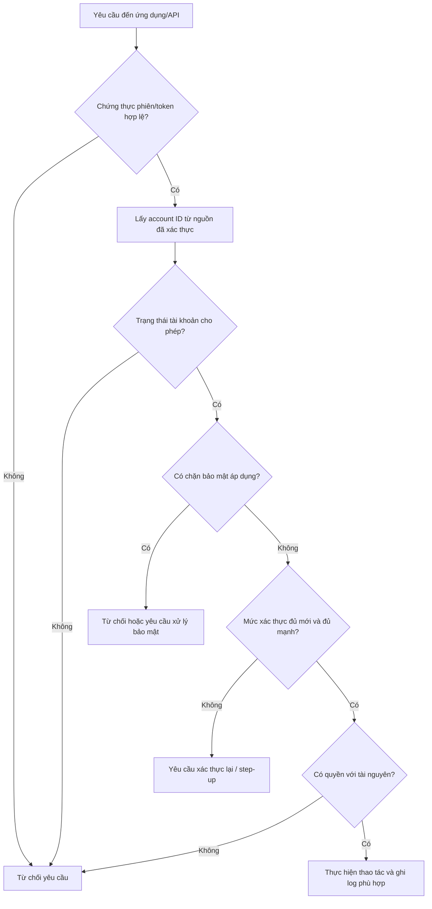

# Account status — Trạng thái tài khoản trong hệ thống xác thực

## Mục tiêu học tập

Một yêu cầu đăng nhập có thể cung cấp đúng mật khẩu hoặc chữ ký passkey nhưng vẫn phải bị từ chối nếu tài khoản đang bị vô hiệu hóa. Tương tự, một tài khoản vừa bị đình chỉ có thể vẫn còn cookie hoặc access token được cấp trước đó. Đó là lý do **trạng thái tài khoản (account status)** phải là một phần của quyết định truy cập được thực thi ở phía máy chủ, xuyên suốt vòng đời của tài khoản.

Sau bài học, bạn có thể:

- Phân biệt trạng thái tài khoản với trạng thái xác minh danh tính, credential, lần đăng nhập, phiên, token và quyền hạn.
- Đề xuất các trạng thái, ý nghĩa và quy tắc chuyển trạng thái phù hợp với sản phẩm.
- Thiết kế hành vi đăng nhập, xác thực lại, cấp token, thu hồi phiên và khôi phục khi trạng thái thay đổi.
- Tách khóa đăng nhập tạm thời do lạm dụng khỏi việc đình chỉ hoặc vô hiệu hóa tài khoản.
- Áp dụng kiểm soát truy cập, giao dịch nguyên tử, ghi nhật ký và kiểm thử để tránh việc tài khoản bị chặn vẫn có thể hoạt động.

Bài thuộc chương **Account** trong mô-đun **SECURITY_AUTHENTICATION_FUNDAMENTALS**. Mô-đun khảo sát credential, mật khẩu, MFA, passkey, chứng chỉ, token, phiên, liên kết danh tính và khôi phục tài khoản. Những cơ chế này đều chịu ảnh hưởng của trạng thái tài khoản, nhưng **không được tự suy diễn trạng thái từ một credential hoặc một token**.

## 1. Trạng thái tài khoản trả lời câu hỏi gì?

**Account status** là thuộc tính vòng đời do hệ thống quản lý, dùng để xác định liệu tài khoản có còn được phép tham gia các luồng nghiệp vụ hay không. Nó thường trả lời các câu hỏi như:

- Tài khoản đã hoàn tất điều kiện kích hoạt chưa?
- Tài khoản có đang được phép đăng nhập và sử dụng tài nguyên không?
- Tài khoản bị đình chỉ theo quyết định của bộ phận bảo mật hoặc quản trị viên chưa?
- Người sở hữu đã chủ động ngừng dùng hoặc yêu cầu xóa tài khoản chưa?
- Tài khoản còn được phép khôi phục, kích hoạt lại hoặc liên kết credential mới không?

Ví dụ, tài khoản của An có email đã xác minh, mật khẩu đúng và passkey hợp lệ. Quản trị viên phát hiện tài khoản bị chiếm đoạt nên chuyển tài khoản sang `SUSPENDED`. Lúc này, xác thực mật khẩu/passkey vẫn có thể chứng minh người gửi biết bí mật hoặc nắm khóa, **nhưng chính sách truy cập phải từ chối sử dụng tài khoản**.

### Phân biệt các lớp trạng thái

| Khái niệm | Câu hỏi được trả lời | Vì sao khác account status? |
| --- | --- | --- |
| **Account status** | Tài khoản đang ở giai đoạn nào, có được phép hoạt động không? | Chính sách vòng đời áp dụng cho tài khoản |
| **Identity verification** | Email, số điện thoại hoặc danh tính bên ngoài đã được xác minh đến đâu? | Một tài khoản `ACTIVE` có thể không cần định danh pháp lý; email xác minh không tự kích hoạt mọi quyền |
| **Credential/authenticator status** | Mật khẩu, passkey, chứng chỉ hoặc MFA đã đăng ký, bị thu hồi hay hết hạn? | Một credential hỏng không nhất thiết làm toàn bộ tài khoản bị đình chỉ |
| **Authentication result** | Lần xác thực hiện tại có thành công và mạnh đến đâu? | Xác thực thành công không đảm bảo tài khoản được phép hoạt động |
| **Session/token status** | Phiên/token có hợp lệ, còn hạn, đúng chủ thể và chưa bị thu hồi không? | Token được cấp trước khi tài khoản bị khóa có thể vẫn còn hạn |
| **Authorization** | Chủ thể có quyền thực hiện hành động trên tài nguyên cụ thể không? | `ACTIVE` không mặc nhiên có quyền quản trị hoặc truy cập tài nguyên của người khác |
| **Risk/abuse signals** | Yêu cầu có dấu hiệu bất thường hoặc tấn công không? | Tín hiệu có thể dẫn đến kiểm soát tạm thời mà không cần thay đổi vòng đời tài khoản |

Có thể hình dung một quyết định cho phép truy cập gồm nhiều điều kiện:

```text
Cho phép =
    bằng chứng xác thực/phiên hợp lệ
    AND trạng thái tài khoản cho phép
    AND không có chặn bảo mật áp dụng
    AND mức xác thực đủ cho hành động
    AND quyền truy cập tài nguyên hợp lệ
```

Đây là **quy tắc tư duy**: mỗi điều kiện phải được đánh giá bằng dữ liệu đáng tin cậy ở máy chủ hoặc từ nhà cung cấp danh tính đã được hệ thống xác minh. Trình duyệt không được tự gửi `accountStatus=ACTIVE` để vượt qua chính sách.

## 2. Xây dựng tập trạng thái có ý nghĩa

Không có một danh sách trạng thái bắt buộc cho mọi sản phẩm. Cần đặt tên rõ, định nghĩa nhất quán và chỉ sử dụng những trạng thái làm thay đổi hành vi hệ thống. Mô hình dưới đây là **ví dụ**, dùng cho ứng dụng có đăng ký tự phục vụ và khả năng quản trị tài khoản.

| Trạng thái | Ý nghĩa | Hành vi chính |
| --- | --- | --- |
| `PENDING_VERIFICATION` | Tài khoản được tạo nhưng chưa hoàn tất điều kiện kích hoạt, chẳng hạn xác nhận email hoặc phê duyệt bắt buộc | Chỉ cho phép các bước hoàn tất đăng ký đã quy định; chưa cho truy cập tài nguyên được bảo vệ |
| `ACTIVE` | Tài khoản đã đáp ứng điều kiện vòng đời để hoạt động | Có thể đăng nhập và truy cập **nếu** đáp ứng các kiểm tra xác thực, phiên và phân quyền |
| `SUSPENDED` | Bị đình chỉ theo quyết định bảo mật, kiểm soát gian lận hoặc quản trị | Chặn đăng nhập và sử dụng tài nguyên; chỉ người/luồng có thẩm quyền mới được gỡ |
| `DEACTIVATED` | Đã ngừng hoạt động theo yêu cầu hợp lệ của chủ tài khoản hoặc quy trình tổ chức | Không cho sử dụng; kích hoạt lại cần quy trình xác minh và chính sách riêng |
| `PENDING_DELETION` | Đã bắt đầu quy trình xóa, có thể đang trong thời gian chờ được phép hủy theo chính sách | Chặn hoạt động thông thường, xử lý dữ liệu/phiên theo chính sách xóa |
| `DELETED` | Tài khoản đã hoàn tất xóa về mặt vòng đời | Không đăng nhập, không khôi phục qua đăng nhập thường; việc giữ tombstone tối thiểu tùy pháp luật và thiết kế |

**Cảnh báo về tên gọi:** Một sản phẩm có thể gọi `DISABLED` là `DEACTIVATED` hoặc gọi `BLOCKED` là `SUSPENDED`. Điều quan trọng là định nghĩa nguyên nhân, phạm vi, quyền thay đổi và quy tắc phục hồi. Nếu hai trạng thái có chính sách giống hệt nhau, hãy cân nhắc liệu có cần tách chúng hay không.

### Không trộn mọi điều kiện vào một enum

Một hệ thống thực tế thường cần **nhiều chiều trạng thái độc lập**:

| Thuộc tính | Ví dụ | Mục đích |
| --- | --- | --- |
| `accountStatus` | `ACTIVE`, `SUSPENDED`, `PENDING_DELETION` | Vòng đời tài khoản |
| `emailVerified` | `true/false` | Đã xác minh quyền kiểm soát email |
| `loginLockUntil` | Thời điểm hết khóa đăng nhập tạm | Giảm thử mật khẩu hoặc OTP hàng loạt |
| `securityHold` | Chờ rà soát nguy cơ chiếm đoạt | Chặn hoặc hạn chế hành động theo chính sách |
| `credentialStatus` | Hoạt động, mất, bị thu hồi | Trạng thái của **từng** authenticator |
| `sessionRevocationVersion` hoặc `authEpoch` | Số tăng dần khi thu hồi quyền phiên | Vô hiệu hóa phiên/token cũ |
| `riskTier` | Mức rủi ro được máy chủ tính toán | Quyết định yêu cầu step-up, cảnh báo hoặc từ chối |

Ví dụ, người dùng đang `ACTIVE` nhưng nhập sai mật khẩu liên tục. Hệ thống có thể áp dụng `loginLockUntil` cùng rate limit, giữ nguyên `accountStatus=ACTIVE`. Nếu quản trị viên đồng thời đình chỉ tài khoản, việc hết thời gian khóa đăng nhập **không được tự động đổi `SUSPENDED` thành `ACTIVE`**.

Trạng thái tài khoản nên phản ánh quyết định có ý nghĩa và có chủ sở hữu rõ; việc áp dụng khóa tạm, CAPTCHA hoặc tăng độ khó thử đăng nhập là những cơ chế riêng.

## 3. Thiết kế chuyển trạng thái như một máy trạng thái

Mỗi chuyển trạng thái phải được định nghĩa bằng **trạng thái nguồn, sự kiện kích hoạt, điều kiện kiểm tra, người/cơ chế có thẩm quyền và tác dụng phụ**. Không cho client gửi trực tiếp một giá trị mới rồi ghi vào cơ sở dữ liệu.

Sơ đồ minh họa một số đường hợp lệ:



Sơ đồ thể hiện chính sách ví dụ, **không phải** các đường chuyển trạng thái bắt buộc. Việc cho phép hủy xóa, kích hoạt lại hoặc xóa tài khoản bị đình chỉ tùy sản phẩm, quy định lưu giữ dữ liệu và quyết định của người có thẩm quyền.

### Đặc tả các chuyển trạng thái quan trọng

| Chuyển trạng thái | Ai/cái gì có quyền thực hiện? | Kiểm tra và tác dụng phụ điển hình |
| --- | --- | --- |
| `PENDING_VERIFICATION → ACTIVE` | Luồng xác minh tin cậy, hệ thống phê duyệt | Kiểm tra challenge còn hạn, dùng một lần, gắn đúng tài khoản; hoàn tất các điều kiện bắt buộc |
| `ACTIVE → SUSPENDED` | Cơ chế bảo mật hoặc người quản trị được phân quyền | Lưu lý do, tăng phiên bản thu hồi, thu hồi phiên/refresh token, cảnh báo phù hợp |
| `SUSPENDED → ACTIVE` | Người/luồng có thẩm quyền gỡ đình chỉ | Kiểm tra nguyên nhân đã được xử lý; cân nhắc đặt lại credential/MFA và yêu cầu đăng nhập mới |
| `ACTIVE → DEACTIVATED` | Chủ tài khoản đã xác thực phù hợp, hoặc tổ chức có quyền | Xác thực lại với thao tác nhạy cảm, thu hồi phiên, vô hiệu hóa truy cập |
| `DEACTIVATED → ACTIVE` | Quy trình kích hoạt lại đã kiểm chứng | Đánh giá danh tính, credential và quyền tổ chức; không khôi phục mù quáng token cũ |
| `ACTIVE/DEACTIVATED → PENDING_DELETION` | Chủ tài khoản hoặc quy trình được ủy quyền | Xác minh thẩm quyền, chặn truy cập thường, tạo yêu cầu xóa có thể kiểm toán |
| `PENDING_DELETION → DELETED` | Tác vụ xóa đáng tin cậy theo chính sách | Xóa/ẩn danh dữ liệu theo phạm vi và thời hạn áp dụng; thu hồi mọi đường truy cập còn lại |

### Những bất biến nên duy trì

1. **Mặc định từ chối:** Trạng thái không nhận diện được, giá trị `null` bất ngờ hoặc bản ghi không tồn tại không được hiểu là `ACTIVE`.
2. **Đình chỉ có ưu tiên:** Đăng nhập, khôi phục mật khẩu, xác minh email hoặc hết hạn khóa tạm không được tự gỡ đình chỉ.
3. **Xác minh đúng chủ thể:** Sự kiện xác minh, liên kết credential và hủy xóa phải gắn với chính tài khoản đích, không với ID do client tự chọn.
4. **Thu hồi hiệu lực:** Khi chuyển sang trạng thái chặn, access token/phiên đã phát hành không được tiếp tục vượt qua kiểm tra chỉ vì chưa đến hạn hết hạn.
5. **Không tái sử dụng ngầm:** Một tài khoản `DELETED` không được âm thầm chuyển về `ACTIVE` bởi email xác minh muộn hoặc một callback từ IdP.
6. **Có nhật ký:** Ghi nhận chủ thể ra quyết định, nguyên nhân, trạng thái trước/sau, thời điểm và ID sự kiện một cách có kiểm soát.

## 4. Từ trạng thái đến quyết định đăng nhập và truy cập

Trạng thái tài khoản cần được kiểm tra **ít nhất tại các ranh giới nơi hệ thống cấp hoặc tiếp tục quyền truy cập**:

- Trước khi cấp phiên/token sau khi credential đã được xác minh.
- Tại điểm kiểm soát truy cập của API/tài nguyên đã đăng nhập, theo yêu cầu về tính tức thời của thu hồi.
- Trước khi thực hiện hành động nhạy cảm: đổi email, thêm/xóa passkey, cập nhật MFA, cấp quyền, chuyển tiền, xuất dữ liệu.
- Khi refresh token được dùng để lấy access token mới.
- Sau các sự kiện thay đổi trạng thái, thay credential, khóa bảo mật hoặc kết thúc khôi phục.

### Cần kiểm tra cả phiên cũ

Giả sử một dịch vụ cấp JWT còn hạn 30 phút. Phút thứ năm tài khoản chuyển sang `SUSPENDED`. Nếu API chỉ xác minh chữ ký và `exp` của JWT, kẻ đang giữ token có thể tiếp tục gửi yêu cầu đến phút thứ ba mươi. **Đổi trạng thái trong cơ sở dữ liệu không tự vô hiệu hóa JWT stateless đã cấp.**

Một số cách kiểm soát gồm:

- Kiểm tra trạng thái tài khoản và phiên ở server-side mỗi lần truy cập, hoặc tại gateway/authorization service có cơ chế đồng bộ đáng tin cậy.
- Gắn `authEpoch`/phiên bản thu hồi với session hay token; từ chối nếu phiên bản được xác minh cũ hơn bản hiện hành.
- Thu hồi refresh token, chặn cấp access token mới, và thu hồi server-side session ngay khi trạng thái thay đổi.
- Giảm thời gian sống access token để **giới hạn** cửa sổ rủi ro nếu chưa thể kiểm tra thu hồi tức thời; thời gian sống ngắn **không thay thế** yêu cầu thu hồi ngay của nghiệp vụ nhạy cảm.

Nếu dùng cache trạng thái, phải xác định giới hạn độ trễ đồng bộ, xử lý mất kết nối và mức độ chấp nhận token cũ. Với thao tác quan trọng, dữ liệu trạng thái không xác minh được thường phải được xử lý theo nguyên tắc **fail closed**. Đồng thời cần cân bằng tính sẵn sàng bằng kiến trúc nguồn trạng thái đủ tin cậy, không tùy tiện bỏ qua kiểm tra bảo mật.

### Thứ tự kiểm tra hợp lý



Quy tắc thiết kế: **một xác thực đúng là điều kiện cần, không phải quyết định truy cập cuối cùng**. Những ranh giới như client ↔ backend, backend ↔ IdP và gateway ↔ dịch vụ nghiệp vụ phải thống nhất ý nghĩa của tài khoản bị đình chỉ.

### Ví dụ mã Java: chính sách phía máy chủ

Ví dụ bên dưới minh họa một lớp kiểm tra vòng đời tài khoản. `VerifiedSession` phải được tạo **sau khi** middleware xác minh chữ ký/token, nguồn phát hành, người nhận, thời hạn và trạng thái phiên. `AccountSnapshot` phải được đọc từ kho dữ liệu đáng tin cậy. Đối tượng này không được lấy trực tiếp từ body của request.

```java
import java.time.Instant;
import java.util.UUID;

enum AccountStatus {
    PENDING_VERIFICATION,
    ACTIVE,
    SUSPENDED,
    DEACTIVATED,
    PENDING_DELETION,
    DELETED
}

enum AccessDecision {
    ALLOW,
    DENY,
    REAUTHENTICATE
}

record AccountSnapshot(
        UUID id,
        AccountStatus status,
        long authEpoch,
        boolean securityHold) {}

record VerifiedSession(
        UUID accountId,
        long issuedAtAuthEpoch,
        boolean active,
        Instant strongAuthAt) {}

class AccountAccessPolicy {
    static AccessDecision evaluate(
            AccountSnapshot account,
            VerifiedSession session,
            Instant now,
            boolean sensitiveAction,
            boolean authorizedForResource) {

        if (account == null || session == null || !session.active()) {
            return AccessDecision.DENY;
        }

        if (!account.id().equals(session.accountId())
                || account.status() != AccountStatus.ACTIVE
                || account.securityHold()) {
            return AccessDecision.DENY;
        }

        // authEpoch thay đổi khi thu hồi tất cả phiên của tài khoản.
        if (account.authEpoch() != session.issuedAtAuthEpoch()) {
            return AccessDecision.DENY;
        }

        if (!authorizedForResource) {
            return AccessDecision.DENY;
        }

        // Chỉ là ngưỡng minh họa của ứng dụng, không phải chuẩn AAL.
        if (sensitiveAction
                && (session.strongAuthAt() == null
                    || session.strongAuthAt().isAfter(now)
                    || session.strongAuthAt().isBefore(
                            now.minusSeconds(600)))) {
            return AccessDecision.REAUTHENTICATE;
        }

        return AccessDecision.ALLOW;
    }
}
```

Một số giới hạn quan trọng của mẫu này:

- `strongAuthAt` chỉ được gán sau một lần xác thực đủ mạnh **theo chính sách của hành động** (ví dụ xác thực chống phishing cho thay đổi credential quan trọng). Thời gian gần không tự chứng minh phương thức mạnh.
- `authorizedForResource` phải được kiểm tra phía máy chủ với **tài nguyên cụ thể**; tài khoản `ACTIVE` không có nghĩa là đã được ủy quyền.
- `loginLockUntil` thường chặn **lần đăng nhập mới**, không mặc nhiên làm chết mọi phiên đang hoạt động. Nếu có nghi ngờ chiếm đoạt, `securityHold` và `authEpoch` có thể chặn phiên hiện hữu theo quyết định bảo mật.
- Giá trị “10 phút” trong ví dụ chỉ là lựa chọn minh họa. Quy tắc sản phẩm có thể khác theo mức rủi ro và yêu cầu tuân thủ.
- Mẫu giả định trạng thái tài khoản được lấy đủ mới. Một cache cũ hoặc sự kiện thu hồi truyền chậm cần có cơ chế xử lý riêng.

## 5. Khóa đăng nhập, hạn chế rủi ro và đình chỉ không giống nhau

Các hệ thống xác thực phải chống credential stuffing, đoán mật khẩu, thử OTP hàng loạt và MFA fatigue. Tuy nhiên, **khóa tài khoản vĩnh viễn sau một số lần nhập sai cố định** có thể bị kẻ tấn công lợi dụng để gây từ chối dịch vụ cho người dùng hợp pháp.

Nên xem xét nhiều biện pháp phối hợp:

| Trường hợp | Cơ chế thích hợp | Lưu ý |
| --- | --- | --- |
| Nhiều lần nhập sai trên một tài khoản | Giới hạn tốc độ, tăng thời gian chờ, khóa đăng nhập tạm thời có thời hạn | Không tự biến thành quyết định `SUSPENDED` lâu dài |
| Một nguồn thử nhiều tài khoản | Rate limit theo nguồn, tài khoản, mạng/thiết bị và phân tích tín hiệu | Không chỉ dựa vào IP vì IP có thể chia sẻ hoặc thay đổi |
| MFA push bị gửi lặp lại | Giới hạn số yêu cầu, number matching/ngữ cảnh giao dịch khi phù hợp, phát hiện lạm dụng | Tránh để người dùng mệt mỏi rồi bấm chấp thuận |
| Đăng nhập ở ngữ cảnh bất thường | Bước xác minh bổ sung, tạm chặn thao tác, cảnh báo | Rủi ro là tín hiệu; không tự coi vị trí/IP là yếu tố xác thực |
| Có bằng chứng credential/phiên bị chiếm đoạt | `securityHold`, thu hồi phiên và điều tra; có thể `SUSPENDED` | Yêu cầu gỡ chặn được kiểm soát và có nhật ký |

Giả sử có 100 lần nhập sai cho tài khoản A. Hệ thống đặt `loginLockUntil = 10:30`. Đến 10:30, khóa thử đăng nhập có thể hết hiệu lực; **không có sự kiện nào mặc nhiên cho phép chuyển `SUSPENDED → ACTIVE`**. Trạng thái vòng đời và chặn tự động do lạm dụng phải được quản lý độc lập.

Khi hiển thị lỗi đăng nhập, nên cân nhắc thông báo chung như “Không thể đăng nhập bằng thông tin đã cung cấp” để tránh tiết lộ tài khoản có tồn tại hoặc bị đình chỉ hay không. Sau khi chủ tài khoản được xác thực an toàn, hệ thống có thể đưa hướng dẫn hỗ trợ chi tiết hơn. Ghi log nội bộ phải đủ cụ thể để xử lý sự cố mà không công khai lý do nhạy cảm cho người lạ.

## 6. Trạng thái tài khoản trong các luồng đặc biệt

### 6.1. Đăng ký và xác minh email

Người dùng tạo tài khoản mới ở trạng thái `PENDING_VERIFICATION`. Một mã xác minh hoặc đường dẫn xác nhận email chứng minh người đang thực hiện bước đó có quyền truy cập kênh liên lạc tại thời điểm xác minh; nó **không tự chứng minh danh tính pháp lý**.

Luồng kích hoạt nên:

1. Tạo challenge khó đoán, hết hạn và sử dụng một lần, gắn với `accountId` cùng mục đích xác minh.
2. Giới hạn tốc độ phát/gửi lại challenge để tránh spam và lạm dụng.
3. Khi nhận challenge, kiểm tra đúng mục đích, thời hạn, tài khoản đích và trạng thái nguồn.
4. Chỉ chuyển `PENDING_VERIFICATION → ACTIVE` nếu các điều kiện khác đã hoàn tất. Nếu tài khoản đã bị đình chỉ hoặc chờ xóa, không chuyển về `ACTIVE` bởi sự kiện đến muộn.
5. Xác định phiên đăng ký có được tiếp tục hay bắt buộc đăng nhập lại; không cấp đặc quyền vượt phạm vi trước khi kích hoạt.

Tương tự, liên kết xác minh email cũ **không** được dùng để phục hồi tài khoản đã xóa hoặc gỡ một lệnh đình chỉ quản trị.

### 6.2. Quên mật khẩu và khôi phục tài khoản

Đặt lại mật khẩu là thao tác với credential, **không mặc định là chuyển account status**. Cần kiểm tra trạng thái và chính sách khôi phục riêng:

- Với `ACTIVE`, cho phép đặt lại theo quy trình kiểm chứng đủ mạnh, token khôi phục một lần, có hạn và chống dò quét.
- Với `SUSPENDED`, không tự xóa cờ đình chỉ sau khi mật khẩu được đặt lại; việc gỡ đình chỉ cần thẩm quyền riêng.
- Với `DEACTIVATED`, quy trình kích hoạt lại có thể yêu cầu bước xác minh bổ sung và không nhất thiết thực hiện ngay khi đổi mật khẩu.
- Với `PENDING_DELETION` hoặc `DELETED`, không cho khôi phục qua đường thông thường nếu chính sách không cho phép.

Một email khôi phục hoặc OTP SMS yếu hơn cơ chế đăng nhập chính có thể là đường vòng của MFA/passkey. Sau khôi phục, cân nhắc thu hồi các phiên, yêu cầu đăng ký lại yếu tố phù hợp, cảnh báo thay đổi và hạn chế tạm thời các thao tác nhạy cảm. Không tự giữ mức bảo đảm cao từ phiên hoặc authenticator cũ.

### 6.3. Đăng nhập liên kết (federation) và SSO

Khi ứng dụng tin vào Identity Provider (IdP), có thể tồn tại hai lớp quyết định:

- IdP xác minh danh tính xác thực, trạng thái tài khoản tại IdP và phát hành assertion/token.
- Ứng dụng (relying party) kiểm tra assertion/token và **trạng thái tài khoản cục bộ** theo chính sách ứng dụng.

Ứng dụng không nên nhận định “IdP vừa đăng nhập thành công, vậy tài khoản cục bộ chắc chắn `ACTIVE`”. Tài khoản ở ứng dụng có thể đã bị đình chỉ, bị thu hồi quyền thành viên hoặc chờ xóa.

Khi đồng bộ tài khoản từ tổ chức (ví dụ luồng provisioning/deprovisioning), cần định nghĩa rõ mapping: sự kiện người dùng bị vô hiệu hóa ở nguồn có chặn đăng nhập, chặn API, thu hồi phiên và thu hồi quyền nhóm ở ứng dụng hay không. Xử lý cập nhật trùng lặp hoặc sai thứ tự bằng phiên bản/timestamp đáng tin cậy và quy tắc ưu tiên; **không để sự kiện kích hoạt cũ ghi đè quyết định đình chỉ mới**.

Nếu dùng OIDC, phải xác minh token theo giao thức, đặc biệt `iss`, `aud`, chữ ký, `exp` và những ràng buộc cần thiết. Khi liên kết tài khoản, dùng khóa định danh ổn định của nhà phát hành, thường là cặp `iss + sub`, thay vì mặc định nối tài khoản chỉ vì cùng địa chỉ email. Tên email giống nhau không chứng minh hai tài khoản thuộc cùng một chủ thể.

### 6.4. Xóa tài khoản, dữ liệu và tái đăng ký

Trạng thái `PENDING_DELETION` cần đi kèm chính sách rõ ràng về quyền hủy xóa, thời hạn (nếu có), xử lý phiên và bảo toàn bằng chứng phục vụ kiểm toán theo luật áp dụng. Khi quá trình xóa hoàn tất, `DELETED` là trạng thái logic; dữ liệu cá nhân có thể được xóa/ẩn danh, trong khi một bản ghi tombstone tối thiểu được giữ lại **chỉ nếu** có cơ sở pháp lý và mục đích rõ ràng.

Cần phòng tránh:

- **Tái sử dụng định danh:** người mới đăng ký cùng email không được thừa hưởng tài nguyên, quyền, token hoặc liên kết IdP của tài khoản đã xóa.
- **Callback đến muộn:** email verify, job bất đồng bộ, webhook IdP hoặc sự kiện thanh toán cũ không được kích hoạt lại tài khoản.
- **Phiên chưa thu hồi:** API tiếp tục cho phép truy cập trong thời gian chờ xóa hoặc sau khi xóa.
- **Cạnh tranh thao tác:** yêu cầu hủy xóa và công việc xóa nền diễn ra cùng lúc; phải quy định thứ tự và tính nguyên tử.

Không nên coi “gỡ kích hoạt” và “xóa dữ liệu” là cùng một thao tác: một bên chặn truy cập, bên kia xử lý vòng đời dữ liệu theo nghĩa vụ sản phẩm và pháp lý.

## 7. Lưu trữ và cập nhật trạng thái an toàn

### Mô hình dữ liệu minh họa

```text
Account
  id                       UUID (ổn định, không lấy email làm khóa chính)
  status                   AccountStatus
  statusReasonCode         mã nguyên nhân nội bộ
  statusChangedAt          thời điểm máy chủ
  statusChangedBy          chủ thể/hệ thống thực hiện
  version                  số phiên bản bản ghi
  authEpoch                số phiên bản thu hồi phiên
  loginLockUntil           khóa đăng nhập tạm thời (nếu có)
  securityHold             cờ kiểm soát rủi ro (nếu có)

AccountStatusEvent
  eventId, accountId
  fromStatus, toStatus
  reasonCode, actorId, occurredAt
  correlationId, previousVersion, newVersion
```

Không nên đưa token khôi phục, mật khẩu, khóa riêng hoặc bí mật MFA vào nhật ký sự kiện. Nhật ký cần bảo vệ khỏi sửa/xóa trái phép và giới hạn quyền truy cập; mã nguyên nhân có thể được lưu thay cho dữ liệu nhạy cảm chi tiết.

### Chuyển trạng thái phải nguyên tử

Hai yêu cầu đồng thời có thể dẫn đến trạng thái sai. Ví dụ, một luồng xác minh email đang kích hoạt tài khoản trong lúc quản trị viên đang đình chỉ. Nếu mỗi luồng chỉ “đọc → ghi”, thao tác đến sau có thể ghi đè thao tác trước.

Một cách xử lý là **optimistic concurrency control**: cập nhật chỉ khi bản ghi còn đúng trạng thái nguồn và phiên bản đã đọc.

```sql
-- Ví dụ: chỉ đình chỉ một tài khoản hiện ACTIVE ở phiên bản mong đợi.
UPDATE accounts
SET status = 'SUSPENDED',
    status_reason_code = :reason,
    auth_epoch = auth_epoch + 1,
    version = version + 1,
    status_changed_at = :now,
    status_changed_by = :actor_id
WHERE id = :account_id
  AND status = 'ACTIVE'
  AND version = :expected_version;
```

Nếu số dòng cập nhật bằng **0**, thao tác không thành công: có thể trạng thái đã đổi, phiên bản đã cũ hoặc tài khoản không tồn tại. Dịch vụ phải đọc lại và quyết định có thử lại hay trả lỗi xung đột; **không bỏ điều kiện phiên bản để ép ghi**.

Trong cùng giao dịch, có thể ghi sự kiện vào outbox để phát đi sau commit, phục vụ thông báo và thu hồi ở các hệ thống khác. Các bên nhận phải xử lý sự kiện lặp lại một cách idempotent và không áp dụng sự kiện cũ hơn phiên bản đã biết.

### Quyền thay đổi status là quyền nhạy cảm

API như `PATCH /admin/accounts/{id}/status` cần xác thực quản trị, phân quyền đủ hẹp, kiểm tra phạm vi tổ chức/tenant và kiểm toán. Trường `status` do client gửi chỉ là **yêu cầu chuyển trạng thái**, không phải quyền quyết định cuối cùng. Với thao tác nhạy cảm, cần xác thực lại/step-up, tách nhiệm vụ hoặc phê duyệt hai người nếu mô hình rủi ro yêu cầu.

Trong hệ thống đa tenant, tài khoản toàn cục `ACTIVE` không có nghĩa là còn là thành viên mọi tổ chức. Trạng thái **membership** (ví dụ `ENABLED`/`REVOKED` trong tenant) nên được lưu và kiểm tra độc lập. Đình chỉ ở một tenant không nhất thiết chặn tài khoản trên toàn hệ thống; chính sách phải nêu rõ phạm vi.

## 8. Kịch bản thực tế và cách kiểm chứng

### Tình huống A: Lạm dụng đăng nhập rồi yêu cầu hỗ trợ

Kẻ tấn công thử nhiều mật khẩu sai cho tài khoản của Linh. Hệ thống giới hạn tốc độ, áp dụng `loginLockUntil` và cảnh báo nếu cần. Linh vẫn có `accountStatus=ACTIVE`; khi khóa tạm hết hạn và qua được các kiểm tra xác thực, Linh có thể đăng nhập. Nếu có dấu hiệu tài khoản đã bị chiếm quyền, hệ thống có thể đặt `securityHold`, thu hồi phiên và chuyển `SUSPENDED` qua luồng có thẩm quyền. Việc hết hạn `loginLockUntil` không được gỡ `securityHold` hoặc `SUSPENDED`.

### Tình huống B: Đình chỉ nhưng token cũ vẫn còn hạn

Tài khoản quản trị được cấp access token có hạn 20 phút; sau 5 phút, bộ phận an ninh đình chỉ tài khoản. Hệ thống tăng `authEpoch`, thu hồi refresh token và chặn phiên tại lớp kiểm soát truy cập. API có kiểm tra trạng thái/phiên bản sẽ từ chối token cũ dù chữ ký còn hợp lệ. Nếu API chỉ xác minh chữ ký và hạn token, đó là **lỗ hổng thu hồi truy cập** cần sửa theo mức bảo đảm mà sản phẩm yêu cầu.

### Tình huống C: Tự đặt lại mật khẩu để vượt đình chỉ

Tài khoản `SUSPENDED` yêu cầu khôi phục mật khẩu và xác minh thành công liên kết email. Dịch vụ có thể ghi nhận việc cập nhật credential theo chính sách nhưng **không** chuyển tài khoản sang `ACTIVE`. Người dùng nhận hướng dẫn liên hệ hỗ trợ qua kênh thích hợp; quản trị viên có quyền kiểm tra nguyên nhân trước khi gỡ đình chỉ.

### Tình huống D: Nhân viên nghỉ việc, tài khoản SSO còn phiên ứng dụng

Hệ thống nhân sự/IdP tắt tài khoản nhân viên. Ứng dụng nhận sự kiện deprovisioning, xác định đúng cặp định danh và cập nhật trạng thái hoặc membership tương ứng. Mọi phiên còn hiệu lực trong ứng dụng phải được xử lý theo chính sách thu hồi. SSO không tự xóa cookie ứng dụng đã cấp; ứng dụng phải chủ động thực thi trạng thái cục bộ hoặc cơ chế thu hồi.

### Bảng kiểm thử đề xuất

| Điều kiện | Kết quả mong đợi |
| --- | --- |
| `PENDING_VERIFICATION` + mật khẩu đúng | Chỉ cho phép thao tác hoàn tất xác minh, không cấp quyền truy cập thường |
| `ACTIVE` + credential sai | Từ chối, áp dụng chống lạm dụng thích hợp |
| `ACTIVE` + phiên hợp lệ + đủ quyền | Có thể cho phép nếu không có chặn và đạt mức xác thực cần thiết |
| `SUSPENDED` + passkey hợp lệ | Từ chối sử dụng tài khoản |
| `SUSPENDED` + token cũ chưa hết hạn | Từ chối truy cập theo chính sách thu hồi |
| `DEACTIVATED` + yêu cầu reset mật khẩu | Không tự chuyển sang `ACTIVE` |
| `PENDING_DELETION` + callback xác minh email cũ | Không kích hoạt lại tài khoản |
| `DELETED` + email được người khác đăng ký | Tạo danh tính/tài khoản mới, không thừa hưởng quyền hoặc phiên cũ |
| `ACTIVE` + `loginLockUntil` chưa hết hạn | Chặn lượt thử đăng nhập mới, không tự đổi trạng thái vòng đời |
| `SUSPENDED` + `loginLockUntil` vừa hết hạn | Vẫn `SUSPENDED` |
| Hai tác vụ cập nhật account cùng `version` | Chỉ tác vụ đáp ứng điều kiện nguyên tử được ghi; tác vụ còn lại xử lý xung đột |
| Client gửi `status=ACTIVE` khi backend đang lưu `SUSPENDED` | Backend không tin client; vẫn từ chối |
| IdP kích hoạt nhưng account cục bộ bị đình chỉ | Ứng dụng vẫn từ chối |
| Token hợp lệ nhưng thiếu quyền tài nguyên | Từ chối truy cập tài nguyên |

Ngoài kiểm thử chức năng, theo dõi số lần thử thất bại, tỷ lệ kích hoạt lại, sự kiện thay trạng thái, độ trễ thu hồi phiên, số lỗi đồng bộ IdP và các lần không khớp trạng thái với cache. Cảnh báo cho hành vi bất thường, nhưng tránh đưa thông tin đăng nhập nhạy cảm vào telemetry.

## 9. Checklist thiết kế và bài tập vận dụng

Trước khi triển khai account status, hãy kiểm tra các câu hỏi sau:

1. Mỗi trạng thái có **nghĩa, điều kiện vào, điều kiện ra và chủ thể có quyền thay đổi** rõ ràng không?
2. Hệ thống có phân biệt `PENDING_VERIFICATION`, `SUSPENDED`, `DEACTIVATED` và `DELETED` theo hành vi thực sự không?
3. Có tách khóa đăng nhập tạm, tín hiệu rủi ro, credential, phiên/token và trạng thái thành viên tenant khỏi vòng đời tài khoản không?
4. Khi tài khoản bị đình chỉ, các phiên/token đã cấp có bị thu hồi hoặc bị từ chối trong giới hạn thời gian mà nghiệp vụ yêu cầu không?
5. Luồng đăng ký, reset mật khẩu, liên kết danh tính và khôi phục có thể vô tình đưa tài khoản bị chặn về `ACTIVE` không?
6. Chuyển trạng thái có kiểm tra quyền, nguồn trạng thái, phiên bản dữ liệu và ghi log kiểm toán không?
7. Ứng dụng có xử lý callback đến muộn, webhook lặp, lỗi đồng bộ IdP và yêu cầu cập nhật đồng thời không?
8. Các API có tiếp tục kiểm tra quyền đối với tài nguyên cụ thể sau khi xác thực và kiểm tra status không?
9. Khi trạng thái không rõ hoặc kho trạng thái lỗi, hệ thống có hành vi từ chối phù hợp với rủi ro thay vì mặc định cho phép không?

### Bài tập tình huống

Một nền tảng học trực tuyến có tài khoản `ACTIVE` khi học viên xác minh email. Học viên có thể đăng nhập bằng mật khẩu hoặc passkey; phiên có hạn 7 ngày. Hệ thống tự khóa đăng nhập 15 phút sau quá nhiều lần nhập sai và quản trị viên có thể đình chỉ tài khoản. Sau khi quên mật khẩu, học viên dùng email để khôi phục.

Hãy thiết kế một chính sách hoàn chỉnh:

- Vẽ máy trạng thái account và chỉ rõ trạng thái nào dành cho khóa thử đăng nhập tạm.
- Chỉ ra các điểm phải kiểm tra account status khi cấp phiên mới, refresh token và truy cập bài học hoặc thao tác quản trị.
- Mô tả điều gì xảy ra với phiên còn hạn 7 ngày ngay sau khi quản trị viên đình chỉ tài khoản.
- Xử lý trường hợp học viên đang `SUSPENDED` vẫn đặt lại mật khẩu thành công qua email.
- Thiết kế cách xử lý an toàn khi sự kiện xác minh email cũ và yêu cầu đình chỉ xảy ra gần như đồng thời.

**Tiêu chí tự đánh giá:** Không một thao tác xác minh email, đặt lại mật khẩu, hết hạn khóa tạm hay callback IdP nào được tự vượt qua lệnh đình chỉ. Token còn hạn không được mặc nhiên qua kiểm tra trạng thái; mọi chuyển trạng thái quan trọng có điều kiện, quyền thực hiện và dấu vết kiểm toán.

---

**Điểm cốt lõi:** Account status là quyết định quản lý **vòng đời và quyền hoạt động của tài khoản**. Nó khác với việc credential đúng, MFA đã bật, phiên còn sống hay người dùng có quyền với một tài nguyên. Hệ thống xác thực an toàn phải thực thi status trong cả đăng nhập lẫn truy cập tiếp diễn, quản lý chuyển trạng thái có kiểm soát, và đóng các đường vòng từ khôi phục tài khoản, token cũ hoặc sự kiện bất đồng bộ.
