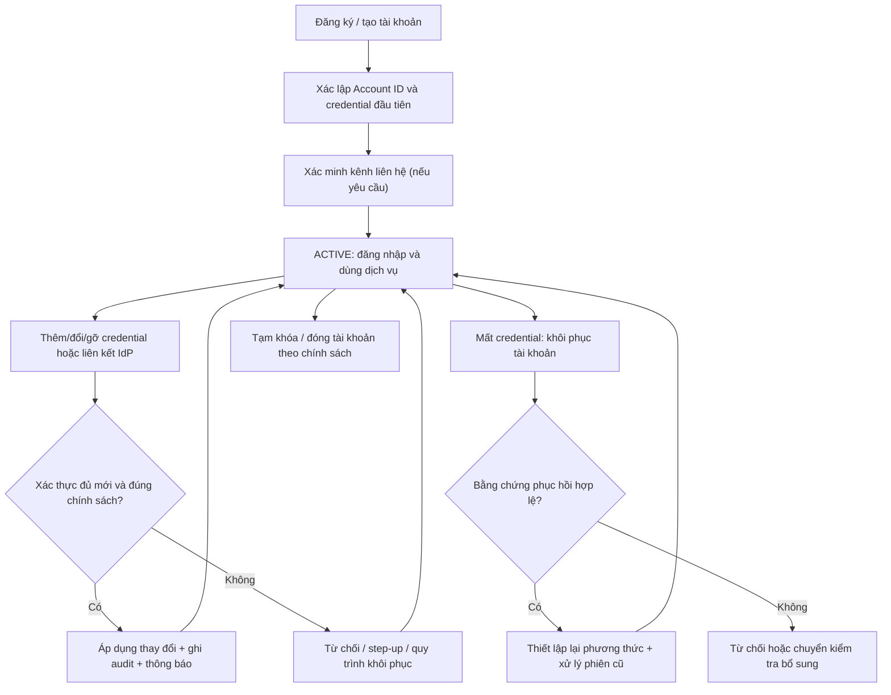
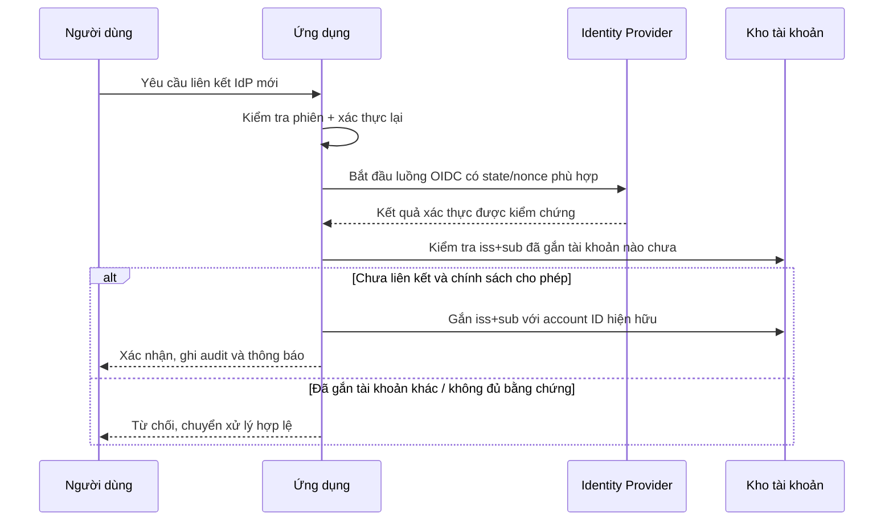
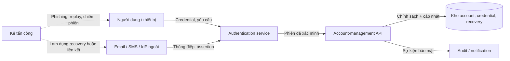

# Account ownership — Quyền kiểm soát tài khoản

## 1. Account ownership là gì?

Trong mô-đun **SECURITY_AUTHENTICATION_FUNDAMENTALS**, người học tìm hiểu nguyên lý xác thực từ credential, mật khẩu, MFA, passkey và chứng chỉ đến token, phiên, liên kết danh tính và khôi phục tài khoản. **Account ownership** (quyền kiểm soát tài khoản) kết nối các cơ chế ấy: hệ thống cần xác định *ai được công nhận là chủ thể có quyền kiểm soát tài khoản*, bằng chứng nào đủ để xác nhận quyền kiểm soát đó và làm thế nào duy trì nó khi thông tin đăng nhập thay đổi.

Ví dụ: Lan đăng ký một tài khoản, xác minh email và thêm passkey. Một ngày, Lan mất điện thoại chứa passkey; người khác kiểm soát số điện thoại cũ của Lan và yêu cầu khôi phục tài khoản. Nếu chỉ cần nhận được mã SMS để đổi toàn bộ credential, hệ thống có thể trao quyền kiểm soát tài khoản cho người không phải Lan. Mọi kiểm tra phân quyền về sau vẫn có thể hoạt động “đúng” theo tài khoản, nhưng tài khoản đã bị chiếm đoạt.

Trong thực hành, cần phân biệt ba tầng:

1. **Danh tính/tài khoản được hệ thống ghi nhận**: bản ghi có ID ổn định, trạng thái, các phương thức xác thực được liên kết và quy tắc quản lý vòng đời.
2. **Quyền kiểm soát tài khoản**: khả năng thực hiện những hành động được chính sách cho phép để đăng nhập, quản lý credential, cập nhật kênh khôi phục và quản lý phiên.
3. **Quyền trên tài nguyên**: quyền xem hóa đơn, sửa tài liệu, quản trị tổ chức... được quyết định qua authorization. Chủ tài khoản không mặc nhiên sở hữu mọi tài nguyên mà tài khoản có thể truy cập.

“Ownership” trong thiết kế hệ thống là **mối quan hệ và tập quyền được chính sách công nhận**, không phải lời khẳng định rằng một yếu tố đơn lẻ chứng minh tuyệt đối một con người là ai. Một email được xác minh chứng minh khả năng kiểm soát hộp thư tại thời điểm kiểm tra; một lần đăng nhập bằng passkey chứng minh khả năng sử dụng khóa riêng tương ứng trong ngữ cảnh xác thực hợp lệ. Việc ai là chủ thể hợp pháp của tài khoản còn phụ thuộc quy tắc đăng ký, hợp đồng, tổ chức, nghiệp vụ và đôi khi yêu cầu xác minh danh tính ngoài hệ thống.

### Mục tiêu học tập

Sau bài này, bạn có thể:

- Phân biệt tài khoản, định danh, credential, phiên, kênh liên hệ và quyền sở hữu tài nguyên.
- Mô hình hóa cách tài khoản được tạo, xác thực, liên kết phương thức đăng nhập, phục hồi và chuyển giao quyền kiểm soát.
- Giải thích vì sao kiểm soát email, số điện thoại hay một phiên đang mở chưa chắc đủ để thay đổi chủ thể kiểm soát tài khoản.
- Nhận diện account takeover (ATO), phishing, replay, chiếm đoạt phiên, social login linking sai và các đường vòng qua khôi phục.
- Thiết kế chính sách thay đổi credential, MFA, email và khôi phục theo mức độ rủi ro.

## 2. Mô hình tài khoản: cái gì có thể được sở hữu hoặc kiểm soát?

Một hệ thống thường lưu **định danh tài khoản nội bộ** tách khỏi các dữ liệu có thể thay đổi:

| Thành phần | Ví dụ | Vai trò trong account ownership |
|---|---|---|
| Account ID | `acc_8fa3` | Định danh nội bộ ổn định để gắn credential và quyền; tránh dùng email làm khóa chính |
| Chủ thể đăng nhập liên kết | `issuer + subject` của một IdP | Chỉ tới danh tính do nhà cung cấp xác thực phát hành, trong phạm vi tin cậy cụ thể |
| Credential | Mật khẩu đã băm, public key của passkey, chứng chỉ, yếu tố MFA | Bằng chứng cho phép thực hiện đăng nhập theo chính sách |
| Kênh liên hệ/khôi phục | Email, số điện thoại, mã khôi phục | Dùng cho thông báo hoặc khôi phục; không tự động là bằng chứng đủ để nhận toàn quyền |
| Phiên và token | Session cookie, access token | Duy trì khả năng gọi hệ thống sau khi xác thực; có thể bị đánh cắp hoặc bị thu hồi |
| Vai trò, tenant, quyền | Thành viên `tenant-A`, quản trị dự án | Xác định hành động trên tài nguyên; phải được kiểm tra riêng |
| Trạng thái tài khoản | `PENDING`, `ACTIVE`, `SUSPENDED`, `CLOSED` | Cho biết có được đăng nhập hoặc thay đổi thông tin hay không |

Một thiết kế có thể cho phép tài khoản có nhiều credential, nhiều thiết bị và nhiều danh tính bên ngoài. Credential có thể bị thay thế mà account ID vẫn giữ nguyên. Tách biệt này giúp giữ lịch sử, dữ liệu, quyền hợp lệ và nhật ký khi người dùng đổi email hoặc đăng ký passkey mới.

### Ba loại bằng chứng dễ bị nhầm lẫn

- **Proof of knowledge**: biết bí mật, chẳng hạn mật khẩu hoặc recovery code. Bí mật bị lộ thì người khác cũng có thể sử dụng.
- **Proof of possession/control**: có quyền sử dụng thiết bị, khóa riêng hoặc kênh nhận mã. Việc có thiết bị không chứng minh chắc chắn chủ thể hợp pháp đang thao tác.
- **Identity proofing**: quy trình đối chiếu một cá nhân/tổ chức với danh tính được khẳng định, có thể gồm giấy tờ và kiểm tra ngoài hệ thống. Xác thực bằng mật khẩu hay passkey thông thường không tự thực hiện bước này.

Nếu sản phẩm chỉ cần tài khoản bút danh để lưu ghi chú, chính sách có thể dựa trên credential đã đăng ký. Nếu sản phẩm quản lý tài khoản tài chính theo danh tính pháp lý, bằng chứng kiểm soát credential và quy trình xác minh chủ thể là hai yêu cầu khác nhau.

## 3. Quyền kiểm soát không chỉ nằm ở thao tác đăng nhập

Luồng quản lý tài khoản cần xử lý nhiều hành động hơn “login thành công”:

| Hành động | Điều hệ thống thực sự cần kiểm tra |
|---|---|
| Đăng nhập | Người yêu cầu có cung cấp bằng chứng hợp lệ cho một credential đã liên kết không? |
| Xem danh sách phương thức đăng nhập | Phiên hiện tại có được phép xem thông tin bảo mật này không? |
| Thêm passkey/MFA | Chủ thể hiện tại đã xác thực đủ mới, đủ mạnh để liên kết một phương thức kiểm soát mới chưa? |
| Xóa phương thức đăng nhập | Sau khi xóa còn phương thức hợp lệ theo chính sách không? Có dấu hiệu chiếm đoạt không? |
| Đổi email hoặc số điện thoại khôi phục | Ai yêu cầu, đã xác thực lại chưa, kênh mới đã được xác minh chưa, có cần cảnh báo kênh cũ không? |
| Đặt lại mật khẩu khi mất quyền truy cập | Bằng chứng phục hồi có đạt chính sách để trao quyền thiết lập credential mới không? |
| Thêm social login/IdP | Chủ thể nội bộ có thực sự chấp thuận gắn định danh bên ngoài này không? |
| Chuyển quyền sở hữu trong tổ chức | Chủ thể hiện tại có quyền chuyển giao, người nhận có đồng ý và các quy tắc tổ chức có cho phép không? |
| Đóng/xóa tài khoản | Có kiểm tra lại danh tính, quyền thao tác, ràng buộc dữ liệu và nghĩa vụ của tổ chức không? |

Các hành động làm thay đổi credential, kênh khôi phục hoặc chủ thể gắn với tài khoản là **thao tác thay đổi gốc tin cậy**. Chính sách bảo vệ chúng thường phải chặt hơn việc đọc hồ sơ cá nhân thông thường.

### Sơ đồ vòng đời



Các trạng thái trên chỉ minh họa. Hệ thống thực tế có thể cần thêm `RECOVERY_PENDING`, `LOCKED` hoặc `DELETION_PENDING`. Quan trọng là các chuyển trạng thái phải có điều kiện được thực thi ở máy chủ, không thể thay đổi chỉ bằng dữ liệu do trình duyệt gửi.

## 4. Xác lập quyền kiểm soát lúc đăng ký

Một luồng đăng ký cơ bản có thể thực hiện:

1. Sinh account ID nội bộ **không phụ thuộc email hay tên đăng nhập**.
2. Thu thập credential đầu tiên qua luồng bảo vệ bằng TLS, chống lạm dụng và xử lý lỗi an toàn.
3. Nếu dùng mật khẩu, lưu dạng **băm thích hợp với mật khẩu kèm salt riêng và cấu hình chi phí phù hợp**; không lưu mật khẩu rõ hoặc mã hóa có thể đảo ngược như phương thức lưu chính.
4. Nếu dùng passkey, kiểm tra thông điệp đăng ký WebAuthn, challenge, origin, RP ID và các điều kiện máy chủ yêu cầu trước khi lưu public key cùng metadata cần thiết.
5. Nếu email/số điện thoại là yêu cầu của nghiệp vụ, gửi thử thách chứng minh khả năng kiểm soát kênh đó; thời hạn ngắn, dùng một lần, giới hạn thử và không để lộ mã xác minh.
6. Kích hoạt tài khoản và gán các quyền khởi tạo tối thiểu theo chính sách, sau khi điều kiện đăng ký đạt yêu cầu.

**Xác minh email không phải chứng minh một cá nhân cụ thể là ai.** Một địa chỉ email cũng có thể đổi chủ theo thời gian. Không nên tự ghép tài khoản có email trùng với người dùng của một IdP khác nếu chưa hoàn thành luồng liên kết có bằng chứng thích hợp.

Với tài khoản do doanh nghiệp cấp, quan hệ ownership có thể khởi đầu từ lời mời quản trị viên, quy trình nhân sự hoặc hệ thống quản lý danh tính của tổ chức. Người dùng có quyền sử dụng tài khoản theo chính sách tổ chức, nhưng quyền quản lý vòng đời tài khoản có thể vẫn thuộc bên quản trị.

## 5. Xác thực đăng nhập chứng minh điều gì?

Khi người dùng đăng nhập thành công, hệ thống có thể phát hành phiên hoặc token gắn với account ID. Kết quả đó cho phép máy chủ xử lý request *như xuất phát từ chủ thể đã xác thực*, trong thời hạn và phạm vi cho phép. Tuy nhiên, nó không chứng minh rằng **chính chủ thể hợp pháp luôn là người đang điều khiển phiên**.

### Mật khẩu, MFA và passkey

- **Mật khẩu:** kiểm tra người gọi biết bí mật đã đăng ký; dễ chịu ảnh hưởng từ tái sử dụng mật khẩu, credential stuffing hoặc trang đăng nhập giả mạo.
- **MFA:** bổ sung yếu tố độc lập theo chính sách; OTP qua tin nhắn hoặc ứng dụng vẫn có thể bị phishing hoặc chuyển tiếp thời gian thực. MFA cần được ràng buộc với đúng lần xác thực, đúng phiên và đúng thao tác khi thiết kế yêu cầu xác thực lại.
- **Passkey/WebAuthn:** yêu cầu bộ xác thực tạo chữ ký cho challenge với khóa riêng tương ứng, gắn với RP ID và origin đã kiểm tra. Cơ chế này chống phishing tốt khi triển khai đúng. Passkey được đồng bộ giữa nhiều thiết bị vẫn có thể đại diện cho cùng một credential; không được suy luận “mỗi passkey = một thiết bị duy nhất” hoặc “có passkey = chủ thể pháp lý đã được định danh”.
- **Chứng chỉ/mTLS:** có thể chứng minh một client hoặc workload đang giữ khóa liên quan đến chứng chỉ hợp lệ. Với tài khoản dịch vụ, còn phải xác định hệ thống hay đội nào được phép tạo, xoay và thu hồi khóa; chứng chỉ không tự cấp quyền trên mọi dữ liệu.

### Phiên hợp lệ có thể nằm trong tay kẻ tấn công

Session cookie và bearer token có thể bị lấy cắp qua lỗ hổng ứng dụng, thiết bị bị xâm nhập hoặc kênh truyền không được bảo vệ. Kẻ tấn công dùng lại phiên thường không cần biết mật khẩu. Do đó:

- Dùng HTTPS; đặt `Secure`, `HttpOnly`, `SameSite` thích hợp cho cookie; bảo vệ request thay đổi dữ liệu khỏi CSRF khi dùng cookie.
- Giới hạn thời hạn phiên và phiên không hoạt động; hỗ trợ đăng xuất, thu hồi phiên, quản lý thiết bị và phát hiện hoạt động bất thường.
- Không lưu credential/token vào log, URL hoặc chỗ hiển thị công khai; bảo vệ chống XSS và rò rỉ dữ liệu.
- Với thao tác nhạy cảm, yêu cầu bằng chứng xác thực **đủ mới**, không chỉ thấy cookie còn hiệu lực.

Việc dùng thêm khóa ràng buộc token với phía gửi, nếu kiến trúc hỗ trợ, có thể giảm rủi ro replay bearer token. Phải xem xét khả năng triển khai và kiểu client thay vì giả định mọi token đều tự chống replay.

## 6. Quyền thay đổi credential và kênh khôi phục

Một người chiếm được phiên trong vài phút có thể cố thêm passkey do họ kiểm soát, đổi email và xóa phương thức đăng nhập cũ. Khi đó họ đạt được quyền truy cập lâu dài ngay cả sau khi phiên ban đầu hết hạn. Vì vậy, **quản lý credential là bề mặt tấn công ưu tiên cao**.

Một chính sách cho thao tác nhạy cảm thường kết hợp:

1. Xác minh phiên hiện hành và trạng thái tài khoản từ nguồn tin cậy.
2. Yêu cầu **reauthentication/step-up** theo mức rủi ro: ví dụ xác thực lại bằng phương thức có mức bảo đảm phù hợp và thời gian đủ gần.
3. Kiểm tra CSRF, challenge dùng một lần và các ràng buộc giao thức liên quan.
4. Xác thực kênh hoặc credential **mới** trước khi kích hoạt.
5. Ghi audit sự kiện; thông báo qua kênh đã tồn tại trước thay đổi nếu phù hợp.
6. Cân nhắc thu hồi các phiên khác, yêu cầu người dùng kiểm tra thiết bị và trì hoãn thực thi những thay đổi đặc biệt nguy hiểm.

Không nên thiết kế “đã mở trang Settings = được phép xóa MFA”. Điều kiện cần được kiểm tra **tại thời điểm máy chủ thực hiện thay đổi**. Trường hợp phiên còn hợp lệ nhưng đã quá lâu kể từ lần xác thực mạnh, hệ thống có thể yêu cầu step-up trước khi tiếp tục.

### Đổi email

Đổi email thường ảnh hưởng đồng thời đến danh tính hiển thị, kênh thông báo, khôi phục và đôi khi tên đăng nhập. Một luồng an toàn nên:

- Yêu cầu bằng chứng quyền kiểm soát tài khoản hiện tại theo chính sách.
- Xác minh địa chỉ email mới trước khi sử dụng để khôi phục.
- Thông báo thay đổi đến địa chỉ cũ khi có thể, không gửi token hay credential trong thông báo.
- Quy định cách xử lý khi người dùng báo thay đổi trái phép: dừng/chặn thay đổi đang chờ, thu hồi phiên đáng ngờ hoặc chuyển kiểm tra bổ sung.
- Không tự động gán lại account ID hay quyền tài nguyên dựa trên email mới.

### Gỡ yếu tố cuối cùng

Nếu xóa passkey cuối cùng hoặc phương thức MFA bắt buộc, tài khoản có thể mất khả năng đăng nhập an toàn. Hệ thống phải kiểm tra **còn đường xác thực hoặc khôi phục hợp lệ** theo chính sách. “Ngăn bị khóa tài khoản” cũng không nên trở thành lý do vô hiệu hóa mọi yêu cầu bảo mật; có thể dùng recovery code dự phòng, phương thức xác thực thứ hai hoặc quy trình hỗ trợ được kiểm soát.

## 7. Liên kết danh tính: một tài khoản, nhiều cách đăng nhập

Lan có thể dùng mật khẩu, passkey và tài khoản của một nhà cung cấp bên ngoài để truy cập cùng tài khoản nội bộ. Khi liên kết, hệ thống thiết lập quan hệ tin cậy giữa account ID hiện hữu và một định danh xác thực mới.

Với OpenID Connect (OIDC), cặp **`iss` (issuer) + `sub` (subject)** là cơ sở định danh chủ thể trong phạm vi nhà phát hành. Email hoặc tên hiển thị trong ID token không phải khóa liên kết thay thế đáng tin cậy. Phía ứng dụng phải kiểm tra token đúng giao thức, chữ ký, issuer, audience, hạn hiệu lực, nonce/state khi áp dụng và các ràng buộc luồng xác thực.

### Quy trình liên kết khuyến nghị



Các điểm cần bảo vệ:

- Người dùng phải chứng minh quyền kiểm soát tài khoản **đang được liên kết**; việc vừa đăng nhập được vào một IdP mới không đủ để chiếm tài khoản cũ.
- Thực hiện kiểm tra và ghi liên kết theo cách nhất quán/atomic để tránh hai yêu cầu đồng thời gắn cùng một định danh vào hai tài khoản.
- Chỉ cho phép gỡ một liên kết nếu còn phương thức truy cập theo chính sách; ghi audit và gửi thông báo.
- Không tự nhập vai tài khoản khác do trùng email hoặc do phía client cung cấp account ID mục tiêu.
- Xem thay đổi thuộc tính của IdP, email được IdP xác minh và trạng thái người dùng là **tín hiệu cần diễn giải**, không phải căn cứ tự động để chuyển ownership.

### Vì sao tự động ghép theo email có thể gây account takeover?

Giả sử tài khoản cũ `acc-17` đăng ký email `a@example.com`. Nhà cung cấp ngoài trả một tài khoản khác có cùng email. Nếu ứng dụng tin ngay email để gán `acc-17` cho phiên mới, người vừa đăng nhập bên ngoài có thể nhận dữ liệu và quyền của chủ thể cũ dù chưa hề chứng minh quyền kiểm soát `acc-17`. Tình huống còn nghiêm trọng hơn khi email chưa được nhà cung cấp xác minh hoặc được tái sử dụng.

Việc liên kết cần một **quy trình có bằng chứng hai phía**, hoặc quy trình cấp phát/di chuyển được quản trị rõ ràng trong mô hình tổ chức.

## 8. Account recovery: đường quay lại tài khoản cũng là đường để chiếm đoạt

Khôi phục tài khoản xảy ra khi người dùng mất credential hoặc không thể hoàn tất MFA. Đây là điểm khó của thiết kế: người dùng thật cần lấy lại quyền truy cập nhưng kẻ tấn công cũng có thể giả vờ “mất quyền đăng nhập”.

Nguyên tắc cốt lõi: **khôi phục là một cơ chế cấp lại quyền kiểm soát**, vì vậy phải được đánh giá như một phần của kiến trúc xác thực, chứ không phải một ngoại lệ có thể bỏ qua yêu cầu bảo mật.

### Các phương thức khôi phục và giới hạn

| Phương thức | Ưu điểm | Rủi ro và điều kiện |
|---|---|---|
| Recovery code được tạo trước | Có thể dùng khi mất điện thoại; không phụ thuộc SMS | Phải phát hành, lưu và dùng một lần an toàn; bị lộ sẽ có giá trị cao |
| Link khôi phục gửi email | Dễ sử dụng với ứng dụng rủi ro thấp/trung bình | Tài khoản email có thể bị chiếm hoặc đổi chủ; email có thể không đủ cho thao tác độ rủi ro cao |
| OTP qua SMS | Phù hợp một số nhóm người dùng | Dễ bị SIM swap, chuyển tiếp, malware, phishing; không nên mặc nhiên là yếu tố khôi phục mạnh |
| Credential dự phòng đã đăng ký | Giảm phụ thuộc bộ phận hỗ trợ | Cần bảo vệ luồng thêm/gỡ credential từ đầu |
| Quy trình hỗ trợ được kiểm soát | Phù hợp khi người dùng mất mọi yếu tố | Dễ bị social engineering, lạm quyền nhân viên; cần bằng chứng, kiểm soát, audit và tách nhiệm vụ theo rủi ro |
| Quản trị viên tổ chức đặt lại quyền truy cập | Hữu ích cho tài khoản công việc | Chỉ đúng trong chính sách tổ chức; quyền admin phải được giới hạn, ghi nhận và kiểm tra |

Các token khôi phục nên khó đoán, có TTL ngắn phù hợp, dùng một lần, gắn với yêu cầu cụ thể, được xử lý an toàn và giới hạn tần suất. Mã và URL khôi phục không được xuất hiện trong log. Phản hồi yêu cầu khôi phục nên hạn chế tiết lộ tài khoản có tồn tại hay không; áp dụng kiểm soát chống bot và lạm dụng mà vẫn tính đến người dùng hợp lệ.

### Luồng khôi phục minh họa

1. Người dùng yêu cầu khôi phục; hệ thống tạo yêu cầu mới, ghi nhận ngữ cảnh rủi ro và phản hồi chung để tránh enumeration.
2. Hệ thống cung cấp phương thức khôi phục đã đăng ký phù hợp mức rủi ro, giới hạn số lần thử và thời hạn.
3. Người dùng chứng minh kiểm soát bằng chứng phục hồi; máy chủ xác minh tính hợp lệ, ràng buộc, tính một lần và trạng thái tài khoản.
4. Sau khi đủ điều kiện, hệ thống cho phép đăng ký credential thay thế theo một phiên khôi phục có phạm vi hẹp. Phiên này **không mặc nhiên là phiên đăng nhập đầy đủ** cho các thao tác nghiệp vụ khác.
5. Hệ thống xử lý phiên/token cũ theo chính sách, cảnh báo thay đổi và ghi audit. Với tài khoản rủi ro cao, có thể đặt giai đoạn hạn chế thao tác nhạy cảm hoặc xác minh bổ sung.

Nếu khôi phục bằng email cho phép bỏ qua hoàn toàn MFA hoặc passkey đã thiết lập, bảo mật hiệu dụng của tài khoản có thể chỉ còn bằng bảo mật của hộp thư. Chính sách phải xác định rõ đánh đổi theo dữ liệu và tác động của tài khoản.

## 9. Shared account, tài khoản tổ chức và tài khoản dịch vụ

Không phải tài khoản nào cũng thuộc một cá nhân duy nhất.

### Tài khoản cá nhân

Thông thường một chủ thể nội bộ có các phương thức đăng nhập do họ đăng ký. Việc chuyển giao tài khoản cá nhân có thể bị cấm bởi điều khoản dịch vụ, yêu cầu tuân thủ hoặc ràng buộc dữ liệu. Nếu cần đổi người chịu trách nhiệm cho tài nguyên, nên **chuyển quyền tài nguyên bằng quy trình authorization**, thay vì giao mật khẩu và toàn bộ lịch sử cá nhân.

### Tài khoản tổ chức

Doanh nghiệp có thể là đơn vị quản lý vòng đời tài khoản nhân viên: tạo, cấp nhóm, khóa khi nghỉ việc, khôi phục theo chính sách. Nhân viên kiểm soát credential sử dụng hằng ngày nhưng không nhất thiết được tự ý chuyển quyền quản trị tổ chức hoặc xóa dữ liệu công ty. Cần phân định:

- **Account controller/owner theo nghiệp vụ:** ai chịu trách nhiệm hoặc có thẩm quyền quản lý vòng đời tài khoản.
- **Authenticated user:** chủ thể đang đăng nhập và thực hiện hành động.
- **Tenant/workspace owner:** người hoặc tổ chức có quyền điều hành một không gian làm việc.
- **Resource owner:** chủ thể có quyền theo chính sách đối với đối tượng cụ thể.

Các danh xưng này có thể trùng nhau nhưng không mặc nhiên tương đương. Chẳng hạn, người sở hữu workspace có thể mời thành viên nhưng không được đọc dữ liệu nhân sự được bảo vệ bởi chính sách riêng.

### Tài khoản dịch vụ và workload

Tài khoản dùng để chạy job hoặc gọi API cần có đơn vị chịu trách nhiệm, credential có thể xoay và thu hồi, phân quyền tối thiểu và audit. Không dùng chung credential cá nhân cho automation. Khi người quản lý nghỉ việc, credential của workload cần tiếp tục được kiểm soát bởi đội/đơn vị được chỉ định; không được để bí mật chỉ tồn tại trên máy cá nhân.

### Tài khoản dùng chung

Việc nhiều người cùng biết một mật khẩu làm mất khả năng quy trách nhiệm và khó thu hồi riêng một cá nhân. Nếu yêu cầu nghiệp vụ cần quyền truy cập chung, ưu tiên **nhiều danh tính cá nhân cùng được cấp quyền** thông qua role, nhóm hoặc delegation. Nếu buộc phải dùng tài khoản dùng chung, cần chính sách quản lý credential, giới hạn truy cập và audit bổ sung, nhưng vẫn khó đạt khả năng truy vết như danh tính riêng.

## 10. Triển khai chính sách ownership ở máy chủ

Thiết kế API có thể chia thành hai nhóm:

- **Identity/session layer:** xác minh credential, token, phiên, độ mới xác thực và trạng thái tài khoản.
- **Account-management policy:** quyết định phiên hiện tại có được phép thêm passkey, xóa MFA, đổi email, liên kết IdP hoặc khôi phục quyền kiểm soát không.

Một bản ghi ngữ cảnh đáng tin cậy có thể chứa:

```text
AuthenticatedContext {
  accountId              // từ phiên/token đã kiểm chứng
  identityIssuer         // nguồn xác thực đáng tin cậy
  identitySubject        // sub trong phạm vi issuer
  sessionId
  authenticatedAt        // thời điểm chứng minh danh tính, không phải lúc refresh token
  authenticationMethods  // do hệ thống/IdP đáng tin cậy xác nhận
  assuranceLevel         // diễn giải theo chính sách của hệ thống
}
```

Ví dụ Java dưới đây minh họa **quy tắc cho phép bắt đầu thay đổi credential**. Đây là mã logic chính sách, giả định middleware đã xác minh phiên và dịch vụ trạng thái tài khoản là nguồn đáng tin cậy:

```java
import java.time.Clock;
import java.time.Duration;
import java.time.Instant;

record AuthenticatedContext(
    String accountId,
    Instant authenticatedAt,
    boolean strongAuthentication
) {}

enum AccountStatus { PENDING, ACTIVE, SUSPENDED, CLOSED }
enum ChangeType { ADD_PASSKEY, REMOVE_MFA, CHANGE_RECOVERY_EMAIL }

interface AccountStore {
    AccountStatus getStatus(String accountId);
}

final class AccountOwnershipPolicy {
    private final AccountStore accounts;
    private final Clock clock;

    AccountOwnershipPolicy(AccountStore accounts, Clock clock) {
        this.accounts = accounts;
        this.clock = clock;
    }

    boolean canStartSensitiveChange(
            AuthenticatedContext actor,
            String targetAccountId,
            ChangeType type) {
        if (actor == null || targetAccountId == null || type == null) {
            return false;
        }
        // Không tin accountId do client khai làm chủ thể đang đăng nhập.
        if (!actor.accountId().equals(targetAccountId)) return false;
        if (accounts.getStatus(targetAccountId) != AccountStatus.ACTIVE) {
            return false;
        }

        // Quy định minh họa: xác thực mạnh trong 5 phút gần nhất.
        Instant authTime = actor.authenticatedAt();
        if (!actor.strongAuthentication() || authTime == null) return false;
        Instant now = clock.instant();
        if (authTime.isAfter(now) ||
            authTime.isBefore(now.minus(Duration.ofMinutes(5)))) {
            return false;
        }
        return true;
    }
}
```

Đoạn mã **chỉ kiểm tra điều kiện đầu vào để bắt đầu** thao tác. Để triển khai thực tế, handler vẫn phải xác minh credential/email mới, challenge một lần và CSRF; kiểm tra chính sách cho từng `ChangeType`; thực hiện cập nhật nhất quán; giữ audit; thông báo; giới hạn tần suất và xử lý phiên cũ. Giá trị `strongAuthentication` phải đến từ hệ thống đã kiểm chứng, không được gán từ header hay JSON của client. Phải xác định rõ khi nào một quá trình khôi phục có thể cấp quyền thực hiện từng hành động.

Không nên dùng mỗi `actor.accountId == targetAccountId` để cho phép mọi thay đổi: chính sách có thể cần thêm role quản trị được giới hạn, dual control cho tổ chức, trạng thái đang khôi phục hoặc kiểm tra rủi ro. Khi có quyền quản trị thay mặt, audit cần ghi **cả người thực thi và tài khoản mục tiêu**.

## 11. Threat modeling: cách kẻ tấn công chiếm quyền kiểm soát

Một sơ đồ ranh giới tin cậy hữu ích:



Từng đường đi đòi hỏi một biện pháp kiểm chứng riêng. Tin vào browser vì browser vừa hiển thị “đăng nhập thành công”, hoặc tin hoàn toàn vào một kênh khôi phục ngoài mà không đánh giá rủi ro, sẽ làm mất ranh giới tin cậy.

| Mối đe dọa | Kịch bản cụ thể | Kiểm soát trọng tâm |
|---|---|---|
| Credential stuffing | Kẻ tấn công thử cặp email/mật khẩu bị lộ | Chống tự động hóa, rate limit theo nhiều tín hiệu, phát hiện bất thường, MFA/passkey |
| Phishing | Người dùng nhập mật khẩu/OTP trên trang giả | Passkey/WebAuthn chống phishing, xác minh origin, giáo dục và giám sát phù hợp |
| Replay session/token | Token hoặc cookie bị sao chép và dùng lại | Bảo vệ token, thời hạn, thu hồi, kiểm soát rủi ro, ràng buộc token khi phù hợp |
| Session-to-account takeover | Kẻ tấn công có phiên rồi thêm credential riêng | Step-up trước thay đổi, thông báo, giới hạn phiên, audit |
| SIM swap / mất email | Kẻ tấn công chiếm kênh nhận mã khôi phục | Không coi một kênh yếu là đủ cho mọi tài khoản; recovery code và kiểm tra bổ sung |
| Account linking sai | Ghép hai tài khoản vì trùng email | Chứng minh quyền kiểm soát hai phía; kiểm tra `iss + sub`; giao dịch atomic |
| Nhân viên hỗ trợ bị lừa | Người giả mạo nhờ reset MFA | Playbook xác minh, giới hạn quyền, kiểm soát bổ sung và audit |
| Tái sử dụng định danh | Email/username đổi chủ nhưng vẫn liên kết dữ liệu cũ | Account ID ổn định; không tái gán quyền theo chuỗi email |
| Quyền tổ chức lẫn quyền cá nhân | Owner workspace tự cấp quyền đối với dữ liệu riêng tư | Chính sách riêng cho account, tenant và resource; phân tách trách nhiệm |

Một số chỉ báo cần giám sát: nhiều lần reset thất bại, thêm credential ngay sau đăng nhập từ môi trường bất thường, thay đồng thời email và MFA, đăng nhập từ thiết bị lạ, đăng xuất hàng loạt hoặc nhiều yêu cầu liên kết IdP thất bại. Các tín hiệu chỉ nên hỗ trợ quyết định theo chính sách và có cơ chế xử lý trường hợp người dùng hợp lệ bị chặn.

## 12. Tình huống thực tế

### Tình huống A — Điện thoại bị mất

Minh có hai passkey trên hai thiết bị và một recovery code đã lưu an toàn. Khi mất điện thoại, Minh đăng nhập bằng passkey còn lại, mở trang quản lý thiết bị, xác thực lại theo chính sách rồi gỡ credential bị mất. Hệ thống ghi audit, gửi thông báo và thu hồi phiên từ thiết bị bị mất nếu có khả năng quản lý phiên tương ứng.

**Điểm mấu chốt:** mất một thiết bị không nhất thiết làm mất toàn bộ account ownership; phương thức dự phòng được đăng ký trước có thể giảm phụ thuộc vào khôi phục khẩn cấp.

### Tình huống B — Email đổi chủ

Hà từng đăng ký bằng email công việc nhưng đã nghỉ việc. Người mới nhận địa chỉ email đó có thể đọc thư mới gửi đến hộp thư. Nếu hệ thống cho phép chỉ dùng link email để tạo mật khẩu mới rồi vào tài khoản cũ, ownership có thể bị chuyển sai. Cách xử lý phù hợp phụ thuộc chính sách tài khoản: tài khoản công việc có thể thuộc quyền quản trị tổ chức, còn dữ liệu cá nhân có thể cần quy trình riêng.

**Điểm mấu chốt:** email là kênh có thể thay đổi chủ sở hữu; không được coi địa chỉ email là danh tính bất biến.

### Tình huống C — Social login trùng email

Tài khoản `acc-21` đã có mật khẩu. Một đăng nhập OIDC mới gửi email giống `acc-21` nhưng có cặp `iss/sub` chưa từng liên kết. Hệ thống không tự cho phép truy cập `acc-21`. Người dùng phải đăng nhập vào tài khoản hiện hữu và hoàn tất quy trình liên kết được bảo vệ, hoặc đi theo quy trình khôi phục/kiểm tra riêng nếu không còn credential cũ.

**Điểm mấu chốt:** trùng thuộc tính hồ sơ không chứng minh hai danh tính bên ngoài cùng sở hữu một tài khoản nội bộ.

### Tình huống D — Chủ workspace rời tổ chức

Nhân viên A là owner duy nhất của workspace dự án. Khi A nghỉ việc, doanh nghiệp cần chuyển quyền điều hành cho B bằng luồng quản trị có kiểm soát, giữ audit và rà soát quyền API/integration. Không giải quyết bằng cách đưa cho B mật khẩu, recovery code hoặc passkey của A.

**Điểm mấu chốt:** ownership của workspace là quyền nghiệp vụ có thể chuyển qua authorization; credential cá nhân gắn với chủ thể đã xác thực thì không nên được “chuyển tay”.

## 13. Bài tập thiết kế

Một ứng dụng có tài khoản `acc-501` với email đã xác minh, mật khẩu, MFA qua ứng dụng xác thực và hai phiên đang hoạt động. Người yêu cầu thay email và xóa MFA từ một phiên đăng nhập cách đây 25 ngày; ngay trước đó hệ thống ghi nhận nhiều lần thử mật khẩu sai.

Hãy đề xuất:

1. Điều kiện máy chủ cần kiểm tra trước khi cho phép đổi email và xóa MFA.
2. Cách chứng minh quyền kiểm soát email mới và bảo vệ email cũ.
3. Nếu người dùng thật đã mất điện thoại, đường khôi phục nào phù hợp để không biến thành đường vòng vượt MFA?
4. Chính sách xử lý hai phiên đang tồn tại và việc ghi audit/thông báo.
5. Cách phân biệt “người có phiên đang mở” với “chủ thể được phép thay đổi gốc tin cậy của tài khoản”.

Một đáp án hợp lý phải yêu cầu xác thực lại đủ mạnh và gần đây hoặc đi theo luồng khôi phục có kiểm soát; không dựa riêng vào việc session cookie còn hiệu lực. Cần xác minh email mới, có thông báo phù hợp, kiểm soát tần suất và dấu hiệu lạm dụng, đánh giá thu hồi phiên và đảm bảo không vô tình loại bỏ mọi phương thức truy cập hợp lệ.

## 14. Checklist thiết kế account ownership

- [ ] Tài khoản có ID nội bộ ổn định, tách khỏi email và tên hiển thị.
- [ ] Có chính sách rõ ai được tạo, sử dụng, sửa, khôi phục, vô hiệu hóa và chuyển quyền tài khoản.
- [ ] Mỗi credential/IdP liên kết đều có nguồn gốc và quy trình xác minh.
- [ ] Không tự gộp tài khoản dựa trên email hoặc thông tin hồ sơ trùng nhau.
- [ ] Thay đổi credential, recovery factor, email và liên kết IdP được bảo vệ bằng kiểm tra phía máy chủ và xác thực đủ mới.
- [ ] Khôi phục có bằng chứng, giới hạn thử, chống replay, thông báo và xử lý phiên cũ.
- [ ] Phiên/token có hạn sử dụng, khả năng thu hồi và cơ chế bảo vệ khỏi lạm dụng.
- [ ] Phân biệt chủ tài khoản, người quản trị tổ chức, chủ workspace và người sở hữu tài nguyên.
- [ ] Audit ghi chủ thể, tài khoản mục tiêu, hành động, thời điểm và kết quả; không ghi bí mật.
- [ ] Có kiểm thử kịch bản ATO, đổi email, mất yếu tố, liên kết IdP, quyền tổ chức và các yêu cầu đồng thời.

**Kết luận:** Account ownership là tập hợp các quy tắc và bằng chứng cho biết ai được phép kiểm soát vòng đời một tài khoản. Muốn giữ quyền đó đúng chủ thể, hệ thống phải xem đăng nhập, quản lý credential, liên kết danh tính, phiên và khôi phục như **một chuỗi tin cậy liên tục**. Chỉ cần một mắt xích yếu ở bước thay email, thêm yếu tố hoặc khôi phục cũng có thể làm mất tác dụng của các cơ chế xác thực mạnh ở những bước còn lại.
