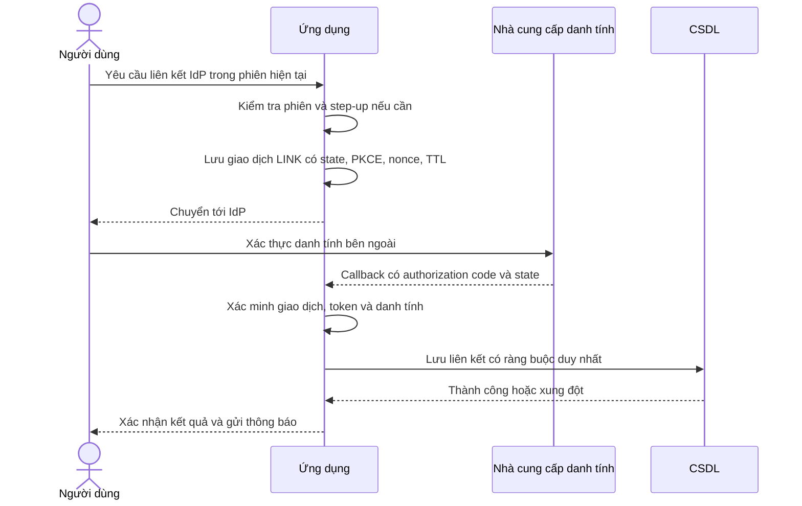

# Account linking — Liên kết tài khoản

Một người có thể sở hữu tài khoản nội bộ của ứng dụng, tài khoản tại nhà cung cấp danh tính doanh nghiệp, tài khoản mạng xã hội và nhiều phương thức đăng nhập khác nhau. **Account linking** (liên kết tài khoản) là quá trình thiết lập mối quan hệ có kiểm chứng giữa những danh tính đó, để ứng dụng biết các lần xác thực khác nhau có thể dẫn tới **cùng một tài khoản ứng dụng**.

Đây là một thao tác nhạy cảm: nếu liên kết nhầm danh tính của kẻ tấn công vào tài khoản nạn nhân, kẻ tấn công có thể đăng nhập bằng phương thức của mình mà không cần biết mật khẩu nạn nhân. Ngược lại, liên kết đúng giúp người dùng chuyển từ mật khẩu sang passkey hoặc đăng nhập doanh nghiệp, giữ được dữ liệu và giảm số lần phải tạo tài khoản mới.

Bài thuộc chương **Account** của học phần **SECURITY_AUTHENTICATION_FUNDAMENTALS**. Nội dung nối kiến thức về credential, mật khẩu, MFA, passkey, chứng chỉ, token, phiên, liên kết danh tính và khôi phục tài khoản với mục tiêu chung: hiểu ranh giới tin cậy và thiết kế luồng xác thực chống phishing, replay và lạm dụng đăng nhập.

## 1. Kết quả học tập

Sau bài này, người học có thể:

- Giải thích sự khác nhau giữa **liên kết tài khoản**, **đăng nhập liên kết**, **gộp tài khoản** và **gắn thêm phương thức xác thực**.
- Chỉ ra dữ liệu định danh nào đủ ổn định để lưu liên kết và vì sao **email trùng nhau không chứng minh hai tài khoản thuộc cùng một người**.
- Thiết kế luồng liên kết yêu cầu bằng chứng hợp lệ ở cả phía tài khoản ứng dụng và phía nhà cung cấp danh tính.
- Phòng tránh chiếm đoạt tài khoản qua callback, liên kết ngầm, nhầm nhà cung cấp, replay, session fixation, chiếm phiên và quy trình khôi phục.
- Quy định cách phát hiện xung đột, hủy liên kết, thu hồi truy cập, kiểm toán và kiểm thử các trường hợp cạnh tranh.

## 2. Phân biệt các khái niệm dễ nhầm

| Khái niệm | Bản chất | Ví dụ |
| --- | --- | --- |
| **Account (tài khoản ứng dụng)** | Đối tượng nội bộ gắn với dữ liệu, quyền và vòng đời trong hệ thống | `user_id = u_1042` sở hữu hồ sơ, đơn hàng và quyền trong ứng dụng |
| **External identity (danh tính bên ngoài)** | Danh tính được nhà cung cấp bên ngoài định danh và xác thực | Một `sub` do OpenID Provider phát hành |
| **Federated login / SSO** | Đăng nhập dựa trên kết quả xác thực từ nhà cung cấp danh tính | Nhân viên dùng IdP của doanh nghiệp để vào SaaS |
| **Account linking** | Ghi nhận một danh tính bên ngoài thuộc về một tài khoản ứng dụng cụ thể sau khi kiểm chứng | Liên kết `(issuer, subject)` với `u_1042` |
| **Account merging** | Gộp dữ liệu, quyền hoặc lịch sử của hai tài khoản ứng dụng vốn đã tồn tại | Hợp nhất hai hồ sơ có hóa đơn và dữ liệu riêng |
| **Authenticator binding** | Đăng ký thêm yếu tố/phương thức xác thực cho một tài khoản | Thêm passkey, khóa bảo mật hoặc phương thức MFA |

Các thao tác có thể xuất hiện cùng một màn hình nhưng có rủi ro và quy tắc khác nhau. Đăng nhập bằng IdP **không tự động** có nghĩa là có quyền liên kết với một tài khoản cũ. Liên kết hai danh tính **không tự động** cho phép gộp hai bộ dữ liệu; gộp tài khoản cần chính sách riêng về xung đột dữ liệu, quyền sở hữu và khả năng đảo ngược.

Đối với passkey, việc thêm một credential WebAuthn vào tài khoản thường là **authenticator binding**, không phải liên kết với một tài khoản mạng xã hội. Trong cả hai trường hợp, thao tác làm thay đổi ai có thể đăng nhập nên đều cần kiểm soát nhạy cảm.

## 3. Mô hình danh tính: giữ tài khoản nội bộ làm điểm neo

Ứng dụng cần một định danh nội bộ ổn định, không phụ thuộc vào email hay nhà cung cấp đăng nhập. Ví dụ:

```text
Tài khoản ứng dụng: user_id = u_1042
    ├── Mật khẩu nội bộ (nếu còn được hỗ trợ)
    ├── Passkey đã đăng ký
    ├── External identity: issuer A + subject 8xQ...
    └── External identity: issuer B + subject 29P...

Tổ chức/cấp quyền: kiểm tra riêng theo user_id và tenant_id
```

Trong OpenID Connect (OIDC), cặp **`iss` (issuer) và `sub` (subject)** là định danh chính để nhận biết một chủ thể tại một nhà phát hành. `sub` chỉ có ý nghĩa trong phạm vi nhà phát hành đã được xác thực; hai IdP có thể phát hành cùng một chuỗi `sub` cho hai người khác nhau. Một số IdP dùng **pairwise subject**: cùng một người có thể nhận `sub` khác nhau ở các ứng dụng khác nhau. Vì vậy, không dùng `sub` một mình hoặc cố suy ra quan hệ giữa các ứng dụng bằng email.

Một bảng lưu liên kết tối giản có thể có dạng:

```sql
-- Minh họa cấu trúc, cần điều chỉnh kiểu dữ liệu theo hệ quản trị CSDL.
CREATE TABLE external_identity_links (
    link_id          UUID PRIMARY KEY,
    user_id          UUID NOT NULL REFERENCES users(id),
    provider_key     VARCHAR(120) NOT NULL,
    issuer           VARCHAR(1024) NOT NULL,
    subject          VARCHAR(1024) NOT NULL,
    linked_at        TIMESTAMP NOT NULL,
    linked_by        UUID NOT NULL,
    status           VARCHAR(20) NOT NULL,
    UNIQUE (issuer, subject)
);
```

`provider_key` dùng để tìm cấu hình IdP đáng tin cậy, còn `issuer + subject` là khóa định danh đã xác minh theo giao thức. Khi hệ thống sử dụng nhiều phạm vi client hoặc nhà cung cấp có quy tắc subject khác chuẩn, phải mô hình hóa phạm vi định danh đó một cách tường minh và giữ nguyên bất biến **một danh tính bên ngoài không bị gắn tùy tiện vào hai tài khoản nội bộ**. Ràng buộc ở CSDL giúp ngăn hai tiến trình liên kết đồng thời tạo trạng thái mâu thuẫn.

### Vì sao không dùng email làm khóa liên kết?

Email có thể đổi, bị thu hồi, cấp lại, dùng chung hoặc chưa được xác minh. Ngay cả claim `email_verified: true` chỉ phản ánh bằng chứng mà nhà cung cấp có về địa chỉ email theo chính sách của họ; nó không chứng minh một tài khoản cũ trong ứng dụng thuộc cùng chủ sở hữu. Hơn nữa, hai tổ chức có thể quản lý miền và tài khoản theo chính sách khác nhau.

**Phản ví dụ:** Alice có tài khoản ứng dụng `alice@example.com`. Một bên khác kiểm soát danh tính mới tại IdP có cùng email (do cấp lại hộp thư, cấu hình sai hoặc nhà cung cấp không kiểm chứng). Nếu ứng dụng tự động liên kết theo email, bên kia có thể đăng nhập vào tài khoản của Alice. Cách an toàn là yêu cầu chủ tài khoản ứng dụng **xác thực riêng** trước khi chấp nhận liên kết.

Tên hiển thị, tên đăng nhập, số điện thoại hay miền email cũng không phải thay thế mặc định cho cặp định danh ổn định của IdP. Có thể sử dụng chúng để **gợi ý** liên kết trong giao diện, nhưng không dùng làm bằng chứng độc lập.

## 4. Các luồng liên kết thường gặp

### 4.1. Người dùng đã đăng nhập muốn thêm một IdP

Đây là luồng dễ kiểm soát nhất vì ứng dụng đã biết tài khoản nội bộ đích:

1. Người dùng đăng nhập tài khoản ứng dụng, mở **Bảo mật → Phương thức đăng nhập → Liên kết**.
2. Máy chủ kiểm tra phiên hiện tại, quyền thao tác và, khi rủi ro phù hợp, yêu cầu **xác thực lại/step-up** đủ mới. Ví dụ, mật khẩu đã kiểm chứng, passkey hoặc MFA thích hợp.
3. Máy chủ tạo **giao dịch liên kết** có thời hạn, dùng một lần, gắn với `user_id`, phiên, IdP được chọn và ý định `LINK`; tạo các giá trị ngẫu nhiên cần thiết cho giao thức.
4. Trình duyệt chuyển tới IdP qua luồng đăng nhập được hỗ trợ. Người dùng xác thực với **đúng tài khoản IdP** mà họ muốn liên kết.
5. Callback được xác minh đầy đủ ở máy chủ. Dịch vụ lấy `issuer + subject` đã xác thực, kiểm tra danh tính này chưa liên kết với tài khoản khác.
6. Nếu hợp lệ, dịch vụ lưu liên kết bằng giao dịch CSDL, ghi nhật ký kiểm toán và thông báo kết quả rõ ràng cho người dùng.



Chỉ màn hình chọn IdP hoặc chỉ việc nhận callback thành công **chưa đủ** để ghi liên kết. Quyết định cuối cùng phải dựa trên cả phiên tài khoản đích đã được xác thực và bằng chứng hợp lệ từ IdP.

### 4.2. Người dùng bắt đầu bằng nút “Đăng nhập với X”

Sau khi người dùng xác thực với IdP, ứng dụng tra cứu cặp `issuer + subject`:

- **Đã có liên kết:** đăng nhập vào đúng `user_id` được lưu, rồi tạo phiên ứng dụng theo chính sách.
- **Chưa có liên kết, cho phép tạo mới:** chỉ tạo tài khoản mới nếu hành trình, chính sách đăng ký và bằng chứng cần thiết cho phép.
- **Chưa có liên kết nhưng người dùng muốn dùng tài khoản ứng dụng hiện có:** yêu cầu họ đăng nhập và chứng minh quyền kiểm soát **tài khoản hiện có**, sau đó khởi tạo giao dịch liên kết riêng. Không liên kết ngầm vì email trùng.
- **Danh tính đã được liên kết với tài khoản khác:** không gắn lại; cần luồng hỗ trợ/xử lý xung đột có kiểm chứng.

Không dùng tham số do trình duyệt tự đưa lên như `user_id`, `email` hoặc `link=true` làm cơ sở chọn tài khoản đích. Máy chủ phải lưu **ý định đăng nhập hay liên kết** và ràng buộc nó với giao dịch từ trước khi chuyển hướng.

### 4.3. Liên kết trong doanh nghiệp và môi trường nhiều tenant

Với SaaS phục vụ doanh nghiệp, có thể cần liên kết người dùng nội bộ với danh tính SSO của tổ chức:

- Xác minh cấu hình IdP thuộc đúng tổ chức, đối chiếu `issuer`, định danh người dùng và các ràng buộc tenant liên quan.
- Phân biệt **xác thực** với **quyền tham gia tổ chức**: một IdP chứng thực Alice không tự cấp cho Alice quyền truy cập toàn bộ dữ liệu khách hàng.
- Kiểm tra thành viên, vai trò và tài nguyên trên máy chủ theo `tenant_id` được xác định đáng tin cậy; không dựa vào miền email hoặc lựa chọn tenant từ phía trình duyệt.
- Với provisioning/deprovisioning (ví dụ, qua SCIM hoặc đồng bộ riêng), xác định nguồn dữ liệu đáng tin, quy tắc khi người dùng nghỉ việc và thời gian thu hồi phiên/token.

Nếu hai tenant có người dùng cùng email, hệ thống không được gộp dữ liệu hoặc quyền của họ chỉ dựa trên địa chỉ đó. Có thể dùng một `user_id` toàn cục với bảng thành viên tenant riêng, hoặc mô hình khác đã được thiết kế rõ ràng; bất biến quan trọng là **liên kết danh tính không vượt qua ranh giới phân quyền giữa tổ chức**.

## 5. Kiểm chứng callback và ranh giới tin cậy

Với nhà cung cấp hỗ trợ **OIDC Authorization Code Flow**, một triển khai đáng tin cậy thường cần:

| Kiểm soát | Vai trò |
| --- | --- |
| `state` ngẫu nhiên, không đoán được, dùng một lần | Liên kết callback với giao dịch đã khởi tạo; ngăn login CSRF, link CSRF và xử lý nhầm giao dịch. |
| PKCE (`code_verifier`, `code_challenge`) | Ràng buộc authorization code với lần yêu cầu ban đầu, hạn chế nguy cơ mã bị chặn và đổi trái phép. |
| `nonce` khi sử dụng trong luồng OIDC | Ràng buộc ID token với yêu cầu xác thực liên quan, giảm nguy cơ token bị phát lại hoặc tráo. |
| Kiểm tra `iss`, `aud`, chữ ký, `exp`, `iat` và các claim liên quan | Chỉ chấp nhận token hợp lệ, do đúng IdP phát hành và dành cho đúng ứng dụng; kiểm tra `azp`, `auth_time`, `acr` khi ngữ cảnh/giao thức yêu cầu. |
| Gắn cấu hình IdP với giao dịch | Ngăn nhầm issuer, nhầm tenant, nhầm endpoint hoặc trộn phản hồi giữa nhiều nhà cung cấp. |
| Redirect URI đăng ký chính xác; trao đổi code ở thành phần tin cậy | Tránh callback đến điểm nhận không đáng tin và không làm lộ bí mật/token. |
| Phiên tài khoản đích còn hợp lệ và đúng giao dịch `LINK` | Không cho kẻ tấn công chọn tùy ý tài khoản nội bộ để liên kết. |

Khi dùng cookie phiên, các yêu cầu thay đổi trạng thái cần bảo vệ CSRF; cookie nên có `Secure`, `HttpOnly` và thuộc tính `SameSite` thích hợp. Giao dịch liên kết không được chỉ dựa vào cookie mà thiếu kiểm tra `state` hay ý định được lưu ở máy chủ. Sau khi liên kết một yếu tố xác thực mới, có thể xoay phiên hoặc yêu cầu đánh giá lại các phiên hiện tại theo chính sách rủi ro.

**Lưu ý về giao thức:** OAuth 2.0 chủ yếu giải quyết việc ủy quyền truy cập tài nguyên, không tự chứng minh danh tính người dùng. Nếu nhà cung cấp chỉ hỗ trợ OAuth mà không có ID token OIDC, ứng dụng phải sử dụng endpoint định danh và cơ chế xác minh đáng tin theo tài liệu nhà cung cấp; không coi access token bất kỳ là bằng chứng danh tính, cũng không tin thông tin profile do trình duyệt tự gửi.

### Ranh giới cần mô hình hóa

```text
[Trình duyệt / thiết bị]
    └─ yêu cầu liên kết, có thể bị điều khiển hoặc lừa qua phishing
           │  (ranh giới không tin cậy)
           ▼
[Máy chủ ứng dụng] ── giao dịch LINK/phiên nội bộ ──> [CSDL tài khoản]
           │
           └─ OIDC code + token đã xác minh
                      │  (ranh giới IdP bên ngoài)
                      ▼
              [Nhà cung cấp danh tính]
```

Máy chủ ứng dụng chịu trách nhiệm quyết định **danh tính bên ngoài nào được liên kết tới tài khoản nội bộ nào**. IdP chịu trách nhiệm chứng thực danh tính bên ngoài theo chính sách của họ; kết quả IdP không mặc nhiên xác nhận người đang thao tác sở hữu một tài khoản ứng dụng cũ.

## 6. Quy tắc an toàn bắt buộc khi ghi liên kết

Trước khi lưu, cần kiểm tra đồng thời:

1. **Tài khoản đích đúng:** `user_id` lấy từ phiên được xác thực và giao dịch đã lưu, không lấy từ query string hay email callback.
2. **Ý định có chủ đích:** người dùng chủ động chọn liên kết đúng IdP; giao dịch có hạn dùng và chỉ được xử lý một lần.
3. **Độ mới xác thực phù hợp:** tài khoản đích được xác thực lại khi cần, đặc biệt với tài khoản đặc quyền hoặc khi phiên cũ có nguy cơ bị chiếm.
4. **Bằng chứng từ IdP hợp lệ:** chỉ dùng `issuer + subject` rút ra từ kết quả xác thực đã kiểm chứng.
5. **Không có liên kết xung đột:** cùng một danh tính bên ngoài chưa thuộc tài khoản khác. Nếu trùng đúng tài khoản hiện tại, có thể trả về thành công theo kiểu idempotent.
6. **Không vượt quyền:** liên kết một phương thức đăng nhập không làm thay đổi trực tiếp tenant, quyền quản trị, vai trò hoặc quyền sở hữu dữ liệu.
7. **Thao tác nguyên tử:** kiểm tra và ghi liên kết trong giao dịch; dựa vào unique constraint để xử lý tranh chấp giữa các yêu cầu đồng thời.

Ví dụ mã giả minh họa luồng callback; các hàm được nêu theo trách nhiệm, không phải thư viện cụ thể:

```ts
async function completeAccountLink(callback, requestSession) {
  // Lấy giao dịch từ kho server-side, kiểm tra TTL và đánh dấu đã dùng.
  const tx = await consumeLinkTransaction(callback.state);
  require(tx?.intent === "LINK");
  require(tx?.boundSession === requestSession.binding);
  require(tx?.targetUserId === requestSession.userId);
  require(await isRecentAuthentication(requestSession, tx.requiredAssurance));

  // Trao đổi authorization code bằng PKCE và cấu hình IdP đã ghim trong tx.
  const idToken = await exchangeAndValidateOidcCode({
    code: callback.code,
    providerConfig: tx.providerConfig,
    pkceVerifier: tx.pkceVerifier,
    expectedNonce: tx.nonce,
    expectedIssuer: tx.issuer,
    expectedAudience: tx.clientId
  });
  require(idToken.subject);

  await database.transaction(async (db) => {
    const existing = await db.findExternalIdentity(
      idToken.issuer, idToken.subject
    );
    if (existing && existing.userId !== tx.targetUserId) {
      throw new Error("IDENTITY_ALREADY_LINKED");
    }
    if (!existing) {
      await db.insertExternalIdentity({
        userId: tx.targetUserId,
        issuer: idToken.issuer,
        subject: idToken.subject
      }); // UNIQUE(issuer, subject) ngăn race condition
    }
    await db.recordSecurityEvent("ACCOUNT_LINKED", tx.targetUserId);
  });
}
```

Ở triển khai thực, cần kiểm tra callback lỗi từ IdP, đáp ứng chống **mix-up** khi tích hợp nhiều IdP, xác minh đúng quy tắc token của thư viện đã chọn, xử lý phiên được xoay sau step-up và chọn chính sách thông báo/thu hồi phiên. **Không ghi authorization code, access token, refresh token, ID token, mật khẩu, OTP hoặc giá trị `state` đầy đủ vào log.** Mã giả cũng chưa chứa phần rate limit và chính sách chống lạm dụng.

## 7. Xử lý xung đột và các tình huống khó

| Tình huống | Cách xử lý phù hợp | Điều cần tránh |
| --- | --- | --- |
| Danh tính ngoài chưa liên kết | Lưu khi cả hai phía đã xác thực và giao dịch hợp lệ | Tự tìm `user_id` bằng email |
| Danh tính ngoài đã liên kết với chính tài khoản đích | Trả kết quả rõ ràng; thao tác lặp có thể idempotent, ghi nhận tùy chính sách | Sinh bản ghi trùng, tăng quyền hoặc tạo tài khoản mới |
| Danh tính ngoài đã liên kết với tài khoản khác | Chặn liên kết; cung cấp quy trình giải quyết có xác minh sở hữu | “Chuyển” liên kết tự động hoặc gộp hai tài khoản |
| Email nhà cung cấp thay đổi | Giữ nhận dạng theo khóa định danh đã được xác minh; cập nhật profile theo chính sách | Coi email mới là danh tính mới hoặc tự liên kết theo email |
| Người dùng bỏ dở callback hoặc callback đến muộn | Hết hạn giao dịch; cho khởi tạo lại từ đầu | Chấp nhận state cũ hoặc mã đã sử dụng |
| Hai trình duyệt gửi liên kết đồng thời | Dựa vào unique constraint và giao dịch nguyên tử; xử lý xung đột nhất quán | Chỉ kiểm tra “chưa tồn tại” trước khi ghi |
| IdP bị ngắt kết nối hoặc bị cấu hình sai | Giữ bản ghi liên kết an toàn, thông báo lỗi, kiểm tra lại cấu hình | Bỏ qua xác minh chữ ký, issuer hoặc audience để “chạy tạm” |
| Hai tài khoản ứng dụng đã có dữ liệu riêng | Khởi động quy trình **account merging** được thiết kế và phê duyệt riêng | Tự gộp dữ liệu và quyền chỉ vì liên kết được một IdP |

Một lỗi nguy hiểm là “login trước rồi tự ghép với người dùng đang mở tab”. Trên thiết bị dùng chung hoặc trong kịch bản session swapping, người dùng có thể vô tình liên kết tài khoản IdP của người khác vào phiên ứng dụng đang mở. Giao diện cần hiển thị rõ **tài khoản nội bộ đích và danh tính nhà cung cấp sẽ liên kết**, yêu cầu xác nhận khi cần; máy chủ vẫn phải dùng dữ liệu đã xác thực thay vì nội dung hiển thị do trình duyệt cung cấp.

## 8. Hủy liên kết, thu hồi và khôi phục tài khoản

**Unlinking** cũng là thao tác bảo mật. Một yêu cầu “xóa cách đăng nhập này” có thể gây khóa tài khoản hoặc làm mất khả năng truy vết, đặc biệt nếu tài khoản chỉ có một phương thức đăng nhập.

- Kiểm tra người yêu cầu đang có phiên hợp lệ, có quyền thao tác và đã xác thực đủ mới khi chính sách yêu cầu.
- **Không cho hủy phương thức đăng nhập/khôi phục cuối cùng** nếu chưa thiết lập phương thức thay thế an toàn; với tài khoản chỉ dùng SSO doanh nghiệp, có thể cần quy trình quản trị riêng.
- Nếu loại bỏ liên kết do nghi ngờ bị xâm nhập, xem xét thu hồi phiên ứng dụng, token hoặc credential liên quan và yêu cầu xác thực lại trên các thiết bị đang hoạt động. Thu hồi ở ứng dụng **không đồng nghĩa** đăng xuất khỏi IdP.
- Ghi dấu vết ai, khi nào, từ phiên/thiết bị nào và liên kết nào đã thay đổi; thông báo qua kênh đã xác minh, đồng thời tránh làm lộ token hoặc thông tin nhạy cảm.
- Khi người dùng mất quyền truy cập IdP, không cho bộ phận hỗ trợ bỏ qua mọi bước kiểm chứng. Khôi phục cần bằng chứng độc lập, quy trình chống giả mạo và cơ chế xử lý tranh chấp.
- Với liên kết do tổ chức quản lý, việc nhân viên nghỉ việc hoặc bị khóa tại IdP có thể đòi thu hồi quyền ứng dụng và phiên hiện tại. Cần định nghĩa thời gian hiệu lực, chính sách kiểm tra lại, provisioning và sự kiện thu hồi.

Có thể phân biệt **hủy liên kết đăng nhập** với **xóa tài khoản ứng dụng**: hủy liên kết chỉ xóa một con đường đăng nhập, không nên âm thầm xóa hồ sơ, hóa đơn, lịch sử hoặc quyền pháp lý liên quan. Dữ liệu cần được xử lý theo quy trình vòng đời tài khoản độc lập.

## 9. Mối đe dọa và biện pháp đối phó

| Mối đe dọa | Kịch bản | Biện pháp |
| --- | --- | --- |
| **Email-based takeover** | Tài khoản ngoài có email trùng được tự gán vào tài khoản ứng dụng cũ | Yêu cầu xác thực tài khoản cũ; liên kết bằng định danh IdP ổn định |
| **Link CSRF** | Kẻ tấn công khiến trình duyệt nạn nhân hoàn tất callback của danh tính kẻ tấn công | Giao dịch `LINK` server-side, `state` một lần, ràng buộc phiên và xác thực ý định |
| **Authorization-code injection / replay** | Mã bị thay hoặc được sử dụng lại | PKCE, callback/redirect chính xác, code dùng một lần, kiểm tra giao dịch |
| **Token substitution / issuer mix-up** | Ứng dụng nhận nhầm token từ IdP khác hoặc dành cho client khác | Ghím IdP theo giao dịch; kiểm tra chữ ký, `iss`, `aud`, nonce và các claim liên quan |
| **Session hijacking** | Kẻ tấn công có cookie phiên cũ và thêm phương thức đăng nhập của mình | Step-up đủ mới, CSRF protection, cookie an toàn, theo dõi sự kiện nhạy cảm |
| **Identity collision giữa tenant** | Hai người có email giống nhau hoặc cùng `sub` ở issuer khác nhau | Khóa định danh có issuer; phân quyền tenant riêng; không liên kết bằng email |
| **Recovery/helpdesk bypass** | Gọi hỗ trợ yêu cầu chuyển liên kết do “mất thiết bị” | Xác minh độc lập, hạn chế quyền hỗ trợ, ghi log và thông báo |
| **Race condition** | Hai yêu cầu cùng liên kết một danh tính ngoài tới hai tài khoản | Giao dịch CSDL, ràng buộc duy nhất, xử lý xung đột |

Các biện pháp này phải được kiểm chứng trên **hành vi máy chủ**, không chỉ qua việc nút “Liên kết” bị ẩn trong giao diện. Hạn chế tốc độ khởi tạo liên kết, thay đổi yếu tố, callback và khôi phục theo ngữ cảnh để giảm lạm dụng; giới hạn quá mạnh cũng có thể tạo cơ hội từ chối dịch vụ cho người dùng hợp lệ.

## 10. Ví dụ thực tế: SaaS quản lý dự án có SSO

Hệ thống quản lý dự án **WorkBoard** có người dùng `u_1042` đăng nhập bằng mật khẩu và MFA. Công ty của người dùng bắt đầu triển khai SSO qua IdP doanh nghiệp. Người dùng muốn tiếp tục thấy các dự án cũ khi đăng nhập bằng SSO.

### Luồng đúng

1. Người dùng đăng nhập `u_1042` bằng phương thức hiện tại và đi tới trang bảo mật.
2. Ứng dụng yêu cầu xác thực lại đủ mới, sau đó tạo giao dịch liên kết với IdP doanh nghiệp được cấu hình cho tổ chức.
3. Người dùng xác thực với IdP. Máy chủ xác nhận token hợp lệ cho đúng client, đúng issuer và có subject `s_789`.
4. Máy chủ kiểm tra `(issuer_doanh_nghiep, s_789)` chưa liên kết với tài khoản khác và lưu liên kết tới `u_1042`.
5. Những lần sau, khi SSO trả về cùng cặp định danh đã kiểm chứng, ứng dụng xác thực người dùng vào `u_1042`. Quyền xem dự án vẫn được kiểm tra theo tổ chức và vai trò ở từng yêu cầu.

### Luồng sai

Ứng dụng nhận email `linh@company.example` từ SSO rồi tìm bất kỳ tài khoản nội bộ nào có cùng email để tự liên kết. Nếu email đó đã được cấp lại cho người mới hoặc IdP/ứng dụng có cấu hình không khớp, người mới có thể đăng nhập vào hồ sơ cũ. Đó là chiếm đoạt tài khoản phát sinh từ **đồng nhất email với quyền sở hữu danh tính**.

### Mở rộng

Giả sử `s_789` đã liên kết với `u_9876`, một tài khoản chứa dự án khác. Hệ thống phải từ chối liên kết mới và đưa người dùng qua quy trình xử lý xung đột/gộp dữ liệu được quản trị. Không chuyển liên kết sang `u_1042` chỉ vì họ đang đăng nhập, cũng không tự xóa `u_9876`.

## 11. Tiêu chí chấp nhận và kiểm thử

Một bộ kiểm thử hữu ích bao gồm cả thành công, thất bại và thao tác đồng thời:

| Trường hợp | Kết quả mong đợi |
| --- | --- |
| Phiên nội bộ hợp lệ, step-up đạt yêu cầu, OIDC trả về danh tính mới | Có đúng một liên kết tới tài khoản hiện tại; có sự kiện kiểm toán |
| Trình duyệt chưa đăng nhập, gọi trực tiếp endpoint `LINK` | Không tạo liên kết; chuyển sang luồng xác thực tài khoản đích phù hợp |
| Trùng email nhưng khác `issuer + subject` | Không tự liên kết hay gộp dữ liệu |
| `state` sai, thiếu, hết hạn hoặc đã dùng | Callback bị từ chối, không thay đổi dữ liệu |
| Mã authorization đã dùng hoặc PKCE không khớp | Không tạo liên kết; không phát sinh phiên mới ngoài chính sách |
| ID token sai issuer, audience, chữ ký, nonce hoặc đã hết hạn | Từ chối liên kết |
| Cùng danh tính ngoài đã liên kết với tài khoản khác | Từ chối có kiểm soát; không chuyển chủ sở hữu |
| Hai yêu cầu đồng thời cố gắn cùng danh tính vào hai tài khoản | Tối đa một giao dịch thành công theo ràng buộc duy nhất |
| Người dùng hủy liên kết cuối cùng khi không có đường khôi phục hợp lệ | Từ chối hoặc yêu cầu thiết lập phương thức thay thế |
| Tài khoản bị thu hồi truy cập ở tenant A | Không thể truy cập tenant A bằng phiên/token trái với chính sách, dù vẫn có thể có danh tính hợp lệ ở tenant B |
| Nhân viên hỗ trợ yêu cầu chuyển liên kết khi chưa có chứng cứ sở hữu | Không được thay đổi liên kết |
| Người dùng hủy liên kết rồi đăng nhập lại bằng IdP đó | Ứng dụng không tự khôi phục liên kết cũ; thực hiện đăng nhập/tạo mới/khôi phục theo chính sách |

Các chỉ số vận hành nên theo dõi gồm: tỷ lệ hoàn tất liên kết theo IdP và thiết bị, số xung đột định danh, số yêu cầu hỗ trợ liên quan, tỷ lệ callback thất bại theo nguyên nhân, thời gian phát hiện và xử lý liên kết trái phép, số lần thay đổi yếu tố nhạy cảm và tỷ lệ tài khoản bị khóa ngoài ý muốn. Chỉ số phải phân biệt người dùng hợp lệ với lưu lượng tự động và không ghi nhận dữ liệu bí mật trong telemetry.

## 12. Bài tập tự kiểm tra

Một nền tảng thương mại điện tử có tài khoản nội bộ đăng ký bằng email. Nền tảng thêm nút “Đăng nhập bằng tài khoản doanh nghiệp”. Có ba tình huống:

1. Người dùng đang đăng nhập và chủ động muốn liên kết tài khoản doanh nghiệp.
2. Người dùng chưa đăng nhập, IdP trả về email trùng với tài khoản nội bộ có sẵn.
3. Một `issuer + subject` đã gắn với tài khoản A nhưng người dùng đang đăng nhập tài khoản B và bấm liên kết.

Hãy thiết kế cách xử lý cho từng tình huống: **bằng chứng phải kiểm tra ở hai phía**, dữ liệu lưu liên kết, các trường hợp bị từ chối và phản hồi người dùng. Sau đó bổ sung hai tình huống tấn công qua `state`/callback và một tình huống khi mất phương thức đăng nhập cuối cùng.

**Gợi ý đáp án:** (1) Yêu cầu phiên tài khoản nội bộ, step-up phù hợp và một lần xác thực IdP hợp lệ; lưu liên kết bằng `issuer + subject` sau kiểm tra xung đột. (2) Không tự liên kết theo email; yêu cầu chứng minh quyền sở hữu tài khoản nội bộ hoặc đi theo luồng tạo tài khoản mới đúng chính sách. (3) Từ chối liên kết vì đã thuộc A; dùng quy trình xử lý xung đột riêng. Với callback, phải kiểm tra giao dịch một lần, ràng buộc phiên và toàn bộ xác minh OIDC/PKCE thích hợp. Với phương thức cuối cùng, cần cơ chế thay thế hoặc khôi phục đáng tin trước khi cho hủy.

---

**Ghi nhớ:** account linking là **quyết định thay đổi cách một người có thể chứng minh quyền kiểm soát tài khoản ứng dụng**. Chỉ liên kết sau khi đã chứng minh quyền với **tài khoản đích** và **danh tính bên ngoài**, lưu khóa định danh có phạm vi rõ ràng, chống replay/xung đột, và giữ phân quyền cùng vòng đời tài khoản ở các cơ chế kiểm tra riêng.
