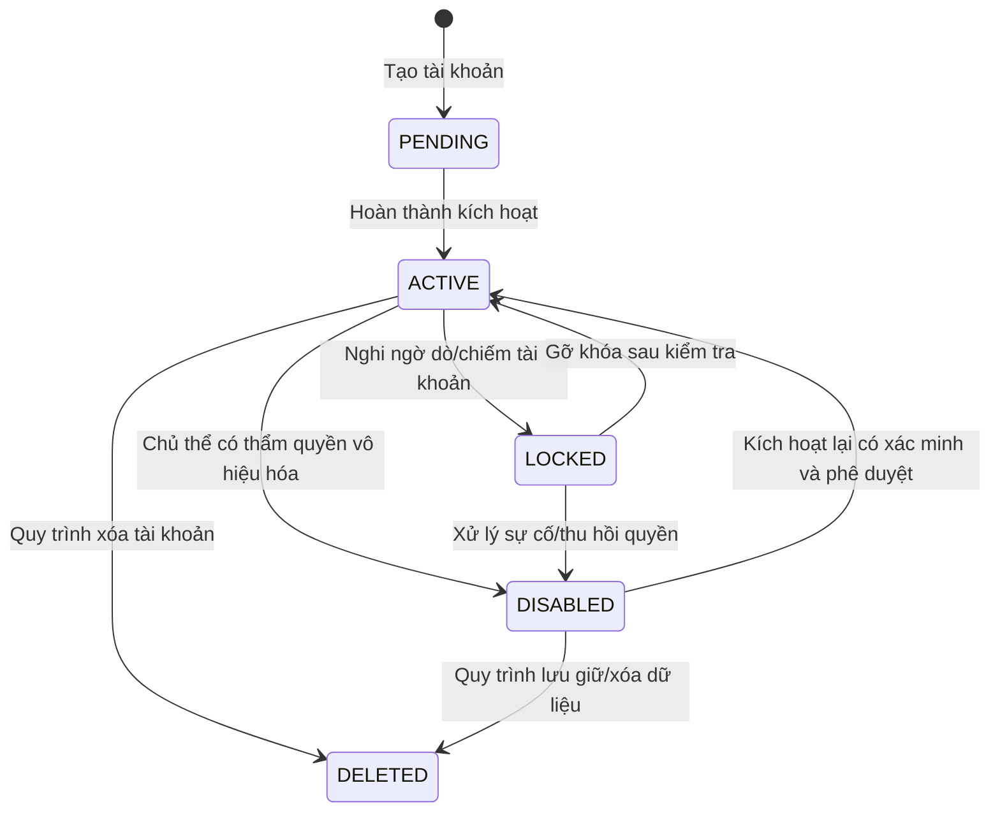
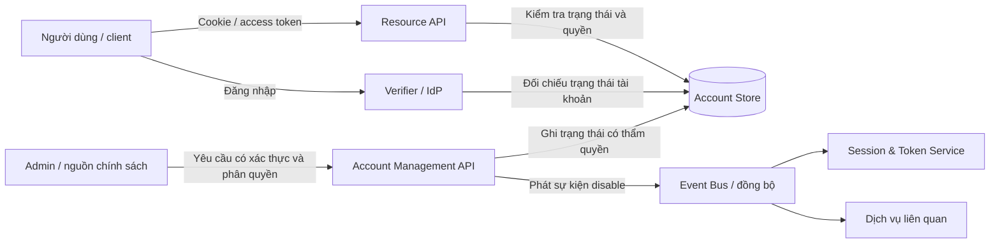
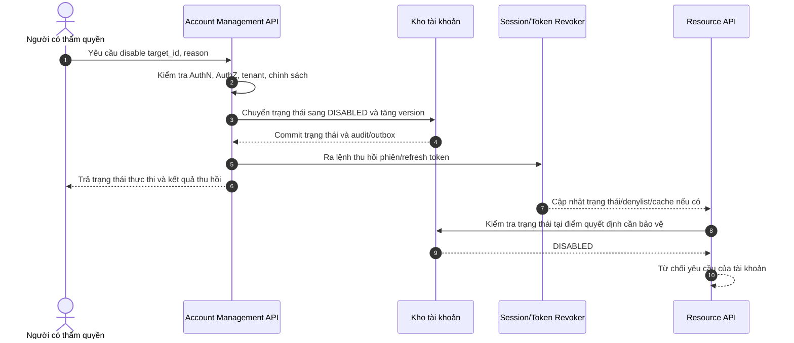

# Account disabling — Vô hiệu hóa tài khoản

> **Chương:** Account (Tài khoản)  
> **Chủ đề:** Account disabling — ngừng quyền sử dụng tài khoản trong hệ thống xác thực danh tính  
> **Phạm vi:** Security Authentication Fundamentals: credential, mật khẩu, MFA, passkey, chứng chỉ, token/phiên, liên kết danh tính, khôi phục tài khoản và ranh giới tin cậy.

## Mục tiêu học tập

Sau bài này, bạn có thể:

1. Giải thích **account disabling** là gì và phân biệt với khóa tạm thời, thu hồi phiên, đình chỉ quyền, xóa tài khoản và vô hiệu hóa một authenticator.
2. Xác định những ranh giới tin cậy và đường truy cập phải bị chặn khi tài khoản chuyển sang trạng thái vô hiệu hóa.
3. Thiết kế quy trình vô hiệu hóa tài khoản có phân quyền, ghi nhận lý do, kiểm soát tính nhất quán và thu hồi các phương tiện truy cập đang còn hiệu lực.
4. Giải thích vì sao vô hiệu hóa bản ghi tài khoản chưa chắc làm JWT, cookie phiên hoặc quyền truy cập liên kết hết hiệu lực ngay.
5. Thiết kế điều kiện kích hoạt lại, xử lý tài khoản bị chiếm, kiểm thử và đo lường hiệu lực của cơ chế vô hiệu hóa.

## 1. Account disabling là gì?

**Account disabling** là hành động đưa một tài khoản vào trạng thái **không còn được phép sử dụng để tạo hoặc tiếp tục một ngữ cảnh truy cập hợp lệ**, theo chính sách của hệ thống. Trạng thái này thường được biểu diễn bằng `DISABLED`, `SUSPENDED` hoặc một thuộc tính tương đương trong **nguồn dữ liệu tài khoản có thẩm quyền**.

Ví dụ: Một nhân viên rời công ty, quản trị viên vô hiệu hóa tài khoản quản trị của người đó. Sau thời điểm quyết định có hiệu lực, hệ thống phải từ chối đăng nhập mới, ngừng phát hành token, chặn những phiên còn tồn tại và không cho phép các API nhạy cảm thực thi dưới danh tính ấy. Đây là yêu cầu xuyên suốt **nhiều lớp**, chứ không chỉ là một nút “Disable” trong giao diện quản trị.

Không nên hiểu `disabled = true` là bằng chứng rằng **mọi đường truy cập đã bị chặn**. Hiệu lực thực tế phụ thuộc nơi kiểm tra trạng thái, khả năng thu hồi phiên/token, độ trễ đồng bộ và cả các kênh khôi phục hay đăng nhập liên kết.

### Phân biệt những khái niệm gần nhau

| Thao tác | Đối tượng chịu tác động | Ý nghĩa chính | Có thể vẫn tồn tại gì? |
| --- | --- | --- | --- |
| **Disable account** | Tài khoản/định danh sử dụng trong ứng dụng | Ngăn tài khoản sử dụng hệ thống theo chính sách | Dữ liệu hồ sơ, log, credential được giữ có kiểm soát |
| **Lock account** | Trạng thái đăng nhập, thường do nghi ngờ tấn công | Chặn tạm thời, đôi khi tự mở khi hết thời gian | Tài khoản chưa bị vô hiệu hóa về mặt quản trị |
| **Suspend access** | Quyền truy cập hoặc quan hệ với tổ chức | Tạm ngừng hoạt động theo quy định nghiệp vụ | Danh tính vẫn tồn tại, quyền có thể được khôi phục |
| **Revoke a session/token** | Một phiên hoặc token cụ thể | Hủy hiệu lực thông tin truy cập hiện có | Tài khoản vẫn có thể đăng nhập lại nếu đang hoạt động |
| **Disable an authenticator** | Mật khẩu, thiết bị MFA, passkey hoặc chứng chỉ cụ thể | Không còn chấp nhận một phương thức xác thực | Tài khoản có thể còn phương thức khác |
| **Delete account** | Vòng đời dữ liệu và bản ghi tài khoản | Xóa/ẩn danh theo chính sách dữ liệu và pháp luật áp dụng | Có thể phải giữ log hoặc hồ sơ bắt buộc theo thời hạn |

Một ứng dụng có thể dùng trạng thái `SUSPENDED` thay cho `DISABLED` hoặc áp dụng quy trình nghiệp vụ riêng. Khi thảo luận kỹ thuật, phải định nghĩa **hệ quả cụ thể** của từng trạng thái: có được login, refresh token, gọi API, dùng liên kết SSO, mở lại bằng email reset, đăng ký authenticator mới hay không.

## 2. Khi nào cần vô hiệu hóa?

Một số trường hợp phổ biến:

- **Offboarding:** Nhân viên, cộng tác viên hoặc thành viên tổ chức không còn đủ điều kiện truy cập.
- **Ứng phó sự cố:** Phát hiện hoặc nghi ngờ credential bị lộ, phiên bị chiếm, đăng nhập lạ, lạm dụng MFA hoặc thao tác trái phép.
- **Chính sách tổ chức:** Tài khoản bị đình chỉ theo quyết định có thẩm quyền, giấy phép/hợp đồng hết hiệu lực hoặc vi phạm điều khoản.
- **Tài khoản không còn sử dụng:** Sau giai đoạn không hoạt động và các bước thông báo, xem xét theo chính sách.
- **Tài khoản dịch vụ:** Máy/ứng dụng cũ đã ngừng vận hành, khóa hoặc chứng chỉ bị lộ, tích hợp không còn được phép.
- **Yêu cầu của chủ tài khoản:** Người dùng muốn tạm ngừng sử dụng mà vẫn giữ dữ liệu, nếu sản phẩm hỗ trợ.

Không phải tình huống nào cũng có mức khẩn cấp giống nhau. Với dấu hiệu chiếm tài khoản, hệ thống có thể cần **chặn tức thời theo mức có thể thực thi**, đồng thời thu hồi session và điều tra. Với quy trình offboarding đã lên lịch, có thể cần kích hoạt đúng thời điểm, phân công người duyệt và ghi nhận việc hoàn tất.

> **Nguyên tắc cốt lõi:** Đối với tài khoản đã bị vô hiệu hóa, đừng để việc đã xác thực thành công **trong quá khứ** trở thành quyền truy cập **vô thời hạn**.

## 3. Mô hình hóa vòng đời trạng thái tài khoản

Nên biểu diễn trạng thái thành một **state machine** có luật chuyển rõ ràng. Ví dụ:



Sơ đồ chỉ minh họa. Hệ thống thật có thể có `PENDING_REVIEW`, `SUSPENDED`, `DEPROVISIONING`, hoặc trạng thái không thể kích hoạt lại. Không nhất thiết cho phép mọi mũi tên trong mọi sản phẩm.

### Mô hình dữ liệu ví dụ

```text
Account {
  id: opaque_internal_id
  status: ACTIVE | LOCKED | DISABLED | DELETED
  status_version: monotonically_increasing_integer
  disabled_at: trusted_server_timestamp | null
  disabled_by: actor_or_automation_reference | null
  disable_reason_code: OFFBOARDING | COMPROMISE | POLICY | USER_REQUEST | ...
  reenable_policy: REQUIRES_REVIEW | ALLOWED_AFTER_VERIFICATION | NEVER
}
```

Đây là **mô hình minh họa**, không phải schema bắt buộc. Trường `status_version` giúp chống cập nhật cạnh tranh và có thể dùng để làm mất hiệu lực ngữ cảnh cũ nếu phiên/token hoặc hệ thống kiểm tra quyền tham chiếu tới phiên bản tài khoản. Lý do nên phân loại bằng **mã lý do** thay vì nhét dữ liệu cá nhân hoặc nội dung điều tra nhạy cảm vào log chung.

Các bất biến cần giữ:

1. Tài khoản `DISABLED` **không thể đăng nhập mới hoặc nhận phiên/token mới để sử dụng tài nguyên thuộc tài khoản ấy**.
2. Hệ thống thực thi tài nguyên phải biết và tôn trọng trạng thái bất hoạt theo chính sách; một phiên/token còn hiệu lực về mặt thời gian không đủ để bỏ qua quy tắc này.
3. Đường **password reset, account recovery, thêm MFA, thêm passkey, liên kết IdP** không được tự biến tài khoản `DISABLED` thành `ACTIVE`.
4. Chuyển `DISABLED → ACTIVE` phải là **hành động có thẩm quyền**, có kiểm soát và có khả năng kiểm toán; không dựa vào sự kiện “đăng nhập đúng” đơn thuần.
5. Mọi cơ chế đồng bộ hoặc bất đồng bộ phải có hành vi xác định khi trạng thái không chắc chắn hoặc dữ liệu bị trễ.

## 4. Ranh giới tin cậy: ai có quyền quyết định disable?

Xét các thành phần của một ứng dụng web có hỗ trợ đăng nhập liên kết:



Sơ đồ nêu hai dạng kiểm soát bổ trợ:

- **Kiểm soát tại nguồn:** trạng thái tài khoản được ghi bởi thành phần được cấp quyền, trong một hệ thống có thẩm quyền. Client không được gửi `status=ACTIVE` để tự vượt qua trạng thái.
- **Kiểm soát tại nơi sử dụng:** verifier, token issuer, session middleware và resource API phải tuân thủ trạng thái ấy. Event bất đồng bộ giúp thu hồi nhanh hơn nhưng **không nên là kiểm soát duy nhất** nếu ứng dụng cần cam kết vô hiệu hóa tức thời.

Một admin đã được xác thực **chưa chắc được phép** vô hiệu hóa mọi tài khoản. Phân quyền cần xét **tenant, tổ chức, vai trò, tài khoản đích và đặc quyền đặc biệt**. Ví dụ, quản trị viên công ty A không được disable tài khoản của công ty B; người quản trị phổ thông có thể không được disable tài khoản “break-glass” hoặc chủ sở hữu tối cao nếu chưa qua quy trình phê duyệt.

Với hành động có tác động lớn, cân nhắc **step-up authentication**, phê duyệt hai người hoặc cơ chế đảm bảo quản trị viên không thể tự ý khóa toàn bộ đường phục hồi tổ chức. Đây là quyết định theo rủi ro, không nhất thiết bắt buộc với mọi sản phẩm.

## 5. Quy trình vô hiệu hóa tài khoản an toàn

Quy trình nên tách việc **chấp nhận quyết định** và việc **phổ biến hiệu lực** tới các cơ chế truy cập.



**Luồng đề xuất:**

1. **Nhận yêu cầu:** Xác thực người thực hiện; kiểm tra đúng quyền trên tài khoản đích, phạm vi tổ chức và điều kiện phê duyệt; sử dụng định danh ổn định nội bộ thay vì tin vào email làm khóa duy nhất.
2. **Chuyển trạng thái một cách nguyên tử:** Cập nhật `status = DISABLED`, thời điểm, lý do, người thực hiện và phiên bản trạng thái trong giao dịch đáng tin; xử lý các yêu cầu đồng thời bằng khóa hoặc compare-and-swap.
3. **Ghi dấu kiểm toán:** Ghi sự kiện chuyển trạng thái và lý do dạng mã, kèm correlation ID và policy version; không ghi credential hoặc token thô.
4. **Thu hồi khả năng truy cập:** Thu hồi phiên máy chủ, refresh token, đăng xuất hoặc làm mất hiệu lực các session liên quan, và phát tín hiệu tới các hệ thống phụ thuộc.
5. **Kiểm tra thực thi:** Xác minh điểm đăng nhập, cấp/refresh token và API tài nguyên đã từ chối truy cập. Nếu có độ trễ hoặc thành phần chưa phản hồi, báo trạng thái chưa hoàn tất thay vì ngầm coi toàn bộ công việc đã xong.
6. **Thông báo thích hợp:** Thông báo cho quản trị viên và, theo chính sách, chủ tài khoản; không đưa dữ liệu điều tra nhạy cảm hoặc chi tiết giúp kẻ tấn công thăm dò vào thông báo.

Một thao tác lặp lại với cùng `account_id` khi đã `DISABLED` thường nên **idempotent**: trả “đã bị vô hiệu hóa” và không tạo phiên bản vô nghĩa, không làm mất dữ liệu kiểm toán của lần disable trước. Nếu lý do hoặc chủ thể thực hiện khác biệt cần ghi nhận thêm, hãy xử lý nó như sự kiện kiểm toán riêng.

### Mã giả phía máy chủ

```text
disableAccount(operatorContext, targetAccountId, reasonCode, requestId):
    requireAuthenticated(operatorContext)
    requireStepUpIfPolicyDemands(operatorContext, "disable_account")

    transaction:
        target = getAccountForUpdate(targetAccountId)
        requirePermission(operatorContext, "disable", target)
        requireBusinessSafeguards(operatorContext, target)

        if target.status == DISABLED:
            return ALREADY_DISABLED
        if target.status == DELETED:
            return INVALID_TRANSITION

        target.status = DISABLED
        target.statusVersion += 1
        target.disabledAt = serverNow()
        target.disabledBy = operatorContext.subjectId
        target.disableReasonCode = reasonCode

        save(target)
        appendAuditEvent("ACCOUNT_DISABLED", target.id, requestId)
        enqueueOutboxEvent("ACCOUNT_DISABLED", target.id, target.statusVersion)

    # Một worker đáng tin xử lý event có retry và chống trùng.
    requestSessionRevocation(targetAccountId)
    requestRefreshTokenRevocation(targetAccountId)
    return DISABLED_WITH_PROPAGATION_STATUS
```

Trong hệ thống phân tán, **transactional outbox** là một cách giúp tránh tình huống database đã commit `DISABLED` nhưng thông điệp thu hồi bị mất giữa chừng. Dù dùng outbox, hàng đợi hay cơ chế đồng bộ khác, mỗi consumer cần xử lý lại được, bỏ qua event cũ theo `statusVersion`, và có giám sát backlog/lỗi.

## 6. Disable phải ảnh hưởng những đường truy cập nào?

Đây là phần dễ bị bỏ sót nhất. Mỗi thành phần sử dụng danh tính cần có một hành vi được mô tả và kiểm thử.

| Đường truy cập hoặc thao tác | Yêu cầu khi tài khoản bị disable |
| --- | --- |
| **Đăng nhập bằng mật khẩu** | Verifier kiểm tra trạng thái và không tạo phiên mới dù mật khẩu đúng |
| **MFA, passkey, chứng chỉ** | Không được hoàn thành đăng nhập/cấp quyền cho tài khoản disabled chỉ vì bằng chứng mật mã hợp lệ |
| **SSO / OIDC / SAML** | Ứng dụng kiểm tra trạng thái tài khoản cục bộ trước khi cấp phiên, ngay cả khi IdP vừa xác thực thành công |
| **Cookie phiên** | Hủy phiên cũ hoặc kiểm tra trạng thái trước khi thực hiện hành động; không chỉ chặn trang login |
| **Access token / JWT** | API phải tính đến trạng thái tài khoản và hiệu lực token; chữ ký/TTL hợp lệ chưa đủ |
| **Refresh token** | Ngăn refresh/cấp access token mới; thu hồi token và phiên liên quan theo chính sách |
| **Password reset / recovery** | Có thể tiếp nhận yêu cầu theo trải nghiệm đã thiết kế, nhưng không tự kích hoạt lại và không cấp phiên sử dụng tài nguyên |
| **Thêm/đổi authenticator** | Không được cho đăng ký passkey, MFA mới hoặc khóa mới để bỏ qua trạng thái disabled |
| **Liên kết danh tính** | Đăng nhập từ IdP khác hoặc email trùng không được tự ghép vào tài khoản disabled và cấp quyền |
| **API key / personal access token** | Nếu key thuộc tài khoản, cần thu hồi hoặc có kiểm tra trạng thái owner; định nghĩa rõ với key dịch vụ độc lập |
| **Jobs, tích hợp nền và ủy quyền** | Đánh giá các quyền đã ủy quyền, tác vụ chạy dưới tài khoản và webhook/integration còn khả năng thay mặt tài khoản |
| **Session ở thiết bị khác** | Thu hồi hoặc chặn đầy đủ ở mọi thiết bị, không chỉ browser gửi yêu cầu disable |

Đặc biệt, **đăng nhập liên kết không làm mất trách nhiệm của ứng dụng nhận danh tính**. IdP có thể vẫn cho phép user xác thực trong tổ chức khác, nhưng ứng dụng phải xét tài khoản cục bộ đã bị disable và từ chối cấp quyền trong phạm vi của mình.

Một số ứng dụng cố ý cho phép người dùng đã disable truy cập **trang giải thích trạng thái, lịch sử thanh toán hoặc chức năng tải dữ liệu theo luật áp dụng**. Khi đó cần định nghĩa **ngữ cảnh hạn chế riêng**, phân quyền rõ và không vô tình tái kích hoạt quyền nghiệp vụ. Nguyên tắc là “từ chối quyền sử dụng bình thường”, còn ngoại lệ phải có yêu cầu và ranh giới cụ thể.

## 7. Vấn đề khó: JWT, bộ nhớ đệm và tính nhất quán

Giả sử tài khoản bị disable lúc 10:00, nhưng trước đó có JWT ký hợp lệ đến 10:15. Một API chỉ xác minh chữ ký, `exp` và `aud` có thể **vẫn chấp nhận token đến 10:15**. Việc đổi cờ trong database không tự động làm chữ ký mất hiệu lực.

Các chiến lược thường được kết hợp:

| Chiến lược | Cách hoạt động | Đánh đổi |
| --- | --- | --- |
| **Tra cứu trạng thái tại API** | Ở điểm quyết định truy cập, lấy trạng thái từ nguồn đáng tin | Hiệu lực nhanh nhưng tăng độ trễ/tải; cần xử lý lỗi nguồn dữ liệu |
| **Phiên hoặc opaque token có tra cứu máy chủ** | Token tra cứu trạng thái/phiên có thể bị thu hồi | Dễ thu hồi tập trung, đòi hỏi kho phiên/introspection tin cậy |
| **Token TTL ngắn** | Thu hẹp thời gian sống của access token sau disable | Giảm cửa sổ rủi ro nhưng **không bảo đảm chặn ngay** |
| **Revocation list / session version / account version** | API so token/phiên với danh sách thu hồi hoặc phiên bản còn hiệu lực | Cần đồng bộ và kiểm soát độ trễ cache, lượng dữ liệu, fallback |
| **Token introspection** | Resource server hỏi bên có thẩm quyền xem token còn active không | Phù hợp một số kiến trúc OAuth; thêm phụ thuộc mạng và độ sẵn sàng |
| **Event invalidation** | Phát thông điệp để xóa cache/thu hồi phiên ở dịch vụ | Tăng tốc truyền trạng thái nhưng có thể trễ hoặc mất nếu thiếu retry |

**Cần xác định SLA hiệu lực:** ví dụ “mọi API quản trị từ chối truy cập của tài khoản bị vô hiệu hóa trong không quá X giây kể từ khi trạng thái được ghi”. Giá trị X là **quyết định kiến trúc dựa trên rủi ro**, không phải một hằng số chuẩn chung.

Nếu sử dụng cache trạng thái tài khoản, cần đặt thời gian tồn tại, cơ chế invalidation và **hành vi khi cache hoặc nguồn dữ liệu lỗi**. Với API tài chính nhạy cảm, có thể yêu cầu từ chối khi không xác minh được trạng thái (*fail closed*); với nội dung công khai, chính sách có thể khác. Tránh một mô hình mà cache cũ chứa `ACTIVE` mãi vì mất event.

### Race condition: yêu cầu đang chạy trong lúc disable

Một tình huống thực tế:

1. 09:59:59 API A kiểm tra thấy tài khoản `ACTIVE`.
2. 10:00:00 Quản trị viên commit `DISABLED`.
3. 10:00:01 API A hoàn tất chuyển tiền dựa trên kiểm tra ở bước 1.

Việc “kiểm tra ở đầu request” chưa chắc đáp ứng yêu cầu **không có giao dịch nhạy cảm nào được hoàn tất sau khi disable**. Nếu nghiệp vụ cần bảo đảm mạnh như vậy, có thể phải xác minh lại phiên bản trạng thái **tại điểm commit của hành động**, phối hợp transaction/lock hoặc cơ chế fencing phù hợp giữa account store và dịch vụ nghiệp vụ. Với hệ thống phân tán, tính nhất quán tức thời qua nhiều kho dữ liệu có chi phí lớn; vì vậy phải định nghĩa rõ **điểm hiệu lực**, bảo đảm có thể đạt và cách giám sát.

## 8. Vô hiệu hóa khi tài khoản bị chiếm

Khi nghi ngờ account takeover, mục tiêu không chỉ là chặn đăng nhập mới. Kẻ tấn công có thể đã:

- Lấy được cookie phiên hoặc bearer token;
- Đăng ký passkey, thiết bị MFA hoặc phương thức recovery do họ kiểm soát;
- Tạo API key/personal access token;
- Đổi email khôi phục, liên kết IdP mới hoặc mời tài khoản đồng phạm;
- Bật một job hoặc thiết lập tích hợp để tiếp tục truy cập gián tiếp.

Quy trình xử lý cần cân nhắc:

1. Đưa tài khoản vào trạng thái hạn chế/disabled theo quyền và mức khẩn cấp phù hợp.
2. Thu hồi phiên, token, API key và các phiên truy cập liên quan; dừng việc cấp token mới.
3. Xem lại các thay đổi authenticator, recovery, IdP, quyền và tài nguyên trong khoảng thời gian nghi bị chiếm.
4. Bảo vệ bằng chứng điều tra, ghi dấu sự kiện và thông báo qua kênh đáng tin khi phù hợp.
5. Chỉ kích hoạt lại sau khi xác minh người kiểm soát hợp lệ, thay thế credential đáng ngờ và kiểm tra các quyền đã bị thay đổi.

Không nên “mở khóa” tự động chỉ vì mật khẩu được nhập đúng hoặc người dùng có mã OTP: chính các bằng chứng đó có thể đã rơi vào tay kẻ tấn công. Quy trình khôi phục phải có **mức bảo đảm tương xứng với nguy cơ** và đường xử lý khi mất hết authenticator, nhưng không tạo lối tắt vượt chính sách disable.

## 9. Re-enable: kích hoạt lại không phải một lần login

**Re-enabling** là chuyển tài khoản từ `DISABLED` về trạng thái cho phép hoạt động. Đây là quyết định quản trị/vòng đời tài khoản, khác với việc người dùng chứng minh mình biết mật khẩu hoặc giữ passkey.

Trước khi kích hoạt lại, cần xác nhận:

- **Nguyên nhân disable còn hay không?** Ví dụ đã hoàn tất offboarding thì không tự mở lại dù user vẫn biết mật khẩu; tài khoản tạm đình chỉ có thể cần quyết định mới của tổ chức.
- **Ai có thẩm quyền?** Có cần phê duyệt, tách nhiệm vụ hoặc xác thực tăng cường cho quản trị viên không?
- **Ai đang kiểm soát account?** Có phải người dùng hợp lệ không? Có authenticator, recovery channel hoặc linked identity bị thêm trái phép không?
- **Khôi phục quyền ở mức nào?** Không nên tự động khôi phục tất cả vai trò cũ, key cũ và token đã thu hồi. Có thể cần cấp lại từ đầu theo nguyên tắc tối thiểu.
- **Những phiên cũ có sống lại không?** Thông thường phiên/token đã thu hồi cần **giữ trạng thái bị thu hồi**, yêu cầu đăng nhập mới sau khi kích hoạt lại.

Ví dụ:

```text
reenableAccount(operator, accountId, approval):
    requireAuthorizedOperator(operator, accountId)
    requireApprovalIfNeeded(approval)
    requireOriginalDisableReasonResolved(accountId)
    requireAuthenticatorAndRecoveryReview(accountId)

    atomicTransition(accountId, DISABLED, ACTIVE)
    recordAudit("ACCOUNT_REENABLED", operator, accountId)

    # Không khôi phục session, refresh token, API key cũ.
    requireFreshLoginForUser(accountId)
```

Trong môi trường đa tenant, có thể tồn tại khác biệt giữa **định danh toàn cục** và **membership của từng tổ chức**. Vô hiệu hóa membership ở tenant A không nhất thiết làm vô hiệu hóa tài khoản ở tenant B; ngược lại, disable toàn cục phải thắng các quyền của mọi tenant. Thiết kế cần định nghĩa rõ phạm vi và thứ tự ưu tiên của các lệnh disable.

## 10. Audit, giám sát và đo hiệu quả

Một yêu cầu disable chỉ có ý nghĩa an toàn khi có thể trả lời **ai đã yêu cầu, tại sao, khi nào có hiệu lực và còn đường truy cập nào chưa bị thu hồi**.

### Sự kiện nên có

| Sự kiện / trường | Mục đích |
| --- | --- |
| `account_disable_requested` | Ghi người yêu cầu, account ID, tenant, request/correlation ID |
| `account_status_changed` | Ghi trạng thái trước/sau, version, timestamp phía máy chủ |
| `session_revocation_completed` | Xác nhận số phiên được xử lý, trạng thái hoàn thành/chưa hoàn thành |
| `refresh_token_revocation_completed` | Theo dõi khả năng ngừng cấp token mới |
| `downstream_disable_ack` | Biết dịch vụ nào nhận và thực thi sự kiện |
| `disabled_account_access_denied` | Phát hiện nỗ lực tiếp tục sử dụng tài khoản disabled |
| `account_reenable_requested/approved` | Truy nguồn quyết định cho phép tài khoản hoạt động lại |
| `disable_propagation_failed` | Cảnh báo khi đồng bộ hoặc thu hồi thất bại |

Không ghi mật khẩu, OTP, session ID thô, access/refresh token, reset link, khóa riêng hoặc nội dung điều tra vượt mức cần thiết vào log. Log phải được giới hạn quyền, bảo vệ tính toàn vẹn, lưu giữ theo chính sách và tránh công khai lý do nhạy cảm tới người không có quyền.

### Chỉ số vận hành gợi ý

| Chỉ số | Cách đo | Ý nghĩa |
| --- | --- | --- |
| **Disable propagation latency** | Khoảng thời gian từ commit `DISABLED` đến khi các điểm thực thi cần thiết xác nhận không còn cấp truy cập | So với SLA chặn truy cập đã đặt |
| **Revocation completion rate** | Số yêu cầu disable có đầy đủ xác nhận thu hồi trong kỳ / tổng yêu cầu disable áp dụng | Tìm trường hợp thu hồi còn dang dở |
| **Post-disable accepted request count** | Số request của tài khoản disabled vẫn được API cho phép sau mốc hiệu lực đã xác định | Chỉ số an toàn đặc biệt cần điều tra |
| **Blocked login/refresh attempts** | Số lần đăng nhập hoặc refresh bị từ chối vì trạng thái disabled | Phát hiện đường đang bị thử lại; chưa tự chứng minh đó là tấn công |
| **Unauthorized disable attempts** | Yêu cầu disable không đủ quyền/khác tenant | Theo dõi lạm dụng chức năng quản trị |
| **Erroneous disable / recovery time** | Số trường hợp disable nhầm và thời gian khắc phục hợp lệ | Đo tác động vận hành và trải nghiệm |

**Tử số và mẫu số phải rõ.** Nếu một tài khoản có 10 phiên ở 3 dịch vụ, chỉ nhận ACK của 2 dịch vụ rồi báo “100% session revoked” là sai. Cũng không được coi sự vắng mặt của log truy cập sau disable là bằng chứng chắc chắn nếu đường API đó chưa có telemetry. Với sự cố, nên đối soát log **quyết định truy cập** ở API, không chỉ log nút bấm disable.

## 11. Sai lầm thường gặp

| Sai lầm | Hậu quả | Hướng sửa |
| --- | --- | --- |
| Chỉ ẩn nút login hoặc đổi giao diện sang “Tài khoản đã khóa” | Gọi API trực tiếp vẫn truy cập được | Kiểm tra trạng thái tại verifier và resource server |
| Chặn mật khẩu nhưng không chặn SSO/passkey | Người dùng hoặc kẻ tấn công đăng nhập bằng phương thức khác | Ràng buộc mọi phương thức với cùng trạng thái tài khoản |
| Xóa cookie trên một trình duyệt và coi là logout toàn bộ | Phiên trên thiết bị khác vẫn sống | Thu hồi phiên phía server hoặc cơ chế tương đương |
| Chỉ thu hồi refresh token nhưng JWT dài hạn vẫn được chấp nhận | API vẫn cho phép thao tác đến khi access token hết hạn | Kiểm tra trạng thái/phiên bản hoặc áp dụng cơ chế revocation phù hợp |
| Đường reset password tự chuyển `DISABLED → ACTIVE` | Account takeover bằng đường khôi phục | Tách quyền khôi phục authenticator khỏi quyền kích hoạt lại |
| Event disable bị xử lý trễ nhưng UI báo hoàn tất toàn bộ | Người vận hành tưởng quyền đã bị cắt ngay | Theo dõi trạng thái propagation và cảnh báo lỗi |
| Thao tác disable không xét tenant/role | Quản trị viên ảnh hưởng sai tài khoản | Phân quyền theo tài khoản đích và chính sách đặc quyền |
| Kích hoạt lại đồng thời khôi phục toàn bộ session và API key cũ | Kẻ từng giữ token cũ có thể truy cập lại | Yêu cầu login/cấp credential mới, giữ revoked token vô hiệu |
| Không kiểm tra job/integration chạy dưới tài khoản | Tích hợp vẫn thao tác gián tiếp | Kiểm kê delegated access và ownership của credentials |
| Xóa hẳn tài khoản để “disable cho nhanh” | Mất ngữ cảnh kiểm toán hoặc vi phạm chính sách lưu giữ | Phân biệt disable, retention và deletion |

## 12. Tình huống thiết kế: vô hiệu hóa tài khoản quản trị

Một nền tảng SaaS có ba thành phần:

- **Web Admin:** đăng nhập SSO/OIDC, tạo phiên cookie.
- **Billing API:** chấp nhận JWT access token thời hạn 15 phút và thực hiện hoàn tiền.
- **Background Worker:** xử lý các job do quản trị viên tạo, một số job vẫn mang quyền của tài khoản đã lập lịch.

Lúc **14:00**, bộ phận vận hành disable tài khoản quản trị viên An vì nghi ngờ phiên bị chiếm. Hệ thống chỉ cập nhật `accounts.status = 'DISABLED'`, còn Billing API chỉ kiểm tra chữ ký JWT. Lúc **14:02**, một request hoàn tiền có JWT phát hành trước 14:00 được chấp nhận.

**Phân tích:** Đây là lỗi ở **điểm thực thi quyền**. Bản ghi tài khoản đã disabled nhưng Billing API không kiểm tra trạng thái hoặc cơ chế thu hồi tương đương. Một JWT còn hạn có thể chứng minh token do issuer cấp, nhưng **không chứng minh danh tính được phép sử dụng tài nguyên ở thời điểm hiện tại**.

Thiết kế lại cần:

1. Web Admin dừng cấp session, đồng thời thu hồi phiên hiện có.
2. Token service dừng refresh/cấp access token mới cho tài khoản disabled.
3. Billing API kiểm tra status hoặc trạng thái thu hồi có bảo đảm phù hợp, cùng với `iss`, `aud`, `exp`, chữ ký và quyền hoàn tiền.
4. Worker đánh giá lại trạng thái actor tại thời điểm job thực thi; các job có quyền nhạy cảm cần hủy, tạm giữ hoặc tái ủy quyền khi chủ tài khoản bị disable.
5. Ghi nhận đầy đủ mốc chuyển trạng thái và thời điểm từng thành phần bắt đầu chặn, cảnh báo nếu sau mốc cam kết vẫn có request được chấp nhận.

Một thiết kế có thể chủ động **hủy job đang chờ**, hoặc cho phép một số job trung tính hoàn thành dưới **danh tính dịch vụ riêng** đã có phê duyệt hợp lệ. Quy tắc này phải rõ từ trước; không được tùy tiện biến mọi job của tài khoản disabled thành job có quyền cao hơn.

### Bài kiểm thử chấp nhận

| Trường hợp | Đầu vào / điều kiện | Kết quả kỳ vọng |
| --- | --- | --- |
| Disable hợp lệ | Admin có quyền disable user cùng tenant | Status chuyển `DISABLED`, có audit, thu hồi truy cập theo SLA |
| Thiếu quyền | User thường gọi API disable admin | Bị từ chối, trạng thái không đổi |
| Cross-tenant | Admin tenant A disable user tenant B | Bị từ chối, không rò rỉ thông tin chi tiết tài khoản |
| Login sau disable | Nhập đúng mật khẩu / dùng passkey hợp lệ | Không cấp session và không cấp token truy cập |
| SSO sau disable | IdP xác thực thành công | Ứng dụng vẫn từ chối tạo phiên tài khoản disabled |
| JWT cũ | Access token còn hạn từ trước disable | API nhạy cảm từ chối theo cơ chế hiệu lực đã chọn |
| Refresh token cũ | Gọi refresh sau disable | Không nhận access token mới |
| Reset password | Link reset hợp lệ của tài khoản disabled | Không tự chuyển trạng thái về active |
| Re-enable | Admin đủ quyền, lý do đã được giải quyết | Cho phép đăng nhập **mới**, các phiên/token đã revoked không sống lại |
| Đồng thời disable và request nghiệp vụ | API gọi đúng sát thời điểm disable | Đáp ứng quy tắc mốc hiệu lực/race condition đã cam kết |
| Event lỗi hoặc gửi trùng | Consumer nhận event disable trùng hoặc out-of-order | Idempotent; không vô tình bật lại account |
| Dịch vụ mất kết nối account store | API không xác nhận được trạng thái | Áp dụng chính sách fail-closed/failover đã định cho độ nhạy tương ứng |

Chạy kiểm thử bằng tài khoản và môi trường được phép. Với luồng SSO hoặc nhiều dịch vụ, test chỉ tại trang login là chưa đủ; cần xác minh request ở **resource API** và khả năng phát hành token thực tế.

## 13. Checklist triển khai

Trước khi coi chức năng account disabling hoàn tất, hãy trả lời:

- **Phạm vi:** Disable tài khoản toàn cục, membership theo tenant, quyền trong ứng dụng hay một authenticator? Tất cả dịch vụ có hiểu cùng một quyết định không?
- **Quyền hạn:** Ai được disable, ai được re-enable, ai duyệt trường hợp đặc biệt? Có kiểm tra quyền trên đối tượng đích không?
- **Trạng thái:** Có state machine, transition hợp lệ, timestamp và source of truth rõ không? Có idempotency và kiểm soát race không?
- **Phát hành truy cập:** Login, SSO, passkey, chứng chỉ, MFA, password reset và recovery có thể bypass không?
- **Ngữ cảnh đang hoạt động:** Có chặn cookie phiên, access/refresh token, API key, delegated access và background jobs theo chính sách không?
- **Tính nhất quán:** Có đo mốc hiệu lực, độ trễ cache, propagation, retry/ACK, sự kiện cũ và hành vi lỗi không?
- **Kích hoạt lại:** Có tách quyết định re-enable khỏi login và không khôi phục credential/session bị thu hồi không?
- **Giám sát:** Có audit đủ để điều tra, cảnh báo request được chấp nhận sau disable và phát hiện lỗi thu hồi không?
- **Dữ liệu:** Có bảo vệ thông tin nhạy cảm, phân biệt disable với deletion và giữ/xóa theo chính sách không?
- **Kiểm thử:** Có kiểm thử mọi entry point, cross-tenant, post-disable API call và các trường hợp đồng thời không?

### Câu hỏi tự kiểm tra

1. Vì sao cập nhật `status = DISABLED` trong database chưa chắc khiến JWT đã phát hành mất hiệu lực ngay?
2. Việc vô hiệu hóa tài khoản khác gì với việc khóa một passkey hoặc thu hồi một phiên?
3. Nếu IdP xác thực thành công nhưng tài khoản cục bộ bị disable, ứng dụng có nên tạo session không? Vì sao?
4. Tại sao luồng password reset không nên tự động kích hoạt lại tài khoản disabled?
5. Trong kiến trúc có cache và event bus, phải đo những gì để biết quyết định disable đã có hiệu lực ở tất cả điểm truy cập?
6. Vô hiệu hóa một quản trị viên có job hoàn tiền đang chạy cần bổ sung chính sách nào?
7. Khi kích hoạt lại sau sự cố chiếm tài khoản, vì sao cần xem lại MFA, passkey, linked IdP và phiên/token cũ?

## Kết luận

**Account disabling là một quyết định kiểm soát truy cập có hiệu lực trong suốt vòng đời tài khoản**, không chỉ là thay một cờ hoặc ẩn nút đăng nhập. Để an toàn, hệ thống phải có trạng thái có thẩm quyền, phân quyền thao tác disable/re-enable, thu hồi và kiểm tra lại các phiên/token, bảo vệ mọi phương thức xác thực và liên kết danh tính, kiểm soát recovery, đồng bộ nhất quán giữa các dịch vụ và đo được thời điểm chặn truy cập thực tế. Các mối đe dọa như phishing, replay, credential theft hay session hijacking cho thấy lý do **bằng chứng xác thực từng đúng** không thể vượt qua **quyết định tài khoản hiện không còn được phép truy cập**.
