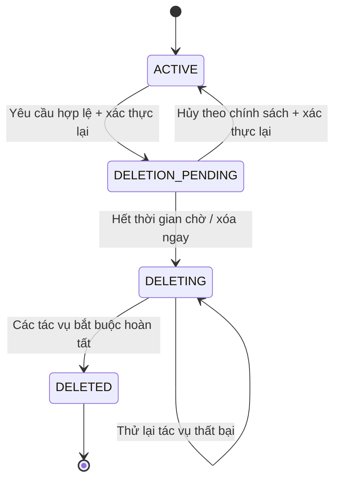

# Account deletion — Xóa tài khoản an toàn

**Xóa tài khoản (account deletion)** là quá trình chấm dứt một danh tính tài khoản trong hệ thống và xử lý những gì gắn với danh tính đó: khả năng đăng nhập, phiên truy cập, credential, liên kết với nhà cung cấp danh tính, dữ liệu cá nhân và các quan hệ nghiệp vụ. Đây là một thao tác nhạy cảm của **vòng đời tài khoản**, không đơn thuần là xóa một hàng khỏi bảng `users`.

Giả sử An chọn **Xóa tài khoản** trong ứng dụng mua hàng. Nếu máy chủ xóa bản ghi `users` nhưng access token của An vẫn gọi được API, danh tính thực tế chưa được vô hiệu hóa. Nếu tài khoản bị xóa ngay khi có một yêu cầu HTTP mà không kiểm tra người yêu cầu, kẻ tấn công có thể làm mất quyền truy cập của người khác. Nếu hệ thống cho phép đăng ký lại cùng email và tự nối các đơn hàng cũ, người mới có thể nhìn thấy dữ liệu không thuộc về mình.

Trong module `SECURITY_AUTHENTICATION_FUNDAMENTALS`, bài này xem xét **xóa tài khoản dưới góc độ xác thực và ranh giới tin cậy**: ai có quyền yêu cầu xóa, cách xác minh ý định, cách kết thúc phiên và token, xử lý mật khẩu/MFA/passkey/chứng chỉ, chống phishing và replay, và cách phối hợp các thành phần để không tạo ra lỗ hổng sau khi xóa.

## 1. Phân biệt những thao tác liên quan

Các sản phẩm thường dùng từ “xóa” cho nhiều trạng thái khác nhau. Trước khi thiết kế, cần xác định chính xác hành vi hệ thống cam kết.

| Thao tác | Ý nghĩa | Khả năng đăng nhập | Dữ liệu |
| --- | --- | --- | --- |
| **Đăng xuất (logout)** | Kết thúc một hoặc nhiều phiên | Có thể đăng nhập lại | Giữ nguyên |
| **Vô hiệu hóa/tạm khóa (disable/suspend)** | Ngăn tài khoản tiếp tục sử dụng trong một giai đoạn | Bị từ chối theo chính sách | Thường được giữ để có thể mở lại |
| **Yêu cầu xóa (deletion request)** | Chủ thể hoặc người có thẩm quyền bắt đầu quy trình xóa | Nên bị hạn chế ngay theo chính sách | Có thể còn trong thời gian chờ và xử lý |
| **Xóa logic (soft delete)** | Đánh dấu tài khoản không hoạt động, ẩn khỏi nghiệp vụ | Không được dùng như tài khoản đang hoạt động | Bản ghi có thể vẫn tồn tại |
| **Xóa hoàn tất (deletion completed)** | Quy trình thu hồi khả năng truy cập và xử lý dữ liệu liên quan đã đạt tiêu chí hoàn tất | Không còn phiên/credential có hiệu lực cho danh tính đó | Dữ liệu được xóa, ẩn danh hoặc giữ có căn cứ rõ ràng theo chính sách |
| **Hủy liên kết IdP (unlink)** | Gỡ một phương thức đăng nhập liên kết | Có thể đăng nhập bằng phương thức khác | Tài khoản nội bộ vẫn tồn tại |

**Đóng tài khoản không nhất thiết đồng nghĩa xóa tức thời toàn bộ dữ liệu.** Ví dụ, dữ liệu hóa đơn hoặc giao dịch có thể cần được lưu theo nghĩa vụ áp dụng, trong khi credential và quyền đăng nhập phải bị xử lý sớm. Hệ thống cần công bố chính sách thời hạn và loại dữ liệu được giữ, tránh hứa “mọi dữ liệu đã biến mất ngay lập tức” khi bản sao lưu hoặc hệ thống khác chưa hoàn tất xử lý.

### Account ID, email và quyền sở hữu

Trong thiết kế tốt, `account_id` là định danh nội bộ ổn định, thường không tái sử dụng. Email, số điện thoại hoặc tên đăng nhập là thuộc tính có thể đổi chủ và không tự nó chứng minh quyền sở hữu một tài khoản cũ. Cặp `(issuer, subject)` từ một nhà cung cấp đăng nhập liên kết chỉ xác định chủ thể trong phạm vi issuer đó; không được tự suy ra quyền sở hữu tài khoản đã xóa từ việc email trùng khớp.

Sau khi xóa, nếu người khác đăng ký lại cùng email, hệ thống cần tạo **account ID mới**, không tự gắn lịch sử giao dịch, phiên cũ, passkey, quyền tenant hoặc tài sản của tài khoản đã xóa vào tài khoản mới.

## 2. Mô hình đe dọa: Ai có thể yêu cầu xóa?

Xóa tài khoản có thể là một **quyền nhạy cảm**: nó làm mất quyền truy cập và đôi khi không thể khôi phục. Các tác nhân liên quan gồm chủ tài khoản, quản trị viên có thẩm quyền, hệ thống xử lý vòng đời tài khoản và kẻ tấn công đang chiếm một phần phiên hoặc thông tin đăng nhập.

| Ranh giới tin cậy | Rủi ro | Nguyên tắc kiểm soát |
| --- | --- | --- |
| Trình duyệt/app → API xóa | Client tự đặt `accountId` của người khác, CSRF, lạm dụng phiên bị đánh cắp | Lấy principal từ phiên đã xác thực; kiểm tra quyền với tài khoản đích, bảo vệ CSRF |
| Phiên hiện tại → thao tác có hậu quả lớn | Phiên lâu ngày hoặc bị chiếm quyền dùng để xóa | **Xác thực lại (step-up)** theo mức rủi ro; kiểm tra thời điểm và phương thức xác thực |
| Credential → bằng chứng xác nhận | Mã xác nhận bị lộ, bị replay hoặc dùng sai giao dịch | Token/challenge ngắn hạn, một lần, ràng buộc với tài khoản và thao tác |
| API xóa → cơ sở dữ liệu và các service | Một phần đã xóa, phần khác vẫn chấp nhận token hoặc giữ quyền | Trạng thái nhất quán, thu hồi quyền, xử lý bất đồng bộ đáng tin cậy |
| Hệ thống → email, IdP, hệ thống ngoài | Kênh thông báo hoặc hệ thống liên kết có thể bị giả mạo hoặc không đồng bộ | Xác minh nguồn, phân biệt thông báo và bằng chứng xác thực, xử lý lỗi rõ ràng |

Xem xét ba hình thức yêu cầu:

1. **Người dùng tự xóa:** cần phiên đã xác thực, kiểm tra đúng account/tenant, xác thực lại đủ mạnh và sự đồng ý rõ ràng đối với hậu quả.
2. **Quản trị viên xóa tài khoản:** cần quyền quản trị cụ thể, phạm vi tổ chức, lý do và ghi nhận audit; không mặc nhiên cho phép quản trị viên ngoài tenant thực hiện.
3. **Xóa tự động theo chính sách:** cần nguồn sự kiện và quyền của service được kiểm chứng, điều kiện kích hoạt xác định và khả năng kiểm tra lại; không tin một webhook không có chữ ký hoặc nguồn gốc.

Không được dựa vào việc request gửi `userId=42` hoặc `email=an@example.com` để quyết định đối tượng xóa. Chủ thể gọi API phải lấy từ kết quả xác thực trên máy chủ; `accountId` được cung cấp chỉ là **đối tượng yêu cầu thao tác** và vẫn phải được phân quyền.

## 3. Vòng đời xóa tài khoản

Thiết kế nên dùng **state machine** thay vì chỉ một cờ `deleted=true`. Các trạng thái gợi ý dưới đây có thể điều chỉnh theo sản phẩm.



**Các bất biến quan trọng:**

- Khi đã vào `DELETION_PENDING`, tài khoản không còn được tự do sử dụng các chức năng nghiệp vụ như trước. Tùy chính sách, chỉ cho phép một luồng giới hạn để xem/hủy yêu cầu xóa, và luồng này phải xác thực đủ mạnh.
- Khi vào `DELETING`, không được quay lại `ACTIVE` bằng thao tác đăng nhập thông thường. Tác vụ xóa cần **idempotent**: chạy lại không tái tạo tài khoản hay khôi phục credential.
- Khi ở `DELETED`, hệ thống không cấp phiên/token mới, không tái sử dụng `account_id`, không tự nối tài khoản mới với dữ liệu của chủ thể đã xóa.
- Mọi dịch vụ ra quyết định truy cập phải nhận biết tài khoản không còn hoạt động, kể cả khi JWT cũ chưa hết hạn. Nếu dịch vụ chỉ xác minh chữ ký JWT mà không kiểm tra trạng thái thu hồi, hệ thống phải có biện pháp khác đáp ứng yêu cầu chấm dứt quyền truy cập, chẳng hạn token ngắn hạn kết hợp kiểm tra phiên/trạng thái hoặc denylist.

**Thời gian chờ (grace period)** là lựa chọn sản phẩm, không phải bước bắt buộc. Nếu có, cần nói rõ người dùng có thể hủy tới thời điểm nào, dữ liệu nào vẫn được giữ trong thời gian chờ và quyền truy cập bị giới hạn thế nào. Quy trình khôi phục trong thời gian chờ không được yếu hơn yêu cầu xác minh danh tính của thao tác nhạy cảm.

## 4. Luồng tự xóa an toàn từ đầu tới cuối

Một luồng mẫu gồm các bước sau.

### Bước 1 — Hiển thị phạm vi và hậu quả

Giao diện giải thích trước khi xác nhận: tài khoản nào sẽ bị xóa, tác động lên tổ chức/nhóm, dữ liệu có thể xuất trước, đăng ký lại có khôi phục dữ liệu cũ không, có thời gian chờ không và các dữ liệu có thể được lưu theo chính sách. Nút xác nhận nên mô tả hành động rõ ràng (ví dụ **“Xác nhận xóa tài khoản”**), không ngụy trang trong một thao tác vô hại.

Nếu người dùng là chủ sở hữu duy nhất của một tổ chức hoặc tài sản chung, hệ thống phải xử lý chuyển quyền sở hữu hoặc nêu rõ hệ quả trước khi xóa. Việc chuyển quyền có thể cần quy trình được xác thực riêng.

### Bước 2 — Xác thực lại và xác định account đích

Máy chủ kiểm tra phiên hiện tại, principal, tenant và **thời điểm xác thực gần nhất**. Với thao tác nhạy cảm như xóa tài khoản, nên yêu cầu xác thực lại theo chính sách rủi ro: nhập lại mật khẩu, xác thực bằng passkey, hoặc hoàn thành yếu tố MFA phù hợp.

- Người đăng nhập bằng **mật khẩu** có thể được yêu cầu nhập lại mật khẩu và bước MFA theo cấu hình; kiểm tra và giới hạn số lần thử ở máy chủ.
- Người đăng nhập bằng **passkey/WebAuthn** có thể thực hiện thử thách xác thực mới, kiểm tra challenge, origin, RP ID, chữ ký và mức user verification theo chính sách. Một assertion của thao tác khác không được chấp nhận cho giao dịch xóa.
- Người đăng nhập bằng **OIDC/SAML** có thể cần reauthentication tại nhà cung cấp danh tính với cơ chế thích hợp, hoặc một yếu tố xác thực nội bộ đủ mạnh. Trường thời điểm/phương thức xác thực do IdP trả về chỉ đáng tin sau khi thông điệp được xác minh đúng và phù hợp ngữ cảnh.
- Nếu tài khoản không còn phương thức đăng nhập, sử dụng quy trình **recovery có bảo đảm tương ứng**; không cho phép xóa chỉ với một email hoặc thông tin cá nhân dễ tìm.

Điều quan trọng là kết quả xác thực lại phải gắn với **cùng account, cùng phiên/giao dịch và đúng hành động**, có hiệu lực ngắn. Không dùng một cờ `mfaPassed=true` do client gửi, cũng không dùng kết quả xác thực lại của tài khoản A để xóa tài khoản B.

### Bước 3 — Xác nhận ý định qua giao dịch một lần

Máy chủ nên cấp một `deletion_transaction_id` hoặc challenge ngẫu nhiên gắn với `account_id`, phiên, loại thao tác, thời hạn và trạng thái chưa sử dụng. Nếu gửi link xác nhận, token cần **khó đoán, ngắn hạn, một lần**, lưu dạng hash hoặc cơ chế bảo vệ thích hợp; không coi việc mở link qua email là bằng chứng đủ mạnh duy nhất trong mọi trường hợp.

Cần kiểm tra chống **CSRF** đối với ứng dụng dùng cookie; cấu hình `SameSite` hỗ trợ nhưng không luôn thay thế CSRF token/kiểm tra nguồn gốc phù hợp. Thao tác xóa thực sự cần một request có chủ đích (`POST`/`DELETE` phù hợp), không kích hoạt chỉ bằng `GET` vì bộ quét link hoặc email client có thể truy cập URL mà người dùng chưa xác nhận.

### Bước 4 — Ghi nhận yêu cầu và cắt quyền truy cập

Trong giao dịch máy chủ, kiểm tra lại trạng thái tài khoản, quyền và điều kiện xác thực lại; chuyển tài khoản sang `DELETION_PENDING` hoặc `DELETING`, ghi sự kiện audit, thu hồi refresh token và vô hiệu hóa các phiên liên quan theo chính sách. Nếu hệ thống cấp access token tự chứa, lên cơ chế kiểm tra trạng thái hoặc thu hồi tương ứng để các API không tiếp tục cấp quyền sau khi yêu cầu đã được chấp nhận.

Thông báo qua kênh liên hệ đã đăng ký giúp chủ tài khoản phát hiện thao tác bất thường. Thông báo không nên chứa password, OTP, access token hoặc đường dẫn tự động xóa ngay khi mở.

### Bước 5 — Dọn dữ liệu và báo trạng thái hoàn tất

Các bước xóa dữ liệu, credential và liên kết đến hệ thống ngoài có thể chạy bất đồng bộ. Máy chủ nên phân biệt **“đã nhận yêu cầu”**, **“đang xử lý”** và **“đã hoàn tất”**. Chỉ công bố hoàn tất khi những tiêu chí bắt buộc được xác nhận, đồng thời nêu rõ các ngoại lệ giữ dữ liệu theo chính sách.

```mermaid
sequenceDiagram
    participant U as Người dùng
    participant A as API account
    participant S as Kho phiên và token
    participant D as CSDL account
    participant W as Worker xóa dữ liệu
    U->>A: Yêu cầu xóa + phiên đã xác thực
    A->>A: Kiểm tra owner/tenant + xác thực lại + CSRF
    A->>D: Chuyển ACTIVE -> DELETION_PENDING, ghi outbox
    A->>S: Vô hiệu hóa các phiên và refresh token
    A-->>U: Đã tiếp nhận; quyền truy cập bị giới hạn
    D-->>W: Sự kiện xóa đã commit
    W->>D: Chuyển sang DELETING, dọn credential và dữ liệu
    W->>D: Ghi trạng thái DELETED khi hoàn tất
```

Sơ đồ diễn tả các bước logic; trong triển khai phân tán cần thiết kế để **thay đổi trạng thái tài khoản và hiệu lực quyền truy cập** không để lại khoảng trống nguy hiểm nếu dịch vụ phiên hoặc worker tạm thời lỗi. Ví dụ, API có thể coi trạng thái `DELETION_PENDING` là bị chặn ngay tại lớp kiểm soát quyền, độc lập với việc dọn phiên đang chờ xử lý.

## 5. Thu hồi credential, phiên và các liên kết xác thực

Danh tính tài khoản có thể tồn tại ở nhiều chỗ. Xóa một bản ghi trong database không tự xóa các quyền đã được phát hành trước đó.

| Thành phần | Việc cần xử lý | Rủi ro nếu bỏ sót |
| --- | --- | --- |
| **Session cookie** | Vô hiệu hóa bản ghi phiên, thay đổi trạng thái truy cập; xóa cookie ở client như bước hỗ trợ | Session ID cũ vẫn dùng được |
| **Refresh token** | Thu hồi token hoặc token family; ngăn cấp access token mới | Kẻ tấn công tiếp tục làm mới phiên |
| **Access token/JWT** | Kiểm soát thời hạn và trạng thái tài khoản; sử dụng denylist/token version hoặc introspection khi cần thu hồi sớm | Token còn hạn vẫn gọi được API |
| **Mật khẩu** | Ngừng chấp nhận mật khẩu, xóa hash và dữ liệu phục vụ đăng nhập khi phù hợp vòng đời | Credential cũ còn xác thực được qua đường phụ |
| **Passkey/WebAuthn** | Gỡ liên kết credential ID/public key và metadata trên server; không giả định có thể xóa khóa khỏi authenticator của người dùng | Credential cũ bị liên kết nhầm với tài khoản mới |
| **MFA/TOTP/recovery codes** | Vô hiệu hóa seed và mã dự phòng; kết thúc enrollment liên quan | Đường xác thực phụ vẫn hoạt động |
| **OIDC/SAML/social login** | Gỡ ánh xạ danh tính ngoài với account nội bộ; thu hồi token bên thứ ba nếu có khả năng và chính sách yêu cầu | Đăng nhập liên kết tái tạo quyền truy cập ngoài ý muốn |
| **API key/chứng chỉ client** | Thu hồi quyền tại verifier/gateway/CA tùy kiến trúc; xoay hoặc vô hiệu hóa key | Ứng dụng hoặc script tiếp tục hành động dưới danh tính cũ |
| **Ủy quyền và thiết bị tin cậy** | Xóa grant, remembered-device, delegation, liên kết tài khoản | Quyền được giữ ngoài vòng đời account |

**Đối với JWT:** `exp` chỉ giới hạn thời điểm hết hạn; chỉ xác minh chữ ký, `iss` và `aud` không đủ để biết tài khoản vừa bị xóa. Các lựa chọn gồm introspection mỗi lần sử dụng, tra trạng thái tài khoản hoặc phiên, kiểm tra phiên bản bảo mật (`auth_version`) với nguồn đáng tin, hoặc denylist theo `jti` cho token còn hạn. Mỗi cách có chi phí độ trễ, độ sẵn sàng và mức thu hồi khác nhau. Nếu cache trạng thái, cần xác định thời gian trễ thu hồi chấp nhận được; cache quá lâu sẽ kéo dài quyền của tài khoản đã xóa.

**Đối với WebAuthn:** server có thể xóa đăng ký credential để không chấp nhận assertion nữa, nhưng thường không thể điều khiển mọi thiết bị của người dùng xóa private key. Không diễn giải việc xóa bản ghi ở server là đã xóa vật lý passkey trên thiết bị.

**Đối với federated login:** xóa tài khoản tại ứng dụng *không đồng nghĩa* xóa tài khoản tại Google, Microsoft hay IdP doanh nghiệp. Chỉ xóa quan hệ do ứng dụng quản lý và thực hiện những bước thu hồi được hệ thống ngoài hỗ trợ, trong phạm vi quyền cho phép. Trường `email` giống nhau hoặc một lần đăng nhập OIDC mới không được tự động khôi phục tài khoản đã xóa.

## 6. Dữ liệu sau khi xóa: nhìn theo vòng đời, không chỉ một bảng

Tài khoản thường xuất hiện trong dữ liệu của nhiều dịch vụ. Cần có **bản đồ dữ liệu** và quy định cho từng loại dữ liệu trước khi triển khai:

| Nhóm dữ liệu | Hướng xử lý thường gặp | Câu hỏi phải giải quyết |
| --- | --- | --- |
| Hồ sơ, thông tin liên hệ | Xóa hoặc ẩn danh theo chính sách | Có bản sao ở search index, cache, analytics không? |
| Credential và cài đặt MFA | Vô hiệu hóa sớm, xóa theo quy trình | Có khóa, seed hoặc recovery code còn hoạt động không? |
| Session, token, thiết bị tin cậy | Thu hồi quyền truy cập và dọn bản ghi | API khác có tiếp tục chấp nhận token không? |
| Nội dung do người dùng tạo | Xóa, ẩn danh hoặc xử lý theo quan hệ sở hữu | Có liên quan tới tài khoản khác hoặc tài sản chung không? |
| Hóa đơn, giao dịch, dữ liệu cần lưu | Giữ phần tối thiểu theo nghĩa vụ/chính sách, hạn chế truy cập | Căn cứ lưu, thời hạn và người được xem là gì? |
| Log bảo mật/audit | Giữ tối thiểu để điều tra/phòng gian lận theo chính sách | Có chứa token hoặc PII không cần thiết không? |
| Cache, queue, index, dữ liệu sao chép | Xóa theo cơ chế đồng bộ/bất đồng bộ | Khi nào được coi là hoàn tất? |
| Backup | Tuân theo vòng đời lưu trữ; có quy trình áp dụng xóa khi khôi phục | Restore có làm tài khoản đã xóa “sống lại” không? |

Không nên dùng **cascade delete** một cách máy móc với dữ liệu có quan hệ chia sẻ. Nếu tài khoản là chủ của một tổ chức, đơn hàng hoặc tài sản chung, cần xác định nên chuyển sở hữu, giữ dữ liệu tối thiểu hay xóa theo chính sách; xóa trực tiếp có thể làm mất dữ liệu của người khác.

Mặt khác, **soft delete** có ích để điều phối quy trình hoặc khôi phục có thời hạn, nhưng tự nó không đáp ứng lời hứa xóa dữ liệu: bản ghi vẫn tồn tại, có thể bị truy vấn ngoài ý muốn. Mục tiêu hoàn tất phải bao gồm các kho dữ liệu liên quan, truy cập nghiệp vụ và các ngoại lệ được phép.

### Chống “tái sinh” dữ liệu qua bản sao lưu

Khi khôi phục cơ sở dữ liệu từ backup, các tài khoản đã xóa sau thời điểm tạo backup có thể xuất hiện lại. Vì vậy cần cơ chế áp dụng lại **dấu mốc xóa (deletion tombstone)** hoặc nhật ký xóa được bảo vệ, đối chiếu với bản phục hồi trước khi đưa dịch vụ trở lại hoạt động. Chỉ giữ lượng thông tin tối thiểu cần thiết để tránh tái sinh danh tính; bản ghi này cũng phải có chính sách vòng đời và truy cập phù hợp.

## 7. Phác thảo triển khai: state machine và sự kiện đáng tin cậy

Ví dụ dưới đây là **pseudocode Java**, nhấn mạnh tính đúng đắn của luồng xác thực. Nó không phải mã có thể dùng nguyên trạng trong production: phần xác minh WebAuthn/OIDC, giới hạn tốc độ, CSRF, persistence và cấp quyền phải dùng các thành phần được cấu hình đầy đủ.

```java
// Pseudocode: API chỉ xóa account của principal đã xác thực.
DeleteResult requestAccountDeletion(
    AuthenticatedPrincipal principal,
    StepUpProof proof,
    String confirmationTransactionId
) {
    AccountId accountId = principal.accountId(); // Không lấy từ request body.
    TenantId tenantId = principal.tenantId();

    // verifyStepUp phải kiểm tra hành động, subject, phiên,
    // challenge một lần, thời hạn và phương thức xác thực.
    if (!stepUpVerifier.verifyAndConsume(
            proof, confirmationTransactionId,
            accountId, principal.sessionId(), "DELETE_ACCOUNT")) {
        throw new ForbiddenException();
    }

    return transaction(() -> {
        Account account = accounts.lockForUpdate(tenantId, accountId);
        if (account == null || !policy.canSelfDelete(principal, account)) {
            throw new ForbiddenException();
        }
        if (account.status() == DELETED || account.status() == DELETING
                || account.status() == DELETION_PENDING) {
            return DeleteResult.alreadyRequested(); // Idempotency.
        }
        if (account.status() != ACTIVE) throw new ConflictException();

        account.setStatus(DELETION_PENDING);
        account.incrementAuthVersion(); // API phải thực sự kiểm tra version này.
        accounts.save(account);
        outbox.append("AccountDeletionRequested", account.id());
        audit.recordWithoutSecrets("DELETE_REQUESTED", account.id());
        return DeleteResult.accepted();
    });
}

// Sau commit: workers xử lý outbox, thu hồi token/credential,
// dọn các kho dữ liệu và ghi DELETED khi tiêu chí hoàn tất đã đạt.
// Mọi API phải từ chối account.status != ACTIVE.
```

**Một số điều kiện triển khai bắt buộc đối với phác thảo:**

- `verifyAndConsume` phải có tính **atomic** để không thể sử dụng lại proof, và không được vô tình tiêu thụ bằng chứng cho account khác. Trong thực tế cần thiết kế thứ tự kiểm tra và giao dịch để việc xác thực lại gắn nhất quán với việc đổi trạng thái.
- `lockForUpdate` hoặc cập nhật có điều kiện cần bảo vệ khỏi hai yêu cầu xóa/hủy cạnh tranh. Quy tắc chuyển trạng thái phải được kiểm soát ở phía lưu trữ, không chỉ trong UI.
- Trạng thái `DELETION_PENDING` và phiên bản xác thực cần được kiểm tra tại **đường quyết định quyền truy cập thực tế**. Chỉ tăng `authVersion` mà verifier không kiểm tra thì không có tác dụng bảo vệ.
- **Transactional outbox** giúp bảo đảm sự kiện xóa chỉ phát đi nếu cập nhật tài khoản commit, rồi worker có thể retry. Consumer phải idempotent và theo dõi tiến độ từng bước; sự kiện phát nhiều lần không được xóa nhầm tài khoản khác.
- Các bước ngoài database (IdP, kho tệp, cache, search, email) có thể thất bại riêng lẻ. Cần retry có giới hạn, hàng lỗi hoặc can thiệp vận hành, trạng thái xử lý rõ ràng và không đánh dấu `DELETED` quá sớm.

Lưu ý về thứ tự: nếu việc vô hiệu hóa tài khoản và thu hồi phiên nằm ở các hệ thống khác nhau, cần xác định **điểm cắt quyền truy cập** đáng tin cậy. Một cách là mọi API nhạy cảm kiểm tra trạng thái account tại nguồn hoặc cache với ngưỡng độ trễ được kiểm soát, trong khi tác vụ thu hồi session/refresh token được xử lý ngay. Nếu chỉ gửi một sự kiện bất đồng bộ và tiếp tục chấp nhận token cũ vô điều kiện, yêu cầu xóa chưa thực sự chấm dứt quyền truy cập.

## 8. Tình huống đặc biệt và lỗi thiết kế cần tránh

### 8.1. Tài khoản bị chiếm quyền rồi bị xóa

Một attacker có được cookie phiên cũ có thể cố xóa tài khoản để phá hoại hoặc che dấu dấu vết. **Xác thực lại mạnh**, thông báo ngoài phiên hiện tại, phát hiện hoạt động bất thường, giới hạn tốc độ và cơ chế hỗ trợ xử lý tranh chấp làm giảm rủi ro. Không nên chỉ hỏi lại một câu trả lời bảo mật dễ đoán; nếu dùng email xác nhận, cần xem email là một yếu tố theo mô hình đe dọa, không tự động xem là đủ cho mọi trường hợp.

Nếu tài khoản bị chiếm và chính email đã bị thay đổi, thông báo chỉ gửi tới email mới có thể không tới chủ cũ. Với thay đổi phương thức xác thực và yêu cầu xóa có rủi ro cao, cân nhắc thông báo tới kênh đã xác minh trước đó theo chính sách và giảm khả năng kẻ tấn công lặng lẽ hoàn tất.

### 8.2. Xóa một tài khoản trong hệ thống đa tenant

Một người có thể thuộc nhiều tổ chức. Phải xác định xóa **toàn bộ danh tính người dùng**, xóa **tư cách thành viên trong một tenant**, hay chỉ đóng **workspace**. Ba thao tác này có hậu quả khác nhau. API cần kiểm tra `(tenant_id, account_id)` và phạm vi quyền; một quản trị viên tenant A không được vô hiệu hóa tư cách thành viên tại tenant B khi không có quyền tương ứng.

### 8.3. Xóa người dùng khi còn tài khoản dịch vụ và ủy quyền

Một user có thể đã tạo API key, webhook credential, OAuth grant hoặc service account đại diện cho ứng dụng. Cần phân loại credential nào **thuộc cá nhân**, credential nào **thuộc tổ chức**, và quy tắc chuyển quyền/thu hồi cụ thể. Không tự động để một API key do người đã bị xóa tạo ra tiếp tục hưởng quyền cá nhân; cũng không tự xóa credential thiết yếu của tổ chức mà không xác định quyền sở hữu và hậu quả.

### 8.4. Xóa rồi đăng ký lại

Giả sử `account_id=U100` dùng email `an@example.com` đã bị xóa. Sau đó có tài khoản `U900` đăng ký bằng chính email đó. Mọi liên kết tới lịch sử cũ phải căn cứ vào **account ID/quan hệ sở hữu hợp lệ**, không dựa vào email; không nối passkey, refresh token hoặc dữ liệu của `U100` cho `U900`. Các đường cache, search và identity linking cần tuân thủ cùng quy tắc.

### 8.5. Người dùng hủy xóa trong thời gian chờ

Nếu có nút **Hủy yêu cầu xóa**, chỉ cho phép trong giai đoạn mà hệ thống còn hỗ trợ khôi phục nhất quán. Cần một luồng xác thực lại phù hợp để bảo đảm đúng chủ thể; kiểm soát tranh chấp giữa job chuyển sang `DELETING` và thao tác hủy. Khi hủy hợp lệ, phát hành lại phiên mới theo quy trình chuẩn thay vì âm thầm hồi sinh session cũ đã bị thu hồi.

### 8.6. Lộ thông tin qua API và nhật ký

API không nên giúp kẻ ngoài đoán liệu email đã đăng ký bằng phản hồi khác nhau không cần thiết. Dữ liệu audit cần ghi loại hành động, tài khoản/tenant đích, actor đã xác thực, thời gian, kết quả, correlation ID và lý do hợp lệ; **không ghi nguyên token xác nhận, mật khẩu, TOTP seed, private key hoặc cookie phiên**. Mọi lưu giữ định danh để điều tra phải tuân theo chính sách truy cập và vòng đời cụ thể.

## 9. Bộ kiểm thử bảo mật và tính đúng đắn

Đánh giá một thiết kế xóa tài khoản cần bao gồm cả **thao tác tấn công** và **lỗi vận hành**.

| Kịch bản thử | Kết quả mong đợi |
| --- | --- |
| A đăng nhập nhưng gửi `accountId` của B | Không thể xóa B; subject đích lấy từ phiên và kiểm tra quyền |
| Request xóa không có xác thực lại hợp lệ | Từ chối, không chuyển trạng thái |
| Dùng lại token xác nhận hoặc challenge đã tiêu thụ | Từ chối replay |
| Kích hoạt xóa qua GET/link preview hoặc CSRF từ trang khác | Không thực hiện thao tác xóa |
| Account ở `DELETION_PENDING` vẫn dùng access token cũ gọi API nghiệp vụ | Bị từ chối theo chính sách cắt quyền |
| Refresh token cũ xin access token mới sau khi yêu cầu xóa | Bị từ chối |
| Access token còn hạn nhưng account đã xóa | Bị từ chối tại lớp quyết định quyền truy cập |
| Worker xóa chạy trùng sự kiện hoặc retry sau lỗi mạng | Không gây xóa chéo hoặc tạo lại account; tiến độ an toàn, idempotent |
| Xóa trong lúc một request khác đang đổi email/đăng ký MFA | Không tạo credential mới cho account không hoạt động; trạng thái nhất quán |
| Khôi phục hệ thống từ backup cũ | Quy tắc xóa được áp lại, không hồi sinh account/credential |
| Đăng ký lại bằng email đã từng bị xóa | Nhận account ID mới, không được quyền truy cập dữ liệu cũ |
| Người dùng đa tenant hoặc chủ tổ chức duy nhất | Quyết định xóa đúng phạm vi và xử lý quan hệ sở hữu theo chính sách |
| Một hệ thống ngoài tạm thời không xóa được dữ liệu | Trạng thái vẫn đang xử lý, có retry/điều tra, không báo hoàn tất sai |

### Bài tập tình huống

Một ứng dụng Java dùng Spring Security với JWT tự chứa có thời hạn 60 phút. API `DELETE /me` thực hiện `DELETE FROM users WHERE id = principal.id`, trả HTTP 200; các API nghiệp vụ chỉ kiểm tra chữ ký JWT. Tài khoản còn có bảng passkey, refresh token và dữ liệu đơn hàng. Sau khi xóa, người dùng có thể đăng ký lại bằng email cũ.

**Câu hỏi:** Thiết kế hiện tại còn những đường nào cho phép danh tính cũ tác động lên hệ thống, và bạn sẽ sửa theo thứ tự nào?

**Gợi ý triển khai:**

1. Tách thao tác **yêu cầu xóa** khỏi xóa vật lý; xác định chủ thể bằng principal đã xác thực, bắt buộc xác thực lại và xác nhận có chủ đích.
2. Chuyển account sang trạng thái không hoạt động trong giao dịch có kiểm soát; để authorization của các API từ chối account đang chờ xóa, thay vì chỉ tin chữ ký JWT.
3. Thu hồi phiên, refresh token, credential passkey/MFA và liên kết IdP; kiểm soát hiệu lực token còn hạn theo cơ chế được lựa chọn.
4. Dùng job idempotent và outbox để xử lý dữ liệu liên quan, bảo đảm không xóa nhầm đơn hàng của chủ thể khác và không báo hoàn tất khi chưa xong.
5. Bảo đảm đăng ký lại email tạo subject mới; kiểm thử replay, CSRF, concurrency, token cũ và restore từ backup.

## 10. Câu hỏi tự kiểm tra

1. **Vì sao xóa một hàng `users` không đồng nghĩa đã xóa tài khoản an toàn?** Vì các phiên, token, credential, liên kết IdP và dữ liệu phụ thuộc có thể vẫn tồn tại hoặc còn quyền sử dụng.
2. **Có nên cho phép xóa tài khoản chỉ với session cookie còn hiệu lực?** Với thao tác nhạy cảm, thường cần xác thực lại theo rủi ro và kiểm tra ý định, bên cạnh xác thực phiên, phân quyền và chống CSRF.
3. **Token JWT đúng chữ ký nhưng account đã `DELETED` có hợp lệ để gọi API nghiệp vụ không?** Không. Xác minh token chỉ là một phần; quyết định quyền truy cập phải tôn trọng trạng thái và chính sách thu hồi tài khoản.
4. **Vì sao không nên dùng email để nối tài khoản mới với dữ liệu cũ sau xóa?** Email có thể được tái sử dụng hoặc thay đổi; chủ thể nội bộ và quyền sở hữu cũ không tự chuyển sang chủ thể mới.
5. **Nếu worker xóa dữ liệu lỗi giữa chừng, khi nào được báo xóa hoàn tất?** Khi tất cả tiêu chí bắt buộc đạt, các ngoại lệ giữ dữ liệu đã được xử lý theo chính sách và trạng thái được ghi nhận chính xác.

**Ghi nhớ:** Account deletion là một giao dịch bảo mật xuyên suốt vòng đời danh tính. Hệ thống phải xác minh **đúng người và đúng ý định**, chấm dứt quyền truy cập của **đúng chủ thể**, xử lý credential và dữ liệu ở nhiều thành phần, đồng thời ngăn token cũ, luồng recovery, liên kết danh tính hoặc bản sao lưu làm tài khoản đã xóa xuất hiện trở lại.
