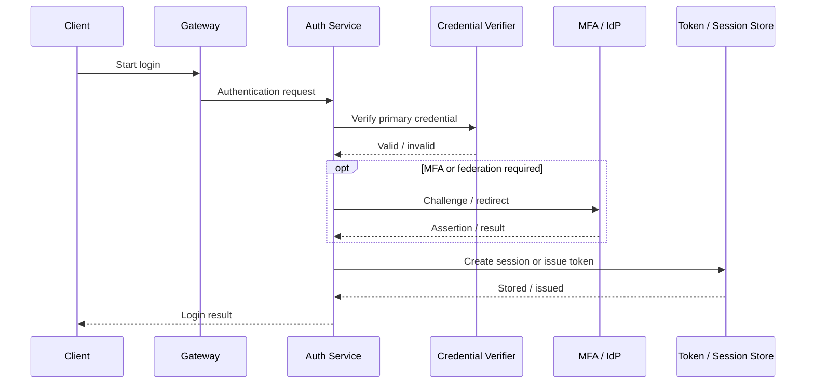

# Login metric — Đo lường hoạt động đăng nhập

## Mục tiêu học tập

Một hệ thống đăng nhập có thể vẫn trả HTTP 200 nhưng người dùng không hoàn tất được xác thực vì MFA provider chậm, callback OIDC lỗi, session không được tạo hoặc token không được phát hành. Ngược lại, tỷ lệ đăng nhập thất bại tăng có thể do người dùng nhập sai mật khẩu, bot thử credential bị lộ, hoặc dịch vụ xác thực đang gặp sự cố. Nếu chỉ đếm request HTTP hoặc tổng số lần đăng nhập thành công, đội vận hành khó phân biệt trải nghiệm người dùng, độ sẵn sàng của dịch vụ và dấu hiệu tấn công.

**Login metric (chỉ số đăng nhập)** là các phép đo định lượng mô tả số lượng, kết quả, thời gian và đặc điểm vận hành của các bước trong quy trình đăng nhập. Chúng giúp theo dõi trải nghiệm, xác định điểm nghẽn, đánh giá SLI/SLO và phát hiện hành vi bất thường. Metric là dữ liệu tổng hợp; để điều tra một lần đăng nhập cụ thể, hệ thống còn cần security event, audit record và trace có kiểm soát.

Bài học thuộc chương **Monitoring và audit** của mô-đun **SECURITY_AUTHENTICATION_FUNDAMENTALS**. Mô-đun tìm hiểu nguyên lý xác thực danh tính từ credential, mật khẩu, MFA, passkey và chứng chỉ đến token, phiên, liên kết danh tính và khôi phục tài khoản. Login metric theo dõi những luồng này để người vận hành hiểu hệ thống đang hoạt động ra sao, người dùng gặp trở ngại ở đâu và khi nào cần điều tra rủi ro.

Sau bài học, bạn có thể:

- Xác định các bước và điểm đo trong một login transaction.
- Phân biệt counter, gauge, histogram, event, log, trace và audit record.
- Định nghĩa login success rate, failure rate, completion rate, latency và MFA conversion.
- Thiết kế metric cho password, passkey, MFA, SSO, token refresh và account recovery.
- Xây dựng SLI/SLO phù hợp với trải nghiệm và độ sẵn sàng của dịch vụ xác thực.
- Instrument ứng dụng bằng metric có nhãn giới hạn và không chứa PII/secret.
- Phân tích credential stuffing, password spraying, MFA fatigue và lỗi provider.
- Thiết kế dashboard, alert, baseline và correlation với security event.
- Kiểm soát cardinality, privacy, retention và chất lượng telemetry.
- Xây dựng ví dụ Java/Micrometer, PromQL và bộ kiểm thử metric.

## 1. Login metric giải quyết vấn đề gì?

Đăng nhập là một chuỗi hoạt động qua nhiều thành phần: client, API gateway, authentication service, credential verifier, MFA provider, Identity Provider (IdP), token service và session store. Một lỗi ở bất kỳ bước nào đều có thể làm người dùng không truy cập được ứng dụng.

Metric giúp trả lời các câu hỏi vận hành:

- Có bao nhiêu login transaction bắt đầu và bao nhiêu transaction kết thúc?
- Tỷ lệ xác thực thành công thay đổi ra sao theo phương thức?
- Người dùng mất bao lâu để hoàn tất đăng nhập?
- MFA challenge được gửi, hoàn tất, từ chối hoặc hết hạn với tỷ lệ nào?
- Passkey và password có tỷ lệ hoàn tất khác nhau không?
- OIDC/SAML callback hoặc token exchange có lỗi tăng đột biến không?
- Refresh token thất bại do hết hạn, reuse detection hay provider outage?
- Có dấu hiệu credential stuffing, password spraying hoặc MFA fatigue không?
- Tỷ lệ login service error có vi phạm SLO không?
- Telemetry có bị mất, trễ hoặc ghi nhận trùng không?

### Ba góc nhìn cần tách biệt

| Góc nhìn | Câu hỏi | Chỉ số ví dụ |
| --- | --- | --- |
| **Product/experience** | Người dùng có hoàn tất đăng nhập thuận lợi không? | Completion rate, abandonment, MFA completion, client-perceived latency |
| **Reliability/operations** | Dịch vụ xác thực có sẵn sàng và phản hồi đúng hạn không? | Service error rate, timeout rate, p95/p99 latency, SLO |
| **Security/risk** | Có hành vi bất thường hoặc lạm dụng luồng đăng nhập không? | Failure burst, credential stuffing signals, lockout rate, MFA denial/replay |

Không dùng một con số duy nhất làm đại diện cho cả ba góc nhìn. Login failure rate tăng có thể là dấu hiệu tấn công, nhưng cũng có thể do một IdP bị lỗi hoặc một bản phát hành ứng dụng gửi sai request.

### Metric không phải audit

Metric tổng hợp cho biết xu hướng và mức độ. Nó thường không lưu đủ chi tiết để trả lời ai đã thực hiện một hành động cụ thể, vào lúc nào, với quyết định nào. Audit record và security event có mục đích khác: ghi lại sự kiện có ý nghĩa bảo mật, actor, target, outcome và lý do theo schema được kiểm soát.

Một dashboard có thể cho biết MFA denial tăng gấp ba; audit/event pipeline mới hỗ trợ điều tra một challenge cụ thể. Không cố nhét mọi chi tiết audit vào metric label.

## 2. Mô hình hóa login transaction trước khi đo

Muốn đo đúng, trước hết cần định nghĩa một lần đăng nhập. Một người dùng có thể bấm nút nhiều lần, client có thể retry do timeout, browser có thể mở nhiều tab và một transaction có thể đi qua nhiều bước MFA. Nếu mỗi HTTP request được tính là một login độc lập, metric sẽ bị phóng đại.

### Login transaction

Một login transaction là một lần thực hiện có chủ đích để thiết lập hoặc khôi phục trạng thái xác thực cho một subject/client context. Transaction có thể gồm:

1. Bắt đầu từ client.
2. Khởi tạo authentication request.
3. Kiểm tra credential hoặc nhận assertion từ IdP.
4. Thực hiện MFA/step-up nếu policy yêu cầu.
5. Xác minh callback, token hoặc assertion.
6. Tạo session hoặc phát hành token.
7. Kết thúc với success, failure, blocked, cancelled hoặc timeout.

Một transaction có ID ngẫu nhiên/correlation ID để nối các bước trong log và trace. ID này không phải metric label có cardinality cao.

### Sơ đồ luồng và điểm đo



Đặt metric tại ranh giới có ý nghĩa: transaction bắt đầu, primary verification hoàn tất, MFA challenge được tạo/hoàn tất, token/session được tạo và transaction kết thúc. Không cộng cùng một kết quả ở cả gateway lẫn auth service nếu chúng cùng mô tả một transaction.

### Outcome taxonomy

Dùng một tập kết quả hữu hạn, có semantics ổn định:

| Outcome | Ý nghĩa |
| --- | --- |
| success | Xác thực và thiết lập session/token hoàn tất |
| invalid_credential | Credential chính không hợp lệ |
| mfa_denied | Người dùng hoặc authenticator từ chối challenge |
| mfa_expired | Challenge hết hạn |
| policy_denied | Policy từ chối, ví dụ account suspended hoặc risk block |
| rate_limited | Request bị giới hạn trước khi xác thực hoàn tất |
| provider_error | IdP/MFA/token provider gặp lỗi kỹ thuật |
| timeout | Transaction vượt quá thời hạn xử lý |
| cancelled | Người dùng hoặc client chủ động hủy |
| internal_error | Lỗi nội bộ chưa phân loại cụ thể |

Không gộp invalid credential, rate limit và provider error thành một failure category duy nhất. Chúng có ý nghĩa khác nhau cho security, support và reliability.

### Started, completed và abandoned

Một transaction đã bắt đầu có thể không bao giờ phát ra kết quả cuối cùng vì người dùng đóng browser hoặc mất mạng. Nên đo started và completed riêng. Abandonment có thể được suy ra theo cohort hoặc trạng thái timeout sau một thời gian chờ; không đánh dấu abandoned ngay khi request bắt đầu chỉ vì chưa có response trong cùng giây.

## 3. Các loại metric và khi nào dùng

| Loại | Mô tả | Ví dụ login |
| --- | --- | --- |
| **Counter** | Chỉ tăng, thường dùng cho số lần xảy ra | Số login completed, MFA denied |
| **Gauge** | Giá trị có thể tăng/giảm | Số challenge đang pending, số worker đang xử lý |
| **Histogram** | Phân phối giá trị theo bucket | Login duration, MFA latency |
| **Summary** | Tính quantile ở client theo cách triển khai | Latency quantile, với hạn chế khi tổng hợp |
| **Event** | Một sự kiện có thời điểm và context | login_succeeded, credential_revoked |
| **Log** | Bản ghi có cấu trúc hoặc văn bản | Lỗi token exchange đã redacted |
| **Trace** | Chuỗi span qua các service | Browser callback đến auth service và token endpoint |
| **Audit record** | Bản ghi phục vụ trách nhiệm giải trình | Admin revoke session của một account |

Counter phù hợp để tính rate qua thời gian. Histogram phù hợp để xem phân phối latency và tính quantile ở hệ thống giám sát. Gauge hữu ích cho backlog/pending state nhưng không nên dùng để đếm sự kiện tích lũy.

Event và audit record có thể lưu từng lần xảy ra; metric thường tổng hợp nhiều lần. Không thay event/audit bằng counter nếu cần điều tra sau sự cố.

## 4. Định nghĩa login metric cốt lõi

Metric cần có tên, đơn vị, thời điểm tăng, mẫu số, phạm vi và quy tắc loại trừ. Nếu hai dashboard dùng cùng tên nhưng mẫu số khác nhau, chúng có thể dẫn đến quyết định sai.

### Login attempts started

Số transaction đăng nhập mới được khởi tạo. Tăng một lần tại điểm server chấp nhận bắt đầu transaction, sau khi request đã qua kiểm tra định dạng và chống spam cơ bản.

Không tăng counter này ở mọi lần retry HTTP của cùng transaction. Nếu client tạo transaction ID mới mỗi lần retry, cần deduplicate theo idempotency/correlation semantics hoặc ghi nhận riêng số request retry.

### Login attempts completed

Số transaction đã có outcome cuối cùng. Nên tách theo kết quả hữu hạn như success, invalid_credential, mfa_denied, policy_denied, provider_error hoặc timeout.

Không coi mọi HTTP 4xx là login failure. Một request thiếu field hoặc sai protocol có thể bị từ chối trước khi có authentication transaction hợp lệ.

### Login success rate

Một định nghĩa có thể dùng:

```text
success_rate =
    successful_completed_transactions
    /
    (successful_completed_transactions + failed_authentication_transactions)
```

Mẫu số chỉ gồm các transaction đã đi tới kết quả xác thực success hoặc failure. Blocked, cancelled và provider error nên được báo riêng để tránh làm sai ý nghĩa. Nếu tổ chức muốn tính blocked vào một chỉ số khác, phải đặt tên rõ và công bố semantics.

Không tính success rate bằng số session hiện còn hoạt động chia cho số login attempts trong cùng cửa sổ; session có thể tồn tại nhiều ngày và không cùng cohort.

### Login failure rate

Có thể tính trên cùng mẫu số với success rate:

```text
failure_rate =
    failed_authentication_transactions
    /
    (successful_completed_transactions + failed_authentication_transactions)
```

Theo dõi failure theo method và category. Tỷ lệ invalid credential cao có thể là typo hoặc credential stuffing; provider error cao thường là sự cố kỹ thuật.

### Completion rate và abandonment

Completion rate đo số transaction bắt đầu và hoàn tất trong cùng cohort. Với dữ liệu metric dạng rate theo cửa sổ, started và completed trong cùng 5 phút không nhất thiết thuộc cùng nhóm transaction vì transaction có thể kéo dài qua nhiều cửa sổ.

Để đo chính xác funnel/abandonment, dùng event hoặc warehouse cohort theo transaction ID và thời gian bắt đầu. Có thể định nghĩa abandonment là transaction không có outcome sau timeout policy và không bị hủy có chủ đích.

### Login latency

Đo thời gian từ khi server chấp nhận bắt đầu transaction đến khi transaction hoàn tất. Nên tách:

- Primary credential verification latency.
- MFA challenge wait/verification latency.
- Federation redirect/callback latency.
- Token issuance/session creation latency.
- End-to-end server processing latency.
- Client-perceived latency nếu có telemetry client được thu thập có kiểm soát.

Dùng histogram để xem p50, p90, p95 và p99. Trung bình có thể che giấu một nhóm nhỏ người dùng phải chờ rất lâu. Không cộng thời gian chờ người dùng nhập OTP vào server processing latency nếu metric được định nghĩa là thời gian xử lý backend; đo user wait riêng.

### Metric mẫu

| Metric | Loại | Đơn vị | Thời điểm ghi |
| --- | --- | --- | --- |
| auth_login_started_total | Counter | transaction | Khi bắt đầu transaction |
| auth_login_completed_total | Counter | transaction | Khi transaction có outcome cuối |
| auth_login_duration_seconds | Histogram | giây | Khi transaction kết thúc |
| auth_primary_verification_total | Counter | lần | Sau khi kiểm tra credential chính |
| auth_primary_verification_duration_seconds | Histogram | giây | Sau primary verification |
| auth_mfa_challenges_issued_total | Counter | challenge | Khi phát hành challenge |
| auth_mfa_challenges_completed_total | Counter | challenge | Khi challenge có outcome cuối |
| auth_mfa_duration_seconds | Histogram | giây | Khi MFA verification kết thúc |
| auth_token_issuance_total | Counter | token issuance | Khi phát hành hoặc thất bại |
| auth_session_creation_total | Counter | session | Khi tạo session thành công/thất bại |
| auth_rate_limit_decisions_total | Counter | decision | Khi policy rate limit quyết định |
| auth_recovery_requests_total | Counter | request | Theo stage/outcome recovery |

Tên và label cụ thể phụ thuộc telemetry stack. Điều quan trọng là mỗi metric có một điểm ghi duy nhất và semantics được tài liệu hóa.

## 5. Metric theo phương thức xác thực

Không phải mọi phương thức đăng nhập có cùng các bước. Một dashboard cần phân biệt method để tìm bottleneck mà không tạo hàng nghìn series.

### Password

Có thể đo:

- Primary verification attempts và outcomes.
- Password hash verification latency.
- Invalid credential rate.
- Password reset initiated/completed.
- Rate-limit decision và account lockout.
- Credential stuffing signal theo network/device risk bucket đã được chuẩn hóa.

Không ghi password, password hash, username hoặc email vào metric label. Không dùng chuỗi exception từ password verifier làm reason label.

### Passkey/WebAuthn

Có thể đo:

- Registration ceremony started/completed/failed.
- Authentication assertion started/completed/failed.
- Challenge expiry và challenge replay detected.
- User verification required/satisfied.
- Signature verification latency.
- Credential not found, revoked hoặc invalidated outcomes.

Không ghi challenge, credential ID, public key fingerprint hoặc user handle vào metric label. Những giá trị đó có thể được tham chiếu trong event bảo mật có kiểm soát nếu thực sự cần.

### MFA

Các metric hữu ích:

- Challenge issued.
- Challenge completed.
- User denied.
- Challenge expired.
- Verification invalid.
- Delivery provider error.
- Push delivery latency.
- Number of prompts per transaction.
- MFA fallback selected.
- MFA fatigue/risk policy intervention.

Tỷ lệ challenge completion cần phân biệt challenge được phát hành với challenge đã có outcome. Một challenge pending chưa phải thất bại. Push notification được gửi thành công cũng không có nghĩa người dùng đã approve.

### Federation: OIDC và SAML

Đo riêng:

- Authorization request initiated.
- Callback received.
- State/nonce validation failure.
- Token exchange success/failure.
- ID token validation failure.
- SAML response signature/issuer/audience/destination failure.
- IdP timeout và metadata/JWKS fetch failure.
- Federation end-to-end latency.

Không ghi authorization code, state, nonce, ID token hoặc SAML assertion vào metric/log. Nếu cần trace một flow, dùng correlation ID ngẫu nhiên và giữ secret trong bộ nhớ xử lý.

### Token refresh và session

Theo dõi:

- Refresh attempts/success/failure.
- Refresh token reuse detection.
- Revocation request outcomes.
- Session create/renew/revoke.
- Concurrent session count ở dạng gauge tổng hợp hoặc event-derived metric.
- Session invalidation propagation delay.
- Token provider latency/error.

Refresh token reuse có thể là tín hiệu compromise, nhưng cũng cần kiểm tra race do nhiều tab hoặc nhiều request refresh đồng thời. Không tự động coi mọi duplicate refresh là attacker; policy rotation/reuse detection cần phân biệt concurrency hợp lệ với reuse sau khi token family đã chuyển trạng thái.

## 6. MFA và login funnel

Funnel cho biết người dùng rời quy trình ở bước nào. Cần xác định các bước là event trong cùng transaction và không đếm retry thành một người dùng mới.

### Funnel minh họa

| Bước | Event | Chỉ số |
| --- | --- | --- |
| 1 | login_started | Số transaction bắt đầu |
| 2 | primary_auth_succeeded | Tỷ lệ qua credential chính |
| 3 | mfa_challenge_issued | Số transaction cần MFA |
| 4 | mfa_succeeded | Tỷ lệ MFA hoàn tất |
| 5 | token_issued | Tỷ lệ cấp token |
| 6 | session_created | Tỷ lệ tạo session |
| 7 | login_completed | Tỷ lệ hoàn tất end-to-end |

Nếu policy không yêu cầu MFA, transaction có thể đi từ primary auth tới token/session. Không tính các transaction không cần MFA là MFA failure.

### MFA conversion

Có thể định nghĩa theo cohort:

```text
mfa_completion_rate =
    mfa_challenges_completed
    /
    mfa_challenges_issued_that_reached_outcome
```

Cần báo thêm challenge pending/expired và thời gian chờ. Với push MFA, delivery success, prompt displayed và user approval là ba bước khác nhau.

### Prompt count và fatigue

Theo dõi số prompt trung bình trên một login transaction, số prompt bị từ chối liên tiếp và tỷ lệ user deny. Prompt lặp bất thường có thể chỉ ra retry bug hoặc MFA fatigue attack. Metric tổng hợp giúp phát hiện xu hướng; điều tra account cụ thể cần security event với truy cập hạn chế.

### Không tối ưu completion bằng cách hạ bảo mật

Nếu MFA completion giảm, không tự động bỏ MFA hoặc hạ assurance để tăng conversion. Phân tích delivery provider, UX, thiết bị, thời gian chờ và phương án authenticator. Quyết định thay đổi policy phải dựa trên risk assessment và được phê duyệt.

## 7. Login metric cho SSO và identity federation

SSO có thể làm trải nghiệm người dùng nhanh hơn nhưng thêm phụ thuộc vào IdP và callback flow.

### Các chỉ số cần theo dõi

- Số authorization request theo issuer/provider class.
- Callback success/failure.
- State mismatch và nonce mismatch.
- Token endpoint timeout/error.
- ID token validation failure theo category.
- SAML response validation failure.
- IdP discovery/JWKS/metadata refresh error.
- Federation round-trip latency.
- Tỷ lệ fallback sang local authentication nếu policy cho phép.

Provider label cần được kiểm soát. Nếu mỗi tenant có thể cấu hình URL/issuer tùy ý, không đưa issuer URL hoặc tenant ID vào label metric. Dùng nhóm provider hữu hạn, cấu hình alias được allowlist hoặc tổng hợp ở tầng analytics.

### Tách lỗi của ứng dụng và lỗi của IdP

Nếu callback không tới, có thể do browser/network hoặc IdP. Nếu token exchange timeout, có thể do IdP hoặc network. Nếu ID token invalid, có thể là clock skew, key rotation, issuer mismatch hoặc token giả.

Dùng trace/span và event reason category để xác định thành phần. Không coi mọi federation failure là lỗi người dùng.

## 8. Reliability: SLI và SLO cho login

Login là một luồng quan trọng, nhưng SLO cần đo những gì dịch vụ có thể kiểm soát. Tỷ lệ người dùng nhập sai mật khẩu không phải là service availability failure.

### Login availability SLI

Một SLI có thể đo tỷ lệ transaction hợp lệ được xử lý mà không gặp lỗi kỹ thuật:

```text
login_service_availability =
    eligible_login_transactions_without_service_error
    /
    eligible_login_transactions
```

Định nghĩa eligible phải rõ. Có thể loại invalid credential, policy denied, user cancelled và rate-limited khỏi numerator/denominator availability, nhưng phải báo riêng. Provider outage, internal error và timeout do dịch vụ thường thuộc service error theo phạm vi SLO.

### Latency SLI

Ví dụ:

```text
login_latency_sli =
    eligible_transactions_completed_within_target
    /
    eligible_completed_transactions
```

Đặt target theo loại flow và trải nghiệm sản phẩm. Login password không MFA có thể có mục tiêu khác flow SSO có redirect và push MFA. Không gộp mọi method nếu điều đó che giấu sự cố ở một nhánh.

### SLO và error budget

SLO có thể gồm:

- Tỷ lệ login transaction không lỗi kỹ thuật trong cửa sổ 28 ngày.
- Tỷ lệ transaction backend hoàn tất dưới ngưỡng latency.
- Tỷ lệ token/session issuance thành công sau authentication.
- Tính sẵn sàng của MFA provider integration.

Không có một ngưỡng phổ quát cho mọi hệ thống. Đội sản phẩm và vận hành cần chọn mục tiêu dựa trên mức độ quan trọng, dữ liệu lịch sử và cam kết dịch vụ. Error budget giúp quyết định có nên ưu tiên reliability work trước khi phát hành tính năng mới.

### Dependency SLO

Một login flow có thể phụ thuộc IdP, email/SMS provider, push service, database, KMS và session store. Theo dõi từng dependency để xác định lỗi đến từ đâu. Không cộng các latency độc lập một cách máy móc nếu chúng chạy song song.

## 9. Security metric và phát hiện lạm dụng đăng nhập

Security metric tìm tín hiệu bất thường ở quy mô lớn. Một metric đơn lẻ hiếm khi chứng minh có tấn công; cần kết hợp nhiều tín hiệu, baseline và event điều tra.

### Credential stuffing

Credential stuffing dùng username/password bị lộ từ dịch vụ khác để thử đăng nhập hàng loạt.

Tín hiệu có thể gồm:

- Invalid credential tăng trên nhiều account.
- Nhiều account được thử từ một network/device fingerprint bucket.
- Nhiều lần thử phân tán qua nhiều IP nhưng có đặc điểm client giống nhau.
- Tỷ lệ success bất thường sau một chuỗi failure.
- Nhiều account bị thử với cùng một mẫu mật khẩu hoặc automation pattern.

Không thu thập password để phát hiện pattern. Dùng telemetry request, risk engine và threat intelligence được phép; không đưa raw IP/device fingerprint vào metric label.

### Password spraying

Password spraying thử một số ít mật khẩu phổ biến trên nhiều account để tránh lockout theo từng account. Chỉ nhìn số lần thất bại trên một account có thể bỏ sót.

Theo dõi aggregate theo network/device/risk bucket và số lượng account bị tác động. Dùng cửa sổ thời gian phù hợp, rate limit đa chiều và alert theo baseline.

### MFA fatigue

Attacker liên tục gửi push prompt để người dùng mệt mỏi và vô tình approve. Metric hữu ích:

- Push challenge count per transaction/account risk bucket.
- Deny/timeout streak.
- Prompt rate vượt policy.
- Approval xảy ra sau nhiều lần deny.
- MFA challenge được gửi khi không có primary auth transaction hợp lệ.

Metric tổng hợp nên không có account ID label. Rule theo account cụ thể có thể chạy trên event/risk store với kiểm soát truy cập và retention.

### Account enumeration

Nếu response khác nhau giữa account tồn tại và không tồn tại, attacker có thể dò danh sách người dùng. Theo dõi số lượng request recovery/login theo endpoint, tỷ lệ response code/category và pattern probing. Public response nên tránh tiết lộ trạng thái account.

### Lockout và denial of service

Account lockout tăng có thể do attacker cố tình khóa tài khoản người dùng. Theo dõi lockout rate, số account bị ảnh hưởng, unlock/recovery volume và rate-limit action. Không dùng lockout làm biện pháp duy nhất vì attacker có thể gây denial of service cho nạn nhân.

### Metric không tự động kết luận attacker

IP lạ, ASN mới, địa lý khác thường hoặc user-agent mới chỉ là tín hiệu. Người dùng có thể đi du lịch, dùng VPN, mạng di động hoặc thiết bị mới. Kết hợp risk scoring, device context, velocity, credential result và step-up policy; tránh khóa tài khoản chỉ từ một tín hiệu đơn.

## 10. Thiết kế metric name và label an toàn

Prometheus-style metric thường gắn label để phân nhóm. Label không kiểm soát có thể làm cardinality tăng mạnh, tăng chi phí và gây mất ổn định hệ thống giám sát.

### Label hữu hạn

Ví dụ label có thể dùng nếu taxonomy được kiểm soát:

- method: password, passkey, totp, push, oidc, saml.
- result: success, invalid_credential, denied, timeout, provider_error.
- client_type: web, ios, android, service.
- factor: totp, push, security_key, platform_authenticator.
- provider_class: enterprise_idp, social_idp, internal, other.
- environment: production, staging.

Chỉ dùng nhãn có tập giá trị hữu hạn và được quản lý. Nếu label đến từ cấu hình tenant hoặc provider do người dùng tự đặt, cần chuẩn hóa thành nhóm cố định trước khi đưa vào metrics.

### Không dùng làm label

Không đưa các giá trị sau vào label metric:

- Username, email, phone number hoặc subject ID.
- Raw IP address hoặc full user-agent.
- Session ID, transaction ID, correlation ID.
- Access token, refresh token, authorization code, state hoặc nonce.
- Credential ID, device ID hoặc certificate serial number không giới hạn.
- URL/path có ID động hoặc exception message.
- Tenant ID tùy ý nếu số tenant lớn.

Những giá trị này có thể chứa PII, secret hoặc tạo hàng triệu time series. Nếu cần điều tra, dùng event/log có schema, quyền truy cập, redaction và retention riêng.

### Cardinality

Cardinality là số tổ hợp label khác nhau. Một metric có 5 method, 6 result và 3 client_type có tối đa 90 series cho các label đó. Nếu thêm user ID với hàng triệu giá trị, số series có thể bùng nổ.

Giữ label set nhỏ, dùng enum và kiểm tra cardinality trong review. Không thêm label mới chỉ để trả lời một câu hỏi điều tra tạm thời; dùng log/event analytics cho truy vấn chi tiết.

## 11. Privacy, security và data minimization

Login telemetry chứa thông tin nhạy cảm về hành vi truy cập. Cần thu thập đủ để vận hành và phát hiện rủi ro, nhưng không giữ bí mật xác thực hoặc dữ liệu cá nhân không cần thiết.

### Tuyệt đối không ghi

- Password hoặc password hash.
- OTP, TOTP seed, recovery code.
- Access token, refresh token, ID token, authorization code.
- Private key, client secret hoặc signing key.
- Raw assertion, full SAML response hoặc WebAuthn challenge/proof.
- Session cookie hoặc bearer authorization header.

### Giới hạn dữ liệu định danh

Nếu cần nối sự kiện trong một khoảng thời gian, dùng pseudonymous subject reference hoặc keyed hash có rotation/retention và quyền truy cập phù hợp. Hash email không tự động biến email thành dữ liệu vô danh; không gian email có thể bị dò từ điển. Không đưa pseudonymous subject reference vào metric label.

IP address và device signals có thể là dữ liệu cá nhân hoặc nhạy cảm theo luật/chính sách. Chỉ xử lý khi có mục đích rõ, giới hạn retention, access control, masking/aggregation và cơ sở pháp lý phù hợp.

### Retention theo mục đích

- Metric tổng hợp có thể giữ lâu hơn event chi tiết.
- Security event cần retention theo threat model, điều tra và nghĩa vụ pháp lý.
- Audit record cần chính sách retention và chống sửa đổi.
- Trace có thể sampling; không sampling mất toàn bộ lỗi hiếm nếu cần điều tra.
- Khi kết thúc retention, xóa hoặc aggregate dữ liệu theo policy.

## 12. Event schema và correlation

Metric cho xu hướng; event giúp nối các bước của một transaction. Một schema event ổn định giúp các service không tự phát minh tên và ý nghĩa khác nhau.

### Event fields gợi ý

| Field | Ý nghĩa | Quy tắc |
| --- | --- | --- |
| event_name | login_started, mfa_denied, login_succeeded | Enum ổn định |
| event_time | Thời điểm xảy ra | UTC, độ chính xác phù hợp |
| observed_time | Thời điểm collector nhận event | Hữu ích đo ingest delay |
| transaction_ref | Correlation reference | Ngẫu nhiên, không dùng làm metric label |
| subject_ref | Pseudonymous subject reference | Chỉ ở event store có kiểm soát |
| client_type | web, ios, android, service | Enum |
| auth_method | password, passkey, oidc, saml | Enum |
| factor | totp, push, security_key | Nullable, enum |
| outcome | success/failure/blocked/timeout | Enum |
| reason_category | invalid_credential, provider_error | Không chứa exception text |
| duration_ms | Thời lượng bước | Không âm, đơn vị rõ |
| issuer_class | Nhóm issuer | Không lưu URL tùy ý |
| policy_version | Phiên bản policy | Giúp giải thích quyết định |
| trace_id | Liên kết trace | Không chứa credential |
| schema_version | Phiên bản event schema | Hỗ trợ migration |

Không phải event nào cũng cần mọi field. Event collector phải validate schema, giới hạn kích thước, chuẩn hóa thời gian và loại bỏ secret. Không tin field subject/role/tenant do client tự khai; backend phải dựng từ context đã xác minh.

### Correlation qua nhiều service

Dùng trace ID hoặc transaction reference ngẫu nhiên để nối gateway, auth service, MFA provider adapter và token service. Không dùng token hoặc session ID làm correlation ID. Nếu truyền context qua redirect federation, giữ reference phía server hoặc state transaction có bảo vệ; không đưa dữ liệu nhạy cảm vào query string.

### Event delivery và duplicate

Telemetry pipeline có thể at-least-once nên consumer có thể nhận event trùng. Dùng event ID và deduplication nếu cần đếm chính xác. Metric được increment tại service source một lần theo transaction lifecycle; không increment lại khi event được replay trong analytics.

Theo dõi dropped events, queue lag, schema rejection và ingest delay. Nếu telemetry bị mất, dashboard có thể trông bình thường trong khi hệ thống không ghi nhận được sự cố.

## 13. Dashboard và alert

Dashboard nên giúp người trực hiểu tình hình trong vài giây, sau đó đi sâu theo method/provider/outcome. Không nhồi quá nhiều chart hoặc label vào một màn hình.

### Dashboard vận hành login

Các panel gợi ý:

1. Login started/completed per second.
2. Success/failure rate theo method.
3. p50/p95/p99 login duration.
4. Primary verification và MFA latency.
5. Provider error/timeout theo provider class.
6. Token issuance/session creation errors.
7. Rate-limit và policy-deny decisions.
8. Recovery request volume và completion trend.
9. Telemetry ingest delay/dropped event.
10. SLO burn rate và error budget còn lại.

### Dashboard security

- Invalid credential velocity.
- Tỷ lệ failure trên các account/risk bucket đã aggregate.
- MFA deny/timeout/prompt burst.
- Lockout và recovery surge.
- Refresh-token reuse detection.
- Challenge replay detection.
- Login từ risk bucket bất thường.
- Session creation/revocation anomaly.
- Admin/security action liên quan account hoặc authenticator.

Dashboard security không cần hiển thị raw email/IP cho mọi người xem. Điều tra chi tiết phải qua workflow có phân quyền.

### Alert cần có ngữ cảnh

Một alert tốt có:

- Metric và condition cụ thể.
- Cửa sổ đánh giá.
- Ngưỡng tuyệt đối hoặc baseline.
- Mức độ ảnh hưởng.
- Nhóm owner/on-call.
- Dashboard/runbook liên quan.
- Hành động đầu tiên an toàn.
- Cách phân biệt sự cố provider với tấn công.

Không alert cho mọi spike ngắn. Dùng duration, multi-window hoặc burn-rate alert để giảm noise. Với credential stuffing, có thể kết hợp ngưỡng failure, số account bị tác động và nguồn/risk bucket; không chỉ dựa tổng failure.

### Ngưỡng không phổ quát

Không áp dụng một tỷ lệ login failure hoặc p95 latency chung cho mọi hệ thống. Hãy dùng baseline theo giờ/ngày, method, khu vực, client version và mùa vụ; đặt ngưỡng dựa trên dữ liệu thực tế, SLO và hậu quả rủi ro.

## 14. Prometheus và PromQL minh họa

Giả sử hệ thống xuất metric với label hữu hạn method, result và client_type.

### Đếm tốc độ login hoàn tất

```promql
sum by (method) (
  rate(auth_login_completed_total[5m])
)
```

### Success rate trên authentication outcomes

```promql
sum(rate(auth_login_completed_total{result="success"}[5m]))
/
(
  sum(rate(auth_login_completed_total{result=~"success|invalid_credential|mfa_denied"}[5m])) > 0
)
```

Trong ví dụ này, provider_error, timeout, blocked và cancelled được báo riêng; mẫu số chỉ gồm outcome xác thực success hoặc failure. Nếu taxonomy khác, phải cập nhật cả biểu thức và tài liệu định nghĩa.

### Provider error rate

```promql
sum(rate(auth_login_completed_total{result="provider_error"}[5m]))
/
(
  sum(rate(auth_login_completed_total[5m])) > 0
)
```

### p95 login latency

```promql
histogram_quantile(
  0.95,
  sum by (le, method) (
    rate(auth_login_duration_seconds_bucket[5m])
  )
)
```

### MFA denial rate

```promql
sum(rate(auth_mfa_challenges_completed_total{result="denied"}[10m]))
/
(
  sum(rate(auth_mfa_challenges_completed_total{result=~"approved|denied|expired|invalid"}[10m])) > 0
)
```

Các query chỉ minh họa. Metric name, label và result enum phải khớp instrumentation thực tế. Biểu thức so sánh mẫu số với 0 để không phát ra tỷ lệ khi chưa có traffic; dashboard nên hiển thị “no data” thay vì khiến người xem hiểu nhầm tỷ lệ là 0%. Không thay mẫu số bằng một hằng số lớn như 1 vì điều đó làm sai tỷ lệ khi tốc độ request thấp hơn một request mỗi giây.

## 15. Java: instrument login bằng Micrometer

Ví dụ dưới đây minh họa cách ghi counter và timer với label hữu hạn. Không đưa username, email, IP, token, transaction ID hoặc exception message vào tag.

```java
import io.micrometer.core.instrument.Counter;
import io.micrometer.core.instrument.MeterRegistry;
import io.micrometer.core.instrument.Timer;

import java.util.concurrent.TimeUnit;

enum LoginMethod {
    PASSWORD("password"),
    PASSKEY("passkey"),
    OIDC("oidc"),
    SAML("saml");

    private final String metricValue;

    LoginMethod(String metricValue) {
        this.metricValue = metricValue;
    }

    String metricValue() {
        return metricValue;
    }
}

enum LoginResult {
    SUCCESS("success"),
    INVALID_CREDENTIAL("invalid_credential"),
    MFA_DENIED("mfa_denied"),
    POLICY_DENIED("policy_denied"),
    RATE_LIMITED("rate_limited"),
    CANCELLED("cancelled"),
    PROVIDER_ERROR("provider_error"),
    TIMEOUT("timeout"),
    INTERNAL_ERROR("internal_error");

    private final String metricValue;

    LoginResult(String metricValue) {
        this.metricValue = metricValue;
    }

    String metricValue() {
        return metricValue;
    }
}

final class LoginMetrics {
    private final MeterRegistry registry;

    LoginMetrics(MeterRegistry registry) {
        this.registry = registry;
    }

    void started(LoginMethod method) {
        Counter.builder("auth.login.started")
                .tag("method", method.metricValue())
                .register(registry)
                .increment();
    }

    void completed(
            LoginMethod method,
            LoginResult result,
            long durationNanos) {

        Counter.builder("auth.login.completed")
                .tag("method", method.metricValue())
                .tag("result", result.metricValue())
                .register(registry)
                .increment();

        Timer.builder("auth.login.duration")
                .tag("method", method.metricValue())
                .tag("result", result.metricValue())
                .register(registry)
                .record(durationNanos, TimeUnit.NANOSECONDS);
    }
}
```

Trong ứng dụng thật, có thể giữ Counter/Timer reference hoặc dùng Observation API để giảm lookup lặp lại. Chỉ gọi started một lần cho transaction và completed đúng một lần khi có outcome cuối. Nếu request retry, deduplicate ở lifecycle layer hoặc định nghĩa retry metric riêng.

### Instrument ở ranh giới xử lý

```java
long startNanos = System.nanoTime();
metrics.started(method);

LoginResult result = LoginResult.INTERNAL_ERROR;
try {
    result = authenticationService.authenticate(request);
    return result;
} catch (ProviderUnavailableException ex) {
    result = LoginResult.PROVIDER_ERROR;
    throw ex;
} finally {
    long elapsed = System.nanoTime() - startNanos;
    metrics.completed(method, result, elapsed);
}
```

Đoạn pseudocode cần được điều chỉnh cho luồng thực tế: result phải được khởi tạo an toàn cho mọi nhánh, và chỉ hoàn tất metric một lần. Nếu exception xảy ra trước khi có transaction hợp lệ, ghi request validation metric riêng thay vì giả thành login attempt. Không ghi exception message vào label.

### Metric cho MFA

```java
void recordMfaOutcome(
        MeterRegistry registry,
        String factor,
        String result) {

    // factor/result must come from bounded enums, never request text.
    Counter.builder("auth.mfa.challenges")
            .tag("factor", factor)
            .tag("result", result)
            .register(registry)
            .increment();
}
```

Trong production, dùng enum hoặc allowlist cho factor/result; không truyền chuỗi trực tiếp từ request. Challenge issued và challenge outcome nên là hai sự kiện/metric riêng để đo pending và completion đúng nghĩa.

## 16. Chất lượng metric và kiểm thử instrumentation

Metric sai có thể nguy hiểm như không có metric: dashboard tạo cảm giác an toàn giả hoặc alert khiến on-call bỏ qua tín hiệu thật.

### Các lỗi cần kiểm tra

- Counter bị tăng hai lần khi retry hoặc callback lặp.
- Transaction bắt đầu nhưng không bao giờ ghi outcome.
- Login success ghi trước khi session/token được tạo thành công.
- Provider timeout bị gán nhầm invalid credential.
- MFA challenge issue được coi là MFA success.
- Latency đo cả thời gian chờ người dùng nhưng dashboard gọi là server processing.
- Label chứa user ID hoặc URL động.
- Result enum thay đổi nhưng PromQL không được cập nhật.
- Một service increment cùng metric cho cùng transaction với gateway.
- Metric bị mất khi collector hoặc exporter lỗi.
- Clock giữa các service lệch làm event order sai.
- Sampling trace làm mất lỗi hiếm mà không có counter tổng hợp.

### Bảng kiểm thử

| Trường hợp | Thao tác | Kết quả mong đợi |
| --- | --- | --- |
| Login success | Credential hợp lệ và session được tạo | Started +1, completed success +1, timer ghi một lần |
| Invalid password | Credential sai | Completed invalid_credential, không gán provider_error |
| MFA denied | Người dùng từ chối | MFA denied và login outcome đúng policy |
| MFA pending | Challenge mới được phát hành | Issued tăng, chưa tăng approved/denied |
| MFA expired | Challenge hết hạn | Expired tăng, transaction kết thúc theo policy |
| Provider outage | IdP/MFA timeout | Provider error/timeout tách biệt invalid credential |
| Token issuance failure | Primary auth đúng nhưng token service lỗi | Login chưa được tính success |
| Session store failure | Không tạo được session bắt buộc | Transaction không thành công |
| Client cancellation | Người dùng đóng flow | Cancelled/abandoned theo định nghĩa, không tính invalid credential |
| Retry duplicate | Cùng transaction callback đến hai lần | Completed chỉ ghi một lần |
| Concurrent request | Hai node xử lý cùng transaction | Counter không bị nhân đôi theo semantics |
| Unknown method | Request có method không nằm allowlist | Từ chối/normalize; không tạo label tùy ý |
| High-cardinality input | Gửi user ID, IP, URL động vào tag | Instrumentation không chấp nhận label |
| Secret redaction | Kiểm tra log và metric | Không có token, OTP, password hoặc challenge |
| Latency bucket | Request nhanh và chậm | Histogram ghi đúng đơn vị và bucket |
| Clock skew | Event time lệch giữa service | Observed time và event time phân biệt |
| Telemetry outage | Exporter/collector không khả dụng | Ứng dụng vẫn có hành vi theo policy; có alert về telemetry |
| Schema change | Thêm outcome mới | Dashboard/alert được cập nhật có kiểm soát |
| No traffic | Không có login transaction | Dashboard hiển thị no data, không gây hiểu nhầm 0% |
| Passkey failure | Credential không tồn tại hoặc bị revoke | Category rõ, không gộp internal error |
| OIDC state mismatch | Callback state sai | Security event; không ghi state thô |
| Refresh token reuse | Token family phát hiện reuse | Metric risk tăng và event có correlation |
| Credential stuffing simulation | Nhiều account bị thử nhanh | Detection rule kích hoạt theo baseline |
| Password spraying simulation | Thử ít lần trên nhiều account | Aggregate detector phát hiện pattern phân tán |
| MFA fatigue simulation | Nhiều prompt bị deny/timeout | Alert theo prompt velocity và deny streak |
| Account enumeration | Request dò account tồn tại | Public response không tiết lộ account state |
| Event duplicate | Collector nhận event lặp | Dedup hoặc đếm theo semantics đã định |
| Metric label audit | Kiểm tra toàn bộ label | Không có PII/secret hoặc ID không giới hạn |

### Kiểm thử alert

Không chỉ test hàm ghi metric. Dùng dữ liệu giả lập để xác minh query, threshold, no-data handling, alert duration, routing và runbook. Kiểm tra cả false positive như giờ cao điểm, chiến dịch đăng nhập, thay đổi app version và IdP bảo trì.

## 17. Lỗi triển khai thường gặp

| Lỗi | Hậu quả | Cách phòng tránh |
| --- | --- | --- |
| Chỉ đo HTTP status | Không biết authentication có hoàn tất hay không | Đo transaction outcome ở auth lifecycle |
| Đếm mỗi HTTP request là một login | Retry làm phóng đại volume | Transaction ID và dedup semantics |
| Gộp mọi failure | Không phân biệt attack, user error và provider outage | Outcome taxonomy |
| Tính invalid password vào availability error | SLO phản ánh sai độ sẵn sàng | Tách auth outcome khỏi service error |
| Ghi success trước session/token issuance | Dashboard báo thành công dù người dùng không có session | Chỉ success sau điểm hoàn tất được định nghĩa |
| Coi MFA issue là MFA success | Đánh giá sai hiệu quả MFA | Tách issued, delivered, approved, denied và expired |
| Dùng average latency | Che giấu tail latency | Histogram và p95/p99 |
| Đưa user ID/IP vào label | Cardinality cao và rủi ro privacy | Label enum; event store có kiểm soát |
| Dùng exception message làm reason | Label bùng nổ và lộ dữ liệu | Reason category hữu hạn |
| Dùng metric thay audit | Không đủ bằng chứng điều tra | Event/audit record riêng |
| Alert theo ngưỡng cố định thiếu baseline | Nhiều false positive/negative | Baseline, multi-window và context |
| Tự động khóa theo failure aggregate | Attacker có thể gây denial of service | Risk-based throttling và nhiều tín hiệu |
| Bỏ qua telemetry pipeline health | Dashboard trống bị hiểu là không có sự cố | Monitor dropped event, queue lag và scrape health |
| Không version schema | Dashboard sai khi taxonomy thay đổi | Schema version và migration |
| Trace chứa token | Credential lộ qua observability backend | Redaction và allowlist attribute |
| Không phân biệt user wait với server latency | Tối ưu sai bottleneck | Đo các span riêng |
| Đếm lại event khi replay collector | Volume sai | Event ID và deduplication |
| Dùng success rate làm security verdict | Một tỷ lệ tốt vẫn có thể có account takeover | Kết hợp event, risk và incident signals |

## 18. Checklist thiết kế login metric

Trước khi phát hành dashboard hoặc alert, hãy trả lời:

1. **Transaction:** Một login transaction bắt đầu và kết thúc ở đâu?
2. **Semantics:** Started, completed, success, failure, blocked, cancelled và timeout được định nghĩa thế nào?
3. **Denominator:** Mỗi tỷ lệ có mẫu số rõ và cùng cohort không?
4. **Method:** Password, passkey, MFA, federation và service login có được phân biệt không?
5. **Latency:** Đang đo server processing, provider wait hay client-perceived time?
6. **Reliability:** SLI có loại trừ invalid credential và user cancellation đúng cách không?
7. **Security:** Có tín hiệu credential stuffing, spraying, MFA fatigue, replay và enumeration không?
8. **Labels:** Mọi label có tập giá trị hữu hạn và không chứa PII/secret không?
9. **Cardinality:** Có giới hạn số series và kiểm tra trước khi thêm label không?
10. **Audit:** Có event/audit record để điều tra chi tiết ngoài metric tổng hợp không?
11. **Correlation:** Transaction/trace reference có nối được các service mà không dùng token làm ID không?
12. **Privacy:** Retention, masking, access control và mục đích xử lý đã được xác định chưa?
13. **Telemetry health:** Có theo dõi dropped event, ingest lag, scrape failure và schema rejection không?
14. **Alert:** Ngưỡng dựa baseline/SLO và có owner/runbook không?
15. **Testing:** Có test retry, duplicate, concurrency, no traffic, provider outage và high-cardinality input không?
16. **Change management:** Khi taxonomy hoặc schema thay đổi, dashboard, query và alert được cập nhật cùng lúc không?

## 19. Bài tập vận dụng

Một ứng dụng doanh nghiệp hỗ trợ password, passkey và OIDC SSO. Sau khi phát hành phiên bản mới, số login failure tăng 40%, MFA completion giảm 18%, p95 login latency tăng từ 700 ms lên 2,4 giây. Đồng thời, số request từ client Android tăng mạnh. Dashboard hiện chỉ có tổng login success/failure; mọi lỗi đều được gộp thành một category. Log có username và raw IP; metric label chứa user ID. Đội vận hành chưa biết vấn đề đến từ app, MFA provider hay credential stuffing.

**Yêu cầu:**

1. Thiết kế outcome taxonomy tách invalid credential, policy denial, MFA denial/expiry, provider error, timeout và internal error.
2. Xác định các điểm instrument từ login_started tới session_created.
3. Định nghĩa success rate, failure rate, completion rate và MFA completion rate với mẫu số chính xác.
4. Đề xuất histogram và dashboard phân tách method/client type/provider class.
5. Thiết kế SLI/SLO để không tính password sai thành service outage.
6. Đề xuất metric/rule phân biệt regression Android, MFA provider outage và credential stuffing.
7. Loại bỏ user ID khỏi metric label; thiết kế event correlation và pseudonymous reference có retention.
8. Đề xuất alert theo baseline và hướng điều tra khi p95 tăng.
9. Viết test cho duplicate callback, provider timeout, MFA pending, high-cardinality label và telemetry loss.
10. Xác định những dữ liệu nào tuyệt đối không được ghi vào log/metric.

**Gợi ý tự đánh giá:** Tổng failure không cho biết nguyên nhân. Cần phân rã theo method, client version, provider class và outcome hữu hạn. p95 tăng phải được chia theo từng span. User ID/IP raw không thuộc metric label. Security detection cần aggregate nhiều account và nhiều tín hiệu; không khóa tài khoản chỉ vì một spike.

---

**Điểm cần nhớ:** Login metric có giá trị khi **định nghĩa transaction và mẫu số chính xác, đo từng bước có ý nghĩa, tách trải nghiệm/reliability/security, và giữ label hữu hạn không chứa PII hoặc secret**. Success rate không thay thế SLO; failure spike không tự chứng minh có tấn công; metric không thay audit. Kết hợp counter, histogram, event, trace và audit record giúp đội vận hành phát hiện vấn đề mà vẫn bảo vệ dữ liệu xác thực.
