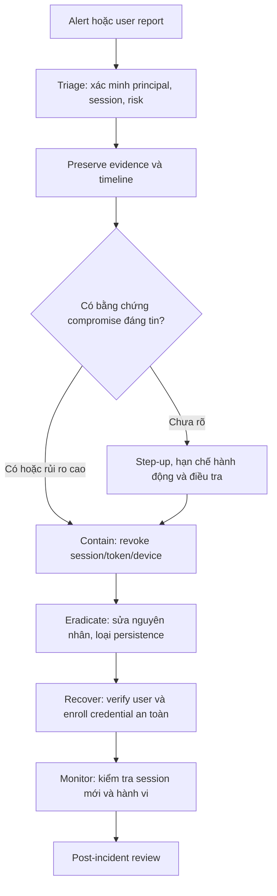

# Session compromise — Ứng phó khi phiên đăng nhập bị chiếm đoạt

## Mục tiêu học tập

Một người dùng có thể đăng nhập đúng mật khẩu, hoàn tất MFA và nhận session hợp lệ. Sau đó attacker lấy được session cookie, refresh token hoặc quyền điều khiển browser đang mở. Attacker có thể tiếp tục hành động dưới danh tính người dùng mà không cần thực hiện lại bước xác thực ban đầu. Nếu hệ thống chỉ kiểm tra mật khẩu lúc đăng nhập và không có cơ chế quản lý vòng đời session, việc đổi mật khẩu có thể không chấm dứt được phiên bị chiếm.

**Session compromise (chiếm đoạt phiên)** là sự cố trong đó một bên không được phép có được hoặc sử dụng quyền đại diện của một session đã được xác thực. Attacker có thể đánh cắp session identifier, cookie, bearer token, refresh token, điều khiển thiết bị hoặc lợi dụng session fixation để gắn phiên của mình với lần đăng nhập của nạn nhân. Hậu quả phụ thuộc quyền của principal, thời hạn và phạm vi session, loại token, khả năng thu hồi và các kiểm soát bổ sung ở từng hành động.

**Incident response cho session compromise** là quy trình phát hiện, xác minh, giới hạn tác động, thu hồi trạng thái xác thực bị ảnh hưởng, loại bỏ nguyên nhân, khôi phục quyền truy cập an toàn, bảo toàn bằng chứng và cải thiện hệ thống. Phản ứng cần nhanh vì attacker có thể đang sử dụng phiên; đồng thời phải chính xác để tránh làm mất bằng chứng hoặc khóa nhầm nhiều người dùng.

Bài học thuộc chương **Incident response** của mô-đun **SECURITY_AUTHENTICATION_FUNDAMENTALS**. Mô-đun tìm hiểu xác thực danh tính từ credential, mật khẩu, MFA, passkey và chứng chỉ đến token, phiên, liên kết danh tính và khôi phục tài khoản. Session compromise nối các chủ đề này trong một tình huống thực tế: một credential phiên đã vượt qua xác thực nhưng bị sử dụng sai chủ thể hoặc sai ngữ cảnh.

Sau bài học, bạn có thể:

- Phân biệt session hijacking, session fixation, token theft, refresh-token reuse và device compromise.
- Nhận diện tín hiệu session bất thường mà không kết luận từ một dấu hiệu đơn lẻ.
- Phân loại mức độ sự cố theo tài khoản, quyền, dữ liệu và phạm vi ảnh hưởng.
- Bảo toàn log, audit, trace và metadata mà không làm lộ thêm token hoặc secret.
- Thu hồi đúng session, token family, device credential và grant bị ảnh hưởng.
- Hiểu giới hạn thu hồi access token dạng JWT tự chứa và lựa chọn kiểm soát phù hợp.
- Điều phối containment, eradication, recovery và thông báo người dùng.
- Thiết kế session lifecycle, cookie, refresh-token rotation và step-up để giảm tác động.
- Xây dựng playbook, Java/SQL minh họa, bảng kiểm thử và checklist ứng phó.

## 1. Session là gì và khi nào bị compromise?

Session là trạng thái xác thực được hệ thống duy trì sau khi người dùng hoặc workload chứng minh danh tính. Session cho phép client tiếp tục thực hiện request mà không phải lặp lại toàn bộ authentication ceremony ở mọi lần gọi.

Một session có thể được biểu diễn bằng:

- Session identifier ngẫu nhiên trong cookie của browser.
- Refresh token hoặc token family trên ứng dụng native.
- Access token có thời hạn ngắn.
- Server-side session record gắn với principal, device và authentication context.
- Một tập credential liên kết với phiên đăng nhập SSO.
- Device-bound key hoặc proof-of-possession credential được dùng để chứng minh thiết bị.

Session không đồng nghĩa với một cookie hay một JWT. Cookie chỉ là phương tiện truyền session identifier; JWT là định dạng token có thể mang claims; server-side session là trạng thái mà hệ thống dùng để kiểm tra phiên còn hợp lệ hay không.

### Session compromise

Session bị compromise khi attacker có thể sử dụng session hoặc bằng chứng phiên thay cho chủ thể hợp pháp. Một số trường hợp:

- Attacker sao chép session cookie từ browser hoặc malware.
- Refresh token bị lấy từ file, log, backup hoặc memory.
- Attacker điều khiển browser qua malware hoặc extension độc hại.
- Session identifier được cố định trước đăng nhập rồi nạn nhân vô tình xác thực trên phiên attacker biết.
- Token bị gửi tới sai audience hoặc bị chuyển tiếp tới dịch vụ không được phép.
- Người dùng phê duyệt push MFA sau khi attacker đã khởi tạo đăng nhập.
- Thiết bị bị mất khi session vẫn còn hiệu lực.
- Một tài khoản đặc quyền để phiên mở trên máy dùng chung hoặc máy không được quản lý.

### Phân biệt các khái niệm

| Khái niệm | Ý nghĩa | Ví dụ |
| --- | --- | --- |
| **Session hijacking** | Attacker chiếm session đang hoạt động | Đánh cắp cookie và gửi request thay người dùng |
| **Session fixation** | Attacker khiến nạn nhân dùng session identifier mà attacker biết trước | Session ID không được rotate sau login |
| **Token theft** | Access/refresh token bị lấy khỏi nơi lưu hoặc trên đường truyền | Token xuất hiện trong log hoặc malware đọc storage |
| **Refresh-token reuse** | Token đã được rotate hoặc consume lại xuất hiện | Attacker và client cùng dùng một refresh token |
| **Credential compromise** | Mật khẩu, passkey hoặc secret xác thực bị lộ | Password bị phishing |
| **Device compromise** | Attacker kiểm soát hoặc có quyền cao trên thiết bị | Malware đọc browser state |
| **Account takeover** | Attacker kiểm soát account đủ lâu hoặc đủ rộng để thay đổi quyền/credential | Đổi email recovery, thêm passkey lạ |

Một session compromise có thể dẫn đến account takeover, nhưng hai khái niệm không hoàn toàn giống nhau. Có thể thu hồi một session bị lộ mà không có bằng chứng attacker đã thay đổi credential hoặc kiểm soát toàn bộ account.

## 2. Đường tấn công thường gặp

### Đánh cắp cookie hoặc bearer token

Cookie session và bearer token thường mang quyền sử dụng trực tiếp. Nếu attacker lấy được giá trị còn hiệu lực, họ có thể gửi request như client hợp lệ.

Nguồn rò rỉ có thể gồm:

- XSS hoặc script injection đọc token trong JavaScript storage.
- Malware, browser extension hoặc remote access tool.
- Log, telemetry, crash dump hoặc support bundle.
- URL, query string, referrer hoặc redirect không an toàn.
- Backup thiết bị hoặc app data không được bảo vệ.
- Máy tính dùng chung, clipboard hoặc profile browser đồng bộ.
- Proxy/debug tooling ghi lại Authorization header.
- Screenshot hoặc file export chứa session material.

TLS bảo vệ dữ liệu trên đường truyền giữa các điểm kết thúc TLS, nhưng không bảo vệ token sau khi nó đã được giải mã tại browser, ứng dụng, proxy hoặc server.

### Session fixation

Trong session fixation, attacker biết trước session identifier và tìm cách khiến nạn nhân đăng nhập bằng chính identifier đó. Sau khi nạn nhân đăng nhập, attacker dùng identifier đã biết để truy cập session đã xác thực.

Biện pháp cốt lõi là tạo session identifier mới sau authentication và sau thay đổi đặc quyền; vô hiệu hóa identifier cũ. Không chấp nhận session ID do client tự chọn hoặc giữ nguyên ID trước và sau đăng nhập.

### Refresh-token theft và reuse

Refresh token có thể sống lâu hơn access token. Nếu attacker lấy được refresh token, họ có thể xin access token mới cho tới khi token bị thu hồi hoặc hết hạn.

Refresh-token rotation phát hành token mới sau mỗi lần sử dụng. Nếu token cũ đã được rotate nhưng xuất hiện lại, authorization server có thể phát hiện reuse và thu hồi token family. Cần tính tới retry và concurrent refresh hợp lệ để tránh false positive; client nên đồng bộ refresh trong một transaction hoặc single-flight mechanism.

### XSS, CSRF và browser compromise

- XSS có thể thực thi script trong origin ứng dụng và thao túng phiên.
- CSRF lợi dụng việc browser tự gửi cookie để ép người dùng thực hiện hành động ngoài ý muốn.
- HttpOnly giảm khả năng JavaScript đọc cookie nhưng không ngăn XSS gửi request cùng origin.
- SameSite và CSRF token giúp giảm CSRF nhưng không thay thế authorization.
- Malware/extension có thể hoạt động ngoài các bảo vệ của trang web.

### Phishing và MFA fatigue

Attacker có thể lừa người dùng nhập password, mã OTP hoặc approve push challenge. Sau khi authentication hoàn tất, attacker lấy session hoặc token. Khi điều tra, cần kiểm tra cả nguồn xác thực ban đầu, thiết bị, MFA event và thời điểm session được tạo.

### Token leakage qua hệ thống trung gian

Token có thể bị gửi nhầm tới API khác, ghi vào tracing attribute hoặc bị forward qua service không đúng audience. Cần kiểm tra issuer, audience, scope, actor/delegation chain và nơi token xuất hiện. Một token hợp lệ về chữ ký vẫn có thể bị sử dụng sai trust boundary.

## 3. Dấu hiệu phát hiện session compromise

Không có một tín hiệu đơn lẻ nào luôn chứng minh session bị chiếm. Hệ thống cần kết hợp hành vi, thiết bị, mạng, session lifecycle và sự kiện thay đổi credential.

### Tín hiệu kỹ thuật

- Cùng một session identifier được dùng đồng thời từ hai môi trường không hợp lý.
- Session xuất hiện từ device/browser mới ngay sau khi token bị lộ hoặc refresh-token reuse.
- Thay đổi đột ngột về network/ASN, vị trí hoặc client characteristics.
- Refresh token cũ được dùng sau khi đã rotate.
- Session tiếp tục hoạt động sau logout/revocation mà theo thiết kế phải bị vô hiệu.
- Nhiều lần step-up hoặc MFA prompt không do người dùng khởi tạo.
- Session thực hiện hành động hiếm hoặc có giá trị cao sau thời gian không hoạt động.
- Một session dùng endpoint/admin API không phù hợp với lịch sử principal.
- Device credential hoặc certificate bị revoke nhưng vẫn có request được chấp nhận.
- Session có authentication age hoặc assurance thấp nhưng thực hiện hành động yêu cầu step-up.

### Tín hiệu nghiệp vụ

- Thay email, phone, recovery method hoặc passkey rồi lập tức chuyển tiền/export dữ liệu.
- Tạo API key, thêm OAuth grant hoặc thêm thiết bị mới bất thường.
- Đọc lượng lớn dữ liệu hoặc truy cập nhiều tenant trong thời gian ngắn.
- Thay đổi quyền, tạo user/admin hoặc sửa audit settings.
- Thực hiện refund, payout hoặc thay đổi thông tin thanh toán.
- Tạo nhiều recovery request hoặc yêu cầu support reset credential sau login lạ.

### Tín hiệu người dùng báo cáo

- Người dùng thấy thông báo đăng nhập hoặc thiết bị lạ.
- Email thông báo thay đổi mật khẩu/credential mà họ không thực hiện.
- Có giao dịch hoặc hoạt động không nhận ra.
- Người dùng bị đăng xuất bất ngờ hoặc nhận MFA prompt liên tục.
- Người dùng nhận thông báo session vẫn hoạt động sau khi đã logout.

### Không dựa tuyệt đối vào IP hoặc địa lý

IP có thể thay đổi do mạng di động, VPN, proxy doanh nghiệp hoặc roaming. Geo-IP không xác định chính xác vị trí người dùng. User-agent có thể bị giả mạo. Dùng các tín hiệu này làm risk input, kết hợp thời gian, device-bound key, hành động, lịch sử và mức assurance; không tự động kết luận compromise chỉ vì một IP mới.

## 4. Phân loại mức độ sự cố

Severity cần phản ánh cả khả năng compromise và tác động. Một session bị lộ của account đọc dữ liệu công khai khác với session quản trị có quyền thay đổi credential và cấu hình bảo mật.

### Ma trận đánh giá

| Yếu tố | Rủi ro thấp hơn | Rủi ro cao hơn |
| --- | --- | --- |
| Principal | Account thử nghiệm/quyền hạn thấp | Admin, finance, support, service principal |
| Quyền session | Read-only, scope hẹp | Write, approve, export, credential management |
| Dữ liệu | Dữ liệu công khai/ít nhạy cảm | PII, tài chính, bí mật, dữ liệu nhiều tenant |
| Bằng chứng | Một tín hiệu chưa xác minh | Token reuse, hành động trái phép, user xác nhận |
| Phạm vi | Một session, một thiết bị | Nhiều account, nhiều session hoặc workload |
| Thời gian | Đã thu hồi, không có hoạt động sau đó | Attacker còn hoạt động hoặc persistence |
| Credential khác | Chưa có dấu hiệu thay đổi | Email recovery, passkey, MFA hoặc quyền đã bị thay |

### Ví dụ phân loại

- **Sev 1 / Critical:** Session đặc quyền bị chiếm, có hành động trái phép, attacker tạo persistence hoặc truy cập dữ liệu nhạy cảm quy mô lớn.
- **Sev 2 / High:** Có bằng chứng token/session bị sử dụng bởi bên không được phép, nhưng phạm vi đang giới hạn.
- **Sev 3 / Medium:** Có tín hiệu bất thường đáng tin cậy, chưa xác nhận hành động trái phép; cần containment phòng ngừa.
- **Sev 4 / Low:** Một cảnh báo yếu hoặc false positive có thể giải thích được; tiếp tục theo dõi và cải thiện detection.

Tên severity và ngưỡng thực tế phải theo incident policy của tổ chức. Nếu chưa biết phạm vi, tạm phân loại theo kịch bản rủi ro cao hợp lý và giảm severity khi có bằng chứng.

## 5. Quy trình ứng phó tổng thể

Một incident session compromise thường đi qua các pha:

1. Detect và triage.
2. Preserve evidence.
3. Contain session/token và ngăn hành động tiếp diễn.
4. Eradicate nguyên nhân và persistence.
5. Recover account/device/service an toàn.
6. Monitor hậu sự cố và xác nhận không tái diễn.
7. Review, báo cáo và cải thiện kiểm soát.



Không chờ điều tra hoàn tất mới containment nếu attacker có thể tiếp tục thực hiện hành động nguy hiểm. Với hành động phá hủy bằng chứng hoặc ảnh hưởng nhiều người dùng, phối hợp incident commander và owner dịch vụ theo quy trình.

## 6. Triage trong giai đoạn đầu

Mục tiêu triage là xác định nhanh session nào, principal nào, quyền gì và liệu attacker còn hoạt động hay không.

### Câu hỏi cần trả lời

- Ai là principal và session thuộc account/tenant nào?
- Session ID/reference, device reference và token family nào liên quan?
- Session được tạo khi nào, bằng phương thức xác thực nào?
- MFA có được yêu cầu và hoàn tất không? Có prompt bất thường không?
- Có step-up hoặc reauthentication gần thời điểm sự cố không?
- Session đã truy cập resource/action nào?
- Có refresh-token reuse hoặc revocation event không?
- Có credential, recovery method hoặc role nào bị thay đổi?
- Có session khác hoặc device khác cùng account bị ảnh hưởng?
- Dữ liệu nào đã bị đọc, sửa, export hoặc xóa?
- Có dấu hiệu attacker vẫn còn quyền truy cập?

### Phạm vi điều tra

Bắt đầu từ session nghi vấn, rồi mở rộng theo quan hệ:

- Các session khác của cùng subject.
- Refresh-token family và device credential liên quan.
- Các access token được phát hành từ session.
- OAuth grant, passkey, TOTP và recovery method.
- Tài khoản liên kết/SSO và IdP session nếu có.
- API key hoặc service credential được tạo trong khoảng thời gian nghi vấn.
- Các account/tenant/resource bị session truy cập.
- Các dịch vụ nhận token từ cùng issuer hoặc audience.

Không mặc định mọi session của toàn hệ thống đều bị compromise. Mở rộng phạm vi theo bằng chứng về credential, signing key, issuer hoặc control plane bị ảnh hưởng.

## 7. Bảo toàn bằng chứng

Containment nhanh là cần thiết, nhưng việc xóa session hoặc reset thiết bị trước khi ghi nhận metadata có thể làm mất bằng chứng. Thu thập metadata tối thiểu trước hoặc song song với containment; không trì hoãn revoke chỉ để có một bản ghi hoàn hảo.

### Bằng chứng cần giữ

| Nhóm | Dữ liệu cần thiết | Lưu ý |
| --- | --- | --- |
| Session metadata | Session reference, created/last-seen, expiry, status, device reference | Không export raw session secret |
| Authentication event | Method, factor, assurance, outcome, timestamp | Không lưu password/OTP/assertion thô |
| Token lifecycle | Token family reference, jti/reference, issued/rotated/revoked time | Không lưu bearer token nguyên vẹn |
| Request activity | Route/action, resource reference, result, timestamp | Giảm thiểu PII |
| Device/network | Risk signal, normalized device/network class | IP đầy đủ chỉ trong evidence store được phân quyền khi cần |
| Authorization | Scope, permission, policy version, decision | Không ghi toàn bộ token |
| Account changes | Password reset, email/recovery changes, passkey enrollment | Ghi actor và source |
| Administrative action | Ai revoke, khi nào, lý do, ticket/incident reference | Audit append-only |
| Infrastructure | Gateway/auth logs, IdP/MFA provider status, deployment changes | Đồng bộ thời gian và nguồn |

### Chain of custody

- Ghi người thu thập, thời điểm, nguồn và lý do.
- Dùng storage có access control và integrity protection.
- Giữ bản gốc hoặc snapshot theo chính sách.
- Ghi hash của artifact nếu cần xác minh tính toàn vẹn.
- Hạn chế quyền xem raw evidence.
- Ghi lại mọi lần truy cập và export.
- Áp dụng retention và legal hold theo yêu cầu phù hợp.

Không gửi session cookie, access token hoặc refresh token qua chat/email để “kiểm tra”. Nếu cần xác minh token, dùng reference, hash hoặc môi trường điều tra có kiểm soát.

## 8. Containment: thu hồi session và token

Containment cần làm cho attacker mất khả năng sử dụng session bị chiếm. Phải hiểu session architecture để biết thao tác revoke nào có hiệu lực ngay.

### Thu hồi một session

Với server-side session, đánh dấu session revoked/invalid trong kho trạng thái có thẩm quyền. Mỗi request phải kiểm tra trạng thái hoặc dùng cache có cơ chế invalidation và giới hạn propagation delay.

Các bước thường gồm:

1. Xác định session reference và principal.
2. Lưu metadata cần thiết cho incident.
3. Chuyển session sang REVOKED bằng thao tác nguyên tử.
4. Xóa hoặc vô hiệu cookie ở client khi có thể.
5. Từ chối request tiếp theo mang session identifier cũ.
6. Ghi audit actor, reason và incident reference.
7. Kiểm tra các node/region đã nhận trạng thái revoke.

Xóa cookie ở browser không thu hồi bản sao cookie của attacker. Backend phải từ chối session cũ.

### Thu hồi tất cả session của một account

Dùng khi có bằng chứng account takeover, credential chính bị compromise, recovery method bị thay hoặc không thể xác định session nào bị ảnh hưởng.

Có thể tăng session version/security stamp của account. Mọi session cũ mang version thấp hơn bị từ chối. Cơ chế này hữu ích cho global logout nhưng cần cân nhắc cache, service offline và các phiên được phép tồn tại theo policy.

### Thu hồi refresh-token family

Nếu refresh token bị lộ hoặc reuse detection kích hoạt:

- Thu hồi token family theo subject/client/device phù hợp.
- Vô hiệu hóa refresh token hiện tại và các descendant token.
- Đánh dấu device/session liên quan không còn trusted.
- Yêu cầu xác thực lại qua flow an toàn.
- Kiểm tra token đã được dùng để phát hành access token nào.
- Gửi thông báo bảo mật qua kênh đã xác minh.

Không chỉ xóa refresh token local. Attacker có thể đang giữ bản sao riêng.

### Access token dạng JWT tự chứa

JWT access token thường được xác minh cục bộ bằng chữ ký và claims. Nếu resource server không kiểm tra trạng thái server-side, việc revoke refresh token không làm JWT đang phát hành tự biến mất. Token có thể còn được chấp nhận tới khi hết hạn.

Các lựa chọn giảm thời gian tác động:

- Access token lifetime ngắn.
- Introspection hoặc session/status lookup cho hành động nhạy cảm.
- Denylist theo jti/reference trong thời gian còn hiệu lực.
- Account/session version hoặc token epoch được kiểm tra tại resource server.
- Thu hồi grant và refresh-token family để ngăn phát hành token mới.
- Step-up và authorization check cho hành động có giá trị cao.

Mỗi lựa chọn có trade-off về độ trễ, availability và chi phí. Nếu dùng denylist, cần phân phối revoke đủ nhanh tới mọi verifier. Nếu chỉ dựa vào expiry, phải chấp nhận cửa sổ còn lại cho tới khi token hết hạn.

### Không xoay signing key chỉ vì một session bị lộ

Signing key compromise là sự cố ở cấp issuer/trust infrastructure. Một session cookie hoặc refresh token bị lộ không tự chứng minh private signing key bị lộ. Xoay signing key không thu hồi session server-side và có thể gây outage lớn. Chỉ xử lý key rollover khẩn cấp khi có bằng chứng hoặc rủi ro đáng tin cậy về key compromise; nếu cần, thực hiện playbook riêng cho issuer/JWKS và token validation.

## 9. Containment theo mức độ ảnh hưởng

| Tình huống | Hành động containment |
| --- | --- |
| Một session cookie bị đánh cắp, account còn an toàn | Revoke session cụ thể, kiểm tra activity và source |
| Refresh token bị lộ | Revoke token family, session/device liên quan, kiểm tra access token đã cấp |
| Người dùng xác nhận account takeover | Global logout, khóa thay đổi nhạy cảm, xác minh lại danh tính |
| Admin session bị chiếm | Revoke ngay, disable/step-up admin access, rà soát thay đổi đặc quyền |
| Device mất | Revoke device key, refresh family và session gắn thiết bị |
| Malware kiểm soát browser | Revoke session, cô lập thiết bị theo quy trình endpoint response |
| IdP session bị compromise | Phối hợp IdP owner, revoke federated session/grant và kiểm tra downstream |
| Token signing key bị lộ | Incident issuer/key riêng, ngừng ký bằng key cũ và xử lý verifier/token |
| Nhiều account cùng bị ảnh hưởng | Mở rộng incident scope, rate-limit/risk controls và phối hợp incident commander |

### Rate limit và tạm khóa

Có thể tạm dừng hành động nhạy cảm, yêu cầu step-up hoặc khóa account trong thời gian điều tra. Không dùng lockout rộng không có căn cứ vì attacker có thể lợi dụng để gây denial of service. Chọn kiểm soát có thể đảo ngược và có owner phê duyệt.

## 10. Eradication: loại bỏ nguyên nhân và persistence

Thu hồi session chỉ ngăn sử dụng credential hiện tại. Nếu nguyên nhân vẫn tồn tại, attacker có thể lấy session mới hoặc tiếp tục truy cập bằng persistence khác.

### Điều tra nguồn compromise

- XSS, dependency bị compromise hoặc script bên thứ ba.
- Malware, browser extension, remote access tool hoặc thiết bị root/jailbreak.
- Token bị log trong application/APM/trace.
- Secret storage không an toàn hoặc backup bị lộ.
- Session fixation do không rotate identifier.
- CSRF hoặc thiếu kiểm tra origin/anti-CSRF.
- Refresh-token rotation/reuse detection bị cấu hình sai.
- OAuth redirect/callback hoặc token audience sai.
- Admin/support workflow reset session quá yếu.
- Phishing/MFA fatigue và step-up không gắn transaction.
- Account recovery bị lợi dụng để enroll credential mới.
- Quyền service quá rộng hoặc confused deputy.

### Loại persistence

Kiểm tra và xử lý nếu attacker đã:

- Thêm passkey, authenticator, recovery email/phone.
- Tạo API key, OAuth grant, app password hoặc device credential.
- Thêm user/admin, service account hoặc role.
- Tạo session mới hoặc refresh-token family khác.
- Thay email, số điện thoại hoặc thông tin recovery.
- Thay forwarding rule, webhook, integration hoặc trusted device.
- Tắt audit/alert hoặc thay policy bảo mật.

Không chỉ reset password rồi kết thúc incident. Cần kiểm tra mọi cơ chế có thể tái lập quyền truy cập.

## 11. Recovery: khôi phục tài khoản an toàn

Recovery chỉ bắt đầu khi attacker đã bị containment đủ mức và nguyên nhân chính được xử lý hoặc kiểm soát. Người dùng phải được xác minh qua flow phù hợp, đặc biệt nếu email/phone hoặc authenticator đã bị thay.

### Xác minh người dùng

- Dùng phương thức recovery đã đăng ký và còn đáng tin.
- Nếu recovery channel bị compromise, không dùng chính channel đó làm bằng chứng duy nhất.
- Với account đặc quyền, dùng quy trình proofing/approval mạnh hơn.
- Thông báo thay đổi và session revocation qua kênh đã xác minh.
- Yêu cầu người dùng kiểm tra hoạt động và dữ liệu bất thường.
- Không yêu cầu người dùng gửi password, OTP hoặc private key cho support.

### Thiết lập credential mới

Tùy nguyên nhân, có thể cần:

- Reset password bằng flow an toàn.
- Enroll passkey hoặc security key mới.
- Re-enroll TOTP/push authenticator.
- Phát hành recovery code mới và revoke mã cũ.
- Enroll device key mới và revoke public key cũ.
- Reauthorize OAuth app/integration cần thiết.
- Khôi phục email/phone/recovery method đã xác minh.
- Tạo session mới với identifier mới và assurance phù hợp.

Đổi password không tự động thu hồi passkey, TOTP seed, refresh-token family, OAuth grant hoặc session ở mọi hệ thống. Recovery plan phải liệt kê từng loại credential bị ảnh hưởng.

### Giới hạn hành động sau recovery

Với sự cố rủi ro cao, có thể áp dụng cooling-off hoặc hạn chế tạm thời với thay đổi payout, email recovery, API key và quyền admin. Thông báo rõ lý do và cách xác minh; tránh tạo một quy trình khiến người dùng không thể truy cập dữ liệu thiết yếu lâu hơn cần thiết.

## 12. Session design giúp giảm tác động

Incident response hiệu quả cần nền tảng session có khả năng xác định và thu hồi từng phiên.

### Session identifier

- Dùng giá trị ngẫu nhiên mật mã, đủ entropy.
- Không mã hóa user ID hoặc timestamp thành session ID.
- Không nhận session ID do client tự chọn.
- Rotate ID sau login, MFA step-up và thay đổi đặc quyền.
- Không đặt session ID trong URL.
- Tránh log session secret; log reference không nhạy cảm.

### Cookie cho browser

Các thuộc tính thường cần:

- Secure: chỉ gửi qua HTTPS.
- HttpOnly: JavaScript không đọc trực tiếp cookie.
- SameSite: giảm một số request cross-site tự động gửi cookie.
- Domain/Path hạn chế đúng phạm vi.
- Prefix như __Host- nếu phù hợp để giảm cookie injection/domain confusion.
- Max-Age/Expires phù hợp idle và absolute timeout.

Cookie flags không thay thế CSRF defense, XSS prevention, server-side authorization hoặc session revocation.

### Idle timeout và absolute timeout

- Idle timeout kết thúc phiên sau thời gian không hoạt động.
- Absolute timeout giới hạn tổng tuổi session dù có activity.
- Reauthentication/step-up được yêu cầu cho hành động rủi ro cao.
- Timeout phụ thuộc assurance, loại account, thiết bị và threat model.

Không kéo dài session vô hạn chỉ vì có request nền hoặc polling. Định nghĩa activity có ý nghĩa và tránh để attacker giữ session sống bằng traffic tự động.

### Session binding và device context

Có thể gắn session với device-bound key hoặc một số thuộc tính thiết bị để tăng khả năng phát hiện token bị sao chép. Tuy nhiên, IP/user-agent binding cứng có thể gây false positive. Dùng binding như risk signal hoặc proof-of-possession khi giao thức hỗ trợ, không coi fingerprint là danh tính chắc chắn.

## 13. Refresh-token rotation và reuse detection

Refresh-token rotation giảm giá trị của token đã bị đánh cắp bằng cách thay token sau mỗi lần refresh và phát hiện token cũ xuất hiện lại.

### Token family

Một family có thể được mô hình hóa:

- Family ID gắn với subject, client và device/session.
- Token hiện hành có trạng thái ACTIVE.
- Mỗi lần refresh thành công, token cũ chuyển ROTATED và token mới trở thành ACTIVE.
- Nếu token ROTATED xuất hiện lại, server phát hiện reuse.
- Policy có thể revoke cả family và yêu cầu authentication lại.

### Race condition

Hai tab hoặc hai request đồng thời có thể dùng cùng refresh token. Nếu một request rotate thành công và request còn lại đến sau, server có thể hiểu nhầm là attacker reuse. Giảm rủi ro bằng:

- Client single-flight refresh để chỉ một refresh request chạy tại một thời điểm.
- Đồng bộ token mới trước khi các request tiếp theo sử dụng.
- Idempotency hoặc grace semantics được thiết kế rõ nếu protocol/provider hỗ trợ.
- Không chấp nhận token cũ vô thời hạn chỉ để hỗ trợ retry.
- Ghi reason category và correlation để phân biệt race với reuse thực sự.

### Khi phát hiện reuse

Không chỉ trả lỗi invalid_grant. Cần đánh dấu family bị compromise/revoked theo policy, ghi security event, thu hồi session/device và đánh giá access token đã phát hành từ family đó. Thông báo cho người dùng khi có khả năng account bị ảnh hưởng.

## 14. SSO và session của Identity Provider

Một ứng dụng có thể có local session riêng và session ở Identity Provider. Logout ở một nơi không tự động kết thúc mọi nơi.

### Local logout và IdP logout

- Local logout: ứng dụng hủy session của chính nó.
- RP-initiated logout: ứng dụng yêu cầu IdP kết thúc session theo OIDC profile.
- SAML Single Logout: trao đổi logout message theo cấu hình và trust của federation.
- Token revocation: thu hồi token/grant theo endpoint và semantics của provider.
- Global session revocation: policy ở IdP hoặc hệ thống trung tâm làm mất hiệu lực nhiều session.

Cần hiểu provider có hỗ trợ front-channel/back-channel logout, token revocation và propagation tới relying party hay không. Không tuyên bố logout toàn hệ thống nếu chỉ xóa cookie local.

### Khi IdP session bị compromise

- Phối hợp owner của IdP để revoke session.
- Xác định downstream RP/session được tạo từ IdP assertion.
- Kiểm tra thời điểm authentication, issuer, subject và assurance.
- Thu hồi local session/token tại các RP bị ảnh hưởng.
- Kiểm tra OAuth grants, refresh-token family và account linking.
- Xác minh IdP signing key và metadata chỉ khi có bằng chứng key/trust compromise.

## 15. Java: mô hình hóa quy trình revoke session

Ví dụ sau minh họa quyết định revoke session và token family trong một transaction. Repository phải cung cấp thao tác nguyên tử; code không thay thế adapter thực tế với Redis, database hoặc authorization server.

```java
import java.time.Instant;
import java.util.Objects;
import java.util.Set;

enum SessionStatus {
    ACTIVE,
    REVOKED,
    EXPIRED
}

enum IncidentReason {
    SUSPECTED_SESSION_THEFT,
    CONFIRMED_SESSION_THEFT,
    REFRESH_TOKEN_REUSE,
    DEVICE_LOST,
    ACCOUNT_TAKEOVER
}

record SessionRecord(
        String sessionRef,
        String subjectId,
        String tokenFamilyRef,
        String deviceRef,
        SessionStatus status,
        Instant expiresAt
) {}

record RevokeCommand(
        String sessionRef,
        String subjectId,
        IncidentReason reason,
        String incidentRef,
        String actorId,
        Instant occurredAt
) {}

record RevokeResult(
        boolean revocationQueued,
        String sessionRef,
        String tokenFamilyRef
) {}

interface SessionRepository {
    // In one database transaction: revoke ACTIVE session and insert an outbox event.
    boolean revokeAndEnqueueOutboxIfActive(
            String sessionRef,
            String subjectId,
            String tokenFamilyRef,
            String actorId,
            String incidentRef,
            Instant revokedAt,
            String reason
    );

    SessionRecord findByReference(String sessionRef);
}

final class SessionIncidentResponder {
    private final SessionRepository sessions;

    SessionIncidentResponder(SessionRepository sessions) {
        this.sessions = Objects.requireNonNull(sessions);
    }

    RevokeResult revoke(RevokeCommand command) {
        if (command == null
                || blank(command.sessionRef())
                || blank(command.subjectId())
                || blank(command.incidentRef())
                || blank(command.actorId())
                || command.reason() == null
                || command.occurredAt() == null) {
            throw new IllegalArgumentException("Invalid revoke command");
        }

        SessionRecord record =
                sessions.findByReference(command.sessionRef());

        if (record == null
                || !command.subjectId().equals(record.subjectId())) {
            return new RevokeResult(false, command.sessionRef(), null);
        }

        boolean queued = sessions.revokeAndEnqueueOutboxIfActive(
                record.sessionRef(),
                record.subjectId(),
                record.tokenFamilyRef(),
                command.actorId(),
                command.incidentRef(),
                command.occurredAt(),
                command.reason().name()
        );

        if (!queued) {
            return new RevokeResult(
                    false,
                    record.sessionRef(),
                    record.tokenFamilyRef()
            );
        }

        return new RevokeResult(
                true,
                record.sessionRef(),
                record.tokenFamilyRef()
        );
    }

    private static boolean blank(String value) {
        return value == null || value.isBlank();
    }
}
```

Đây là policy sketch. Repository phải cập nhật session và ghi outbox event trong cùng một database transaction. Outbox dispatcher sẽ retry idempotent việc revoke token family, phát cache invalidation và ghi audit; nhờ vậy sự cố ở một dependency không làm mất yêu cầu xử lý tiếp theo. Kết quả `revocationQueued` chỉ xác nhận công việc đã được ghi bền vững vào outbox, không chứng minh mọi verifier đã nhận revoke. Theo dõi propagation tới khi hoàn tất. Không đưa raw cookie/token vào command hoặc audit.

### SQL revoke nguyên tử

```sql
UPDATE auth_sessions
SET status = 'REVOKED',
    revoked_at = :now,
    revoke_reason = :reason,
    incident_ref = :incident_ref
WHERE session_ref = :session_ref
  AND subject_id = :subject_id
  AND status = 'ACTIVE'
  AND expires_at > :now;
```

Kiểm tra update count. Dùng unique reference và transaction/outbox để phát sự kiện invalidation tới cache/verifier. Nếu update count bằng 0, kiểm tra trạng thái đã revoked/expired theo policy; không kích hoạt lại session.

### Account-wide revoke

```sql
UPDATE auth_sessions
SET status = 'REVOKED',
    revoked_at = :now,
    revoke_reason = 'ACCOUNT_SECURITY_RESET',
    incident_ref = :incident_ref
WHERE subject_id = :subject_id
  AND status = 'ACTIVE';
```

Với hệ thống lớn, có thể dùng session epoch/security stamp để tránh cập nhật hàng triệu record đồng bộ. Resource server phải kiểm tra epoch theo cách có consistency và propagation phù hợp; nếu cache quá lâu, attacker có thể tiếp tục dùng session cũ.

## 16. Truyền thông và phối hợp trong incident

Thông báo cần kịp thời, chính xác và không tiết lộ chi tiết giúp attacker né detection.

### Nội dung thông báo người dùng

Có thể bao gồm:

- Tổ chức phát hiện hoạt động đăng nhập/phiên đáng ngờ.
- Session hoặc thiết bị bị ảnh hưởng đã được thu hồi nếu việc đó đã hoàn tất.
- Người dùng cần đăng nhập lại qua website/app chính thức.
- Hướng dẫn kiểm tra hoạt động và thay credential nếu được yêu cầu.
- Cách liên hệ support qua kênh đã xác minh.
- Những thay đổi hoặc giao dịch nào cần người dùng kiểm tra.
- Thời điểm cập nhật tiếp theo nếu incident chưa đóng.

Không tuyên bố “account đã an toàn” khi điều tra chưa hoàn tất. Không yêu cầu người dùng gửi password, OTP, recovery code, token hoặc private key.

### Phối hợp nội bộ

| Vai trò | Trách nhiệm |
| --- | --- |
| Incident commander | Quyết định severity, scope, ưu tiên và escalation |
| Identity/auth owner | Revoke session, token family, grant và credential |
| Security/IR | Triage, forensic, threat hunting và containment |
| Service owner | Kiểm tra hành động/resource và khôi phục dịch vụ |
| Endpoint/IT | Hỗ trợ cô lập, làm sạch hoặc thay thiết bị |
| Privacy/legal | Đánh giá nghĩa vụ thông báo và xử lý dữ liệu |
| Support/communications | Hỗ trợ người dùng theo script đã xác minh |

Chỉ người được ủy quyền mới thực hiện global revoke, disable account hoặc thay đổi policy có phạm vi lớn. Ghi lại quyết định và lý do.

## 17. Monitoring và metric cho session compromise

Các metric giúp nhận ra xu hướng, nhưng cần giữ label hữu hạn và tránh PII.

| Metric | Ý nghĩa |
| --- | --- |
| auth_session_created_total | Session được tạo theo outcome/method |
| auth_session_revoked_total | Session bị revoke theo reason category |
| auth_session_active | Số session active tổng hợp |
| auth_session_revoke_propagation_seconds | Thời gian revoke lan tới verifier/cache |
| auth_refresh_reuse_detected_total | Refresh token reuse detection |
| auth_session_anomaly_total | Risk engine ghi nhận anomaly category |
| auth_step_up_required_total | Số lần policy yêu cầu step-up |
| auth_step_up_failed_total | Step-up thất bại |
| auth_device_credential_revoked_total | Device key/certificate bị revoke |
| auth_global_logout_total | Account-wide revoke được thực hiện |
| auth_session_invalid_after_revoke_total | Request tiếp tục dùng session đã revoke |

### Alert gợi ý

- Refresh-token reuse tăng vượt baseline.
- Session bị revoke nhưng request cũ vẫn được chấp nhận sau SLA.
- Admin session xuất hiện từ risk context bất thường.
- Một account có nhiều session/device mới trong thời gian ngắn.
- Nhiều account có cùng pattern session anomaly.
- Session tạo mới ngay sau account recovery hoặc đổi MFA bất thường.
- Global logout/revoke thất bại hoặc propagation chậm.
- Audit event không được ghi sau một hành động revoke quan trọng.

Không dùng username, session ID, token, IP đầy đủ hoặc device ID tùy ý làm metric label. Drill-down theo principal/session reference phải qua event store được phân quyền.

## 18. Bảng kiểm thử ứng phó session compromise

| Trường hợp | Thao tác | Kết quả mong đợi |
| --- | --- | --- |
| Revoke một session | Revoke session ACTIVE theo subject đúng | Session chuyển REVOKED, request sau bị từ chối |
| Subject mismatch | Gửi lệnh revoke session của user khác | Không revoke, audit/alert theo policy |
| Duplicate revoke | Gửi lại cùng lệnh | Idempotent, không tạo trạng thái mới sai |
| Cookie copy | Dùng cookie cũ sau revoke | Server từ chối |
| JWT còn hạn | Revoke refresh token nhưng JWT tự chứa còn hiệu lực | Test xác nhận giới hạn; denylist/introspection/expiry policy hoạt động |
| Refresh-token reuse | Dùng token đã rotate | Family bị revoke theo policy và security event được ghi |
| Concurrent refresh | Hai request refresh cùng lúc từ client hợp lệ | Xử lý race theo policy, tránh false compromise nếu có cơ chế đồng bộ |
| Session fixation | Giữ ID trước login | ID được rotate; ID cũ không truy cập session authenticated |
| Global logout | Tăng session epoch/revoke mọi session | Session cũ bị từ chối sau propagation SLA |
| Multi-region revoke | Revoke tại region A, request tới B | B từ chối trong giới hạn propagation đã định |
| Cache stale | Verifier giữ cache session cũ | Invalidation hoặc TTL bảo đảm không vượt SLA |
| Device lost | Revoke device credential và token family | Device proof/session cũ bị từ chối |
| MFA fatigue | Nhiều push prompt bất thường | Detection/rate control kích hoạt |
| Passkey added by attacker | Phát hiện credential mới trái phép | Gỡ/revoke credential và kiểm tra account |
| Recovery method changed | Email/phone recovery bị thay | Freeze/hạn chế thay đổi, xác minh lại |
| SSO logout | Local và IdP session có trạng thái khác nhau | Hiển thị/ghi nhận đúng phạm vi logout |
| Audit failure | Audit store tạm unavailable khi revoke | Outbox/retry bảo đảm record không mất |
| Token leak in logs | Quét log/APM | Không có raw bearer token/cookie |
| Session replay | Gửi lại request với session cũ | Revoke/expiry/risk policy từ chối theo thiết kế |
| Admin compromise | Admin session thực hiện action nhạy cảm | Containment ưu tiên cao, audit đầy đủ |
| Recovery completion | User xác minh và enroll credential mới | Session mới được tạo, credential cũ vẫn revoked |
| Post-incident monitoring | Theo dõi account sau recovery | Không xuất hiện persistence/session mới bất thường |

## 19. Lỗi ứng phó thường gặp

| Lỗi | Hậu quả | Cách phòng tránh |
| --- | --- | --- |
| Chỉ xóa cookie ở browser | Attacker vẫn giữ bản sao cookie | Revoke session server-side |
| Chỉ đổi password | Refresh token/passkey/session cũ có thể còn hiệu lực | Revoke từng credential/session liên quan |
| Chỉ revoke refresh token | JWT access token tự chứa vẫn có thể được chấp nhận | Short lifetime, introspection, denylist hoặc session epoch |
| Không kiểm tra token family | Attacker dùng descendant token khác | Revoke family và kiểm tra issuance history |
| Xoay signing key không có căn cứ | Outage lớn mà session bị lộ vẫn tồn tại | Phân biệt session compromise và issuer key compromise |
| Xóa evidence trước khi triage | Mất timeline và phạm vi | Preserve metadata song song containment |
| Tin IP là danh tính | Khóa nhầm người dùng hoặc bỏ sót attacker | Kết hợp nhiều risk signal |
| Reset password qua recovery yếu | Attacker chiếm lại account | Proofing/step-up phù hợp và thông báo |
| Không kiểm tra passkey/MFA mới | Attacker giữ persistence | Inventory credential và enrollment audit |
| Chỉ revoke local session | IdP hoặc downstream RP session còn sống | Phối hợp SSO/IdP và downstream revoke |
| Không xử lý cache/region | Session revoked vẫn được chấp nhận ở node khác | Propagation SLA, shared state và test |
| Lock account hàng loạt | Attacker gây denial of service | Risk-based containment và scope hẹp |
| Không kiểm tra action đã thực hiện | Thiệt hại dữ liệu/tài chính chưa được xử lý | Resource audit, transaction review và remediation |
| Thông báo quá sớm hoặc sai | Gây hoang mang hoặc lộ detection | Comms theo evidence và incident commander |
| Không monitor sau recovery | Attacker tái xâm nhập | Post-incident watch và credential review |

## 20. Bài tập vận dụng

Một nhân viên tài chính báo rằng họ nhận được thông báo đăng nhập mới dù không đăng nhập. Backend phát hiện cùng một session reference được sử dụng từ hai client context cách nhau vài phút. Session được tạo sau một lần đăng nhập password + push MFA. Người dùng xác nhận đã bấm approve một push notification mà họ không khởi tạo. Trong session đó, attacker đọc danh sách payout, thêm một OAuth integration và tạo refresh token mới. Access token là JWT có thời hạn 20 phút; resource server chỉ xác minh chữ ký và expiry, không introspection. Hệ thống có ba region và cache session status 10 phút.

**Yêu cầu:**

1. Phân loại sự cố và xác định bằng chứng nào hỗ trợ kết luận session/account compromise.
2. Lập timeline từ password verification, push approval, session creation tới payout access và OAuth integration.
3. Xác định session, refresh-token family, OAuth grant, integration và các credential/device cần thu hồi.
4. Đề xuất containment ngay trong 15 phút đầu, bao gồm ba region và cache session status.
5. Phân tích access JWT còn hiệu lực 20 phút: revoke refresh token có tác dụng gì và không có tác dụng gì?
6. Thiết kế cách ngăn session cũ tiếp tục hoạt động trong thời gian cache 10 phút.
7. Điều tra persistence: OAuth integration, passkey, MFA, recovery method và session khác.
8. Thiết kế recovery để nhân viên tài chính xác minh danh tính, enroll MFA/passkey mới và kiểm tra payout.
9. Đề xuất cải tiến push MFA để chống fatigue và gắn approval với transaction/context.
10. Viết test cho multi-region revoke, JWT còn hạn, refresh-token reuse, global logout và audit propagation.
11. Đề xuất thông báo người dùng và metric theo dõi sau incident.

**Gợi ý tự đánh giá:** Đây là sự cố có bằng chứng mạnh vì người dùng không khởi tạo push nhưng đã approve, session có dấu hiệu sử dụng từ client context khác và attacker tạo integration/refresh token. Cần revoke session và token family, thu hồi OAuth grant/integration trái phép, kiểm tra payout và credential mới, đồng thời xử lý access JWT còn hạn tại resource server. Cache 10 phút có thể tạo cửa sổ attacker tiếp tục dùng session; containment phải tính propagation thực tế ở cả ba region.

---

**Điểm cần nhớ:** Ứng phó session compromise phải **bảo toàn bằng chứng, thu hồi trạng thái xác thực đúng phạm vi, loại bỏ persistence và khôi phục danh tính qua flow đáng tin**. Xóa cookie hoặc đổi password không đủ nếu attacker còn refresh token, access JWT, IdP session, OAuth grant hay device credential. Hãy thiết kế session có thể revoke, theo dõi propagation tới mọi verifier và yêu cầu transaction-bound step-up cho hành động rủi ro cao.
