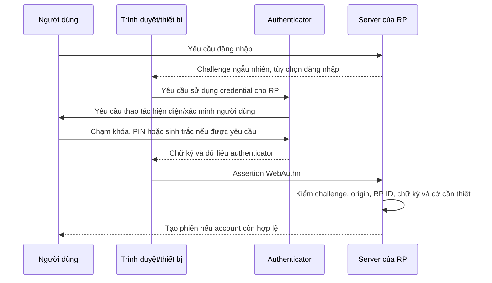
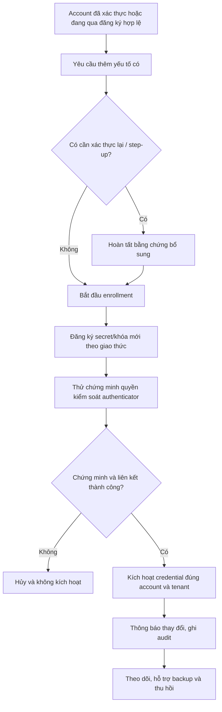

# Yếu tố có (Possession factor)

Trong xác thực danh tính, **yếu tố có** (*something you have*, *possession factor*) là nhóm bằng chứng dựa vào việc người yêu cầu đăng nhập **kiểm soát một vật, thiết bị hoặc phương tiện chứa bí mật/khóa xác thực** đã được đăng ký. Ví dụ: khóa bảo mật FIDO2, điện thoại chứa ứng dụng tạo mã TOTP, thẻ thông minh có khóa riêng, hoặc thiết bị nhận yêu cầu xác nhận đăng nhập.

Yếu tố có giúp hệ thống kiểm tra rằng người đăng nhập có quyền sử dụng một phương tiện xác thực đã gắn với danh tính trước đó. Nhưng **đang cầm điện thoại** hoặc **biết số điện thoại** chưa đủ: hệ thống cần một **bằng chứng có thể kiểm chứng**, gắn với đúng người dùng, đúng lần xác thực và đúng dịch vụ.

Bài này thuộc nhóm kiến thức **Authentication factor** trong module **SECURITY_AUTHENTICATION_FUNDAMENTALS**. Mục tiêu là hiểu bản chất yếu tố có; so sánh OTP, push, passkey, khóa bảo mật và chứng chỉ; nhận diện rủi ro phishing, replay, đánh cắp thiết bị, lạm dụng đăng nhập; đồng thời thiết kế việc đăng ký, xác minh và khôi phục phương tiện xác thực một cách an toàn.

## 1. Phân biệt yếu tố có với các yếu tố khác

Ba nhóm yếu tố thường được mô tả như sau:

| Nhóm | Câu hỏi | Ví dụ | Hạn chế tiêu biểu |
| --- | --- | --- | --- |
| **Yếu tố biết** (*knowledge*) | Bạn biết điều gì? | Mật khẩu, mã PIN ghi nhớ. | Có thể bị lộ qua phishing, tái sử dụng hoặc đoán. |
| **Yếu tố có** (*possession*) | Bạn kiểm soát phương tiện nào? | Khóa FIDO2, ứng dụng TOTP, smart card. | Có thể mất, bị đánh cắp hoặc bị sao chép nếu bí mật được trích xuất. |
| **Yếu tố sinh trắc/đặc trưng vốn có** (*inherence*) | Bạn là ai theo đặc điểm được kiểm tra? | Vân tay, khuôn mặt qua cơ chế xác minh sinh trắc phù hợp. | Chất lượng cảm biến, chống giả mạo và cách bảo vệ mẫu sinh trắc ảnh hưởng kết quả. |

**MFA (multi-factor authentication)** đòi hỏi bằng chứng từ **ít nhất hai loại yếu tố độc lập** theo yêu cầu bảo đảm. Hai mã TOTP từ hai ứng dụng vẫn đều là yếu tố có; dùng hai thiết bị không tự biến thành hai loại yếu tố. Ngược lại, một phương tiện xác thực có thể kết hợp nhiều yếu tố trong cùng quá trình sử dụng: ví dụ một khóa phần cứng đòi hỏi người dùng nhập PIN hoặc xác minh sinh trắc tại thiết bị trước khi ký yêu cầu.

Cần phân biệt **yếu tố** với **bước xác thực**. Một luồng có hai màn hình hỏi bí mật hoặc hai lần nhập mã chưa chắc đã là MFA. Hệ thống phải xét phương tiện nào bị tấn công, bằng chứng nào độc lập và bên xác minh có thực sự yêu cầu cả hai yếu tố hay không.

### 1.1. “Có thiết bị” khác “chứng minh quyền kiểm soát”

Những dữ liệu như tên điện thoại, địa chỉ IP, user-agent, cookie theo dõi hoặc device fingerprint chỉ là **tín hiệu ngữ cảnh**. Chúng có thể phục vụ phát hiện rủi ro, nhưng tự chúng không chứng minh quyền kiểm soát authenticator đã đăng ký.

Bằng chứng mạnh hơn thường đòi hỏi thiết bị **tạo ra phản hồi mà kẻ không có bí mật/khóa hợp lệ khó giả mạo**: chẳng hạn mã OTP tính từ bí mật đã đăng ký, hoặc chữ ký số trên challenge của máy chủ. Máy chủ phải xác định phản hồi này tương ứng với đúng đăng ký và chưa bị dùng sai ngữ cảnh.

### 1.2. “Có phương tiện” khác “là chủ sở hữu hợp pháp”

Chữ ký bằng khóa hợp lệ chứng minh bên ký kiểm soát khả năng sử dụng khóa tương ứng; nó không tự chứng minh tên thật, quan hệ lao động hay quyền truy cập mọi tài nguyên. Liên kết phương tiện với đúng user identity/account tại bước **enrollment** (đăng ký) và kiểm tra quyền sau khi đăng nhập vẫn là trách nhiệm của hệ thống.

## 2. Các cơ chế phổ biến của yếu tố có

| Cơ chế | Vật/phương tiện cần kiểm soát | Máy chủ xác minh điều gì? | Đặc điểm bảo mật |
| --- | --- | --- | --- |
| **HOTP** | Token/ứng dụng giữ bí mật chia sẻ. | OTP từ bí mật và bộ đếm. | Mã ngắn hạn theo lần dùng; phải chống đoán và sử dụng lại. |
| **TOTP** | Ứng dụng hoặc token giữ bí mật chia sẻ. | OTP từ bí mật và khoảng thời gian. | Dễ triển khai, nhưng mã có thể bị phishing hoặc chuyển tiếp theo thời gian thực. |
| **Ứng dụng push xác nhận** | Thiết bị/ứng dụng đã đăng ký và khóa/kênh xác thực của nó. | Phản hồi cho một yêu cầu đăng nhập cụ thể. | Trải nghiệm thuận tiện; dễ bị *push fatigue* nếu cho phép bấm đồng ý mù quáng. |
| **SMS OTP / cuộc gọi** | Quyền nhận thông điệp tại số điện thoại. | Mã gửi qua mạng viễn thông. | Phụ thuộc SIM, nhà mạng, chuyển số, khả năng bị chuyển tiếp/chiếm số; thường yếu hơn FIDO2. |
| **Khóa bảo mật FIDO2/WebAuthn** | Authenticator chứa khóa riêng gắn với dịch vụ. | Chữ ký trên challenge cùng dữ liệu ràng buộc nguồn gốc. | Chống phishing tốt khi triển khai đúng; khóa riêng có thể nằm trong phần cứng bảo vệ. |
| **Passkey trên thiết bị** | Quyền sử dụng credential khóa công khai, có thể gắn thiết bị hoặc đồng bộ. | Chữ ký WebAuthn, kiểm tra RP ID/origin và các cờ phù hợp. | Chống phishing; cần phân biệt passkey gắn thiết bị và passkey có thể đồng bộ. |
| **Smart card / chứng chỉ khách** | Thẻ, token hoặc thiết bị giữ khóa riêng. | Chứng minh sở hữu khóa tương ứng với chứng chỉ đã chấp nhận. | Phù hợp môi trường quản trị tập trung; chất lượng phụ thuộc quản lý khóa và kiểm tra chứng chỉ. |

**Không phải mọi phương tiện trong bảng đều có mức bảo đảm như nhau.** Hệ thống cần đánh giá khả năng chống phishing, khả năng xuất/sao chép bí mật, cách mở khóa thiết bị, quy trình đăng ký và cách thu hồi.

## 3. OTP trong yếu tố có: HOTP và TOTP

### 3.1. Tại sao OTP được xem là bằng chứng kiểm soát?

Khi đăng ký TOTP, ứng dụng tạo mã và máy chủ cùng có **bí mật chia sẻ**. Ứng dụng tính một mã dựa trên bí mật và mốc thời gian hiện tại; máy chủ tính lại để đối chiếu. Nếu bí mật chỉ được lưu an toàn trong phương tiện đã đăng ký, nhập mã đúng là tín hiệu rằng bên đăng nhập có quyền truy cập phương tiện ấy.

- **HOTP (HMAC-based One-Time Password):** mã phụ thuộc bí mật và bộ đếm được đồng bộ.
- **TOTP (Time-based One-Time Password):** mã phụ thuộc bí mật và khoảng thời gian, thường mỗi 30 giây; độ dài 6 chữ số là cấu hình phổ biến, không phải bất biến.

TOTP không cần ứng dụng phát mã gửi trực tiếp đến server. Điện thoại và server có thể cùng tạo ra mã từ bí mật đã chia sẻ. Vì vậy, nếu kẻ tấn công **đánh cắp được TOTP seed** (bí mật gốc), họ có thể sao chép khả năng tạo mã mà không cần cầm chiếc điện thoại ban đầu.

```mermaid
sequenceDiagram
    participant U as Người dùng
    participant A as Ứng dụng TOTP
    participant S as Dịch vụ xác thực
    Note over A,S: Enrollment: hai bên đã có cùng secret
    U->>A: Mở ứng dụng để lấy mã
    A-->>U: Mã TOTP tại khoảng thời gian hiện tại
    U->>S: Gửi mã và ngữ cảnh đăng nhập
    S->>S: Tính mã từ secret; kiểm tra giới hạn lần thử
    S->>S: Kiểm tra mã chưa được dùng lại
    S-->>U: Chấp nhận hoặc từ chối
```

### 3.2. Giới hạn bảo mật của OTP

1. **Dễ bị phishing theo thời gian thực:** Trang đăng nhập giả có thể yêu cầu mã và chuyển tiếp ngay sang dịch vụ thật trước khi mã hết hiệu lực.
2. **Có nguy cơ replay:** Mã TOTP còn hiệu lực trong một cửa sổ thời gian. Nếu máy chủ chỉ so sánh giá trị mà không chặn dùng lại, một mã có thể được sử dụng nhiều lần.
3. **Mã ngắn nên dễ đoán nếu không giới hạn tốc độ:** Với 6 chữ số, không thể dựa vào độ dài mã để chống thử hàng loạt.
4. **Bí mật có thể bị trích xuất:** Seed lộ qua ảnh QR đăng ký, bản sao lưu kém an toàn, malware hoặc ghi log sẽ làm hỏng giả định về quyền kiểm soát.
5. **Đồng hồ có thể lệch:** Server thường cho phép sai lệch nhỏ để người dùng đăng nhập được; cửa sổ càng rộng thì khả năng thử lại càng cần kiểm soát chặt.

**Quy tắc triển khai:** Lưu secret được mã hóa hoặc bảo vệ bằng cơ chế quản lý khóa phù hợp; không ghi seed/QR vào log; hạn chế lần thử theo account, authenticator và nguồn; chống replay bằng trạng thái sử dụng mã; dùng thời gian có đồng bộ hợp lý và tránh cửa sổ dung sai quá rộng.

### 3.3. Giả mã xác minh TOTP có chống replay

Giả mã sau chỉ minh họa các bước logic, không thay thư viện TOTP chuẩn hay cơ chế giao dịch sản xuất:

```text
verifyTotp(user, authenticator, code, now):
    require authenticator belongs to user and is ACTIVE
    enforceRateLimit(user, authenticator, requestContext)

    # Thư viện chuẩn tính các mã ứng viên trong cửa sổ nhỏ
    matches = findMatchingTotpSteps(
        decryptProtectedSeed(authenticator.seedRef),
        code,
        now,
        permittedClockSkew
    )
    if matches is empty:
        recordFailedAttempt()
        return REJECT

    # Thao tác dưới transaction/lock phù hợp để hai request
    # đồng thời không thể cùng tiêu thụ một bước thời gian.
    step = chooseAllowedUnusedStep(matches, authenticator.lastUsedStep)
    if step is absent:
        return REJECT_REPLAY

    atomicallyStoreLastUsedStep(authenticator.id, step)
    return ACCEPT
```

Một số thiết kế dùng cấu trúc chống replay khác, nhưng **kiểm tra và ghi nhận đã dùng phải có tính nguyên tử**. Để bảo vệ dữ liệu, đừng lưu mã OTP thành công ở dạng văn bản rõ. Không dùng TOTP làm bằng chứng “chống phishing”: bản thân mã không ràng buộc với domain đang đăng nhập.

## 4. Khóa bảo mật, WebAuthn và passkey

### 4.1. Chứng minh quyền kiểm soát bằng khóa bất đối xứng

Trong WebAuthn/FIDO2, authenticator tạo hoặc sử dụng **cặp khóa công khai/khóa riêng** dành cho relying party (RP, dịch vụ xác thực). Server lưu khóa công khai và thông tin credential tương ứng; khóa riêng dùng để ký challenge phát sinh trong quá trình xác thực.



Khi triển khai đúng, WebAuthn có **khả năng chống phishing** vì credential được ràng buộc với tên dịch vụ: trình duyệt/ứng dụng và authenticator phối hợp giới hạn việc sử dụng khóa theo RP ID, còn server kiểm tra origin, RP ID và challenge. Kẻ tấn công vận hành một domain giả không thể chỉ lấy mã hoặc chữ ký rồi dùng lại để đăng nhập trên domain thật theo cách phishing OTP thường gặp.

Server xác minh ít nhất những điều kiện tương ứng với luồng xác thực:

- Credential ID khớp một đăng ký hợp lệ của account/subject dự kiến; dùng khóa công khai được lưu khi đăng ký.
- Challenge có tính ngẫu nhiên, gắn với **đúng phiên đăng nhập**, chưa dùng lại và còn thời hạn.
- `origin` và RP ID phù hợp cấu hình; dữ liệu ký và chữ ký hợp lệ.
- Cờ **user presence** và **user verification** đáp ứng chính sách. Nếu yêu cầu xác minh người dùng thì cần thực sự kiểm tra cờ UV, không chỉ tin UI đã hiện.
- Trạng thái credential và account còn hoạt động; xử lý dấu hiệu rủi ro khác theo chính sách.

Thông tin như *signature counter* có thể hỗ trợ phát hiện bất thường khi authenticator cung cấp giá trị có ý nghĩa; không thể coi counter là bằng chứng duy nhất về nhân bản khóa vì nhiều loại passkey đồng bộ hoặc authenticator không có bộ đếm tăng liên tục.

### 4.2. Passkey có phải luôn là “khóa nằm trên một điện thoại”?

Không. **Passkey** là credential WebAuthn có trải nghiệm đăng nhập không mật khẩu; có thể tồn tại dưới dạng **device-bound** (khóa bị ràng buộc với một thiết bị hoặc phần cứng) hoặc **syncable** (được đồng bộ giữa thiết bị thông qua hệ sinh thái quản lý passkey).

Cả hai có thể cung cấp khả năng chống phishing nhờ ràng buộc RP. Tuy nhiên, mức đảm bảo về **khả năng xuất/nhân bản khóa**, hệ thống đồng bộ, khôi phục tài khoản đám mây, khóa màn hình và quản trị thiết bị **khác nhau**. Không suy luận mọi passkey đều chứng minh đang có một *thiết bị vật lý duy nhất* hoặc mọi passkey đều đạt một mức bảo đảm phần cứng.

**User verification** trên authenticator có thể dùng PIN, sinh trắc hoặc cơ chế cục bộ khác. Sinh trắc thường được kiểm tra tại thiết bị; ứng dụng web không cần và không nên nhận mẫu vân tay/ảnh khuôn mặt để tự xác minh. Khi yêu cầu MFA, cần xét loại authenticator, cờ UV, bảo vệ khóa và chính sách bảo đảm tổng thể, thay vì chỉ thấy chữ “passkey” rồi tự kết luận.

### 4.3. Chứng chỉ và smart card

Trong xác thực bằng chứng chỉ khách hoặc smart card, chứng chỉ công khai gắn một public key với danh tính được phát hành trong chính sách PKI, còn khóa riêng được lưu ở token/thẻ/thiết bị. Máy chủ kiểm tra chuỗi tin cậy và điều kiện chứng chỉ phù hợp, đồng thời cần bằng chứng rằng bên đăng nhập **đang kiểm soát private key**.

**Chứng chỉ tự nó không chứng minh possession**: bất kỳ ai cũng có thể sao chép chứng chỉ công khai. Phải có thao tác dùng khóa riêng (ví dụ ký challenge hoặc trong handshake mTLS) và kiểm tra khóa này đã được liên kết hợp lệ với account/service identity nào.

Đối với mTLS ở tầng dịch vụ, credential có thể chứng minh danh tính **workload**; không tự xác thực người điều khiển máy hay thay thế bước đăng nhập của người dùng.

## 5. Push và mã gửi qua kênh ngoài

### 5.1. Push approval

Ứng dụng xác thực trên điện thoại có thể nhận một yêu cầu “Bạn có đang đăng nhập không?” và gửi phản hồi cho server. Đây chỉ là yếu tố có đáng tin khi phản hồi được liên kết với **thiết bị/khóa đã đăng ký** và một **giao dịch đăng nhập cụ thể**.

Một nút **Approve** chung chung rất dễ bị *MFA fatigue* (kẻ tấn công liên tục tạo yêu cầu cho đến khi người dùng bấm đồng ý). Thiết kế tốt nên:

- Hiển thị rõ tên dịch vụ, ngữ cảnh, vị trí hoặc thiết bị khi thông tin có ý nghĩa và nguồn dữ liệu đáng tin.
- Gắn yêu cầu với một challenge hoặc giao dịch đang chờ, có thời hạn và chỉ tiêu thụ một lần.
- Yêu cầu **number matching** hoặc xác nhận thông tin giao dịch khi phù hợp; tránh phê duyệt tự động.
- Giới hạn số lần gửi push, khóa hoặc tăng kiểm tra khi xuất hiện phê duyệt bất thường, và hỗ trợ người dùng báo cáo “không phải tôi”.

Number matching giúp hạn chế kiểu bấm đồng ý mù quáng, nhưng **không tự tạo khả năng chống phishing tương đương WebAuthn** nếu kẻ tấn công có thể lừa người dùng xác nhận giao dịch của họ.

### 5.2. SMS OTP, cuộc gọi và email

Mã gửi qua SMS có thể được xem là cơ chế gửi bằng chứng qua một thiết bị/số điện thoại do người dùng đang kiểm soát, nhưng khả năng bảo vệ yếu hơn bởi **SIM swap, chuyển số, thu hồi/tái cấp số, chuyển tiếp thông điệp, malware và tấn công vào hạ tầng viễn thông**. Một người nhập đúng số điện thoại hoặc sở hữu SIM không mặc nhiên là chủ tài khoản ban đầu.

Email OTP chứng tỏ người yêu cầu đã nhận/đọc được một thông điệp ở hộp thư tại thời điểm đó; không tự động được xem là một **yếu tố có độc lập**, vì quyền truy cập email có thể chỉ dựa vào mật khẩu hoặc chính phiên trình duyệt đang dùng. Đánh giá MFA phải xem **nguồn gốc và tính độc lập của các yếu tố**, thay vì chỉ đếm số kênh gửi mã.

Cả SMS và email OTP đều có thể bị phishing hoặc chuyển tiếp và thường **không có ràng buộc mật mã với origin**. Khi có yêu cầu bảo đảm cao hoặc chống phishing mạnh, nên ưu tiên WebAuthn/FIDO2 và cơ chế phù hợp rủi ro.

## 6. Những rủi ro thực tế và cách ứng phó

| Mối đe dọa | Cách xảy ra | Kiểm soát cần chú ý |
| --- | --- | --- |
| **Phishing / adversary-in-the-middle** | Trang giả thu mã TOTP/SMS hoặc thúc ép người dùng xác nhận push để hoàn thành phiên của kẻ tấn công. | Ưu tiên WebAuthn ràng buộc RP; không coi OTP hoặc push thông thường là chống phishing. |
| **Replay** | Mã/challenge/phản hồi cũ được gửi lại trong cửa sổ còn hiệu lực. | Challenge ngẫu nhiên và dùng một lần; đánh dấu mã TOTP đã tiêu thụ; thời hạn ngắn và giao dịch nguyên tử. |
| **Đoán mã (brute force)** | Bot thử nhiều OTP 6 chữ số hoặc liên tục tạo yêu cầu. | Rate limit theo account/authenticator/nguồn; phát hiện bất thường; khóa tạm thời có chính sách chống DoS. |
| **Mất hoặc bị đánh cắp thiết bị** | Người khác cầm token/điện thoại và thử truy cập. | Khóa thiết bị, user verification, khả năng báo mất và vô hiệu hóa credential, đăng ký phương thức dự phòng. |
| **Sao chép bí mật** | TOTP seed hoặc private key có thể xuất bị đánh cắp từ backup, QR, malware. | Bảo vệ seed/khóa, ưu tiên phần cứng bảo vệ khi yêu cầu, kiểm soát sao lưu và nhật ký. |
| **SIM swap / tái cấp số** | Kẻ tấn công nhận SMS hợp lệ thay người dùng trước đó. | Tránh SMS làm phương án duy nhất cho tác vụ nhạy cảm; có quy trình xác minh và cảnh báo đổi số. |
| **Push fatigue** | Hàng loạt thông báo khiến người dùng phê duyệt nhầm. | Giới hạn push, number matching, mô tả giao dịch, phát hiện và báo cáo yêu cầu lạ. |
| **Tấn công vào enrollment** | Đối tượng đã chiếm phiên gắn thêm authenticator của họ. | Re-authentication/step-up, kiểm tra nguồn đăng ký, thông báo ngoài băng, audit và khả năng thu hồi. |
| **Khôi phục yếu hơn đăng nhập** | Hỗ trợ viên hoặc luồng “quên MFA” cho phép thay đổi thiết bị chỉ nhờ email/SMS dễ chiếm. | Quy trình recovery tương xứng rủi ro, kiểm tra bổ sung, giới hạn và giám sát thay đổi. |
| **Nhầm ranh giới tenant / account** | Credential từ người dùng A bị ánh xạ sang account B. | Liên kết authenticator với subject/account đúng phạm vi, kiểm tra trạng thái và tenant phía server. |

**Tấn công vào phiên khác tấn công vào yếu tố có.** Một người có thể đăng nhập bằng khóa bảo mật rất mạnh nhưng cookie phiên bị đánh cắp sau đó. Cần bảo vệ cookie/token, giới hạn thời gian tồn tại, kiểm soát phiên và xác thực lại trước thao tác nhạy cảm; không chỉ gia cố bước nhập OTP.

## 7. Đăng ký, sử dụng và thu hồi phương tiện xác thực

Yếu tố có chỉ đáng tin khi **vòng đời credential** được quản lý chặt, vì “đã gắn vào account” là một quyết định bảo mật.



### 7.1. Enrollment

1. **Xác định đúng chủ thể:** Yêu cầu thêm yếu tố phải được liên kết với principal/account đã xác thực, hoặc luồng đăng ký ban đầu có kiểm chứng. Không cho client tự chỉ định account đích rồi gắn khóa vào đó.
2. **Kiểm tra mức bảo đảm:** Đối với thay đổi nhạy cảm, yêu cầu xác thực lại bằng phương tiện còn tin cậy, cùng đánh giá bất thường của phiên hiện tại. Chỉ có cookie phiên cũ có thể không đủ.
3. **Tạo dữ liệu đăng ký trên kênh an toàn:** Với TOTP, seed phải được tạo bằng RNG an toàn, phân phối qua kênh đã bảo vệ; với WebAuthn, challenge ngẫu nhiên gắn với phiên và RP.
4. **Xác nhận sở hữu phương tiện:** Yêu cầu nhập mã TOTP tạo từ seed mới hoặc hoàn thành ceremony tạo credential WebAuthn, xác minh phản hồi trước khi kích hoạt.
5. **Lưu tối thiểu và có thể thu hồi:** Quản lý trạng thái, thời điểm thêm, tên thiết bị do người dùng đặt, thông tin khóa công khai/secret được bảo vệ; giữ lịch sử thay đổi cần thiết.
6. **Thông báo và giám sát:** Gửi cảnh báo khi thêm, xóa hoặc thay phương tiện. Cung cấp cách báo cáo khi người dùng không thực hiện thao tác.

Một mã QR TOTP là cách **truyền secret để đăng ký**, không phải một bí mật có thể chia sẻ cho người khác. Ảnh chụp mã QR có thể khiến nhiều người cùng tạo được OTP đúng.

### 7.2. Đăng nhập và step-up

Trong đăng nhập thông thường, ứng dụng trước hết xác định account hoặc identity đang được yêu cầu, sau đó chỉ chấp nhận authenticator **đã liên kết và còn hiệu lực**. Nếu phiên được tạo thành công, hệ thống nên ghi nhận ngữ cảnh xác thực: thời điểm, loại phương tiện, và mức xác thực được xác minh thực tế. Không ghi thẳng OTP, seed hoặc private key vào log.

**Step-up authentication** là yêu cầu chứng cứ mạnh hơn khi thao tác có rủi ro cao, ví dụ đổi số điện thoại khôi phục, thêm passkey mới, thay đổi quyền quản trị hoặc xuất dữ liệu nhạy cảm. Chỉ thấy người dùng đã đăng nhập bằng TOTP hôm qua không đủ để kết luận giao dịch hiện tại đã được xác thực lại ở mức cần thiết.

### 7.3. Mất thiết bị, dự phòng và khôi phục

- Cho phép người dùng đăng ký phương tiện dự phòng theo chính sách, ví dụ hai khóa bảo mật hoặc một passkey phù hợp.
- Có quy trình mất thiết bị gồm xác minh chủ tài khoản theo mức rủi ro, thu hồi authenticator cũ, đăng ký mới và xem xét phiên hiện hành.
- Backup/recovery code là bí mật khôi phục cần bảo vệ, sử dụng một lần và giới hạn tốc độ; không tùy tiện đếm chúng là một loại yếu tố MFA độc lập.
- Khi thay đổi phương thức khôi phục, cần xét việc thông báo trên kênh đã biết, thời gian chờ hoặc đánh giá thủ công nếu mức rủi ro yêu cầu.
- Không để quy trình hỗ trợ “bỏ MFA” dựa trên các câu hỏi công khai dễ thu thập hoặc một email chưa được kiểm tra đầy đủ.

## 8. Thiết kế MFA không chỉ là “thêm một mã”

Giả sử ứng dụng dùng mật khẩu và TOTP. Đây thường là hai loại yếu tố (biết + có), **nếu** TOTP seed được bảo vệ độc lập với mật khẩu và quy trình phục hồi không làm mất tác dụng của yếu tố thứ hai.

Nhưng nhiều kịch bản có thể làm giảm hiệu quả:

- Người dùng lưu mật khẩu và TOTP seed cùng trong một nơi bị xâm nhập; hai chứng cứ có thể bị đánh cắp cùng lúc.
- Một trang phishing thu mật khẩu rồi chuyển tiếp TOTP; MFA đã tăng chi phí tấn công nhưng không chặn được phishing theo thời gian thực.
- Sau khi đăng nhập bằng mật khẩu, hệ thống cho phép vô hiệu hóa MFA chỉ cần quyền truy cập hộp thư đã đăng nhập trên cùng thiết bị.
- API chỉ kiểm tra một access token không phù hợp mục đích rồi bỏ qua thông tin principal/account, tenant và chính sách phân quyền.

Với phương tiện hỗ trợ **user verification** tại chỗ (chẳng hạn passkey dùng PIN hoặc sinh trắc), việc nhập PIN/kiểm tra sinh trắc không đồng nghĩa server đã nhận một bí mật PIN. Authenticator thực hiện xác minh cục bộ rồi tạo bằng chứng mật mã; server kiểm tra cờ và chữ ký theo chính sách. Đây có thể đáp ứng yêu cầu nhiều yếu tố trong một authenticator, nhưng phải dựa vào tính năng và mức bảo đảm được xác minh, không chỉ dựa vào giao diện yêu cầu người dùng “chạm để tiếp tục”.

Có thể đặt chính sách theo cấp độ:

| Tình huống | Hướng thiết kế tham khảo |
| --- | --- |
| Tài khoản cá nhân, rủi ro thấp | Hỗ trợ passkey, đăng nhập dễ dùng, bảo vệ phiên và phục hồi có kiểm soát. |
| Tài khoản nhân viên | Ưu tiên WebAuthn/passkey phù hợp quản trị; xem xét MFA, chính sách thiết bị và khả năng thu hồi. |
| Tài khoản quản trị hoặc thao tác nhạy cảm | Ưu tiên authenticator chống phishing, xác thực lại/step-up, giám sát và quy trình khôi phục chặt chẽ. |
| Tài khoản dịch vụ/workload | Dùng khóa hoặc chứng chỉ gắn workload, quản lý vòng đời bí mật/khóa; không coi đó là MFA người dùng. |

Đây là định hướng kiến trúc; lựa chọn chính thức cần dựa vào mô hình đe dọa, yêu cầu bảo đảm và khả năng vận hành của hệ thống.

## 9. Tình huống thực hành: hệ thống học tập bị lừa xác nhận push

**Bối cảnh:** Một nền tảng đào tạo nội bộ dùng mật khẩu và thông báo push trên điện thoại để đăng nhập. Kẻ tấn công lấy được mật khẩu của nhân viên An từ một trang phishing và liên tục thử đăng nhập. Điện thoại An nhận nhiều thông báo “Chấp nhận đăng nhập?” nhưng không có thông tin giao dịch cụ thể. Cuối cùng An bấm đồng ý để thông báo biến mất.

**Phân tích ranh giới tin cậy:**

1. **Mật khẩu đã bị lộ:** Hệ thống đã nhận đúng yếu tố biết, nhưng đó không chứng minh người yêu cầu thực sự là An.
2. **Push không đủ rõ ngữ cảnh:** Kẻ tấn công đã kích hoạt yêu cầu. Thiết bị hợp lệ của An vẫn có thể gửi phản hồi “approve” cho **phiên của kẻ tấn công**.
3. **MFA có hai yếu tố nhưng vẫn bị vượt qua bằng thao túng:** Chứng cứ thứ hai đến từ thiết bị An, song người dùng bị lừa phê duyệt giao dịch sai. Việc có MFA không làm mọi cơ chế tự động chống phishing.
4. **Nếu phiên được cấp cho kẻ tấn công:** Dịch vụ cần giám sát đăng nhập bất thường, hỗ trợ khóa/thu hồi phiên, cảnh báo người dùng và xử lý sự cố.

**Thiết kế cải tiến:**

- Giới hạn số lượng push liên tiếp, dùng number matching hoặc thông tin giao dịch dễ xác nhận, và thêm lựa chọn “Tôi không yêu cầu đăng nhập”.
- Với tài khoản nhạy cảm, ưu tiên WebAuthn/passkey chống phishing và yêu cầu user verification theo chính sách.
- Bảo vệ việc gắn/xóa thiết bị push bằng xác thực lại, thông báo và nhật ký.
- Đừng đồng nhất việc xác thực đúng phương tiện với quyền truy cập: sau khi đăng nhập, server vẫn kiểm tra account, tenant và authorization.

**Câu hỏi mở:** Nếu ứng dụng thay push bằng SMS OTP, rủi ro phishing theo thời gian thực có biến mất không? **Không.** Kẻ tấn công có thể thu mã trên trang giả và chuyển tiếp ngay; ngoài ra SMS còn có rủi ro chiếm số hoặc chuyển SIM.

## 10. Checklist khi chọn và triển khai yếu tố có

- [ ] Xác định phương tiện nào được xem là possession authenticator và bằng chứng nào chứng minh quyền kiểm soát.
- [ ] Phân biệt OTP, push, passkey, khóa FIDO2, smart card và chứng chỉ; không đánh đồng khả năng chống phishing.
- [ ] Gắn mỗi credential với **đúng identity/account, tenant và trạng thái**; không tin identifier tự khai từ client.
- [ ] Với TOTP/HOTP, bảo vệ seed, rate limit, chống replay, xử lý độ lệch thời gian hoặc bộ đếm, không ghi secret/OTP vào log.
- [ ] Với WebAuthn, kiểm tra challenge, origin, RP ID, chữ ký, credential đã đăng ký, cờ user presence/user verification theo chính sách.
- [ ] Với push, ràng buộc yêu cầu vào giao dịch, hạn chế spam và cung cấp ngữ cảnh phê duyệt rõ ràng.
- [ ] Thiết kế enrollment/thay thế/xóa authenticator kèm xác thực lại khi cần, audit và thông báo.
- [ ] Có phương án dự phòng, mất thiết bị, phục hồi và thu hồi phiên tương xứng với rủi ro account.
- [ ] Đánh giá tính độc lập của các yếu tố khi tuyên bố MFA; không dùng số màn hình hoặc số mã để suy đoán.
- [ ] Kiểm tra step-up và authorization khi thực hiện tác vụ nhạy cảm; bảo vệ cookie/token sau khi xác thực.
- [ ] Kiểm thử phishing relay, TOTP replay trong cùng khoảng thời gian, thử đoán OTP hàng loạt, đăng ký authenticator trái phép và đổi tenant.

## 11. Câu hỏi tự kiểm tra

**1. Điện thoại chỉ xuất hiện trong danh sách “thiết bị tin cậy” có đủ là yếu tố có không?**  
Không mặc nhiên. Danh sách thiết bị hoặc fingerprint thường là tín hiệu rủi ro; cần bằng chứng kiểm soát authenticator đã đăng ký.

**2. Hai ứng dụng TOTP khác nhau có tạo thành MFA hai yếu tố không?**  
Không. Cả hai đều chứng minh cùng loại yếu tố có; MFA phải đáp ứng yêu cầu phối hợp yếu tố độc lập.

**3. Vì sao TOTP không chống được phishing theo thời gian thực?**  
Mã không ràng buộc mật mã với domain của dịch vụ. Trang giả có thể nhận mã rồi chuyển tiếp trước khi hết hạn.

**4. Tại sao WebAuthn có khả năng chống phishing tốt hơn OTP?**  
Credential/chữ ký được sử dụng trong ngữ cảnh RP cụ thể; trình duyệt và server kiểm tra RP ID, origin và challenge. Mã thu trên domain giả không dễ chuyển thành bằng chứng hợp lệ ở domain thật.

**5. Một chứng chỉ công khai có đủ để chứng minh possession không?**  
Không. Phải chứng minh quyền kiểm soát khóa riêng tương ứng và kiểm tra liên kết khóa/chứng chỉ với danh tính hợp lệ.

**6. Khi mất điện thoại, vì sao không nên chỉ gửi email để vô hiệu hóa MFA của tài khoản quản trị?**  
Vì email có thể bị chiếm hoặc truy cập nhờ phiên đang bị tấn công. Luồng khôi phục cần mức kiểm chứng tương xứng giá trị tài khoản và phải xử lý authenticator cũ cùng các phiên liên quan.

**7. Một đăng nhập đã dùng khóa bảo mật mạnh có cần authorization không?**  
Có. Authentication chứng minh quyền kiểm soát phương tiện; authorization quyết định account và principal được truy cập tài nguyên nào trong đúng tenant.

**Ghi nhớ:** Yếu tố có mang giá trị khi hệ thống kiểm chứng được **quyền kiểm soát authenticator đã đăng ký**, chống dùng lại chứng cứ và gắn bằng chứng với **đúng danh tính, đúng dịch vụ, đúng thời điểm**. Mức bảo vệ còn phụ thuộc việc chống phishing, cách lưu khóa/bí mật và toàn bộ vòng đời thêm, sử dụng, thay thế, thu hồi và khôi phục.
