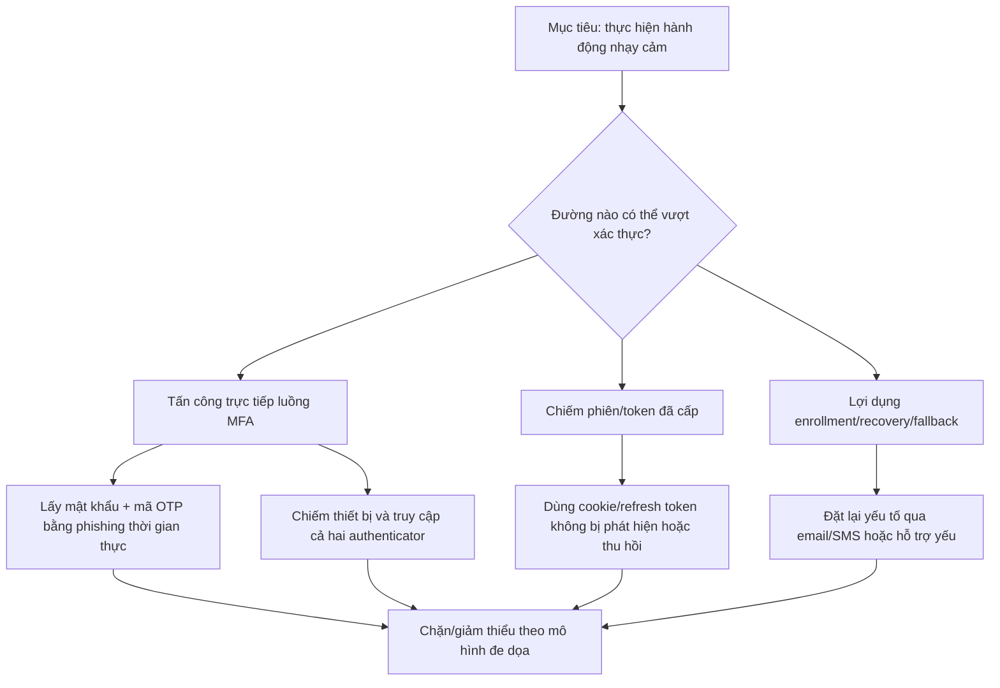
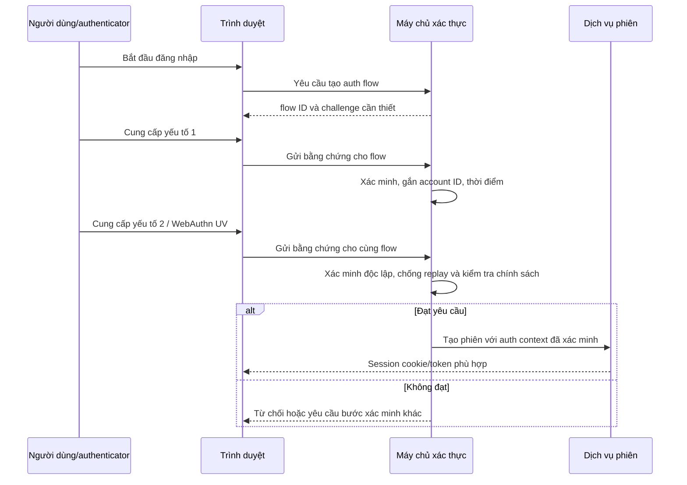

# Độc lập giữa các yếu tố xác thực

## Mục tiêu học tập

**Xác thực đa yếu tố (multi-factor authentication, MFA)** chỉ có ý nghĩa bảo vệ khi kẻ tấn công không thể dễ dàng vượt qua tất cả yếu tố bằng **cùng một bí mật bị lộ, cùng một quyền kiểm soát bị chiếm, hoặc cùng một đường tấn công**. Hai màn hình xác minh không nhất thiết tương đương hai yếu tố độc lập.

Trong chương **Authentication factor** của mô-đun **SECURITY_AUTHENTICATION_FUNDAMENTALS**, bài học này đi sâu vào cách phối hợp mật khẩu, ứng dụng OTP, SMS, passkey, khóa bảo mật, sinh trắc học và chứng chỉ. Mục tiêu là hiểu **độc lập giữa các yếu tố** trong bối cảnh thiết kế luồng đăng nhập, phiên, token, liên kết danh tính và khôi phục tài khoản, nhằm hạn chế phishing, replay và lạm dụng xác thực.

Sau bài học, bạn có thể:

1. Phân biệt **loại yếu tố xác thực**, **authenticator**, **bằng chứng xác thực** và **mức độc lập trước một mối đe dọa**.
2. Giải thích vì sao hai mật khẩu, mật khẩu cộng câu hỏi bí mật, hoặc hai OTP không tự tạo thành hai loại yếu tố.
3. Đánh giá sự phụ thuộc giữa các yếu tố khi chúng cùng nằm trên một thiết bị, cùng tài khoản email hoặc cùng một luồng khôi phục.
4. Phân tích tính độc lập của mật khẩu + TOTP, mật khẩu + SMS, passkey có user verification và khóa bảo mật có PIN.
5. Thiết kế kiểm tra phía máy chủ để chỉ công nhận những bằng chứng đã được xác minh, ràng buộc đúng phiên và đáp ứng mức bảo đảm của thao tác.
6. Nhận diện các điểm yếu khi thêm/thay thế yếu tố, fallback và khôi phục khiến MFA mạnh bị vô hiệu hóa.

## 1. “Yếu tố” và “độc lập” có nghĩa là gì?

Một **yếu tố xác thực** là loại bằng chứng dùng để chứng minh chủ thể đang kiểm soát một bí mật, một vật sở hữu hoặc một đặc điểm cá nhân theo cơ chế xác thực đã định.

| Loại yếu tố | Tên tiếng Anh | Ví dụ | Lưu ý |
| --- | --- | --- | --- |
| **Điều bạn biết** | Something you know — knowledge | Mật khẩu, PIN, passphrase | Hai bí mật khác nhau vẫn có thể cùng là **một loại yếu tố** |
| **Điều bạn sở hữu** | Something you have — possession | Khóa bảo mật FIDO, authenticator TOTP có khóa bí mật, thẻ/chứng chỉ có khóa riêng | Bên xác minh cần kiểm chứng quyền kiểm soát authenticator; sở hữu số điện thoại hoặc thiết bị không phải lúc nào cũng được bảo vệ tốt |
| **Điều thuộc về bạn** | Something you are — inherence | Vân tay, khuôn mặt được kiểm tra bởi authenticator phù hợp | Sinh trắc học thường dùng để **kích hoạt một authenticator**; ảnh mặt hay dữ liệu sinh trắc từ client không mặc nhiên là bằng chứng đáng tin |

**Authenticator** là thiết bị/phần mềm/bộ phận giữ bí mật hoặc khóa, tạo ra **authenticator output** (ví dụ OTP hoặc chữ ký). **Verifier** là thành phần xác minh bằng chứng. Bên xác minh cần biết ai đã kiểm tra bằng chứng và nó được ràng buộc với tài khoản, phiên và yêu cầu nào.

Cần phân biệt hai câu hỏi:

- **Độc lập về loại yếu tố:** hai cơ chế thuộc hai loại khác nhau không, chẳng hạn mật khẩu (knowledge) và thiết bị sinh OTP (possession)?
- **Độc lập trước tấn công:** một sự kiện xâm phạm có thể đồng thời giúp kẻ tấn công kiểm soát cả hai cơ chế không, chẳng hạn malware trên điện thoại đọc được mật khẩu đã lưu và mã OTP?

MFA cần sự kết hợp các loại yếu tố hoặc một authenticator đa yếu tố được xác minh đúng. **Độc lập trước tấn công** là yêu cầu thiết kế sâu hơn: cùng một mối đe dọa không nên có đường vòng rẻ và dễ dàng qua mọi yếu tố.

Không phải lúc nào cũng cần **hai thiết bị vật lý**. Authenticator mật mã có khóa riêng được bảo vệ và yêu cầu xác minh người dùng cục bộ (PIN hoặc sinh trắc học) có thể cung cấp bằng chứng đa yếu tố trong **một thiết bị**, miễn giao thức và triển khai đáp ứng yêu cầu. Ngược lại, hai ứng dụng trên hai màn hình khác nhau chưa chắc đã tạo được tính độc lập.

## 2. Vì sao hai bước không mặc nhiên tạo ra hai yếu tố?

Hãy xem các tổ hợp sau:

| Hai bước được yêu cầu | Phân tích | Kết luận |
| --- | --- | --- |
| Mật khẩu đăng nhập + câu hỏi “tên thú cưng đầu tiên?” | Cả hai là thông tin **biết**; câu trả lời có thể tra cứu hoặc đoán | Không phải MFA chỉ nhờ có hai ô nhập |
| Mật khẩu + PIN tài khoản do máy chủ kiểm tra | Hai bí mật thuộc nhóm knowledge | Không phải hai loại yếu tố |
| Hai mật khẩu khác nhau | Hai bí mật knowledge; còn dễ tái sử dụng/lộ chung | Không mặc nhiên là MFA |
| Mật khẩu + mã TOTP từ authenticator đã đăng ký | Knowledge + possession nếu verifier kiểm tra đúng và authenticator được quản lý phù hợp | Thường là MFA, nhưng phải xét xâm phạm chung thiết bị và phishing |
| Mật khẩu + SMS OTP | Mật khẩu + quyền nhận mã trên số điện thoại | Có thể là phương thức hai bước, nhưng kênh SMS có rủi ro SIM swap, chuyển hướng và phishing; không mặc định đáp ứng mọi mức bảo đảm |
| Mật khẩu + mã gửi đến email dùng để đặt lại mật khẩu | Cùng hộp thư có thể vừa nhận mã vừa đặt lại mật khẩu; email có thể đăng nhập từ phiên đã bị chiếm | Không thể suy ra hai yếu tố độc lập chỉ từ việc mã được gửi qua email |
| Hai mã OTP từ cùng một ứng dụng/authenticator | Có thể là hai lần dùng cùng secret hay cùng nhóm possession | Không trở thành hai loại yếu tố chỉ vì hai mã |
| Khóa WebAuthn có user verification (PIN/sinh trắc cục bộ) | Chữ ký chứng minh quyền kiểm soát khóa; user verification theo yêu cầu được phản ánh trong assertion đã xác minh | Có thể là authenticator **đa yếu tố mật mã**, tùy đặc tính và xác minh theo giao thức |
| Khóa WebAuthn chỉ xác minh user presence | Có chữ ký và thao tác hiện diện, nhưng user presence khác user verification | Không coi user presence đơn thuần là yếu tố knowledge/inherence bổ sung |

**Ví dụ:** Ứng dụng yêu cầu “mật khẩu tài khoản” rồi “mật khẩu giao dịch”. Dù hai màn hình xuất hiện ở hai thời điểm, kẻ tấn công có thể đánh cắp cả hai bằng một trang phishing hoặc một password manager bị chiếm quyền. Cách này có thể tạo thêm một điều kiện kiểm tra nghiệp vụ, nhưng không tự nâng lên xác thực đa yếu tố.

Một đối tượng như **PIN** có thể đóng các vai trò khác nhau: PIN tài khoản được server kiểm tra là knowledge factor; PIN mở khóa authenticator FIDO là phương tiện **user verification cục bộ**; PIN mở màn hình điện thoại không được tự động tính là bằng chứng mà ứng dụng từ xa đã nhận được. Phải xét **ai xác minh điều gì**, không chỉ tên gọi “PIN”.

## 3. Độc lập phải được đánh giá theo mô hình đe dọa

Không có phương thức MFA nào “độc lập tuyệt đối” trước mọi đối thủ. Cần nêu rõ năng lực của kẻ tấn công:

- Biết mật khẩu từ vụ rò rỉ hoặc tái sử dụng trên nhiều website.
- Dựng trang phishing hoặc reverse proxy chuyển tiếp đăng nhập thời gian thực.
- Chiếm quyền thiết bị người dùng; đọc clipboard, thông báo hoặc bộ nhớ ứng dụng.
- Thay SIM, lừa tổng đài hoặc chuyển hướng SMS.
- Chiếm hộp thư có quyền reset mật khẩu hoặc nhận liên kết thêm yếu tố.
- Đánh cắp cookie phiên, refresh token hay token từ trình duyệt.
- Lừa người dùng chấp thuận push MFA liên tục (MFA fatigue).
- Lợi dụng bộ phận hỗ trợ để đặt lại toàn bộ yếu tố bằng một bằng chứng yếu.

### 3.1. Tìm điểm lỗi chung (common-mode failure)

Ví dụ người dùng lưu mật khẩu và bộ tạo TOTP trên cùng điện thoại. Về **loại yếu tố**, mật khẩu + TOTP có thể là knowledge + possession. Nhưng nếu kẻ tấn công mở khóa điện thoại và truy cập được cả kho mật khẩu lẫn bí mật/mã TOTP, một lần chiếm thiết bị có thể đủ để vượt qua cả hai. Phải đánh giá các lớp bảo vệ của thiết bị, kho khóa và ứng dụng; không nên coi “cùng thiết bị” là bằng chứng rằng MFA vô giá trị, cũng không được giả định rủi ro hai yếu tố hoàn toàn tách biệt.

Một ví dụ khác: tài khoản dùng mật khẩu + SMS OTP, nhưng mọi thay đổi số điện thoại đều được duyệt chỉ bằng liên kết gửi đến email; email lại có thể đăng nhập bằng cùng mật khẩu đã bị lộ. **Đường quản trị hoặc khôi phục** đã tạo một điểm lỗi chung vượt qua yêu cầu MFA ở luồng đăng nhập chính.

### 3.2. Đừng nhân xác suất một cách máy móc

Nếu hai sự kiện xâm phạm thật sự độc lập thì có thể dùng phép gần đúng:

```text
P(vượt cả A và B) = P(vượt A) × P(vượt B | vượt A)

Chỉ khi độc lập:
P(vượt B | vượt A) = P(vượt B)

Khi đó mới có thể viết gần đúng:
P(vượt cả A và B) ≈ P(vượt A) × P(vượt B)
```

Giả sử trong **mô hình minh họa** một lần tấn công có xác suất lấy được mật khẩu là 10% và lấy được OTP là 10%. Nếu hai sự kiện độc lập, khả năng vượt cả hai được ước lượng 1%. Nhưng một reverse proxy phishing có thể khiến việc lấy OTP **phụ thuộc mạnh** vào việc lừa được mật khẩu. Khi đó xác suất thực tế có thể cao hơn đáng kể; không được áp dụng công thức 1% như một cam kết an toàn.

Các con số trên chỉ phục vụ giải thích khái niệm, **không phải tỷ lệ tấn công thực tế**. Để đánh giá một hệ thống, phải dùng dữ liệu và mô hình đe dọa của hệ thống đó.

### 3.3. Biểu diễn bằng cây tấn công



Sơ đồ cho thấy **mục tiêu của kẻ tấn công có nhiều đường**, một số thậm chí không cần thu thập hai yếu tố trong luồng đăng nhập. Vì vậy đánh giá độc lập phải bao gồm cả **quy trình cấp, thay, khôi phục và sử dụng kết quả xác thực**.

## 4. Các tổ hợp yếu tố phổ biến: lợi ích và giới hạn

### 4.1. Mật khẩu + TOTP

Luồng điển hình:

1. Người dùng nhập mật khẩu; máy chủ so khớp thông qua cơ chế xác minh mật khẩu thích hợp.
2. Máy chủ yêu cầu mã TOTP từ authenticator đã đăng ký cho tài khoản.
3. Máy chủ kiểm tra mã đúng bí mật, trong cửa sổ thời gian chấp nhận, áp dụng giới hạn thử và chính sách chống dùng lại.
4. Chỉ khi **cả hai bằng chứng thuộc cùng luồng đăng nhập** được xác minh, máy chủ mới ghi nhận kết quả MFA và cấp phiên/token theo chính sách.

**Ưu điểm:** Rò rỉ riêng mật khẩu thường chưa đủ để tạo một lần đăng nhập mới. **Giới hạn:** Người dùng có thể nhập cả hai vào trang giả và kẻ tấn công chuyển tiếp theo thời gian thực; TOTP không có ràng buộc origin như WebAuthn. Nếu cả mật khẩu và seed OTP bị sao chép từ thiết bị, tính độc lập cũng giảm.

Một số hệ thống chỉ kiểm tra mã TOTP đúng nhưng **không giới hạn số lần thử** hoặc **không chống dùng lại mã trong cùng khoảng chấp nhận**. Điều này tạo rủi ro brute force/replay độc lập với câu hỏi phân loại yếu tố.

### 4.2. Mật khẩu + SMS OTP

Cách này làm tăng rào cản so với chỉ dùng mật khẩu trong nhiều tình huống, nhưng số điện thoại là kênh chịu ảnh hưởng bởi nhà mạng, chuyển SIM, đổi thiết bị, chuyển tiếp tin nhắn và hành vi người dùng. Khi dùng SMS, phải đánh giá rủi ro theo đối tượng, tính nhạy cảm của hành động và yêu cầu tiêu chuẩn áp dụng. Với hoạt động bảo mật cao, nên ưu tiên cơ chế mật mã chống phishing phù hợp.

**Không nhầm:** Một mã gửi qua SMS có thể khác mật khẩu về cách chuyển giao nhưng không đồng nghĩa với **bằng chứng mạnh về sở hữu thiết bị an toàn**. Kẻ tấn công đổi SIM hoặc kiểm soát kênh nhận SMS có thể vượt qua lớp này.

### 4.3. Push MFA trên điện thoại

Push MFA có thể đơn giản hơn nhập mã, nhưng màn hình “Approve/Deny” đơn thuần dễ bị **MFA fatigue**: kẻ tấn công biết mật khẩu liên tục tạo yêu cầu cho đến khi người dùng chấp thuận nhầm.

Cơ chế như number matching, hiển thị ngữ cảnh thiết bị/địa điểm và giới hạn gửi push giúp giảm rủi ro. Tuy vậy, nếu phản hồi push không được ràng buộc mật mã với đúng bên xác minh hoặc phiên/giao dịch thì không được mặc định là **chống phishing**.

### 4.4. Passkey/WebAuthn có user verification

Một luồng WebAuthn triển khai đúng sử dụng cặp khóa mật mã. Authenticator giữ khóa riêng; máy chủ lưu khóa công khai được đăng ký cho tài khoản. Khi đăng nhập, authenticator ký challenge với ngữ cảnh bên yêu cầu.

Máy chủ cần xác minh các thuộc tính giao thức, tối thiểu gồm chữ ký, challenge, origin, RP ID và các cờ thích hợp. **User presence (UP)** chứng minh đã có tương tác hiện diện; **user verification (UV)** cho biết authenticator đã xác minh người dùng cục bộ bằng cơ chế phù hợp, chẳng hạn PIN hoặc sinh trắc học. Không được đồng nhất hai cờ này.

Khi một authenticator mật mã được bảo vệ và có **UV đã được kiểm chứng đúng**, nó có thể đại diện cho nhiều yếu tố trong **một lần sử dụng authenticator**: chứng minh quyền kiểm soát khóa riêng và đã kiểm tra knowledge/inherence cục bộ. Độ bảo đảm cụ thể còn phụ thuộc loại authenticator, cách bảo vệ khóa, cấu hình UV, việc đồng bộ khóa và yêu cầu chuẩn áp dụng. **Không tự tuyên bố mức AAL cao nhất chỉ vì có chữ “passkey”.**

Do credential WebAuthn được ràng buộc với RP/origin, phishing qua trang giả thường không thể lấy một chữ ký hợp lệ cho website đích theo cách chuyển tiếp mật khẩu + OTP thông thường. Tuy nhiên, bảo mật phiên, enrollment, máy khách và các đường khôi phục vẫn phải được xử lý riêng.

### 4.5. Khóa bảo mật phần cứng, chứng chỉ và xác thực máy–máy

Khóa bảo mật có PIN/biometric UV mang lại đặc tính khác với ứng dụng OTP lưu seed trên thiết bị thông dụng. Song không thể chỉ dựa vào **vật liệu phần cứng** để kết luận hai yếu tố độc lập; cần biết cơ chế khóa, bảo vệ khóa riêng và cách verifier kiểm tra UV.

Chứng chỉ client hoặc mTLS có thể chứng minh endpoint kiểm soát khóa riêng. Một chứng chỉ + một chứng chỉ khác đều thuộc mô hình sở hữu khóa, không mặc nhiên là hai loại yếu tố. Với thiết bị/dịch vụ không có con người trực tiếp thao tác, nên nói về **xác thực thực thể, khóa, ranh giới tin cậy và quản lý khóa**, tránh áp dụng máy móc “sinh trắc học của người dùng” vào xác thực máy–máy.

## 5. Hai yếu tố trên cùng thiết bị: đánh giá đúng mức

Một ứng dụng có thể chứa password manager, ứng dụng TOTP và passkey trên cùng điện thoại. Câu hỏi cần hỏi không phải chỉ là “cùng thiết bị hay khác thiết bị?”, mà là:

- Bí mật và khóa có được cách ly bằng vùng bảo mật, bảo vệ hệ điều hành hoặc phần cứng phù hợp không?
- Từng authenticator có cần hành động/user verification riêng không?
- Một ứng dụng độc hại có thể đọc/chép seed TOTP hoặc lấy mã hiện tại dễ dàng không?
- Nếu màn hình đã mở khóa, các cơ chế có tự động phê duyệt mà không cần xác minh lại không?
- Nếu thiết bị bị mất, người dùng có thể thu hồi credential và phiên từ kênh độc lập không?
- Có đường đồng bộ/khôi phục seed, khóa hay password manager từ cùng tài khoản cloud không?
- Ứng dụng từ xa biết được đặc tính nào **qua bằng chứng đã xác minh** và đặc tính nào chỉ là suy đoán?

### Ba tình huống cần phân biệt

**Tình huống A — Mật khẩu và TOTP chung điện thoại.** Có thể đạt hai loại yếu tố trong cách kiểm tra đăng nhập, nhưng malware hoặc quyền truy cập điện thoại bị chiếm có khả năng làm mất lợi ích độc lập. Giảm thiểu bằng bảo vệ thiết bị, khóa ứng dụng/kho bí mật, tách biện pháp khôi phục, phát hiện rủi ro và phương thức chống phishing cho thao tác nhạy cảm.

**Tình huống B — Passkey với UV trên điện thoại.** Một authenticator có thể tự thực hiện kiểm tra người dùng cục bộ rồi ký challenge. Nếu server xác minh đúng UV và chữ ký, thiết kế có thể tạo bằng chứng đa yếu tố **mà không yêu cầu người dùng cầm hai thiết bị**. Không suy ra mọi bản triển khai đều có phần cứng bảo vệ khóa giống nhau.

**Tình huống C — Mật khẩu + nút “Tôi xác nhận” trên website.** Nút bấm không chứng minh thêm quyền kiểm soát bí mật, thiết bị hay đặc điểm sinh trắc được verifier tin cậy kiểm tra. Đây là xác nhận giao diện, **không phải yếu tố xác thực mới**.

Tóm lại, **phân loại yếu tố**, **cách ly bí mật** và **kháng tấn công thực tế** cần được đánh giá đồng thời, thay vì dùng một tiêu chí vật lý đơn lẻ.

## 6. Ràng buộc bằng chứng với đúng luồng, chủ thể và thời điểm

Hai bằng chứng riêng lẻ sẽ không đủ nếu kẻ tấn công có thể ghép chúng từ những ngữ cảnh khác nhau.

Ví dụ, attacker có mật khẩu tài khoản A và một mã OTP hợp lệ cho tài khoản B. Nếu máy chủ lưu cờ `passwordVerified=true` và `otpVerified=true` trong session tạm nhưng **không liên kết cùng account ID, challenge và phiên đăng nhập**, chúng có thể bị ghép sai để xác thực A.

Một thiết kế đáng tin cậy nên:

1. Tạo **transaction/flow ID** máy chủ quản lý cho mỗi lần đăng nhập hoặc step-up.
2. Gắn mọi authenticator đã xác minh với đúng **account ID**, flow, mục đích và thời hạn.
3. Kiểm tra từng bằng chứng bằng **verifier tin cậy**. Không lấy kết quả kiểm tra từ JSON/header của trình duyệt.
4. Áp dụng giới hạn số lần thử, mã dùng một lần hoặc nonce/challenge mới theo cơ chế; chống replay và chèn lại bằng chứng cũ.
5. Chỉ nâng mức xác thực sau khi **toàn bộ điều kiện của chính sách** đã được hoàn tất.
6. Gắn mức, phương thức và thời điểm xác thực vào **phiên do máy chủ kiểm soát**; xoay session ID và thu hồi khi cần.
7. Với thao tác nhạy cảm, yêu cầu **xác thực lại gần thời điểm thao tác** và có thể ràng buộc thêm nội dung giao dịch.

Sơ đồ tổng quát:



### 6.1. Ví dụ Java: đánh giá chứng cứ đã được máy chủ xác minh

Mã dưới đây **không tự xác minh mật khẩu, TOTP hoặc WebAuthn**. Nó nhận kết quả từ các verifier đã triển khai đúng. Đây là **bước đánh giá chính sách sau xác minh**, để không công nhận “2FA” khi chỉ có hai bước thuộc cùng một nhóm hoặc khi bằng chứng thuộc hai flow khác nhau.

```java
import java.time.Duration;
import java.time.Instant;
import java.util.Collection;

enum VerifiedMechanism {
    PASSWORD,             // Kiểm tra mật khẩu phía server
    TOTP,                 // Kiểm tra OTP, account, anti-replay và rate limit
    WEBAUTHN_UP,          // Chữ ký đúng + user presence
    WEBAUTHN_UV           // Chữ ký đúng + user verification
}

record VerifiedProof(
        String accountId,
        String flowId,
        VerifiedMechanism mechanism,
        Instant verifiedAt) {}

class FactorPolicy {
    // Thời gian tối đa chỉ là chính sách minh họa của ứng dụng.
    private static final Duration MAX_AGE = Duration.ofMinutes(5);

    static boolean meetsMfa(
            Collection<VerifiedProof> proofs,
            String expectedAccountId,
            String expectedFlowId,
            Instant now) {

        boolean password = false;
        boolean possession = false;
        boolean webauthnWithUv = false;

        for (VerifiedProof proof : proofs) {
            if (proof == null
                    || !expectedAccountId.equals(proof.accountId())
                    || !expectedFlowId.equals(proof.flowId())
                    || proof.verifiedAt() == null
                    || proof.verifiedAt().isAfter(now)
                    || Duration.between(proof.verifiedAt(), now)
                               .compareTo(MAX_AGE) > 0) {
                continue;
            }

            switch (proof.mechanism()) {
                case PASSWORD -> password = true;
                case TOTP, WEBAUTHN_UP -> possession = true;
                case WEBAUTHN_UV -> webauthnWithUv = true;
            }
        }

        // WebAuthn UV là cơ chế đa yếu tố khi kết quả được
        // xác minh đúng và authenticator đáp ứng chính sách.
        return webauthnWithUv || (password && possession);
    }
}
```

**Điều kiện để dùng mẫu này an toàn:**

- `VerifiedProof` chỉ do **thành phần xác thực của máy chủ** tạo, sau khi kiểm tra đầy đủ bằng chứng; không deserialize tùy tiện từ client.
- `WEBAUTHN_UV` chỉ được ghi khi đã xác minh chữ ký, challenge, origin, RP ID, cờ UV cùng các điều kiện triển khai khác. `WEBAUTHN_UP` **không** đại diện cho yếu tố inherence/knowledge.
- `TOTP` chỉ được ghi khi bí mật thuộc đúng tài khoản và mã được kiểm tra kèm giới hạn thử, cửa sổ thời gian và chống dùng lại.
- `password && possession` kiểm tra **đủ loại yếu tố ở mức cơ bản**, chưa đánh giá khả năng chống phishing, mức bảo vệ khóa hay tính độc lập trước malware. Chính sách cho hành động nhạy cảm có thể yêu cầu **WebAuthn UV chống phishing**, không chấp nhận password + TOTP.
- `expectedAccountId` và `expectedFlowId` phải lấy từ **giao dịch xác thực phía server**, không được lấy làm nguồn tin trực tiếp từ request.
- Sau khi xác thực, hệ thống **vẫn phải kiểm tra** trạng thái tài khoản, phiên/token, quyền đối với tài nguyên, rủi ro hiện tại và thời điểm xác thực lại khi thích hợp.

Hai lần nhập mã TOTP tạo hai `VerifiedProof` loại `TOTP` cũng không làm `password` thành true. Một bằng chứng của tài khoản/flow khác sẽ bị bỏ qua.

### 6.2. Token/phiên không phải yếu tố mới

Một cookie session hoặc access token chứng minh rằng hệ thống đã cấp một kết quả đăng nhập trước đó; nó **không tự trở thành yếu tố sở hữu độc lập** chỉ vì token nằm trong trình duyệt. Kẻ tấn công đánh cắp cookie có thể bỏ qua toàn bộ màn hình MFA.

Máy chủ nên quản lý phiên an toàn: cookie `Secure`, `HttpOnly`, `SameSite` theo bối cảnh; giới hạn thời gian sống; xác thực lại khi thao tác nhạy cảm; phát hiện bất thường và thu hồi khi credential hoặc tài khoản bị xâm phạm. Với token, phải xác minh chữ ký/issuer/audience/expiry, ràng buộc đúng bên nhận và có chiến lược thu hồi phù hợp. **Chữ ký token hợp lệ không chứng minh người cầm token hiện tại còn kiểm soát các yếu tố đã dùng trước đây.**

## 7. Khi MFA thất bại qua enrollment, fallback hoặc recovery

Một thiết kế thường rất mạnh ở màn hình đăng nhập chính nhưng yếu ở cách **thêm, thay và lấy lại yếu tố**.

### 7.1. Đăng ký authenticator mới

Ví dụ kẻ tấn công lấy cookie phiên từ trình duyệt của nạn nhân. Nếu trang “Thêm passkey” chỉ đòi phiên còn sống, attacker có thể gắn passkey của mình và tạo quyền truy cập lâu dài dù nạn nhân đăng nhập bằng MFA.

Đối với thao tác thay đổi credential:

- Kiểm tra phiên còn hợp lệ, mức xác thực và **độ mới** theo rủi ro.
- Yêu cầu step-up bằng phương thức thích hợp; với rủi ro cao, ưu tiên chống phishing.
- Ràng buộc authenticator mới với đúng tài khoản và challenge đăng ký của máy chủ.
- Thông báo cho kênh liên lạc cũ/đang tin cậy khi phù hợp, cho phép xử lý sự cố.
- Theo dõi thời điểm thêm, trạng thái credential, nguồn yêu cầu và sự kiện kiểm toán.
- Không cho phép kẻ chỉ có một phiên bị đánh cắp đơn phương xóa mọi yếu tố đang bảo vệ tài khoản.

### 7.2. “Mất MFA thì chỉ cần email” là đường vòng

Nếu tài khoản yêu cầu mật khẩu + khóa bảo mật nhưng bộ phận hỗ trợ cho phép vô hiệu hóa khóa chỉ dựa trên một email, thì kẻ có quyền đọc email đã có đường vòng qua MFA. Rủi ro tương tự khi chỉ cần mã SMS để thay một passkey chống phishing.

Quy trình khôi phục cần **mô hình đe dọa riêng**: mã một lần, giới hạn thời gian, chống đoán/dò tài khoản, xác minh phù hợp, cảnh báo, thời gian hạn chế thao tác có giá trị cao hoặc rà soát thủ công khi cần. Sau khôi phục có thể cần **hạ mức tin cậy**, thu hồi các phiên cũ và yêu cầu đăng ký lại authenticator đáng tin cậy.

### 7.3. Fallback yếu làm giảm ngưỡng toàn hệ thống

Giả sử luồng chuẩn yêu cầu passkey chống phishing, nhưng nút “Không dùng được passkey?” cho phép đăng nhập chỉ bằng mật khẩu + mã email. Kẻ tấn công sẽ chọn đường **dễ nhất**, không bắt buộc đi qua luồng an toàn nhất.

Khi thiết kế fallback, hỏi rõ:

1. Fallback dùng cho tình huống nào và ai được phép kích hoạt?
2. Nó chứng minh điều gì, có độc lập với các yếu tố bị mất/chiếm không?
3. Có áp dụng xác thực bổ sung, hạn chế quyền, chậm xử lý, cảnh báo và giám sát không?
4. Có sự kiện thu hồi hoặc yêu cầu người dùng hoàn tất đăng ký lại MFA không?
5. Fallback có vô tình trả kết quả cùng mức bảo đảm với luồng chính không?

Không được phát hành cùng nhãn `phishing_resistant=true` cho luồng dùng SMS/email OTP chỉ vì người dùng **đã đăng ký** một passkey. Thuộc tính bảo đảm phản ánh **bằng chứng thực sự được sử dụng và xác minh ở lần xác thực liên quan**.

## 8. Federation, các claim MFA và mức bảo đảm

Trong hệ thống SSO/OIDC, ứng dụng dựa vào Identity Provider (IdP) để xác thực. IdP có thể cung cấp claim:

- `amr` mô tả các phương thức đã được dùng trong sự kiện xác thực, theo quy ước áp dụng.
- `acr` thể hiện lớp/ngữ cảnh xác thực theo chính sách hoặc thỏa thuận giữa IdP và ứng dụng.
- `auth_time` mô tả thời điểm người dùng được xác thực.

Những claim này chỉ có ý nghĩa khi ứng dụng xác minh **token/assertion hợp lệ** và hiểu quy ước của IdP. Không tự suy ra “độc lập hoàn toàn” từ sự xuất hiện của hai chuỗi trong `amr`; cũng không tự nâng `acr` vì giao diện có chữ “MFA enabled”.

Ứng dụng cần xác minh issuer, audience, chữ ký, thời hạn và nonce/state trong luồng áp dụng. Sau đó ánh xạ mức bảo đảm của IdP với **chính sách riêng của hành động**, kiểm tra quyền và trạng thái tài khoản cục bộ.

Với các mức bảo đảm kiểu NIST, cần phân biệt:

| Chiều | Câu hỏi |
| --- | --- |
| **IAL** — bảo đảm danh tính | Người đăng ký đã được đối chiếu danh tính đến đâu? |
| **AAL** — bảo đảm xác thực | Những authenticator và giao thức dùng trong lần xác thực đáp ứng mức nào? |
| **FAL** — bảo đảm liên kết | Assertion/token được bảo vệ và ràng buộc với bên nhận như thế nào? |

**MFA không tự quyết định IAL/FAL**, và việc có hai bước không bảo đảm đạt một AAL cụ thể. Khi cần tuyên bố tuân thủ, phải đánh giá toàn bộ yêu cầu của phiên bản tiêu chuẩn được áp dụng: cơ chế, chống phishing, bảo vệ khóa, vòng đời authenticator, xác thực lại và khôi phục.

## 9. Phân tích kịch bản và chọn phương án

### Kịch bản 1: Đăng nhập quản trị bằng mật khẩu + TOTP

Nguy cơ: mật khẩu quản trị bị lộ và trang phishing thời gian thực thu cả TOTP. Hai loại yếu tố có ích trước **rò rỉ mật khẩu đơn lẻ**, nhưng chưa chống tốt hình thức phishing đó.

Thiết kế đề xuất: cân nhắc yêu cầu passkey/khóa bảo mật chống phishing cho đăng nhập đặc quyền; dùng step-up khi cấp quyền, xuất dữ liệu hoặc thay authenticator; giới hạn phiên, theo dõi bất thường và quản lý recovery tương xứng.

### Kịch bản 2: TOTP và password manager nằm trên cùng điện thoại

Nguy cơ: thiết bị nhiễm mã độc hoặc mở khóa ngoài ý muốn có thể cho truy cập cả hai. Thiết kế có thể vẫn là MFA về loại yếu tố, nhưng **điểm lỗi chung của thiết bị** cần được xem xét.

Thiết kế đề xuất: bảo vệ kho khóa và OS, quản lý thiết bị, dùng authenticator có cách ly khóa/UV, chọn phương thức chống phishing cho hành động rủi ro cao và thiết kế kênh thu hồi an toàn khi mất thiết bị.

### Kịch bản 3: Kẻ tấn công có cookie phiên nhưng không có MFA

Nguy cơ: ứng dụng chỉ kiểm tra cookie trước khi thêm một yếu tố mới. Kẻ tấn công không cần vượt qua hai bước xác thực, mà đi thẳng qua phiên đã có.

Thiết kế đề xuất: step-up bằng chứng xác thực mới, ràng buộc với đúng phiên và tài khoản; thông báo thay đổi authenticator; thu hồi phiên nghi ngờ và bảo vệ cookie/token.

### Kịch bản 4: Đăng nhập bằng passkey nhưng khôi phục qua SMS

Nguy cơ: người dùng từng đăng nhập bằng phương thức chống phishing, nhưng đường khôi phục sử dụng kênh bị chuyển SIM. Một bằng chứng yếu hơn có thể tạo quyền truy cập mới.

Thiết kế đề xuất: áp dụng chính sách khôi phục độc lập, giới hạn chức năng sau khôi phục, cảnh báo kênh cũ, thu hồi credential/phiên có nguy cơ và xác thực lại mạnh trước thao tác nhạy cảm. Không giữ nguyên nhãn đảm bảo cao của phiên cũ.

### Kịch bản 5: Ứng dụng chấp nhận hai bằng chứng từ hai luồng khác nhau

Nguy cơ: API ghi cờ mật khẩu xác thực thành công ở flow A, nhưng ghép mã OTP xác thực ở flow B hoặc tài khoản khác.

Thiết kế đề xuất: mỗi bằng chứng cần account ID, flow ID, thời điểm, mục đích và verifier nguồn. Chỉ kết hợp những chứng cứ đã được máy chủ xác minh trong một giao dịch hợp lệ.

## 10. Bảng kiểm thử nguyên tắc độc lập

| Tình huống kiểm thử | Kết luận/hành vi mong đợi |
| --- | --- |
| Người dùng nhập đúng hai mật khẩu | Không công nhận là hai loại yếu tố |
| Mật khẩu + câu hỏi bí mật | Không công nhận MFA chỉ vì có hai ô nhập |
| Mật khẩu đúng, TOTP đúng và cùng account/flow | Có thể đạt chính sách MFA cơ bản nếu verifier và giới hạn dùng mã đúng |
| Mật khẩu đúng cho A, TOTP đúng cho B | Không được ghép thành MFA cho A |
| Hai TOTP hợp lệ cùng một bí mật | Không trở thành knowledge + possession |
| WebAuthn chữ ký hợp lệ nhưng chỉ có UP | Không coi như đã có UV/multi-factor authenticator |
| WebAuthn chữ ký, challenge, origin, RP ID, UV đúng | Có thể ghi nhận xác thực đa yếu tố mật mã theo chính sách của authenticator |
| OTP bị dùng lại trong phạm vi verifier yêu cầu dùng một lần | Từ chối replay |
| Mật khẩu + OTP bị phishing chuyển tiếp thời gian thực | Không được ghi nhãn chống phishing chỉ vì có OTP |
| Kẻ tấn công có cookie phiên còn hạn | Kiểm tra phiên/rủi ro; yêu cầu step-up đối với thay credential nhạy cảm |
| Tài khoản vừa thay số điện thoại qua luồng yếu | Không tự giữ mức bảo đảm cao; áp dụng hạn chế/giám sát |
| Passkey đã đăng ký nhưng phiên hiện tại chỉ đăng nhập bằng mật khẩu | Không đánh dấu phiên hiện tại là passkey-verified |
| IdP trả claim `amr` không rõ nghĩa | Không tự suy diễn AAL hoặc tính chống phishing |
| Recovery chỉ bằng email trong khi email cũng reset được mật khẩu | Đánh giá đường vòng và điểm lỗi chung |
| Thiết bị chứa cả password manager và TOTP bị mất | Có quy trình thu hồi, chặn đăng nhập mới và khôi phục theo bằng chứng phù hợp |
| Tài khoản bị `SUSPENDED` nhưng có đủ MFA | Vẫn từ chối truy cập theo trạng thái tài khoản |

Khi kiểm thử, ngoài kết quả “cho phép/từ chối” cần kiểm tra **log chứng cứ** (nguồn verifier, cơ chế, account ID, flow ID, thời điểm, ngữ cảnh xác thực) để biết vì sao một phiên được công nhận MFA. Nhật ký không được chứa mật khẩu, seed TOTP, mã OTP còn dùng được hoặc khóa riêng.

## 11. Checklist thiết kế MFA có yếu tố độc lập

Trước khi quyết định một tổ hợp là “MFA đủ mạnh”, hãy trả lời:

1. **Phân loại:** Mỗi bước thuộc loại yếu tố nào? Có hai loại khác nhau hoặc một authenticator đa yếu tố đã được xác minh không?
2. **Nguồn bằng chứng:** Ai kiểm tra bí mật/chữ ký/challenge? Client có thể tự đánh dấu `mfa=true` hay không?
3. **Điểm lỗi chung:** Chiếm một thiết bị, một hộp thư, một số điện thoại hoặc một tài khoản cloud có vượt được mọi bước không?
4. **Phishing:** Có ràng buộc mật mã với đúng origin/verifier không? OTP/push có thể bị chuyển tiếp không?
5. **Replay:** Bằng chứng có challenge/nonce hoặc giới hạn một lần sử dụng, hết hạn và chống dò quét phù hợp không?
6. **Ràng buộc:** Các bằng chứng thuộc **cùng tài khoản, flow, mục đích và khoảng thời gian** được phép không?
7. **Đăng ký:** Thêm/xóa/thay authenticator có đòi xác thực lại đủ mạnh và lưu dấu kiểm toán không?
8. **Fallback/recovery:** Đường dễ nhất có làm vô hiệu hóa chính sách chính không? Mức bảo đảm sau khôi phục được điều chỉnh thế nào?
9. **Phiên/token:** Sau đăng nhập, token/phiên có được bảo vệ, thu hồi và yêu cầu step-up khi thích hợp không?
10. **Phân quyền:** Sau MFA, hệ thống vẫn kiểm tra account status, quyền đối với tài nguyên và rủi ro của hành động chứ?

## 12. Bài tập vận dụng

Một nền tảng có ba lựa chọn đăng nhập:

- **Cách A:** Mật khẩu + một mã TOTP từ ứng dụng nằm trong điện thoại có lưu sẵn mật khẩu.
- **Cách B:** Passkey trên điện thoại, có yêu cầu user verification và máy chủ xác minh assertion WebAuthn.
- **Cách C:** Mật khẩu + mã gửi qua email; email có thể được mở qua cùng password manager và dùng để reset mật khẩu.

Ứng dụng cho phép mọi phiên mới thêm khóa bảo mật chỉ bằng cách nhập lại mật khẩu. Khi mất điện thoại, người dùng có thể nhờ hỗ trợ vô hiệu hóa mọi yếu tố chỉ với mã SMS.

**Yêu cầu:**

1. Phân loại các yếu tố của A, B, C và phân biệt yếu tố chính thức với việc có hai bước UI.
2. Nêu ít nhất hai **điểm lỗi chung** ở A hoặc C, và giải thích B khác ở đâu về khả năng chống phishing.
3. Vẽ cây tấn công cho mục tiêu “gắn khóa bảo mật của kẻ tấn công vào tài khoản”.
4. Đề xuất sửa đổi cho luồng thêm authenticator và khôi phục để không hạ cấp im lặng mức bảo đảm.
5. Xây dựng bảng kiểm thử có ít nhất một trường hợp ghép bằng chứng khác account/flow, một trường hợp replay, một trường hợp token cũ và một trường hợp account bị đình chỉ.

**Gợi ý tự đối chiếu:** A có thể là MFA về loại yếu tố nhưng cùng thiết bị tạo rủi ro tương quan; B có bằng chứng mật mã ràng buộc RP/origin và UV phải được server xác minh; C phụ thuộc mạnh vào hộp thư cùng đường reset. Luồng “thêm khóa chỉ bằng mật khẩu” và “mất yếu tố thì nhận SMS” có thể trở thành đường vòng qua toàn bộ cơ chế bảo vệ ban đầu.

---

**Ghi nhớ:** Độc lập giữa các yếu tố không chỉ là **hai bước, hai ô nhập hay hai thiết bị**. Cần phân biệt đúng **loại yếu tố**, kiểm tra **khả năng bị xâm phạm cùng lúc**, xác minh bằng chứng đúng **tài khoản/luồng/thời điểm**, và giữ vững chính sách qua **thêm yếu tố, fallback, khôi phục, phiên và token**. Một MFA mạnh chỉ hiệu quả khi kẻ tấn công không có đường vòng dễ dàng qua phần yếu nhất của vòng đời tài khoản.
