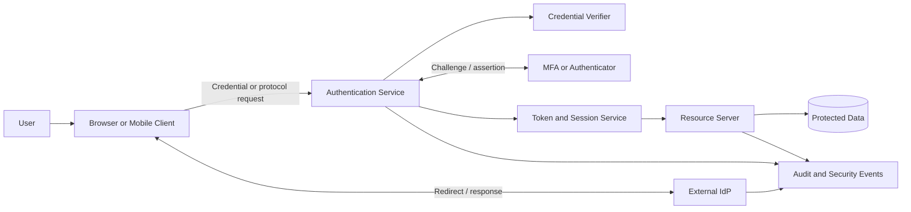
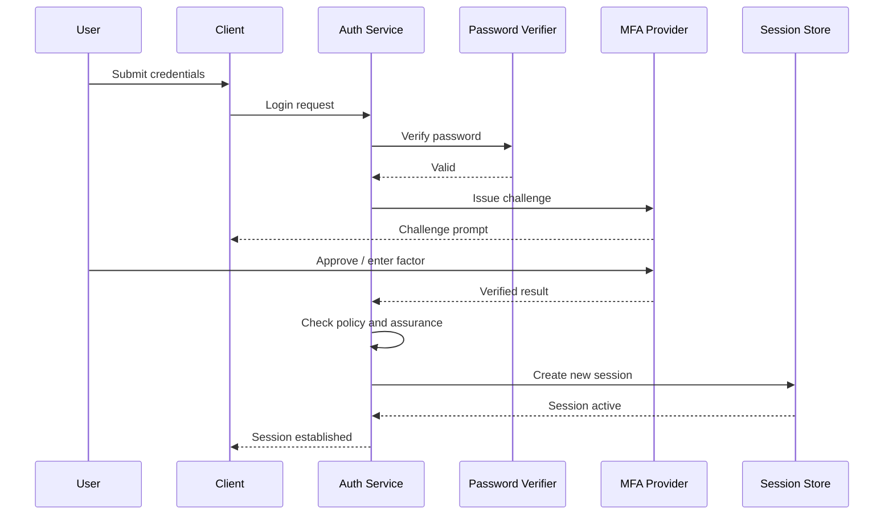

# Flow review — Rà soát luồng xác thực

## Mục tiêu học tập

Một hệ thống có thể dùng mật khẩu mạnh, MFA, passkey, certificate và token hiện đại nhưng vẫn có lỗ hổng nếu các bước được ghép nối sai. Ví dụ, ứng dụng xác minh chữ ký ID token nhưng không kiểm tra nonce; gateway kiểm tra access token nhưng backend không giới hạn tenant; logout xóa cookie ở browser nhưng session server-side vẫn hoạt động; hoặc recovery cho phép thay email rồi lập tức đăng ký authenticator mới mà không xác minh lại danh tính.

**Flow review (rà soát luồng)** là hoạt động kiểm tra có hệ thống một hành trình xác thực và các chuyển tiếp tin cậy giữa người dùng, client, authenticator, identity provider, authorization server, resource server và hệ thống lưu session. Review đánh giá mục tiêu, dữ liệu, trạng thái, quyết định bảo mật, nhánh lỗi, quyền được cấp và khả năng thu hồi trong toàn bộ vòng đời. Một bước đúng riêng lẻ chưa đủ chứng minh toàn bộ flow an toàn; các bước phải liên kết đúng ngữ cảnh và bảo toàn các bất biến bảo mật từ đầu đến cuối.

Trong mô-đun **SECURITY_AUTHENTICATION_FUNDAMENTALS**, người học tìm hiểu credential, mật khẩu, MFA, passkey, chứng chỉ, token, session, liên kết danh tính và khôi phục tài khoản. Flow review kết nối các chủ đề này bằng cách xem chúng như một hệ thống có ranh giới tin cậy, trạng thái và đường đi dữ liệu. Mục tiêu là phát hiện lỗi thiết kế trước khi triển khai hoặc trước khi thay đổi một luồng đang vận hành.

Sau bài học, bạn có thể:

- Xác định phạm vi, actor, tài sản, trust boundary và các thành phần của một authentication flow.
- Mô hình hóa luồng chính, nhánh lỗi, retry, timeout, cancellation và recovery.
- Viết các security invariant mà mọi đường đi phải bảo toàn.
- Áp dụng threat modeling và abuse-case analysis cho login, MFA, federation, session và recovery.
- Kiểm tra semantics của password, WebAuthn/passkey, OAuth/OIDC, SAML và certificate authentication.
- Đánh giá token validation, audience, scope, session lifecycle và authorization boundary.
- Rà soát rate limit, anti-enumeration, replay protection, audit và privacy.
- Thiết kế test case theo state transition, negative path, concurrency và failure injection.
- Phân loại finding theo impact, likelihood, exploitability và blast radius.
- Viết báo cáo review có bằng chứng, khuyến nghị cụ thể và tiêu chí đóng finding.

## 1. Flow review là gì?

Một authentication flow là tập các bước và quyết định mà hệ thống thực hiện để thiết lập, nâng mức, duy trì hoặc kết thúc trạng thái xác thực. Flow có thể bắt đầu khi người dùng nhập mật khẩu, dùng passkey, chuyển sang IdP, xác minh certificate hoặc khôi phục tài khoản. Nó thường kết thúc khi hệ thống tạo session/token, từ chối request hoặc yêu cầu bước xác minh khác.

Flow review không chỉ đọc code của endpoint login. Người review cần theo dõi dữ liệu và trạng thái qua các thành phần:

- Client: browser, mobile app, desktop app hoặc workload.
- Authenticator: password, passkey, security key, TOTP, push hoặc certificate.
- Authentication service: kiểm tra credential, risk, challenge và assurance.
- Identity Provider (IdP): xác thực bên ngoài và phát assertion.
- Authorization Server: cấp token, refresh token, scope và audience.
- Session store: duy trì trạng thái đăng nhập và khả năng revoke.
- API gateway/resource server: xác minh token và thực thi authorization.
- Recovery service: xác minh yêu cầu khôi phục và thay credential.
- Notification, audit, telemetry và fraud/risk service.

### Flow review khác code review thông thường

Code review thường tập trung vào thay đổi trong một tập file hoặc module. Flow review bắt đầu từ hành vi và bất biến bảo mật, rồi lần theo nhiều thành phần và cấu hình. Có thể cần xem code, sequence diagram, protocol configuration, identity provider settings, database state, cookie attributes, token claims, deployment topology, logs và test.

Một endpoint có thể được viết đúng nhưng được gọi từ một flow sai. Ví dụ, endpoint enroll passkey kiểm tra session hợp lệ, nhưng recovery flow vừa tạo session có assurance thấp rồi cho phép enroll passkey mới ngay lập tức. Lỗ hổng nằm ở sự kết hợp của hai flow và policy assurance, không chỉ trong endpoint enroll.

### Kết quả cần có

Một flow review có chất lượng nên tạo ra:

1. Mô hình luồng hiện tại và các ranh giới tin cậy.
2. Danh sách tài sản, actor và threat scenario.
3. Các security invariant và điểm kiểm tra.
4. Findings có bằng chứng và mức độ ưu tiên.
5. Test case có thể tái hiện hoặc xác minh.
6. Remediation đề xuất và tiêu chí xác nhận đã sửa.
7. Những giả định hoặc phần chưa thể xác minh.

Review không tự động chứng minh hệ thống an toàn tuyệt đối. Kết luận chỉ có phạm vi theo kiến trúc, code, cấu hình, môi trường và bằng chứng đã được kiểm tra.

## 2. Xác định phạm vi review

Trước khi bắt đầu, viết rõ câu hỏi review đang cần trả lời. Phạm vi mơ hồ dễ bỏ sót một flow liên quan hoặc khiến reviewer kiểm tra lan man mà không xác định được kết quả.

### Các loại flow thường gặp

| Flow | Điểm bắt đầu | Điểm kết thúc cần kiểm tra |
| --- | --- | --- |
| Primary login | Người dùng chọn phương thức xác thực | Session/token được cấp hoặc request bị từ chối |
| MFA/step-up | Policy yêu cầu thêm yếu tố | Assurance được nâng hoặc challenge thất bại |
| Passkey registration | Người dùng bắt đầu enroll authenticator | Credential được gắn đúng account hoặc bị từ chối |
| Passkey authentication | RP tạo challenge | Assertion được xác minh và session được tạo |
| Federation/SSO | Client chuyển tới IdP | Assertion/token được xác minh và local session được thiết lập |
| Certificate authentication | Client trình certificate | Chain, identity và proof-of-possession được xác minh |
| Token refresh | Client gửi refresh token | Token mới được cấp hoặc family bị revoke |
| Session renewal | Session gần hết hạn | Session được gia hạn theo policy hoặc kết thúc |
| Logout | Người dùng hoặc admin yêu cầu kết thúc phiên | Session/token/grant bị vô hiệu trong phạm vi đã cam kết |
| Account recovery | Người dùng không còn phương thức truy cập | Danh tính được xác minh và credential mới được đăng ký |
| Account linking | Người dùng liên kết IdP/account khác | Identity link được tạo đúng chủ thể sau xác minh |
| Credential change | Người dùng thay password/MFA/passkey | Credential mới hoạt động và credential cũ được xử lý đúng |
| Admin-assisted recovery | Support/admin bắt đầu hỗ trợ | Approval, evidence và audit đầy đủ |

### Xác định ranh giới

Ghi rõ những thành phần nằm trong phạm vi và những thành phần được coi là dependency. Ví dụ, nếu review OIDC login của một mobile app, có thể review sâu app, redirect URI, PKCE, state/nonce handling, token validation và local session; IdP bên ngoài được coi là dependency, nhưng cấu hình trust, issuer và key discovery vẫn phải được kiểm tra.

Không bỏ qua thành phần bên ngoài chỉ vì nhóm không sở hữu nó. Hãy ghi rõ giả định, bằng chứng đã có, SLA/contract và phần chưa thể kiểm chứng.

### Câu hỏi phạm vi

- Flow phục vụ user, administrator, service hay workload?
- Có bao nhiêu client và phiên bản client?
- Issuer/IdP nào được tin cậy?
- Token được gửi tới những audience nào?
- Flow có thay đổi credential, recovery channel hoặc quyền không?
- Có multi-tenant hoặc delegated access không?
- Những hành động nào có tác động cao?
- Có hỗ trợ offline, retry, multiple tabs hoặc multi-region không?
- Review bao gồm code, cấu hình, deployment hay chỉ design?
- Tiêu chí hoàn tất review là gì?

## 3. Actor, tài sản và trust boundary

Một flow cần được mô hình hóa theo actor và tài sản trước khi tìm lỗ hổng. Nếu không biết ai có quyền gửi dữ liệu nào, reviewer khó phát hiện trust confusion.

### Actor

Các actor phổ biến:

- Người dùng cuối.
- Administrator hoặc support agent.
- Browser/mobile/desktop client.
- Authenticator hoặc thiết bị bảo mật.
- Authentication service.
- Authorization server và IdP.
- Resource server/API.
- Device management hoặc attestation service.
- Email/SMS/push provider.
- Attacker bên ngoài.
- Malware/extension có quyền trên thiết bị.
- Service/workload khác trong hệ thống.

Không gộp người dùng, client và service thành một principal duy nhất. Trong delegated flow, cần phân biệt subject (người dùng được đại diện) với actor/client/service thực hiện request.

### Tài sản

- Password verifier, passkey public key và credential metadata.
- Private key, certificate, TOTP seed và recovery code.
- Access token, refresh token, ID token và session identifier.
- Account identity, linked identity và recovery channel.
- Session state, authentication context và assurance level.
- Authorization grant, role, scope, permission và tenant membership.
- Dữ liệu cá nhân, tài chính và dữ liệu nghiệp vụ.
- Audit log, security event, signing key và trust configuration.

### Trust boundary

Trust boundary là nơi dữ liệu, identity hoặc quyền đi từ một miền tin cậy sang miền khác. Ví dụ:

- Browser sang backend.
- Mobile app sang OS keystore.
- Client sang authorization server.
- IdP sang relying party.
- API gateway sang resource server.
- User session sang admin operation.
- Recovery service sang credential enrollment.
- Một tenant sang tenant khác.
- Workload identity sang service khác.

Mỗi lần vượt boundary phải xác định dữ liệu nào được xác minh, bằng cơ chế nào, và nguồn nào có quyền khẳng định dữ liệu đó.

### Data flow và boundary diagram



Sơ đồ chỉ là khung. Với mỗi mũi tên, ghi protocol, transport protection, data classification, authentication of peer, replay defense và error behavior. Đặc biệt, không coi kết nối HTTPS là bằng chứng rằng identity trong payload hoặc quyền của caller đã hợp lệ.

## 4. Mô hình hóa flow trước khi đọc code

Reviewer nên dựng mô hình hiện tại từ tài liệu, code, cấu hình và quan sát. Không bắt đầu bằng cách đoán flow mong muốn rồi chỉ tìm đoạn code khớp với nó.

### Sequence diagram

Ghi các bước theo thời gian và actor. Mỗi message nên thể hiện:

- Ai gửi và ai nhận.
- Dữ liệu hoặc assertion được truyền.
- Protocol và endpoint.
- Điều kiện trước khi gửi.
- Quyết định xác minh.
- Trạng thái được tạo hoặc thay đổi.
- Hành vi khi thất bại.

Ví dụ flow password + MFA:



Sau khi vẽ, thêm các nhánh invalid password, rate limit, MFA denied, timeout, replay, provider unavailable, user cancel, duplicate callback, session store failure và account suspended. Flow chỉ có happy path là chưa đủ để review.

### State machine

Với mỗi đối tượng có vòng đời, xác định state và transition. Ví dụ authentication transaction:

| State | Ý nghĩa | Transition hợp lệ |
| --- | --- | --- |
| CREATED | Transaction vừa được tạo | PRIMARY_PENDING, CANCELLED, EXPIRED |
| PRIMARY_PENDING | Đang xác minh yếu tố đầu tiên | PRIMARY_VERIFIED, FAILED, EXPIRED |
| PRIMARY_VERIFIED | Yếu tố đầu tiên hợp lệ | MFA_PENDING, READY_TO_ISSUE, DENIED |
| MFA_PENDING | Đang chờ yếu tố bổ sung | MFA_VERIFIED, MFA_DENIED, EXPIRED |
| MFA_VERIFIED | MFA hợp lệ trong transaction này | READY_TO_ISSUE, DENIED |
| READY_TO_ISSUE | Policy đã đạt | COMPLETED, FAILED |
| COMPLETED | Session/token được tạo thành công | Terminal |
| FAILED | Transaction thất bại | Terminal |
| DENIED | Policy từ chối | Terminal |
| CANCELLED | Người dùng hủy | Terminal |
| EXPIRED | Quá thời hạn | Terminal |

Không cho phép chuyển từ FAILED, DENIED, CANCELLED hoặc EXPIRED trở lại READY_TO_ISSUE bằng cách replay callback cũ. Nếu cần thử lại, tạo transaction mới với challenge mới và context mới.

### Preconditions và postconditions

Mỗi transition cần ghi:

- Preconditions: điều kiện bắt buộc trước khi thực hiện.
- Operation: hành động hệ thống.
- Postconditions: trạng thái sau khi thành công.
- Failure behavior: kết quả khi dependency hoặc kiểm tra thất bại.
- Side effects: session, token, credential, notification, audit và rate-limit state.

Ví dụ, transition MFA_VERIFIED chỉ hợp lệ nếu challenge thuộc đúng transaction, subject, client, audience, action, còn hạn và chưa được consume. Postcondition là factor được ghi nhận cho transaction hiện tại; nó không tự tạo session nếu policy chưa đạt.

## 5. Security invariant cần kiểm tra

Security invariant là điều kiện phải luôn đúng, bất kể người dùng đi theo nhánh nào hoặc request đến theo thứ tự nào. Đây là trọng tâm của flow review.

### Invariant về danh tính và transaction

- Mỗi authentication transaction có ID khó đoán và scope rõ ràng.
- Assertion/response phải gắn với đúng transaction đang chờ.
- Subject được xác định từ nguồn đã xác minh, không lấy trực tiếp từ input client.
- Một challenge hoặc one-time proof chỉ được chấp nhận theo semantics một lần.
- Callback cũ, sai issuer, sai audience hoặc sai client bị từ chối.
- Session mới được tạo chỉ sau khi mọi điều kiện authentication bắt buộc đạt.

### Invariant về credential

- Secret không xuất hiện trong log, URL, telemetry hoặc error message.
- Private key được dùng đúng mục đích và không bị export trái policy.
- Credential mới không được kích hoạt trước khi enrollment được xác minh.
- Credential bị revoke không thể quay lại ACTIVE.
- Thay đổi authenticator yêu cầu assurance phù hợp với rủi ro.
- Recovery không được bỏ qua các kiểm tra chỉ vì người dùng mất credential.

### Invariant về session và token

- Session ID được rotate sau login và nâng đặc quyền.
- Token được kiểm tra issuer, audience, signature/profile và thời hạn.
- Scope/permission được kiểm tra riêng với authentication.
- Logout/revoke có hiệu lực theo propagation SLA đã cam kết.
- Refresh-token reuse được phát hiện và xử lý theo family policy.
- Session bị revoke không thể được tái tạo bằng callback hoặc token cũ.

### Invariant về authorization và tenant

- Mỗi request được kiểm tra audience và quyền cần thiết.
- Resource thuộc tenant được xác minh.
- Client không thể tự khai role, subject, assurance hoặc tenant để nâng quyền.
- Service trung gian không dùng quyền của chính nó vượt quyền caller.
- Deny rule và account suspension được áp dụng nhất quán.
- Missing context hoặc policy dependency failure không tạo quyền mặc định.

### Invariant về audit và privacy

- Hành động nhạy cảm có actor, target, outcome, timestamp và reason.
- Audit không chứa password, OTP, bearer token, private key hoặc raw assertion.
- Các bước có thể điều tra được liên kết bằng correlation reference không nhạy cảm.
- Thay đổi credential và recovery method tạo event có thể truy vết.
- Log/metric không làm lộ PII hoặc tạo cardinality không kiểm soát.

## 6. Threat modeling cho authentication flow

Threat modeling giúp reviewer tìm cách một attacker có thể làm sai mục tiêu của flow. Không cần dùng một framework duy nhất, nhưng cần có phương pháp nhất quán và ghi rõ giả định.

### STRIDE áp dụng cho flow

| Nhóm | Câu hỏi khi review | Ví dụ |
| --- | --- | --- |
| Spoofing | Attacker giả danh user/client/IdP bằng cách nào? | Token giả, callback giả, session theft |
| Tampering | Có thể sửa request, claim, state hoặc resource context không? | Đổi tenant ID, sửa redirect parameter |
| Repudiation | Có thiếu bằng chứng ai thực hiện hành động không? | Admin reset MFA nhưng không có audit |
| Information disclosure | Secret/PII lộ qua đâu? | Token trong log, OTP trong telemetry |
| Denial of service | Có thể làm cạn challenge hoặc khóa account không? | Login flood, MFA prompt flood |
| Elevation of privilege | Có thể nâng assurance hoặc quyền không hợp lệ không? | Recovery session enroll passkey admin |

### Abuse case

Viết kịch bản theo cấu trúc:

- Attacker có năng lực gì?
- Tài sản hoặc quyết định nào bị nhắm tới?
- Attacker bắt đầu từ trạng thái nào?
- Các bước tấn công và điều kiện thành công?
- Kiểm soát nào đang ngăn từng bước?
- Nếu kiểm soát thất bại, tác động và blast radius là gì?
- Bằng chứng nào giúp phát hiện?
- Test nào xác minh kiểm soát?

Ví dụ: Attacker lấy được callback OIDC cũ. Nếu client chỉ kiểm tra chữ ký và expiry của ID token mà không kiểm tra nonce/state transaction, token có thể được gắn vào một login transaction khác. Abuse case cần test callback replay, transaction binding và one-time consumption.

### Attacker capability

Không chỉ xét attacker Internet không có quyền. Flow review nên cân nhắc:

- Attacker có password bị lộ.
- Attacker có session cookie hoặc refresh token.
- Attacker kiểm soát browser extension/process.
- Attacker có account thường nhưng muốn lên admin.
- Attacker có quyền trong một tenant nhưng muốn truy cập tenant khác.
- Insider hoặc support agent có quyền hỗ trợ recovery.
- Service nội bộ bị compromise.
- IdP hoặc signing key bị compromise.
- Attacker có thể gửi request đồng thời, retry hoặc replay.

Ghi rõ threat nào nằm ngoài scope và vì sao.

## 7. Review yếu tố đầu tiên: password và credential

### Password verification

Kiểm tra:

- Password được gửi qua TLS tới endpoint đúng.
- Không ghi password hoặc password hash vào log/trace.
- Server dùng password hashing chuyên dụng có salt và cost phù hợp.
- So sánh/verify qua thư viện chuẩn, không tự viết crypto.
- Có chống password spraying và credential stuffing.
- Error response không tiết lộ account tồn tại.
- Reset/change password có reauthentication hoặc recovery proof phù hợp.
- Password compromise có thể kích hoạt session/token revocation theo policy.
- Password reset token có entropy, expiry, single-use và binding với đúng account/action.

### Credential lifecycle

Review cả issuance, enrollment, storage, use, rotation, revocation và destruction. Credential có owner, purpose, scope và status rõ ràng. Credential dùng chung giữa nhiều service làm tăng blast radius; credential của public mobile/browser client không được coi là bí mật dài hạn.

### Thay đổi credential

Đối với đổi password, thêm passkey hoặc reset MFA, kiểm tra:

- Requester được xác thực với assurance đủ mạnh.
- Có kiểm tra session age hoặc step-up khi cần.
- Thông báo được gửi tới channel đã xác minh.
- Credential cũ được revoke đúng phạm vi.
- Session khác có được giữ hay bị kết thúc theo policy.
- Có cooling-off hoặc approval cho thay đổi rủi ro cao.
- Có audit actor, method, reason và outcome.

## 8. Review MFA và step-up

MFA flow cần phân biệt challenge issuance, delivery, user interaction và verification. Một push notification đã gửi không có nghĩa người dùng đã approve; một OTP hợp lệ không chứng minh transaction được phê duyệt nếu code không được bind đúng action.

### Kiểm tra từng factor

| Factor | Cần review |
| --- | --- |
| TOTP | Seed storage, enrollment proof, time window, reuse prevention, clock drift |
| HOTP | Counter update nguyên tử, resynchronization window, duplicate/replay |
| Push | Transaction binding, number matching/context, prompt rate, deny/timeout |
| SMS/voice | SIM swap risk, delivery provider, fallback policy, rate limit |
| Security key | Challenge, origin/RP ID, user presence/verification, signature |
| Passkey | WebAuthn challenge, origin, RP ID hash, credential ownership, UV policy |
| Certificate | Chain, EKU, SAN, validity, revocation, proof-of-possession |

### Step-up

Step-up được yêu cầu khi action cần assurance cao hơn session hiện tại. Reviewer cần xác minh:

- Policy xác định action nào cần step-up.
- Challenge gắn với đúng principal, session, action, resource và transaction digest.
- Assurance sau step-up được ghi nhận trong context đáng tin.
- Step-up không thể được dùng lại cho action khác.
- Authentication age/freshness được kiểm tra.
- Session hoặc token được cập nhật theo cách không tạo privilege escalation.
- Nếu challenge hết hạn hoặc bị hủy, action không được thực hiện.

### MFA fatigue

Kiểm tra giới hạn số prompt, cooldown, risk-based suppression, user denial, notification và khả năng report prompt không mong muốn. Không coi một lần approve là bằng chứng đầy đủ khi người dùng bị attacker thúc ép hoặc challenge không hiển thị context.

## 9. Review passkey và WebAuthn

Passkey flow có registration ceremony và authentication ceremony. Reviewer cần kiểm tra cả client data lẫn authenticator data theo WebAuthn, không chỉ xác minh chữ ký.

### Registration ceremony

- RP tạo challenge ngẫu nhiên, có expiry và single-use.
- Challenge gắn với account/session và operation registration.
- Client kiểm tra expected origin.
- RP kiểm tra client data type, challenge, origin và cross-origin policy.
- RP kiểm tra RP ID hash, attestation policy nếu sử dụng và credential public key.
- User verification requirement được áp dụng đúng.
- Credential ID không bị gắn vào account khác ngoài policy.
- Credential được lưu cùng metadata và trạng thái revocation.
- Người dùng được thông báo khi credential mới được đăng ký.

### Authentication ceremony

- Challenge mới được tạo cho mỗi ceremony.
- Challenge gắn với transaction và consume nguyên tử.
- RP kiểm tra type, challenge, origin, RP ID hash và chữ ký.
- Kiểm tra user presence/user verification theo policy.
- Kiểm tra credential thuộc đúng account hoặc discoverable credential được xử lý đúng.
- Kiểm tra credential không bị revoke.
- Signature counter được xử lý theo semantics; không giả định mọi authenticator tăng counter như nhau.
- Session chỉ được tạo sau khi toàn bộ kiểm tra thành công.

### Cross-origin và phishing resistance

Passkey có thể chống phishing nhờ ràng buộc origin/RP ID. Điều đó chỉ có tác dụng khi RP kiểm tra chính xác origin, RP ID hash và client data. Không bỏ qua origin mismatch để “tăng tương thích”. Kiểm tra cả subdomain, app association và embedded webview policy.

## 10. Review OAuth 2.0 và OpenID Connect

Federation và token flow thường có nhiều tham số dễ bị nhầm. Review phải kiểm tra semantics từng tham số và binding giữa request/response.

### Authorization request

- Authorization Code Flow được dùng theo profile phù hợp.
- Public client dùng PKCE; verifier có entropy và được giữ bí mật trong transaction.
- State ngẫu nhiên gắn với browser/app transaction và được consume một lần.
- OIDC nonce gắn với authentication request và được so khớp trong ID token.
- Redirect URI được đăng ký chính xác, không dùng wildcard rộng.
- Issuer được xác định theo cấu hình tin cậy; có chống authorization server mix-up.
- Client không đưa secret hoặc dữ liệu nhạy cảm vào URL.
- Request có response mode/parameters theo profile được hỗ trợ.

### Token response và validation

- Authorization code chỉ đổi một lần và đúng redirect/client/PKCE context.
- ID token kiểm tra chữ ký, issuer, audience, expiry và nonce.
- Nếu có azp hoặc nhiều audience, áp dụng quy tắc profile tương ứng.
- Access token chỉ dùng cho resource server/audience phù hợp.
- Token type/profile không bị nhầm giữa ID token và access token.
- Scope là granted scope trong token, không phải requested scope từ UI.
- Opaque token được introspect theo cấu hình đã tin cậy.
- JWKS/issuer metadata được lấy từ nguồn tin cậy và xử lý key rotation đúng.

### Refresh token

- Refresh token được lưu trong secure storage.
- Rotation và reuse detection được triển khai theo semantics provider.
- Concurrent refresh hợp lệ được xử lý có chủ đích.
- Reuse có thể dẫn tới revoke family và security event.
- Token family gắn đúng subject, client và device/session.
- Logout/revocation không chỉ xóa token ở client.

### Token substitution và audience confusion

Kiểm tra token có thể bị dùng ở API khác hay không. Một token có chữ ký hợp lệ nhưng sai audience phải bị từ chối. Không chấp nhận ID token làm bearer token gọi API chỉ vì nó là JWT.

## 11. Review SAML và federation khác

Nếu flow dùng SAML, reviewer cần kiểm tra các điều kiện xác minh assertion và response:

- Chữ ký được xác minh bằng trust anchor/metadata đã cấu hình.
- Chọn đúng node được ký; tránh signature wrapping và xử lý XML không an toàn.
- Issuer và audience restriction đúng.
- Recipient, destination và ACS URL đúng.
- InResponseTo khớp request đang chờ.
- NotBefore/NotOnOrAfter được kiểm tra với clock skew giới hạn.
- Assertion ID và response ID có replay protection.
- Subject confirmation method và recipient đúng profile.
- RelayState được bảo vệ, giới hạn và binding với request.
- Assertion chỉ được dùng một lần theo transaction semantics.
- Metadata/key rollover có quy trình và audit.

Không chỉ xác minh một XML signature rồi tin mọi trường trong document. Parser, canonicalization, reference URI và phần tử được ký phải được xử lý theo thư viện SAML đã được kiểm chứng.

## 12. Review certificate và mutual TLS

Certificate authentication dựa vào việc xác minh chain và proof-of-possession của private key. Certificate hợp lệ về thời gian không đồng nghĩa identity và purpose phù hợp.

### Certificate validation

- Chain dẫn tới trust anchor được cấu hình.
- Certificate nằm trong validity period.
- Signature algorithm/key strength đáp ứng policy.
- SAN/subject khớp identity mong đợi.
- EKU/key usage phù hợp client/server authentication.
- Name constraints, policy constraints và path length được xử lý.
- Revocation status được kiểm tra theo policy và khả năng OCSP/CRL.
- Certificate mapping tới account/workload là duy nhất và có owner.
- Renewal/rotation không tạo khoảng thời gian trust sai.

### Mutual TLS

- Client certificate được xác minh ở đúng TLS termination point.
- Identity được truyền tới backend qua kênh tin cậy.
- Backend không tin header identity từ Internet.
- Certificate subject/SAN được map theo allowlist hoặc registry.
- Certificate revoke có propagation tới mọi verifier.
- Private key được bảo vệ bằng hardware-backed storage nếu phù hợp.
- Session/token phát sinh từ mTLS vẫn cần audience, scope và authorization.

mTLS xác thực peer ở tầng transport. Nó không tự chứng minh người dùng cuối có quyền thực hiện mọi action qua service đó.

## 13. Review session lifecycle

Session review cần bao phủ tạo, rotate, renew, idle expiry, absolute expiry, revoke và logout.

### Session creation

- Session ID ngẫu nhiên đủ mạnh và không chứa dữ liệu định danh.
- ID mới được tạo sau authentication; không giữ pre-auth session ID.
- Session gắn với principal, client, authentication method, assurance và thời điểm.
- Cookie có Secure, HttpOnly, SameSite và Domain/Path phù hợp.
- Session không được đặt trong URL hoặc log.
- Session store có TTL và trạng thái rõ.

### Session use

- Mỗi request xác minh session/token còn active theo policy.
- Sensitive action kiểm tra assurance và authentication freshness.
- CSRF protection được áp dụng với cookie-based session.
- XSS prevention và CSP phù hợp.
- Authorization kiểm tra resource, tenant, owner và scope.
- Session không được chia sẻ ngoài intended trust boundary.
- Concurrent session và device management theo policy.

### Renewal, logout và revoke

- Session ID rotate khi nâng quyền hoặc reauthentication.
- Idle timeout và absolute timeout có semantics rõ.
- Logout local/server được phân biệt.
- Global logout có cơ chế session epoch/security stamp nếu cần.
- Revocation propagation tới mọi region/verifier được đo.
- Refresh-token family được revoke theo policy.
- JWT self-contained được xử lý theo expiry, introspection, denylist hoặc session version; không giả định revoke refresh token làm JWT biến mất.
- SSO logout xử lý local RP session và IdP session theo đúng phạm vi.

## 14. Review account recovery và identity linking

Recovery là một authentication flow có rủi ro cao vì nó cấp lại khả năng truy cập khi credential chính không còn dùng được. Review cần coi recovery như một đường đăng nhập thay thế có threat model riêng.

### Recovery flow

- Request không tiết lộ account tồn tại hay không.
- Evidence được thu thập theo mức assurance cần thiết.
- Recovery channel không được coi là đáng tin nếu chính nó có dấu hiệu compromise.
- Challenge có expiry, single-use và binding với account/action.
- Approval tách requester và reviewer khi rủi ro yêu cầu.
- Thay đổi recovery method có notification và audit.
- Có cooling-off hoặc hạn chế action nhạy cảm sau recovery.
- Credential cũ, session và token family được revoke theo incident scope.
- Completion chỉ xảy ra sau khi credential mới được xác minh.

### Identity linking

- Account linking yêu cầu xác thực account hiện tại và identity mới.
- Không link chỉ dựa trên email trùng nếu chưa xác minh semantics và ownership.
- Issuer + subject là cặp định danh federation quan trọng; email có thể thay đổi hoặc được tái cấp.
- Link/unlink có step-up và audit.
- Unlink không được làm mất phương thức truy cập cuối cùng ngoài policy.
- Kiểm tra account collision, duplicate identity và takeover path.

### Admin-assisted recovery

- Support agent không được xem password, OTP hoặc private key.
- Quyền hỗ trợ có scope, approval và audit.
- Không cho support tự phê duyệt yêu cầu do chính mình khởi tạo khi policy yêu cầu separation of duties.
- Mọi override có lý do, actor, reviewer và thời hạn.
- Recovery không được biến thành bypass MFA thường trực.

## 15. Review authorization boundary sau authentication

Authentication trả lời ai đã chứng minh danh tính; authorization quyết định principal được làm gì với resource. Flow review phải đi tiếp sau khi session/token được tạo.

### Token và permission

- Issuer, audience, signature/profile và expiry được xác minh.
- Granted scope được map chính xác sang permission nội bộ.
- Role và permission lấy từ nguồn tin cậy.
- Tenant context được xác minh với membership và resource.
- Ownership/relationship được kiểm tra ở object-level.
- Admin/service credential không vượt quyền caller trong delegated flow.
- Unknown scope/action bị deny.
- Account suspended hoặc credential revoked được áp dụng nhất quán.

### Confused deputy

Nếu gateway hoặc backend có credential service-level rộng, reviewer cần hỏi service có thực hiện action vượt quyền của caller không. Giữ subject, actor, client, audience và delegation chain qua các hop. Backend cần xác minh cả identity của service gọi và quyền caller được ủy quyền.

### Step-up theo action

Một session đã xác thực không tự đủ cho mọi action. Chuyển tiền, thay recovery channel, thêm passkey, cấp API key hoặc thay quyền admin có thể yêu cầu assurance cao hơn, authentication gần đây và transaction binding. Review cần kiểm tra policy được thực thi tại nơi action xảy ra.

## 16. Error handling, retry và concurrency

Nhiều lỗ hổng xuất hiện ở nhánh lỗi, retry hoặc request đồng thời. Reviewer phải thử phá thứ tự dự kiến của flow.

### Failure modes

- Auth service không truy cập được database.
- MFA provider timeout sau khi user đã approve.
- IdP callback tới sau khi transaction hết hạn.
- Token endpoint phát token nhưng client không nhận response.
- Session store ghi thành công nhưng response bị mất.
- Client gửi lại request vì network retry.
- Hai tab cùng refresh một token.
- Hai node cùng consume một challenge.
- User hủy giữa chừng.
- Account bị khóa trong khi transaction đang pending.
- Credential bị revoke trong lúc request đang xử lý.

### Nguyên tắc

- Retry không được tạo thêm session/token hoặc thực hiện action hai lần.
- One-time challenge phải được consume nguyên tử.
- State machine không cho phép terminal state quay lại active.
- Idempotency key được dùng cho retry nghiệp vụ khi phù hợp.
- Timeout phải có trạng thái và cleanup rõ.
- Failure không được biến thành allow.
- Dependency outage phải có fail-closed hoặc fallback được đánh giá theo risk.
- Duplicate callback không được hoàn tất transaction lần hai.
- Audit/event delivery có retry/outbox để không mất quyết định nhạy cảm.

### Race condition cần test

Ví dụ, hai request refresh cùng sử dụng một refresh token. Một request rotate thành công, request thứ hai đến sau. Hệ thống cần phân biệt concurrent legitimate request với token reuse theo policy. Tương tự, hai node không được cùng consume một WebAuthn challenge hoặc password reset token.

## 17. Rate limit, anti-enumeration và abuse controls

Flow review cần kiểm tra khả năng bị lạm dụng ở nhiều lớp:

- Theo account/subject.
- Theo IP/network/risk bucket.
- Theo device/client.
- Theo client ID/API key.
- Theo challenge hoặc transaction.
- Theo endpoint/action.
- Theo provider dependency.

Không chỉ rate-limit theo IP vì botnet có thể phân tán; cũng không chỉ lock account vì attacker có thể khóa tài khoản nạn nhân.

### Anti-enumeration

- Login/recovery response không tiết lộ account tồn tại.
- Timing và response shape không tạo khác biệt rõ ràng không cần thiết.
- Password reset và account lookup dùng thông điệp trung tính.
- Rate limit không tạo oracle xác định account.
- Log nội bộ vẫn có reason category đủ để vận hành.

### Abuse scenario

- Credential stuffing và password spraying.
- MFA fatigue/push bombing.
- Recovery flooding hoặc support social engineering.
- Passkey enrollment trái phép.
- OIDC redirect abuse và callback replay.
- SAML assertion replay.
- Session fixation và cookie theft.
- Refresh-token reuse.
- Challenge exhaustion.
- Account linking collision.
- Certificate mapping abuse.
- Tenant switching và confused deputy.

## 18. Logging, audit, privacy và observability

Flow review cần xác định những sự kiện nào được ghi, ở đâu và ai được xem. Metric, security event, application log, trace và audit record không thể thay thế nhau.

### Event quan trọng

- Login started/completed/failed.
- MFA challenge issued/approved/denied/expired.
- Passkey enrolled/removed/used.
- Certificate enrolled/renewed/revoked.
- Token issued/refreshed/revoked/reuse detected.
- Session created/rotated/revoked/expired.
- Recovery requested/approved/completed/denied.
- Identity linked/unlinked.
- Role/scope/grant changed.
- Admin/support override.
- Security policy denied action.

### Trường dữ liệu

Có thể ghi actor reference, subject reference, client, action, target, result, reason category, policy version, timestamp và correlation reference. Các reference phải được bảo vệ, không trở thành bearer credential.

### Không ghi secret

Không ghi password, password hash, OTP, TOTP seed, recovery code, access/refresh/ID token, session cookie, authorization code, private key, client secret, raw assertion hoặc WebAuthn challenge/proof. Nếu cần điều tra, dùng metadata hoặc reference trong kho evidence có phân quyền.

### Metric và cardinality

Metric label nên là enum hữu hạn như method, factor, result, client_type và provider_class. Không dùng email, user ID, session ID, raw IP, URL có ID hoặc exception message làm label. Dữ liệu định danh cần điều tra nên ở event store với retention, redaction và access control riêng.

### Audit integrity

Audit record cần chống sửa đổi theo mức rủi ro, có đồng bộ thời gian, actor attribution và quy trình truy cập. Hành động thay credential, recovery hoặc revoke cần audit ngay cả khi request thất bại một phần.

## 19. Test strategy cho flow review

Review chỉ ra rủi ro cần chuyển thành test có thể lặp lại. Kết hợp nhiều lớp kiểm thử:

| Loại test | Mục đích | Ví dụ |
| --- | --- | --- |
| Unit test | Kiểm tra policy/transition nhỏ | State terminal không quay lại ACTIVE |
| Integration test | Kiểm tra nhiều thành phần | OIDC callback, token exchange, session creation |
| Protocol conformance | Xác minh semantics chuẩn | WebAuthn challenge/origin, SAML audience |
| Negative test | Chứng minh request sai bị từ chối | Wrong issuer, nonce, audience, tenant |
| Replay test | Chặn thông điệp đã dùng | Callback/challenge/token reuse |
| Concurrency test | Phát hiện race | Hai request consume cùng challenge |
| Failure injection | Xử lý dependency outage | IdP timeout, session store unavailable |
| Security test | Kiểm tra abuse case | Enumeration, fixation, CSRF, XSS |
| End-to-end test | Kiểm tra toàn hành trình | Login → MFA → session → logout |
| Recovery test | Đảm bảo đường thay thế an toàn | Lost authenticator → proofing → re-enroll |
| Regression test | Giữ finding đã sửa không tái xuất | Scope escalation hoặc cross-tenant access |

### Test happy path và negative path

Mỗi flow tối thiểu cần:

- Một happy path cho từng phương thức hỗ trợ.
- Sai credential và sai factor.
- Challenge hết hạn, bị dùng lại hoặc sai context.
- Sai issuer, audience, origin, redirect URI hoặc signature.
- Request lặp và request đồng thời.
- Session/token bị revoke.
- Account suspended hoặc risk blocked.
- Provider/database/KMS outage.
- Logout và recovery.
- Cross-tenant và privilege escalation.

### Property/invariant test

Có thể diễn đạt các bất biến như:

- Nếu challenge đã CONSUMED thì mọi lần consume sau đều thất bại.
- Nếu session là REVOKED thì mọi request tiếp theo phải bị từ chối sau propagation SLA.
- Nếu audience không chứa resource server thì token không thể authorize request.
- Nếu subject không thuộc tenant của resource thì decision không thể ALLOW.
- Nếu transaction là terminal thì callback lặp không thể tạo session mới.
- Nếu recovery chưa hoàn tất thì credential mới chưa thể được dùng để cấp session có assurance cao.

## 20. Đánh giá finding và ưu tiên remediation

Một finding cần mô tả vấn đề có thể kiểm chứng, tác động và đường khai thác. Không chỉ ghi “cần tăng bảo mật” hoặc trích một best practice mà không chỉ ra hệ thống vi phạm ở đâu.

### Severity

| Mức | Đặc điểm | Ví dụ |
| --- | --- | --- |
| Critical | Bypass authentication/authorization quy mô lớn hoặc chiếm quyền đặc quyền | ID token bị chấp nhận cho mọi API, signing key compromise |
| High | Chiếm account/session hoặc vượt tenant/quyền với tác động đáng kể | Refresh token reuse không bị phát hiện, recovery bypass MFA |
| Medium | Điều kiện khai thác cần thêm yếu tố hoặc phạm vi giới hạn | Session không rotate sau step-up trong một flow hẹp |
| Low | Hardening hoặc observability gap ít tác động trực tiếp | Audit reason category chưa đủ chi tiết |
| Informational | Cải thiện tài liệu/consistency không có exploit trực tiếp | Thiếu flow diagram hoặc owner metadata |

Severity thực tế phụ thuộc exposure, exploitability, privileges, data sensitivity, blast radius, compensating controls và khả năng phát hiện. Không gán severity chỉ dựa vào tên lỗi.

### Finding template

Một finding nên gồm:

1. ID và tiêu đề ngắn.
2. Severity và confidence.
3. Flow/component/version bị ảnh hưởng.
4. Preconditions và attacker capability.
5. Steps to reproduce hoặc evidence.
6. Security invariant bị vi phạm.
7. Impact và blast radius.
8. Root cause.
9. Recommended remediation.
10. Regression test.
11. Owner và due date.
12. Residual risk hoặc accepted risk nếu có.

### Ví dụ finding

**F-01 — OIDC callback không consume transaction state một lần**

- Severity: High nếu có thể gắn lại assertion/callback vào session khác.
- Evidence: callback handler kiểm tra state tồn tại nhưng không atomically consume record.
- Attack path: replay callback đã xử lý tới node khác trước khi state cache được cập nhật.
- Impact: có thể tạo session không gắn đúng authentication transaction.
- Remediation: bind state/nonce với client, browser transaction và issuer; consume atomically; reject terminal transaction.
- Regression: gửi cùng callback đồng thời tới hai node; chỉ một request được chấp nhận.

Ví dụ này cần được xác nhận bằng code/config và test của hệ thống cụ thể trước khi kết luận là vulnerability.

## 21. Java: mô hình hóa kết quả flow review

Ví dụ dưới đây minh họa cách lưu finding và đánh giá một số invariant ở mức review checklist. Đây là công cụ hỗ trợ reviewer, không phải policy engine để thay thế kiểm thử protocol hoặc pentest.

```java
import java.util.List;

enum Severity {
    CRITICAL,
    HIGH,
    MEDIUM,
    LOW,
    INFORMATIONAL
}

enum FlowStage {
    ENROLLMENT,
    PRIMARY_AUTH,
    MFA,
    FEDERATION,
    TOKEN_ISSUANCE,
    SESSION,
    AUTHORIZATION,
    LOGOUT,
    RECOVERY
}

record FlowFinding(
        String id,
        String title,
        Severity severity,
        FlowStage stage,
        String evidence,
        String impact,
        String remediation,
        String regressionTest
) {}

record FlowReviewEvidence(
        boolean tokenIssuerValidated,
        boolean audienceValidated,
        boolean challengeBoundToTransaction,
        boolean challengeConsumedAtomically,
        boolean sessionRotatedAfterAuthentication,
        boolean revokedSessionRejected,
        boolean recoveryRequiresAdequateProof,
        boolean auditAvoidsSecrets
) {}

final class AuthenticationFlowReviewer {

    List<FlowFinding> review(FlowReviewEvidence evidence) {
        if (evidence == null) {
            throw new IllegalArgumentException("Evidence is required");
        }

        java.util.ArrayList<FlowFinding> findings =
                new java.util.ArrayList<>();

        if (!evidence.tokenIssuerValidated()) {
            findings.add(new FlowFinding(
                    "AUTH-FLOW-001",
                    "Token issuer is not validated",
                    Severity.CRITICAL,
                    FlowStage.TOKEN_ISSUANCE,
                    "Resource server accepts token without trusted issuer validation",
                    "A token from an untrusted issuer may be accepted",
                    "Validate issuer against configured trust metadata and key set",
                    "Submit a token signed by an untrusted issuer and expect rejection"
            ));
        }

        if (!evidence.audienceValidated()) {
            findings.add(new FlowFinding(
                    "AUTH-FLOW-002",
                    "Token audience is not validated",
                    Severity.HIGH,
                    FlowStage.AUTHORIZATION,
                    "Resource server does not bind token to its audience",
                    "A token intended for another API may be substituted",
                    "Require the expected audience for every resource server",
                    "Send a valid token with a different audience and expect rejection"
            ));
        }

        if (!evidence.challengeBoundToTransaction()
                || !evidence.challengeConsumedAtomically()) {
            findings.add(new FlowFinding(
                    "AUTH-FLOW-003",
                    "Challenge is not safely bound and consumed",
                    Severity.HIGH,
                    FlowStage.MFA,
                    "Challenge context or single-use transition is missing",
                    "A proof may be replayed or used in another transaction",
                    "Bind challenge to subject/client/action and consume with atomic state change",
                    "Replay the same proof concurrently across two nodes"
            ));
        }

        if (!evidence.sessionRotatedAfterAuthentication()) {
            findings.add(new FlowFinding(
                    "AUTH-FLOW-004",
                    "Session identifier is not rotated after authentication",
                    Severity.HIGH,
                    FlowStage.SESSION,
                    "Pre-authentication identifier remains valid after login",
                    "Session fixation may preserve an attacker-known identifier",
                    "Issue a new unpredictable session identifier and revoke the old one",
                    "Reuse the pre-authentication identifier after successful login"
            ));
        }

        if (!evidence.revokedSessionRejected()) {
            findings.add(new FlowFinding(
                    "AUTH-FLOW-005",
                    "Revoked session remains accepted",
                    Severity.HIGH,
                    FlowStage.LOGOUT,
                    "A verifier accepts session state after revocation",
                    "A stolen session may remain usable",
                    "Propagate revocation to every verifier within a defined SLA",
                    "Revoke a session and call every region with the old identifier"
            ));
        }

        if (!evidence.recoveryRequiresAdequateProof()) {
            findings.add(new FlowFinding(
                    "AUTH-FLOW-006",
                    "Recovery proof is weaker than the account risk",
                    Severity.HIGH,
                    FlowStage.RECOVERY,
                    "Recovery can enroll a new credential without sufficient proof",
                    "An attacker may take over the account through recovery",
                    "Require risk-appropriate proofing, approval and notification",
                    "Attempt recovery using only an unverified channel"
            ));
        }

        if (!evidence.auditAvoidsSecrets()) {
            findings.add(new FlowFinding(
                    "AUTH-FLOW-007",
                    "Authentication telemetry may expose secrets",
                    Severity.MEDIUM,
                    FlowStage.PRIMARY_AUTH,
                    "Audit/logging schema has not demonstrated secret redaction",
                    "Tokens or authentication secrets may be exposed to operators or log readers",
                    "Use allowlisted metadata and redact credentials before collection",
                    "Inject test credentials and scan all emitted telemetry"
            ));
        }

        return List.copyOf(findings);
    }
}
```

Đây là ví dụ đánh giá dựa trên evidence do reviewer thu thập; boolean không thay thế bằng chứng. Trong production review tooling, mỗi control nên có source reference, test result, confidence, owner và timestamp. Finding cần được xác nhận thủ công để tránh tự động kết luận quá mức từ một field chưa được kiểm tra.

## 22. Báo cáo review và theo dõi remediation

Báo cáo phải đủ để owner tái hiện vấn đề và xác minh bản sửa. Tách rõ điều đã quan sát, giả định, tác động có thể xảy ra và điều chưa kiểm chứng.

### Cấu trúc báo cáo

- Executive summary và phạm vi.
- System/context và phiên bản được review.
- Flow diagram và trust boundaries.
- Assets, actors và attacker assumptions.
- Security invariants.
- Findings theo severity.
- Positive controls và compensating controls.
- Test coverage và evidence.
- Out-of-scope/dependencies/limitations.
- Remediation plan, owner, due date và retest status.
- Residual risk/accepted risk.

### Remediation lifecycle

| Trạng thái | Ý nghĩa |
| --- | --- |
| OPEN | Finding đã được ghi nhận |
| TRIAGED | Owner và severity được xác nhận |
| IN_PROGRESS | Đang triển khai remediation |
| FIXED | Đã có thay đổi code/config |
| RETEST_PENDING | Chờ reviewer kiểm tra lại |
| VERIFIED | Evidence chứng minh remediation hiệu quả |
| ACCEPTED_RISK | Rủi ro được người có thẩm quyền chấp nhận có thời hạn |
| REOPENED | Regression hoặc remediation không đạt |

Không đóng finding chỉ vì PR đã merge. Cần retest đúng attack path và kiểm tra side effect lên các flow liên quan.

### Retest

- Reproduce lại attack path ban đầu.
- Chạy regression test.
- Kiểm tra các client/version và region liên quan.
- Kiểm tra telemetry/audit sau remediation.
- Kiểm tra backward compatibility và migration.
- Xác nhận không tạo bypass mới ở recovery, SSO hoặc session renewal.
- Ghi kết quả và residual risk.

## 23. Bảng kiểm tra nhanh theo từng flow

| Flow | Kiểm tra bắt buộc | Negative path cần thử |
| --- | --- | --- |
| Password login | Hashing, rate limit, enumeration, session creation | Wrong password, suspended account, spray |
| MFA | Challenge binding, expiry, single-use, prompt policy | Denied, replay, timeout, provider outage |
| Passkey | Challenge, origin, RP ID, signature, UV | Wrong origin, stale challenge, revoked credential |
| OIDC | State, nonce, PKCE, issuer, audience, redirect | Callback replay, mix-up, wrong aud |
| SAML | Signature, issuer, audience, recipient, InResponseTo | Assertion replay, wrapping, expired assertion |
| Certificate | Chain, SAN, EKU, revocation, proof-of-possession | Wrong CA, wrong SAN, revoked certificate |
| Token refresh | Rotation, family, concurrency, client binding | Reuse, race, revoked family |
| Session | ID rotation, cookie flags, timeout, revoke | Fixation, copied cookie, stale cache |
| Logout | Local/IdP/global scope, propagation | Offline logout, back-channel failure |
| Recovery | Proofing, approval, notification, credential cleanup | Enumeration, social engineering, replay |
| Account linking | Current account proof, new identity proof, unique link | Email collision, link takeover |
| Authorization | Audience, scope, role, tenant, ownership | Cross-tenant, confused deputy, IDOR |
| Admin flow | Step-up, separation of duties, audit | Self-approval, stolen admin session |

## 24. Checklist hoàn tất Flow review

### Phạm vi và mô hình

1. Đã xác định flow, client, actor, dependency và phiên bản chưa?
2. Đã vẽ sequence diagram và trust boundary chưa?
3. Đã liệt kê assets, principal, attacker capability và blast radius chưa?
4. Đã mô hình hóa state machine và terminal states chưa?
5. Đã ghi rõ giả định và phần ngoài scope chưa?

### Authentication và protocol

6. Password, MFA, passkey và certificate có semantics đúng không?
7. Challenge/state/nonce có entropy, binding, expiry và single-use không?
8. OIDC có state, nonce, PKCE, issuer, audience và redirect validation không?
9. SAML có signature, issuer, audience, recipient và replay checks không?
10. Token profile, issuer, audience, scope và thời hạn có được kiểm tra không?
11. Error/retry/concurrency có tạo bypass hoặc duplicate side effect không?

### Session, authorization và recovery

12. Session ID có rotate sau login/step-up không?
13. Cookie, idle/absolute timeout, refresh rotation và revocation có đúng không?
14. Logout có phân biệt local, RP và IdP/global session không?
15. Authorization có kiểm tra role, scope, tenant, ownership và resource không?
16. Recovery có proofing, approval, notification và credential cleanup không?
17. Account linking có chống collision và takeover không?

### Operations và evidence

18. Rate limit và anti-enumeration có bao phủ các đường abuse không?
19. Audit/metric/trace có đủ correlation mà không ghi secret không?
20. Có dashboard/alert cho replay, refresh reuse và revoke propagation không?
21. Test bao phủ happy path, negative path, replay, concurrency và dependency failure không?
22. Finding có evidence, severity, owner, remediation và retest criteria không?
23. Mọi finding đóng đã được VERIFIED hoặc ACCEPTED_RISK có thẩm quyền chưa?

## 25. Bài tập vận dụng

Một ứng dụng doanh nghiệp hỗ trợ ba cách đăng nhập: password + TOTP, passkey và OIDC SSO. Sau đăng nhập, backend tạo session cookie và cấp access token cho API. Recovery cho phép người dùng dùng email đã đăng ký để bắt đầu khôi phục; support agent có thể phê duyệt trường hợp đặc biệt. Người dùng có thể thêm passkey mới trong trang bảo mật. Gateway xác minh JWT signature và expiry, nhưng mỗi service tự diễn giải scope; session status được cache 15 phút ở ba region.

Một đợt review phát hiện:

- OIDC callback kiểm tra chữ ký ID token nhưng không thấy kiểm tra nonce trong một nhánh legacy.
- Passkey challenge được lưu trong local memory của từng node.
- Recovery completion tạo session ngay sau khi email link được mở.
- Support agent có thể vừa khởi tạo vừa phê duyệt override.
- Logout chỉ xóa cookie tại browser.
- Một số service dùng prefix matching cho scope.
- Audit log có correlation ID nhưng thiếu actor của admin action.

**Yêu cầu:**

1. Vẽ flow hiện tại cho password/TOTP, passkey, OIDC, session và recovery.
2. Xác định trust boundary, asset và attacker capability cho từng finding.
3. Viết security invariant cho OIDC nonce, passkey challenge, recovery proof và session revocation.
4. Phân tích attack path và blast radius của từng vấn đề.
5. Phân loại severity, confidence và thứ tự remediation.
6. Đề xuất thiết kế OIDC transaction binding, passkey challenge store dùng chung và atomic consume.
7. Thiết kế recovery assurance, support dual control và notification/cooling-off.
8. Đề xuất logout/revocation propagation cho ba region và access token còn hạn.
9. Chuẩn hóa scope mapping bằng exact allowlist, issuer/audience context và deny-by-default.
10. Thiết kế audit schema có actor, subject, reviewer, action, target, outcome và incident reference.
11. Viết negative/concurrency test cho callback replay, challenge race, recovery abuse, self-approval và stale session cache.
12. Định nghĩa tiêu chí retest để chuyển finding từ FIXED sang VERIFIED.

**Gợi ý tự đánh giá:** Không dừng review ở từng endpoint. OIDC nonce bị thiếu, challenge cache cục bộ, recovery proof yếu, self-approval, logout chỉ ở client và scope prefix matching là các vấn đề ở nhiều ranh giới. Cần đánh giá cả tương tác giữa chúng: attacker có thể dùng recovery để tạo session, enroll passkey, rồi tận dụng scope mapping hoặc session cache để duy trì quyền truy cập.

---

**Điểm cần nhớ:** Flow review đánh giá **toàn bộ hành trình và các chuyển tiếp tin cậy**, không chỉ kiểm tra một endpoint hoặc một phương thức xác thực. Hãy mô hình hóa actor, asset, boundary, state và invariant; thử cả nhánh lỗi, replay, retry và concurrency; sau đó ghi finding có evidence, impact, remediation và regression test. Một flow chỉ được xem là đã review đầy đủ trong phạm vi đã định khi các đường chính, đường thay thế và vòng đời session/credential đều được kiểm tra.
