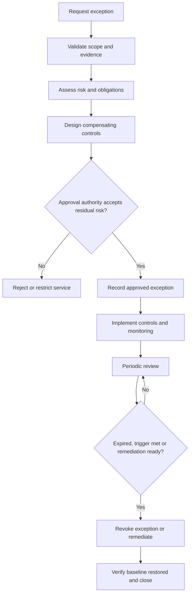

# Exception management — Quản lý ngoại lệ kiểm soát

## Mục tiêu học tập

Một hệ thống xác thực có thể có quy định bắt buộc MFA cho tài khoản quản trị, giới hạn thời hạn session, yêu cầu chứng chỉ thiết bị hoặc yêu cầu xác minh mạnh khi khôi phục tài khoản. Trong thực tế, một hệ thống cũ chưa hỗ trợ passkey, một thiết bị công nghiệp không có giao diện nhập MFA, một nhà cung cấp bên ngoài chưa đáp ứng giao thức mới hoặc một sự cố vận hành có thể khiến nhóm kỹ thuật đề xuất tạm thời không áp dụng một kiểm soát. Nếu ngoại lệ được chấp thuận qua trao đổi miệng, không có chủ sở hữu, không có thời hạn và không có biện pháp bù trừ, ngoại lệ tạm thời dễ trở thành cấu hình vĩnh viễn.

**Exception management (quản lý ngoại lệ)** là quy trình có kiểm soát để ghi nhận, đánh giá, phê duyệt, triển khai, giám sát, gia hạn hoặc chấm dứt một trường hợp không đáp ứng đầy đủ chính sách hoặc kiểm soát đã xác định. Mục đích là làm cho sai lệch có thể nhìn thấy, có người chịu trách nhiệm, có căn cứ rủi ro và có thời hạn xử lý. Ngoại lệ không tự làm cho một kiểm soát yếu trở nên an toàn; nó chỉ tạo một quyết định quản trị có thể truy vết về cách xử lý rủi ro còn lại.

Trong mô-đun **SECURITY_AUTHENTICATION_FUNDAMENTALS**, người học tìm hiểu credential, mật khẩu, MFA, passkey, chứng chỉ, token, session, liên kết danh tính và khôi phục tài khoản. Exception management áp dụng cho các kiểm soát trong những luồng đó, chẳng hạn yêu cầu MFA, thời hạn token, loại authenticator được phép, quy tắc certificate validation, session timeout, logging hoặc recovery proofing. Người thiết kế phải biết khi nào ngoại lệ không thể chấp nhận, cách chọn compensating control và cách đưa hệ thống trở lại trạng thái tuân thủ.

Sau bài học, bạn có thể:

- Phân biệt exception, waiver, deviation, risk acceptance và việc miễn trừ nghĩa vụ pháp lý/hợp đồng.
- Xác định policy/control bị sai lệch, phạm vi, lý do và tài sản bị ảnh hưởng.
- Đánh giá likelihood, impact, exposure, blast radius và residual risk.
- Chọn compensating control có hiệu lực kiểm chứng được.
- Thiết kế workflow request, review, approval, implementation, monitoring, expiry và closure.
- Áp dụng segregation of duties và thẩm quyền phê duyệt theo mức rủi ro.
- Quản lý ngoại lệ khẩn cấp mà vẫn bảo toàn audit trail và thời hạn.
- Xử lý ngoại lệ cho MFA, passkey, certificate, token, session và account recovery.
- Duy trì evidence, exception register, metrics và cảnh báo hết hạn.
- Xây dựng Java policy model, cấu hình minh họa và bộ kiểm thử exception lifecycle.

## 1. Exception management giải quyết vấn đề gì?

Policy và security baseline mô tả trạng thái kiểm soát mong muốn. Tuy nhiên, hệ thống thực tế có thể có giới hạn kỹ thuật, phụ thuộc nhà cung cấp, yêu cầu tương thích hoặc nhu cầu vận hành khiến một control chưa thể áp dụng ngay. Exception management tạo quy trình để quyết định có chấp nhận sai lệch đó hay không, trong phạm vi nào, trong bao lâu và với điều kiện gì.

Ví dụ:

- Một tài khoản dịch vụ trên hệ thống cũ chưa hỗ trợ MFA tương tác.
- Một ứng dụng cần tạm thời chấp nhận chứng chỉ cũ trong giai đoạn migration.
- Một tích hợp bên ngoài yêu cầu token lifetime dài hơn baseline.
- Một thiết bị kiosk không thể dùng biometric hoặc passkey.
- Một service chưa hỗ trợ kiểm tra session revocation theo thời gian thực.
- Một luồng recovery cần thời gian chuyển đổi vì phụ thuộc kênh xác minh cũ.
- Một môi trường thử nghiệm cần test với policy yếu hơn production.
- Một đợt xử lý sự cố cần mở một cửa sổ truy cập break-glass được giám sát.

Không phải mọi yêu cầu tiện lợi đều là lý do hợp lệ. “Người dùng không thích MFA”, “ứng dụng cũ khó sửa” hoặc “chưa có thời gian” chỉ mô tả áp lực; chúng chưa chứng minh rủi ro có thể chấp nhận.

### Vì sao ngoại lệ không được quản lý sẽ nguy hiểm?

- Không ai biết control nào đang bị bỏ qua.
- Phạm vi thực tế rộng hơn yêu cầu ban đầu.
- Ngoại lệ không có ngày hết hạn và tồn tại vô thời hạn.
- Biện pháp bù trừ chỉ nằm trong tài liệu, không được triển khai.
- Người phê duyệt không hiểu tác động tới dữ liệu hoặc tài khoản.
- Nhiều ngoại lệ nhỏ cộng lại tạo ra một đường bypass lớn.
- Khi xảy ra sự cố, không thể xác định ai đã chấp thuận và dựa trên bằng chứng nào.
- Kiểm toán không thể chứng minh ngoại lệ đã được review định kỳ hoặc đóng đúng hạn.

### Mục tiêu quản trị

Một exception process tốt phải làm rõ:

1. Control nào không được đáp ứng?
2. Ai yêu cầu và ai sở hữu hệ thống?
3. Vì sao không thể đáp ứng baseline ngay?
4. Tài sản, principal, môi trường và tenant nào bị ảnh hưởng?
5. Attacker có thể khai thác sai lệch ra sao?
6. Biện pháp bù trừ nào giảm likelihood hoặc impact?
7. Rủi ro còn lại là bao nhiêu và ai có thẩm quyền chấp nhận?
8. Ngoại lệ có hiệu lực từ khi nào tới khi nào?
9. Ai giám sát và điều kiện nào làm ngoại lệ phải bị thu hồi sớm?
10. Kế hoạch đưa hệ thống về baseline là gì?

## 2. Phân biệt exception, deviation, waiver và risk acceptance

Các tổ chức có thể dùng thuật ngữ khác nhau. Điều quan trọng là định nghĩa nội bộ phải nhất quán và phân biệt rõ quyết định kỹ thuật với quyết định chịu trách nhiệm rủi ro.

| Thuật ngữ | Ý nghĩa thực tế | Ví dụ |
| --- | --- | --- |
| **Exception** | Cho phép một phạm vi xác định tạm thời không đáp ứng một control | Tài khoản dịch vụ chưa hỗ trợ MFA tương tác |
| **Deviation** | Sai lệch so với baseline hoặc cấu hình chuẩn | Token lifetime đang dài hơn profile chuẩn |
| **Waiver** | Quyết định miễn một yêu cầu theo quy trình/thẩm quyền đã định | Một control nội bộ được miễn có điều kiện |
| **Risk acceptance** | Người có thẩm quyền chấp nhận residual risk sau khi xem xét phương án | Chấp nhận cửa sổ token còn hiệu lực trong thời gian migration |
| **Compensating control** | Biện pháp khác giảm rủi ro khi control gốc chưa đáp ứng | mTLS, IP allowlist, workload identity và monitoring |
| **Remediation** | Công việc loại bỏ nguyên nhân và đưa hệ thống về baseline | Nâng cấp service để hỗ trợ workload MFA/phân quyền |
| **Legal/regulatory exemption** | Miễn trừ theo cơ chế pháp lý hoặc cơ quan có thẩm quyền nếu có | Chỉ áp dụng khi văn bản/quyết định hợp lệ cho phép |

Exception và risk acceptance thường đi cùng nhau nhưng không đồng nghĩa. Exception là trạng thái sai lệch được quản lý; risk acceptance là quyết định của người có thẩm quyền về rủi ro còn lại. Người yêu cầu kỹ thuật không mặc nhiên có quyền chấp nhận rủi ro cho tổ chức.

### Ngoại lệ nội bộ không ghi đè nghĩa vụ bên ngoài

Một người quản lý nội bộ không thể tự tuyên bố miễn trừ nghĩa vụ pháp lý, quy định ngành, hợp đồng khách hàng hoặc yêu cầu của đối tác. Nếu một control là nghĩa vụ bắt buộc, cần xác định có cơ chế thay thế hoặc miễn trừ hợp lệ hay không từ nguồn có thẩm quyền. Khi không có cơ chế đó, yêu cầu phải được đáp ứng hoặc hệ thống/hoạt động liên quan phải bị giới hạn.

Các framework và tiêu chuẩn như ISO/IEC 27001, NIST, SOC 2 hoặc PCI DSS có mục đích, phạm vi và cách đánh giá khác nhau. Không nên suy ra rằng một exception form nội bộ tự động đáp ứng yêu cầu của mọi framework. Mapping và evidence phải được kiểm tra theo phạm vi áp dụng, hợp đồng và phiên bản yêu cầu cụ thể.

### Ngoại lệ không phải là bỏ qua policy

Một quyết định exception phải tham chiếu tới control cụ thể và điều kiện được phép sai lệch. Không sửa policy gốc để hợp thức hóa một hệ thống chưa đạt yêu cầu nếu chưa qua quy trình thay đổi policy. Giữ nguyên baseline giúp tổ chức biết trạng thái chuẩn và đo được số lượng sai lệch.

## 3. Khi nào có thể và không thể xem xét ngoại lệ?

Exception process không phải một cửa xin phép để vô hiệu hóa mọi kiểm soát. Trước khi đánh giá rủi ro, cần xác định control có thể được thay thế hợp lệ hay không.

### Trường hợp có thể xem xét

- Giới hạn kỹ thuật có bằng chứng và có kế hoạch loại bỏ.
- Phụ thuộc bên thứ ba có thời gian migration rõ.
- Hệ thống legacy được cô lập, có owner và có ngày sunset.
- Yêu cầu tương thích được giới hạn trong một môi trường hoặc nhóm thiết bị.
- Tình huống khẩn cấp cần quyền break-glass có giám sát và tự hết hạn.
- Một control có thể được thay bằng control khác với hiệu lực tương đương hoặc phù hợp risk appetite.
- Giai đoạn chuyển đổi có rollout theo cohort và điều kiện dừng cụ thể.

### Trường hợp không nên phê duyệt

- Không xác định được owner hoặc phạm vi.
- Không có bằng chứng về lý do và tác động.
- Không có biện pháp bù trừ khả thi.
- Không có ngày hết hạn hoặc kế hoạch remediation.
- Người yêu cầu muốn miễn kiểm soát chỉ vì tiện lợi.
- Ngoại lệ làm lộ secret, bỏ xác minh issuer/audience, vô hiệu hóa replay protection hoặc cho phép cross-tenant access.
- Ngoại lệ mâu thuẫn với nghĩa vụ pháp lý/hợp đồng mà tổ chức không có quyền miễn trừ.
- Không thể giám sát hoặc phát hiện việc sử dụng sai lệch.
- Rủi ro còn lại vượt quá risk appetite hoặc thẩm quyền của người phê duyệt.

### Dừng thay vì ngoại lệ

Nếu không thể triển khai MFA cho một tài khoản quản trị và không có phương án bù trừ đủ mạnh, lựa chọn đúng có thể là ngừng truy cập từ xa, giới hạn chức năng hoặc ngừng hệ thống cho tới khi control được khôi phục. Không phải lúc nào cũng cần giữ dịch vụ hoạt động bằng mọi giá.

## 4. Phân loại ngoại lệ theo control xác thực

Ngoại lệ nên gắn với control và tài sản cụ thể, không chỉ ghi “authentication exception”.

| Miền control | Ví dụ sai lệch | Rủi ro chính | Ví dụ biện pháp bù trừ |
| --- | --- | --- | --- |
| Password | Không áp dụng policy password baseline | Credential guessing/reuse | Passkey migration, rate limit, breached-password screening |
| MFA | Tài khoản không dùng MFA | Account takeover | Device-bound certificate, network isolation, restricted action, monitoring |
| Passkey | Thiết bị không hỗ trợ platform authenticator | Phishing/credential theft | Security key hoặc authenticator thay thế đã đánh giá |
| Certificate | Chấp nhận certificate profile cũ | Impersonation/weak crypto | Pin trust anchor, scope hẹp, short validity, migration deadline |
| Token | Access token lifetime dài hơn baseline | Token theft có cửa sổ tác động dài | Audience hẹp, proof-of-possession, introspection, revoke path |
| Session | Idle/absolute timeout dài hơn chuẩn | Session hijacking kéo dài | Step-up, device binding, risk-based revoke |
| Recovery | Recovery proof yếu hơn chuẩn | Account takeover | Dual approval, cooling-off, notification, restricted session |
| Federation | Tạm chấp nhận legacy IdP behavior | Assertion substitution/misconfiguration | Issuer allowlist, strict audience, isolated RP, monitoring |
| Logging/audit | Thiếu một số event trong migration | Không phát hiện/điều tra được | Gateway audit, immutable event sink, manual review |
| Workload identity | Service chưa dùng short-lived credential | Secret reuse/lateral movement | mTLS, secret manager, rotation, network segmentation |

Biện pháp bù trừ chỉ là ví dụ để đánh giá, không phải danh sách thay thế tự động. Mỗi biện pháp phải được kiểm chứng trong bối cảnh kiến trúc cụ thể.

## 5. Workflow exception management

Một workflow chuẩn có thể gồm các bước dưới đây. Tổ chức có thể gộp một số vai trò ở hệ thống nhỏ, nhưng không nên để cùng một người yêu cầu, tự phê duyệt và tự xác nhận việc triển khai khi rủi ro đáng kể.



### Bước 1 — Request

Người yêu cầu tạo record có:

- Control ID và phiên bản policy/baseline.
- System/service/application và owner.
- Principal, client, tenant, environment hoặc thiết bị bị ảnh hưởng.
- Mô tả sai lệch chính xác.
- Lý do và bằng chứng kỹ thuật/nghiệp vụ.
- Thời gian bắt đầu mong muốn và thời hạn tối đa đề xuất.
- Dữ liệu, action và dependency có thể bị ảnh hưởng.
- Phương án đã thử để đáp ứng control gốc.
- Kế hoạch remediation và người chịu trách nhiệm.

Không cho phép yêu cầu mơ hồ như “bypass MFA cho app cũ”. Phải chỉ rõ account/service nào, từ đâu, tới resource nào, action nào và trong điều kiện nào.

### Bước 2 — Validate request

Security/compliance reviewer kiểm tra request có đầy đủ và nằm trong thẩm quyền hay không. Xác nhận control có thực sự áp dụng, phạm vi có bị phóng đại và có giải pháp chuẩn nào đã tồn tại không.

Nếu thiếu thông tin, trả lại để bổ sung; không tự suy đoán rủi ro hoặc phê duyệt có điều kiện khi chưa biết đối tượng chịu ảnh hưởng.

### Bước 3 — Assess risk and obligations

Đánh giá rủi ro theo threat model, dữ liệu, quyền, exposure, khả năng phát hiện, blast radius và thời gian tồn tại. Kiểm tra nghĩa vụ pháp lý, hợp đồng, khách hàng và framework áp dụng. Nếu không có quyền miễn trừ, dừng workflow exception hoặc chuyển sang phương án đáp ứng control.

### Bước 4 — Design compensating controls

Mỗi biện pháp bù trừ phải mô tả:

- Threat hoặc đường tấn công mà nó giảm.
- Phạm vi áp dụng và owner.
- Cấu hình cụ thể.
- Bằng chứng triển khai.
- Cách kiểm tra hiệu lực.
- Alert hoặc failure condition.
- Giới hạn còn lại và cách xử lý khi biện pháp bù trừ thất bại.

Không chấp nhận câu “monitoring sẽ theo dõi” nếu không có event, dashboard, alert, owner và runbook cụ thể.

### Bước 5 — Approval

Người phê duyệt phải có thẩm quyền tương ứng với residual risk và phạm vi. Tùy tổ chức, có thể cần system owner, security officer, risk owner, compliance/legal hoặc business owner.

Approval phải ghi rõ quyết định ALLOW_WITH_EXCEPTION, REJECT hoặc NEEDS_REMEDIATION; lý do, điều kiện, ngày hiệu lực, ngày hết hạn và người chịu trách nhiệm. Không dùng approval chung chung cho mọi môi trường hoặc mọi account.

### Bước 6 — Implementation

Kỹ thuật triển khai đúng phạm vi đã được phê duyệt. Nên dùng policy-as-code/config có version, feature flag có owner hoặc allowlist có thời hạn. Tránh tạo bypass thủ công không có audit.

Sau triển khai, kiểm tra cả positive và negative path: chỉ đối tượng được nêu trong exception mới nhận sai lệch; đối tượng khác vẫn tuân thủ baseline.

### Bước 7 — Monitoring and review

Theo dõi mức sử dụng ngoại lệ, sự kiện bảo mật, hiệu lực compensating control và tiến độ remediation. Review định kỳ trước ngày hết hạn. Nếu điều kiện thay đổi, exception phải được đánh giá lại ngay.

### Bước 8 — Expiry, revoke and closure

Khi hết hạn, hệ thống phải tự chuyển sang trạng thái hết hiệu lực hoặc chặn hành vi ngoại lệ. Không tự gia hạn chỉ vì owner không phản hồi. Đóng khi baseline được khôi phục, test đạt và evidence được lưu. Nếu tiếp tục cần sai lệch, tạo yêu cầu gia hạn mới với risk assessment cập nhật và approval mới.

## 6. Đánh giá rủi ro ngoại lệ

Không chỉ chấm điểm “high/medium/low” mà không giải thích. Một risk assessment hữu ích phải nêu scenario, likelihood, impact, control gap và residual risk sau bù trừ.

### Threat scenario

Dùng cấu trúc:

- Asset: token, session, account, private key, recovery channel hoặc dữ liệu.
- Threat actor: external attacker, malware, insider, compromised service.
- Weakness: control bị bỏ qua hoặc không hoạt động.
- Attack path: cách attacker khai thác sai lệch.
- Impact: account takeover, privilege escalation, data exposure, fraud, outage.
- Existing controls: các kiểm soát đang hoạt động.
- Proposed controls: biện pháp bù trừ.
- Residual risk: rủi ro còn lại sau các biện pháp.
- Trigger: điều kiện làm rủi ro tăng hoặc exception phải bị thu hồi.

### Các yếu tố đánh giá

| Yếu tố | Câu hỏi |
| --- | --- |
| Likelihood | Attacker có thể khai thác sai lệch dễ đến đâu? |
| Impact | Nếu thành công, dữ liệu, tài khoản hoặc hoạt động bị ảnh hưởng thế nào? |
| Exposure | Thành phần có Internet-facing, public client hoặc network rộng không? |
| Privilege | Principal có quyền admin, approve, export hoặc quản lý credential không? |
| Data sensitivity | Có PII, tài chính, bí mật hoặc dữ liệu nhiều tenant không? |
| Blast radius | Một account, một tenant hay toàn hệ thống bị ảnh hưởng? |
| Detectability | Có thể phát hiện trong thời gian phù hợp không? |
| Duration | Sai lệch tồn tại bao lâu và có thể bị khai thác liên tục không? |
| Dependency | Có phụ thuộc bên thứ ba hoặc control khác không? |
| Reversibility | Có thể revoke nhanh và khôi phục baseline không? |

### Risk score không thay judgment

Có thể dùng ma trận likelihood × impact để phân loại ưu tiên, nhưng không để một con số thấp che lấp một nghĩa vụ bắt buộc hoặc một scenario catastrophic. Risk owner cần hiểu scenario và residual risk; security reviewer cần kiểm tra tính hợp lý của assumptions.

### Inherent risk và residual risk

- **Inherent risk:** Rủi ro trước khi áp dụng compensating controls.
- **Residual risk:** Rủi ro còn lại sau khi biện pháp bù trừ được triển khai và kiểm chứng.
- **Risk appetite:** Mức rủi ro tổ chức sẵn sàng chấp nhận theo policy.
- **Risk tolerance:** Biên độ sai lệch được phép trong phạm vi appetite và mục tiêu cụ thể.

Không đánh giá residual risk dựa trên biện pháp mới chỉ nằm trong kế hoạch. Chỉ tính các control đã triển khai và có bằng chứng kiểm tra.

## 7. Compensating controls phải có hiệu lực kiểm chứng

Compensating control là một biện pháp thay thế hoặc bổ sung nhằm giảm rủi ro khi control gốc chưa thể đáp ứng. Nó không nhất thiết giống control gốc, nhưng phải giải quyết được threat scenario đã nêu và không tạo một bypass khác.

### Ví dụ: chưa thể bật MFA cho workload cũ

Một service account không thể tương tác với MFA prompt. Có thể xem xét:

- Chuyển sang workload identity hoặc certificate-based authentication.
- Giới hạn audience, scope và resource.
- Chỉ cho phép kết nối từ workload/network đã xác thực.
- Dùng mTLS và certificate có vòng đời ngắn nếu hệ thống hỗ trợ.
- Đặt secret trong secret manager và rotation tự động.
- Giới hạn quyền thành một tập action tối thiểu.
- Alert khi có request từ network/client bất thường.
- Chặn truy cập interactive và cấm dùng credential này cho người dùng.
- Có ngày chuyển đổi và owner.

Chỉ IP allowlist không đủ nếu attacker đã chiếm workload nằm trong mạng được phép. Biện pháp bù trừ phải xét threat actor có thể ở bên trong boundary hay không.

### Ví dụ: token lifetime dài hơn baseline

Có thể cân nhắc audience hẹp, scope tối thiểu, proof-of-possession, session status check cho action nhạy cảm, refresh-token rotation, anomaly detection và revoke path. Nếu access token tự chứa không có introspection/denylist, phải ghi rõ cửa sổ còn hiệu lực tối đa và chấp nhận hoặc giảm bằng thay đổi kiến trúc.

### Ví dụ: certificate cũ trong migration

Giới hạn certificate cũ theo issuer, subject/SAN, EKU, audience, endpoint và thời hạn ngắn; theo dõi mọi lần sử dụng; phát hành certificate mới; xác minh rotation; sau deadline loại bỏ CA/profile cũ. Không nới lỏng toàn bộ chain validation hoặc chấp nhận certificate hết hạn vô thời hạn.

### Ví dụ: recovery proof chưa đạt baseline

Có thể tạm thời giới hạn session sau recovery ở chế độ read-only, yêu cầu dual approval, gửi notification tới kênh đã xác minh trước đó, áp dụng cooling-off và chặn thay payout/email/passkey trong thời gian chờ. Nếu không có kênh proof đáng tin, có thể cần identity proofing mạnh hơn thay vì miễn kiểm tra.

### Tiêu chí kiểm tra control bù trừ

Một compensating control chỉ được tính vào residual risk nếu:

- Có owner và cấu hình cụ thể.
- Đã triển khai trước hoặc đồng thời với exception có hiệu lực.
- Có test hoặc evidence xác minh.
- Bao phủ đúng scope và threat scenario.
- Có monitoring và cảnh báo khi mất hiệu lực.
- Có cách fail-safe khi dependency hỏng.
- Không phụ thuộc duy nhất vào một kiểm soát khác cũng đang có exception.
- Có ngày review và điều kiện kết thúc.

## 8. Thẩm quyền, segregation of duties và approval

Quyền phê duyệt cần tương xứng với rủi ro. Một nhóm phát triển có thể đề xuất exception và triển khai biện pháp, nhưng không nên tự phê duyệt residual risk cao mà không có người chịu trách nhiệm độc lập.

### Vai trò

| Vai trò | Trách nhiệm |
| --- | --- |
| Requester | Nêu nhu cầu, phạm vi, bằng chứng và kế hoạch remediation |
| System owner | Xác nhận tác động kỹ thuật, dependency và khả năng triển khai |
| Security reviewer | Kiểm tra threat model, control gap và compensating control |
| Compliance/legal | Đánh giá nghĩa vụ bên ngoài và yêu cầu evidence khi cần |
| Risk owner | Chấp nhận hoặc từ chối residual risk trong thẩm quyền |
| Approver | Ra quyết định chính thức và điều kiện |
| Implementer | Cấu hình đúng phạm vi được duyệt |
| Control tester | Xác minh compensating control và baseline restoration |
| Exception coordinator | Theo dõi expiry, review, register và escalation |

Một người có thể giữ nhiều vai trò ở tổ chức nhỏ nếu policy cho phép, nhưng các xung đột lợi ích phải được ghi nhận và có kiểm soát thay thế.

### Approval matrix minh họa

| Mức rủi ro | Phê duyệt tối thiểu gợi ý |
| --- | --- |
| Low, scope hẹp, không ảnh hưởng control bắt buộc | System owner + security reviewer |
| Medium, ảnh hưởng một service/nhóm người dùng | System owner + security/risk owner |
| High, liên quan MFA, admin, token hoặc dữ liệu nhạy cảm | Business risk owner + security leadership; compliance/legal nếu cần |
| Critical hoặc có thể vi phạm nghĩa vụ bắt buộc | Không phê duyệt qua workflow thông thường; escalation cấp có thẩm quyền hoặc dừng hoạt động |

Đây là mô hình tham khảo; tổ chức phải định nghĩa approval authority thực tế trong policy. Không tự gán quyền cho một chức danh chỉ dựa trên bảng này.

### Approval phải có điều kiện

Một approval record nên chứa:

- Decision và rationale.
- Control ID/version và policy reference.
- Scope chính xác.
- Inherent/residual risk và assumptions.
- Compensating controls.
- Start/end time.
- Review cadence.
- Remediation owner/due date.
- Trigger revoke.
- Approver identity và timestamp.
- Evidence reference.

Không dùng email “OK” làm nguồn duy nhất nếu hệ thống cần audit trail bền vững.

## 9. Emergency exception và break-glass access

Trong incident hoặc outage, có thể cần một ngoại lệ khẩn cấp để khôi phục dịch vụ. Break-glass access đặc biệt nhạy cảm vì thường có quyền cao và có thể bỏ qua một số bước thông thường.

### Điều kiện tối thiểu

- Chỉ dùng khi có trigger khẩn cấp được định nghĩa.
- Tài khoản/credential break-glass được quản lý riêng, không dùng hàng ngày.
- Có owner và custodian rõ ràng.
- Quyền tối thiểu cần thiết và phạm vi thời gian ngắn.
- MFA hoặc hardware-backed credential nếu khả thi.
- Nếu buộc phải bypass một control, có kiểm soát thay thế và lý do.
- Ghi log/audit bất biến và cảnh báo ngay khi sử dụng.
- Có approval trước; nếu tình huống đòi hỏi hành động tức thì, dùng quy trình hậu kiểm có giới hạn và người phê duyệt độc lập.
- Credential được rotate hoặc revoke sau khi dùng.
- Session và hành động được review sau sự kiện.

### Time-bound emergency access

Emergency exception phải tự hết hạn. Không chỉ dựa vào người dùng nhớ logout. Có thể dùng TTL ngắn, JIT elevation, one-time credential hoặc session tự động bị revoke sau cửa sổ đã duyệt.

### Hậu kiểm

Sau khi kết thúc:

1. Xác minh ai đã dùng break-glass và lý do.
2. Đối chiếu mọi action với incident/ticket.
3. Thu hồi session/token/key tạm.
4. Rotate credential nếu đã lộ hoặc được chia sẻ.
5. Kiểm tra thay đổi và dữ liệu bị tác động.
6. Ghi nhận liệu exception có cần tiếp tục hay baseline đã phục hồi.
7. Phân tích vì sao hệ thống cần break-glass và cách giảm phụ thuộc.

Break-glass không được trở thành một tài khoản admin dùng chung hoặc một lối vào không audit.

## 10. Thời hạn, gia hạn và tự động hết hiệu lực

Mọi exception phải có thời hạn cụ thể. “Until fixed” không đủ nếu không có ngày mục tiêu và review. Ngoại lệ càng lâu càng tăng khả năng assumption ban đầu không còn đúng.

### Thiết kế expiry

- Có effective_at và expires_at.
- Expires_at không vượt giới hạn tối đa theo policy.
- Hệ thống cảnh báo trước ngày hết hạn.
- Owner phải xác nhận trạng thái và evidence khi review.
- Không tự động gia hạn nếu owner im lặng.
- Khi hết hạn, policy tự quay về baseline hoặc chặn đối tượng.
- Nếu không thể tự revert an toàn, phải có escalation và biện pháp fail-safe.
- Lưu lịch sử gia hạn và thay đổi scope.

### Renewal không phải thao tác lặp lại

Gia hạn cần đánh giá lại:

- Threat landscape có thay đổi không?
- Control gốc đã có giải pháp chưa?
- Compensating control còn hoạt động không?
- Phạm vi có mở rộng không?
- Có incident hoặc finding mới không?
- Residual risk có tăng không?
- Người phê duyệt cũ còn thẩm quyền không?
- Kế hoạch remediation có tiến triển không?

Nếu scope, threat hoặc control thay đổi đáng kể, tạo exception mới hoặc assessment mới thay vì chỉ kéo dài ngày hết hạn.

### Trigger thu hồi sớm

Ngoại lệ phải bị revoke trước expiry khi:

- Compensating control mất hiệu lực.
- Có dấu hiệu exploit hoặc incident liên quan.
- Phạm vi sử dụng vượt approval.
- Owner rời vai trò hoặc service chuyển quyền sở hữu.
- Credential/key bị compromise.
- Control gốc đã sẵn sàng và có thể bật lại.
- Policy hoặc nghĩa vụ áp dụng thay đổi.
- Rủi ro vượt risk appetite.

## 11. Exception register và dữ liệu cần lưu

Exception register là nguồn quản lý tập trung giúp biết hiện có bao nhiêu sai lệch, chúng ảnh hưởng tới đâu và ai chịu trách nhiệm. Không quản lý bằng bảng tính riêng rẽ không có owner hoặc lịch sử.

### Schema record gợi ý

| Field | Ý nghĩa |
| --- | --- |
| exception_id | ID duy nhất, không phải secret |
| title/description | Mô tả ngắn và sai lệch |
| control_id/control_version | Control và baseline bị ảnh hưởng |
| service/system_owner | Hệ thống và người chịu trách nhiệm |
| requester | Người tạo yêu cầu |
| scope | Account, client, tenant, environment, resource, action |
| reason/evidence | Lý do và bằng chứng |
| threat_scenario | Attack path và tác động |
| inherent_risk | Rủi ro trước bù trừ |
| compensating_controls | Control thay thế, owner, evidence |
| residual_risk | Rủi ro còn lại |
| decision/approver | Quyết định và người phê duyệt |
| effective_at/expires_at | Khoảng hiệu lực |
| review_at | Ngày review tiếp theo |
| remediation_plan/owner/due_date | Kế hoạch đưa về baseline |
| status | Trạng thái workflow |
| revoke_trigger | Điều kiện thu hồi sớm |
| audit_refs | Reference tới audit/evidence |
| created_at/updated_at | Lịch sử thời gian |

### Status lifecycle

| Status | Ý nghĩa |
| --- | --- |
| DRAFT | Đang soạn, chưa gửi |
| SUBMITTED | Đã gửi yêu cầu |
| NEEDS_INFO | Cần bổ sung bằng chứng |
| UNDER_REVIEW | Đang đánh giá |
| APPROVED | Đã phê duyệt, chờ triển khai hoặc hiệu lực |
| ACTIVE | Ngoại lệ đang có hiệu lực |
| REJECTED | Bị từ chối |
| EXPIRED | Hết hạn |
| REVOKED | Bị thu hồi sớm |
| REMEDIATING | Đang khôi phục control gốc |
| CLOSED | Baseline đã được khôi phục và xác minh |

Không gộp APPROVED với ACTIVE. Một exception có thể được phê duyệt nhưng chưa được triển khai; chỉ chuyển ACTIVE sau khi compensating control và cấu hình đã được xác minh.

## 12. Áp dụng exception cho các kiểm soát authentication

### MFA exception

Nếu một account hoặc workload không thể dùng MFA:

- Xác định chính xác principal và loại client.
- Xác minh control có bắt buộc theo policy/contract hay không.
- Xem xét thay bằng workload identity, certificate hoặc security key.
- Hạn chế action, audience, network và thời gian.
- Không cho account dịch vụ đăng nhập interactive nếu không cần.
- Theo dõi usage, location/risk bucket và bất thường.
- Có kế hoạch loại bỏ credential legacy.

Không miễn MFA toàn bộ tenant chỉ vì một tích hợp không hỗ trợ.

### Passkey exception

Thiết bị hoặc client chưa hỗ trợ passkey không tự động có nghĩa phải hạ toàn bộ assurance. Có thể cung cấp security key hoặc phương thức thay thế được đánh giá tương đương theo threat model. Xác định nhóm thiết bị, thời hạn tương thích và cách thông báo/migration. Không chấp nhận password-only cho admin nếu policy yêu cầu phishing-resistant authentication mà không có risk acceptance hợp lệ.

### Certificate exception

Nếu cần chấp nhận certificate legacy:

- Pin issuer/CA và identity mapping cụ thể.
- Giới hạn EKU, SAN, audience và endpoint.
- Giữ validation chain và proof-of-possession.
- Giảm validity period nếu có thể.
- Theo dõi từng lần sử dụng.
- Không tắt revocation check toàn cục nếu chỉ một certificate có vấn đề.
- Đặt ngày migration và test certificate mới.
- Revoke trust cũ khi migration hoàn tất.

### Token lifetime exception

Nếu token cần lifetime dài hơn baseline:

- Giới hạn audience và scope.
- Cân nhắc sender-constrained token hoặc proof-of-possession.
- Có refresh rotation và reuse detection.
- Có revoke path hoặc status check cho hành động nhạy cảm.
- Ghi rõ cửa sổ tác động tối đa nếu token tự chứa.
- Theo dõi token use bất thường.
- Không dùng token lifetime dài để thay cho thiết kế offline/session đúng.

### Session timeout exception

Nếu một kiosk hoặc thiết bị vận hành cần session dài hơn:

- Giới hạn thiết bị, network và resource.
- Dùng device identity hoặc managed-device control.
- Tự động khóa giao diện khi không hoạt động nếu có thể.
- Yêu cầu step-up trước hành động nhạy cảm.
- Giới hạn quyền session.
- Theo dõi session age và concurrent use.
- Có remote revoke và quy trình mất thiết bị.
- Đặt absolute expiry, không chỉ idle timeout.

### Recovery exception

Nếu recovery proof chưa đáp ứng baseline:

- Không cấp session có toàn quyền ngay sau một email link yếu.
- Giới hạn quyền trong recovery session.
- Dùng dual control cho account nhạy cảm.
- Notification tới channel cũ đã xác minh.
- Cooling-off trước thay đổi payout, email hoặc authenticator.
- Ghi audit đầy đủ và có người review.
- Đặt hạn chót hoàn tất migration sang proofing mạnh hơn.

## 13. Mapping compliance và evidence

Exception management hỗ trợ chứng minh tổ chức nhận diện và quản lý sai lệch, nhưng không tự tạo ra sự tuân thủ. Evidence cần liên kết control, phạm vi áp dụng, quyết định, bù trừ, giám sát và closure.

### Control mapping

Với mỗi exception, ghi:

- Control/baseline ID và phiên bản.
- Yêu cầu nguồn: policy nội bộ, contract, framework hoặc regulation.
- Applicability và scope.
- Lý do control chưa đáp ứng.
- Có cho phép alternative/compensating control hay không.
- Ai có thẩm quyền chấp nhận.
- Evidence của approval và implementation.
- Review/expiry/closure history.

Nếu một control mapping tới nhiều framework, không giả định một approval áp dụng cho tất cả. Phạm vi chứng minh và điều kiện của từng framework có thể khác.

### Evidence package

Một evidence package có thể gồm:

- Request và business justification.
- Risk assessment và threat scenario.
- Security review và legal/compliance assessment khi cần.
- Approval record.
- Cấu hình hoặc change reference.
- Test result cho compensating control.
- Dashboard/alert và review evidence.
- Remediation plan/progress.
- Expiry/revocation/closure record.

Evidence nên có timestamp, owner, version và integrity protection. Tránh đính kèm token, password, private key hoặc dữ liệu cá nhân không cần thiết.

### Kiểm tra tính đầy đủ

Reviewer hoặc auditor cần có thể trả lời:

1. Ngoại lệ nào đang active?
2. Control nào bị sai lệch?
3. Ai phê duyệt và theo thẩm quyền nào?
4. Rủi ro nào được chấp nhận?
5. Biện pháp bù trừ nào đang hoạt động?
6. Evidence nào chứng minh điều đó?
7. Khi nào phải review hoặc hết hạn?
8. Có quá hạn hoặc vượt scope không?
9. Kế hoạch remediation tiến triển thế nào?
10. Baseline đã được khôi phục và kiểm thử chưa?

## 14. Monitoring, metrics và cảnh báo

Exception register cần được giám sát như một phần của security posture. Một exception đã phê duyệt nhưng không được dùng vẫn cần được xem xét; một exception được sử dụng vượt scope cần cảnh báo.

### Metric gợi ý

| Metric | Ý nghĩa |
| --- | --- |
| compliance_exceptions_active | Số exception đang active |
| compliance_exceptions_pending | Số request đang chờ review |
| compliance_exceptions_expiring | Số exception sắp hết hạn |
| compliance_exceptions_overdue | Số exception quá hạn |
| compliance_exception_renewals_total | Số lần gia hạn |
| compliance_exception_revocations_total | Số lần thu hồi sớm |
| compliance_compensating_control_failures_total | Lần control bù trừ thất bại |
| compliance_exception_scope_violations_total | Lần sử dụng vượt phạm vi |
| compliance_exception_review_overdue_total | Exception chưa review đúng hạn |
| compliance_baseline_restoration_total | Số control được khôi phục và xác minh |

Label nên hữu hạn như control_domain, risk_tier, status và environment. Không dùng requester email, account ID, exception ID hoặc tenant tùy ý làm metric label. Drill-down dùng exception register/audit store có phân quyền.

### Alert gợi ý

- Exception sắp hết hạn nhưng chưa có remediation/renewal.
- Exception quá hạn vẫn đang cho phép traffic.
- Compensating control bị tắt hoặc không có telemetry.
- Usage từ principal, device, network hoặc action ngoài scope.
- Exception High/Critical không được review đúng lịch.
- Một owner có quá nhiều exception hoặc nhiều lần gia hạn.
- Break-glass exception được dùng ngoài incident.
- Control gốc đã sẵn sàng nhưng exception chưa được đóng.
- Audit evidence thiếu hoặc không thể truy xuất.

### Dashboard

Dashboard nên phân tích theo control domain, risk tier, owner group, environment, age và trạng thái. Cần có danh sách exception sắp hết hạn/quá hạn để owner xử lý, cùng biểu đồ trend về số lượng và thời gian tồn tại. Không hiển thị raw secret hoặc dữ liệu cá nhân trong dashboard.

## 15. Java: mô hình hóa exception lifecycle

Ví dụ sau minh họa một policy model đơn giản để đánh giá trạng thái exception. Production cần authorization theo vai trò, persistence có transaction, audit, scheduler, policy versioning và integration với hệ thống change management.

```java
import java.time.Instant;
import java.util.Objects;
import java.util.Set;

enum ExceptionStatus {
    DRAFT,
    SUBMITTED,
    UNDER_REVIEW,
    APPROVED,
    ACTIVE,
    NEEDS_INFO,
    REJECTED,
    EXPIRED,
    REVOKED,
    REMEDIATING,
    CLOSED
}

enum RiskTier {
    LOW,
    MEDIUM,
    HIGH,
    CRITICAL
}

enum ExceptionDecision {
    ALLOW_WITH_EXCEPTION,
    REJECT,
    NEEDS_REMEDIATION
}

record ExceptionRequest(
        String exceptionId,
        String controlId,
        String serviceId,
        String ownerId,
        String requesterId,
        Set<String> scope,
        String justification,
        String remediationPlan,
        RiskTier riskTier,
        Instant effectiveAt,
        Instant expiresAt,
        Instant reviewAt
) {}

record ExceptionApproval(
        String approverId,
        ExceptionDecision decision,
        String rationale,
        Instant approvedAt
) {}

record CompensatingControl(
        String controlId,
        String ownerId,
        boolean implemented,
        boolean tested,
        boolean monitored,
        String evidenceRef
) {
    boolean effective() {
        return !blank(controlId) && !blank(ownerId)
                && implemented && tested && monitored
                && evidenceRef != null && !evidenceRef.isBlank();
    }

    private static boolean blank(String value) {
        return value == null || value.isBlank();
    }
}

final class ExceptionPolicy {

    private static final Set<RiskTier> REQUIRING_INDEPENDENT_APPROVAL =
            Set.of(RiskTier.HIGH, RiskTier.CRITICAL);

    boolean canActivate(
            ExceptionRequest request,
            ExceptionApproval approval,
            CompensatingControl compensatingControl,
            Instant now) {

        if (request == null || approval == null
                || compensatingControl == null || now == null) {
            return false;
        }

        if (blank(request.exceptionId())
                || blank(request.controlId())
                || blank(request.serviceId())
                || blank(request.ownerId())
                || blank(request.requesterId())
                || request.scope() == null || request.scope().isEmpty()
                || blank(request.justification())
                || blank(request.remediationPlan())
                || request.riskTier() == null
                || request.effectiveAt() == null
                || request.expiresAt() == null
                || request.reviewAt() == null
                || request.scope().stream().anyMatch(ExceptionPolicy::blank)) {
            return false;
        }

        if (request.expiresAt().isAfter(
                request.effectiveAt().plusSeconds(90L * 24 * 60 * 60))) {
            return false;
        }

        if (!request.expiresAt().isAfter(now)
                || request.effectiveAt().isAfter(now)
                || !request.reviewAt().isAfter(now)
                || !request.reviewAt().isBefore(request.expiresAt())) {
            return false;
        }

        if (approval.decision() != ExceptionDecision.ALLOW_WITH_EXCEPTION
                || approval.approvedAt() == null
                || approval.approvedAt().isAfter(now)
                || blank(approval.approverId())
                || blank(approval.rationale())) {
            return false;
        }

        if (REQUIRING_INDEPENDENT_APPROVAL.contains(request.riskTier())
                && request.requesterId().equals(approval.approverId())) {
            return false;
        }

        if (!compensatingControl.effective()) {
            return false;
        }

        return true;
    }

    ExceptionStatus statusAt(
            ExceptionStatus current,
            ExceptionRequest request,
            Instant now,
            boolean revoked,
            boolean baselineRestored,
            boolean restorationVerified) {

        Objects.requireNonNull(current);
        Objects.requireNonNull(request);
        Objects.requireNonNull(now);
        Objects.requireNonNull(request.expiresAt());

        if (revoked) {
            return ExceptionStatus.REVOKED;
        }

        if (current == ExceptionStatus.CLOSED
                || current == ExceptionStatus.REJECTED
                || current == ExceptionStatus.REVOKED) {
            return current;
        }

        if (!now.isBefore(request.expiresAt())
                && (current == ExceptionStatus.ACTIVE
                    || current == ExceptionStatus.APPROVED)) {
            return ExceptionStatus.EXPIRED;
        }

        if (baselineRestored && restorationVerified) {
            return ExceptionStatus.CLOSED;
        }

        return current;
    }

    private static boolean blank(String value) {
        return value == null || value.isBlank();
    }
}
```

Đây là ví dụ policy minh họa, không phải một chuẩn phê duyệt dùng chung. Giới hạn 90 ngày chỉ là giá trị ví dụ; tổ chức cần đặt giới hạn theo risk tier và policy. Hàm statusAt không thay thế state transition có kiểm tra quyền và persistence nguyên tử. Trong production, status transition phải append audit event, ghi người thực hiện và ngăn trạng thái terminal quay lại ACTIVE.

### Cấu hình exception minh họa

```yaml
exception:
  id: EXC-AUTH-2026-014
  control:
    id: AUTH-MFA-ADMIN
    version: "3.2"
  scope:
    environment: production
    principal_type: workload
    workload: legacy-reporting-worker
    actions:
      - reports:read
    audiences:
      - reporting-api
  reason: "Legacy workload is not yet integrated with interactive MFA"
  risk:
    inherent: high
    residual: medium
    owner: reporting-service-owner
  compensating_controls:
    - id: workload-mtls
      required: true
      evidence_ref: evidence://change/CHG-2048
    - id: short_lived_certificate
      required: true
      evidence_ref: evidence://test/TEST-881
    - id: network_restriction
      required: true
      evidence_ref: evidence://policy/NET-91
  approval:
    decision: allow_with_exception
    approver_role: security-risk-owner
    approved_at: "2026-11-22T09:00:00Z"
  lifecycle:
    effective_at: "2026-11-22T10:00:00Z"
    review_at: "2026-12-06T10:00:00Z"
    expires_at: "2027-01-21T10:00:00Z"
  remediation:
    owner: reporting-platform-team
    due_date: "2027-01-14"
    plan: "Migrate workload to managed identity"
  revoke_triggers:
    - compensating_control_failed
    - unexpected_scope_usage
    - credential_compromise
```

Cấu hình trên chỉ minh họa cấu trúc dữ liệu. URI evidence là reference giả lập, không phải đường dẫn thực. Parser cần schema validation, kiểm tra timestamp, scope, audience, owner và approval. Không đưa credential hoặc secret vào exception record.

## 16. Lỗi quản lý ngoại lệ thường gặp

| Lỗi | Hậu quả | Cách phòng tránh |
| --- | --- | --- |
| Không có owner | Không ai chịu trách nhiệm remediation | Bắt buộc system owner và risk owner |
| Không có expiry | Ngoại lệ trở thành vĩnh viễn | Expiry bắt buộc và tự động revoke |
| Request quá rộng | Bypass lan sang nhiều account/service | Scope theo principal, action, resource, environment |
| Không có threat scenario | Không biết ngoại lệ làm tăng rủi ro gì | Viết attack path và impact |
| Compensating control chỉ trên giấy | Residual risk bị đánh giá thấp | Evidence, test và monitoring bắt buộc |
| Requester tự phê duyệt | Xung đột lợi ích | Segregation of duties theo risk tier |
| Dùng exception để miễn luật/hợp đồng | Tổ chức vẫn có thể vi phạm nghĩa vụ | Legal/compliance review và authority phù hợp |
| Gia hạn tự động | Rủi ro cũ tồn tại dù bối cảnh đổi | Reassessment và approval mới |
| Không kiểm tra usage | Ngoại lệ bị dùng vượt phạm vi | Runtime enforcement và scope violation alert |
| Không có rollback | Không thể nhanh chóng khôi phục baseline | Revoke trigger và rollback plan |
| Gộp APPROVED với ACTIVE | Sai lệch có hiệu lực trước khi control bù trừ sẵn sàng | Tách trạng thái và kiểm tra implementation |
| Không theo dõi control dependency | Bù trừ mất tác dụng mà không ai biết | Monitor dependency và fail-safe |
| Break-glass dùng thường xuyên | Đường đặc quyền không được quản lý | JIT, alert, hậu kiểm và rotate |
| Không đóng ngoại lệ sau remediation | Register không phản ánh posture thật | Retest và closure evidence |
| Dùng metric label có ID tùy ý | Cardinality/privacy risk | Label enum; drill-down qua register |
| Chỉ lưu email approval | Khó truy vết và kiểm chứng điều kiện | Approval record có version và audit |
| Không đánh giá tổng hợp | Nhiều exception cộng lại tạo attack path | Aggregate risk review theo service/control |

## 17. Bảng kiểm thử exception management

| Trường hợp | Thao tác | Kết quả mong đợi |
| --- | --- | --- |
| Request hợp lệ | Đủ control, scope, owner, reason, risk và expiry | Chuyển sang review |
| Thiếu owner | Submit không có owner | Từ chối validation |
| Scope rỗng | Không xác định principal/action/resource | Không được approve |
| Control không áp dụng | Request cho control không liên quan | Trả lại hoặc reject |
| Nghĩa vụ bắt buộc | Không có cơ chế miễn trừ hợp lệ | Không activate exception |
| Risk cao tự duyệt | Requester là approver trong tier cần độc lập | Từ chối approval |
| Chưa có compensating control | Control chưa triển khai/test | Không chuyển ACTIVE |
| Evidence thiếu | Reference không tồn tại hoặc chưa kiểm tra | Không activate |
| Expiry không hợp lệ | Expiry trước effective hoặc quá giới hạn | Validation fail |
| Review sau expiry | review_at không trước expires_at | Validation fail |
| Request tương lai | effective_at chưa tới | Chưa ACTIVE |
| Hết hạn | Clock vượt expires_at | Chuyển EXPIRED và enforce baseline |
| Gia hạn | Owner gửi renewal request | Risk assessment và approval mới |
| Control bù trừ thất bại | Monitoring báo control down | Revoke hoặc fail-safe theo policy |
| Scope violation | Principal dùng action/audience ngoài exception | Deny và security alert |
| Owner thay đổi | Service đổi owner | Yêu cầu reassignment/review |
| Credential compromise | Key/token liên quan bị lộ | Revoke exception hoặc kích hoạt incident process |
| Break-glass | Emergency credential được dùng | Alert, audit, TTL và hậu kiểm |
| Duplicate approval | Gửi lại cùng quyết định | Idempotent, không tạo record mâu thuẫn |
| Concurrent activation | Hai operator activate cùng exception | Chỉ một transition hợp lệ |
| Baseline restored | Control gốc được bật lại và test đạt | REMEDIATING rồi CLOSED |
| Closure chưa verified | Có change nhưng chưa có test evidence | Không đóng |
| Audit integrity | Sửa record lịch sử | Bị ngăn hoặc phát hiện |
| Notification failure | Không gửi cảnh báo expiry | Retry/escalation và metric |
| Register outage | Không ghi được exception | Không cho bypass mới hoạt động |
| Multi-environment | Exception chỉ production workload cụ thể | Staging/dev không tự động được miễn |
| Aggregate risk | Nhiều exception cùng control/service | Dashboard phát hiện concentration |

Ngoài unit test, cần integration test với policy engine, identity provider, secret manager, change management, notification, audit store và runtime enforcement. Kiểm tra hành vi thật khi exception hết hạn hoặc compensating control bị mất; không chỉ test record status trong database.

## 18. Checklist thiết kế exception

Trước khi cho một ngoại lệ có hiệu lực, hãy trả lời:

1. **Control:** Control ID, phiên bản và baseline nào bị sai lệch?
2. **Applicability:** Control có áp dụng cho hệ thống và môi trường này không?
3. **Obligation:** Có nghĩa vụ pháp lý, hợp đồng hoặc yêu cầu khách hàng không thể miễn trừ không?
4. **Scope:** Principal, client, tenant, resource, action và environment nào bị ảnh hưởng?
5. **Reason:** Vì sao chưa thể đáp ứng control gốc? Có phương án chuẩn nào đã được thử?
6. **Threat:** Attacker khai thác sai lệch bằng attack path nào?
7. **Impact:** Dữ liệu, quyền, account và blast radius ra sao?
8. **Compensation:** Control bù trừ giảm threat nào và có evidence kiểm chứng không?
9. **Residual risk:** Rủi ro còn lại có nằm trong risk appetite không?
10. **Approval:** Ai có thẩm quyền? Có segregation of duties không?
11. **Lifecycle:** Effective, review và expiry time có rõ không?
12. **Monitoring:** Có metric, alert, owner và runbook không?
13. **Revoke:** Trigger nào làm ngoại lệ phải dừng sớm?
14. **Remediation:** Ai đưa hệ thống về baseline và deadline nào?
15. **Evidence:** Request, approval, test, review và closure có thể truy xuất không?
16. **Testing:** Đã test scope boundary, expiry, control failure và negative path chưa?

## 19. Bài tập vận dụng

Một nền tảng quản trị danh tính có baseline yêu cầu MFA phishing-resistant cho mọi tài khoản quản trị, access token có lifetime ngắn, certificate thiết bị được rotate định kỳ và mọi thao tác recovery phải có audit. Một ứng dụng báo cáo legacy chưa hỗ trợ passkey hoặc MFA tương tác. Đội vận hành đề xuất một exception cho toàn bộ service account và admin account của ứng dụng trong 12 tháng. Họ đưa ra IP allowlist như biện pháp bù trừ nhưng không có owner riêng, không có expiry tự động và chưa có test certificate rotation. Một quản lý dự án muốn tự phê duyệt vì deadline triển khai gần.

**Yêu cầu:**

1. Xác định control nào bị ảnh hưởng và phân biệt workload principal với human administrator.
2. Thu hẹp scope của exception theo service account, action, audience, resource và environment.
3. Phân tích vì sao IP allowlist đơn lẻ không thay thế phishing-resistant MFA hoặc workload identity.
4. Đề xuất compensating controls phù hợp: managed workload identity, mTLS, certificate ngắn hạn, scope tối thiểu, network restriction và monitoring.
5. Xác định nghĩa vụ nào cần compliance/legal xác minh trước khi xem xét exception.
6. Thiết kế approval matrix và segregation of duties; giải thích vì sao requester không tự chấp nhận residual risk.
7. Đề xuất thời hạn, review cadence, expiry và revoke triggers.
8. Thiết kế test cho certificate rotation, scope violation, compensating-control outage và expiry.
9. Xác định evidence cần lưu để auditor kiểm tra.
10. Viết remediation plan đưa workload sang managed identity và loại bỏ exception.

**Gợi ý tự đánh giá:** Yêu cầu 12 tháng cho cả service và admin account là quá rộng. Workload identity có thể là phương án thay MFA tương tác cho service, nhưng không hợp thức hóa việc bỏ MFA của con người. IP allowlist không bảo vệ khỏi attacker đã chiếm workload bên trong mạng. Không được activate exception trước khi control bù trừ được triển khai/test và risk owner có thẩm quyền chấp thuận.

---

**Điểm cần nhớ:** Exception management là cách quản lý **sai lệch có phạm vi, có căn cứ, có người chịu trách nhiệm, có biện pháp bù trừ, có thời hạn và có khả năng thu hồi**. Một ngoại lệ được phê duyệt không xóa bỏ control gap hoặc nghĩa vụ bên ngoài. Chỉ kích hoạt sau khi approval hợp lệ và compensating controls đã được kiểm chứng; tự động hết hạn, theo dõi usage và đóng khi baseline được khôi phục.
