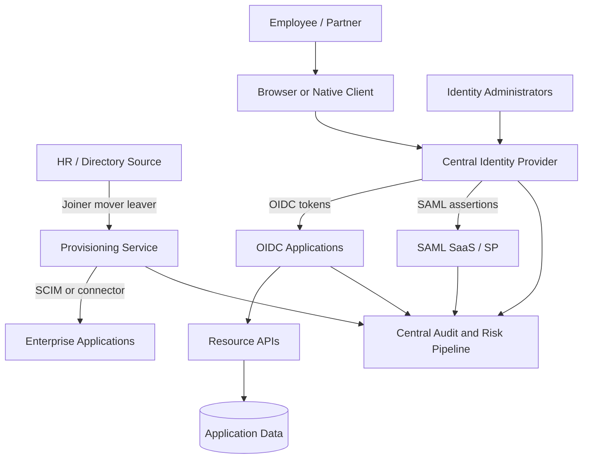
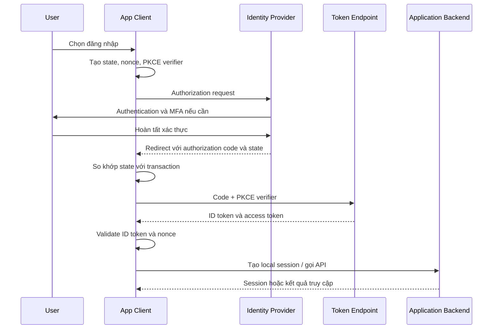

# SSO cho nhiều ứng dụng — Case study thiết kế và triển khai

## Bối cảnh và mục tiêu

Một doanh nghiệp đang vận hành nhiều ứng dụng cho nhân viên và đối tác: cổng nhân sự, quản lý tài chính, CRM, hệ thống hỗ trợ khách hàng, kho tài liệu và một số dịch vụ SaaS. Mỗi ứng dụng hiện có cách đăng nhập riêng. Có ứng dụng dùng mật khẩu nội bộ, ứng dụng tích hợp SAML với một Identity Provider (IdP), ứng dụng khác dùng OpenID Connect (OIDC), còn một số hệ thống cũ giữ session riêng và danh sách tài khoản thủ công.

Người dùng phải nhớ nhiều mật khẩu, bộ phận IT khó thu hồi quyền đồng loạt khi nhân viên nghỉ việc, nhóm bảo mật khó áp dụng MFA thống nhất và log đăng nhập nằm rải rác. Khi một nhân viên chuyển phòng ban, quyền trong một vài ứng dụng được cập nhật chậm. Một số ứng dụng dùng email làm khóa liên kết tài khoản; khi email thay đổi hoặc được tái cấp, nguy cơ liên kết nhầm danh tính xuất hiện.

Doanh nghiệp muốn triển khai **Single Sign-On (SSO)** để người dùng xác thực một lần với hệ thống danh tính trung tâm rồi truy cập nhiều ứng dụng theo quyền được cấp. Mục tiêu gồm giảm mật khẩu riêng lẻ, áp dụng MFA và chính sách truy cập tập trung, chuẩn hóa onboarding/offboarding, tăng khả năng kiểm toán và giảm chi phí vận hành.

SSO không có nghĩa mọi ứng dụng dùng chung một session cookie, mọi ứng dụng tin mọi claim, hoặc một lần đăng nhập có thể cấp quyền vô hạn. Mỗi ứng dụng vẫn phải xác minh assertion/token dành cho chính nó, thiết lập local session theo policy, kiểm tra authorization và có khả năng thu hồi quyền. IdP tập trung authentication và phát hành assertion; ứng dụng chịu trách nhiệm bảo vệ tài nguyên của mình.

Case study này xây dựng một kiến trúc SSO cho nhiều ứng dụng, từ khảo sát hiện trạng đến rollout, vận hành và xử lý sự cố. Các tên tổ chức, ứng dụng, domain và dữ liệu dưới đây là ví dụ giả định để minh họa thiết kế.

Sau bài học, bạn có thể:

- Phân biệt SSO, federation, authentication và authorization.
- Chọn OIDC hoặc SAML theo loại client, khả năng tích hợp và yêu cầu hệ thống.
- Mô hình hóa IdP, relying party, client, resource server và trust boundary.
- Thiết kế OIDC Authorization Code Flow với PKCE và SAML Service Provider integration.
- Ánh xạ identity ổn định, claims, groups, roles, scopes và tenant.
- Quản lý MFA, step-up, session, token, logout và revocation.
- Tổ chức provisioning/deprovisioning qua SCIM hoặc quy trình tương đương.
- Phòng chống account linking sai, confused deputy, replay và cross-application token substitution.
- Lập kế hoạch migration cho ứng dụng legacy và SaaS.
- Xây dựng test matrix, runbook, audit và tiêu chí vận hành SSO.

## 1. Bài toán doanh nghiệp

### Hiện trạng giả định

Công ty Sao Mai có khoảng 4.000 nhân viên, 300 đối tác và sáu ứng dụng chính:

| Ứng dụng | Nhóm người dùng | Hiện trạng | Nhu cầu |
| --- | --- | --- | --- |
| People Portal | Nhân viên | Tài khoản mật khẩu riêng | OIDC, MFA và provisioning tự động |
| Finance Hub | Finance, approver, auditor | SAML với IdP cũ | OIDC mới hoặc SAML federation, step-up |
| CRM | Sales, support | Tài khoản local và email link | SSO, role mapping, tenant boundary |
| Support Desk | Nhân viên và vendor | SaaS hỗ trợ SAML | SAML SSO, SCIM deprovision |
| Document Vault | Nhân viên, đối tác | OIDC cho một số nhóm | OIDC, group/role mapping và audit |
| Legacy ERP | Nhóm vận hành | LDAP/password, session riêng | Federation gateway hoặc adapter có giới hạn |

Một nhân viên có thể dùng nhiều ứng dụng trong cùng ngày. Tài khoản được tạo thủ công ở vài nơi; khi nhân viên rời công ty, IT phải khóa từng ứng dụng. Một số session có thời hạn dài và không có cơ chế revoke tập trung.

### Các vấn đề cần giải quyết

1. Người dùng có nhiều password và MFA experience không nhất quán.
2. Onboarding/offboarding chậm, quyền còn tồn tại sau khi thay đổi công việc.
3. Mỗi ứng dụng tự triển khai login, password reset và session policy.
4. Identity được map bằng email hoặc username không ổn định.
5. Token/claim không có quy ước audience, scope và role thống nhất.
6. Logout khỏi một ứng dụng không kết thúc các session còn lại.
7. Security team không có góc nhìn tập trung về login, MFA và account changes.
8. Ứng dụng legacy không hỗ trợ protocol hiện đại.
9. SaaS provider có khả năng provisioning và logout khác nhau.
10. Một lỗi tại IdP có thể ảnh hưởng tới nhiều ứng dụng cùng lúc.

### Kết quả mong muốn

- Một IdP trung tâm làm nguồn xác thực cho các ứng dụng trong phạm vi.
- OIDC là lựa chọn mặc định cho ứng dụng mới và ứng dụng hỗ trợ tốt.
- SAML được giữ cho SaaS/ứng dụng cần federation theo khả năng nhà cung cấp.
- Mỗi ứng dụng có client registration, audience và redirect/ACS endpoint riêng.
- MFA và assurance policy được quản lý tập trung, có step-up cho hành động nhạy cảm.
- Provisioning/deprovisioning được tự động hóa và có reconciliation.
- Mỗi ứng dụng giữ authorization policy riêng, dựa trên claims đã xác minh và dữ liệu quyền nội bộ.
- Session/token có lifetime, revocation và logout semantics rõ.
- Audit event được chuẩn hóa, không ghi secret.
- Có kế hoạch migration và rollback cho từng ứng dụng.

## 2. SSO, federation và authorization khác nhau thế nào?

**Single Sign-On** cho phép người dùng truy cập nhiều ứng dụng thông qua một lần xác thực với một miền đăng nhập tin cậy, trong phạm vi session và policy cho phép. Người dùng có thể vẫn phải xác thực lại hoặc step-up khi session hết hạn, thiết bị có rủi ro hoặc hành động yêu cầu assurance cao hơn.

**Identity federation** là quan hệ tin cậy giữa một Identity Provider và một relying party/service provider. IdP phát hành assertion hoặc token; ứng dụng xác minh nguồn phát hành và ngữ cảnh trước khi tạo local session.

**Authentication** xác minh danh tính hoặc bằng chứng xác thực. **Authorization** quyết định principal được phép thực hiện action nào trên resource nào. SSO không tự cấp quyền đọc mọi dữ liệu trong mọi ứng dụng.

### Vai trò trong kiến trúc

- **Identity Provider (IdP):** Xác thực người dùng, áp dụng MFA/risk policy và phát assertion/token.
- **Relying Party (RP) / Service Provider (SP):** Ứng dụng tin cậy IdP, xác minh response và thiết lập session.
- **OIDC client:** Ứng dụng khởi tạo authorization request và nhận response theo OIDC.
- **Authorization Server:** Cấp access token theo grant, client, scope và audience.
- **Resource Server:** API nhận access token và thực thi authorization.
- **Directory/HR source:** Nguồn dữ liệu nhân sự, nhóm và trạng thái làm việc.
- **Provisioning service:** Đồng bộ account/group tới ứng dụng, ví dụ qua SCIM.
- **Session service:** Quản lý session trung tâm hoặc hỗ trợ revoke/status.
- **Audit pipeline:** Thu thập sự kiện xác thực, provisioning, authorization và quản trị.

### SSO không đồng nghĩa với một session dùng chung

Mỗi ứng dụng có thể tạo local session riêng sau khi xác minh token/assertion. IdP cũng có session riêng trong domain của mình. Khi người dùng mở ứng dụng thứ hai, browser có thể được redirect tới IdP; IdP nhận ra session còn hợp lệ và trả assertion/token mới mà không yêu cầu nhập password lần nữa.

Điều này tạo trải nghiệm SSO nhưng vẫn giữ ranh giới cookie và session giữa các domain. Không chia sẻ cookie session của IdP cho tất cả ứng dụng.

## 3. Lựa chọn giao thức: OIDC hay SAML?

OIDC và SAML đều hỗ trợ federation, nhưng có mô hình message, token và tích hợp khác nhau. Không chọn chỉ vì một giao thức “mới hơn”; cần xét khả năng của client, IdP, SP, SaaS và yêu cầu vận hành.

| Tiêu chí | OpenID Connect (OIDC) | SAML 2.0 |
| --- | --- | --- |
| Kiểu assertion | ID token JWT và access token theo OAuth profile | XML assertion trong SAML response |
| Client phổ biến | Web app, mobile app, SPA qua kiến trúc phù hợp, API ecosystem | Enterprise SaaS, ứng dụng doanh nghiệp lâu đời |
| Flow thường gặp | Authorization Code Flow, PKCE cho public client | SP-initiated hoặc IdP-initiated SSO |
| Identity data | Claims trong ID token/UserInfo | Attributes trong assertion |
| API authorization | Access token, scope, audience | Thường cần cơ chế/API token riêng |
| Key discovery | OIDC discovery và JWKS theo issuer tin cậy | Metadata, signing certificate và rollover |
| Logout | RP-initiated/front-channel/back-channel tùy hỗ trợ | SAML Single Logout tùy triển khai |
| Vận hành | JSON/JWT, OAuth ecosystem | XML signature, metadata và canonicalization |

### Quyết định cho case study

- People Portal, CRM và Document Vault hỗ trợ OIDC tốt: dùng OIDC Authorization Code Flow.
- Support Desk chỉ cung cấp SAML enterprise integration: dùng SAML 2.0.
- Finance Hub hỗ trợ cả hai: chọn OIDC nếu chức năng, assurance và logout đáp ứng; nếu chưa, giữ SAML trong giai đoạn đầu.
- Legacy ERP không hỗ trợ federation: đặt adapter/gateway trong vùng cô lập, chỉ cho phép một tập chức năng; lập kế hoạch thay thế hoặc nâng cấp.

Không ép tất cả ứng dụng vào một protocol nếu nhà cung cấp không hỗ trợ đúng profile. Tuy nhiên, identity mapping, provisioning, MFA policy, audit schema và governance nên được chuẩn hóa dù giao thức khác nhau.

### Tránh trộn token giữa protocol

ID token dành cho OIDC client; access token dành cho resource server/audience được cấp. SAML assertion dành cho SP/audience và recipient đã định. Không dùng SAML assertion như bearer token tùy ý cho API; không dùng ID token làm access token chỉ vì cả hai là JWT hoặc đều chứa subject.

## 4. Kiến trúc mục tiêu

Kiến trúc đề xuất đặt IdP làm điểm xác thực trung tâm, còn từng ứng dụng giữ quyền quyết định trên tài nguyên của nó.



### Thành phần và trách nhiệm

| Thành phần | Trách nhiệm chính | Kiểm soát quan trọng |
| --- | --- | --- |
| IdP | Primary authentication, MFA, federation | Phishing-resistant MFA, risk policy, issuer/key governance |
| OIDC client | Khởi tạo login, kiểm tra state/nonce, xử lý callback | PKCE, exact redirect URI, secure token handling |
| SAML SP | Tạo AuthnRequest, xác minh Response/Assertion | Signature, issuer, audience, recipient, replay defense |
| API/resource server | Kiểm tra access token và authorization | Issuer, audience, scope, tenant, resource policy |
| Directory | Lưu subject, employment status, groups | Unique immutable ID, lifecycle source |
| Provisioning | Tạo, cập nhật, disable account | SCIM auth, reconciliation, deprovision SLA |
| Session store | Quản lý local session và revoke | Rotation, TTL, revocation propagation |
| Audit pipeline | Correlation và evidence | Redaction, access control, retention |

### Ranh giới tin cậy

- User/browser tới IdP: client không được tự khai identity hoặc assurance.
- IdP tới OIDC client: token phải đúng issuer, audience, nonce và transaction.
- IdP tới SAML SP: response phải đúng issuer, audience, recipient và request context.
- Client tới API: access token phải đúng audience/scope; API vẫn kiểm tra resource.
- HR/directory tới provisioning: chỉ nguồn được ủy quyền mới được thay đổi employment/group state.
- Provisioning tới SaaS: credential tích hợp có scope hẹp và được rotate.
- Admin tới IdP: thao tác quản trị cần phishing-resistant MFA, JIT privilege và audit.

Không coi private network, DNS name hoặc TLS đơn lẻ là bằng chứng authorization. Mỗi boundary cần xác minh peer, message, context và quyền.

## 5. Identity model: định danh ổn định giữa nhiều ứng dụng

Một trong những quyết định quan trọng nhất là cách nhận diện cùng một người qua nhiều ứng dụng. Nếu dùng email làm primary key, đổi email có thể tạo account mới hoặc liên kết nhầm.

### Khóa định danh federation

Với OIDC, cặp issuer và subject (iss + sub) là định danh của subject trong phạm vi issuer. Subject thường là opaque identifier và không nên được suy ra từ email. Một IdP có thể dùng pairwise subject để các client khác nhau không dễ dàng đối chiếu cùng một người.

Với SAML, dùng persistent NameID hoặc attribute định danh ổn định theo hợp đồng federation. Không mặc định email address là unique, immutable hoặc luôn được xác minh.

### Internal principal ID

Ứng dụng nên ánh xạ federation identity vào một internal principal ID ổn định:

| Trường | Vai trò |
| --- | --- |
| internal_subject_id | ID nội bộ ổn định của principal |
| issuer | IdP phát hành identity |
| external_subject | sub hoặc NameID theo protocol |
| identity_type | employee, contractor, partner, service |
| status | active, suspended, terminated |
| tenant/org | Tổ chức hoặc miền dữ liệu |
| linked_at | Thời điểm liên kết |
| last_verified_at | Lần xác minh gần nhất |

Mapping có unique constraint trên issuer + external_subject trong phạm vi identity contract. Nếu IdP thay đổi subject format hoặc issuer, cần migration plan có kiểm chứng; không tự động nối tài khoản chỉ vì email giống nhau.

### Account linking

Nếu một người đã có local account và lần đầu đăng nhập qua IdP, account linking phải chứng minh quyền sở hữu cả hai identity theo policy. Ví dụ, yêu cầu người dùng đăng nhập vào account hiện tại, sau đó xác thực IdP mới và xác nhận liên kết. Với account nhạy cảm, cần step-up hoặc admin approval.

Không link account chỉ dựa trên email claim, kể cả khi claim có email_verified, nếu ứng dụng chưa định nghĩa rõ semantics, issuer trust và collision handling. Khi unlink, không để người dùng mất phương thức truy cập cuối cùng hoặc mở đường chiếm account.

### Employee, partner và service identity

Tách loại principal để policy rõ:

- Employee: nguồn lifecycle là HR directory.
- Contractor: có sponsor, ngày hết hạn và phạm vi truy cập.
- Partner: có organization/tenant và hợp đồng.
- Service/workload: dùng workload identity, certificate hoặc client credentials phù hợp; không giả làm user.
- Break-glass admin: identity riêng, được quản lý và giám sát đặc biệt.

Không đưa service principal vào cùng policy MFA tương tác của con người. Service cần credential ngắn hạn, audience/scope tối thiểu và rotation.

## 6. OIDC flow cho ứng dụng web và native

Ứng dụng mới nên dùng Authorization Code Flow. Public client như mobile app cần PKCE; confidential web client giữ client credential phía server và vẫn có thể dùng PKCE để tăng bảo vệ.

### Luồng tổng quát



### Các kiểm soát bắt buộc

1. Dùng issuer được cấu hình và tin cậy; không lấy issuer tùy ý từ request.
2. Redirect URI đăng ký chính xác; tránh wildcard hoặc open redirect.
3. Tạo state ngẫu nhiên, gắn với browser/app transaction và consume một lần.
4. Với OIDC, tạo nonce và so khớp claim trong ID token.
5. Public client dùng PKCE với verifier ngẫu nhiên; challenge dùng S256.
6. Authorization code chỉ đổi một lần, đúng client, redirect URI và PKCE context.
7. Xác minh chữ ký ID token bằng key thuộc issuer đã tin cậy.
8. Kiểm tra iss, aud, exp, iat và nonce; xử lý azp/multiple audience theo profile.
9. Không nhầm ID token với access token.
10. Token được lưu và truyền theo platform security guidance.
11. Callback lỗi hoặc transaction hết hạn phải kết thúc; không tái sử dụng state/nonce.
12. Có chống authorization server mix-up và kiểm tra issuer trong response khi profile hỗ trợ.

### Native app

Native app nên dùng system browser hoặc authentication session do hệ điều hành cung cấp, không thu thập password trong embedded webview. Dùng Authorization Code + PKCE, redirect URI/app link đã đăng ký và state/nonce. Refresh token được giữ trong Keychain/Keystore-backed storage; access token giữ trong memory nếu kiến trúc cho phép.

### SPA

SPA là public client và không thể giữ client secret. Cân nhắc Backend-for-Frontend (BFF) với server-side token handling và cookie HttpOnly, Secure, SameSite. Nếu SPA gọi token trực tiếp, cần thư viện OIDC được duy trì, PKCE, token storage phù hợp và phòng chống XSS/CSRF. Không coi localStorage là kho an toàn cho refresh token dài hạn.

## 7. SAML flow cho SaaS và ứng dụng doanh nghiệp

SAML vẫn phổ biến ở SaaS và ứng dụng enterprise. Trong case study, Support Desk dùng SAML để nhận identity từ IdP trung tâm.

### SP-initiated flow

1. Người dùng truy cập Support Desk.
2. SP tạo AuthnRequest và lưu request context.
3. Browser được redirect tới IdP.
4. IdP xác thực người dùng và áp dụng MFA policy.
5. IdP gửi SAML Response tới Assertion Consumer Service (ACS).
6. SP xác minh chữ ký, issuer, audience, recipient, destination, InResponseTo và thời hạn.
7. SP consume assertion/response ID để chống replay.
8. SP map NameID/attributes tới internal account.
9. SP tạo local session và áp dụng authorization riêng.

### Kiểm tra assertion

- Chỉ tin metadata/trust anchor được cấu hình.
- Xác minh chữ ký đúng node và đúng reference.
- Kiểm tra issuer, audience restriction, recipient, destination và ACS.
- Kiểm tra InResponseTo với request đang chờ trong SP-initiated flow.
- Kiểm tra NotBefore/NotOnOrAfter với clock skew giới hạn.
- Chống replay bằng assertion ID/response ID và state store dùng chung.
- Parse XML an toàn; dùng thư viện SAML được duy trì.
- Không tắt signature validation để xử lý lỗi tương thích.
- Metadata/certificate rollover cần quy trình có overlap và audit.

### IdP-initiated SSO

IdP-initiated flow có thể thuận tiện nhưng thiếu một số binding với request do SP tạo. Nếu sử dụng, cần đánh giá unsolicited response, replay, RelayState, audience và account mapping chặt chẽ. Ưu tiên SP-initiated nếu ứng dụng và nghiệp vụ cho phép.

### Không dùng SAML assertion như session chung

Assertion là bằng chứng federation dành cho SP/audience cụ thể. SP phải tạo local session riêng và không forward assertion sang API hoặc ứng dụng khác trừ khi có protocol/token exchange được thiết kế rõ.

## 8. Claims, groups, roles và scopes

IdP có thể phát claims về subject, email, tên, nhóm, tổ chức và assurance. Chỉ gửi claims cần thiết; dữ liệu dư thừa tăng privacy risk và coupling giữa ứng dụng với directory schema.

### Claims tối thiểu

Ví dụ claims có thể cần:

- sub: subject identifier theo issuer.
- iss: issuer.
- aud: client hoặc resource audience.
- email/email_verified: chỉ khi ứng dụng cần và trust semantics rõ.
- name/display_name: hiển thị, không dùng làm authorization key.
- groups hoặc entitlement reference: nếu có contract rõ.
- auth_time/amr/acr: thông tin authentication context theo profile.
- tenant/org reference: khi được issuer quản lý và ứng dụng xác minh.

Không phát toàn bộ HR attributes cho mọi ứng dụng. Không dùng email hoặc display name làm authorization subject.

### Group mapping

Group ở IdP có thể được map sang application role, nhưng cần:

- Namespace và owner rõ.
- Allowlist group được ứng dụng chấp nhận.
- Quy tắc xử lý group bị xóa hoặc đổi tên.
- Không dùng prefix matching tùy tiện.
- Kiểm tra group claim size và giới hạn token.
- Có reconciliation khi token/session cũ còn chứa group trước khi thu hồi.

### Role và scope

Role mô tả vai trò nghiệp vụ trong một ứng dụng; scope mô tả phạm vi quyền client/token theo contract API. Một token có scope đọc không tự cấp role quản trị. Ứng dụng cần kết hợp principal, role, scope, resource, tenant và policy.

Ví dụ:

| Ứng dụng | Group/entitlement từ IdP | Role nội bộ |
| --- | --- | --- |
| People Portal | employees | employee |
| Finance Hub | finance-approver | payment_approver |
| CRM | sales-emea | sales_agent |
| Support Desk | support-tier-2 | support_agent |
| Document Vault | legal-readers | document_reader |

Không cấp role từ một claim do browser tự gửi. Backend chỉ dùng claims sau khi token/assertion đã được xác minh và mapping policy được áp dụng.

### Audience isolation

Mỗi ứng dụng/API cần audience phù hợp. Không cấp một bearer token có audience quá rộng để tất cả ứng dụng dùng chung. Nếu một ứng dụng cần gọi API khác, dùng token exchange hoặc client credential có scope hẹp theo trust contract.

## 9. MFA và assurance tập trung

IdP là nơi phù hợp để áp dụng chính sách MFA nhất quán, nhưng policy cần dựa vào rủi ro và khả năng của ứng dụng.

### Chính sách theo nhóm

- Nhân viên thông thường: MFA theo baseline; ưu tiên passkey hoặc security key.
- Administrator: phishing-resistant MFA, step-up và reauthentication cho hành động đặc quyền.
- Finance approver: step-up gắn với giao dịch hoặc action nhạy cảm.
- Contractor/partner: policy theo hợp đồng, tenant và thiết bị.
- Service/workload: workload identity, mTLS hoặc credential machine-to-machine; không dùng MFA tương tác giả tạo.
- Break-glass: credential riêng, kiểm soát JIT, alert và hậu kiểm.

### Authentication context

OIDC có thể truyền authentication context qua claims/profile được hỗ trợ, ví dụ acr, amr và auth_time. Ứng dụng cần hiểu semantics từ IdP contract; không tự suy diễn mức assurance chỉ từ một chuỗi tùy ý.

Một ứng dụng có thể yêu cầu max_age hoặc acr_values theo profile khi cần xác thực gần đây hoặc assurance cụ thể. IdP cần áp dụng policy và trả kết quả có thể xác minh. Backend vẫn phải kiểm tra context cho action nhạy cảm.

### Step-up

Ví dụ Finance Hub yêu cầu phê duyệt payout. Người dùng đã SSO từ một giờ trước, nhưng action có rủi ro cao. Ứng dụng yêu cầu step-up qua IdP với phishing-resistant factor, ràng buộc request vào action/transaction và kiểm tra freshness. Một lần step-up không được tái sử dụng để phê duyệt transaction khác nếu policy yêu cầu transaction binding.

### Fallback

Nếu passkey/MFA provider không khả dụng, fallback phải được định nghĩa trước: authenticator thay thế, recovery hoặc tạm dừng action. Không tự động hạ xuống password-only cho admin vì provider outage. Có thể cho phép đọc dữ liệu ít rủi ro nhưng chặn approve, export hoặc thay đổi credential.

## 10. Session và token trong kiến trúc SSO

SSO tạo ít nhất hai lớp session: session tại IdP và local session tại từng ứng dụng. Một ứng dụng có thể còn access token/refresh token cho API. Cần lập inventory từng loại.

| Thành phần | Owner | Mục đích | Kiểm soát |
| --- | --- | --- | --- |
| IdP browser session | IdP | Nhận biết user đã xác thực | Idle/absolute timeout, MFA freshness, revoke |
| App local session | Ứng dụng | Duy trì đăng nhập tại app | Cookie flags, rotation, idle/absolute expiry |
| Access token | Authorization server | Gọi API audience cụ thể | Short lifetime, scope, audience, validation |
| Refresh token | Authorization server | Xin access token mới | Rotation, reuse detection, secure storage |
| SAML assertion | IdP | Thiết lập SP session | Short validity, audience, recipient, replay cache |
| Device key | OS/keystore | Proof-of-possession hoặc device authentication | Non-exportable, access control, revoke |

### Session lifetime

Không nhất thiết mọi ứng dụng có cùng timeout. Finance Hub có thể có idle timeout ngắn và step-up cho approve; Document Vault có thể cho session dài hơn nhưng giới hạn download/export. IdP session không nên kéo dài vô hạn chỉ vì một app phát request nền.

### Logout semantics

Phải mô tả riêng:

- **Local logout:** kết thúc session của một ứng dụng.
- **IdP logout:** kết thúc session tại identity provider.
- **RP-initiated logout:** ứng dụng yêu cầu IdP logout theo OIDC profile.
- **Front-channel/back-channel logout:** thông báo logout tới relying parties nếu được hỗ trợ.
- **SAML Single Logout:** trao đổi logout message theo cấu hình federation.
- **Global session revoke:** thu hồi nhiều session/token theo account hoặc risk incident.

Xóa cookie trên browser không thu hồi cookie attacker đã sao chép. Thu hồi session phải được thực hiện server-side và propagation tới mọi node/region.

### Access token tự chứa

JWT access token đã phát hành có thể còn được chấp nhận đến exp nếu resource server chỉ xác minh chữ ký và claims cục bộ. Revoke refresh token ngăn cấp token mới nhưng không nhất thiết vô hiệu JWT đang còn hạn. Dùng access token lifetime ngắn, introspection/status check, denylist hoặc session epoch cho action nhạy cảm tùy yêu cầu consistency và availability.

## 11. Provisioning và deprovisioning nhiều ứng dụng

SSO giải quyết authentication; provisioning giải quyết account tồn tại và quyền được cấp ở từng ứng dụng. Nếu chỉ có SSO mà không có lifecycle sync, nhân viên nghỉ việc vẫn có thể còn local account, API key hoặc quyền dữ liệu.

### Source of truth

Trong case study, HR directory là nguồn trạng thái employment và organization. Identity platform đồng bộ thay đổi tới IdP; provisioning service gửi account/group tới SaaS qua SCIM hoặc connector. Mỗi ứng dụng có thể có thuộc tính nghiệp vụ riêng, nhưng không được tự sửa source-of-truth employment state.

### Joiner, mover, leaver

- **Joiner:** Tạo principal, xác minh thuộc tính, cấp group theo role, provision ứng dụng cần thiết.
- **Mover:** Khi chuyển phòng ban, tính lại group/entitlement; thu hồi quyền cũ và cấp quyền mới theo approval.
- **Leaver:** Disable identity, revoke IdP session, refresh-token family, app session, API key và certificate liên quan; deprovision account ở ứng dụng.

### SCIM và connector

SCIM có thể hỗ trợ tạo, cập nhật và deactivate user/group. Không phải provider nào cũng hỗ trợ đầy đủ hoặc có cùng semantics. Cần kiểm tra:

- Authentication của provisioning connector.
- Scope/permission tối thiểu.
- Idempotency và retry.
- Mapping immutable ID.
- Deactivation semantics.
- Group membership propagation.
- Rate limit và pagination.
- Reconciliation và drift detection.
- Audit cho create/update/disable/delete.
- Behavior khi provider outage.

### Deprovisioning SLA

Đặt thời gian tối đa từ HR termination event tới disable login và revoke access ở từng app. Đo propagation, alert khi quá hạn và có quy trình thủ công có audit nếu connector lỗi. Với tài khoản đặc quyền hoặc sự cố, có thể cần emergency revoke đồng thời với pipeline thông thường.

### Không chỉ disable login

Khi leaver, kiểm tra API keys, personal access tokens, OAuth grants, app passwords, device certificates, scheduled jobs, delegated access, shared mailbox và service ownership. Một user bị disable ở IdP nhưng API key còn hoạt động vẫn có thể tạo đường truy cập.

## 12. Account linking và chuyển đổi tài khoản hiện có

Khi bật SSO, người dùng đã có account local. Việc ghép account cũ với identity federation phải tránh collision và account takeover.

### Quy trình linking an toàn

1. Người dùng đăng nhập account local hiện tại bằng phương thức đang được tin cậy.
2. Yêu cầu reauthentication/step-up nếu account nhạy cảm.
3. Người dùng bắt đầu link IdP.
4. Client thực hiện federation flow mới với state/nonce.
5. Backend xác minh issuer, subject và transaction.
6. Kiểm tra identity mới chưa được link tới account khác.
7. Xác nhận người dùng có quyền sở hữu account local và identity federated.
8. Ghi link với audit, thời gian và actor.
9. Thông báo tới channel đã xác minh.
10. Có quy trình unlink/rollback được kiểm soát.

### Xử lý email trùng

Email có thể thay đổi, alias, shared mailbox hoặc được tái cấp. Không tự động link theo email nếu chưa có identity proof và collision policy. Nếu directory cung cấp employee ID, subject ID hoặc immutable identifier, dùng mapping có kiểm soát và không công khai định danh nội bộ không cần thiết.

### Migration theo cohort

Bắt đầu với nhóm pilot đã được xác minh, giữ fallback local login có thời hạn và policy rõ. Khi cohort đã ổn định, mở rộng từng ứng dụng/nhóm. Tránh bật SSO bắt buộc cho toàn bộ người dùng trước khi test recovery, break-glass và support readiness.

## 13. Tích hợp ứng dụng legacy

Legacy ERP trong case study không hỗ trợ OIDC/SAML. Có ba hướng thường gặp:

1. Nâng cấp ứng dụng để hỗ trợ protocol hiện đại.
2. Đặt federation gateway/reverse proxy có kiểm soát trước ứng dụng.
3. Giữ authentication riêng trong giai đoạn giới hạn và quản lý exception có expiry.

### Federation gateway

Gateway có thể xác minh SAML/OIDC và tạo header/assertion nội bộ cho legacy app. Đây là một trust boundary nhạy cảm:

- Gateway phải xóa header identity do client gửi trước khi tạo header tin cậy.
- Backend chỉ nhận traffic từ gateway qua kênh đã xác thực.
- Network ACL không thay thế mutual authentication.
- Header cần integrity protection hoặc channel binding phù hợp.
- Gateway phải map subject/role theo allowlist.
- Không truyền access token nguyên vẹn nếu backend không phải audience.
- Session của legacy app phải có timeout và revoke path.
- Audit phải giữ caller gốc và gateway identity.
- Có kế hoạch loại bỏ adapter khi ứng dụng được nâng cấp.

### Rủi ro confused deputy

Nếu gateway có service credential rộng, nó có thể thực hiện action vượt quyền người dùng. Backend cần biết subject, actor và delegation context; gateway phải kiểm tra quyền caller trước khi dùng quyền service. Không chỉ tin rằng request đến từ gateway là được phép.

### Exception có kiểm soát

Nếu legacy app chưa thể hỗ trợ MFA hoặc token validation, exception phải có owner, scope, risk assessment, compensating control, expiry và remediation plan. Không miễn MFA cho toàn bộ người dùng chỉ vì một ứng dụng cũ.

## 14. Multi-tenant và đối tác

Nhiều ứng dụng phục vụ nhiều tổ chức có thể dùng một IdP chung hoặc federation với IdP riêng của từng tenant. Cần tách identity namespace, tenant context và authorization.

### Tenant discovery

Có thể dùng domain hint hoặc organization selection để định tuyến tới IdP, nhưng domain/email không phải bằng chứng cuối cùng về tenant membership. Backend phải xác minh issuer/tenant mapping và membership.

### Tenant isolation

- Issuer và external subject được map trong namespace đúng.
- Token audience chỉ tới ứng dụng/API cần thiết.
- Tenant claim được phát từ nguồn tin cậy và kiểm tra với resource.
- Group/role mapping không được dùng chung ngoài phạm vi.
- Account linking giữa tenant cần policy riêng.
- Admin của tenant A không được quản lý tenant B.
- Log/audit tách tenant và có quyền truy cập phù hợp.

### Partner federation

Đối tác có thể dùng IdP riêng. Thiết lập trust cần metadata/issuer allowlist, certificate/key rotation, attribute contract, MFA assurance expectation, deprovision contact và incident process. Không tin bất kỳ IdP nào chỉ vì nó trả một assertion có chữ ký hợp lệ; chữ ký phải dẫn tới trust anchor được cấu hình và audience đúng.

## 15. Resilience và vận hành IdP

IdP là dependency trọng yếu. Một outage có thể chặn login mới trên nhiều ứng dụng, nhưng local session đang hoạt động có thể tiếp tục theo policy. Cần thiết kế rõ hành vi khi IdP không khả dụng.

### Availability và failure mode

- Multi-zone/region theo kiến trúc provider.
- DNS/TLS/certificate renewal và JWKS/metadata caching.
- Database/session store resilience.
- Backup/restore và disaster recovery.
- Rate limit và protection trước login flood.
- MFA/email/SMS/push provider dependency.
- Clock synchronization.
- Key rotation và rollback.
- Runbook khi IdP hoặc federation provider outage.

### Cached keys và metadata

Resource server có thể cache JWKS/metadata theo policy để xác minh token khi endpoint tạm thời lỗi. Cần hỗ trợ key rollover an toàn, giới hạn stale cache và không chấp nhận key tùy ý. Nếu gặp unknown kid, refresh metadata có rate limit; không tải JWKS URL do token cung cấp.

### Fail-open hay fail-closed?

Không có câu trả lời chung cho mọi action:

- Với action đọc ít rủi ro trong một session đã xác minh, có thể tiếp tục trong cửa sổ policy nếu local session còn hợp lệ.
- Với approve payout, thay recovery method hoặc admin operation, nên fail closed hoặc yêu cầu step-up.
- Với deprovision event, nếu IdP outage, phải có emergency disable path hoặc hạn chế truy cập.
- Không tạo session mới bằng assertion/token chưa xác minh chỉ để giữ UX.

Ghi rõ degraded mode, action được phép, thời hạn và người phê duyệt.

### SLO

Theo dõi IdP availability, authorization endpoint latency, token endpoint errors, federation callback success, MFA provider latency, session revoke propagation và provisioning lag. SLO phải phân biệt lỗi người dùng với lỗi dịch vụ.

## 16. Bảo mật cấu hình và quản trị IdP

IdP trở thành một control plane quan trọng. Một admin bị compromise có thể thay redirect URI, signing key, MFA policy, group mapping hoặc federation trust cho nhiều ứng dụng.

### Quản trị an toàn

- Admin dùng phishing-resistant MFA và privileged workstation phù hợp.
- JIT elevation và approval cho thay đổi nhạy cảm.
- Tách vai trò tenant admin, app admin, identity admin và security admin.
- Không dùng shared admin account.
- Audit mọi thay đổi client registration, redirect URI, issuer, signing key, claim mapping và policy.
- Review định kỳ client/secret/certificate không còn sử dụng.
- Rotate client secret và provisioning credential.
- Bảo vệ signing key trong HSM/KMS hoặc dịch vụ phù hợp.
- Có quy trình key rollover, emergency revoke và metadata publication.
- Test restore và break-glass admin access.

### Client registration

Mỗi ứng dụng cần client ID riêng, redirect URI/ACS endpoint cụ thể, allowed grant/response type, audience, scope, logout URI và owner. Không dùng một confidential client chung cho nhiều ứng dụng nếu điều đó làm mất khả năng giới hạn quyền hoặc điều tra.

### Secret management

Client secret chỉ dùng cho confidential client phía server. Không nhúng secret vào mobile app, SPA hoặc desktop binary. Dùng secret manager, rotation và least privilege. Public client dùng PKCE thay vì giả vờ có thể giữ client secret.

## 17. Java: mô hình hóa OIDC client registration và identity mapping

Ví dụ minh họa một allowlist client và cách map external identity vào principal nội bộ. Đây không phải thư viện OIDC hoàn chỉnh; xác minh chữ ký, discovery, token parsing và protocol validation phải dùng implementation đã được kiểm chứng.

```java
import java.util.Map;
import java.util.Objects;
import java.util.Optional;

record OidcClientPolicy(
        String clientId,
        String issuer,
        String redirectUri,
        String expectedAudience,
        boolean publicClient,
        boolean pkceRequired
) {}

record FederationIdentity(
        String issuer,
        String subject,
        String email,
        boolean emailVerified
) {}

record InternalPrincipal(
        String principalId,
        String identityKey,
        String accountStatus
) {}

interface PrincipalRepository {
    Optional<InternalPrincipal> findByIdentityKey(String identityKey);
}

final class FederationIdentityMapper {
    private final PrincipalRepository principals;

    FederationIdentityMapper(PrincipalRepository principals) {
        this.principals = Objects.requireNonNull(principals);
    }

    Optional<InternalPrincipal> map(FederationIdentity identity) {
        if (identity == null
                || blank(identity.issuer())
                || blank(identity.subject())) {
            return Optional.empty();
        }

        // Identity key must use a canonical, configured issuer and immutable subject.
        String identityKey = identity.issuer() + "|" + identity.subject();

        return principals.findByIdentityKey(identityKey)
                .filter(principal -> "ACTIVE".equals(principal.accountStatus()));
    }

    private static boolean blank(String value) {
        return value == null || value.isBlank();
    }
}

final class OidcClientRegistry {
    private final Map<String, OidcClientPolicy> clients;

    OidcClientRegistry(Map<String, OidcClientPolicy> clients) {
        this.clients = Map.copyOf(clients);
    }

    OidcClientPolicy requireClient(String clientId) {
        OidcClientPolicy policy = clients.get(clientId);
        if (policy == null) {
            throw new IllegalArgumentException("Unknown OIDC client");
        }
        return policy;
    }

    void validateRedirect(String clientId, String redirectUri) {
        OidcClientPolicy policy = requireClient(clientId);
        if (!policy.redirectUri().equals(redirectUri)) {
            throw new SecurityException("Redirect URI mismatch");
        }
        if (policy.publicClient() && !policy.pkceRequired()) {
            throw new SecurityException("Public client requires PKCE");
        }
    }
}
```

Trong production, issuer phải được canonicalize theo metadata đã tin cậy và không lấy từ payload chưa xác minh. Identity key nên có unique constraint trong database; xử lý issuer migration cần quy trình linking có approval/evidence. Không dùng email để tự động thay subject. OIDC validation cần kiểm tra signature, iss, aud, exp, nonce, azp khi cần, token type và transaction context trước khi gọi mapper.

### Cấu hình client minh họa

```yaml
clients:
  - client_id: people-portal
    protocol: oidc
    issuer: https://id.example.test
    redirect_uris:
      - https://people.example.test/oidc/callback
    post_logout_redirect_uris:
      - https://people.example.test/signed-out
    audiences:
      - people-api
    scopes:
      - openid
      - profile
      - email
      - people:read
    client_type: confidential_web
    pkce: required
    owner: people-platform

  - client_id: support-desk
    protocol: saml
    entity_id: https://support.example.test/saml/metadata
    acs_urls:
      - https://support.example.test/saml/acs
    name_id_format: persistent
    audience: https://support.example.test
    signing_certificate_ref: secret://sso/support-signing-cert
    owner: enterprise-apps
```

Cấu hình minh họa không chứa secret thật. Trong triển khai, client registration cần schema validation, owner, environment, key reference, change approval, redirect/ACS exact match và audit. OIDC scope openid/profile/email yêu cầu authentication/claims; scope nghiệp vụ phải theo contract API riêng.

## 18. Kế hoạch triển khai theo giai đoạn

Không bật SSO bắt buộc cho toàn doanh nghiệp trong một lần. Rollout theo cohort giúp phát hiện lỗi identity mapping, provisioning, MFA và recovery trước khi mở rộng.

### Giai đoạn 0 — Discovery

- Inventory ứng dụng, owner, user population và authentication method.
- Xác định OIDC/SAML/LDAP/local login capability.
- Lập danh sách service account, API key và integration.
- Xác định data sensitivity, admin role và compliance obligations.
- Đánh giá session/logout/revocation behavior.
- Xác định nguồn identity và group/role mapping.
- Lập dependency và outage impact.

Deliverable: application inventory, trust map, protocol matrix, risk register và migration owner.

### Giai đoạn 1 — Foundation

- Cấu hình IdP, domain, signing key và admin roles.
- Bật phishing-resistant MFA cho admin.
- Định nghĩa immutable identity mapping.
- Chuẩn hóa client registration, audience, scope và claims.
- Thiết lập audit, monitoring, SLO và break-glass.
- Xây dựng provisioning/deprovisioning pipeline.
- Test backup, restore, key rollover và incident response.

Deliverable: IdP baseline, federation standard, identity schema và operational runbooks.

### Giai đoạn 2 — Pilot

Chọn một nhóm nhỏ và một ứng dụng có hỗ trợ OIDC tốt. Kiểm tra:

- Login, logout và session timeout.
- MFA enrollment và recovery.
- Account linking và duplicate identity.
- Role/group provisioning.
- Token validation và API audience.
- Device/browser compatibility.
- Support workflow và audit.
- Rollback sang local login nếu cần theo thời hạn đã định.

Không đưa tài khoản admin toàn tổ chức vào pilot nếu chưa có break-glass và recovery được kiểm chứng.

### Giai đoạn 3 — Expand

Mở rộng theo cohort và ứng dụng:

1. People Portal.
2. Document Vault.
3. CRM.
4. Finance Hub.
5. Support Desk qua SAML.
6. Legacy ERP qua adapter hoặc migration plan.

Mỗi lần mở rộng phải có owner, test evidence, rollback criteria và support readiness. Theo dõi login success, MFA completion, provisioning lag và ticket volume.

### Giai đoạn 4 — Enforce and retire legacy

- Bắt buộc SSO theo cohort sau khi migration ổn định.
- Tắt local password login khi đã xác minh không còn dependency.
- Revoke password/app credentials cũ.
- Thu hồi client registration không dùng.
- Xóa group mapping cũ.
- Reconcile account và quyền.
- Kiểm tra leaver workflow và global revoke.
- Đóng exception có thời hạn và xác minh baseline.

Không xóa local account hoặc dữ liệu trước khi hoàn tất mapping và retention requirements.

## 19. Rollback và business continuity

SSO là dependency trung tâm nên rollback cần được thiết kế trước khi rollout.

### Khi cần rollback

- IdP outage vượt SLO.
- Redirect/callback hoặc token validation có lỗi diện rộng.
- Identity mapping sai gây nhầm account.
- MFA provider outage làm người dùng không thể hoàn tất flow.
- Provisioning sai làm disable nhầm nhiều tài khoản.
- Logout/revocation propagation không đạt SLA.
- Một client registration bị compromise.

### Rollback an toàn

- Tắt rollout cho cohort bị ảnh hưởng.
- Giữ local login fallback chỉ khi đã được kiểm soát và có expiry.
- Không bật lại password flow yếu cho admin một cách tự động.
- Revoke token/session phát hành sai.
- Khôi phục client registration/config đã biết tốt.
- Reconcile account/group và audit thay đổi.
- Thông báo người dùng qua kênh chính thức.
- Mở incident nếu có khả năng unauthorized access.

Rollback không được khôi phục credential đã bị revoke hoặc mở lại một đường bypass không có owner.

## 20. Vận hành, monitoring và audit

### Metric vận hành

| Metric | Ý nghĩa |
| --- | --- |
| sso_login_started_total | Số login transaction bắt đầu |
| sso_login_completed_total | Số transaction kết thúc theo outcome |
| sso_federation_latency_seconds | Thời gian federation round-trip |
| sso_oidc_callback_failures_total | OIDC callback lỗi theo reason category |
| sso_saml_validation_failures_total | SAML response/assertion validation failure |
| sso_mfa_challenges_total | MFA challenge theo outcome |
| sso_session_revoke_propagation_seconds | Thời gian revoke lan tới verifier |
| sso_provisioning_lag_seconds | Độ trễ đồng bộ account/group |
| sso_deprovision_failures_total | Deprovision connector thất bại |
| sso_identity_link_conflicts_total | Collision khi link identity |
| sso_token_audience_denials_total | Token bị từ chối vì audience |
| sso_unknown_client_requests_total | Request tới client registration không biết |

Label nên hữu hạn: protocol, app_class, client_type, result và environment. Không đưa username, email, session ID, token, raw IP hoặc tenant ID tùy ý vào metric label.

### Audit event

Ghi các sự kiện:

- Authentication started/succeeded/failed.
- MFA challenge issued/approved/denied.
- Federation assertion/token accepted/rejected.
- Client registration hoặc redirect URI changed.
- Group/role mapping changed.
- User provisioned/deactivated.
- Session created/revoked.
- Refresh token reuse detected.
- Account linked/unlinked.
- Recovery started/completed.
- Admin role/policy/key changed.
- Break-glass access used.

Mỗi event nên có actor, subject, client/app, action, target, outcome, reason category, timestamp, correlation reference và policy version. Không ghi raw password, OTP, assertion, authorization code, token hoặc private key.

### Dashboard và alert

- Login success/failure theo protocol và ứng dụng.
- MFA challenge completion và provider latency.
- Callback validation errors.
- Provisioning/deprovisioning lag.
- Session revoke propagation.
- Unknown client/redirect URI.
- Identity linking conflict.
- Admin/config change.
- Refresh-token reuse và session anomaly.
- IdP dependency availability.

Alert cần có owner, runbook, threshold/baseline và cách phân biệt user error với provider outage hoặc attack.

## 21. Test strategy cho SSO đa ứng dụng

Test cần kiểm tra protocol conformance, authorization, lifecycle, resilience và các nhánh vận hành. Không chỉ kiểm tra người dùng có đăng nhập được hay không.

| Nhóm test | Trường hợp | Kết quả mong đợi |
| --- | --- | --- |
| OIDC state | Callback có state sai hoặc thiếu | Từ chối |
| OIDC nonce | ID token nonce không khớp | Từ chối |
| PKCE | Verifier sai hoặc thiếu ở public client | Token exchange thất bại |
| Redirect URI | URI không nằm trong allowlist | Từ chối |
| Issuer | Token từ issuer không tin cậy | Từ chối |
| Audience | Token dành cho API khác | Resource server từ chối |
| ID/access token | Dùng ID token gọi API | Từ chối theo token profile |
| JWKS rotation | Key mới được publish đúng quy trình | Token hợp lệ được xác minh, key lạ bị từ chối |
| SAML signature | Assertion/response không có chữ ký hợp lệ | Từ chối |
| SAML audience | Audience/recipient sai | Từ chối |
| SAML replay | Assertion ID được dùng lại | Từ chối |
| Identity mapping | Issuer + subject đã link | Map đúng principal |
| Email collision | Hai identity có email giống nhau | Không auto-link |
| Group mapping | Group ngoài allowlist | Không cấp role |
| MFA | Admin login không đạt phishing-resistant factor | Không cấp session admin |
| Step-up | Action nhạy cảm với auth_time quá cũ | Yêu cầu xác thực lại |
| Session | Pre-auth session ID được gửi sau login | Session ID cũ không còn hiệu lực |
| Local logout | Logout một ứng dụng | Local session bị revoke |
| Global logout | IdP/global revoke | Các RP xử lý theo SLA đã cam kết |
| JWT expiry | Access token tự chứa còn hạn sau refresh revoke | Kiểm tra denylist/status/short expiry policy |
| SCIM provision | HR tạo nhân viên | Account và group đúng được tạo |
| SCIM mover | Nhân viên đổi phòng ban | Quyền cũ bị thu hồi, quyền mới theo approval |
| SCIM leaver | HR terminate | Disable và revoke theo SLA |
| Connector outage | SaaS không nhận deprovision | Retry, alert và manual runbook |
| Legacy gateway | Client gửi header identity giả | Gateway xóa và tạo context tin cậy |
| Tenant isolation | Token/claim tenant A truy cập resource B | Từ chối |
| Confused deputy | Gateway dùng quyền service vượt caller | Backend từ chối |
| Account linking | Link identity mới chưa được chứng minh | Từ chối |
| Recovery | Email link bị replay hoặc hết hạn | Không tạo session |
| IdP outage | Dependency không khả dụng | Degraded mode theo action risk |
| Break-glass | Emergency admin sử dụng | Alert, audit, TTL và hậu kiểm |
| Secret leakage | Scan log/trace | Không có credential/token thô |
| Multi-region revoke | Revoke ở một region, request tới region khác | Bị từ chối trong propagation SLA |

### Acceptance criteria

Trước khi enforce SSO bắt buộc:

- Tất cả client registration có owner và redirect/ACS allowlist.
- Identity mapping không phụ thuộc email mutable.
- Token/assertion validation được test theo protocol.
- MFA và recovery đã được thử trên các nhóm người dùng chính.
- Session/local logout/global revoke semantics được tài liệu hóa.
- Deprovisioning SLA được đo và alert.
- Có break-glass và rollback đã diễn tập.
- Audit không chứa secret và đủ actor attribution.
- Support có runbook và kênh liên hệ chính thức.
- Không còn finding Critical/High chưa được xử lý hoặc chấp nhận theo thẩm quyền hợp lệ.

## 22. Bảng quyết định cho case study

| Quyết định | Lựa chọn | Lý do và điều kiện |
| --- | --- | --- |
| IdP | Một IdP trung tâm | Policy MFA, lifecycle và audit nhất quán; cần HA và break-glass |
| Ứng dụng mới | OIDC Authorization Code + PKCE | Phù hợp web/native hiện đại; mỗi client có registration riêng |
| SaaS legacy | SAML 2.0 | Theo khả năng provider; xác minh signature/audience/replay |
| Legacy ERP | Adapter cô lập và migration plan | Không để gateway trở thành confused deputy |
| Identity key | Issuer + immutable subject | Không dùng email làm primary key |
| Provisioning | SCIM/connector từ HR source | Joiner/mover/leaver có thể audit và reconcile |
| Admin MFA | Phishing-resistant MFA | Giảm phishing và credential replay |
| API authorization | Audience + scope + policy nội bộ | SSO không thay authorization |
| Session | Local session theo từng app | Giữ cookie boundary và khả năng revoke |
| Logout | Local, RP/IdP và global semantics rõ | Không tuyên bố logout toàn hệ thống sai phạm vi |
| Token | Audience hẹp, lifetime ngắn, refresh rotation | Giảm blast radius khi token bị lộ |
| Recovery | Proofing và step-up theo risk | Không biến recovery thành bypass MFA |
| Rollout | Pilot rồi mở rộng cohort | Giảm rủi ro migration diện rộng |

## 23. Bài tập vận dụng

Một công ty có năm ứng dụng: HR Portal hỗ trợ OIDC, Finance SaaS hỗ trợ SAML, CRM hỗ trợ OIDC nhưng map role bằng email domain, Document Store dùng local password, còn Legacy ERP chỉ nhận header username từ reverse proxy. Công ty muốn bật SSO bắt buộc trong 60 ngày. Nhân viên dùng email làm username; contractor có thể đổi email; admin hiện dùng TOTP; refresh token của CRM sống 90 ngày; logout chỉ xóa cookie local. HR có thể gửi SCIM deactivation nhưng connector đôi khi lỗi mà không alert.

**Yêu cầu:**

1. Vẽ kiến trúc mục tiêu và trust boundary cho năm ứng dụng.
2. Quyết định giao thức cho từng ứng dụng và nêu lý do.
3. Thiết kế identity mapping ổn định khi email thay đổi hoặc contractor chuyển tổ chức.
4. Đề xuất client registration, redirect/ACS allowlist, PKCE, state và nonce.
5. Xây dựng group/role mapping có allowlist, audience và scope riêng.
6. Thiết kế MFA/step-up cho admin, finance approver và user thông thường.
7. Xác định session/token lifetime, refresh rotation và logout/revocation semantics.
8. Thiết kế SCIM joiner/mover/leaver, retry, reconciliation và deprovision SLA.
9. Đề xuất adapter an toàn cho Legacy ERP và ngăn header spoofing/confused deputy.
10. Thiết kế account linking và recovery cho local account hiện tại.
11. Lập rollout 60 ngày theo pilot/cohort, rollback và support readiness.
12. Viết test cho email collision, OIDC nonce mismatch, SAML replay, cross-tenant access, stale session, SCIM outage và global revoke.
13. Xác định acceptance criteria trước khi tắt local password login.

**Gợi ý tự đánh giá:** HR Portal và CRM có thể dùng OIDC; Finance SaaS dùng SAML nếu provider hỗ trợ đúng profile; Document Store cần federation integration hoặc migration; Legacy ERP chỉ được nhận identity từ gateway qua channel đã xác thực và header do client gửi phải bị loại bỏ. Email không phải identity key. SSO không thay authorization, deprovisioning, session revoke hoặc recovery.

---

**Điểm cần nhớ:** SSO đa ứng dụng là một hệ thống federation và lifecycle, không phải một nút đăng nhập chung. Thiết kế an toàn cần **IdP đáng tin, client registration riêng, protocol validation đầy đủ, identity mapping ổn định, MFA/assurance rõ, authorization ở từng ứng dụng, provisioning/deprovisioning, session/token revocation và audit xuyên suốt**. Rollout theo cohort, test cả nhánh lỗi và chuẩn bị rollback trước khi enforce giúp giảm rủi ro trên toàn doanh nghiệp.
