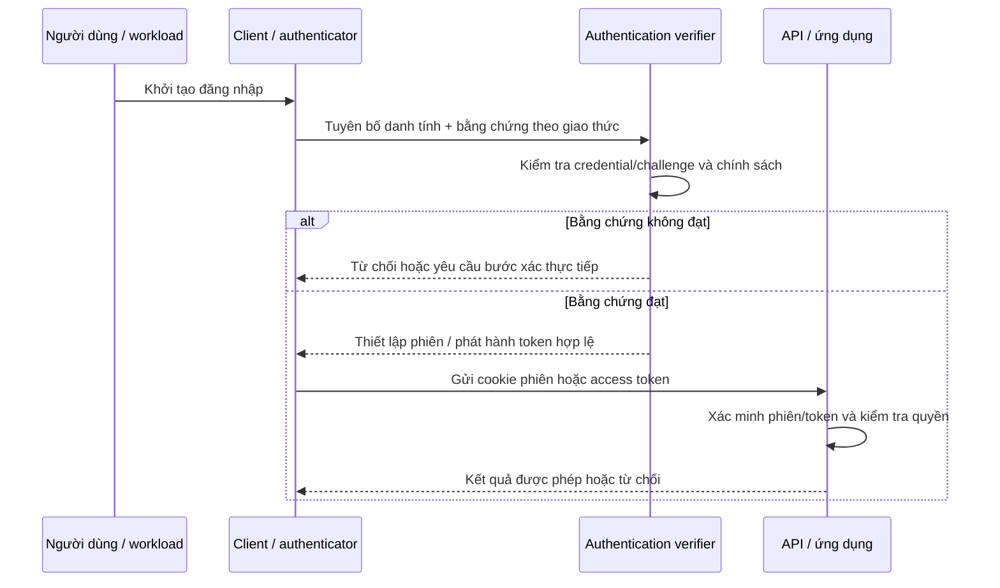
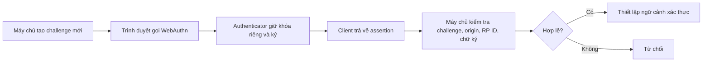
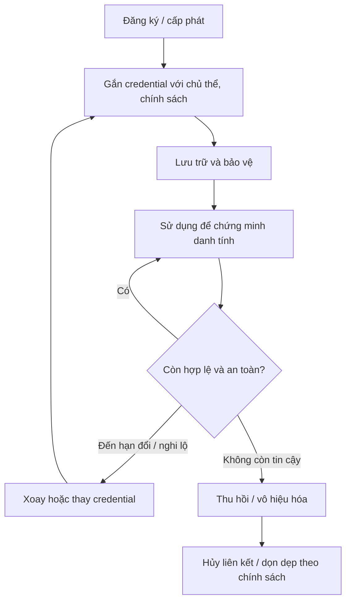

# Credential là gì?

## 1. Khái niệm và vai trò của credential

Trong bảo mật hệ thống, **credential** (thông tin hoặc phương tiện chứng thực) là dữ liệu, bí mật hoặc vật liệu mật mã được dùng trong một cơ chế bảo mật để **chứng minh một tuyên bố về danh tính hay quyền truy cập**. Credential có thể là mật khẩu, khóa mật mã, dữ liệu đăng ký một authenticator, chứng chỉ đi kèm bằng chứng sở hữu khóa riêng hoặc một token được chấp nhận theo chính sách. Credential chỉ mang ý nghĩa xác thực khi có **bên kiểm tra** (*verifier*) và quy tắc kiểm tra rõ ràng.

Ví dụ: người dùng nhập mật khẩu cho tài khoản; máy chủ so sánh với bộ xác minh mật khẩu đã lưu. Trong một luồng khác, trình duyệt yêu cầu passkey ký một challenge; máy chủ dùng khóa công khai đã đăng ký để kiểm tra chữ ký. Hai cách đưa ra bằng chứng khác nhau, nhưng cùng phục vụ câu hỏi: **yêu cầu này có thực sự đến từ bên được phép sử dụng phương thức xác thực gắn với tài khoản không?**

Trong mô-đun **SECURITY_AUTHENTICATION_FUNDAMENTALS**, chủ đề credential là nền tảng để hiểu mật khẩu, MFA, passkey, chứng chỉ, token, phiên, liên kết danh tính và khôi phục tài khoản. Những phương thức đó phải được thiết kế cùng ranh giới tin cậy và cơ chế phòng chống phishing, replay, lạm dụng đăng nhập.

> **Điểm cốt lõi:** Một credential hợp lệ cho thấy người yêu cầu đã đáp ứng một phép kiểm tra xác thực cụ thể; điều đó **không tự động chứng minh danh tính pháp lý**, không đảm bảo tài khoản không bị chiếm đoạt và **không tự cấp quyền** thao tác trên mọi tài nguyên.

### Mục tiêu học tập

Sau bài này, người học có thể:

- Giải thích credential, authenticator và verifier khác nhau ở đâu.
- Nhận diện credential dạng bí mật dùng chung, khóa bất đối xứng, mã dùng một lần và token.
- Phân biệt **định danh**, **bằng chứng xác thực**, **phiên đăng nhập** và **quyết định phân quyền**.
- Mô tả vòng đời phát hành/đăng ký, sử dụng, lưu trữ, thay đổi, thu hồi và khôi phục credential.
- Phân tích rủi ro phishing, lộ bí mật, replay, credential stuffing và chiếm phiên.
- Phác thảo luồng xác thực an toàn cho tài khoản người dùng hoặc hệ thống máy.

## 2. Phân biệt những khái niệm dễ nhầm

| Thuật ngữ | Ý nghĩa | Ví dụ |
|---|---|---|
| **Identity / danh tính** | Chủ thể mà hệ thống nhận diện theo một định danh hoặc hồ sơ | Người dùng nội bộ có ID `user_42` |
| **Identifier / định danh** | Giá trị để chỉ ra chủ thể hoặc tài khoản đang được đề cập | Username, account ID, `iss + sub` |
| **Credential** | Vật liệu/bằng chứng được cơ chế xác thực hoặc ủy quyền chấp nhận | Mật khẩu; khóa riêng; chứng chỉ và proof-of-possession; API key |
| **Authenticator / bộ xác thực** | Phương tiện hoặc thành phần mà người dùng sở hữu/điều khiển để tạo bằng chứng | Ứng dụng TOTP, khóa bảo mật FIDO2, passkey trên thiết bị |
| **Authentication / xác thực** | Quá trình kiểm tra bằng chứng để xác nhận tuyên bố về danh tính | Kiểm tra mật khẩu hoặc chữ ký WebAuthn |
| **Verifier / bên kiểm tra** | Thành phần kiểm tra bằng chứng theo giao thức | Dịch vụ đăng nhập, hệ thống xác minh assertion |
| **Assertion** | Thông điệp chứng thực phát sinh trong một lần xác thực | WebAuthn assertion ký challenge |
| **Session / phiên** | Trạng thái cho phép duy trì ngữ cảnh sau khi xác thực | Phiên phía máy chủ gắn với cookie |
| **Token** | Giá trị mang/tham chiếu thông tin bảo mật hoặc khả năng truy cập theo giao thức | Access token, ID token, session token |
| **Authorization / phân quyền** | Quyết định hành động có được phép đối với tài nguyên hay không | Người dùng được đọc tài liệu của chính họ |

Một số tên gọi thay đổi theo giao thức: trong OAuth, **access token bearer** được dùng như credential để gọi API; trong xác thực bằng mật khẩu, mật khẩu là credential được đưa đến bên kiểm tra; với WebAuthn, bộ khóa đã đăng ký và bằng chứng chữ ký đóng vai trò chứng minh quyền sử dụng authenticator. Không nên áp dụng một định nghĩa hẹp cho mọi giao thức.

### Định danh không phải credential

Email `linh@example.com` hoặc username `linh.nguyen` thường chỉ giúp hệ thống **tìm đúng bản ghi tài khoản**. Biết email của Linh không chứng minh người gửi yêu cầu là Linh. Ngay cả email đã được xác minh trước đây cũng không mặc nhiên chứng minh ai đang sở hữu hộp thư tại thời điểm hiện tại.

### Credential không phải quyền truy cập vô hạn

Hai người dùng cùng xác thực thành công có thể có quyền khác nhau. Người có quyền đọc hóa đơn A vẫn cần bị từ chối khi yêu cầu sửa hóa đơn B nếu chính sách không cho phép. Xác thực trả lời “bằng chứng về chủ thể đã được kiểm tra chưa?”, phân quyền trả lời “chủ thể này được phép làm gì, trên tài nguyên nào, trong hoàn cảnh nào?”.

### Bằng chứng dùng để đăng nhập khác trạng thái đăng nhập

Mật khẩu và passkey thường được kiểm tra tại thời điểm đăng nhập, sau đó hệ thống phát hành phiên. Cookie phiên hoặc access token có thể tiếp tục cho phép gọi hệ thống mà không yêu cầu gửi lại mật khẩu mỗi lần. Tuy nhiên, **người đang cầm token chưa chắc là người ban đầu đã xác thực**: nếu bearer token bị đánh cắp, kẻ khác có thể dùng lại nó trước khi hết hạn hoặc bị thu hồi.

## 3. Credential vận hành như thế nào?

Mô hình tổng quát có bốn vai trò:

1. **Chủ thể (claimant):** người dùng hoặc workload tuyên bố mình là một danh tính nhất định.
2. **Authenticator/credential:** phương tiện hoặc dữ liệu giúp tạo bằng chứng cho tuyên bố.
3. **Verifier:** bên kiểm tra bằng chứng theo chính sách và giao thức.
4. **Relying party / dịch vụ sử dụng kết quả:** ứng dụng hoặc API tin cậy kết quả xác thực trong phạm vi xác định.



**Ranh giới tin cậy cần bảo vệ:**

- Từ **người dùng/thiết bị tới verifier**: đầu vào có thể giả mạo. Verifier phải thực sự kiểm tra credential; không chấp nhận cờ `authenticated=true` do client tự gửi.
- Từ **verifier tới ứng dụng/API**: ứng dụng chỉ tin kết quả đến từ nguồn xác thực đã cấu hình, đúng audience, phiên, thời hạn và các thuộc tính bắt buộc.
- Từ **API tới tài nguyên**: API phải áp chính sách authorization của thao tác hiện tại, kể cả khi token hợp lệ.

Giao thức khác nhau có thể gộp các thành phần này vào cùng máy chủ hoặc tách qua Identity Provider (IdP). Việc tách dịch vụ không làm mất trách nhiệm kiểm tra nguồn và phạm vi tin cậy.

## 4. Các nhóm credential thông dụng

### 4.1. Mật khẩu — bí mật dùng chung

Mật khẩu thuộc nhóm bằng chứng **something you know** (điều người dùng biết). Thông thường người dùng nhập chuỗi bí mật; bên kiểm tra có dữ liệu xác minh mật khẩu được bảo vệ, chẳng hạn bản băm tạo bởi hàm băm mật khẩu chuyên dụng với salt riêng và chi phí tính toán phù hợp.

Ví dụ:

```text
Tài khoản: user_42
Người dùng nhập mật khẩu
   -> Máy chủ lấy bản ghi verifier của user_42
   -> Hàm kiểm tra mật khẩu đã chọn xác minh đầu vào
   -> Hợp lệ: tiếp tục kiểm tra chính sách/MFA
   -> Không hợp lệ: từ chối; ghi tín hiệu cho chống lạm dụng
```

Không dùng phép so sánh mật khẩu rõ đã lưu trong cơ sở dữ liệu. Một triển khai mới có thể cân nhắc **Argon2id** với cấu hình thích hợp, hoặc giải pháp băm mật khẩu được đánh giá và hỗ trợ tốt như scrypt/bcrypt khi phù hợp hệ thống. Thông số phải theo nhu cầu thực tế, thư viện được bảo trì và khả năng cập nhật sau này. Không dùng SHA-256 thuần làm thuật toán lưu mật khẩu.

Những vấn đề chính:

- Mật khẩu dễ bị tái sử dụng ở nhiều website; khi một dịch vụ lộ dữ liệu, kẻ tấn công có thể thử cùng cặp tài khoản/mật khẩu ở dịch vụ khác (**credential stuffing**).
- Phishing có thể thu thập mật khẩu; malware và rò rỉ phía client cũng có thể lấy bí mật.
- Tăng độ khó đoán của mật khẩu, chặn mật khẩu đã lộ, giới hạn thử đăng nhập và cung cấp password manager giúp giảm rủi ro.
- MFA hoặc passkey làm giảm sự phụ thuộc vào mật khẩu, nhưng luồng khôi phục yếu vẫn có thể bị lợi dụng để chiếm tài khoản.

**Mật khẩu được nhập trong một phiên xác thực; không nên được gửi lại trong mọi request API.** Sau đăng nhập, hệ thống nên quản lý phiên hoặc token với thời hạn, phạm vi và cơ chế thu hồi phù hợp.

### 4.2. OTP và ứng dụng xác thực

OTP (*one-time password*) là mã ngắn chỉ có giá trị trong điều kiện hạn chế:

- **TOTP:** mã dựa trên bí mật dùng chung và mốc thời gian, thường được ứng dụng authenticator tạo định kỳ.
- **HOTP:** mã dựa trên bí mật dùng chung và bộ đếm.
- **Mã dùng một lần được máy chủ gửi:** chẳng hạn mã qua email/SMS, thường được tạo ngẫu nhiên, có TTL và bộ đếm số lần thử.

OTP có thể là yếu tố xác thực bổ sung, nhưng không phải mọi OTP đều có mức đảm bảo giống nhau. Một mã TOTP đúng vẫn có thể bị kẻ gian thu thập trên trang đăng nhập giả rồi sử dụng ngay trên trang thật. Mã qua SMS còn chịu rủi ro SIM swap, chuyển tiếp tin nhắn và khả năng kiểm soát thuê bao.

Để kiểm tra OTP an toàn, hệ thống cần xét thời hạn, số lần thử, khả năng dùng lại, đồng bộ thời gian/bộ đếm khi áp dụng, giới hạn tần suất và ràng buộc mã với đúng luồng hoặc tài khoản. Đối với TOTP, cấu hình kiểm tra cửa sổ thời gian hợp lý là một đánh đổi giữa khả năng sử dụng và chống replay; không nên chấp nhận mã đã được ghi nhận sử dụng trong cùng khoảng hiệu lực nếu chính sách yêu cầu dùng một lần thật sự.

**OTP không có thuộc tính chống phishing như WebAuthn theo nguồn gốc website.** Vì vậy, khái niệm “có MFA” chưa đủ để kết luận một luồng kháng phishing.

### 4.3. Passkey và WebAuthn — khóa mật mã bất đối xứng

Passkey là credential dùng mật mã khóa công khai, thường triển khai qua **WebAuthn/FIDO2**. Trong quá trình đăng ký:

1. Máy chủ tạo challenge và gắn yêu cầu đăng ký với phiên/ngữ cảnh thích hợp.
2. Client yêu cầu authenticator tạo cặp khóa gắn với Relying Party ID (RP ID).
3. Khóa riêng được authenticator bảo vệ; máy chủ nhận khóa công khai cùng thông tin credential cần lưu.
4. Máy chủ xác minh kết quả đăng ký theo giao thức, bao gồm challenge, origin, RP ID và các điều kiện chính sách liên quan.

Khi đăng nhập, authenticator tạo chữ ký trên dữ liệu xác thực có ràng buộc challenge và ngữ cảnh. Máy chủ dùng khóa công khai đã lưu để kiểm tra chữ ký và kiểm tra các thuộc tính bắt buộc như challenge, origin, RP ID, sự hiện diện/xác minh người dùng theo chính sách và metadata thích hợp.



Ưu điểm quan trọng là **khóa riêng không cần rời authenticator** và bằng chứng gắn với RP ID/origin của dịch vụ. Khi được triển khai đúng, cơ chế này giảm đáng kể nguy cơ credential bị lấy trên trang phishing rồi đem dùng tại website thật.

Cần hiểu đúng một số chi tiết:

- Khóa công khai lưu trên máy chủ **không phải bí mật**, nhưng phải được gắn đúng credential ID, tài khoản và metadata.
- Xác thực bằng vân tay hoặc khuôn mặt thường **mở khóa authenticator tại thiết bị**; server không nhận bản sao vân tay/khuôn mặt để so khớp.
- Passkey đồng bộ có thể dùng trên nhiều thiết bị; không nên giả định một credential luôn chỉ nằm trên một thiết bị vật lý.
- Attestation, cờ user verification và chính sách cho thiết bị được quản lý có vai trò riêng, không được suy ra tùy tiện từ việc “dùng passkey”.
- Mất thiết bị, đồng bộ khóa, hủy liên kết và phục hồi vẫn cần thiết kế vòng đời tài khoản an toàn.

### 4.4. Chứng chỉ và khóa riêng

Trong xác thực bằng **X.509 client certificate** hoặc mutual TLS (mTLS), bên kết nối có thể chứng minh mình kiểm soát khóa riêng tương ứng với chứng chỉ được chấp nhận. Một chứng chỉ công khai đơn lẻ **không phải bằng chứng sở hữu khóa riêng**; phần quan trọng nằm ở quá trình kiểm tra chứng chỉ và proof-of-possession trong giao thức.

Verifier cần kiểm tra chuỗi tin cậy, mục đích sử dụng chứng chỉ, định danh mong đợi, hạn hiệu lực và trạng thái thu hồi theo chính sách áp dụng. Với workload hoặc service account, việc quản lý cấp phát, luân chuyển, lưu trữ và thu hồi khóa có thể quan trọng hơn giao diện đăng nhập người dùng.

Ví dụ: dịch vụ `billing-worker` dùng mTLS để gọi `invoice-api`. API xác thực được client certificate thuộc một workload tin cậy; sau đó vẫn phải kiểm tra workload đó có quyền thực hiện thao tác trên loại dữ liệu, tenant và endpoint cụ thể hay không.

### 4.5. API key, access token và cookie phiên

Trong ngữ cảnh API, **API key** thường là một bí mật bearer: ai có key hợp lệ có thể được xem là ứng dụng hoặc bên tích hợp đã được cấp key trong phạm vi chính sách. Một API key không chứng minh riêng lẻ cá nhân nào đang thao tác. Nên cấp key theo tích hợp/workload, giới hạn phạm vi, có thời hạn/quy trình xoay và hỗ trợ thu hồi.

**Access token** có thể là token opaque hoặc token tự chứa như JWT, tùy hệ thống. API phải xác minh token đúng cơ chế. Với JWT được cho phép: kiểm tra chữ ký, thuật toán, issuer, audience, thời hạn và những yêu cầu bắt buộc khác. Việc chỉ giải mã payload JWT để đọc `sub` hoặc `scope` **không phải** xác minh.

Trong OpenID Connect, **ID token** là thông điệp để client hiểu kết quả đăng nhập theo giao thức và audience dành cho client. Không tự coi ID token là access token cho API. Quyền thực hiện thao tác API còn phụ thuộc scope, tài khoản, chính sách và đối tượng tài nguyên.

Cookie phiên là một phương tiện đưa định danh phiên trở lại máy chủ ở các request sau. Nếu cookie là bearer credential, bên nào giữ được cookie có thể tái sử dụng nó trong giới hạn phiên. Khi dùng cookie phiên nên cấu hình `Secure`, `HttpOnly`, `SameSite` phù hợp, bảo vệ chống CSRF tại thao tác thay đổi dữ liệu và chống XSS.

| Loại | Bí mật ở đâu? | Bằng chứng gửi tới verifier/API | Rủi ro nổi bật |
|---|---|---|---|
| Mật khẩu | Người dùng biết; server lưu verifier an toàn | Chuỗi mật khẩu qua kênh bảo vệ | Phishing, stuffing, lộ cơ sở dữ liệu |
| TOTP | Bí mật dùng chung trong authenticator và verifier | Mã ngắn theo thời gian | Phishing thời gian thực, replay trong cửa sổ hợp lệ |
| Passkey/WebAuthn | Khóa riêng do authenticator quản lý | Assertion có chữ ký gắn challenge/origin | Mất quyền kiểm soát thiết bị/tài khoản đồng bộ, lỗi triển khai/khôi phục |
| mTLS certificate | Khóa riêng phía client | Bằng chứng sở hữu khóa trong bắt tay TLS | Rò rỉ khóa riêng, cấp phát sai, không thu hồi |
| API key | Bên tích hợp và verifier/nguồn kiểm tra | Chuỗi bearer key | Rò rỉ trong code, log, CI/CD |
| Bearer access token/session cookie | Client/thiết bị đang giữ token | Giá trị token hoặc cookie | Chiếm đoạt phiên, replay, scope quá rộng |

## 5. Authentication factor: vì sao nhiều credential chưa chắc là MFA?

Trong xác thực, các bằng chứng thường được chia thành:

- **Knowledge factor — điều bạn biết:** mật khẩu, PIN bí mật theo mô hình áp dụng.
- **Possession factor — điều bạn sở hữu/kiểm soát:** khóa bảo mật, ứng dụng giữ bí mật OTP, thiết bị quản lý khóa mật mã.
- **Inherence factor — đặc điểm sinh trắc:** vân tay, khuôn mặt, khi được hệ thống xác thực sử dụng theo cơ chế phù hợp.

**MFA (multi-factor authentication)** yêu cầu các yếu tố thuộc **ít nhất hai loại khác nhau** theo cách tạo được bảo đảm bổ sung. Hai mật khẩu không thành MFA chỉ vì phải nhập hai lần. Mật khẩu và mã từ ứng dụng TOTP có thể là hai yếu tố nếu authenticator và quy trình kiểm tra đáp ứng mô hình đã thiết kế. Một passkey với xác minh người dùng cục bộ có thể mang đặc tính đa yếu tố khi authenticator đáp ứng yêu cầu về sở hữu thiết bị và kích hoạt tại chỗ; cần xác minh các cờ và chính sách WebAuthn thích hợp, thay vì tự suy diễn.

Một **PIN mở khóa điện thoại** và mật khẩu tài khoản không nhất thiết tạo thành hai yếu tố độc lập nếu phía máy chủ không thể xác minh rằng thiết bị đã thực hiện kiểm tra PIN theo giao thức đáng tin cậy. Việc dùng cùng một kênh để khôi phục cả hai yếu tố cũng làm suy giảm hiệu quả bảo vệ.

### Mức mạnh xác thực không quyết định quyền

Một người dùng có passkey chống phishing vẫn không được xem dữ liệu khách hàng khác nếu thiếu quyền. Ngược lại, người có role hợp lệ có thể được yêu cầu xác thực mới bằng phương thức mạnh trước một thao tác nhạy cảm. Hệ thống phải quyết định riêng:

1. **Bằng chứng nào đã được kiểm tra?**
2. **Ngữ cảnh xác thực còn hiệu lực và đủ mới không?**
3. **Tài khoản có quyền trên tài nguyên yêu cầu không?**

## 6. Vòng đời của một credential

Credential là thành phần có vòng đời, không phải chuỗi dữ liệu tạo xong rồi dùng mãi.



| Giai đoạn | Câu hỏi thiết kế |
|---|---|
| Đăng ký/cấp phát | Ai được tạo credential? Đã chứng minh quyền kiểm soát tài khoản hiện tại hay chưa? |
| Liên kết | Credential thuộc account ID, tổ chức, client hoặc workload nào? Có tránh liên kết sai/chồng chéo không? |
| Lưu trữ | Khóa riêng, secret hay password verifier nằm ở đâu? Có giới hạn quyền đọc, sao lưu, mã hóa thích hợp không? |
| Sử dụng | Kiểm tra challenge, nguồn phát hành, đối tượng, hạn dùng, retry và replay thế nào? |
| Giám sát | Có ghi sự kiện cấp phát, dùng bất thường, thay đổi hay thất bại mà không ghi bí mật không? |
| Xoay/thay thế | Có thể thay secret/khóa mà không làm gián đoạn lớn? Credential cũ còn dùng được bao lâu? |
| Thu hồi | Khi lộ, mất thiết bị, nghỉ việc hoặc khóa tài khoản, cơ chế vô hiệu hóa là gì? |
| Khôi phục | Nếu mất tất cả credential, bằng chứng nào đủ để cấp lại quyền kiểm soát tài khoản? |

### Cấp credential mới là thao tác nhạy cảm

Kẻ tấn công có được cookie phiên trong vài phút có thể tìm cách thêm passkey riêng, thay email khôi phục hoặc tắt MFA để duy trì quyền kiểm soát tài khoản. Vì vậy, **thêm/gỡ/đổi credential phải được bảo vệ ở máy chủ**, thường cần xác thực lại (*reauthentication*), step-up theo rủi ro, kiểm tra trạng thái phiên, ghi audit và thông báo qua kênh phù hợp. Không tin mỗi việc người dùng đã mở được trang “Cài đặt bảo mật”.

### Khôi phục không được trở thành đường vòng yếu nhất

Nếu đăng nhập phải dùng passkey nhưng “quên passkey” chỉ cần mã SMS dễ bị chiếm đoạt để đặt lại tất cả credential, mức bảo mật thực tế có thể bị giới hạn bởi kênh SMS. Recovery code dự phòng, credential thứ hai, hỗ trợ có quy trình kiểm tra hoặc phương thức phục hồi khác cần được chọn theo độ nhạy cảm của tài khoản. Việc khôi phục nên xử lý cả các phiên cũ, gửi thông báo và ghi audit.

### Đổi chủ tài khoản không phải “đưa credential cho người khác”

Trong tổ chức, chuyển quyền quản trị một workspace hoặc tài nguyên cho nhân sự khác nên được thực hiện bằng quy tắc authorization có kiểm tra và ghi nhận. Giao mật khẩu, private key hoặc token cá nhân cho người mới làm mất khả năng truy vết và khiến việc thu hồi quyền trở nên khó khăn.

## 7. Thiết kế xác thực chống phishing, replay và lạm dụng

### Phishing

Một trang đăng nhập giả có thể thu thập mật khẩu và OTP, rồi chuyển tiếp ngay sang trang thật. Dùng HTTPS vẫn cần thiết nhưng **không tự bảo vệ người dùng khỏi website giả**: trang giả cũng có thể có TLS hợp lệ. Các phương thức ràng buộc bằng chứng với nguồn gốc website, như WebAuthn, giảm khả năng dùng lại credential trên domain giả.

Biện pháp hỗ trợ gồm không yêu cầu người dùng đọc OTP cho người khác, phát hiện đăng nhập bất thường, ưu tiên phương thức chống phishing phù hợp và có chính sách quản lý credential bị nghi lộ.

### Replay

Replay xảy ra khi kẻ tấn công ghi lại một bằng chứng hoặc giá trị bearer hợp lệ và gửi lại để được chấp nhận. Ví dụ: dùng lại mã OTP chưa bị đánh dấu đã sử dụng, phát lại request có chữ ký không ràng buộc nonce, hoặc dùng lại cookie bị đánh cắp.

Tùy loại credential, biện pháp gồm:

- **Challenge/nonce ngẫu nhiên, mới và được kiểm tra một lần** cho các giao thức dựa trên challenge-response; kiểm tra đúng ngữ cảnh, thời hạn, audience/origin theo giao thức.
- **OTP có thời hạn ngắn, giới hạn lần thử và chống tái sử dụng** trong phạm vi khả thi.
- **Token/phiên có thời hạn và khả năng thu hồi**, giới hạn phạm vi; với hệ thống hỗ trợ có thể dùng cơ chế token gắn với bên gửi thay cho bearer thuần.
- **Chống replay cho request nhạy cảm** bằng idempotency key, nonce, transaction binding hoặc biện pháp phù hợp giao thức. Chống trùng giao dịch và chứng minh danh tính là hai bài toán liên quan nhưng khác nhau.

Không nên hiểu rằng chỉ kiểm tra chữ ký token là đã chống được việc token bearer bị sao chép và gửi lại; chữ ký chỉ chứng minh token được phát hành và nội dung không bị sửa trái phép.

### Credential stuffing và brute force

Kẻ tấn công có thể thử rất nhiều mật khẩu đã lộ hoặc đoán giá trị yếu. Hệ thống cần bảo vệ bằng cơ chế giới hạn tốc độ, phát hiện tự động hóa, theo dõi thất bại theo tài khoản và nguồn, kiểm tra mật khẩu bị lộ và chiến lược chống lạm dụng phù hợp. Thông báo lỗi cần hạn chế tiết lộ tài khoản có tồn tại hay không; ghi log không được chứa chính password, OTP, session cookie hoặc access token.

### Lộ dữ liệu và lưu trữ

Không để credential trong source code, URL, file cấu hình được commit công khai, log, chat hay ảnh chụp màn hình. Workload nên sử dụng kho secret, cơ chế danh tính máy hoặc môi trường quản lý khóa phù hợp, có phân quyền đọc tối thiểu và khả năng xoay secret.

Với mật khẩu người dùng, lưu **password hash** bằng thư viện chuyên dụng và cấu hình phù hợp. Với API key do server phát hành, nếu không cần phục hồi key gốc, có thể lưu giá trị kiểm chứng như hash được thiết kế thích hợp; cần chú ý đủ entropy vì API key yếu vẫn bị đoán offline. Với public key của WebAuthn, việc lưu khóa công khai là bình thường; dữ liệu đăng ký và ánh xạ tài khoản vẫn phải được bảo vệ khỏi sửa sai.

## 8. Ví dụ mô hình dữ liệu và luồng kiểm tra

Không nên dồn mọi loại credential vào một cột `password` hoặc biểu diễn “đăng nhập thành công” bằng boolean do client gửi. Có thể mô hình hóa thông tin **metadata** và điều kiện chấp nhận như sau:

```java
import java.time.Instant;

enum CredentialType {
    PASSWORD, TOTP, WEBAUTHN, CLIENT_CERTIFICATE, API_KEY
}

enum CredentialStatus {
    ACTIVE, SUSPENDED, REVOKED
}

record CredentialRecord(
    String id,
    String accountId,
    CredentialType type,
    CredentialStatus status,
    Instant enrolledAt,
    Instant lastUsedAt
) {}

record VerifiedAuthentication(
    String accountId,
    Instant authenticatedAt,
    String method
) {}
```

Đây chỉ là **mô hình metadata** để suy nghĩ về thiết kế, không chứa password, private key, TOTP secret hoặc token thật. Việc xác minh mật khẩu, TOTP, WebAuthn và chứng chỉ phải do những thành phần triển khai đúng thuật toán và giao thức thực hiện. Sau khi verifier kiểm tra thành công, nó có thể tạo `VerifiedAuthentication` từ dữ liệu **do máy chủ xác định**. Client không được tự gửi một đối tượng `VerifiedAuthentication` rồi yêu cầu máy chủ tin ngay.

Một endpoint kiểm tra mật khẩu và MFA có thể theo logic khái niệm:

```text
1. Nhận yêu cầu qua kênh bảo vệ; chuẩn hóa định danh theo chính sách.
2. Áp dụng chống lạm dụng trước/trong quá trình xác minh.
3. Tra account và password verifier phía máy chủ.
4. Kiểm tra mật khẩu bằng thư viện băm mật khẩu chuyên dụng.
5. Nếu chính sách yêu cầu MFA, tạo thử thách có liên kết với
   giao dịch xác thực; kiểm tra yếu tố thứ hai và chống replay.
6. Chỉ khi mọi điều kiện đạt mới thiết lập phiên với account ID
   đã được máy chủ xác định.
7. Khi API được gọi, xác minh phiên/token rồi đánh giá authorization
   cho tài nguyên và hành động cụ thể.
```

Luồng thực tế phải có cách chống dò tài khoản qua thời gian phản hồi/thông báo lỗi, bảo vệ trạng thái xác thực tạm thời, giới hạn số lần thử và chính sách khóa/giảm tốc độ hợp lý. Những bước bổ sung tùy rủi ro và phương thức triển khai.

### Ví dụ: cùng một tài khoản, nhiều credential

Tài khoản `acc_105` đăng ký:

- Một mật khẩu đã lưu dạng verifier; không ai được đọc lại mật khẩu gốc.
- Hai passkey trên các môi trường khác nhau, mỗi passkey có credential ID và public key tương ứng.
- Một bộ recovery code lưu an toàn để dùng khi mất phương thức đăng nhập chính.

Khi người dùng đổi email, **account ID không đổi**. Khi mất một thiết bị, họ có thể đăng nhập bằng credential còn lại, xác thực lại theo chính sách và thu hồi passkey bị mất. Nếu không còn phương thức nào, họ cần luồng recovery riêng; không được lấy việc ai đang nhận email làm bằng chứng tuyệt đối về quyền sở hữu tài khoản.

## 9. Chọn credential phù hợp với hệ thống

| Tình huống | Lựa chọn thường gặp | Điều cần cân nhắc |
|---|---|---|
| Ứng dụng web cho người dùng cuối | Passkey; hoặc mật khẩu kèm MFA phù hợp | Khả năng hỗ trợ thiết bị, phishing, recovery và trải nghiệm |
| Nhân viên truy cập hệ thống nhạy cảm | SSO với IdP tin cậy, MFA chống phishing | Quản lý thiết bị, step-up, chính sách tổ chức và thu hồi khi nghỉ việc |
| Workload gọi API nội bộ | Workload identity, mTLS, token ngắn hạn | Cấp phát khóa, audience, quyền tối thiểu, xoay/thu hồi |
| Tích hợp bên thứ ba | OAuth 2.0 access token hoặc API key có scope | Quyền theo client, vòng đời key/token, tránh chia sẻ bí mật dài hạn |
| Thiết bị không có giao diện nhập mật khẩu | Khóa thiết bị, chứng chỉ hoặc luồng cấp phát có kiểm soát | Chống sao chép khóa, xác thực thiết bị, quy trình đưa thiết bị vào hệ thống |
| Khôi phục tài khoản | Credential dự phòng, recovery code hoặc quy trình bảo đảm thích hợp | Tránh đường vòng yếu hơn nhiều so với xác thực chính |

Không có một loại credential tốt nhất cho mọi trường hợp. Quyết định dựa trên **chủ thể được xác thực**, khả năng bảo vệ khóa/bí mật, rủi ro dữ liệu, môi trường client, yêu cầu chống phishing, khả năng thu hồi và quy trình khôi phục.

## 10. Bài tập tình huống

Một ứng dụng quản lý dự án có ba cách đăng nhập: mật khẩu, mã TOTP và passkey. Hệ thống cho phép người dùng thêm credential mới từ trang cài đặt. Nhà phát triển đưa ra ba ý tưởng:

1. “Chỉ cần có session cookie hợp lệ là được thêm passkey mới.”
2. “Nếu email từ social login giống email nội bộ thì tự gộp hai tài khoản.”
3. “JWT có `sub` và `role` nên API chỉ cần decode payload, không cần kiểm tra chữ ký.”

Hãy xác định lỗi trong từng ý tưởng:

- **Ý tưởng 1:** Một phiên bị đánh cắp có thể bị dùng để thêm passkey của kẻ tấn công và giành quyền kiểm soát lâu dài. Thao tác thêm credential cần chính sách xác thực lại/step-up, kiểm tra trạng thái phiên, audit và thông báo phù hợp.
- **Ý tưởng 2:** Email không đủ làm bằng chứng hai danh tính thuộc cùng một người. Phải có quy trình liên kết do người đang kiểm soát tài khoản hiện hữu khởi tạo, chứng minh được quyền đối với tài khoản và xác minh nguồn phát hành/định danh của IdP mới.
- **Ý tưởng 3:** Đọc payload không chứng minh JWT được phát hành bởi nguồn tin cậy. API phải xác minh chữ ký và các claim bắt buộc; sau đó còn phải kiểm tra quyền cụ thể trên tài nguyên.

Một yêu cầu bổ sung: nếu TOTP của người dùng bị phishing nhưng passkey của họ không bị lộ, hệ thống có nên tự động coi mọi credential của tài khoản đã mất an toàn không? Không có đáp án cố định cho mọi hệ thống: cần xem **credential nào bị lộ**, có phiên/token nào bị chiếm, mức rủi ro, lịch sử sự kiện, quy tắc thu hồi và khả năng yêu cầu người dùng xác thực lại bằng phương thức tin cậy.

## 11. Checklist khi thiết kế và sử dụng credential

- [ ] Phân biệt rõ identifier, credential, authenticator, phiên/token và authorization.
- [ ] Mỗi loại credential có giao thức xác minh và nguồn tin cậy xác định.
- [ ] Bí mật không xuất hiện trong log, URL, mã nguồn hoặc cấu hình công khai.
- [ ] Mật khẩu được kiểm tra bằng password hashing chuyên dụng, có chống lạm dụng.
- [ ] Challenge/OTP được ràng buộc đúng ngữ cảnh, có thời hạn và bảo vệ chống replay phù hợp.
- [ ] WebAuthn kiểm tra chữ ký, challenge, origin, RP ID và các điều kiện giao thức liên quan.
- [ ] Chứng chỉ/khóa/token được kiểm tra hiệu lực, nguồn phát hành, phạm vi và thu hồi khi áp dụng.
- [ ] Có quy trình thêm, thay, xoay, vô hiệu hóa credential và quản lý phiên cũ.
- [ ] Thao tác thay đổi credential hoặc kênh recovery có bảo vệ mạnh hơn thao tác thông thường.
- [ ] Dịch vụ API thực hiện authorization riêng sau khi xác thực yêu cầu.
- [ ] Có kiểm thử phishing, replay, stuffing, chiếm đoạt phiên và liên kết danh tính sai.

## 12. Tổng kết

**Credential là vật liệu hoặc bằng chứng để một hệ thống kiểm tra tuyên bố về danh tính hay quyền truy cập theo một giao thức cụ thể.** Mật khẩu, OTP, passkey, chứng chỉ và token đại diện cho các cơ chế khác nhau về cách giữ bí mật, tạo bằng chứng và kiểm tra. Vì vậy, không nên đánh đồng “có một chuỗi bí mật” với “chắc chắn là đúng người”, hoặc “đã xác thực” với “được phép làm mọi việc”.

Thiết kế xác thực an toàn đòi hỏi nhìn credential trong **toàn bộ vòng đời**: đăng ký đúng chủ thể, bảo vệ khi lưu trữ, kiểm tra theo ranh giới tin cậy, ngăn phishing/replay/lạm dụng, xử lý thu hồi, phiên và khôi phục. Hiểu rõ các thuộc tính đó là bước đầu để chọn mật khẩu, MFA, passkey, chứng chỉ và token phù hợp với mức rủi ro của từng hệ thống.
