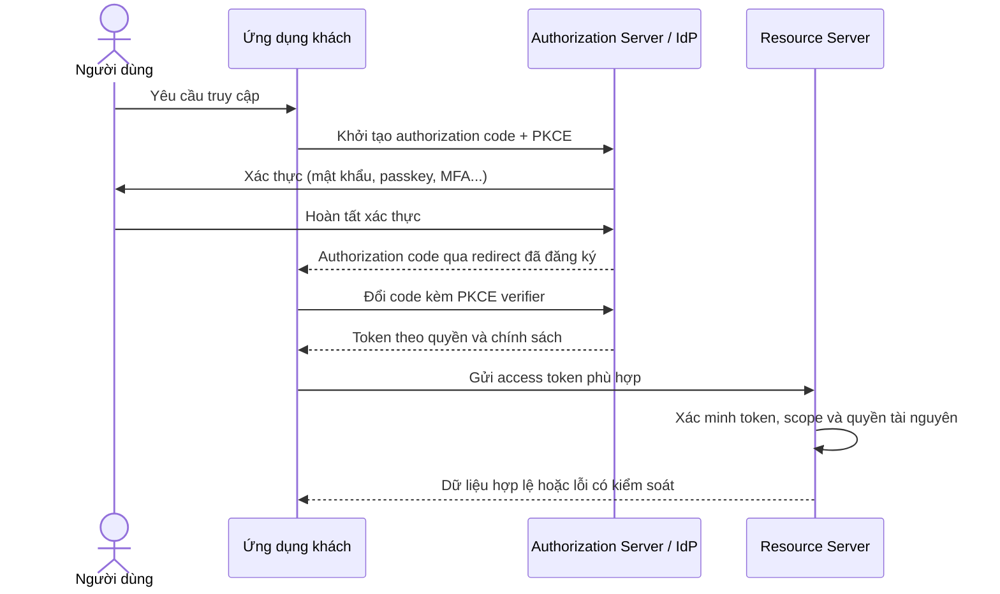
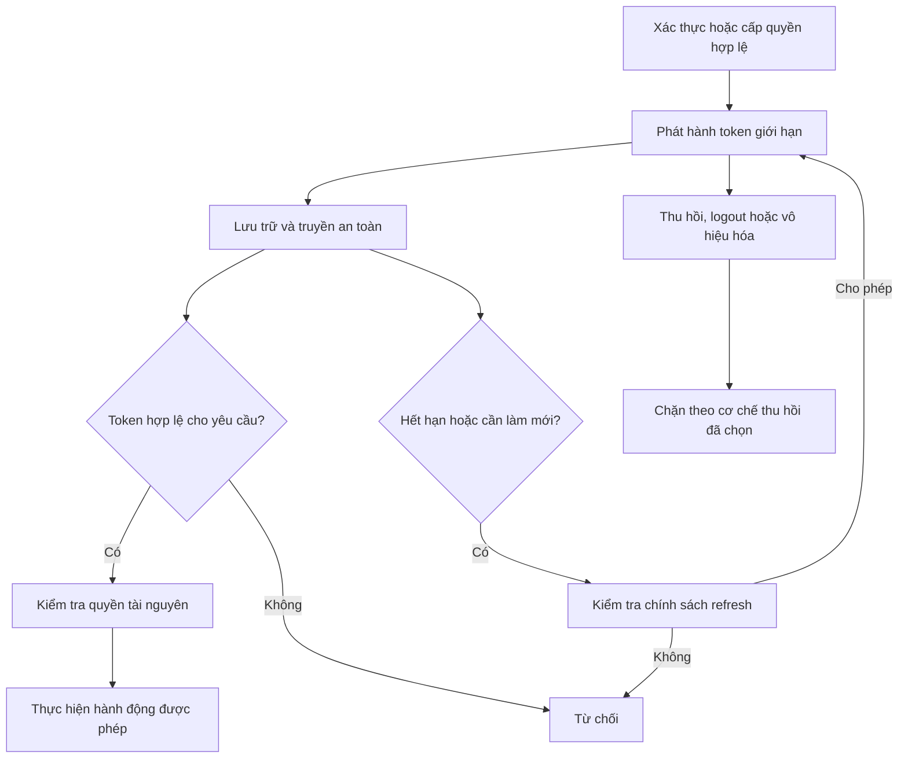

# Token credential — Sử dụng token làm bằng chứng truy cập

Khi một người dùng đăng nhập bằng mật khẩu, passkey hoặc MFA, ứng dụng thường không yêu cầu họ lặp lại toàn bộ bước xác thực cho từng yêu cầu HTTP. Thay vào đó, hệ thống phát hành hoặc chấp nhận một **token** để bên nhận biết yêu cầu đang thuộc về chủ thể và ngữ cảnh nào. Từ thời điểm đó, **việc sở hữu và sử dụng token đúng cách trở thành một phần quan trọng của bảo mật xác thực**: người lấy cắp được bearer token có thể dùng nó trong phạm vi và thời hạn token còn được chấp nhận.

Bài này thuộc chương **Credential** của học phần **SECURITY_AUTHENTICATION_FUNDAMENTALS**. Trong phạm vi học phần, token kết nối các cơ chế credential, mật khẩu, MFA, passkey, chứng chỉ với phiên, liên kết danh tính và khôi phục tài khoản. Trọng tâm là phân biệt những loại token có ý nghĩa khác nhau, mô hình hóa ranh giới tin cậy giữa bên cấp và bên kiểm tra, cũng như phòng chống phishing, replay, chiếm phiên và lạm dụng đăng nhập.

## 1. Kết quả học tập

Sau bài học, người học có thể:

- Giải thích **token credential** là gì, khi nào token chứng minh việc sở hữu một bí mật và khi nào nó chỉ biểu diễn quyền đã được cấp.
- Phân biệt **access token**, **ID token**, **refresh token**, **session token**, **API key** và **token dùng một lần**; không sử dụng chúng thay thế cho nhau.
- Phân biệt **bearer token** với token ràng buộc bằng chứng sở hữu khóa (proof of possession); hiểu vì sao chữ ký JWT không tự ngăn việc token bị đánh cắp rồi phát lại.
- Thiết kế quy trình phát hành, lưu trữ, xác minh, giới hạn, xoay vòng, thu hồi và theo dõi token.
- Kiểm tra đúng `issuer`, `audience`, thời hạn, loại token, phạm vi quyền và ngữ cảnh người dùng ở phía tài nguyên.
- Đặt ra tiêu chí kiểm thử cho các tình huống token hết hạn, bị đánh cắp, sai đối tượng nhận, bị dùng lại hoặc phát sinh từ tài khoản đã bị vô hiệu hóa.

## 2. Token credential là gì?

**Credential** là vật hoặc thông tin được sử dụng để chứng minh một tuyên bố về danh tính hay quyền kiểm soát. Ví dụ, mật khẩu bí mật chứng minh người nhập biết mật khẩu; passkey chứng minh bên dùng có khả năng tạo chữ ký bằng khóa riêng thích hợp. **Token credential** là token mà bên nhận chấp nhận như một bằng chứng để tiếp tục truy cập hoặc thực hiện một hành động theo chính sách đã xác định.

Tuy nhiên, từ `token` xuất hiện trong nhiều giao thức và **không phải token nào cũng chứng thực người dùng theo cùng một nghĩa**:

| Loại | Mục đích chính | Bên thường kiểm tra | Điều không nên suy diễn |
| --- | --- | --- | --- |
| **Access token** | Cho phép ứng dụng khách gọi tài nguyên/API với phạm vi được cấp | Resource server/API | Token hợp lệ không đồng nghĩa người dùng vừa nhập mật khẩu hoặc đủ quyền với mọi đối tượng dữ liệu. |
| **ID token (OIDC)** | Chuyển kết quả xác thực người dùng từ OpenID Provider tới ứng dụng khách | OIDC client/Relying Party | Không dùng ID token như access token cho một API chỉ vì có `sub` hoặc chữ ký hợp lệ. |
| **Refresh token** | Xin access token mới theo chính sách phiên và quyền được cấp | Authorization server | Không gửi refresh token tới API nghiệp vụ hoặc xem nó như quyền truy cập trực tiếp. |
| **Session identifier / session cookie** | Tham chiếu tới phiên do ứng dụng quản lý | Backend ứng dụng | Cookie không mặc nhiên chứa danh tính; máy chủ cần ánh xạ và kiểm tra trạng thái phiên. |
| **API key** | Nhận biết và/hoặc xác thực client, ứng dụng hay tích hợp trong phạm vi dịch vụ | Cổng API hoặc backend | API key không tự xác nhận danh tính của một người dùng cuối. |
| **Reset token / magic-link token** | Cho phép thực hiện một hành động đặc biệt trong thời gian ngắn | Dịch vụ tài khoản/khôi phục | Không được coi như phiên lâu dài hoặc dùng lặp lại ngoài mục đích cấp phát. |

Ví dụ, khi một API nhận `Authorization: Bearer <token>`, nó thường đang kiểm chứng rằng bên gọi **có token truy cập hợp lệ dành cho API đó**. Nếu token do authorization server phát hành sau khi người dùng đăng nhập, nó có thể mang thông tin về chủ thể, nhưng API vẫn phải kiểm tra quyền đối với tài nguyên cụ thể. Với luồng máy với máy, chủ thể có thể là **workload hoặc client**, không phải con người.

### Xác thực, ủy quyền và phiên liên hệ thế nào?

- **Authentication:** kiểm tra bằng chứng xác thực của chủ thể, ví dụ passkey hoặc mật khẩu + MFA.
- **Authorization:** xác định chủ thể/client có được thực hiện hành động nào trên tài nguyên nào.
- **Session:** duy trì ngữ cảnh tương tác theo thời gian, có thể dựa trên cookie tham chiếu tới bản ghi máy chủ hoặc cơ chế token khác.
- **Token issuance:** cấp một vật mang thông tin hoặc quyền theo kết quả của một giao thức và một chính sách; token không thay thế việc kiểm tra quyền tại tài nguyên.

Một phiên có thể được tạo sau khi xác thực, còn access token có thể được phát hành thông qua việc cấp quyền của OAuth 2.0. Hai bước liên quan nhưng không đồng nghĩa: một access token không nhất thiết chứng minh người dùng vừa xác thực tại thời điểm gửi yêu cầu.

## 3. Hai mô hình sử dụng token: bearer và proof of possession

### 3.1. Bearer token

Với **bearer token**, điều kiện quan trọng để được chấp nhận là **trình ra được token**. Tương tự một vé còn hiệu lực, ai đang cầm vé có thể thử sử dụng vé đó. Chữ ký mật mã bảo vệ token khỏi việc bị sửa tùy ý, nhưng **không ngăn một token hợp lệ bị sao chép rồi sử dụng lại**.

```http
GET /api/orders/ord_123 HTTP/1.1
Host: api.example.test
Authorization: Bearer <access_token_placeholder>
```

Trong ví dụ, API vẫn phải xác minh token dành cho `api.example.test`/API nhận tương ứng, còn hạn, đúng chính sách cấp quyền và người gọi có quyền đọc `ord_123`. Việc `ord_123` xuất hiện trong URL không cho phép bỏ qua kiểm tra chủ sở hữu đơn hàng.

**Rủi ro chính:** bearer token bị lộ qua XSS, log, URL, kho lưu trữ không an toàn, máy bị nhiễm mã độc hoặc đường truyền không được bảo vệ có thể bị kẻ tấn công dùng lại đến khi bị hết hạn hoặc thu hồi. HTTPS bảo vệ token trên đường truyền, nhưng không tự bảo vệ token đã bị đánh cắp ở máy khách hay máy chủ.

### 3.2. Token ràng buộc bên nắm giữ (sender-constrained token)

Một số thiết kế yêu cầu bên gọi **vừa xuất trình token, vừa chứng minh có khóa riêng/credential được ràng buộc với token**. Ví dụ:

- **mTLS sender-constrained token:** resource server xác minh token được ràng buộc với chứng chỉ của kết nối TLS phía client.
- **DPoP (Demonstrating Proof of Possession):** client ký một bằng chứng riêng cho yêu cầu HTTP bằng khóa liên quan; API kiểm tra DPoP proof và quan hệ giữa khóa đó với token, cùng các ràng buộc như phương thức, URI, thời gian và chống phát lại theo giao thức.

Token bị sao chép **một mình** sẽ khó dùng hơn nếu kẻ tấn công không có khóa tương ứng. Tuy vậy, proof of possession không loại bỏ các nguy cơ như mã độc chiếm quyền thực thi trên thiết bị có khóa, đánh cắp khóa hoặc lỗi xác minh ràng buộc tại resource server. Khóa riêng phải được bảo vệ và hệ thống cần chính sách chống replay của **proof**, chứ không chỉ kiểm tra chữ ký.

| Tiêu chí | Bearer token | Sender-constrained token |
| --- | --- | --- |
| Điều kiện sử dụng cơ bản | Có token hợp lệ | Có token hợp lệ và chứng minh kiểm soát khóa liên quan |
| Nếu lộ riêng chuỗi token | Có thể bị sử dụng lại trong phạm vi còn hiệu lực | Không đủ nếu bên nhận thực thi đúng kiểm tra ràng buộc |
| Độ phức tạp | Thấp hơn | Cần quản lý khóa, kiểm tra proof/chứng chỉ và chống replay |
| Ứng dụng thường gặp | Nhiều API, phiên và tích hợp thông thường | Tích hợp nhạy cảm, thiết bị/workload quản lý được, hệ thống yêu cầu bảo vệ cao |

Việc chọn cơ chế phải dựa trên rủi ro và khả năng bảo vệ khóa của môi trường. **Token có chữ ký số không mặc nhiên là proof-of-possession token.**

## 4. Hình thức biểu diễn: opaque token và JWT

**Opaque token** là chuỗi mà bên nhận không thể tự suy ra nội dung quyền chỉ từ hình thức bên ngoài. Máy chủ có thể tra cứu trạng thái phiên, bản ghi token hoặc gọi **token introspection endpoint** đáng tin để xác định token còn hoạt động, thuộc chủ thể nào và có quyền gì.

**JWT (JSON Web Token)** có cấu trúc ba phần khi ở dạng JWS compact serialization: `header.payload.signature` (đối với JWS dùng chữ ký/MAC). Payload chứa các claim; resource server có thể xác minh chữ ký và các claim cục bộ nếu được cấu hình đúng. **Base64url không phải mã hóa bí mật**: bất kỳ ai có JWT dạng thông thường đều có thể đọc header và payload. JWT cũng có thể được mã hóa theo dạng JWE, nên không thể kết luận mọi token JWT đều công khai nội dung; phải biết định dạng thực tế đang sử dụng.

Ví dụ payload của một **access token giả định**:

```json
{
  "iss": "https://login.example.test",
  "sub": "user_042",
  "aud": "orders-api",
  "exp": 1900003600,
  "iat": 1900000000,
  "nbf": 1900000000,
  "jti": "tok_a1b2",
  "scope": "orders:read"
}
```

Đây chỉ là dữ liệu minh họa, **không phải token hoạt động** và các số thời gian không mang ý nghĩa chính sách. Một số JWT có `client_id`, `azp`, `tenant_id`, `acr`, `amr`, `auth_time` hoặc claim ràng buộc khóa như `cnf`; chỉ dựa vào những claim đã được **nhà phát hành đáng tin xác nhận** và thuộc hợp đồng giao thức được cấu hình. Không tự gán ý nghĩa an ninh cao cho claim tùy ý.

| Thuộc tính | Ý nghĩa thường gặp | Kiểm tra cần chú ý |
| --- | --- | --- |
| `iss` | Nhà phát hành token | So sánh chính xác với issuer đã cấu hình tin cậy |
| `aud` | Bên nhận được chỉ định | Phải chứa đúng audience của dịch vụ đang kiểm tra |
| `exp`, `nbf`, `iat` | Hết hạn, chưa có hiệu lực, thời điểm phát hành | Kiểm tra thời gian và lệch đồng hồ nhỏ theo chính sách |
| `sub` | Chủ thể trong phạm vi issuer | Ánh xạ theo issuer; không tin `sub` đơn lẻ trên mọi IdP |
| `jti` | Định danh token khi nhà phát hành cung cấp | Có thể hỗ trợ truy vết, thu hồi hoặc kiểm tra dùng một lần nếu có cơ chế lưu trạng thái |
| `scope` hoặc permissions | Phạm vi quyền được cấp | Là điều kiện cần cho API; vẫn phải kiểm tra quyền theo đối tượng |
| `cnf` | Thông tin xác nhận khóa cho token bị ràng buộc | Kiểm tra proof/cert thực tế phù hợp với token và yêu cầu |

### Opaque hay JWT?

Không có định dạng “luôn an toàn hơn” trong mọi hệ thống. Opaque token thuận lợi cho kiểm tra trạng thái tập trung nhưng có thể phụ thuộc vào kho tra cứu hoặc introspection. JWT giúp dịch vụ xác minh cục bộ, giảm lượt gọi nhưng khó thu hồi tức thời nếu dịch vụ chỉ kiểm tra chữ ký và `exp`. Dù chọn cách nào, resource server vẫn phải kiểm tra mục đích, quyền, audience, thời hạn và tình trạng chủ thể khi nghiệp vụ yêu cầu.

## 5. Token được phát hành và sử dụng qua những ranh giới nào?

Ví dụ phổ biến là ứng dụng web dùng **OpenID Connect/OAuth 2.0 Authorization Code Flow + PKCE**:



Đây là sơ đồ khái niệm; trong triển khai thực, các thành phần đổi code, lưu token và sử dụng khóa phụ thuộc kiến trúc client (backend web, BFF, ứng dụng di động, SPA). **ID token** phải được ứng dụng OIDC client kiểm chứng theo quy tắc OIDC, còn **access token** do resource server kiểm tra theo hợp đồng của API/authorization server. Refresh token nếu được cấp phải nằm trong luồng xin token mới, không đi theo từng yêu cầu API.

Các ranh giới cần phân biệt:

1. **Thiết bị/trình duyệt → ứng dụng khách:** có thể bị XSS, extension độc hại, phishing hoặc chiếm phiên. Không tin dữ liệu định danh/role do UI tự khai báo.
2. **Ứng dụng khách → authorization server:** phải kiểm soát redirect URI, `state` chống CSRF/mix-up theo giao thức, PKCE ràng buộc code và `nonce` khi áp dụng cho luồng OIDC.
3. **Authorization server → client/resource server:** token phải được phát hành từ nguồn tin cậy, dành cho đúng bên nhận; không chấp nhận token từ issuer khác chỉ vì cấu trúc giống nhau.
4. **Client → resource server:** token có thể bị đánh cắp; API kiểm tra token và **quyền thật sự trên tài nguyên** ở phía máy chủ.
5. **Resource server → kho dữ liệu:** truy vấn phải bảo đảm chủ thể/tenant có quyền với từng đối tượng; `sub` không tự cho phép đọc dữ liệu người khác.

Đừng dùng **ID token** làm “thẻ ra vào API” hoặc gửi **refresh token** cho resource server. Việc nhầm loại token là một dạng **token substitution**, có thể khiến dịch vụ chấp nhận bằng chứng không dành cho mình.

## 6. Checklist xác minh access token tại API

Một API không được tin token chỉ vì giải mã được phần payload. Quy trình tối thiểu tùy loại token:

1. **Xác định cơ chế chấp nhận:** API chỉ nhận đúng loại token và đúng kênh theo thiết kế; hạn chế đầu vào từ header, không đưa token vào URL.
2. **Xác thực nguồn phát hành:** với JWT, xác minh chữ ký/MAC bằng khóa từ issuer đáng tin, khóa phù hợp và thuật toán đã cho phép; không chấp nhận tùy ý `alg: none` hay để token tự quyết định khóa/URL tải khóa không tin cậy. Với opaque token, kiểm tra qua kho token hoặc introspection có xác thực của đúng AS.
3. **Kiểm tra ngữ cảnh:** `iss`, `aud`, loại token/claim sử dụng theo profile, `exp`, `nbf`, các điều kiện áp dụng cho `iat`, trạng thái token. Không lấy cấu hình issuer từ input chưa tin cậy.
4. **Kiểm tra ràng buộc:** nếu là DPoP/mTLS token, xác minh bằng chứng sở hữu khóa/chứng chỉ, sự khớp với token và ngữ cảnh request; không hạ cấp thành bearer khi proof bị thiếu.
5. **Kiểm tra quyền:** phạm vi được cấp, quyền theo tài nguyên, tổ chức/tenant, trạng thái tài khoản và các yêu cầu xác thực lại cho thao tác nhạy cảm.
6. **Xử lý lỗi an toàn:** không trả nội dung token, claim nhạy cảm hay chi tiết hạ tầng; ghi nhận mã lỗi, issuer/routing phù hợp và định danh sự kiện đã xử lý giảm lộ dữ liệu.

Mã giả sau biểu diễn trách nhiệm kiểm tra bằng thư viện chuyên dụng, không tự triển khai thuật toán chữ ký:

```ts
async function readOrder(request, orderId) {
  const token = readBearerAuthorizationHeader(request);
  if (!token) return unauthorized();

  // verifier dùng trust config cố định cho orders-api; tự kiểm tra
  // chữ ký, thuật toán, issuer, audience, hạn dùng và token profile.
  const claims = await verifiedAccessToken(token, {
    trustedIssuer: "https://login.example.test",
    expectedAudience: "orders-api",
    allowedAlgorithms: ["RS256"]
  });
  if (!claims) return unauthorized();

  const principal = await findActivePrincipal({
    issuer: claims.iss,
    subject: claims.sub
  });
  if (!principal) return unauthorized();
  if (!hasGrantedScope(claims, "orders:read")) return forbidden();

  const order = await loadOrder(orderId);
  if (!order || !mayReadOrder(principal, order)) return notFoundOrForbidden();

  return success(order);
}
```

Hàm `verifiedAccessToken` là **khái niệm**, không phải API của thư viện cụ thể. Ở một hệ thống thực, cần cấu hình thêm loại token, cách lấy và làm mới khóa công khai từ nguồn đã ghim, thời gian lệch đồng hồ, chống replay nếu chính sách cần, cách phân biệt access token với ID token, và sender constraint khi áp dụng. Các bước xác thực phải thất bại an toàn (fail closed). `mayReadOrder` là kiểm tra quyền trên tài nguyên, không được thay bằng `scope` đơn thuần.

## 7. Lưu trữ và truyền token an toàn

### 7.1. Ứng dụng web

Một mô hình thường dùng là **backend/BFF giữ token phía máy chủ**, còn trình duyệt nhận cookie phiên có `Secure`, `HttpOnly`, `SameSite` phù hợp và chính sách path/domain chặt chẽ. `HttpOnly` giúp script phía trình duyệt không đọc trực tiếp cookie, nhưng cookie vẫn tự động đi kèm request nên phải chống CSRF ở các thao tác thay đổi trạng thái. XSS vẫn có thể thực hiện hành động qua phiên đang mở; do đó phải giảm XSS và bảo vệ thao tác nhạy cảm bằng xác thực lại/step-up.

Với SPA nắm token trực tiếp, cần cân nhắc rủi ro XSS, tab/extension, làm mới token và thời gian tồn tại. Lưu lâu dài token nhạy cảm trong `localStorage` khiến script chạy cùng origin có thể đọc được; đây không phải lựa chọn mặc định an toàn. Access token tồn tại ngắn trong bộ nhớ giảm thời gian tồn lưu nhưng **không ngăn XSS đang hoạt động**. Thiết kế cụ thể phải dựa trên mô hình ứng dụng và hướng dẫn bảo mật của nền tảng.

### 7.2. Ứng dụng di động và máy với máy

- **Mobile:** sử dụng cơ chế lưu bí mật của hệ điều hành cho credential dài hạn; không hardcode client secret trong ứng dụng phân phối tới người dùng. Chống rò qua crash report, backup và log.
- **Server-to-server:** dùng danh tính workload, khóa/chứng chỉ hoặc cơ chế xác thực client phù hợp; giới hạn scope/audience, phân quyền tối thiểu và xoay vòng bí mật. Luồng `client_credentials` biểu thị quyền của client/workload, không tự mang danh tính người dùng cuối.
- **Thiết bị quản lý được:** có thể ràng buộc token với khóa/chứng chỉ thiết bị và kiểm tra trạng thái thiết bị khi cần; quy trình cấp, đổi và thu hồi khóa là một phần của vòng đời credential.

### 7.3. Đường truyền và nhật ký

Chỉ truyền token qua kênh TLS đáng tin cậy. Không để token trong query string, fragment được sao chép, ảnh chụp màn hình, log truy cập, sự kiện analytics, tiêu đề lỗi hoặc thông báo hỗ trợ. Chú ý URL chứa reset token hay magic-link token: nếu buộc dùng đường dẫn, phải dùng một lần, hết hạn ngắn, xử lý tránh rò qua referrer, history và log, rồi chuyển sang trạng thái an toàn sau khi kiểm tra.

Khi cần lưu token ngẫu nhiên dạng bí mật phục vụ tra cứu/thu hồi, có thể lưu **giá trị băm/token handle** phù hợp và so khớp trên máy chủ thay cho lưu token thô; cơ chế lưu trữ cụ thể phụ thuộc định dạng token, entropy và cách tra cứu. Không viết token đầy đủ vào nhật ký chỉ để tiện gỡ lỗi.

## 8. Vòng đời token: phát hành, sử dụng, làm mới, thu hồi



### Thời hạn và phạm vi

Token càng có quyền rộng, tồn tại lâu và được nhiều dịch vụ chấp nhận thì hậu quả khi lộ càng lớn. Hãy chọn **audience hẹp**, **scope tối thiểu** và **thời gian tồn tại đủ ngắn** theo rủi ro, hiệu năng, khả năng làm mới và yêu cầu kinh doanh. Không có một TTL chuẩn đúng cho mọi hệ thống. Đối với thao tác nhạy cảm, không chỉ dựa vào `exp`: còn cần biết phiên có đủ mới, xác thực đã đạt mức nào và người dùng có quyền với hành động hay không.

### Refresh token rotation

Khi refresh token là bearer credential dài hạn, **refresh token rotation** có thể giảm thời gian kẻ tấn công lợi dụng bí mật bị lộ: mỗi lần đổi token hợp lệ, authorization server cấp token mới và vô hiệu hóa phiên bản trước. Nếu phát hiện token cũ bị dùng lại, có thể coi là dấu hiệu rò rỉ và thu hồi cả họ token/phiên liên quan theo chính sách. Cần thiết kế xử lý **hai request làm mới gần đồng thời** để tránh chặn nhầm người dùng hợp lệ, nhưng không để cửa sổ chấp nhận dùng lại biến thành đường replay.

Refresh token nên được bảo vệ chặt, có giới hạn thời gian, ràng buộc phù hợp với client và bị thu hồi khi đăng xuất/đổi credential/sự kiện rủi ro theo chính sách. Không coi việc xoay vòng là biện pháp đủ nếu máy khách đã bị kiểm soát.

### Thu hồi và logout

**JWT tự xác minh** có thể vẫn được resource server chấp nhận tới khi hết hạn nếu API không tra cứu trạng thái thu hồi. Do đó “người dùng đã logout” ở trình duyệt hoặc “tài khoản đã bị vô hiệu hóa” trong một giao diện **không tự đảm bảo** mọi access token đang lưu hành đã mất hiệu lực. Những phương án thường dùng:

- Access token tồn tại ngắn và chính sách giới hạn phiên để giảm khoảng rủi ro.
- Introspection hoặc kiểm tra phiên/trạng thái tập trung khi phải thu hồi nhanh.
- Danh sách thu hồi theo `jti`/phiên hoặc phiên bản bảo mật, tùy quy mô và yêu cầu; phải quản lý thời hạn dữ liệu thu hồi.
- Kiểm tra trạng thái người dùng/quyền ở phía API với thao tác quan trọng.
- Thu hồi refresh token và các phiên liên quan khi đổi mật khẩu, mất thiết bị hoặc phát hiện chiếm đoạt.

Doanh nghiệp nên quy định **thời gian tối đa có thể tiếp tục truy cập sau khi thu hồi** và kiểm chứng bằng thử nghiệm ở các API thật, thay vì chỉ kiểm tra trạng thái trên màn hình quản trị.

## 9. Các nguy cơ phổ biến và cách kiểm soát

| Nguy cơ | Tình huống | Kiểm soát phù hợp |
| --- | --- | --- |
| **Token theft** | Script độc hại hoặc log làm lộ bearer access token | Giảm XSS, TLS, bảo vệ kho lưu, không log bí mật, TTL và sender constraint khi phù hợp |
| **Replay** | Kẻ tấn công sử dụng lại token hoặc proof hợp lệ | Hạn dùng, audience, token dùng một lần/nonce khi cần, ràng buộc khóa, `jti` và cơ chế phát hiện lặp theo giao thức |
| **Token substitution** | API chấp nhận ID token hoặc token của API khác | Kiểm tra loại token/profile, issuer, audience, scope và đối tượng nhận |
| **Signature/algorithm confusion** | Trình xác minh chấp nhận thuật toán/khóa do token không tin cậy gợi ý | Danh sách thuật toán cho phép, khóa ghim theo issuer, thư viện đáng tin, từ chối `none` khi không thuộc profile an toàn |
| **Phishing** | Người dùng nhập mật khẩu/OTP ở trang giả, sau đó kẻ tấn công chiếm phiên | Ưu tiên passkey/chống phishing, bảo vệ luồng OIDC `state`/`nonce`/PKCE, thông báo bất thường |
| **Refresh token reuse** | Token làm mới cũ bị dùng lại sau rotation | Phát hiện reuse, chính sách thu hồi họ token, kiểm soát đồng thời |
| **CSRF hoặc session abuse** | Cookie tự gửi tới backend khi người dùng bị dụ mở trang | SameSite phù hợp, CSRF token/kiểm tra Origin khi cần, step-up cho tác vụ nhạy cảm |
| **Excessive scope / confused deputy** | API chấp nhận token quá rộng hoặc cho truy cập dữ liệu tenant khác | Audience và scope tối thiểu, kiểm tra quyền theo chủ thể và tenant trên máy chủ |
| **Stale privilege** | Tài khoản đã bị khóa nhưng JWT cũ còn được API chấp nhận | Thu hồi/introspection hoặc kiểm tra trạng thái, TTL phù hợp, SLA vô hiệu hóa |
| **Recovery token abuse** | Mã đặt lại mật khẩu bị lộ, bị dùng lại hoặc tồn tại quá lâu | Token ngẫu nhiên đủ mạnh, một lần, ràng buộc hành động/tài khoản, TTL ngắn, hạn chế thử và thông báo |

Một **OTP** hoặc mã khôi phục có thể là token theo nghĩa rộng, nhưng không được nhập nhằng với access token. Với OTP nhập thủ công, phishing thời gian thực vẫn là rủi ro: kẻ tấn công có thể chuyển mã ngay tới trang thật. Ngược lại, passkey/WebAuthn có tính ràng buộc theo origin, tạo khả năng chống phishing tốt hơn; kết quả xác thực đó có thể dùng để phát hành phiên/token, nhưng bearer token phát hành sau đó vẫn cần bảo vệ khỏi bị đánh cắp.

## 10. Ví dụ thực tế: hệ thống đơn hàng có bước xác thực tăng cường

Một nền tảng bán hàng có ba dịch vụ: `web-app`, `orders-api` và `payouts-api`. Người dùng đăng nhập bằng passkey. Authorization server có thể cấp access token dành riêng cho từng API:

- `orders-api` nhận token có audience `orders-api`, scope `orders:read` hoặc `orders:write`.
- `payouts-api` nhận token có audience `payouts-api` và quyền phù hợp. Dịch vụ này còn yêu cầu bằng chứng **xác thực đủ mới** trước khi đổi tài khoản nhận tiền.
- Refresh token chỉ dùng với authorization server để lấy token mới nếu chính sách cho phép.

**Trường hợp đúng:** trình duyệt xin xem đơn `ord_123`; backend/API kiểm tra access token đúng issuer, audience và thời hạn, sau đó đối chiếu tài khoản/tenant của đơn với người gọi. Yêu cầu đổi tài khoản nhận tiền phải qua step-up và kiểm tra quyền nghiệp vụ trước khi ghi.

**Trường hợp sai 1:** `payouts-api` chấp nhận access token của `orders-api` chỉ vì chữ ký cùng một issuer. Đây là lỗi kiểm tra `aud`, dẫn đến token dùng sai đích.

**Trường hợp sai 2:** ứng dụng coi `auth_time` cũ hoặc sự tồn tại của access token là bằng chứng người dùng vừa xác thực MFA. Một phiên bị chiếm có thể thực hiện thao tác tài chính nếu không có bước xác thực tăng cường tương ứng. Khi đánh giá mức bảo đảm, cần kiểm chứng các claim `auth_time`, `acr`, `amr` theo hợp đồng tin cậy với IdP và gắn với phiên/hành động cụ thể, không tự suy từ giao diện.

**Trường hợp sai 3:** nhân viên bị vô hiệu hóa tại IdP, nhưng `payouts-api` vẫn chấp nhận JWT cũ trong thời gian dài mà không có cơ chế trạng thái/thu hồi phù hợp. Nếu doanh nghiệp cam kết chặn quyền gần như ngay lập tức, kiến trúc phải hỗ trợ đo và đạt cam kết đó.

## 11. Tiêu chí chấp nhận và kiểm thử

Các kiểm thử quan trọng phải kiểm tra **hành vi máy chủ** và bất biến bảo mật, không chỉ thông báo lỗi ở giao diện:

| Tình huống kiểm thử | Kết quả mong đợi |
| --- | --- |
| Access token hợp lệ, đúng `iss`, `aud`, hạn dùng và scope; người dùng có quyền trên tài nguyên | API cho phép hành động được cấp |
| JWT chỉ giải mã được nhưng chữ ký sai hoặc khóa/thuật toán không được phép | API từ chối |
| Token đúng chữ ký nhưng `aud` của API khác | API từ chối |
| Dùng ID token tại endpoint chỉ chấp nhận access token | API từ chối |
| Token hết hạn, `nbf` ở tương lai ngoài sai số cho phép | API từ chối |
| Token hợp lệ nhưng người dùng truy cập đơn hàng của tenant khác | API từ chối theo kiểm tra quyền tài nguyên |
| Token bị ràng buộc DPoP/mTLS nhưng thiếu hoặc sai proof/chứng chỉ | API từ chối, không tự chuyển sang chấp nhận bearer |
| Mã khôi phục đã sử dụng được gửi lại | Không thực hiện hành động lần hai |
| Refresh token đã bị xoay vòng được sử dụng lại | Phát hiện và xử lý theo chính sách an ninh, không cấp phiên mới trái phép |
| Tài khoản bị vô hiệu hóa/thu hồi | Quyền truy cập dừng trong giới hạn được công bố và kiểm thử |
| Token bị đưa vào URL hoặc log | Kiểm tra ứng dụng không ghi nhận/lan truyền bí mật ở các kênh đó |
| Phiên chưa đủ mới thực hiện hành động đổi tài khoản nhận tiền | Yêu cầu step-up và không ghi dữ liệu trước khi thành công |

### Chỉ số theo dõi

Để kiểm chứng cả mục tiêu xác thực lẫn trải nghiệm kinh doanh, theo dõi tỷ lệ token bị từ chối theo nguyên nhân (`exp`, `aud`, issuer, lỗi chữ ký, thiếu scope), số lần refresh reuse được phát hiện, độ trễ xác minh token, thời gian thu hồi truy cập, tỷ lệ đăng nhập/làm mới token thành công, tỷ lệ bước step-up hoàn tất và số trường hợp người dùng bị khóa nhầm. Phân biệt lỗi cấu hình/phần mềm với dấu hiệu tấn công; không lưu token thô để phục vụ phân tích.

## 12. Bài tập tự kiểm tra

Bạn thiết kế API cho ứng dụng y tế. Người dùng đăng nhập bằng passkey, xem kết quả xét nghiệm và có thể thay đổi địa chỉ email dùng khôi phục tài khoản. Một ứng dụng tích hợp bên ngoài cũng cần đọc **một phần** dữ liệu sau khi được cấp quyền.

Hãy trả lời các câu hỏi:

1. API nào cần access token dành riêng cho nó? Vì sao không chấp nhận ID token dùng cho ứng dụng khác?
2. Nếu một access token bị lộ qua log, điều gì khiến kẻ tấn công dùng được hoặc không dùng được token? Bạn sẽ chọn những biện pháp giảm thiệt hại nào?
3. Khi người dùng đổi email khôi phục, cần thêm bước nào ngoài việc kiểm tra `exp` và chữ ký của token?
4. Nếu phải vô hiệu hóa một nhân viên ngay sau khi họ nghỉ việc, việc dùng JWT tự xác minh có những giới hạn gì? Bạn đề xuất cơ chế thu hồi nào và kiểm thử ra sao?
5. Phân biệt cách bảo vệ refresh token của người dùng với credential của ứng dụng máy với máy.

**Gợi ý đánh giá:** đáp án tốt phải chỉ rõ **bên cấp token, bên giữ token, bên kiểm tra, tài nguyên được bảo vệ, thời hạn và phạm vi quyền**. Với thao tác nhạy cảm, cần kiểm chứng mức/độ mới xác thực và quyền đối tượng. Với replay, phải phân biệt **JWT đã ký đúng** với **token chỉ bên sở hữu hợp lệ mới sử dụng được**. Với thu hồi, phải mô tả giới hạn thời gian thực tế và cách kiểm chứng trên API.

---

**Ghi nhớ:** token credential mở rộng kết quả xác thực/ủy quyền qua nhiều yêu cầu và nhiều dịch vụ. An toàn phụ thuộc vào việc **token được cấp đúng mục đích, chỉ được bên nhận phù hợp chấp nhận, được giữ kín hoặc ràng buộc khóa, có thời hạn và quyền tối thiểu, được kiểm tra tại ranh giới tin cậy và có cơ chế thu hồi theo yêu cầu kinh doanh**. Token hợp lệ không thay thế việc phân quyền, xác thực tăng cường hay bảo vệ phiên.
