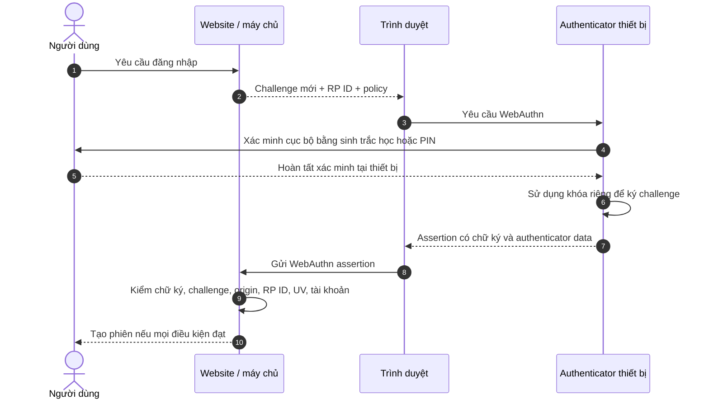

# Biometric credential — Thông tin xác thực sinh trắc học

> **Chương:** Credential  
> **Phạm vi:** Nền tảng bảo mật xác thực danh tính (`SECURITY_AUTHENTICATION_FUNDAMENTALS`), từ credential và MFA đến passkey, token/phiên, ranh giới tin cậy và khôi phục tài khoản.

## Mục tiêu học tập

Sau bài này, bạn có thể:

1. Giải thích **biometric credential** trong ngữ cảnh xác thực, phân biệt **mẫu sinh trắc học**, **biometric template**, **authenticator** và **credential mật mã**.
2. Phân tích quy trình đăng ký (enrollment), xác minh 1:1, đánh giá độ khớp và quyết định chấp nhận hoặc từ chối.
3. Phân biệt **mở khóa tại thiết bị bằng sinh trắc học** với **máy chủ trực tiếp so khớp dữ liệu sinh trắc học**; mô tả vai trò của passkey/WebAuthn.
4. Nhận biết những rủi ro như giả mạo mẫu, tấn công trình diện, chèn dữ liệu vào luồng, replay, lộ template, thiên lệch độ chính xác và lạm dụng khôi phục.
5. Lựa chọn các biện pháp bảo vệ phù hợp với ranh giới tin cậy, quyền riêng tư, trải nghiệm người dùng và yêu cầu assurance.

## 1. Biometric credential là gì?

**Biometrics (sinh trắc học)** dùng những đặc trưng sinh học hoặc hành vi của con người để hỗ trợ nhận diện hay xác minh. Ví dụ: vân tay, đặc điểm khuôn mặt, mống mắt và trong một số hệ thống là giọng nói hoặc cách tương tác với thiết bị.

Trong giao tiếp sản phẩm, cụm từ **biometric credential** đôi khi được dùng để chỉ “đăng nhập bằng vân tay/khuôn mặt”. Tuy nhiên, trong thiết kế bảo mật cần tách ít nhất bốn khái niệm:

| Khái niệm | Bản chất | Ví dụ |
| --- | --- | --- |
| **Biometric sample** — mẫu đầu vào | Dữ liệu thu tại một thời điểm từ cảm biến | Ảnh khuôn mặt, dấu vân tay vừa quét |
| **Biometric template** — bản mẫu tham chiếu | Dữ liệu đặc trưng được tạo để so khớp với mẫu mới | Biểu diễn đặc trưng vân tay lưu trên thiết bị |
| **Biometric matcher** — bộ so khớp | Thuật toán/chính sách đánh giá độ tương đồng giữa mẫu và template | Kiểm tra điểm khớp và ngưỡng chấp nhận |
| **Authenticator / credential dùng để đăng nhập** | Phương tiện và bằng chứng được bên xác thực tin cậy chấp nhận | Passkey với khóa riêng được mở bằng vân tay; hoặc kết quả sinh trắc học đã được bảo vệ theo giao thức |

**Một mẫu vân tay không tương đương mật khẩu.** Mật khẩu có thể thay khi lộ; đặc điểm sinh học của một người về cơ bản không thể “đổi” theo cách đó. Người dùng cũng có thể để lại dấu vân tay hoặc ảnh khuôn mặt trong đời sống, vì vậy dữ liệu sinh trắc học **không nên được đối xử như bí mật có thể thu hồi**.

Sinh trắc học thường trả lời câu hỏi **“mẫu hiện tại có đủ giống mẫu đã đăng ký không?”**. Nó không tự trả lời những câu hỏi khác:

- Người đăng ký ban đầu có thực sự là người sở hữu danh tính pháp lý được khai báo không?
- Cảm biến, môi trường thực thi và kết quả so khớp có đáng tin cậy không?
- Chủ thể có **được phép** thực hiện hành động mà ứng dụng yêu cầu không?
- Dữ liệu sinh trắc học được truyền hoặc lưu ở đâu? Ai có quyền sử dụng lại?

Đó là lý do phải đặt biometric credential trong **toàn bộ luồng xác thực**, cùng credential mật mã, phiên/token, phân quyền, quản trị tài khoản và khôi phục.

## 2. Các loại đặc trưng sinh trắc học và giới hạn

| Phương thức | Dữ liệu thường dùng | Ưu điểm | Thách thức / giới hạn |
| --- | --- | --- | --- |
| **Vân tay** | Các đặc điểm trên bề mặt ngón tay | Nhanh, phổ biến trên thiết bị cá nhân | Ngón tay ướt, mòn, bị thương; cảm biến và chống giả mạo khác nhau |
| **Khuôn mặt** | Đặc trưng hình học/ảnh khuôn mặt | Thao tác thuận tiện, có thể dùng cảm biến chuyên dụng | Ánh sáng, góc quay, thay đổi ngoại hình; ảnh/video giả và deepfake |
| **Mống mắt** | Đặc điểm kết cấu mống mắt | Tiềm năng phân biệt cao với cảm biến phù hợp | Thiết bị chuyên dụng, khoảng cách/góc nhìn và trải nghiệm |
| **Giọng nói** | Đặc trưng âm học và phát âm | Phù hợp một số luồng tương tác bằng tiếng nói | Tiếng ồn, bệnh lý, ghi âm phát lại hoặc tiếng nói tổng hợp |
| **Hành vi** | Nhịp gõ, cách cầm máy, chuyển động, mẫu tương tác | Có thể bổ sung tín hiệu liên tục | Thay đổi theo hoàn cảnh, khó diễn giải, có rủi ro riêng tư và sai lệch |

Không có phương thức nào luôn tốt nhất. Độ chính xác phụ thuộc **cảm biến, quy trình enrollment, ngưỡng so khớp, môi trường sử dụng, nhóm người dùng và các biện pháp chống tấn công**.

Một phương thức có thể tiện lợi cho mở khóa điện thoại nhưng không phù hợp làm bằng chứng duy nhất để duyệt chuyển tiền hoặc mở lại tài khoản có nguy cơ bị chiếm.

## 3. Enrollment, verification và identification

### 3.1. Đăng ký mẫu (enrollment)

Một quy trình đăng ký điển hình:

1. Xác lập tài khoản/ngữ cảnh đang được phép đăng ký sinh trắc học.
2. Thu một hoặc nhiều mẫu bằng cảm biến và phần mềm tin cậy.
3. Đánh giá chất lượng mẫu; khi cần, sử dụng cơ chế **presentation attack detection (PAD)** nhằm phát hiện trình diện giả.
4. Trích xuất template tham chiếu hoặc thiết lập phương tiện xác thực gắn với mẫu đã đăng ký.
5. Bảo vệ template, hạn chế truy cập và ràng buộc nó với đúng tài khoản hoặc thiết bị.
6. Ghi nhận sự kiện đăng ký, chính sách áp dụng và cách hủy/thay thế enrollment.

**Enrollment là thời điểm nhạy cảm.** Nếu kẻ tấn công đã chiếm phiên và tự đăng ký khuôn mặt hoặc vân tay của mình, các lần xác minh sinh trắc học sau đó có thể hoạt động hoàn toàn “đúng thuật toán” nhưng lại bảo vệ sai chủ thể. Việc thêm hoặc thay authenticator nên yêu cầu xác thực có mức bảo đảm thích hợp và thông báo theo chính sách.

### 3.2. Xác minh 1:1 (verification)

Người dùng khai báo một danh tính; hệ thống so sánh mẫu mới với **template của đúng danh tính đó**:

```text
subject = claimed_account
probe = capture_from_trusted_sensor()
reference = load_protected_template(subject)
score = biometric_matcher(probe, reference)

if sensor_and_pad_checks_pass and score meets policy_threshold:
    biometric_verification = PASS
else:
    biometric_verification = FAIL
```

Đây chỉ là **mã giả mô tả quy trình**, không phải thuật toán nhận dạng sinh trắc học có thể dùng trực tiếp. Kết quả `PASS` phải được liên kết với một **phiên xác minh, thiết bị và ngữ cảnh đáng tin**; một Boolean từ trình duyệt không đủ làm bằng chứng.

### 3.3. Nhận diện 1:N (identification)

Với nhận diện 1:N, hệ thống tìm template gần khớp nhất trong **nhiều danh tính** khi chưa biết người đang đứng trước cảm biến là ai. Đây là vấn đề khác với xác minh 1:1:

- Mẫu số lượng lớn có thể làm tăng số cơ hội xuất hiện khớp nhầm.
- Việc tìm kiếm trên kho sinh trắc học tập trung làm tăng rủi ro liên kết dữ liệu và theo dõi danh tính.
- Các quyết định 1:N cần tiêu chí kiểm thử và bảo vệ quyền riêng tư riêng; không được tự suy kết quả từ chỉ số 1:1.

Đối với đăng nhập tài khoản thông thường, khi đã biết người dùng muốn đăng nhập vào tài khoản nào, **xác minh 1:1 hoặc sử dụng khóa mật mã gắn với tài khoản** thường phù hợp hơn việc tìm kiếm danh tính trong toàn bộ cơ sở dữ liệu.

## 4. Hai kiến trúc rất khác nhau dưới nhãn “đăng nhập sinh trắc học”

### 4.1. Sinh trắc học chỉ mở khóa authenticator trên thiết bị

Trên thiết bị có passkey/WebAuthn, người dùng chạm vân tay hoặc xác minh khuôn mặt để **kích hoạt việc sử dụng khóa riêng**. Sau đó, authenticator tạo bằng chứng mật mã cho thử thách của website. Máy chủ kiểm tra **chữ ký và các ràng buộc của WebAuthn**, thay vì nhận và so khớp ảnh hoặc vân tay.



**Các điểm phải nhớ:**

- Khóa riêng dùng để ký **không cần rời authenticator** và máy chủ lưu khóa công khai liên kết với credential đã đăng ký.
- Website nhận kết quả xác minh WebAuthn và thông tin về việc **user verification (UV)** đã thỏa điều kiện; nó **không mặc nhiên biết người dùng đã dùng vân tay, khuôn mặt hay PIN**. `UV=true` không chứng minh riêng rằng biometric đã được sử dụng.
- Khả năng **chống phishing** chủ yếu đến từ ràng buộc mật mã với website hợp lệ (**RP ID/origin**) và challenge, **không phải** từ đặc điểm vân tay/khuôn mặt.
- Nếu người dùng hủy bước sinh trắc học nhưng hoàn thành bằng PIN hợp lệ và policy cho phép, WebAuthn vẫn có thể hoàn tất. Chính sách cần mô tả yêu cầu bảo đảm thực sự thay vì dựa vào lời quảng cáo “đăng nhập bằng khuôn mặt”.
- Passkey có thể gắn thiết bị hoặc được đồng bộ theo cơ chế của nhà cung cấp. Cách lưu trữ, phục hồi và kiểm soát tài khoản đồng bộ ảnh hưởng đến mô hình rủi ro.

Đây là cách sử dụng sinh trắc học rất hữu ích: **sinh trắc học ở ranh giới cục bộ; chữ ký mật mã ở ranh giới máy chủ**.

### 4.2. Máy chủ hoặc dịch vụ từ xa trực tiếp kiểm tra mẫu sinh trắc học

Một số hệ thống kiểm soát ra vào, định danh từ xa hoặc thiết bị chuyên dụng gửi dữ liệu hoặc đặc trưng sinh trắc học tới dịch vụ để so khớp. Khi đó, **hệ thống nhận dữ liệu sinh trắc học** phải bảo vệ cả quá trình thu mẫu, kênh truyền, tính xác thực của nguồn, template, điểm so khớp và các quyết định nghiệp vụ.

Lúc này ranh giới tin cậy phức tạp hơn:

- Có chắc dữ liệu đến từ **cảm biến/chương trình được tin cậy** mà không bị sửa trên client?
- PAD và kiểm tra tính nguyên vẹn của quá trình thu có chạy ở nơi khó bị thao túng không?
- Các mẫu có bị phát lại hoặc tái sử dụng cho yêu cầu khác không?
- Có cần thu và lưu ảnh/video gốc không, hay có thể giảm dữ liệu?
- Kết quả khớp được gắn với đúng `request_id`, tài khoản, khoảng thời gian và hành động không?
- Người dùng có thể yêu cầu xóa dữ liệu, rút lại sự đồng ý hoặc sử dụng một phương án thay thế theo quy định áp dụng không?

**Không nên sao chép sơ đồ passkey rồi giả định máy chủ sinh trắc học từ xa có tính chống phishing tương đương.** Hai kiến trúc truyền và tin những bằng chứng khác nhau.

## 5. Sinh trắc học có phải MFA không?

Ba nhóm yếu tố xác thực thường được nhắc đến:

| Nhóm yếu tố | Ý nghĩa | Ví dụ |
| --- | --- | --- |
| **Knowledge** | Điều người dùng biết | Mật khẩu, PIN |
| **Possession** | Điều người dùng sở hữu/kiểm soát | Authenticator giữ khóa riêng, khóa bảo mật phần cứng |
| **Inherence** | Đặc trưng của người dùng | Vân tay, đặc trưng khuôn mặt |

**MFA** đòi hỏi những yếu tố độc lập thuộc ít nhất hai nhóm, được xác minh theo một quy trình tin cậy. Sinh trắc học **chính nó** không mặc định là MFA.

Trong một passkey có **khóa riêng được thiết bị bảo vệ** và yêu cầu **user verification**, một luồng sử dụng sinh trắc học có thể cung cấp bằng chứng **possession + inherence**; khi người dùng thay bằng PIN, luồng có thể dựa trên **possession + knowledge**. Mức bảo đảm và cách phân loại thực tế còn tùy đặc tính authenticator, chính sách enrollment, bảo vệ khóa, sự độc lập của các yếu tố và tiêu chuẩn áp dụng.

Ví dụ không nên đánh đồng:

1. **Chỉ quét khuôn mặt vào app rồi app gửi `faceMatched=true`:** client có thể bị sửa, kết quả không đáng tin nếu không có cơ chế chứng minh độc lập.
2. **Vân tay mở khóa kho mật khẩu trên máy:** xác thực cục bộ để truy xuất dữ liệu, chưa chắc máy chủ nhận bằng chứng MFA.
3. **Passkey ký challenge sau xác minh cục bộ:** máy chủ nhận assertion mật mã và có thể kiểm tra `UV` theo policy.
4. **Mật khẩu + OTP SMS:** có thể là hai yếu tố, nhưng OTP và mật khẩu đều dễ bị phishing chuyển tiếp; cần đánh giá rủi ro tương ứng.

Đừng gắn nhãn “AAL cao”, “phishing-resistant MFA” hoặc “đã dùng biometric” chỉ từ việc giao diện có biểu tượng vân tay. Mức assurance phải căn cứ vào **bằng chứng được kiểm chứng**, vòng đời authenticator, điều kiện bảo vệ thiết bị và quy trình khôi phục.

## 6. Độ chính xác của biometric matcher: hiểu các chỉ số

Sinh trắc học sử dụng **so khớp mang tính xác suất**. Hai lần đo cùng người có thể khác nhau do cảm biến, ánh sáng, góc, chuyển động hoặc môi trường. Hệ thống thường so sánh **điểm khớp** với một **ngưỡng**:

```text
score = similarity(probe, reference_template)
if score >= threshold:
    result = MATCH
else:
    result = NO_MATCH
```

Tên, dấu so sánh và thang điểm thay đổi tùy thuật toán; có hệ thống dùng **distance** càng nhỏ càng tốt. Điều quan trọng là định nghĩa rõ **điều kiện chấp nhận**.

| Chỉ số | Diễn giải | Ý nghĩa khi vận hành |
| --- | --- | --- |
| **FMR — False Match Rate** | Tỷ lệ cặp mẫu từ **hai chủ thể khác nhau** bị matcher đánh giá là khớp trong tập kiểm thử | Liên quan rủi ro khớp sai của thuật toán |
| **FNMR — False Non-Match Rate** | Tỷ lệ cặp mẫu từ **cùng một chủ thể** bị matcher đánh giá là không khớp | Liên quan trải nghiệm người dùng hợp lệ |
| **FAR — False Acceptance Rate** | Tỷ lệ yêu cầu không hợp lệ bị **toàn hệ thống xác minh** chấp nhận trong kịch bản đo xác định | Phụ thuộc không chỉ matcher mà cả workflow, PAD và điều kiện thử |
| **FRR — False Rejection Rate** | Tỷ lệ yêu cầu hợp lệ bị toàn hệ thống từ chối trong kịch bản đo xác định | Ảnh hưởng hỗ trợ người dùng và lựa chọn phương thức dự phòng |
| **FTE — Failure to Enroll** | Tỷ lệ trường hợp không thể đăng ký mẫu theo quy trình | Có thể loại bỏ người dùng dù họ có quyền hợp lệ |
| **FTA — Failure to Acquire** | Tỷ lệ không thu được mẫu đủ điều kiện trong một lần thử | Gây lặp thao tác và timeout |

FMR/FNMR là chỉ số của **bộ so khớp theo điều kiện thí nghiệm**; FAR/FRR có thể thuộc **toàn hệ thống** và phải định nghĩa rõ đối tượng, số lần thử, điều kiện và phương pháp thử. Không nên dùng các thuật ngữ này lẫn nhau nếu báo cáo không chỉ rõ phạm vi.

### Đánh đổi theo ngưỡng

Giả sử một matcher dùng hai ngưỡng minh họa:

| Cấu hình giả định | FMR đo được | FNMR đo được | Hệ quả có thể thấy |
| --- | --- | --- | --- |
| Ngưỡng chấp nhận thấp hơn | 0,5% | 1% | Ít làm khó người dùng hơn nhưng dễ khớp nhầm hơn |
| Ngưỡng chấp nhận cao hơn | 0,05% | 5% | Giảm khớp nhầm nhưng nhiều người dùng thật bị từ chối hơn |

**Những số trên hoàn toàn giả định để hiểu hướng đánh đổi**, không phải mục tiêu tiêu chuẩn hay đánh giá một cảm biến cụ thể. Khi chọn ngưỡng, phải xét hậu quả khớp nhầm, số lần thử cho phép, PAD, nhóm người dùng, điều kiện thiết bị và khả năng khôi phục an toàn.

Đặc biệt:

- **Không suy ra xác suất bị chiếm tài khoản từ FMR một cách máy móc.** Một kẻ tấn công có thể chọn cách khác như chiếm phiên, phá enrollment hoặc lạm dụng recovery.
- **Không đánh giá chỉ bằng trung bình toàn bộ người dùng.** Độ chính xác có thể khác giữa cảm biến, điều kiện môi trường, lứa tuổi, đặc điểm sinh học, tình trạng khuyết tật hoặc các nhóm nhân khẩu.
- **Không lấy “tỷ lệ đăng nhập thất bại” làm FRR.** Log đăng nhập có thể chứa thử sai mật khẩu, bot, tài khoản bị disable và lỗi mạng.

### PAD và khả năng chống trình diện giả

**Presentation attack detection (PAD)** nhằm phát hiện một cách trình diện giả mạo lên cảm biến, chẳng hạn vật thể giả, ảnh, video hoặc tín hiệu không xuất phát từ chủ thể thực theo cách mong đợi. PAD **không đồng nghĩa** với chống mọi kiểu tấn công. Nó không tự ngăn sửa client, chèn dữ liệu sau cảm biến, chiếm quyền hệ điều hành, đánh cắp phiên hoặc gian lận ở account recovery.

Trong đánh giá PAD có thể gặp các nhóm chỉ số như **APCER** (tỷ lệ phân loại nhầm trình diện tấn công là bình thường) và **BPCER** (tỷ lệ phân loại nhầm trình diện bình thường thành tấn công). Các chỉ số phải được báo cáo **theo từng kiểu tấn công được thử và điều kiện kiểm thử**; chúng không bảo đảm hệ thống an toàn với mọi phương tiện giả mạo chưa được thử.

## 7. Ranh giới tin cậy và đe dọa bảo mật

Với sinh trắc học, câu hỏi cốt lõi không chỉ là “matcher có chính xác không?” mà còn là **“ai có thể tạo, thay đổi hoặc tái sử dụng bằng chứng mà verifier chấp nhận?”**

```mermaid
flowchart LR
    H["Người dùng / đặc trưng sinh học"] --> S["Cảm biến"]
    S --> M["Bộ xử lý và so khớp cục bộ"]
    M -->|"Kích hoạt sử dụng khóa"| K["Authenticator giữ khóa riêng"]
    K -->|"Chữ ký trên challenge"| RP["Máy chủ xác thực"]
    RP -->|"Phiên / token có giới hạn"| API["API tài nguyên"]
    API -->|"Kiểm tra quyền và trạng thái tài khoản"| DB[("Dữ liệu nghiệp vụ")]
```



Đây là **luồng ưu tiên cho passkey trên thiết bị**. Với kiến trúc xác minh sinh trắc học từ xa, dữ liệu đi từ cảm biến tới matcher phía máy chủ và phải bổ sung kiểm soát bảo mật kênh truyền, nguồn thu và kho template.

| Đe dọa | Hậu quả | Kiểm soát cần cân nhắc |
| --- | --- | --- |
| **Presentation attack / giả mạo trình diện** | Cảm biến xử lý ảnh, giọng nói hoặc đối tượng giả như người hợp lệ | PAD phù hợp, cảm biến đáng tin, giới hạn thử và MFA/chữ ký mật mã |
| **Injection / client tampering** | Kẻ tấn công thay dữ liệu hoặc gửi thẳng `match=true` | Không tin kết quả client; ràng buộc bằng chứng vào môi trường tin cậy và challenge đã xác minh |
| **Replay** | Sử dụng lại mẫu, thông điệp hoặc bằng chứng cũ | Challenge mới/chỉ dùng một lần, hạn thời gian, ràng buộc phiên/ngữ cảnh, chống dùng lại |
| **Template compromise** | Dữ liệu đặc trưng bị lộ và có thể bị lạm dụng lâu dài | Hạn chế thu thập, lưu cục bộ khi phù hợp, mã hóa và phân quyền, cơ chế bảo vệ template |
| **Cross-matching / tracking** | Liên kết cùng người qua nhiều hệ thống trái mục đích | Hạn chế chia sẻ, tách phạm vi sử dụng, giảm dữ liệu, chính sách riêng tư |
| **Enrollment takeover** | Kẻ khác thêm khuôn mặt/vân tay vào tài khoản | Xác thực tăng cường khi đăng ký/thay đổi, thông báo, audit, kiểm tra recovery |
| **Session/token theft** | Đăng nhập sinh trắc học đúng nhưng phiên về sau bị chiếm | Cookie an toàn, chống XSS/CSRF, TLS, giới hạn TTL, thu hồi và kiểm tra quyền |
| **Coercion / ép buộc** | Người hợp lệ bị buộc phải xác minh | Cơ chế bảo vệ và quy trình hỗ trợ theo mức rủi ro; sinh trắc học không giải quyết triệt để |
| **Bias / exclusion** | Người dùng bị từ chối không cân xứng hoặc không dùng được cảm biến | Đánh giá theo nhóm và điều kiện, phương án thay thế an toàn, kiểm tra khả năng tiếp cận |
| **Recovery bypass** | Đường hỗ trợ/khôi phục yếu giúp chiếm tài khoản bất chấp biometric mạnh | Xác minh người yêu cầu, chống giả mạo, kiểm soát thay authenticator và thông báo |

**Phishing:** Một trang giả có thể dụ người dùng cung cấp mật khẩu hoặc OTP. Với WebAuthn hợp lệ, máy chủ kiểm tra origin và RP ID giúp ngăn việc tạo một assertion dùng được cho website thật từ trang giả. **Bản thân khuôn mặt hoặc vân tay không mang tính ràng buộc với tên miền**; không gọi một hệ thống gửi ảnh mặt lên website là “phishing-resistant” chỉ vì nó yêu cầu quét mặt.

**Replay:** Nếu hệ thống chấp nhận ảnh hoặc template cũ như một “vé đăng nhập” mà không có kiểm tra ngữ cảnh mới, dữ liệu đã bị thu thập có thể được tái sử dụng. Với WebAuthn, verifier phát challenge mới; khóa riêng ký bằng chứng dành cho challenge và website đó.

**Abuse:** Giới hạn số lần thử, giám sát bất thường và khóa/chờ có điều kiện cũng cần thiết để ngăn thử nhiều mẫu hoặc làm quá tải sinh trắc học. Cơ chế này phải tránh gây ra **denial of service** cho người dùng hợp lệ và có kênh phục hồi an toàn.

## 8. Quyền riêng tư và bảo vệ template sinh trắc học

Biometric template là **dữ liệu nhạy cảm** vì có liên quan tới đặc trưng khó thay thế của một người. Một template không phải lúc nào cũng có thể tái tạo trực tiếp ảnh gốc, nhưng **không vì vậy mà mặc định vô hại**. Tùy thuật toán và bối cảnh, dữ liệu có thể hỗ trợ nhận dạng, liên kết hoặc các hình thức tấn công khác.

Các nguyên tắc thiết kế:

1. **Giảm thu thập:** Không yêu cầu ảnh gốc, video, âm thanh hoặc template nếu hệ thống chỉ cần kết quả chữ ký của một authenticator tại thiết bị.
2. **Giữ dữ liệu cục bộ khi khả thi:** Với passkey, để việc xác minh sinh trắc học diễn ra bên trong cơ chế bảo vệ của thiết bị và chỉ truyền assertion mật mã tới máy chủ.
3. **Giới hạn mục đích:** Không dùng lại dữ liệu đăng ký xác thực cho marketing, giám sát hoặc nhận dạng diện rộng nếu không có cơ sở sử dụng hợp lệ và được thông báo rõ.
4. **Bảo vệ lưu trữ:** Khi phải giữ template, dùng kiểm soát truy cập chặt, mã hóa phù hợp, phân tách tenant, giới hạn quyền quản trị và cân nhắc các kỹ thuật bảo vệ template theo nhu cầu.
5. **Kiểm soát vòng đời:** Xác định thời gian lưu giữ, cách xóa/ngừng sử dụng, yêu cầu của người dùng và phương án chuyển thiết bị.
6. **Tránh lộ qua log:** Không đưa mẫu, template, ảnh mặt, âm thanh, secret hoặc toàn bộ assertion/token vào nhật ký thông thường.
7. **Đánh giá quy định áp dụng:** Sinh trắc học có thể thuộc nhóm dữ liệu cá nhân nhạy cảm hoặc chịu chế độ xử lý đặc biệt tùy khu vực và mục đích. Cần kiểm tra căn cứ xử lý và yêu cầu bảo vệ liên quan.

**Không có phép “reset vân tay” tương tự reset mật khẩu.** Khi hệ thống mất quyền kiểm soát template, có thể thu hồi **credential/khóa/thiết bị và enrollment** liên quan, thay đổi cách xác minh hoặc ngừng chấp nhận template bị ảnh hưởng; điều đó không thay đổi đặc điểm sinh học của người dùng. Vì vậy, bảo vệ ngay từ khâu thiết kế tốt hơn dựa vào khả năng xoay vòng về sau.

## 9. Thiết kế đăng nhập an toàn bằng passkey và xác minh cục bộ

Khi bài toán là **đăng nhập ứng dụng web/mobile**, thường nên ưu tiên sử dụng cơ chế chuẩn như **WebAuthn/FIDO2** hoặc API nền tảng có đặc tính bảo vệ tương đương, thay vì tự xây matcher và thu dữ liệu sinh trắc học lên máy chủ.

### Đăng ký (registration)

1. Máy chủ xác định tài khoản đang có quyền đăng ký authenticator mới; với hành động nhạy cảm, có thể yêu cầu **reauthentication/step-up**.
2. Máy chủ cấp challenge ngẫu nhiên đủ mạnh và chỉ dùng một lần, kèm RP ID, cấu hình authenticator và chính sách user verification.
3. Trình duyệt/thiết bị thực hiện ceremony tạo credential; quá trình kiểm tra sinh trắc học hoặc PIN diễn ra cục bộ theo authenticator.
4. Máy chủ xác minh client data, challenge, RP ID, origin, kết quả ceremony và những chính sách áp dụng; lưu **credential ID và khóa công khai** gắn với user ID.
5. Ghi nhận sự kiện và thông báo đăng ký authenticator mới; hỗ trợ quản lý nhiều authenticator và thu hồi từng cái.

### Xác thực (authentication)

```text
beginPasskeyLogin(identifierOrDiscoverableFlow):
    challenge = createRandomSingleUseChallenge()
    storeChallengeForBoundLoginTransaction(challenge)
    return webauthnRequest(challenge, rpId, userVerification="required")

finishPasskeyLogin(assertion, loginTransaction):
    expected = takeUnexpiredChallengeExactlyOnce(loginTransaction)
    credential = resolveRegisteredCredential(assertion.credentialId)
    account = loadAccount(credential.accountId)

    if expected is absent or account.status != ACTIVE:
        return DENY

    verified = verifyWebAuthnAssertion(
        assertion,
        credential.publicKey,
        expected.challenge,
        expected.rpId,
        expected.allowedOrigins,
        requireUserPresence=true,
        requireUserVerification=true
    )
    if not verified:
        return DENY

    applyRiskAndSessionPolicy(account, verified)
    session = createServerSideSession(account.id)
    return secureSessionCookie(session)
```

**Đây là mã giả**: nên dùng thư viện WebAuthn đã được kiểm thử, không tự viết hệ thống xác minh chữ ký, phân tích định dạng binary hoặc xử lý attestation từ đầu. Cần ràng buộc challenge với giao dịch, xử lý đồng thời, chống replay, kiểm tra account ID, cấu hình đúng origin/RP ID và kiểm tra credential đã thu hồi. Quản lý sign counter cần hiểu giới hạn của authenticator đồng bộ; không coi counter đơn lẻ là phép chứng minh tuyệt đối rằng khóa riêng chưa bị sao chép.

Những điểm cần kiểm chứng thêm ở tầng ứng dụng:

- **Trạng thái tài khoản:** Account đã `DISABLED` không được cấp phiên mới dù assertion đúng.
- **Phân quyền:** User đăng nhập thành công không mặc định được thực hiện thao tác nhạy cảm; API phải kiểm tra quyền riêng.
- **Phiên/token:** Dùng cookie an toàn hoặc token với giới hạn thời gian/phạm vi thích hợp; đánh cắp phiên vẫn là rủi ro sau xác thực.
- **Độ mới của xác thực:** Chuyển tiền, đổi authenticator hoặc thay phương thức recovery có thể đòi hỏi user verification gần thời điểm hành động.
- **Thông báo và audit:** Ghi phương thức/bằng chứng đã kiểm chứng, nhưng không lưu dữ liệu sinh trắc học hoặc secret.

### Những điều máy chủ **không thể kết luận** từ WebAuthn

| Tín hiệu | Có thể kết luận | Không thể tự kết luận |
| --- | --- | --- |
| Chữ ký hợp lệ trên challenge | Authenticator giữ khóa riêng tương ứng đã ký bằng chứng | Người thao tác có danh tính pháp lý nào ngoài thông tin account đã đăng ký |
| `UV=true` đã được xác minh | Authenticator báo có kiểm tra người dùng theo cơ chế của nó | Người dùng chắc chắn đã quét vân tay, không phải nhập PIN |
| Origin và RP ID hợp lệ | Assertion phù hợp website được cấp credential | Thiết bị không hề có mã độc hoặc phiên không thể bị chiếm |
| Account đang active | Tài khoản được phép đăng nhập theo vòng đời ứng dụng | Tài khoản có quyền đọc mọi dữ liệu hoặc duyệt mọi giao dịch |

## 10. Vòng đời sinh trắc học: thiết bị, thay đổi và khôi phục

Đăng ký sinh trắc học không kết thúc ở lần quét đầu tiên. Cần thiết kế cả vòng đời:

| Sự kiện | Câu hỏi phải xử lý |
| --- | --- |
| **Người dùng thêm một thiết bị** | Ai xác minh quyền thêm authenticator? Có thông báo và log? |
| **Mất điện thoại/khóa bảo mật** | Thu hồi credential hoặc phiên nào? Có khóa dự phòng/passkey đồng bộ không? |
| **Cảm biến không sử dụng được** | Có phương án PIN hoặc authenticator khác đủ an toàn và khả dụng không? |
| **Enrollment thay đổi** | Khi hệ điều hành thêm sinh trắc học mới, credential có bị ảnh hưởng không? Điều này tùy cơ chế và nền tảng |
| **Đổi mật khẩu, mất quyền email** | Có thể bỏ qua MFA/passkey bằng recovery yếu không? |
| **Account disabling** | Máy chủ còn chấp nhận passkey của tài khoản đã vô hiệu hóa không? Phiên/token cũ đã bị thu hồi chưa? |
| **Credential nghi bị lộ** | Có thể thu hồi khóa, đăng ký lại bằng chứng mới và điều tra thay đổi quyền không? |
| **Người dùng muốn ngừng sử dụng biometric** | Có cách xóa đăng ký/không dùng biometric và vẫn truy cập dịch vụ phù hợp không? |

Nếu khôi phục tài khoản chỉ cần một email hoặc cuộc gọi dễ giả mạo, bảo vệ bằng passkey có thể bị đi vòng. Quy trình recovery phải đánh giá người yêu cầu theo mức rủi ro, chống dò tài khoản, giới hạn thử sai, thông báo thay đổi và không tự động kích hoạt tài khoản đã disabled.

**Trường hợp đặc biệt: thiết bị dùng chung.** Nếu nhiều người đã đăng ký vân tay/khuôn mặt trên cùng thiết bị, xác minh cục bộ có thể chứng minh **một người được thiết bị cho phép** đã mở khóa authenticator, chưa chắc đúng cá nhân mà doanh nghiệp muốn định danh. Cần đánh giá chính sách thiết bị, bảo vệ khóa và ràng buộc danh tính trước khi dựa vào nó cho giao dịch có trách nhiệm pháp lý cao.

## 11. Tình huống thiết kế: cổng quản trị có xác thực khuôn mặt

Một nền tảng quản trị đơn hàng đang cân nhắc hai giải pháp:

- **Phương án A:** Trang web bật webcam, gửi ảnh khuôn mặt tới API để so khớp với template trong database, rồi cấp JWT nếu API trả `matched`.
- **Phương án B:** Trang web dùng passkey/WebAuthn. Thiết bị yêu cầu user verification cục bộ (có thể bằng khuôn mặt, vân tay hoặc PIN), rồi trả assertion có chữ ký để máy chủ kiểm tra.

Nhóm vận hành muốn bảo vệ thao tác **duyệt hoàn tiền lớn**, cho nhân viên dùng thiết bị khác khi mất điện thoại và chặn ngay tài khoản khi phát hiện lạm dụng.

### So sánh quyết định kiến trúc

| Tiêu chí | Phương án A: So khớp ảnh từ xa | Phương án B: Passkey/WebAuthn |
| --- | --- | --- |
| **Dữ liệu đi qua máy chủ** | Ảnh/đặc trưng sinh trắc học và kết quả so khớp | Assertion chữ ký, credential ID và thông tin giao thức |
| **Kho dữ liệu nhạy cảm** | Cần bảo vệ template và có thể cả dữ liệu đầu vào | Lưu khóa công khai/credential metadata; dữ liệu biometric thường ở thiết bị |
| **Kháng phishing** | Không tự có chỉ vì so khớp ảnh | Có ràng buộc RP ID/origin trong protocol |
| **Kháng replay/injection** | Cần tự thiết kế bảo vệ capture, PAD, challenge và đường client–server | Challenge và chữ ký mật mã được chuẩn hóa; vẫn phải kiểm tra đúng |
| **Mất thiết bị** | Phụ thuộc cơ chế thu lại mẫu và xác minh người dùng | Có thể dùng passkey dự phòng/đồng bộ hoặc recovery bảo đảm phù hợp |
| **Tác động vận hành** | Quản lý dữ liệu biometric nhạy cảm và chất lượng matcher | Quản lý credential, nguồn gốc, phiên, vòng đời authenticator |

Trong **bài toán đăng nhập web phổ biến**, phương án B thường giảm nhu cầu lưu dữ liệu sinh trắc học tập trung và cung cấp cơ sở chống phishing tốt hơn. Tuy nhiên, lựa chọn cuối cùng phải tính đến thiết bị được hỗ trợ, chính sách doanh nghiệp, phương án dự phòng và mức assurance cần đạt.

### Luồng kiểm soát gợi ý

1. Nhân viên đăng ký passkey sau khi được cấp tài khoản và kiểm tra quyền đăng ký authenticator.
2. Khi đăng nhập, máy chủ kiểm tra chữ ký, challenge, RP ID/origin, user verification và trạng thái tài khoản, sau đó tạo phiên có thời hạn.
3. Khi yêu cầu hoàn tiền lớn, API kiểm tra **quyền của nhân viên trên giao dịch cụ thể** và độ mới của lần xác thực; nếu chưa đạt, yêu cầu step-up với authenticator phù hợp.
4. Nếu có dấu hiệu session hijacking, hệ thống có thể chặn hoặc yêu cầu xác minh lại ngoài ngữ cảnh phiên nghi bị chiếm, đồng thời thu hồi token/phiên.
5. Nếu mất thiết bị, nhân viên dùng authenticator dự phòng hoặc quy trình khôi phục có thẩm quyền; việc thêm passkey mới tạo audit và thông báo.
6. Nếu tài khoản bị vô hiệu hóa, **mọi access token, refresh token và phiên** phải bị chặn theo chính sách thu hồi đã thiết kế, bất kể biometric trên thiết bị vẫn còn hoạt động.

### Ví dụ lỗi kiến trúc cần tìm

Frontend hiển thị “Xác thực khuôn mặt thành công”, rồi gửi:

```json
{
  "accountId": "employee-42",
  "faceMatched": true,
  "approveRefund": true
}
```

Nếu API tin thẳng các trường này, kẻ tấn công có thể sửa request. **`faceMatched` do client gửi không chứng minh bất kỳ bằng chứng sinh trắc học nào.** Dịch vụ phải xác minh bằng chứng đã được tạo trong một quy trình tin cậy và tách **authentication** khỏi quyết định **authorization** đối với hoàn tiền.

## 12. Kiểm thử và đo hiệu quả triển khai

Một hệ thống sử dụng biometric credential cần kết hợp **đo chất lượng xác minh** với **đo việc thực thi chính sách**:

| Nhóm kiểm thử | Ví dụ câu hỏi xác minh |
| --- | --- |
| **Đăng ký** | Người không có quyền có thể thêm biometric hoặc passkey vào tài khoản khác không? |
| **Biometric matching** | FMR, FNMR, FTE, FTA trong điều kiện và nhóm người dùng phù hợp ra sao? |
| **PAD / sensor** | Những kiểu trình diện giả đã được kiểm thử? Cách báo cáo lỗi và xử lý mẫu chất lượng thấp? |
| **Client trust boundary** | Client tự gửi `matched=true` có bị từ chối không? Có kiểm chứng bằng chứng ở server không? |
| **Replay/phishing** | Challenge cũ, origin/RP ID sai, chữ ký sai có bị từ chối không? |
| **Session/token** | Sau xác thực, token hết hạn, bị thu hồi, sai audience hoặc account disabled có bị chặn không? |
| **Recovery** | Người không có authenticator có thể đi qua một đường fallback yếu để chiếm tài khoản không? |
| **Khả năng tiếp cận** | Người dùng không thể dùng vân tay hoặc khuôn mặt có phương thức thay thế an toàn không? |
| **Quyền riêng tư** | Có dữ liệu biometric ngoài mục đích trong log, analytics, bản sao lưu hoặc nơi lưu trữ không? |

Các chỉ số vận hành có thể theo dõi **tỷ lệ enrollment thành công**, **tỷ lệ xác minh hợp lệ bị từ chối**, **tỷ lệ hoàn tất bằng phương thức dự phòng**, **thời gian xác thực**, **sự kiện thêm/xóa authenticator**, **số yêu cầu step-up bị hủy**, **số vụ chiếm tài khoản được xác nhận** và **mức độ tuân thủ chính sách cho thao tác nhạy cảm**.

Lưu ý: Tỷ lệ đăng nhập bằng “biometric” được gắn nhãn bởi giao diện có thể không chính xác, vì **UV trên thiết bị có thể được đáp ứng bằng PIN**. Báo cáo phải dựa trên event đáng tin từ authenticator, verifier hoặc policy engine và ghi rõ **hệ thống có thể chứng minh được điều gì**.

## 13. Checklist trước khi triển khai

- **Mục đích:** Hệ thống cần mở khóa cục bộ, xác minh 1:1 hay nhận diện 1:N? Có thật sự cần giữ dữ liệu sinh trắc học trên máy chủ không?
- **Kiến trúc:** Sinh trắc học dùng để kích hoạt khóa mật mã hay matcher từ xa quyết định đăng nhập? Bằng chứng nào tới verifier?
- **Enrollment:** Ai có quyền thêm/thay biometric hoặc passkey, việc ràng buộc với account có an toàn không?
- **Trust boundary:** Có kiểm tra nguồn gốc, challenge, chữ ký và ngữ cảnh ở phía tin cậy thay vì đọc `match=true` từ client không?
- **Assurance:** Có phân biệt biometric, MFA, passkey, user verification, phishing resistance và freshness không?
- **Rủi ro:** Đã tính PAD, spoof, replay, injection, lộ template, session hijacking và recovery abuse chưa?
- **Độ chính xác:** Có FMR/FNMR/FTE/FTA theo điều kiện và quần thể phù hợp? Có phương án cho người không thể dùng cảm biến không?
- **Quyền riêng tư:** Thu thập tối thiểu, bảo vệ template, lưu giữ/xóa có mục đích và tránh log dữ liệu nhạy cảm chưa?
- **Phiên và quyền:** API kiểm tra session/token, trạng thái account, quyền trên tài nguyên và step-up với thao tác nhạy cảm không?
- **Vòng đời:** Có thu hồi authenticator, thay thiết bị, khóa tài khoản, phương án recovery và khả năng kích hoạt lại có kiểm soát không?
- **Đo lường:** Có dữ liệu đáng tin để đánh giá false acceptance/rejection, tỷ lệ bypass, lỗi recovery và trải nghiệm người dùng không?

### Câu hỏi ôn tập

1. Biometric sample và biometric template khác nhau ở đâu? Vì sao không nên coi template như mật khẩu có thể đổi khi lộ?
2. Trong một luồng WebAuthn, máy chủ nhận dữ liệu vân tay hay nhận bằng chứng nào?
3. Tại sao `UV=true` không chứng minh chắc chắn rằng người dùng đã dùng vân tay thay vì PIN?
4. Biometric verification 1:1 khác với biometric identification 1:N như thế nào?
5. Nếu tăng ngưỡng so khớp, FMR và FNMR thường thay đổi theo hướng nào, và vì sao cần đánh giá người dùng hợp lệ?
6. PAD có ngăn được việc ứng dụng khách tự gửi `faceMatched=true` không? Cần bổ sung ranh giới tin cậy nào?
7. Vì sao passkey chống phishing tốt hơn một trang web chỉ yêu cầu gửi ảnh khuôn mặt?
8. Một nhân viên đã đăng nhập bằng passkey nhưng tài khoản vừa bị disabled. API có nên cho phép request với JWT cũ còn hạn không?
9. Một hệ thống cho phép khôi phục tài khoản bằng câu hỏi bảo mật yếu sẽ ảnh hưởng gì tới assurance của passkey?

## Kết luận

**Biometric credential** là một chủ đề rộng hơn thao tác “chạm vân tay để đăng nhập”. Sinh trắc học giúp xác minh đặc trưng người dùng nhưng có sai số, rủi ro giả mạo, nguy cơ lộ dữ liệu khó thay thế và những yêu cầu riêng về quyền riêng tư. Khi được dùng để **mở khóa authenticator giữ khóa riêng**, như nhiều luồng passkey/WebAuthn, hệ thống có thể giữ dữ liệu sinh trắc học trên thiết bị và gửi tới máy chủ **bằng chứng mật mã có ràng buộc challenge và website**. Bảo đảm an toàn thực tế vẫn phụ thuộc enrollment, ranh giới tin cậy, chống phishing/replay, phiên/token, phân quyền, vô hiệu hóa tài khoản và khôi phục. Một thiết kế tốt kiểm tra **đúng bằng chứng tại đúng nơi**, hạn chế tối đa thu thập sinh trắc học và luôn có phương án thay thế an toàn cho người dùng.
